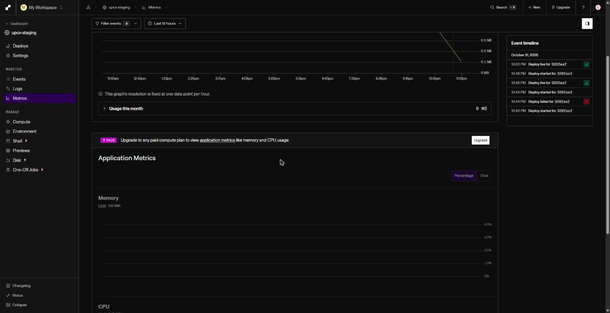
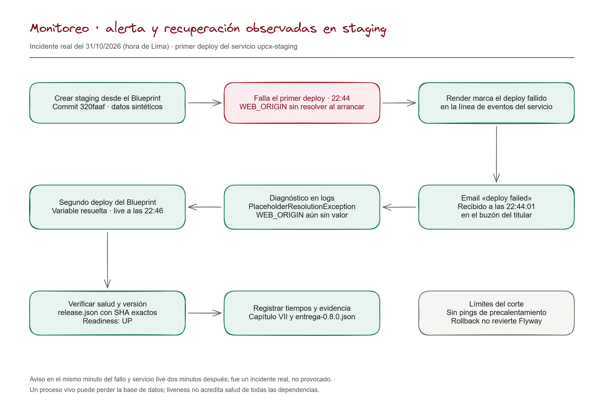

  

<h2 style="text-align: center;"> Universidad Peruana de Ciencias Aplicadas </h2>

<h4 style="text-align: center"> Ingeniería de Software </h4>

<h4 style="text-align: center"> Periodo: 202620 </h4>

<h4 style="text-align: center"> 1ASI0732 | Diseño de Experimentos de Ingeniería de Software </h4>

<h4 style="text-align: center"> NRC: 9082 </h4>

<h4 style="text-align: center"> Docente: Juan Fernando Ysen Paiba </h4>

<h3 style="text-align: center;"> Informe del Trabajo Final </h3>

<h4 style="text-align: center"> Startup: RichStudent</h4>

<h4 style="text-align: center"> Producto: UPC-X</h4>

<h4 style="text-align: center">Integrantes:</h4>

   <table style="margin-left: auto; margin-right: auto;">
      <tr>
         <td>u202312109</td>
         <td>Eduardo Jose Cossar Sanchez</td>
      </tr>
      <tr>
         <td>u202322187</td>
         <td>Gilbert Alonso Huarcaya Matias</td>
      </tr>
      <tr>
         <td>u201821684</td>
         <td>Luis Manuel Espinoza Navarrete</td>
      </tr>
      <tr>
         <td>U20221G231</td>
         <td>Manuel Alejandro Molina Vásquez</td>
      </tr>
      <tr>
         <td>U202022211</td>
         <td>Mathias Javier Murillo</td>
      </tr>
   </table>

 

<h5 style="text-align: center; font-style: italic;"> Noviembre de 2026 </h5>

# Capítulo VII: DevOps Practices

La automatización está integrada en `main` y documentada en el [runbook de entrega y operación vigente](https://github.com/UPC-X/upcx-api/blob/main/docs/release-runbook.md). El 31/10/2026 (hora de Lima; 1/11 en UTC) se ejecutó por primera vez la entrega completa del corte 0.8.0:

- candidato integrado de tres SHA;
- servicio staging creado y promovido con recibo;
- aceptación por API con datos sintéticos;
- ensayo de respaldo y restauración;
- distribución Android QA;
- promoción a producción del mismo candidato.

Dos intentos se detuvieron en sus controles y se corrigieron por PR sin relajar los gates. Autodeploy sigue desactivado en todos los servicios. El registro de entrega (Anexo F) reúne runs, recibos, deploys y tiempos; el estado de activación (Anexo F) conserva la preparación previa de Neon, R2, Resend y Firebase.

| Sección | Estado acreditado al 31/10 | Pendiente |
|---|---|---|
| 7.1. Continuous Integration | Checks por repositorio y [candidato integrado](https://github.com/UPC-X/upcx-api/actions/runs/41265231185) con `candidate.json` descargable. El primer intento, detenido por CORS, se corrigió por PR. | Revisión de cada PR por otro integrante antes de integrar. |
| 7.2. Continuous Delivery | `upcx-staging` creado desde su Blueprint y [promovido con recibo](https://github.com/UPC-X/upcx-api/actions/runs/41270614291). APK QA 1.0.0-qa (2) [distribuido por Firebase](https://github.com/UPC-X/upcx-api/actions/runs/41272672709) con autenticación WIF. | Nueva distribución QA con las correcciones del 1/11 y aceptación con participantes; aceptación en navegador con OTP real. El OTP y recorridos controlados del APK distribuido ya se comprobaron en Samsung. |
| 7.3. Continuous deployment | Respaldo y restauración ensayados en staging. Rama Neon de respaldo antes de [promover a producción](https://github.com/UPC-X/upcx-api/actions/runs/41273661782) el mismo candidato, con recibo y tags `v0.8.0`. | Volcado cifrado de producción y copia de medios R2 fuera del proveedor. |
| 7.4. Continuous Monitoring | Fallo real del primer deploy de staging: aviso por email en el mismo minuto, diagnóstico en logs y servicio live dos minutos después. Línea de eventos y ancho de banda en el panel. | CPU/RAM no disponibles en el panel Free observado; telemetría de aplicación pendiente de implementar. |

## 7.1. Continuous Integration

El corte del 26/10 obtuvo checks remotos aprobados en [API](https://github.com/UPC-X/upcx-api/actions/runs/40447376831), [web](https://github.com/UPC-X/upcx-web/actions/runs/40414073004) y [Android](https://github.com/UPC-X/upcx-mobile/actions/runs/40415572906). En esas ejecuciones, la web rápida de CI aprobó 212 escenarios y omitió los 18 live de forma explícita; la corrida local con API real aprobó los 230 sin omisiones. API aprobó verify, catorce pruebas Python, contrato de 52 operaciones y smokes. El avance del 27/10 registra por separado 216 pruebas Java, 18 Python y, tras la revisión del catálogo, 333 unitarias web y 220 E2E empaquetadas sin reintentos en el registro de activación (Anexo F). Hasta el reinicio de la cuota de Actions del 1/11 (UTC), las cargas auxiliares se rechazaban, con avisos visibles. Después del reinicio, el integrador publicó `candidate.json` y los recibos se cargaron sin rechazo. Esos artefactos descargables, y no los checks individuales, son los que habilitan una promoción.

### 7.1.1. Tools and Practices

GitHub Actions conserva checks por repositorio: Maven/PostgreSQL/Mailpit/contrato en API, Prettier/Vitest/TypeScript/build/Playwright en web y formato/análisis/pruebas/build en Flutter. Java 21, PostgreSQL 17, Node desde `.nvmrc` y Flutter desde `.flutter-version` fijan el entorno. Se usan permisos mínimos; CI local/aislado no necesita credenciales de producción. Los cambios se revisan antes de integrar y los reportes diferencian pruebas ejecutadas, fallidas y omitidas.

**Benchmark de alternativas para el pipeline.** La selección parte de criterios del propio proyecto: presupuesto de US$0, repositorios ya alojados en GitHub, tres productos (API Java, web y Flutter) y un equipo pequeño que necesita mantener poco. La valoración va de 1 (cumple poco) a 3 (cumple bien) y resume las restricciones ya documentadas en este capítulo; no es una medición de rendimiento entre herramientas.

| Etapa | Alternativa | Costo con presupuesto US$0 | Integración con los repositorios | Mantenimiento para el equipo | Total | Decisión |
|---|---|---|---|---|---|---|
| Integración (7.1) | **GitHub Actions** | 3: incluido, con una cuota que se agotó y reinició | 3: nativa en los tres repositorios | 3: sin servidor propio | **9** | Elegida |
| Integración (7.1) | GitLab CI | 3: nivel gratuito | 1: exigiría migrar o espejar los repositorios | 2 | 6 | Descartada |
| Integración (7.1) | Jenkins | 2: software libre, pero requiere un servidor | 2: por webhooks | 1: instalación y actualización propias | 5 | Descartada |
| Entrega móvil (7.2) | **Firebase App Distribution** | 3: sin costo | 3: acción de GitHub con Workload Identity Federation, sin claves | 3 | **9** | Elegida |
| Entrega móvil (7.2) | Prueba interna de Google Play | 2: requiere cuenta de desarrollador | 2 | 1: revisión y publicación de la tienda | 5 | Descartada para QA |
| Entrega móvil (7.2) | APK compartido a mano | 3 | 1: sin trazabilidad al candidato | 1 | 5 | Descartada |
| Despliegue (7.3) | **Render, plan gratuito** | 3: sin costo, con arranque en frío | 3: despliegue por API desde el workflow | 3 | **9** | Elegida |
| Despliegue (7.3) | Servidor propio o VPS | 1: costo mensual | 2 | 1: administración del sistema | 4 | Descartada |
| Monitoreo (7.4) | **Panel y logs de Render, health de Spring y estados de Actions** | 3: sin costo | 3 | 3 | **9** | Elegida como mínimo gratuito |
| Monitoreo (7.4) | Plataforma de observabilidad externa | 1: planes de pago para retención y alertas | 2 | 1: instrumentación adicional | 4 | Fuera del alcance por costo |

La alternativa elegida en cada etapa es la que mejor cumple las tres restricciones a la vez. El costo es la limitación principal: por eso el monitoreo no ofrece percentiles nativos de latencia ni telemetría de CPU y memoria, como se explica en 7.4.1.

### 7.1.2. Build & Test Suite Pipeline Components

`integration.yml`, activado con `workflow_dispatch`, exige tres SHA completos e inmutables para API, web y móvil. Obtiene esos commits, prepara servicios descartables, ejecuta verificaciones y build de los tres productos, smokes de API, cliente Dart real y Playwright con `UPCX_LIVE_API=1`. Después de todos los checks publica `candidate.json` con contrato, repositorios/SHA, digest, run ID e intento. No sella un candidato si falla una etapa. El handoff privado vive temporalmente en el runner y no se sube; los reportes auxiliares duran siete días y el candidato y los recibos obligatorios, treinta días.

**Estado al 31/10:** el primer run multirrepositorio exitoso es el [41265231185](https://github.com/UPC-X/upcx-api/actions/runs/41265231185), lanzado desde `main` con API `320faaf`, web `daa71ec` y móvil `3872885`. Todas sus etapas pasaron y publicó `candidate.json` con contrato 0.8.0 y digest `475ee33b…`; el artefacto se descargó y validó antes de promover. El intento anterior, [41263112116](https://github.com/UPC-X/upcx-api/actions/runs/41263112116), no selló candidato porque falló `mvnw verify` (6.1.4). La corrección se integró por el [PR #34](https://github.com/UPC-X/upcx-api/pull/34) a `develop` y el [PR #35](https://github.com/UPC-X/upcx-api/pull/35) a `main`. Esperar el reinicio de la cuota permitió ejecutarlo sin modificar el presupuesto de US$0.

El diagrama representa el flujo implementado con la evidencia del 31/10:
- **azul:** automatización definida;
- **verde:** etapas ejecutadas con run, recibo o registro;
- **rojo:** la rama que detiene la entrega cuando no hay candidato, como en el primer intento;
- **amarillo:** lo que sigue pendiente.

La aceptación y el ensayo de respaldo/restauración son requisitos operativos: se ejecutaron por separado y no se deducen de los gates automáticos. El disparador automático de staging permanece desactivado.

*Figura 7.1. Pipeline de integración, entrega y promoción del mismo candidato, elaborado en Excalidraw.*

Los tests de `test_release_control.py` simulan respuestas de proveedores y comprueban el rechazo de workflows fallidos o ajenos, intentos distintos y recibos de otro candidato. `test_production_cannot_promote_another_candidate` relaciona ese control con la rama de promoción del diagrama. El [código del controlador y sus tests](https://github.com/UPC-X/upcx-api/blob/4d1446bd50d21e8ad717fb558e19e8d2abf71931/scripts/test_release_control.py) no realiza despliegues al ejecutar estas pruebas simuladas.

## 7.2. Continuous Delivery

### 7.2.1. Tools and Practices

El titular creó Firebase `upc-x-4aaaa`, aportó su App ID y ejecutó el alta de identidad federada en Cloud Shell. Provider y cuenta de servicio están registrados como variables de Actions, y la distribución del 31/10 comprobó la autenticación efectiva por Workload Identity Federation, sin claves de cuenta de servicio. Los secretos de firma QA están en Actions y la clave estable se custodia con acceso local restringido. El APK release firmado del 26/10 se conserva como evidencia histórica y no es distribuible: apunta al hostname staging retirado. El workflow reconstruyó el SHA móvil del candidato con el origen HTTPS del servicio staging después de verificar su recibo, según la guía `upcx-api/docs/staging-bootstrap.md` y el runbook de entrega de la API. La revisión física anterior por USB usó una compilación profile y API local; no equivale a la distribución Firebase.

Los secretos `STAGING_RENDER_API_KEY`, `PRODUCTION_RENDER_API_KEY` y `REPOS_READ_TOKEN` están guardados en GitHub, y `upcx-qa-testers` está registrado en `QA_FIREBASE_TESTER_GROUP`. El [preflight desde main del 27/10](https://github.com/UPC-X/upcx-api/actions/runs/40521137770) aprobó acceso a contenidos de web/móvil y consulta de los dos servicios Render de producción, sin crear recursos ni desplegar; ambos tenían autodeploy Off. Ese día el panel Firebase mostraba la aplicación QA y el grupo con un verificador, sin versiones distribuidas. El registro inicial de accesos (Anexo E, E.6) se conserva con su fecha. El registro de activación (Anexo F) documenta la preparación, y el registro de entrega (Anexo F), los runs del 31/10.

Se separan CI, staging y producción. Staging usa un único contenedor Free con web compilada y API en el mismo origen, sin dominios personalizados; conserva base/rol y bucket propios con datos sintéticos. Los archivos `deploy/render.staging.yaml` y `deploy/render.production.example.yaml` describen recursos y configuración. El primero creó `upcx-staging` el 31/10 como Blueprint propio. El segundo se adopta sobre los servicios existentes para no duplicar producción. En staging `/config.json` usa `apiBase` vacío para el mismo origen; Spring sirve rutas SPA y conserva errores API/health. Producción sigue usando web estática con origen HTTPS explícito. Los secretos permanecen en Render/GitHub y no en el artefacto estático. Para GitHub Free privado se usan secrets/variables de repositorio con prefijos `STAGING_`, `PRODUCTION_` y `QA_`; no se requieren environments ni reviewers protegidos de pago. El dispatch de promoción/distribución se limita a `main`; staging dispone además de un disparador automático desde un candidato exitoso de `main`, condicionado por `STAGING_AUTO_DEPLOY_ENABLED=true`, que aún no se ha activado; los permisos de escritura y la revisión humana se gestionan por el titular, con su evidencia separada.

### 7.2.2. Stages Deployment Pipeline Components

`deploy.yml` recibe el run ID candidato por dispatch o, solo para staging, por `workflow_run` del integrador exitoso de `main` cuando se habilita la variable indicada. Verifica con GitHub que el workflow esperado terminó exitosamente y que el artefacto corresponde a su intento. Para staging fija el SHA web exacto, despliega el `commitId` API en un único servicio Free sin dominios personalizados y espera `live`. Comprueba readiness, configuración same-origin y `/release.json` con ambos SHA empaquetados. El recibo schema 2 identifica ese único deploy y el origen HTTPS real. El acceso de build al repositorio privado usa un secreto BuildKit preparado antes de importar el Blueprint; su modo de preparación no despliega ni acredita aceptación. Publica el recibo staging únicamente tras pasar esas verificaciones. Ese recibo prueba el despliegue técnico del candidato y no equivale a revisión humana, auditoría UX o aceptación de participantes. Rechaza servicios con autodeploy activo para evitar que un commit no probado sustituya al candidato.

**Ejecución del 31/10:**

1. El modo restringido de `deploy.yml` ([run 41266769066](https://github.com/UPC-X/upcx-api/actions/runs/41266769066)) preparó el grupo de entorno `upcx-staging-build` con la credencial de lectura para el build, sin desplegar.
2. Se importó el Blueprint desde `main` con la ruta `deploy/render.staging.yaml`. Dejarla vacía habría tomado el `render.yaml` raíz, que describe producción. La vista previa mostró solo `upcx-staging`, Free y sin dominios.
3. Render lanzó el primer deploy al crear el servicio, aunque autodeploy estaba en Off; ese deploy falló y se analiza en 7.4.3.
4. Se registraron el ID real del servicio en `STAGING_RENDER_SERVICE_ID` y su origen en `QA_API_ORIGIN`.
5. La promoción ([run 41270614291](https://github.com/UPC-X/upcx-api/actions/runs/41270614291)) desplegó el commit `320faaf` y publicó el recibo schema 2 (`single-service`, deploy `dep-dbjbd3bbc2fs73cb94o0`).
6. En vivo se comprobaron `/release.json` con los SHA exactos, `/config.json` con `apiBase` vacío, OpenAPI 0.8.0 con 52 operaciones y Flyway 13 de 13.

Android QA usa package separado `.qa`, nombre distinguible, origen HTTPS y firma estable custodiada por el titular. `distribute-android.yml` exige candidato exitoso y recibo staging del mismo corte, compila ese SHA móvil y distribuye APK firmado a un grupo Firebase consentido, mediante ADC/Workload Identity Federation. El 31/10, el [run 41272672709](https://github.com/UPC-X/upcx-api/actions/runs/41272672709) compiló el SHA móvil `3872885` contra `https://upcx-staging.onrender.com` y firmó el APK (59,1 MB). Luego distribuyó la versión 1.0.0-qa (2) al grupo `upcx-qa-testers`, cuyo único verificador es el titular; Firebase le envió la invitación en el mismo minuto. Un intento previo ([run 41271394372](https://github.com/UPC-X/upcx-api/actions/runs/41271394372)) se detuvo al leer el recibo: el paso compila dentro de `mobile/` y buscaba el archivo con una ruta relativa a la raíz. La corrección pasó por los [PR #36](https://github.com/UPC-X/upcx-api/pull/36) y [#37](https://github.com/UPC-X/upcx-api/pull/37) y no cambió candidato ni recibo. El 1/11 el verificador confirmó que descargó la versión desde Firebase, la instaló y pudo abrir UPC-X QA. Confirmó que lo hizo en Samsung SM-S938B con Android 16. La confirmación inicial fue reportada por el titular. Más tarde el mismo día se inspeccionaron por USB paquete y versión; el titular completó el OTP directamente y se observó el catálogo con sesión. Se probaron recorridos con datos ficticios contra staging y se corrigieron comprobante/cierre en una actualización QA local 1.0.0-qa (3), que no sustituye la entrega Firebase. La auditoría del 1/11 (Anexo H) identifica el alcance y los artefactos. Para declarar terminada App Validation faltan aceptación con participantes, nueva entrega con las correcciones y video. App Distribution puede usarse sin cargo en Spark; no se activa Test Lab ni facturación. [Documentación Firebase](https://firebase.google.com/docs/app-distribution/android/distribute-cli), [planes](https://firebase.google.com/docs/projects/billing/firebase-pricing-plans).

## 7.3. Continuous deployment

### 7.3.1. Tools and Practices

El corte implementa **staging automático después del integrador exitoso de main**, desactivado hasta configurar `STAGING_AUTO_DEPLOY_ENABLED=true`, y **promoción a producción mediante dispatch explícito desde main**. No hay despliegue automático de producción: el titular desactivó autodeploy en los servicios y la configuración integrada mantiene `render.yaml` en Off. El 31/10 la promoción se lanzó solo después de contar con el candidato descargable, staging creado con sus secretos separados, la aceptación por API y el ensayo de respaldo/restauración. Los workflows no dependen de GitHub environments, que requieren planes superiores en repositorios privados; tampoco se afirman protecciones de revisión humana no configuradas. El controlador exige autodeploy Off y coteja nombre de servicio y repositorio para prevenir cruce entre destinos. La [guía de arranque de staging](https://github.com/UPC-X/upcx-api/blob/main/docs/staging-bootstrap.md) advierte que crear un servicio puede iniciar su primer build aunque autodeploy esté desactivado, y así ocurrió con `upcx-staging` (7.4.3).

El diagnóstico de almacenamiento encontró aproximadamente 372 GiB-h acumulados de Actions en octubre, casi todos del historial móvil, con presupuesto de cero y reinicio confirmado por el titular para el 1/11/2026. La limpieza autorizada respaldó y verificó 43 reportes antiguos antes de retirarlos, liberando 18.508.064 bytes; conservó los tres reportes más recientes, ejecuciones y logs. Los reportes auxiliares nuevos duran siete días y el APK QA de compilación deja de publicarse; candidato y recibos conservan treinta días y son obligatorios. Borrar reduce almacenamiento actual, pero no revierte uso acumulado del ciclo. Tras el reinicio del 1/11 (UTC), el candidato, los recibos y las notas de distribución se cargaron sin rechazo. La evidencia de almacenamiento (Anexo E, E.7) registra resultados y checksum del respaldo privado.

### 7.3.2. Production Deployment Pipeline Components

Para `production`, `deploy.yml` exige el candidato y un run staging exitoso de ese mismo digest y los mismos tres SHA. Solo entonces despliega API/web por commit exacto y conserva un recibo de producción. El proceso es secuencial, no atómico entre servicios; un fallo detiene la promoción y activa el runbook. Un rollback de Render recupera código, no deshace Flyway. Por eso el runbook pide respaldo, ensayo de restauración aislado y comprobación de compatibilidad antes de promover. [Despliegue por commit](https://render.com/docs/deploys), [API de Render](https://api-docs.render.com/reference/create-deploy).

**Respaldo y restauración.** Antes de promover se ensayó la restauración en staging. Un `pg_dump` en formato custom de la base staging (58.105 bytes, SHA-256 `77e55876…a1df59`) se cifró con DPAPI fuera de Git y se restauró en una base nueva y vacía del mismo proyecto. Flyway (13 de 13) y los conteos de las nueve tablas comparadas coincidieron con el origen; el acuerdo restaurado conservó estado `completed` y sus cuatro eventos. El volcado tardó 12,5 s y la restauración 21 s, y la base de prueba se borró al terminar.

Para producción se creó la rama Neon `backup-production-20261101` desde `production`, sin vencimiento, minutos antes de promover. Es una copia instantánea de datos y esquema dentro de Neon; no se tomó un volcado externo ni copia de los medios R2 de producción. V13 vuelve opcional `student_id` en `support_tickets` y agrega `contact_email` con una restricción que las filas existentes ya cumplen; no borra ni transforma datos.

**Promoción del 31/10.** El titular registró `PRODUCTION_RENDER_API_KEY`, y `WEB_ORIGIN` de la API se amplió a `https://app.upcx.tech,https://upc-x.github.io` para la landing. Con eso, el [run 41273661782](https://github.com/UPC-X/upcx-api/actions/runs/41273661782):

1. verificó la procedencia del candidato `475ee33b…` frente al recibo staging;
2. desplegó por commit exacto la API (`dep-dbjc31vlk1mc738qs91g`) y la web (`dep-dbjc4fp42hec73cjffo0`);
3. publicó el recibo de producción (schema 2, `split`).

Duró 3 min 40 s. Después se comprobó desde fuera, sin crear datos:

- el contrato servido es 0.8.0 con 52 operaciones;
- readiness responde `UP`;
- la web apunta a `https://api.upcx.tech`;
- CORS acepta la web y la landing y rechaza un origen ajeno con 403.

No se ejecutaron smokes contra producción. Los tags `v0.8.0` marcan en cada repositorio los commits desplegados, y a continuación se publicó la landing con el formulario conectado ([PR #1](https://github.com/UPC-X/Landing-Page/pull/1)).

## 7.4. Continuous Monitoring

### 7.4.1. Tools and Practices

El mínimo gratuito utiliza panel/logs de Render, health de Spring y estados de Actions. `X-Request-Id` relaciona respuesta y log sin publicar cuerpos privados. Se mantiene liveness como chequeo de proceso y readiness a demanda para base de datos. Los percentiles nativos de latencia requieren workspace Pro; este corte los mide en pruebas controladas y separa arranque en frío de uso activo. No se afirma SLO de disponibilidad continua en planes gratuitos. [Métricas Render](https://render.com/docs/service-metrics).

### 7.4.2. Monitoring Pipeline Components

Durante un despliegue se observa estado Render, commit, readiness y configuración web. En el plan Free, el panel Metrics muestra el ancho de banda saliente y la línea de eventos del servicio. Memoria y CPU solo se ven con un plan de cómputo pago, por lo que este corte no las reporta. La captura del 31/10 muestra los deploys del commit `320faaf` en `upcx-staging`: el fallido de las 22:44, el recuperado a las 22:46 y el de la promoción a las 22:50.

No se programan pings a API/readiness/docs ni precalentamiento para impedir suspensión: Render Free duerme tras 15 minutos sin tráfico y comparte 750 horas mensuales por workspace. Los datos persisten fuera del disco efímero y el mantenimiento recupera tareas al arrancar. El proceso vivo puede perder Neon sin fallar liveness; se documenta esa limitación en vez de declarar una detección que no existe. [Render Free](https://render.com/docs/free).

### 7.4.3. Alerting Pipeline Components

Las alertas nativas de Render cubren fallos de build/deploy y servicio unhealthy, junto a los avisos de Actions; el destino configurado es Email con Only failure notifications. En lugar del fallo provocado que preveía el procedimiento, se registró un incidente real en staging, no planificado:

| Paso | Registro (31/10/2026, hora de Lima) |
|---|---|
| Evento | El primer deploy del Blueprint (`dep-dbjb9iu7bikc73eutlb0`, commit `320faaf`) falló a las 22:44. |
| Detección | Render marcó el deploy como fallido en la línea de eventos del servicio. |
| Notificación | El email «deploy failed for upcx-staging» llegó al buzón del titular a las 22:44:01. |
| Diagnóstico | Los logs mostraron `PlaceholderResolutionException`: `WEB_ORIGIN`, que el Blueprint toma de `RENDER_EXTERNAL_URL` del propio servicio, aún no estaba resuelta al arrancar. |
| Resolución | Un segundo deploy del Blueprint, con la variable ya resuelta, quedó live a las 22:46. |
| Verificación | `/release.json` devolvió los SHA del candidato y readiness respondió `UP`; la promoción a staging partió de ese servicio sano. |
| Responsable | Titular del repositorio, con revisión asistida. |

El incidente afectó solo a staging, sin usuarios, y se recuperó en dos minutos; por eso no se repitió con un fallo provocado. No hay reglas custom automáticas de SLO, latencia o errores de aplicación en este corte. Si se amplía ese alcance, incorporar telemetría push y verificar sus reglas; no mantener el servicio despierto con sondas externas.

### 7.4.4. Notification Pipeline Components

Render permite email para fallos; los éxitos y recuperación usan Slack si se conecta ese canal. Actions puede enviar avisos de workflows fallidos al responsable. Firebase notifica a miembros del grupo al distribuir una versión, por lo que su ejecución requiere testers consentidos. **Estado al 31/10:** llegaron al titular tres tipos de aviso:
- el email de fallo de Render (7.4.3);
- los avisos «Run failed» de GitHub de los dos intentos detenidos, del candidato y de la distribución;
- la invitación de Firebase App Distribution para la versión 1.0.0-qa (2), a las 23:29, al terminar la distribución.

Los runs del candidato, de las promociones a staging y producción y de la distribución están enlazados en este capítulo, con sus recibos en el registro de entrega (Anexo F). La instalación y apertura QA fueron confirmadas por el titular el 1/11 en Samsung SM-S938B con Android 16. Ese día se comprobaron OTP y recorridos controlados; la auditoría de lanzamiento (Anexo H) registra correcciones y los requisitos todavía abiertos. La aceptación con participantes, el video y la nueva entrega QA corregida siguen pendientes. [Notificaciones Render](https://render.com/docs/notifications), [avisos Actions](https://docs.github.com/en/subscriptions-and-notifications/how-tos/managing-github-actions-notifications).

La figura recorre el incidente de 7.4.3: detección, recepción del aviso, diagnóstico, recuperación y verificación. Verde marca los pasos con evidencia, rojo el fallo y gris los límites del corte.

*Figura 7.2. Alerta y recuperación observadas en staging el 31/10/2026.*

### 7.4.5. Incremento de eficiencia y medición pendiente

El 3 de noviembre de 2026 se integró en `develop` un incremento compatible del contrato 0.10.0 para reducir las esperas de acceso, catálogo, fotos y chat. Comprende BCrypt con menor coste y verificación fuera de la transacción, fotos reducidas en los clientes y saneadas sin redibujarlas en la API, variantes de imagen completa y miniatura, subidas anticipadas, caché y revalidación, reintentos de lectura durante el despertar y sondeo condicional de conversaciones. La API conserva la privacidad de los comprobantes; la entrega pública de fotos es configurable y requiere preparar DNS, buckets y migración antes de activarla. La ruta de ejecución sigue siendo JVM con AppCDS: la prueba AOT no produjo un binario nativo entregable.

El banco local de Docker, limitado a 0,1 CPU y 512 MB, con avisos, mensajes e imágenes sintéticos, dio estos resultados en dos ejecuciones con el archivo de clases válido:

| Medida | Ejecución 1 | Ejecución 2 | Meta del plan |
|---|---:|---:|---:|
| Arranque hasta liveness, con esquema migrado | 46,65 s | 36,37 s | Menos de 50 s en JVM |
| Primer login tras arrancar | 3,64 s | 1,82 s | Sin meta propia |
| Login con el servidor despierto, mediana de 5 | 1,30 s | 0,70 s | Menos de 1,5 s |

Las primeras mediciones del incremento, de 145,43 s y 75,68 s, corrieron con un archivo de clases que la JVM rechazaba sin avisar, porque se entrenaba en otra imagen; ahora el build falla si eso ocurre. El [registro de rendimiento de la API](https://github.com/UPC-X/upcx-api/blob/develop/docs/rendimiento.md) reúne condiciones, fuentes y límites. Estas cifras comparan decisiones de código, pero no representan el despertar remoto de Render ni la latencia hasta Ohio.

En un Samsung SM-S938B con Android 16, compilación de perfil y API local por USB, el catálogo apareció desde disco a una mediana de 309 ms desde el intent en arranque frío, 308 ms con el servidor respondiendo 503 y 303 ms con la conexión rechazada, en cinco arranques por caso. Cinco JPEG sintéticos de 12 MP se redujeron un 72,08 % en bytes, sin EXIF y con la orientación corregida. El [registro móvil](https://github.com/UPC-X/upcx-mobile/blob/develop/docs/rendimiento.md) detalla ese recorrido. Es un teléfono de gama alta: no sustituye la prueba en otros dispositivos.

La revisión de este incremento encontró además defectos que las pruebas previas no cubrían, ya corregidos con su regresión: un fallo de correo consumía la espera y el cupo diario, y un diálogo que no debía cerrarse cedía a la tecla Escape, entre otros. El corte quedó con 299 pruebas de Java, 307 de Flutter y 404 unitarias web, además de los recorridos de navegador y los smokes contra una API local.

El mismo día el incremento llegó a staging, se distribuyó la QA (10) y, por decisión del titular y antes de la revisión de los verificadores, se desplegó en producción con respaldo previo y las fotos migradas al CDN, que respondió con acierto de caché. En staging, tras 21 minutos sin tráfico, el servidor despertó en 94,38 s, frente a 124 s antes, sin alcanzar la meta de 50 s. La revisión final encontró la causa: los servicios ya creados conservaban opciones anteriores de la JVM. Corregidas, despertó en 36,35 s en una medición tras 23 minutos sin tráfico, y las fotos de la QA y de la web pasaron a pedirse directamente al CDN, sin esperar a la API. El login con cuenta inexistente tardó de 0,65 a 0,95 s con el servidor despierto. Las fotos migradas se sirven desde el CDN con acierto de caché, sin comprobantes en el bucket público, y la QA (10) abrió el catálogo desde disco en modo avión. Un último recorrido en el teléfono encontró una espera que seguía pendiente: si la app se cerraba tras un cambio confirmado, como guardar un aviso, o tras cambiar de idioma, sin volver a leer el catálogo, el siguiente arranque con el servidor dormido mostraba tarjetas vacías. Con la corrección, y el servidor dormido, el catálogo con sus fotos se vio en una captura terminada 1,39 s después de abrir la app, y la API respondió antes de 40,5 s, en una medición. Esa versión de la app se envió a los verificadores como QA (13). Se conserva el veredicto **No cumple** de M-05 de la auditoría de lanzamiento (Anexo H): siguen pendientes la revisión de los verificadores, una entrega real de correo tras mover el DNS, las cuotas reales y los criterios de aceptación acordados. Las pruebas técnicas locales no sustituyen esa validación operativa ni la aceptación con participantes.
