<div style="text-align: center;">
  
</div>

<h2 style="text-align: center;"> Universidad Peruana de Ciencias Aplicadas </h2>

<h4 style="text-align: center"> Ingeniería de Software </h4>

<h4 style="text-align: center"> Periodo: 202620 </h4>

<h4 style="text-align: center"> 1ASI0732 | Diseño de Experimentos de Ingeniería de Software </h4>

<h4 style="text-align: center"> NRC: 9082 </h4>

<h4 style="text-align: center"> Docente: Juan Fernando Ysen Paiba </h4>

<h3 style="text-align: center;"> Informe del Trabajo Final </h3>

<h4 style="text-align: center"> Startup: RichStudent</h4>

<h4 style="text-align: center"> Producto: UPC-X</h4>

<h4 style="text-align: center">Integrantes:</h4>

<div style="text-align:center; margin-top: 10px; font-size: 90%; line-height: 1.6;">
   <table style="margin-left: auto; margin-right: auto;">
      <tr>
         <td>u202312109</td>
         <td>Eduardo Jose Cossar Sanchez</td>
      </tr>
      <tr>
         <td>u202322187</td>
         <td>Gilbert Alonso Huarcaya Matias</td>
      </tr>
      <tr>
         <td>u201821684</td>
         <td>Luis Manuel Espinoza Navarrete</td>
      </tr>
      <tr>
         <td>U20221G231</td>
         <td>Manuel Alejandro Molina Vásquez</td>
      </tr>
      <tr>
         <td>U202022211</td>
         <td>Mathias Javier Murillo</td>
      </tr>
   </table>
</div>

<br>

<h5 style="text-align: center; font-style: italic;"> Noviembre de 2026 </h5>

<div class="page"></div>


# Capítulo VI: Product Verification & Validation

El corte 0.8.0 reúne API, web y Android, con evidencias del 26, 27 y 31/10/2026. Se distinguen **pruebas locales ejecutadas**, **checks remotos y entrega cloud comprobados** y **validación con participantes pendiente**. La existencia de una prueba o plantilla no acredita una entrevista o auditoría realizada. Los [PRs y SHA del corte](docs/validacion/corte-0.8.0.json) identifican la integración en `main`; el [registro de activación](docs/validacion/activacion-pendiente.md) y el [registro de entrega](docs/validacion/entrega-0.8.0.json) conservan las comprobaciones y sus límites. El [paquete de validación](docs/validacion/README.md) y su [matriz de evidencia](docs/validacion/matriz-evidencia.csv) relacionan los resultados con las actividades que faltan para cerrar el capítulo.

| Sección | Evidencia disponible al 31/10 | Pendiente para el cierre |
|---|---|---|
| 6.1. Testing Suites & Validation | El candidato integrado repitió en GitHub Actions 216 pruebas Java, 333 unitarias web, 220 E2E, 139 pruebas Flutter, 18 de Python y los smokes; antes se habían registrado comprobaciones dirigidas en Android físico. En staging se aprobó un recorrido completo por API con cuentas sintéticas. | Aceptación en navegador con OTP real, TalkBack, permisos cancelados/denegados y otros dispositivos; aceptación con participantes. El seguimiento del 1/11 comprobó OTP y selector/carga de fotos en Samsung y registra nuevas suites en la [auditoría de lanzamiento](docs/validacion/auditoria-lanzamiento-2026-11-01.md). Las cifras de distintas ejecuciones no se suman. |
| 6.2. Static testing & Verification | Análisis estático, triage, contrato de 52 operaciones (también servido por staging y producción) y revisiones asistidas con correcciones y revalidación. | Registrar la revisión independiente de integrantes, con responsable y decisión; mantener el seguimiento de deuda del triage. |
| 6.3. Validation Interviews | Guion, seis fichas, formato de registro (6.3.2) y formato de evaluación preparados. | Ejecutar al menos tres entrevistas por segmento, registrar videos y analizar las tareas observadas. |
| 6.4. Auditoría de Experiencias de Usuario | Auditoría realizada a SecuraNet (7 hallazgos) y auditoría recibida de SANUVI (17 hallazgos), con sus capturas. | Corregir los hallazgos recibidos y registrar el commit o captura de cada corrección en 6.4.2.4. |

## 6.1. Testing Suites & Validation

El diagrama relaciona las suites con sus evidencias y con las actividades de validación que aún requieren participantes. Las cajas azules representan las suites descritas; la verde resume evidencia técnica registrada y las amarillas señalan actividades pendientes al 27/10/2026.

<p align="center">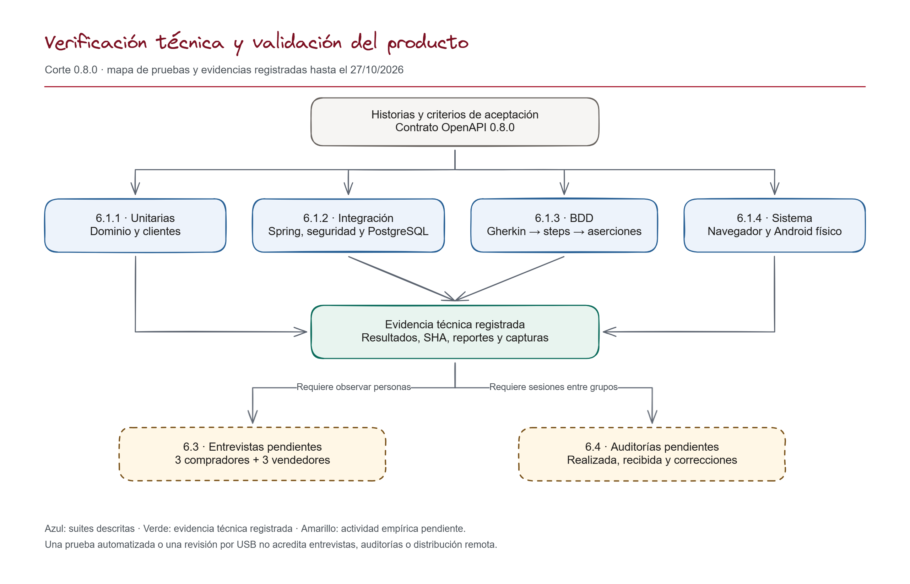</p>

*Figura 6.1. Relación entre verificación técnica y validación con participantes, elaborada en Excalidraw.* [Editable](diagramas/excalidraw/06-01-mapa-verificacion.excalidraw) · [SVG](diagramas/excalidraw/06-01-mapa-verificacion.svg) · [Captura del editor](diagramas/excalidraw/editor-06-01-mapa-verificacion.png).

Los flujos siguientes identifican preparación, acciones, aserciones y rutas alternativas de pruebas existentes. La [relación de casos y código](docs/validacion/flujos-de-pruebas.md) enlaza los tests por commit. El [catálogo Excalidraw](diagramas/excalidraw/README.md) conserva las escenas nativas y sus exportaciones; generar estas figuras no añade una ejecución de pruebas.

### 6.1.1. Core Entities Unit Tests

Los agregados `Listing`, `Deal`, `PaymentEvidence`, `Challenge` y solicitudes de soporte se comprueban con JUnit sin servicios cloud. Los casos cubren estados permitidos, edición/pausa de avisos, reserva exclusiva, aceptación con revisión vigente, cierre bilateral, cancelación, inasistencia, vencimiento y reseña. Las pruebas del cliente verifican mapeo de respuestas, contadores, validaciones, perfil e idioma. En el corte del 26/10, Android completó 126 pruebas sin fallos, análisis sin incidencias, formato de 81 archivos sin cambios y compilaciones QA debug y release. El release usó una clave QA estable y su firma se verificó; el build sin variables de firma fue rechazado correctamente. El [manifiesto Android](docs/validacion/android-qa-artifact.json) conserva ese archivo histórico y su SHA256: no es distribuible porque su origen staging fue retirado. Esto no acredita instalación o distribución. Se evalúan resultados y reglas de negocio, no solo la presencia de métodos.

En la ejecución local del 26/10/2026, Maven completó **214 pruebas, 0 fallos y 0 errores**, incluidas pruebas de integración y BDD; ese total no se presenta como 214 pruebas unitarias. `verify` completó también SpotBugs, PMD, CPD y JaCoCo (duración de la ejecución: 3 min 38 s). El artefacto JaCoCo registró 1581 líneas cubiertas y 70 no cubiertas (95,8 %), y 621 ramas cubiertas y 102 no cubiertas (85,9 %); son medidas de esta ejecución local, sin umbral de bloqueo configurado. El entorno fue PostgreSQL y Mailpit locales descartables, sin cuentas o constancias reales. El número de pruebas no se usa para inferir cobertura ni calidad por sí solo.

La comprobación del empaquetado del 27/10 elevó el total Java a **216 pruebas**. La revisión Android posterior completó **139 pruebas Flutter**, análisis y compilación QA, con instalación física documentada en 6.1.4. Los resultados y SHA se conservan en el [registro de activación](docs/validacion/activacion-pendiente.md); los porcentajes JaCoCo anteriores siguen identificando exclusivamente la ejecución del 26/10.

Como caso representativo, `DealTest.bothConfirmationsCompleteAnAgreedDeal` prepara un acuerdo aceptado, verifica que la primera confirmación y su repetición mantengan `AGREED`, y comprueba que la contraparte complete la entrega y genere los dos eventos esperados. El control negativo usa otro fixture en `PROPOSED` y espera `DomainException`, tipo `CONFLICT`, código `deal.not_agreed`. La figura distingue ambos fixtures y sigue Arrange–Act–Assert.

<p align="center">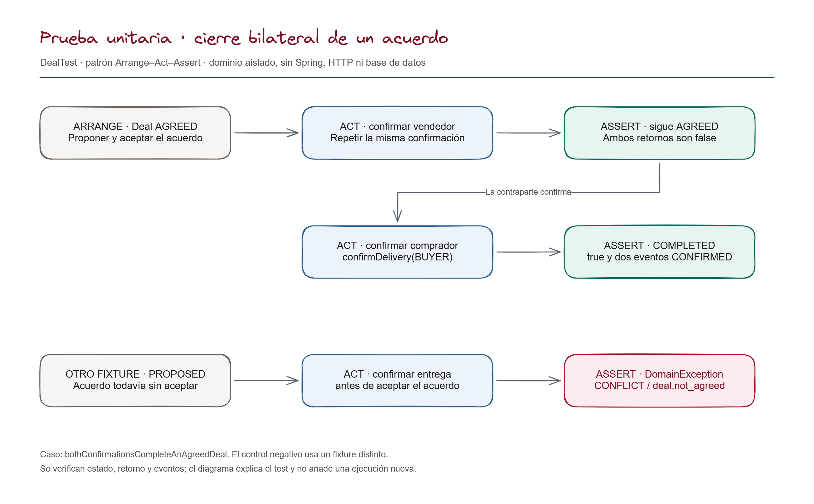</p>

*Figura 6.2. Flujo unitario del cierre bilateral y su control negativo.* [Editable Excalidraw](diagramas/excalidraw/06-02-unitarias.excalidraw) · [SVG](diagramas/excalidraw/06-02-unitarias.svg) · [Captura del editor](diagramas/excalidraw/editor-06-02-unitarias.png).

### 6.1.2. Core Integration Tests

Las pruebas de integración recorren Spring, la cadena de seguridad, PostgreSQL y Flyway. Comprueban propiedad de publicaciones/imágenes, privacidad entre participantes, sesiones cookie/bearer, atomicidad, carreras de reserva/reportes, comprobantes y conteos exactos. El incremento 0.8.0 añade soporte de visitantes (`POST /api/support/guest` → `201 {id,status}`), teléfono de cobro de nueve dígitos y el conteo de acuerdos completados independiente de reseñas.

`scripts/smoke.py` y `scripts/smoke_mvp.py` crean estudiantes sintéticos a través de la API y reciben OTP en Mailpit. `tool/api_smoke.dart` del móvil usa su cliente HTTP real con un handoff temporal de esas cuentas; comprueba compatibilidad de modelos y operaciones. El 26/10/2026 ambos smokes de API pasaron contra PostgreSQL/Mailpit locales descartables; se comprobó también recepción 201, privacidad/campos del soporte visitante y metadatos en inglés. El smoke Dart sobre el mismo handoff también pasó: autenticó, interpretó conversaciones/comprobantes/perfiles, consultó contadores y notificaciones, comprobó polling incremental y reintento idempotente y revocó su sesión. Se ejecutan exclusivamente contra la base descartable de CI/local. El handoff contiene credenciales sintéticas y no se publica como artefacto.

`GuestSupportIntegrationTests` combina Spring, seguridad y PostgreSQL a través de MockMvc. El flujo de US50 comprueba recepción y persistencia de la consulta, ausencia de vínculo automático con una cuenta, privacidad del historial y errores 400/403/429. La transacción del test revierte los datos de prueba; este recorrido no se presenta como una petición TCP desde navegador.

<p align="center"></p>

*Figura 6.3. Flujo de integración de soporte visitante, privacidad y cuota.* [Editable Excalidraw](diagramas/excalidraw/06-03-integracion.excalidraw) · [SVG](diagramas/excalidraw/06-03-integracion.svg) · [Captura del editor](diagramas/excalidraw/editor-06-03-integracion.png).

### 6.1.3. Core Behavior-Driven Development

Los escenarios Gherkin viven en `src/test/resources/features`, con etiquetas `@USxx` que enlazan con el Anexo D. Cucumber comprueba acceso institucional, publicación, ofertas continuas, encuentro, revisión de condiciones, cancelación, cierre, comprobantes, inasistencia, notificaciones y soporte. El soporte a visitantes se verifica como recepción de ticket y validación de campos; no se afirma atención humana instantánea. El reporte `target/cucumber/acceptance.html` permite inspeccionar pasos y resultados después de ejecutar Maven.

El ejemplo de US38 procede de `delivery_confirmation.feature`. `AcceptanceTests` carga los escenarios, `CoordinationSteps` traduce las frases y `ScenarioWorld` atraviesa MockMvc con la seguridad real y PostgreSQL. El correo se sustituye por un mailer de prueba. La ruta con una confirmación verifica `AGREED` y el rechazo 409 de reseñas; con ambas verifica `COMPLETED`, aviso vendido y dos reseñas aceptadas. El hook `After` elimina los datos sintéticos.

```gherkin
@US38
Feature: Confirming the delivery
  The sale closes only when both students confirm that the delivery happened on campus.

  Background:
    Given Ana is a verified student
    And Bruno is a verified student
    And Ana published a listing delivered at the "Monterrico" campus
    And Bruno contacted Ana about the listing
    And Bruno and Ana accepted a meeting

  Scenario: Both students confirm and the sale is completed
    When Bruno confirms the delivery
    And Ana confirms the delivery
    Then the deal is "completed"
    And the listing is sold
    And both students can rate each other

  Scenario: Only one student confirmed
    When Bruno confirms the delivery
    Then the deal stays pending
    And neither student can rate the other yet
```

<p align="center">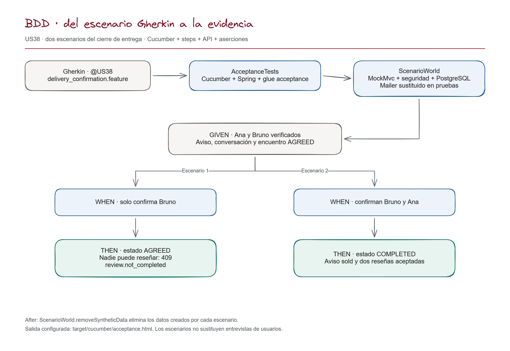</p>

*Figura 6.4. Flujo BDD: escenario, runner, steps y aserciones observables.* [Editable Excalidraw](diagramas/excalidraw/06-04-bdd.excalidraw) · [SVG](diagramas/excalidraw/06-04-bdd.svg) · [Captura del editor](diagramas/excalidraw/editor-06-04-bdd.png).

### 6.1.4. Core System Tests

La figura compara dos recorridos con alcances distintos: W16 automatiza el navegador y la API real; la revisión Android verifica recuperación con un dispositivo físico y la API local por USB. Se conservan separados los resultados de ambos y las suites con respuestas simuladas.

<p align="center"></p>

*Figura 6.5. Flujos de sistema web y recuperación Android con sus aserciones y límites.* [Editable Excalidraw](diagramas/excalidraw/06-05-sistema.excalidraw) · [SVG](diagramas/excalidraw/06-05-sistema.svg) · [Captura del editor](diagramas/excalidraw/editor-06-05-sistema.png).

La corrida local del 26/10 completó **230 pruebas Playwright, cero fallos, cero omitidas y cero reintentos**, con API real habilitada y un worker como en CI (509,9 s). Incluye escenarios simulados y suites live, escritorio y viewport móvil. Las 332 pruebas unitarias web, el build y la exclusión de previews también pasaron. Durante la validación se corrigieron el reconocimiento de lectura del chat y selectores desactualizados del recorrido de soporte; el [registro de revisión](docs/validacion/revision-incremento-0.8.0.md) explica el tratamiento.

La revisión del 27/10 añadió correcciones del inicio del catálogo, limpieza de filtros e imágenes no disponibles. Aprobó **333 pruebas unitarias web y 220 casos Playwright sobre el contenedor con web compilada y API, sin reintentos**; las 12 pruebas de previews se conservan en desarrollo. El [registro de activación](docs/validacion/activacion-pendiente.md) presenta capturas antes/después, procedencia de la imagen reutilizada y el aislamiento corregido de un test de acceso. Los totales de ambos días corresponden a suites y empaquetados identificados por separado; no se suman ni acreditan aceptación cloud o con participantes.

Playwright dispone de pruebas con respuestas simuladas y de pruebas `*-live.spec.ts` contra la API real. Estas últimas solo se activan con `UPCX_LIVE_API=1`; omitirlas no demuestra integración. El workflow candidato prepara API/PostgreSQL/Mailpit aislados y ejecuta ambos proyectos de Playwright, escritorio y viewport móvil, además del smoke Dart. El build productivo se inspecciona con `scripts/check-preview-build.mjs` para excluir rutas y datos de demostración.

El 31/10/2026 ese workflow se completó por primera vez sobre los tres SHA del corte ([run 41265231185](https://github.com/UPC-X/upcx-api/actions/runs/41265231185)). Pasaron sin fallos 216 pruebas Java, 333 unitarias web, 12 de previews, 220 casos Playwright, 139 pruebas Flutter y 18 de Python. Los smokes HTTP, el cliente Dart y Playwright, en escritorio y viewport móvil, corrieron contra la imagen de origen único con API real y datos sintéticos. Un primer intento ([run 41263112116](https://github.com/UPC-X/upcx-api/actions/runs/41263112116)) se detuvo en `mvnw verify`: el `WEB_ORIGIN` del job reemplazaba los orígenes por defecto y cuatro pruebas de CORS recibían 403. El [PR #34](https://github.com/UPC-X/upcx-api/pull/34) limitó la variable al paso que arranca el contenedor, sin modificar ninguna prueba.

**Aceptación en staging.** Con el candidato desplegado en `https://upcx-staging.onrender.com`, se recorrió el flujo principal contra la API cloud con dos cuentas sintéticas, vendedor y comprador, creadas directamente en la base staging con sesiones de un día.

- El vendedor subió una imagen y publicó un aviso.
- El comprador lo contactó, escribió y propuso el acuerdo; al aceptarlo, el aviso pasó a `reserved`.
- El comprador subió un comprobante sintético privado, que el vendedor leyó y marcó como recibido.
- Ambos confirmaron la entrega: el acuerdo quedó `completed`, el aviso `sold` y se registraron dos reseñas.
- Tras cerrar sesión, `/auth/me` respondió 401.

Como las cuentas se sembraron en la base, este recorrido no ejercita el OTP por correo. Siguen pendientes la aceptación en navegador con OTP real y sus capturas.

Estas capturas corresponden a soporte contra **API local real y datos sintéticos**, con ambos viewports. Sus casos pasaron en la corrida completa; [el manifiesto](img/verification-0.8.0/real-api-manifest.json) distingue su origen de las imágenes con respuestas interceptadas.

<p align="center">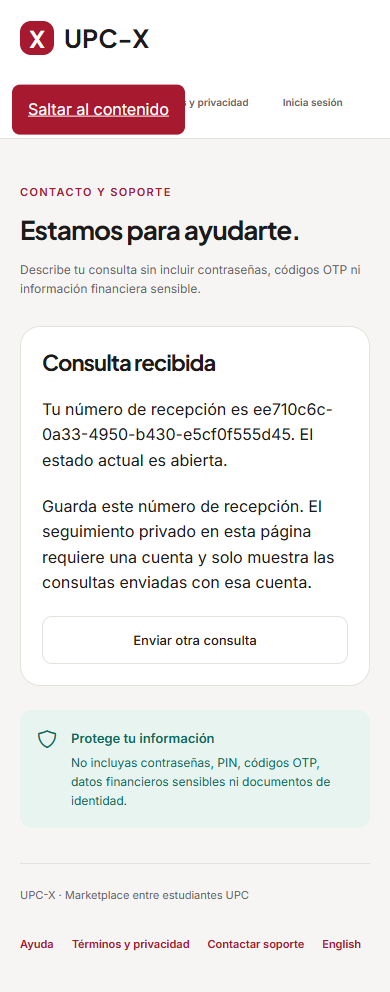</p>

<p align="center">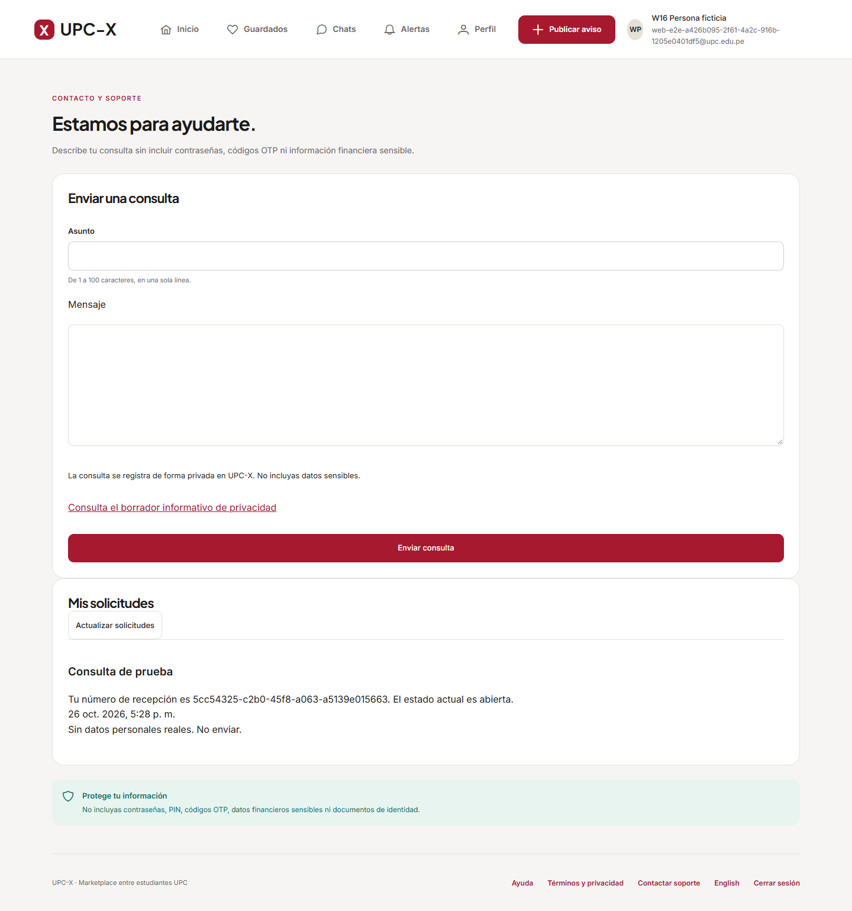</p>

La validación Android nativa requiere instalación, versión/build y resultado por tarea. El 26/10 no había dispositivo ADB; el 27/10 se completaron comprobaciones dirigidas por USB en Samsung SM-S938B con Android 16 y un package QA separado: acceso con código y teclado, sesión recuperada, catálogo, navegación, búsqueda y envío sin conexión con reintento único. Se corrigieron insets, limpieza de búsqueda, conservación del siguiente borrador y opciones recortadas al ampliar el texto al 200 %. El APK final instalado y su hash se verificaron en el dispositivo; aprobaron 139 pruebas y el CI del SHA integrado por PR #18. Las [capturas y la sonda profile](docs/validacion/activacion-pendiente.md) identifican fuentes, resultados y límites. Ese corte del 27/10 no acredita aceptación remota. El [seguimiento del 1/11](docs/validacion/auditoria-lanzamiento-2026-11-01.md) confirmó OTP en el APK Firebase y recorridos controlados contra staging, incluido selector/carga de fotos; detectó y corrigió estados obsoletos de comprobante/cierre en una actualización QA local. Quedan pendientes TalkBack, permisos cancelados/denegados, más dispositivos, aceptación de una nueva entrega Firebase con las correcciones, participantes y el video App Validation.

Estas dos capturas pertenecen al ensayo Android local del 27/10: primero el error con borrador conservado y después el envío recuperado. El conteo de un único mensaje y la procedencia de cada imagen se describen en el [registro por USB](docs/validacion/activacion-pendiente.md#revisión-android-por-usb).

<p align="center"> </p>

Las siguientes capturas documentan presentación y recuperación de campos con **API interceptada y datos sintéticos**, según `img/verification-0.8.0/ui-manifest.json`; no son evidencia de integración HTTP real, entrega cloud ni entrevistas.

<p align="center">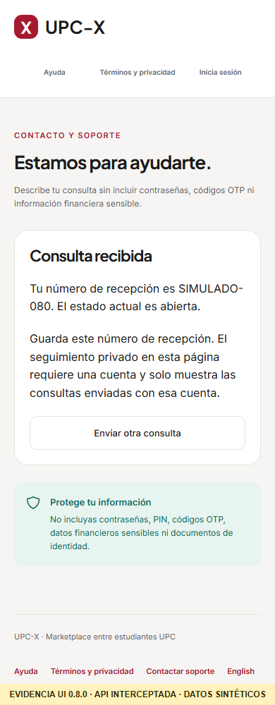</p>

<p align="center"></p>

<p align="center">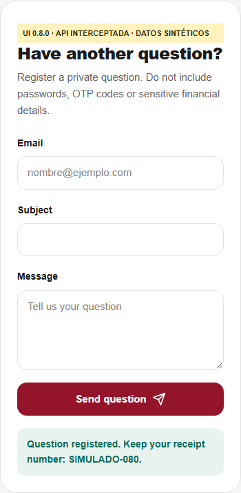</p>

## 6.2. Static testing & Verification

### 6.2.1. Static Code Analysis

#### 6.2.1.1. Coding standard & Code conventions

La web usa Prettier, TypeScript/Vue y Vitest; Android ejecuta `dart format --output=none --set-exit-if-changed`, `flutter analyze` y `flutter test`. Java separa dominio, aplicación, infraestructura e interfaces por contexto; las respuestas se contrastan con OpenAPI y Bruno. CI ejecuta estos checks antes de sellar un candidato. Los comandos, versiones SDK fijadas y reportes se conservan junto al código. El [resumen local del 26/10](docs/validacion/resultados-locales-2026-10-26.json) identifica lo ejecutado y sus limitaciones; en ese corte se registraron seis pruebas del controlador de release con proveedores simulados y seis archivos de workflows validados con actionlint 1.7.12. La comprobación posterior del 27/10 registró 18 pruebas Python de controles de entrega, según el [registro de activación](docs/validacion/activacion-pendiente.md).

#### 6.2.1.2. Code Quality & Code Security

Maven produce JaCoCo, SpotBugs con FindSecBugs, PMD y CPD. SpotBugs/PMD/CPD son informativos en este corte: no se presentan como un bloqueo automático de vulnerabilidades ni como ausencia de riesgos. El [triage estático](docs/validacion/triage-estatico.md) registra el inventario inicial de 51 SpotBugs, 5 PMD y 0 duplicaciones, separa dos alertas nuevas del código preexistente y documenta tratamiento/deuda. Las prioridades de scanner no se equiparan a severidad de seguridad; el criterio de salida es cero críticos/altos confirmados sin tratamiento. La revisión incluye permisos de participantes, cookie segura/HttpOnly, CORS exacto, límites por identidad/IP, archivos recodificados y privados, validación de correo/teléfono, ausencia de secretos en artefactos y exclusión de previews. `python scripts/check_contract.py` valida el contrato 0.8.0 con **52 operaciones** y la correspondencia de Bruno; no reemplaza pruebas de ejecución de cada respuesta.

El flujo de verificación distingue los checks obligatorios de los reportes informativos y la revisión de riesgos. Un scanner no aprueba automáticamente la seguridad del producto: el triage contrasta cada ubicación y determina su tratamiento. El reescaneo de `GuestSupportRateLimiter` se conserva como ejemplo del ciclo hallazgo → corrección → repetición, con 49 hallazgos totales y cero en esa clase.

<p align="center">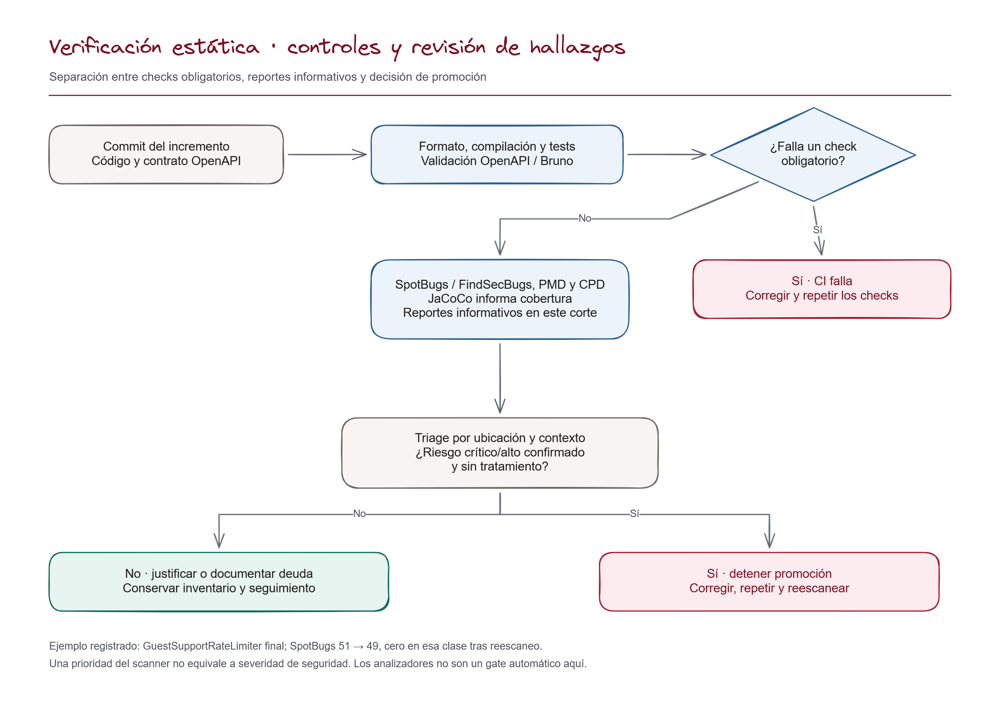</p>

*Figura 6.6. Flujo de análisis estático, tratamiento de deuda y revisión de riesgos.* [Editable Excalidraw](diagramas/excalidraw/06-06-analisis-estatico.excalidraw) · [SVG](diagramas/excalidraw/06-06-analisis-estatico.svg) · [Captura del editor](diagramas/excalidraw/editor-06-06-analisis-estatico.png).

### 6.2.2. Reviews

La [revisión asistida del incremento](docs/validacion/revision-incremento-0.8.0.md) documenta defectos observados y revalidación, incluido el rechazo de candidatos de workflows fuera de `main`. La aprobación humana del equipo y sus enlaces de PR se registran aparte.

La revisión del incremento contrasta cada historia modificada con interfaz, API, casos negativos y evidencia. Antes de integrar se registra: revisor real, SHA/PR, observación, decisión y repetición del caso. No se atribuyen revisiones a integrantes ni se enlazan PR todavía no publicados. Casos prioritarios: visitante sin sesión recibe ticket; puntos se presentan como sugerencias; el teléfono no se divulga automáticamente; Android conserva idioma/perfil; historial, reseñas y acuerdos completados muestran cantidades correctas. Los [hallazgos](docs/validacion/hallazgos.csv) se mantienen abiertos hasta verificar la corrección.

## 6.3. Validation Interviews

En esta sección se presenta el proceso de validación de UPC-X, desarrollado por la startup RichStudent, cuyo propósito es evaluar la experiencia de usuario mediante la interacción directa de representantes de los segmentos objetivo con el Landing Page y las aplicaciones web y móvil.

A diferencia de las entrevistas exploratorias realizadas en el Capítulo II, estas sesiones buscan identificar problemas de usabilidad, dificultades de navegación, comprensión de funcionalidades y oportunidades de mejora en los flujos principales de la plataforma.

Para ello, se han planificado seis entrevistas de validación, distribuidas entre estudiantes vendedores y estudiantes compradores. Los participantes realizarán tareas representativas de sus actividades dentro de UPC-X y compartirán sus apreciaciones sobre la experiencia. Los resultados servirán como base para las evaluaciones heurísticas y la identificación de mejoras del producto.

### 6.3.1. Diseño de Entrevistas

El diseño de las entrevistas contempla la evaluación del Landing Page y las aplicaciones de UPC-X mediante tareas prácticas y preguntas abiertas. Se busca observar cómo los participantes utilizan las funcionalidades de la plataforma, identificando dificultades sin intervenir directamente en la ejecución de las tareas.

**Objetivos de la validación**

- Evaluar la claridad de la información y facilidad de navegación del Landing Page.
- Comprobar la usabilidad de los principales User Flows de las aplicaciones web y móvil.
- Identificar dificultades durante la búsqueda, publicación y gestión de productos.
- Evaluar la comprensión de los procesos de comunicación, coordinación y cierre de intercambios.
- Recopilar observaciones sobre accesibilidad, confianza y experiencia general.

**Segmentos y participantes**

| Segmento objetivo | Cantidad de entrevistas | Enfoque de validación |
|---|---|---|
| Estudiantes vendedores | 3 | Publicación y administración de productos, comunicación con compradores y gestión de intercambios. |
| Estudiantes compradores | 3 | Búsqueda de productos, consulta de publicaciones, comunicación con vendedores y coordinación de compras. |

Las sesiones tendrán una duración estimada de 25 a 35 minutos. Se utilizarán las versiones de prueba de las aplicaciones y datos de demostración, sin realizar transferencias monetarias reales. Se solicitará el consentimiento de cada participante para registrar la entrevista en video.

#### Validación del Landing Page

La validación del Landing Page será común para ambos segmentos. Se solicitará a los participantes explorar el sitio e identificar la propuesta de valor de UPC-X, sus funcionalidades principales y los medios disponibles para acceder a la plataforma.

**Tareas de validación:**

1. Explorar el Landing Page e identificar el propósito de UPC-X.
2. Localizar información sobre las características y beneficios de la plataforma.
3. Identificar cómo acceder a las aplicaciones.
4. Cambiar el idioma y localizar los medios de ayuda o contacto.

**Preguntas de validación:**

1. ¿Qué entiendes que ofrece UPC-X después de explorar la página?
2. ¿Qué tan sencillo te resultó encontrar la información que buscabas?
3. ¿Qué opinas de la organización visual y la navegación del sitio?
4. ¿Encontraste alguna sección o elemento que no comprendieras?
5. ¿Qué información agregarías o modificarías para mejorar la página?

#### Validación de las aplicaciones web y móvil

Para las aplicaciones se evaluarán los User Flows establecidos en el Capítulo IV, considerando los recorridos principales y situaciones alternativas. Las sesiones alternarán el uso de la aplicación web y Android para observar la experiencia en ambas plataformas.

**Flujos de validación comunes**

| ID | Tarea de validación | User Flow relacionado |
|---|---|---|
| T01 | Comprender el servicio, cambiar de idioma y localizar ayuda desde el Landing Page. | UG-08 |
| T02 | Enviar una consulta de soporte como visitante. | UG-08 |
| T03 | Acceder mediante correo institucional y verificar la cuenta. | UG-01 |
| T04 | Buscar un producto, aplicar filtros, revisar sus detalles y guardarlo. | UG-02, UG-05 |
| T05 | Comunicarse con la contraparte y coordinar un encuentro mediante un punto sugerido. | UG-04 |
| T06 | Revisar una constancia de pago de prueba y comprender su finalidad. | UG-04 |
| T07 | Confirmar una entrega, realizar una reseña y consultar el historial. | UG-04, UG-06 |
| T08 | Actualizar información del perfil, cambiar de idioma y gestionar datos de cobro de prueba. | UG-06 |

Las tareas se presentarán sin explicar previamente cómo completarlas. Se priorizarán los flujos principales de cada segmento y se registrarán las dificultades observadas durante su ejecución.

#### Segmento Objetivo 1: Estudiantes vendedores

Para este segmento, la validación se centrará en determinar si los estudiantes pueden publicar productos, administrar sus anuncios y coordinar intercambios de manera clara y segura.

**Tareas específicas:**

1. Publicar un producto incluyendo descripción, imágenes y precio.
2. Consultar, editar y pausar una publicación existente.
3. Responder a un comprador mediante la mensajería.
4. Coordinar o modificar las condiciones de un encuentro.
5. Confirmar una entrega y consultar el historial de transacciones.
6. Reactivar o volver a publicar un anuncio cuando corresponda.

**Preguntas de validación:**

1. ¿Qué tan sencillo te resultó publicar un producto en UPC-X?
2. ¿Encontraste alguna dificultad al editar o administrar tus publicaciones?
3. ¿Cómo describirías la experiencia de comunicación con un posible comprador?
4. ¿Qué opinas del proceso para coordinar y confirmar una entrega?
5. ¿Qué información necesitarías para sentir mayor confianza al vender mediante la plataforma?
6. ¿Qué funcionalidad mejorarías para facilitar tus ventas?

#### Segmento Objetivo 2: Estudiantes compradores

Para este segmento, la validación se enfocará en la facilidad para encontrar productos relevantes, evaluar publicaciones, comunicarse con vendedores y completar el proceso de intercambio.

**Tareas específicas:**

1. Buscar un producto mediante el catálogo y sus filtros.
2. Revisar la descripción, precio y perfil del vendedor.
3. Guardar una publicación de interés.
4. Contactar al vendedor para consultar la disponibilidad del producto.
5. Coordinar un encuentro y revisar las condiciones acordadas.
6. Cancelar una propuesta, consultar su notificación y revisar el historial de intercambios.

**Preguntas de validación:**

1. ¿Qué tan fácil te resultó encontrar el producto que buscabas?
2. ¿La información de las publicaciones fue suficiente para evaluar una posible compra?
3. ¿Cómo describirías tu experiencia al contactar y coordinar con un vendedor?
4. ¿Qué opinas de las opciones disponibles para organizar un encuentro?
5. ¿Qué dificultades encontraste durante el proceso de búsqueda o compra?
6. ¿Qué cambios realizarías para mejorar tu experiencia como comprador?

#### Procedimiento de evaluación

Durante cada sesión, el entrevistador presentará las tareas y solicitará al participante expresar sus pensamientos mientras utiliza la plataforma. Se observará su comportamiento sin proporcionar instrucciones adicionales durante el primer intento.

Para cada tarea se registrarán los siguientes aspectos:

- **Resultado:** completada sin ayuda, completada con ayuda, no completada o no ejecutada.
- **Tiempo de ejecución:** duración necesaria para completar o abandonar la tarea.
- **Dificultades:** errores, confusiones o problemas de navegación identificados.
- **Observaciones:** comentarios y recomendaciones expresados por el participante.
- **Facilidad percibida:** valoración opcional del 1 al 5, acompañada de una explicación.

Finalmente, se solicitará una apreciación general sobre UPC-X, considerando su utilidad, facilidad de uso y confianza percibida. La información recopilada permitirá documentar los resultados de cada entrevista y realizar posteriormente las evaluaciones según heurísticas de usabilidad, arquitectura de información y diseño inclusivo, conforme al Anexo D del enunciado del proyecto.
### 6.3.2. Registro de Entrevistas

**Estado: cinco de las seis entrevistas de validación tienen su video y su captura registrados (E01, E02, E04, E05 y E06); la sexta, E03, tiene el video y espera su captura.** Los resúmenes de E01 y E06 se redactarán con lo que expresaron los participantes. Una sesión se acredita cuando se registran su video, su captura y los datos del participante, con su consentimiento. Las entrevistas de needfinding del capítulo II no se reutilizan como validaciones del producto. El registro sigue el formato de la sección [2.2.2](#222-registro-de-entrevistas) y añade la fecha, el dispositivo y el consentimiento de grabación. El resultado por tarea de cada sesión se anota en su ficha: [E01](docs/validacion/entrevistas/E01-comprador.md), [E02](docs/validacion/entrevistas/E02-comprador.md), [E03](docs/validacion/entrevistas/E03-comprador.md), [E04](docs/validacion/entrevistas/E04-vendedor.md), [E05](docs/validacion/entrevistas/E05-vendedor.md) y [E06](docs/validacion/entrevistas/E06-vendedor.md).

| Sesión | Segmento | Estado | Evidencia |
|---|---|---|---|
| E04 | Vendedor | Registrada | Video y captura |
| E05 | Vendedor | Registrada | Video y captura |
| E06 | Vendedor | Registrada | Video y captura; resumen por redactar |
| E01 | Comprador | Registrada | Video y captura; resumen por redactar |
| E02 | Comprador | Registrada | Video y captura |
| E03 | Comprador | En registro | Video; faltan la captura y los datos del participante |

La [agenda de tres semanas](docs/validacion/README.md) propone preparación en la primera semana, sesiones en la segunda y correcciones/repetición en la tercera. Los nombres y horarios se registrarán cuando se acuerden, sin convertir la agenda propuesta en evidencia de ejecución.

#### Registro de estudiantes vendedores

##### Entrevista de validación E04


| | |
| :--- | :--- |
| **Entrevistador:** | Molina Vásquez Manuel Alejandro |
| **Entrevistado:** | Milenko Rubén Cayanchi Ávila |
| **Edad:** | 20 |
| **Segmento:** | Estudiantes vendedores |
| **Fecha:** | 11/11/2026 |
| **Dispositivo y plataforma:** | Aplicación Web |
| **Consentimiento de grabación:** | Aprobado |
| **Inicio de la entrevista:** | 00:00 |
| **Duración:** | 08:07 |
| **Enlace:** | https://upcedupe-my.sharepoint.com/:v:/g/personal/u20221g231_upc_edu_pe/IQCdqU19aXguRZ78_rAX-lrWAYwGP_3JaJ-8oPkkC1dxV04?nav=eyJyZWZlcnJhbEluZm8iOnsicmVmZXJyYWxBcHAiOiJPbmVEcml2ZUZvckJ1c2luZXNzIiwicmVmZXJyYWxBcHBQbGF0Zm9ybSI6IldlYiIsInJlZmVycmFsTW9kZSI6InZpZXciLCJyZWZlcnJhbFZpZXciOiJNeUZpbGVzTGlua0NvcHkifX0&e=xurace |
| **Ficha de tareas:** | [E04](docs/validacion/entrevistas/E04-vendedor.md) |

| |
| :--- |
| **Resumen:** Milenko Rubén Cayanche Ávila, estudiante de ingeniería de software de veinte años en la UPC de San Miguel, participó en la entrevista de validación para evaluar el rol de vendedor en la plataforma UPC-X. Durante la sesión, comentó que solía vender artículos previamente mediante WhatsApp y recomendación de boca en boca, lidiando con la alta competencia en redes sociales externas. Al probar el flujo de la aplicación, destacó que el proceso para registrar y publicar productos es sumamente sencillo, intuitivo y fácil de aprender, valorando también el chat interno y los puntos de entrega sugeridos en el campus. Finalmente, señaló que adoptaría la plataforma de forma definitiva si logra una mayor difusión entre la comunidad estudiantil, y recomendó añadir enlaces a redes sociales o detalles de validación institucional en los perfiles de vendedor para fortalecer la confianza de los compradores. |

##### Entrevista de validación E05


| | |
| :--- | :--- |
| **Entrevistador:** | Huarcaya Matias Gilbert Alonso |
| **Entrevistado:** | Fiorella Grisel Cordova Pinchi |
| **Edad:** | 30 |
| **Segmento:** | Estudiantes vendedores |
| **Fecha:** | 12/11/2026 |
| **Dispositivo y plataforma:** | Aplicación móvil Android y Landing Page en laptop |
| **Consentimiento de grabación:** | Aprobado |
| **Inicio de la entrevista:** | 00:00 |
| **Duración:** | 10:32 |
| **Enlace:** | https://upcedupe-my.sharepoint.com/:v:/g/personal/u202322187_upc_edu_pe/IQBNzb2DbmWAQqjR1_Jc_rTJATjnINQK5P06kAMXSqjWjpo?nav=eyJyZWZlcnJhbEluZm8iOnsicmVmZXJyYWxBcHAiOiJPbmVEcml2ZUZvckJ1c2luZXNzIiwicmVmZXJyYWxBcHBQbGF0Zm9ybSI6IldlYiIsInJlZmVycmFsTW9kZSI6InZpZXciLCJyZWZlcnJhbFZpZXciOiJNeUZpbGVzTGlua0NvcHkifX0&e=9syPpy |
| **Ficha de tareas:** | [E05](docs/validacion/entrevistas/E05-vendedor.md) |

| |
| :--- |
| **Resumen:** Fiorella Grisel Cordova Pinchi, estudiante de décimo ciclo de treinta años, participó en la entrevista de validación para evaluar el rol de vendedor en UPC-X. Entendió la propuesta del Landing Page en pocos segundos, cambió el idioma y envió una consulta de soporte sin ayuda. En la aplicación móvil publicó un perfume de catálogo como producto de prueba, lo editó, lo pausó y respondió a una compradora con facilidad, y valoró que su número de WhatsApp no se comparta y que quien compra sea un estudiante verificado. Tardó en ubicar la sugerencia de punto de encuentro porque confundió su ícono con el envío de ubicación, y dudó al interpretar la constancia de pago, que no le indicaba si el pago ya estaba confirmado. Pidió que la aplicación recuerde los pagos pendientes y que las reseñas del comprador se vean antes de aceptar un encuentro. Calificó la facilidad de uso con 4 sobre 5. |

##### Entrevista de validación E06


| | |
| :--- | :--- |
| **Entrevistador:** | Eduardo Jose Cossar Sanchez |
| **Entrevistado:** | Valeria Mendoza |
| **Edad:** | 21 años |
| **Segmento:** | Estudiantes vendedores |
| **Fecha:** | Por registrar |
| **Dispositivo y plataforma:** | Por registrar |
| **Consentimiento de grabación:** | Por registrar |
| **Inicio de la entrevista:** | 00:00 |
| **Duración:** | 4:52 |
| **Enlace:** | https://drive.google.com/file/d/1K48PsRhwTlocGwNUadBb-CI2jWxp8d94/view?usp=sharing |
| **Ficha de tareas:** | [E06](docs/validacion/entrevistas/E06-vendedor.md) |

| |
| :--- |
| **Resumen:** La sesión de validación está diseñada para evaluar la experiencia de Valeria Mendoza como estudiante vendedora en UPC-X. Las tareas previstas incluyen la exploración del Landing Page, el acceso a la plataforma, la publicación y administración de productos, la comunicación con compradores, la coordinación de encuentros, la revisión de constancias de pago y el cierre de ventas. Se busca identificar posibles dificultades de navegación, comprensión de funcionalidades y oportunidades de mejora en usabilidad, arquitectura de información y diseño inclusivo. Los resultados y apreciaciones reales se incorporarán después de la sesión. |


#### Registro de estudiantes compradores

##### Entrevista de validación E01

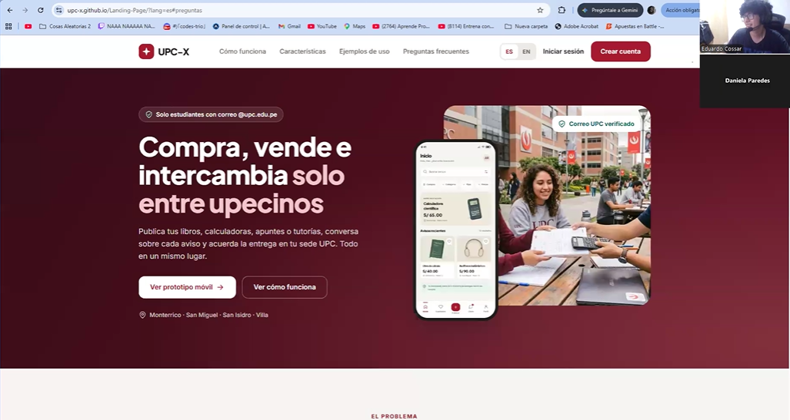

| | |
| :--- | :--- |
| **Entrevistador:** | Eduardo Jose Cossar Sanchez |
| **Entrevistado:** | Daniela Paredes |
| **Edad:** | 20 años |
| **Segmento:** | Estudiantes compradores |
| **Fecha:** | Por registrar |
| **Dispositivo y plataforma:** | Por registrar |
| **Consentimiento de grabación:** | Por registrar |
| **Inicio de la entrevista:** | 00:00 |
| **Duración:** | 4:55 |
| **Enlace:** | https://drive.google.com/file/d/1J-BsSvitUQQjNBQR-dqU2QSOBBt6yZAS/view?usp=sharing |
| **Ficha de tareas:** | [E01](docs/validacion/entrevistas/E01-comprador.md) |

| |
| :--- |
| **Resumen:** La sesión de validación está diseñada para evaluar la experiencia de Daniela Paredes como estudiante compradora en UPC-X. Las tareas previstas incluyen la exploración del Landing Page, el acceso a la plataforma, la búsqueda y filtrado de productos, la revisión de publicaciones y perfiles de vendedores, el uso de productos guardados, la comunicación con vendedores, la coordinación de entregas, la comprensión de pagos externos, la cancelación de acuerdos y la consulta del historial de compras. Se busca identificar dificultades relacionadas con la navegación, claridad de la información, confianza y facilidad de uso. Los resultados y apreciaciones reales se incorporarán después de la sesión. |

##### Entrevista de validación E02


| | |
| :--- | :--- |
| **Entrevistador:** | Luis Manuel Espinoza Navarrete |
| **Entrevistado:** | Nicolás Castro Solorza |
| **Edad:** | 21 años |
| **Segmento:** | Estudiantes compradores |
| **Fecha:** | 13/11/2026 |
| **Dispositivo y plataforma:** | Laptop (aplicación web), en español y con una breve prueba en inglés |
| **Consentimiento de grabación:** | Autorizó usar la conversación como testimonio y su nombre |
| **Inicio de la entrevista:** | 0:00 |
| **Duración:** | 9:26 min |
| **Enlace:** | [Entrevista de validación E02](https://upcedupe-my.sharepoint.com/:v:/g/personal/u201821684_upc_edu_pe/IQCFyD7xC2PGTZMsm3kJrC9TAZVzpANR7mXdJKcEeG3kjnk?nav=eyJyZWZlcnJhbEluZm8iOnsicmVmZXJyYWxBcHAiOiJPbmVEcml2ZUZvckJ1c2luZXNzIiwicmVmZXJyYWxBcHBQbGF0Zm9ybSI6IldlYiIsInJlZmVycmFsTW9kZSI6InZpZXciLCJyZWZlcnJhbFZpZXciOiJNeUZpbGVzTGlua0NvcHkifX0&e=eojsRI) |
| **Ficha de tareas:** | [E02](docs/validacion/entrevistas/E02-comprador.md) |

| |
| :--- |
| **Resumen:** Nicolás participó nuevamente, ahora en la entrevista de validación como estudiante comprador. Al comprarle a un desconocido le preocupa que no se presente, que el producto no sea como en la foto o que no sea realmente un estudiante. Probó UPC-X desde su laptop, sobre todo en español y con una breve prueba en inglés. Lo describió como un marketplace entre estudiantes de la UPC con entrega en el campus. Creó su cuenta con su correo institucional, un registro que le pareció razonable porque asegura que los usuarios sean estudiantes, y sabe que si el código no llega debe revisar su carpeta de spam. Encontró el producto que buscaba con los filtros por sede y categoría, y se fijó en la reputación y las reseñas del vendedor. Entendió el punto sugerido como un lugar del campus que propone la app y se sintió seguro por entregar dentro de la universidad. Interpretó la constancia de pago como una declaración de lo ocurrido, que no demuestra que el banco acreditó el pago, y probó el cierre con la confirmación de ambas partes, la reseña y el historial. Describió la experiencia como concisa y clara: lo más fácil fue encontrar el aviso y lo más difícil, los selectores de fecha y hora para coordinar el encuentro. Se perdió al volver a los filtros después de bajar, porque desaparecen, y al leer el chat, que se ve pequeño y con mensajes poco distinguibles. Confiaría en UPC-X por los vendedores verificados y la entrega dentro de las sedes, y para seguir usándola después de la venta pediría avisos de productos nuevos sin exceso y respuestas rápidas. Lo primero que cambiaría es que los filtros queden fijos al bajar. Daría un 8 sobre 10 a su recomendación y autorizó usar la conversación como testimonio, con su nombre. |

##### Entrevista de validación E03


| | |
| :--- | :--- |
| **Entrevistador:** | Mathias Javier Murillo |
| **Entrevistado:** | Por registrar |
| **Edad:** | Por registrar |
| **Segmento:** | Estudiantes compradores |
| **Fecha:** | 13/11/2026 |
| **Dispositivo y plataforma:** | Por registrar |
| **Consentimiento de grabación:** | Por registrar |
| **Inicio de la entrevista:** | Por registrar |
| **Duración:** | 1:45 min |
| **Enlace:** | [Entrevista de validación E03](https://upcedupe.sharepoint.com/:v:/s/UPC-X/IQDBFebqn1-ZTYsl-n0kZ-mhAQKVbYIW-l3Vyt7k6g7NjjQ?e=I1kzJq) |
| **Ficha de tareas:** | [E03](docs/validacion/entrevistas/E03-comprador.md) |

| |
| :--- |
| **Resumen:** Por redactar después de la sesión: tareas realizadas, dificultades observadas y apreciaciones del participante, sin generalizar al segmento. |

### 6.3.3. Evaluaciones según heurísticas

Esta evaluación aplica la estructura del **Anexo D del enunciado** (aplicación evaluada, tareas, escala de severidad, tabla resumen y descripción de problemas) a las sesiones de validación de [6.3.2](#632-registro-de-entrevistas) cuyo resumen ya describe lo que dijo y vio cada participante: E02 (comprador), E04 y E05 (vendedores). E01, E03 y E06 no se incluyen porque todavía no tienen resumen. Las severidades son una propuesta del equipo basada en lo que cada participante manifestó, no el resultado de una medición, y no se generalizan a toda la comunidad UPC. El [formato completo](docs/validacion/auditoria-heuristica.md) se conserva como plantilla.

**Aplicación evaluada.** Landing Page y aplicación UPC-X, en web (laptop) y Android QA, con los datos sintéticos del candidato vigente.

**Tareas evaluadas.** Comprender la propuesta y cambiar el idioma; crear la cuenta con correo institucional; buscar y filtrar un producto; revisar la reputación del vendedor; publicar, editar y pausar un producto; conversar y coordinar el encuentro; interpretar la constancia de pago; cerrar la entrega con reseña e historial. **No incluidas:** pagos reales, verificación bancaria e iOS.

**Escala de severidad.** 1, superficial; 2, menor; 3, mayor (frecuente o impide resolver la tarea sin ayuda); 4, muy grave (impide continuar). Es la misma escala del formato del enunciado.

| # | Problema | Severidad | Heurística o principio | Fuente |
|---|---|---|---|---|
| 1 | Los filtros desaparecen al bajar y el comprador se pierde al volver a ellos | 2 | Usabilidad: control y libertad del usuario | E02 |
| 2 | El chat se ve pequeño y sus mensajes se distinguen poco | 2 | Diseño inclusivo: percepción y legibilidad | E02 |
| 3 | Los selectores de fecha y hora para coordinar el encuentro resultan difíciles | 2 | Usabilidad: eficiencia y flexibilidad de uso | E02 |
| 4 | El ícono de la sugerencia de punto de encuentro se confunde con el envío de ubicación | 2 | Usabilidad: coincidencia con el mundo real y reconocimiento | E05 |
| 5 | La constancia de pago no indica si el pago ya está confirmado | 3 | Usabilidad: visibilidad del estado del sistema | E05 |
| 6 | El perfil del vendedor no ofrece señales adicionales de confianza, como enlaces o validación institucional | 1 | Arquitectura de información: ¿es confiable y se encuentra? | E04 |

**Descripción de problemas.**

- **Problema 1: filtros que desaparecen (severidad 2).** En E02, el comprador usó los filtros por sede y categoría para encontrar su producto, pero se perdió al volver a ellos después de bajar, porque dejan de estar visibles. *Recomendación:* mantener los filtros accesibles durante el desplazamiento o ofrecer un acceso fijo para volver a ellos.
- **Problema 2: chat pequeño (severidad 2).** En E02, el participante describió el chat como pequeño y con mensajes poco distinguibles. *Recomendación:* aumentar el tamaño del texto y diferenciar con claridad los mensajes propios de los ajenos, con contraste suficiente.
- **Problema 3: selectores de fecha y hora (severidad 2).** En E02, fueron lo más difícil de la experiencia al coordinar el encuentro. *Recomendación:* ofrecer opciones rápidas de horario junto al selector.
- **Problema 4: ícono del punto de encuentro (severidad 2).** En E05, la vendedora tardó en ubicar la sugerencia porque confundió su ícono con el envío de ubicación. *Recomendación:* usar un ícono y una etiqueta distintos para el punto sugerido.
- **Problema 5: estado de la constancia de pago (severidad 3).** En E05, la participante dudó al interpretarla porque no le indicaba si el pago ya estaba confirmado, y pidió que la aplicación recuerde los pagos pendientes. En E02, el comprador la interpretó como una declaración de lo ocurrido que no demuestra la acreditación bancaria. *Recomendación:* mostrar de forma explícita que la constancia es una declaración, no una confirmación del banco, y listar los pagos pendientes.
- **Problema 6: señales de confianza del vendedor (severidad 1).** En E04, el participante recomendó añadir enlaces a redes sociales o detalles de validación institucional en los perfiles de vendedor. *Recomendación:* evaluar esta mejora en el backlog antes de implementarla.

Estas observaciones coinciden con varios hallazgos de la auditoría recibida de [6.4.2](#642-auditoría-recibida), cuyas correcciones siguen pendientes de verificar en 6.4.2.4. Cuando se redacten los resúmenes de E01, E03 y E06, se añadirán sus problemas a esta tabla.

## 6.4. Auditoría de Experiencias de Usuario

Esta sección reúne las dos auditorías de experiencia de usuario del curso: la que RichStudent realizó al producto SecuraNet (6.4.1) y la que el grupo SANUVI realizó a UPC-X (6.4.2). Ambas usan la escala de severidad de 1 a 4 y la estructura del formato de auditoría del enunciado, e identifican las heurísticas de Nielsen vulneradas.

### 6.4.1. Auditoría realizada

#### 6.4.1.1. Información del grupo auditado

| Campo | Dato |
|---|---|
| Startup auditada | SecuraNet |
| Producto | SecuraNet |
| Integrantes | Diego Roberto Campbolanco Guzman, Mathias Andree Cárdenas Huaman, Godoy Santillan, Jesus Andres, Salazar Miranda Mateo Paolo, Chavez Bardales Esteban Eduardo |
| Repositorio / despliegue | https://github.com/DEJAMICE |

**Tareas a evaluar**

El alcance de esta evaluación incluye la revisión de la usabilidad de las siguientes tareas de la plataforma SecuraNet, considerando su aplicación web, móvil y landing page:

1. Registro de una cuenta nueva ciudadana y concesión de permisos de sistema (Ubicación, Bluetooth, Notificaciones).
2. Exploración del mapa interactivo, consulta de zonas de riesgo y filtrado de reportes comunitarios.
3. Configuración y trazado de rutas seguras asistidas por Inteligencia Artificial (origen, destino y modo de transporte).
4. Activación de Alerta SOS manual desde la interfaz web o móvil, y mediante botón de pánico físico IoT.
5. Simulación de detección de anomalías por sensores y cancelación preventiva con temporizador.
6. Gestión de la red de confianza (registro, búsqueda y asignación de contactos prioritarios).
7. Sincronización y prueba de conectividad de dispositivos de hardware IoT (Bluetooth Low Energy).
8. Publicación y visualización de reportes comunitarios de incidentes en la vía pública.
9. Consulta del historial de alertas e incidentes con filtros cronológicos y de estado.
10. Gestión de perfil de usuario, preferencias de seguridad y selección de planes del modelo freemium.

**No están incluidas en esta versión de la evaluación las siguientes tareas:**

1. Pruebas de carga masiva o estrés sobre la infraestructura de la API en Render.
2. Integración de pasarelas de pago reales para la suscripción al plan Premium.
3. Evaluación de funcionalidades administrativas de nivel gubernamental o policial externo.
4. Funcionalidades que no se encuentren disponibles en las versiones web y móvil prototipadas para esta entrega.

#### 6.4.1.2. Cronograma de auditoría realizada

| Fecha | Actividad | Participantes | Duración |
|---|---|---|---|
| 02/11/2026 | Envío y preparación de paquetes de prueba y prototipos interactivos | Equipo SecuraNet | 01:00 |
| 05/11/2026 | Evaluación de usabilidad de la interfaz web y flujos de autenticación | Mathias Cárdenas, Mateo Salazar | 01:30 |
| 07/11/2026 | Revisión del comportamiento visual en flujos críticos (simulación SOS y temporizadores) | Esteban Chávez, Diego Campbolanco | 01:30 |
| 09/11/2026 | Verificación de interacciones cartográficas y ruteo asistido por IA | Jesús Godoy, Diego Campbolanco | 02:00 |
| 11/11/2026 | Consolidación y clasificación de problemas de interfaz detectados | Equipo SecuraNet | 02:00 |
| 12/11/2026 | Elaboración e integración del informe final de auditoría heurística | Mathias Cárdenas | 01:30 |

#### 6.4.1.3. Contenido de auditoría realizada

**Escala de severidad.** Los errores identificados se puntúan según la siguiente escala:

| Nivel | Descripción |
|:---:|---|
| 1 | Problema cosmético que no afecta significativamente la experiencia. |
| 2 | Problema menor que puede generar confusión o incomodidad. |
| 3 | Problema importante que dificulta la realización de una tarea. |
| 4 | Problema crítico que impide completar una tarea o provoca errores graves. |

**Tabla resumen**

| # | Problema | Escala de severidad | Heurística / Principio violado | Recomendación |
|---:|---|:---:|---|---|
| 1 | Al registrar una cuenta nueva en la interfaz web, el sistema muestra un estado de carga prolongado («CREANDO CUENTA...») sin barras de progreso o mensajes explicativos. | 3 | Visibilidad del estado del sistema (H1). | Optimizar la respuesta asíncrona del *backend* e implementar una barra de progreso o un indicador textual que detalle los pasos iniciales de configuración. |
| 2 | Inexistencia de un selector, menú o botón de cambio de idioma en el panel web de la plataforma. | 2 | Flexibilidad y eficiencia de uso (H7). | Añadir un control multilingüe (Español/Inglés) en la barra superior o en la sección de configuración para adaptar la interfaz a usuarios extranjeros. |
| 3 | Durante la simulación de alerta SOS, el número central del temporizador rota solidariamente junto con la barra de progreso circular, generando molestia visual. | 2 | Diseño estético y minimalista (H8). | Ajustar el componente gráfico para que la barra rote de forma independiente, manteniendo el dígito numérico estático, orientado y centrado en todo momento. |
| 4 | Al ingresar manualmente un punto de origen (A) y destino (B) en el módulo de rutas seguras, el mapa interactivo no se actualiza ni redibuja el trayecto. | 4 | Coherencia entre el sistema y el mundo real (H2). | Corregir la sincronización de eventos en el *frontend* para que cualquier modificación en los campos de texto dispare el recálculo y renderizado de la polilínea en Leaflet. |
| 5 | El botón «Ver en mapa» en las tarjetas de reportes comunitarios no redirige al visor cartográfico, limitándose a emitir una notificación flotante (*toast*). | 3 | Reconocimiento antes que recuerdo (H6). | Programar la redirección automática del botón hacia el módulo cartográfico, centrando y resaltando el marcador georreferenciado del incidente seleccionado. |
| 6 | El selector de «Tipo de Peligro / Incidentes» en el reporte comunitario restringe la entrada a opciones cerradas, sin permitir ingresar descripciones libres. | 3 | Flexibilidad y eficiencia de uso (H7). | Añadir una opción mixta o categoría abierta («Otro») que despliegue un campo de texto editable para reportar eventos atípicos con total libertad. |
| 7 | Las tarjetas informativas superiores del panel principal («Alertas Activas», «Contactos de Confianza», etc.) tienen apariencia interactiva pero carecen de enlaces. | 2 | Consistencia y estándares (H4). | Dotar de interactividad a las tarjetas superiores para que funcionen como accesos directos (*shortcuts*) hacia sus respectivas secciones de gestión. |

**Recomendaciones detalladas**

##### Problema n°1: Demora prolongada y opacidad de estado en la creación de cuentas

**Severidad:** 3 | **Heurística violada:** Visibilidad del estado del sistema (H1)

**Problema:** Al enviar el formulario de registro de una cuenta nueva, la interfaz muestra el mensaje «CREANDO CUENTA...» con un círculo de carga estático, pero la operación demora demasiado sin brindar retroalimentación sobre el progreso real.

**Recomendación:** Optimizar los tiempos de respuesta del endpoint de registro e incorporar mensajes dinámicos (ej. «Verificando credenciales...», «Configurando red de seguridad...») para tranquilizar al usuario durante la espera.


##### Problema n°2: Ausencia de soporte multilingüe en la interfaz web

**Severidad:** 2 | **Heurística violada:** Flexibilidad y eficiencia de uso (H7)

**Problema:** La plataforma web carece de un selector de idioma, lo que limita la usabilidad para transeúntes extranjeros o estudiantes de intercambio en Lima Metropolitana.

**Recomendación:** Integrar un conmutador de idioma (Español/Inglés) en el menú de navegación superior o en las configuraciones generales del perfil.


##### Problema n°3: Rotación solidaria del dígito numérico en el temporizador de alerta

**Severidad:** 2 | **Heurística violada:** Diseño estético y minimalista (H8)

**Problema:** El número central del temporizador de prueba gira junto con el trazo de la barra de progreso, afectando la legibilidad rápida bajo situaciones de tensión.

**Recomendación:** Separar las capas de renderizado para que la animación circular de carga sea independiente del texto numérico, el cual debe mantenerse estático y centrado.


##### Problema n°4: Falta de actualización dinámica en el mapa al definir origen y destino

**Severidad:** 4 | **Heurística violada:** Coherencia entre el sistema y el mundo real (H2)

**Problema:** Al ingresar coordenadas o nombres en los campos de origen (A) y destino (B), el mapa de rutas seguras no se actualiza de manera reactiva, estancándose en trayectos por defecto.

**Recomendación:** Asegurar la reactividad en el *framework* cliente (Vue 3) conectando los eventos de cambio de input con la API de ruteo para redibujar el trayecto cartográfico de manera inmediata.


##### Problema n°5: Comportamiento inadecuado del botón «Ver en mapa» en reportes comunitarios

**Severidad:** 3 | **Heurística violada:** Reconocimiento antes que recuerdo (H6)

**Problema:** Pulsar el botón «Ver en mapa» en las tarjetas comunitarias solo muestra un mensaje emergente (*toast*) en la esquina superior derecha, defraudando la expectativa de navegación cartográfica.

**Recomendación:** Modificar el evento del botón para redirigir directamente al usuario hacia el mapa interactivo de la aplicación con el foco centrado en el incidente reportado.


##### Problema n°6: Rigidez en el catálogo de tipos de incidentes comunitarios

**Severidad:** 3 | **Heurística violada:** Flexibilidad y eficiencia de uso (H7)

**Problema:** El formulario de reportes limita las opciones a cuatro categorías preestablecidas sin permitir al usuario detallar libremente un acontecimiento fuera de ese alcance.

**Recomendación:** Habilitar un campo de texto abierto complementario o una categoría genérica personalizable para enriquecer los reportes ciudadanos.


##### Problema n°7: Falta de interactividad en los indicadores de resumen del panel principal

**Severidad:** 2 | **Heurística violada:** Consistencia y estándares (H4)

**Problema:** Las tarjetas de métricas del *dashboard* («Alertas Activas», «Contactos de Confianza», «Dispositivos IoT») sugieren interactividad visual pero no reaccionan ni redirigen al hacer clic sobre ellas.

**Recomendación:** Programar eventos de redirección o enlaces internos en cada tarjeta superior para que actúen como accesos directos funcionales a las vistas detalladas correspondientes.

### 6.4.2. Auditoría recibida

#### 6.4.2.1. Información del grupo auditor

| Campo | Dato |
|---|---|
| Startup auditora | SANUVI |
| Producto del equipo auditor | Ferova Platform (FerovaClinic y FerovaFamily) |
| Auditor responsable | Vitaly Arturo Baca Camargo |
| Startup auditada | RichStudent |
| Producto auditado | UPC-X |
| Integrantes del equipo auditado | Gilbert Alonso Huarcaya Matias, Luis Manuel Espinoza Navarrete, Eduardo Jose Cossar Sanchez, Manuel Alejandro Molina Vásquez, Mathias Javier Murillo |
| Fuente del informe | [Capítulo VI del informe de SANUVI, sección 6.4.1](https://github.com/SANUVI-Diseno-de-Experimentos-SW/sanuvi-report/blob/develop/docs/chapter-VI.md) |

El alcance cubrió las diez tareas de UPC-X que figuran en su informe: acceso con correo institucional y código, registro, exploración con filtros por sede y categoría, publicación y administración de avisos, favoritos, detalle y contacto con el vendedor, conversaciones, acuerdos de encuentro, evidencias de pago y confirmación de entrega, y perfil con reputación e historial. Quedaron fuera la validación directa de pagos por Yape o Plin, las suscripciones Premium, las pruebas de carga o seguridad de la API, las funciones administrativas internas y lo no disponible en las versiones web y móvil entregadas.

#### 6.4.2.2. Cronograma de auditoría recibida

| Fecha | Actividad | Participantes | Duración |
|---|---|---|---|
| 10/11/2026 | Envío de solicitud de información al equipo RichStudent | Vitaly Arturo Baca Camargo | 00:15 |
| 11/11/2026 | Recepción y revisión de información del proyecto UPC-X | Vitaly Arturo Baca Camargo | 00:30 |
| 12/11/2026 | Evaluación de usabilidad de la aplicación web | Vitaly Arturo Baca Camargo | 01:30 |
| 13/11/2026 | Identificación y clasificación de problemas encontrados | Vitaly Arturo Baca Camargo | 01:00 |
| 14/11/2026 | Elaboración del informe de auditoría | Vitaly Arturo Baca Camargo | 01:30 |
| 15/11/2026 | Revisión y entrega del informe de auditoría | Vitaly Arturo Baca Camargo | 00:30 |

Las fechas del 14 y 15/11 corresponden a la planificación que consta en el informe de SANUVI.

#### 6.4.2.3. Contenido de auditoría recibida

**Escala de severidad**

| Nivel | Descripción |
|:---:|---|
| 1 | Problema cosmético que no afecta significativamente la experiencia. |
| 2 | Problema menor que puede generar confusión o incomodidad. |
| 3 | Problema importante que dificulta la realización de una tarea. |
| 4 | Problema crítico que impide completar una tarea o provoca errores graves. |

**Tabla resumen**

| # | Problema | Escala de severidad | Heurística / Principio violado | Recomendación |
|---:|---|:---:|---|---|
| 1 | Los filtros del marketplace desaparecen al desplazarse hacia abajo por los productos, obligando al usuario a regresar a la parte superior para modificarlos. | 3 | Flexibilidad y eficiencia de uso (H7). | Implementar un panel de filtros lateral fijo (*sticky*) o un botón flotante que permita acceder a los filtros sin interrumpir la navegación por los productos. |
| 2 | El buscador y los filtros del marketplace no presentan una diferenciación visual suficientemente clara, dificultando la comprensión de sus funciones. | 2 | Correspondencia entre el sistema y el mundo real (H2). | Diferenciar visualmente el buscador de los filtros, agrupando estos últimos en una sección independiente y utilizando etiquetas e iconografía claras. |
| 3 | En la vista de conversación con el vendedor, el contenido del chat y los datos del producto tienen dimensiones reducidas, dificultando la lectura y comprensión de la información. | 3 | Diseño estético y minimalista (H8). | Ampliar el área de conversación, mejorar el tamaño de los textos y reorganizar la información del producto para facilitar su lectura y consulta. |
| 4 | Los selectores de fecha y hora para proponer un encuentro presentan una apariencia visual antigua y poco intuitiva, especialmente al utilizar el calendario desplegable. | 2 | Consistencia y estándares (H4). | Implementar componentes modernos de selección de fecha y hora, con una interfaz visual uniforme, controles claros y una navegación sencilla. |
| 5 | La opción «Cerrar sesión» aparece duplicada en el menú lateral y en la sección principal del perfil, generando redundancia en las acciones disponibles. | 2 | Consistencia y estándares (H4). | Mantener una única opción para cerrar sesión, preferentemente en el menú lateral, evitando duplicaciones innecesarias. |
| 6 | La sección «Acuerdos anteriores» presenta información poco organizada, dificultando identificar rápidamente el estado del acuerdo, el motivo de cancelación y los pasos realizados. | 3 | Reconocimiento antes que recuerdo (H6). | Rediseñar cada acuerdo mediante tarjetas estructuradas que destaquen el estado, precio, fecha, punto de encuentro y motivo de cancelación. Incorporar una línea de tiempo visual para representar los pasos del acuerdo. |
| 7 | En el centro de ayuda, las preguntas frecuentes permiten mantener varias respuestas abiertas simultáneamente, provocando acumulación de contenido y dificultando la navegación. | 2 | Diseño estético y minimalista (H8). | Implementar un comportamiento de acordeón exclusivo (*single accordion*), donde al abrir una pregunta se cierre automáticamente la respuesta anterior. |
| 8 | El correo electrónico de contacto del centro de ayuda no presenta una integración visual suficientemente clara como enlace de contacto, aunque dispone de un vínculo. | 2 | Visibilidad del estado del sistema (H1). | Presentar el correo como un elemento interactivo claramente identificable, manteniendo su hipervínculo y agregando una acción visible para abrir la aplicación de correo. |
| 9 | En la versión móvil del marketplace, el saludo «Hola, Vitaly» aparece demasiado cerca de la parte superior de la pantalla, generando una distribución visual poco equilibrada. | 2 | Diseño estético y minimalista (H8). | Incrementar el espaciado superior del contenido, respetar las áreas seguras del dispositivo y mejorar la distribución vertical del encabezado. |
| 10 | La vista móvil «Gestionar cierre» presenta los acuerdos anteriores y sus respectivos pasos mediante bloques de texto poco diferenciados, dificultando la comprensión de la información. | 3 | Reconocimiento antes que recuerdo (H6). | Reorganizar la información en tarjetas con jerarquía visual, etiquetas de estado, iconografía y una línea de tiempo que permita identificar fácilmente cada etapa del acuerdo. |
| 11 | En la publicación de avisos desde dispositivos móviles, la opción para agregar fotografías únicamente permite seleccionar imágenes de la galería, sin ofrecer directamente la posibilidad de tomar una fotografía del producto. | 3 | Flexibilidad y eficiencia de uso (H7). | Incorporar dos opciones claramente diferenciadas: «Tomar fotografía» y «Seleccionar de galería», solicitando los permisos de cámara correspondientes cuando sea necesario. |
| 12 | La ventana emergente «Perfil del vendedor» presenta información de reputación poco clara, ya que muestra al vendedor como «QA Equipo 1», pero posteriormente aparece una reseña identificada como «QA Equipo 2», generando confusión sobre la identidad del vendedor y el autor de la valoración. | 3 | Consistencia y estándares (H4). | Reorganizar la información del perfil y diferenciar claramente los datos del vendedor de las reseñas recibidas. Mostrar el nombre del autor de cada reseña mediante una etiqueta identificativa y asegurar que las valoraciones correspondan al perfil consultado. |
| 13 | La sección "Mi reputación" presenta las estadísticas de intercambios, opiniones positivas, ventas completadas y avisos activos como texto simple, sin una jerarquía visual clara. Además, existe demasiado espacio vacío y no se muestra una representación visual de la calificación del usuario. | 2 | H8: Estética y diseño minimalista. H1: Visibilidad del estado del sistema. | Rediseñar la sección mediante tarjetas individuales para cada indicador, incorporando iconos, cifras destacadas y una representación visual mediante estrellas para la calificación. Cuando no existan reseñas, mostrar un estado vacío ilustrado y un mensaje explicativo. |
| 14 | Durante la selección de fotografías del aviso, la imagen se muestra con un recorte y ampliación excesivos dentro del espacio asignado, impidiendo visualizar correctamente el producto completo. Además, no se ofrecen controles para ajustar el encuadre de la fotografía. | 3 | H7: Flexibilidad y eficiencia de uso. H8: Estética y diseño minimalista. | Incorporar herramientas para ajustar el encuadre, ampliar, reducir y posicionar la fotografía. Permitir visualizar la imagen completa antes de confirmar su selección. |
| 15 | Los botones de gestión de la publicación presentan una distribución desordenada, tamaños desiguales y textos divididos en varias líneas, dificultando la identificación de las acciones. Además, algunas opciones como «Retirar aviso» y «Marcar como vendido» pueden generar confusión sobre sus consecuencias. | 3 | Estética y diseño minimalista (Heurística 8) y Prevención de errores (Heurística 5). | Reorganizar las acciones según su importancia, mantener botones de dimensiones uniformes y agrupar las opciones secundarias en un menú desplegable. Asimismo, incorporar mensajes de confirmación para las acciones que modifican el estado de la publicación. |
| 16 | El campo «Precio en soles» no establece un límite máximo para el importe ingresado, permitiendo registrar cantidades excesivamente elevadas que podrían generar publicaciones con precios irreales o errores al momento de publicar el aviso. | 3 | Prevención de errores (Heurística 5). | Establecer un importe máximo permitido para el precio, validar que el valor ingresado se encuentre dentro del rango establecido y mostrar un mensaje de advertencia cuando se supere dicho límite. |
| 17 | Los mensajes del chat presentan el mismo color y alineación, sin una diferenciación visual clara entre los mensajes enviados y recibidos por los participantes, dificultando identificar quién intervino en la conversación. | 3 | Visibilidad del estado del sistema (Heurística 1) y Consistencia y estándares (Heurística 4). | Diferenciar los mensajes mediante colores, alineaciones y estilos de burbuja según el emisor, permitiendo reconocer rápidamente los mensajes propios y los del otro participante. |

**Recomendaciones detalladas**

##### Problema n°1: Pérdida de visibilidad de los filtros al desplazarse en el marketplace

**Severidad:** 3 | **Heurística violada:** Flexibilidad y eficiencia de uso (H7)

**Problema:** Los filtros del marketplace desaparecen al desplazarse hacia abajo por el catálogo de productos, obligando al usuario a regresar manualmente hasta la parte superior de la página cada vez que desea modificar o aplicar un nuevo criterio de filtrado.

<div align="center">
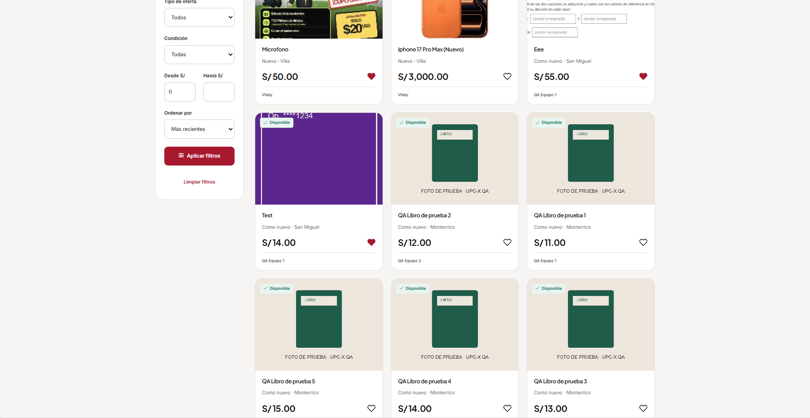
</div>

**Recomendación:** Implementar un panel de filtros lateral fijo (*sticky*) o un botón de acción flotante que permita acceder y modificar los filtros en cualquier momento sin interrumpir la navegación por los productos.

---

##### Problema n°2: Falta de diferenciación visual entre el buscador y los filtros

**Severidad:** 2 | **Heurística violada:** Correspondencia entre el sistema y el mundo real (H2)

**Problema:** El buscador principal y los controles de filtrado del marketplace no presentan una separación ni diferenciación visual suficientemente clara en la interfaz, lo que dificulta al usuario distinguir rápidamente el alcance y la función de cada herramienta.

<div align="center">

</div>

**Recomendación:** Diferenciar visualmente la barra de búsqueda de los filtros de categoría o atributos, agrupando estos últimos en un contenedor o sección independiente y utilizando etiquetas descriptivas e iconografía clara.

---

##### Problema n°3: Dimensiones reducidas en el chat y datos del producto en la vista de conversación

**Severidad:** 3 | **Heurística violada:** Diseño estético y minimalista (H8)

**Problema:** En la vista de conversación con el vendedor, tanto el contenedor del chat como el resumen con los datos del producto presentan dimensiones muy reducidas, dificultando la lectura cómoda de los mensajes y la consulta de los detalles del artículo.

<div align="center">
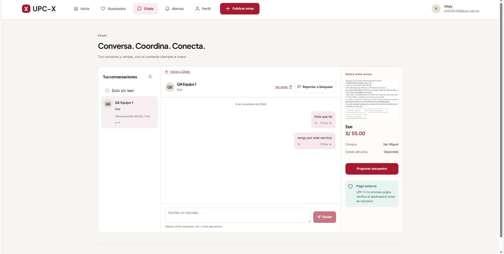
</div>

**Recomendación:** Ampliar el área destinada a la ventana de conversación, incrementar el tamaño tipográfico de los textos y reorganizar la tarjeta informativa del producto para facilitar su lectura y consulta rápida.

---

##### Problema n°4: Apariencia desactualizada y poco intuitiva en selectores de fecha y hora

**Severidad:** 2 | **Heurística violada:** Consistencia y estándares (H4)

**Problema:** Los selectores de fecha y hora utilizados para proponer un encuentro presentan una apariencia visual antigua y poco intuitiva, especialmente al interactuar con el calendario desplegable, rompiendo con la línea gráfica del resto de la plataforma.

<div align="center">

</div>

**Recomendación:** Implementar componentes modernos y estandarizados de selección de fecha y hora (*date/time pickers*), manteniendo una interfaz visual uniforme con el sistema de diseño, controles claros y una navegación sencilla.

---

##### Problema n°5: Duplicidad de la opción «Cerrar sesión» en menú lateral y perfil

**Severidad:** 2 | **Heurística violada:** Consistencia y estándares (H4)

**Problema:** La acción «Cerrar sesión» aparece duplicada simultáneamente en el menú de navegación lateral y dentro del área principal de la sección de perfil, generando redundancia innecesaria en las acciones disponibles de la cuenta.

<div align="center">

</div>

**Recomendación:** Mantener una única ubicación estándar para la acción de cerrar sesión, preferentemente al final del menú lateral de navegación o en el menú de usuario superior, eliminando duplicaciones en el contenido central.

---

##### Problema n°6: Desorganización de la información en la sección «Acuerdos anteriores»

**Severidad:** 3 | **Heurística violada:** Reconocimiento antes que recuerdo (H6)

**Problema:** La sección «Acuerdos anteriores» muestra los datos de forma plana y poco estructurada, lo que dificulta al usuario identificar de un vistazo el estado final del acuerdo, el motivo de cancelación y la secuencia de pasos realizados.

<div align="center">
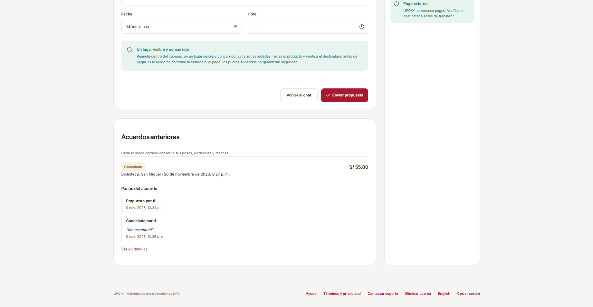
</div>

**Recomendación:** Rediseñar cada registro mediante tarjetas estructuradas que destaquen mediante insignias (*badges*) el estado, precio, fecha, punto de encuentro y motivo de cancelación, incorporando además una línea de tiempo visual (*stepper*) para representar los pasos completados del acuerdo.

---

##### Problema n°7: Acumulación de respuestas abiertas simultáneamente en preguntas frecuentes

**Severidad:** 2 | **Heurística violada:** Diseño estético y minimalista (H8)

**Problema:** En la sección del centro de ayuda, el listado de preguntas frecuentes permite mantener múltiples respuestas desplegadas al mismo tiempo, provocando una acumulación excesiva de texto en pantalla y alargando innecesariamente el desplazamiento vertical.

<div align="center">

</div>

**Recomendación:** Implementar un comportamiento de acordeón exclusivo (*single accordion*), de modo que al desplegar una nueva pregunta se contraiga automáticamente la respuesta que se encontraba abierta previamente.

---

##### Problema n°8: Falta de affordance visual en el enlace de correo de contacto del centro de ayuda

**Severidad:** 2 | **Heurística violada:** Visibilidad del estado del sistema (H1)

**Problema:** En el centro de ayuda, la dirección de correo electrónico de soporte no presenta señales visuales claras (como color distintivo, subrayado o botón) que indiquen que se trata de un enlace interactivo, pese a contar internamente con el hipervínculo mailto:.

<div align="center">
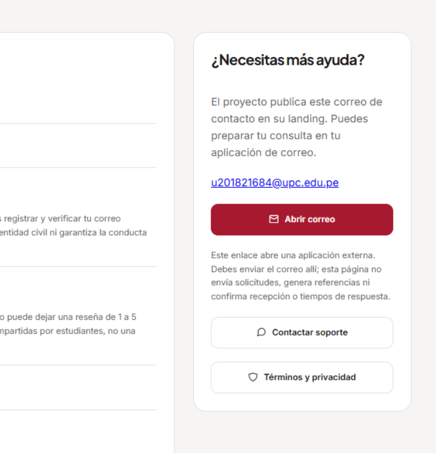
</div>

**Recomendación:** Presentar el correo electrónico como un elemento interactivo claramente identificable mediante color de enlace, iconografía de sobre o botón de acción secundaria que indique explícitamente la apertura del cliente de correo o la opción de copiar la dirección.

---

##### Problema n°9: Espaciado superior insuficiente en el saludo de la versión móvil

**Severidad:** 2 | **Heurística violada:** Diseño estético y minimalista (H8)

**Problema:** En la vista móvil del marketplace, el encabezado de bienvenida «Hola, Vitaly» se posiciona demasiado pegado al borde superior del contenedor, generando una composición visual apretada y poco equilibrada.

<div align="center">
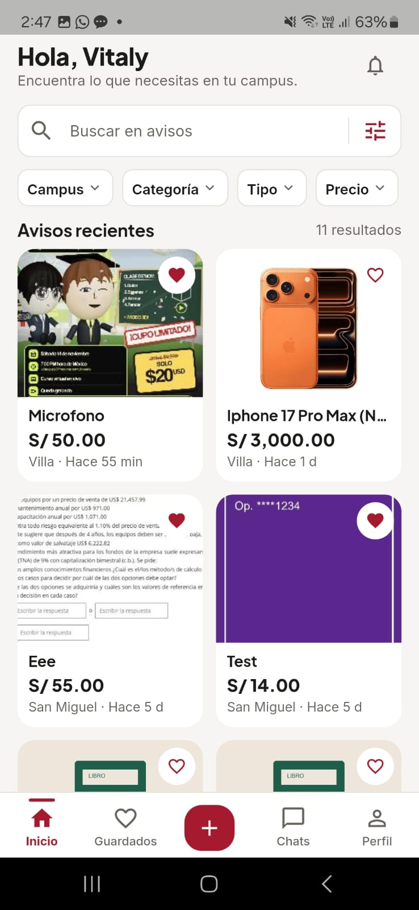
</div>

**Recomendación:** Incrementar el margen o espaciado interno superior (*padding-top*) del contenedor principal, respetando las áreas seguras (*safe areas*) del dispositivo móvil y mejorando la respiración visual del encabezado.

---

##### Problema n°10: Bloques de texto poco diferenciados en la vista móvil «Gestionar cierre»

**Severidad:** 3 | **Heurística violada:** Reconocimiento antes que recuerdo (H6)

**Problema:** En la versión móvil de la vista «Gestionar cierre», los acuerdos anteriores y el historial de sus respectivos pasos se presentan como bloques continuos de texto sin jerarquía ni separación clara, dificultando el escaneo rápido de la información en pantallas pequeñas.

<div align="center">

</div>

**Recomendación:** Reorganizar la información en tarjetas individuales con jerarquía tipográfica clara, etiquetas de estado con código de color, iconografía de apoyo y una línea de tiempo compacta que permita identificar fácilmente cada etapa del acuerdo en móvil.

---

##### Problema n°11: Ausencia de opción para tomar fotografías directamente desde la cámara en móvil

**Severidad:** 3 | **Heurística violada:** Flexibilidad y eficiencia de uso (H7)

**Problema:** Durante el flujo de publicación de avisos desde dispositivos móviles, el control para agregar imágenes únicamente abre el selector de archivos de la galería, impidiendo al usuario capturar una fotografía del producto en el momento con la cámara de su teléfono.

<div align="center">
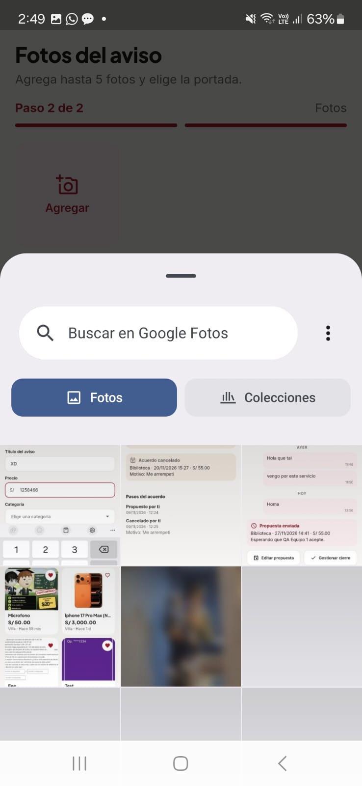
</div>

**Recomendación:** Incorporar un menú de selección o dos acciones claramente diferenciadas al subir imágenes en móvil: «Tomar fotografía» (invocando la cámara con los permisos correspondientes) y «Seleccionar de la galería».

---

##### Problema n°12: Confusión de identidad entre vendedor y autor de reseña en «Perfil del vendedor»

**Severidad:** 3 | **Heurística violada:** Consistencia y estándares (H4)

**Problema:** La ventana emergente «Perfil del vendedor» muestra información ambigua sobre la reputación: encabeza la vista identificando al vendedor como «QA Equipo 1», pero en el listado inferior muestra una reseña asociada a «QA Equipo 2» sin especificar quién es el evaluador y quién el evaluado.

<div align="center">
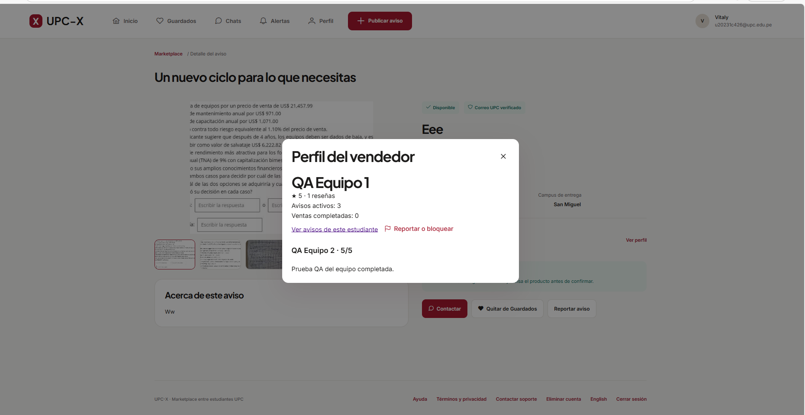
</div>

**Recomendación:** Reestructurar el modal diferenciando visualmente la cabecera con los datos del vendedor respecto a la sección de comentarios recibidos. Incluir etiquetas explícitas (ej. «Reseña escrita por: [Nombre del comprador]») y validar que las valoraciones listadas correspondan efectivamente al vendedor consultado.

---

##### Problema n°13: Falta de jerarquía visual y representación gráfica en «Mi reputación»

**Severidad:** 2 | **Heurística violada:** Diseño estético y minimalista (H8) / Visibilidad del estado del sistema (H1)

**Problema:** La sección «Mi reputación» presenta las métricas de intercambios, opiniones positivas, ventas completadas y avisos activos como líneas de texto simple sin jerarquía visual, dejando grandes espacios vacíos y omitiendo una representación gráfica de la calificación promedio del usuario.

<div align="center">
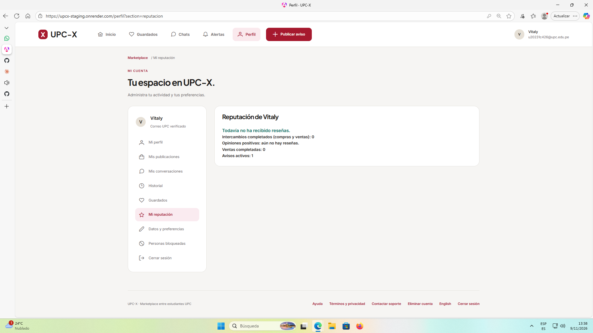
</div>

**Recomendación:** Rediseñar el panel utilizando tarjetas de resumen (*KPI cards*) para cada indicador con iconos e indicadores numéricos destacados, además de incorporar una visualización mediante estrellas para la calificación general. En caso de no contar con reseñas, mostrar un estado vacío (*empty state*) ilustrado con un mensaje orientativo.

---

##### Problema n°14: Recorte excesivo y falta de controles de ajuste al seleccionar fotografías

**Severidad:** 3 | **Heurística violada:** Flexibilidad y eficiencia de uso (H7) / Diseño estético y minimalista (H8)

**Problema:** Al cargar fotografías para un aviso, la previsualización aplica un recorte (*crop*) y zoom automático excesivo dentro del marco asignado, cortando partes importantes del producto y sin ofrecer controles para que el usuario ajuste el encuadre.

<div align="center">

</div>

**Recomendación:** Integrar un componente de edición básica al subir imágenes que permita ajustar el encuadre, ampliar, reducir (*zoom in/out*) y reposicionar la fotografía, garantizando una vista previa fiel a cómo se publicará el anuncio.

---

##### Problema n°15: Distribución desordenada y ambigüedad en los botones de gestión de la publicación

**Severidad:** 3 | **Heurística violada:** Diseño estético y minimalista (H8) / Prevención de errores (H5)

**Problema:** Los botones de acción para gestionar una publicación presentan una alineación desordenada, tamaños desiguales y etiquetas de texto partidas en múltiples líneas. Además, acciones críticas como «Retirar aviso» y «Marcar como vendido» carecen de diferenciación y explicación sobre sus consecuencias.

<div align="center">

</div>

**Recomendación:** Estandarizar el tamaño y alineación de los botones priorizando la acción principal, agrupar las acciones secundarias o destructivas en un menú desplegable («Más opciones») e implementar modales de confirmación que expliquen el impacto de retirar o marcar como vendido un aviso antes de ejecutar la acción.

---

##### Problema n°16: Falta de validación de límite máximo en el campo «Precio en soles»

**Severidad:** 3 | **Heurística violada:** Prevención de errores (H5)

**Problema:** El campo numérico «Precio en soles» del formulario de publicación no cuenta con un tope máximo ni validación de longitud, permitiendo ingresar cifras desproporcionadas o irreales que pueden generar errores de visualización o distorsionar el catálogo.

<div align="center">

</div>

<div align="center">

</div>

**Recomendación:** Definir e implementar una validación de importe máximo razonable tanto en el *frontend* como en el *backend*, restringiendo la cantidad de dígitos permitidos y mostrando un mensaje de advertencia en línea cuando el monto ingresado supere el límite establecido.

---

##### Problema n°17: Ausencia de diferenciación visual entre mensajes enviados y recibidos en el chat

**Severidad:** 3 | **Heurística violada:** Visibilidad del estado del sistema (H1) / Consistencia y estándares (H4)

**Problema:** En la interfaz de mensajería, todas las burbujas de texto utilizan exactamente el mismo color de fondo y se alinean del mismo lado del contenedor, impidiendo distinguir rápidamente cuáles mensajes fueron enviados por el usuario actual y cuáles pertenecen al interlocutor.

<div align="center">

</div>

**Recomendación:** Aplicar el estándar convencional de interfaces de chat: alinear los mensajes propios a la derecha con un color de acento diferenciador, y posicionar los mensajes recibidos a la izquierda con un tono neutro, facilitando el seguimiento inmediato de la conversación.

#### 6.4.2.4. Resumen de modificaciones para subsanar hallazgos

El estado de cada hallazgo se registra aquí a medida que se contrasta con la versión vigente de UPC-X y se corrige. Una fila solo pasa de «Pendiente de verificar» cuando existe un commit, un PR o una captura que lo respalde.

El 16/11 se registraron las correcciones de móvil en H014–H016 y H022, además de H004 (guardar un aviso propio), con los commits y PR en [hallazgos.csv](docs/validacion/hallazgos.csv). La revisión local aprobó 317 pruebas Flutter y comprobaciones de densidad con pantallas pequeñas, español/inglés y texto ampliado. «Corregido en código» no cierra el hallazgo: falta el retest independiente y, para cámara, recorrer la captura y sus permisos en el dispositivo. La instalación local por USB se distingue de la distribución QA por Firebase.

| Hallazgo | Resumen | Severidad | Estado | Modificación realizada | Evidencia (commit / captura) | Responsable |
|---|---|:---:|---|---|---|---|
| 1 | Filtros del marketplace no visibles al desplazarse | 3 | Pendiente de verificar | Por completar tras revisar el caso contra la versión vigente | — | — |
| 2 | Buscador y filtros sin diferenciación visual | 2 | Pendiente de verificar | Por completar tras revisar el caso contra la versión vigente | — | — |
| 3 | Chat y datos del producto de tamaño reducido | 3 | Pendiente de verificar | Por completar tras revisar el caso contra la versión vigente | — | — |
| 4 | Selectores de fecha y hora con apariencia antigua | 2 | Pendiente de verificar | Por completar tras revisar el caso contra la versión vigente | — | — |
| 5 | «Cerrar sesión» duplicado | 2 | Pendiente de verificar | Por completar tras revisar el caso contra la versión vigente | — | — |
| 6 | «Acuerdos anteriores» poco organizado | 3 | Pendiente de verificar | Por completar tras revisar el caso contra la versión vigente | — | — |
| 7 | Preguntas frecuentes con varias respuestas abiertas | 2 | Pendiente de verificar | Por completar tras revisar el caso contra la versión vigente | — | — |
| 8 | Correo de contacto sin affordance de enlace | 2 | Pendiente de verificar | Por completar tras revisar el caso contra la versión vigente | — | — |
| 9 | Saludo móvil sin espaciado superior | 2 | Corregido en código; pendiente de retest | Cabeceras y áreas seguras con espaciado coherente; pruebas de densidad con texto ampliado | [Móvil #36](https://github.com/UPC-X/upcx-mobile/pull/36) | Titular |
| 10 | «Gestionar cierre» móvil con bloques indiferenciados | 3 | Corregido en código; pendiente de retest | Trato dentro del chat; estados diferenciados, iconos y línea de tiempo en su detalle | [Móvil #37](https://github.com/UPC-X/upcx-mobile/pull/37), [#39](https://github.com/UPC-X/upcx-mobile/pull/39) | Titular |
| 11 | Sin opción de cámara al subir fotos en móvil | 3 | Corregido en código; pendiente de retest | Selector de cámara o galería al publicar; captura y permisos en dispositivo pendientes de comprobar | [Móvil #36](https://github.com/UPC-X/upcx-mobile/pull/36) | Titular |
| 12 | Vendedor y autor de reseña confundidos en el perfil | 3 | Pendiente de verificar | Por completar tras revisar el caso contra la versión vigente | — | — |
| 13 | «Mi reputación» sin jerarquía visual | 2 | Pendiente de verificar | Por completar tras revisar el caso contra la versión vigente | — | — |
| 14 | Recorte excesivo y sin ajuste de encuadre en fotos | 3 | Pendiente de verificar | Por completar tras revisar el caso contra la versión vigente | — | — |
| 15 | Botones de gestión de la publicación desordenados | 3 | Pendiente de verificar | Por completar tras revisar el caso contra la versión vigente | — | — |
| 16 | «Precio en soles» sin límite máximo | 3 | Pendiente de verificar | Por completar tras revisar el caso contra la versión vigente | — | — |
| 17 | Mensajes del chat sin diferenciación emisor/receptor | 3 | Corregido en código; pendiente de retest | Propios a la derecha en granate; recibidos a la izquierda en tono neutro; hora y referencia de respuesta | [Móvil #36](https://github.com/UPC-X/upcx-mobile/pull/36), [#38](https://github.com/UPC-X/upcx-mobile/pull/38) | Titular |


