<div style="text-align: center;">
  
</div>

<h2 style="text-align: center;"> Universidad Peruana de Ciencias Aplicadas </h2>

<h4 style="text-align: center"> Ingeniería de Software </h4>

<h4 style="text-align: center"> Periodo: 202620 </h4>

<h4 style="text-align: center"> 1ASI0732 | Diseño de Experimentos de Ingeniería de Software </h4>

<h4 style="text-align: center"> NRC: 9082 </h4>

<h4 style="text-align: center"> Docente: Juan Fernando Ysen Paiba </h4>

<h3 style="text-align: center;"> Informe del Trabajo Final </h3>

<h4 style="text-align: center"> Startup: RichStudent</h4>

<h4 style="text-align: center"> Producto: UPC-X</h4>

<h4 style="text-align: center">Integrantes:</h4>

<div style="text-align:center; margin-top: 10px; font-size: 90%; line-height: 1.6;">
   <table style="margin-left: auto; margin-right: auto;">
      <tr>
         <td>u202312109</td>
         <td>Eduardo Jose Cossar Sanchez</td>
      </tr>
      <tr>
         <td>u202322187</td>
         <td>Gilbert Alonso Huarcaya Matias</td>
      </tr>
      <tr>
         <td>u201821684</td>
         <td>Luis Manuel Espinoza Navarrete</td>
      </tr>
      <tr>
         <td>U20221G231</td>
         <td>Manuel Alejandro Molina Vásquez</td>
      </tr>
      <tr>
         <td>U202022211</td>
         <td>Mathias Javier Murillo</td>
      </tr>
   </table>
</div>

<br>

<h5 style="text-align: center; font-style: italic;"> Noviembre de 2026 </h5>

<div class="page"></div>

# Registro de Versiones del Informe

| Version | Fecha | Autor | Descripción de modificación |
|---------|-------|-------|-----------------------------|
| 1.0 | 31/08/2026 | Eduardo Jose Cossar Sanchez | Creación del repositorio del informe y estructura inicial del documento: carátula, registro de versiones y tabla de contenidos. |
| 1.1 | 31/08/2026 | Eduardo Jose Cossar Sanchez | Redacción inicial del Capítulo I: descripción de la startup RichStudent y primera versión del Solution Profile. |
| 1.2 | 01/09/2026 | Luis Manuel Espinoza Navarrete | Desarrollo del Capítulo I para RichStudent y UPC-X: análisis 5W+2H completo, Lean UX Process (Problem Statements, Assumptions e Hypothesis Statements) y segmentos objetivo. |
| 1.3 | 01/09/2026 | Mathias Javier Murillo | Actualización de la tabla de perfiles de integrantes del equipo en la sección 1.1.2. |
| 1.4 | 01/09/2026 | Luis Manuel Espinoza Navarrete | Incorporación de la sección Student Outcome con el cuadro del ABET Student Outcome 4 e integración de la imagen del Lean UX Canvas en la sección 1.2.2.4. |
| 1.5 | 03/09/2026 | Eduardo Jose Cossar Sanchez | Incorporación de las fotografías de los integrantes del equipo en la sección 1.1.2. |
| 1.6 | 04/09/2026 | Gilbert Alonso Huarcaya Matias | Incorporación del marco ético profesional ACM/IEEE Computer Society en la sección Student Outcome, con sus referencias bibliográficas, y desglose del registro de versiones por autor. |
| 1.7 | 04/09/2026 | Gilbert Alonso Huarcaya Matias | Integración de los Capítulos I a V en un único documento, reunión de los recursos gráficos y regeneración de la tabla de contenidos a cuatro niveles. |
| 1.8 | 04/09/2026 | Gilbert Alonso Huarcaya Matias | Redacción de la sección 2.4 Ubiquitous Language con el glosario de términos del dominio, y de la sección 2.3 Needfinding con la User Task Matrix y la introducción metodológica de sus cinco artefactos. Ampliación del diseño de entrevistas de la sección 2.2.1. |
| 1.9 | 04/09/2026 | Gilbert Alonso Huarcaya Matias | Redacción del Capítulo III: especificación de treinta User Stories, seis Technical Stories y tres Spike Stories con criterios de aceptación en notación Gherkin, Product Backlog priorizado y estimado, e introducción del To-Be Scenario Mapping y del Impact Mapping. |
| 1.10 | 04/09/2026 | Gilbert Alonso Huarcaya Matias | Elaboración de los cuatro Scenario Maps de las secciones 2.3.5 y 3.1: el escenario actual y el propuesto para cada segmento objetivo, representados como matriz de fases por Doing, Thinking y Feeling con codificación de color según la carga de la experiencia. |
| 1.11 | 04/09/2026 | Gilbert Alonso Huarcaya Matias | Elaboración de los artefactos de Needfinding de la sección 2.3: las dos fichas de User Persona, los dos User Journey Maps del recorrido actual y los dos Empathy Maps, uno por cada segmento objetivo. |
| 1.12 | 04/09/2026 | Gilbert Alonso Huarcaya Matias | Elaboración del Impact Map de la sección 3.4, que enlaza el objetivo de negocio con los actores, los impactos esperados, los entregables y las historias de usuario que los implementan. |
| 1.13 | 05/09/2026 | Luis Manuel Espinoza Navarrete | Revisión de AV1: incorporación de Part I, actualización de Collaboration Insights, precisión de objetivos y restricciones del Capítulo I, matriz preliminar de impactos ABET y corrección de hipótesis y segmentos pendientes de validación. |
| 1.14 | 05/09/2026 | Luis Manuel Espinoza Navarrete | Precisión del ciclo progresivo de evidencias de colaboración por hito, sin alterar el contenido de los capítulos II a V. |
| 1.15 | 05/09/2026 | Manuel Alejandro Molina Vásquez | Corrección del Capítulo III: especificación y análisis de las 50 User Stories y del Product Backlog. |
| 1.16 | 18/09/2026 | Luis Manuel Espinoza Navarrete | Registro de la entrevista a Nicolás Castro Solorza en la sección 2.2.2 (Segmento Objetivo 2, Entrevistado #2), con captura y enlace al video. |
| 1.17 | 18/09/2026 | Luis Manuel Espinoza Navarrete | Reenfoque de la problemática del Capítulo I: de riesgo de seguridad a la falta de un conjunto completo de herramientas de intercambio entre pares, con cifras de SUNEDU, CAPPES/ENAHO y ComexPerú. |
| 1.18 | 21/09/2026 | Luis Manuel Espinoza Navarrete | Incorporación del análisis preliminar de las cinco entrevistas realizadas en la sección 2.2.3 y actualización de edad y duración de la entrevista a Nicolás Castro Solorza. |
| 1.19 | 29/09/2026 | Gilbert Alonso Huarcaya Matias | Revisión del informe: imágenes del Capítulo IV incrustadas para la exportación a PDF, criterios de aceptación y ejemplos de request y response de las Technical Stories, orden del Product Backlog por valor de negocio y análisis de las cinco entrevistas. |
| 1.20 | 29/09/2026 | Manuel Alejandro Molina Vásquez | Diagramas C4 de contexto, contenedores y componentes de la sección 4.8. |
| 1.21 | 29/09/2026 | Mathias Javier Murillo | Registro de la tercera entrevista del segmento de estudiantes compradores en la sección 2.2.2. |
| 1.22 | 30/09/2026 | Luis Manuel Espinoza Navarrete | Nueva propuesta de landing en la sección 4.3, con wireframes y mock-ups para escritorio y navegador móvil en un archivo de Figma propio, y enlaces a Figma para cada wireflow, User Flow y prototipo de las secciones 4.4 a 4.7. |
| 1.23 | 30/09/2026 | Luis Manuel Espinoza Navarrete | Videos de navegación de los prototipos móvil y web en las secciones 4.5 y 4.7, y actualización de los diagramas C4 de la sección 4.8 y del modelo relacional de la sección 4.10. |
| 1.24 | 30/09/2026 | Luis Manuel Espinoza Navarrete | Redacción del Capítulo V: herramientas, repositorios, GitFlow y despliegue de la sección 5.1, evidencias de landing, aplicación web, aplicación móvil y API de la sección 5.2, acuerdo de servicio SaaS publicado en la landing y tabla de endpoints documentados. |
| 1.25 | 30/09/2026 | Mathias Javier Murillo | Evidencias de la aplicación web y de la API RESTful en las secciones 5.2.3 y 5.2.6, con capturas de la documentación interactiva de los endpoints. |
| 1.26 | 08/10/2026 | Eduardo Jose Cossar Sanchez | Actualización del Student Outcome con las acciones del TB1 y corrección de imágenes del informe. |
| 1.27 | 09/10/2026 | Gilbert Alonso Huarcaya Matias | Actualización del Capítulo V al producto desplegado: stack de la aplicación web en Vue, despliegue en Render con los dominios api.upcx.tech y app.upcx.tech, Sprint Backlog 1 con tareas de ingeniería estimadas en horas, documentación completa de la API con ejemplos, Collaboration Insights del TB1, Student Outcome y conclusiones. |
| 1.28 | 20/10/2026 | Luis Manuel Espinoza Navarrete | Nueva coordinación en el mismo chat tras una cancelación o una inasistencia, hasta tres no concretadas, en la sección 4.10, el modelo relacional y el diagrama de clases. |
| 1.29 | 21/10/2026 | Luis Manuel Espinoza Navarrete | Anexo D: matriz de trazabilidad entre las historias del Product Backlog, el contrato OpenAPI 0.7.1, la API, las aplicaciones web y móvil y sus pruebas. |
| 1.30 | 26/10/2026 | Equipo RichStudent (revisión asistida) | Corte local 0.8.0, cierre de brechas de perfil/soporte/seguridad/idioma y trazabilidad; capítulos VI y VII, instrumentos de validación, CI integrado y promoción por SHA. Entrevistas, auditorías, distribución y evidencia cloud pendientes de ejecución. |
| 1.31 | 28/10/2026 | Revisión asistida | Capítulo VI: consolidación de pruebas, revisión Android física, instrumentos y matriz de evidencia; diagrama de suites y pendientes de validación. |
| 1.32 | 28/10/2026 | Revisión asistida | Capítulo VII: accesos comprobados, preparación de infraestructura, bloqueo de artefactos y pendientes de entrega; diagrama del pipeline. Integración del avance del informe en develop. |
| 1.33 | 28/10/2026 | Revisión asistida | Capítulo VI: seis flujos nativos de Excalidraw con archivos editables, exportaciones y capturas del editor; ejemplos trazables a tests reales y capturas de recuperación Android. |
| 1.34 | 28/10/2026 | Revisión asistida | Capítulo VII: flujos nativos Excalidraw del pipeline y del ensayo de monitoreo, capturas y trazabilidad de controles; conservación explícita de los pendientes cloud. |
| 1.35 | 30/10/2026 | Luis Manuel Espinoza Navarrete | Student Outcome del AV2: acciones y conclusiones del AV2 por criterio (4.c.1 y 4.c.2), con la entrada de Luis; sección Conclusiones con el avance del AV2. |
| 1.36 | 30/10/2026 | Luis Manuel Espinoza Navarrete | Collaboration Insights del AV2 con las tareas de cada integrante y referencia a las capturas pendientes; enlaces de la tabla de contenidos. |
| 1.37 | 30/10/2026 | Luis Manuel Espinoza Navarrete | Revisión general de coherencia con el código: entidad `Deal` y sus estados en 4.9 y 4.10, conteo de 17 tablas, nombre de los tests de liberación en el capítulo VII. |
| 1.38 | 31/10/2026 | Luis Manuel Espinoza Navarrete | Modelo de clases y diccionario de 4.9 alineados con el dominio de la API 0.8.0; diagrama relacional y tabla de 4.10 regenerados desde las migraciones V1–V13 (17 tablas, 36 claves foráneas e índices reales); rutas y respuestas reales en los criterios de las historias técnicas; variables de producción en el capítulo V. |
| 1.39 | 31/10/2026 | Luis Manuel Espinoza Navarrete | Entrega del corte 0.8.0 con evidencia real: candidato integrado, staging con recibo, aceptación por API con datos sintéticos, respaldo y restauración, distribución Android QA, alerta de Render ante un fallo real y promoción a producción con recibo y tags `v0.8.0`. Capítulos V, VI y VII, conclusiones y Anexos A y D actualizados; diagramas C4 y sus PNG sincronizados con el soporte de la landing; figuras 7.1 y 7.2 regeneradas. |
| 1.40 | 01/11/2026 | Luis Manuel Espinoza Navarrete | Instalación y apertura de UPC-X QA desde Firebase confirmadas por el verificador; estado de validación y figura 7.1 actualizados sin atribuir todavía acceso OTP ni tareas completas. |
| 1.41 | 13/11/2026 | Luis Manuel Espinoza Navarrete | Sección 6.4: auditoría realizada a SecuraNet (7 hallazgos) y auditoría recibida de SANUVI (17 hallazgos con capturas), tabla de seguimiento de correcciones y registro de los hallazgos en la matriz de evidencia. |
| 1.42 | 13/11/2026 | Luis Manuel Espinoza Navarrete | Sección 6.3.2: formato de registro de las entrevistas de validación, replicado del formato de la sección 2.2.2, con seis bloques (E01 a E06) listos para completar con el video, la captura y los datos de cada participante. |
| 1.43 | 13/11/2026 | Gilbert Alonso Huarcaya Matias | Sección 6.3.2: registro de la entrevista de validación E05 a Fiorella Grisel Cordova Pinchi (estudiante vendedor), con su captura y resumen. |
| 1.44 | 13/11/2026 | Luis Manuel Espinoza Navarrete | Sección 6.3.2: registro de la entrevista de validación E02 a Nicolás Castro Solorza, con captura y enlace al video, y actualización del estado de las seis sesiones, con el dispositivo, la autorización del participante y el resumen. |
| 1.45 | 13/11/2026 | Luis Manuel Espinoza Navarrete | Sección 6.3.2: enlace al video, entrevistador, fecha y duración de la entrevista E03 (Mathias Javier Murillo); quedan pendientes su captura, los datos del participante y el resumen. |
| 1.46 | 13/11/2026 | Luis Manuel Espinoza Navarrete | Sección 6.3.2: corrección del registro de las entrevistas E01 y E06 (imagen, ficha de tareas y campos), actualización del estado de las seis sesiones y fecha de la carátula. |
| 1.47 | 13/11/2026 | Luis Manuel Espinoza Navarrete | Integración del capítulo VIII para AV2: preguntas, priorización, tarjetas, hipótesis nulas, métricas, condiciones, escala y seguimiento propuestos; historias y backlog To-Be sin atribuir ejecución ni resultados. |
| 1.48 | 13/11/2026 | Luis Manuel Espinoza Navarrete | Sección 6.3.3: evaluación heurística con tareas, escala de severidad, tabla de problemas y recomendaciones a partir de E02, E04 y E05. Sección 7.1.1: benchmark de alternativas para integración, entrega, despliegue y monitoreo. |
| 1.49 | 23/11/2026 | Manuel Alejandro Molina Vásquez | Capítulo VIII: estructura de la sección 8.3.3 y de las secciones 8.4 a 8.6, y sección 8.3.4 To-Be Validation Interviews con el diseño y el registro de las entrevistas. |
| 1.50 | 24/11/2026 | Luis Manuel Espinoza Navarrete | Capítulo VIII: títulos de 8.3.3.2 a 8.3.3.5, 8.4 y 8.5.1 alineados con el enunciado y nivel de 8.3.4.2; índice completo del capítulo; secciones Video App Validation y Video About-the-Team dentro de Conclusiones; numeración de 3.2.1 a 3.2.3. |
| 1.51 | 25/11/2026 | Luis Manuel Espinoza Navarrete | Capítulo VIII: medición con PostHog implementada y desplegada en staging; 8.2.2, 8.2.4, 8.2.8, 8.3 y 8.3.2 actualizados; 8.3.3.1–8.3.3.5 con evidencia; 8.3.4 reescrito como validación To-Be sin repetir 6.3; 8.6.2 con la matriz GEES que pide el enunciado. |
| 1.52 | 25/11/2026 | Luis Manuel Espinoza Navarrete | Capítulo VIII: PostHog descarta la IP de los eventos (8.2.8); prueba del trato completo en staging y dashboard de TS09 con M01–M04 (8.3.3.3 y 8.3.3.5). |
| 1.53 | 27/11/2026 | Gilbert Alonso Huarcaya Matias | Integración del Capítulo VIII para el TB2: 8.3.3 con capturas de la web, la API, la landing y la aplicación Android, 8.3.3.6 con los pull requests del Sprint 4 y 5, 8.4.1 y 8.4.2 con el análisis de EX01 y el backlog de preguntas repuntuado, 8.5.1 con el flujo de aprendizaje y el shareback de EX01, matriz de evaluación ética y de impacto, protocolo y consentimiento del piloto EX01 en `docs/validacion`, y Student Outcome del TB2. |


<div class="page"></div>


# Project Report Collaboration Insights

## AV1

### Tareas

El informe se desarrolla de manera colaborativa en el repositorio público [UPC-X/report-UPC](https://github.com/UPC-X/report-UPC). Las contribuciones de AV1 se organizan mediante ramas de funcionalidad, commits convencionales y revisiones antes de la integración a `develop`.

<div style="text-align:center; margin-top: 10px; font-size: 90%; line-height: 1.6;">
   <table style="margin-left: auto; margin-right: auto;">
      <tr>
         <td>Eduardo Jose Cossar Sanchez</td>
         <td>Creación del repositorio y redacción inicial del Startup Profile y Solution Profile del Capítulo I.</td>
      </tr>
      <tr>
         <td>Gilbert Alonso Huarcaya Matias</td>
         <td>Revisión ética del Student Outcome, integración del informe y aportes posteriores de Needfinding y especificación.</td>
      </tr>
      <tr>
         <td>Luis Manuel Espinoza Navarrete</td>
         <td>Desarrollo del análisis 5W+2H, Lean UX Process, segmentos objetivo y primera versión del Student Outcome.</td>
      </tr>
      <tr>
         <td>Manuel Alejandro Molina Vásquez</td>
         <td>Revisión colaborativa de las hipótesis y criterios de éxito del Capítulo I.</td>
      </tr>
      <tr>
         <td>Mathias Javier Murillo</td>
         <td>Actualización de perfiles del equipo y revisión de Business Outcomes y Business Assumptions.</td>
      </tr>
   </table>
</div>

### GitHub Collaboration Insights

El historial de cambios, las ramas y los Pull Requests de AV1 se encuentran disponibles en el [repositorio del informe](https://github.com/UPC-X/report-UPC). Las evidencias visuales de colaboración se consolidan progresivamente al cierre de cada hito a partir del grafo de red, la actividad de commits y los Pull Requests integrados a `develop`, verificando su coherencia con el Registro de Versiones y las responsabilidades descritas.


## TB1

### Tareas

En el TB1 el informe se trabajó en ramas `feature/*` que se integraron a `develop` mediante Pull Requests, y el producto se desarrolló en los repositorios de la landing, la API, la aplicación web y la aplicación móvil de la organización [UPC-X](https://github.com/UPC-X).

<div style="text-align:center; margin-top: 10px; font-size: 90%; line-height: 1.6;">
   <table style="margin-left: auto; margin-right: auto;">
      <tr>
         <td>Eduardo Jose Cossar Sanchez</td>
         <td>Desarrollo de la aplicación web en Vue: registro con términos y privacidad, catálogo, conversaciones y vistas de cierre. Estructura del keynote y del video de exposición, y actualización del Student Outcome.</td>
      </tr>
      <tr>
         <td>Gilbert Alonso Huarcaya Matias</td>
         <td>Revisión del informe sección por sección, corrección de las imágenes del Capítulo IV para el PDF, criterios de aceptación de las Technical Stories, análisis de las cinco entrevistas, y actualización del Capítulo V: Sprint Backlog, documentación de la API y despliegue.</td>
      </tr>
      <tr>
         <td>Luis Manuel Espinoza Navarrete</td>
         <td>Diseño en Figma de la landing y de las aplicaciones web y móvil con sus prototipos, implementación de la API RESTful y de la aplicación móvil, despliegue en Render y redacción del Capítulo V.</td>
      </tr>
      <tr>
         <td>Manuel Alejandro Molina Vásquez</td>
         <td>Diagramas C4 de contexto, contenedores y componentes de la sección 4.8, y actualización de las fotografías del Capítulo I.</td>
      </tr>
      <tr>
         <td>Mathias Javier Murillo</td>
         <td>Tercera entrevista del segmento de estudiantes compradores, integración de la aplicación web con la API, evidencias de la aplicación web y de la API en el Capítulo V, y configuración del despliegue.</td>
      </tr>
   </table>
</div>

### GitHub Collaboration Insights

Las siguientes capturas de GitHub muestran las contribuciones de cada integrante al informe integradas en la rama `main`, los commits de la rama `develop` con su autor y fecha, y los Pull Requests integrados durante el TB1.

<p align="center">
  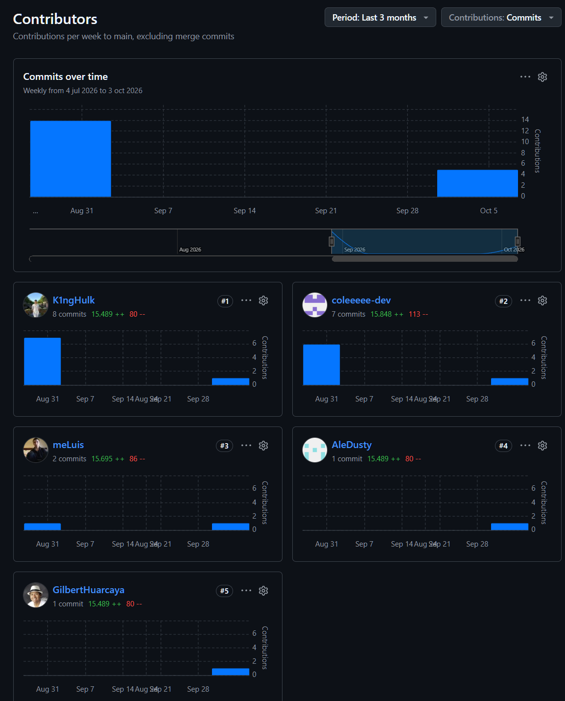
</p>

<p align="center">
  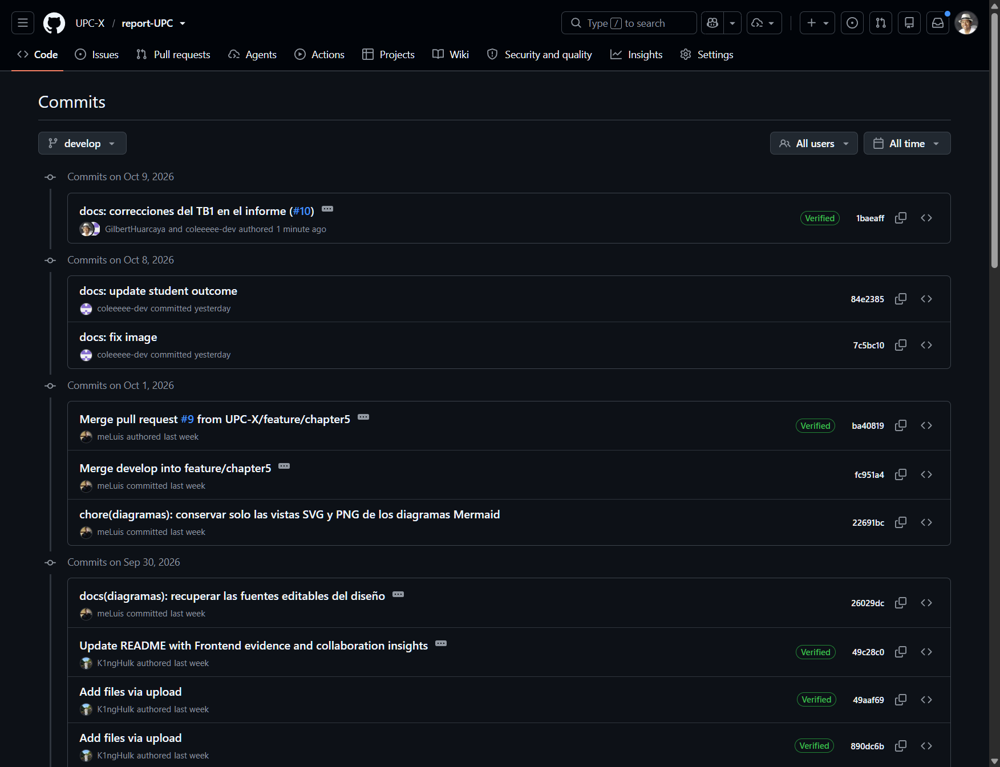
</p>

<p align="center">
  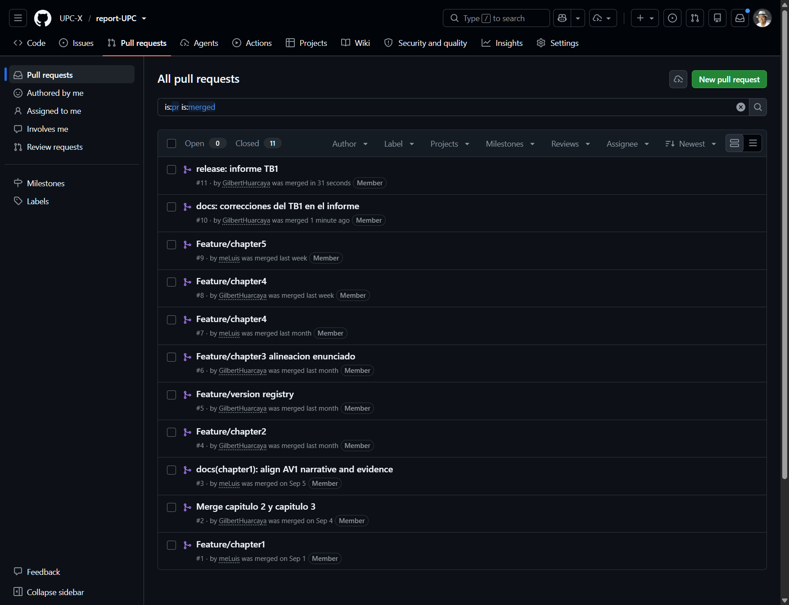
</p>

## AV2

### Tareas

En el AV2 el informe y el producto se trabajaron en ramas `feature/*` que se integraron a `develop` mediante Pull Requests. La API, la aplicación web, la aplicación móvil y la landing se desarrollaron en los repositorios de la organización [UPC-X](https://github.com/UPC-X), y el informe recogió cada avance en su capítulo correspondiente.

<div style="text-align:center; margin-top: 10px; font-size: 90%; line-height: 1.6;">
   <table style="margin-left: auto; margin-right: auto;">
      <tr>
         <td>Eduardo Jose Cossar Sanchez</td>
         <td>Aplicación web sobre la API v0.3: ingreso con código por correo, recuperación de cuenta, consentimiento renovado al cambiar el encuentro, catálogo con filtros, página 404 y perfil con historial.</td>
      </tr>
      <tr>
         <td>Gilbert Alonso Huarcaya Matias</td>
         <td>Acuerdos y comprobantes: historial, inasistencia, comprobantes con respuesta y nueva coordinación tras cancelar. Notificaciones transaccionales, mensajería incremental, reportes de avisos y soporte, contrato en inglés, <code>/api/docs</code> y una petición Bruno por operación.</td>
      </tr>
      <tr>
         <td>Luis Manuel Espinoza Navarrete</td>
         <td>Verificación y calidad del corte: matriz de trazabilidad del Anexo D, capítulos VI y VII con flujos Excalidraw, revisión del catálogo web, revisión de Android en dispositivo físico, conteo de pruebas y registro de lo pendiente.</td>
      </tr>
      <tr>
         <td>Manuel Alejandro Molina Vásquez</td>
         <td>Corte 0.8.0: contrato de 52 operaciones, soporte para visitantes, número de cobro privado, conteo de acuerdos completados independiente de reseñas y Android bilingüe con distribución QA.</td>
      </tr>
      <tr>
         <td>Mathias Javier Murillo</td>
         <td>Entrega y costos: workflows de integración, despliegue y distribución; staging gratuito en un único servicio; comprobación de accesos a la nube; diagnóstico y limpieza verificada de reportes de GitHub Actions; registro de costos reales y runbook de entrega.</td>
      </tr>
   </table>
</div>

### GitHub Collaboration Insights

Las contribuciones del AV2 al informe entraron a `develop` mediante los Pull Requests #18 a #26 y los merges de las ramas de los capítulos VI y VII. La captura muestra los commits de `develop` del 10 de octubre al 1 de noviembre.

<p align="center">
  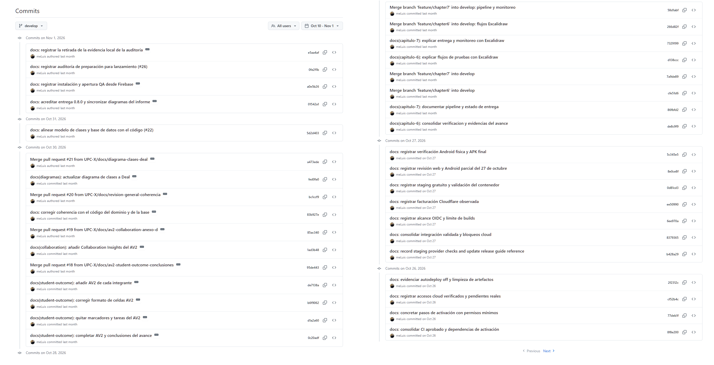
</p>

## TB2

### Tareas

En el TB2 el informe se trabajó sobre el capítulo VIII y sobre las entrevistas de validación de 6.3.2. Los cambios entraron a `develop` mediante los Pull Requests #1 a #4 de [UPC-X/report-UPC](https://github.com/UPC-X/report-UPC) y, al cierre, con la integración del capítulo. En el producto se fusionaron, desde el 16 de noviembre, 5 Pull Requests en la API, 11 en la aplicación web, 8 en la aplicación móvil y 1 en la landing.

<div style="text-align:center; margin-top: 10px; font-size: 90%; line-height: 1.6;">
   <table style="margin-left: auto; margin-right: auto;">
      <tr>
         <td>Eduardo Jose Cossar Sanchez</td>
         <td>Entrevistas de validación E06 (estudiante vendedora) y E01 (estudiante compradora), con sus datos, capturas y videos registrados en 6.3.2 el 12 y el 13 de noviembre.</td>
      </tr>
      <tr>
         <td>Gilbert Alonso Huarcaya Matias</td>
         <td>Entrevista de validación E05. Evidencias de 8.3.3 con capturas de la web, la API, la landing, Trello y Android; 8.3.3.6, 8.4.1, 8.4.2 y 8.5.1; matriz de evaluación ética y de impacto; Sprint 2 y 3 en 5.2.1; ejemplos de la API en 5.2.7; estado de la auditoría de SANUVI; Student Outcome y conclusiones del TB2.</td>
      </tr>
      <tr>
         <td>Luis Manuel Espinoza Navarrete</td>
         <td>Entrevista de validación E02. Medición con consentimiento y EX02 en la API, la web y la aplicación móvil, PostHog sin IP y analítica de la landing sin cookies. Rediseño del chat y del trato. Capítulo VIII alineado con la estructura pedida, 8.3.3.1 a 8.3.3.5, 8.3.4 como validación To-Be y matriz GEES de 8.6.2.</td>
      </tr>
      <tr>
         <td>Manuel Alejandro Molina Vásquez</td>
         <td>Entrevista de validación E04. Estructura de 8.3.3 y de 8.4 a 8.6, y primera versión de 8.3.4 con los objetivos, los segmentos y el procedimiento de las entrevistas To-Be.</td>
      </tr>
      <tr>
         <td>Mathias Javier Murillo</td>
         <td>Entrevista de validación E03 con un estudiante comprador el 13 de noviembre.</td>
      </tr>
   </table>
</div>

### GitHub Collaboration Insights

Las capturas muestran los Pull Requests integrados en el informe durante el TB2 y los commits de `develop` desde el 13 de noviembre. Los Pull Requests del producto están en 8.3.3.6.

<p align="center">
  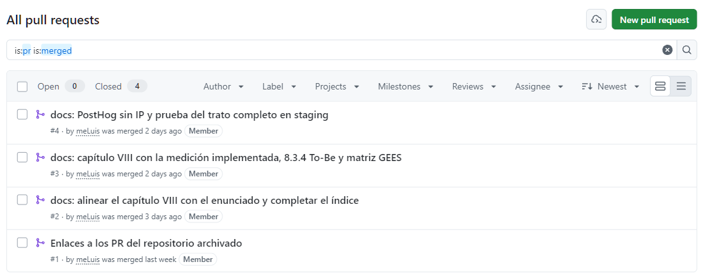
</p>

<p align="center">
  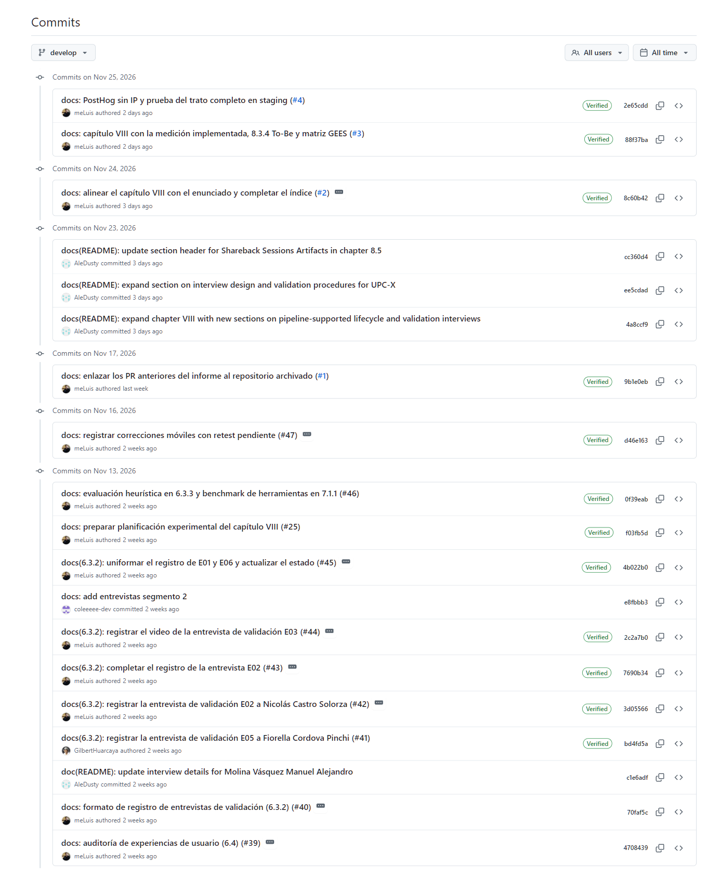
</p>

<div class="page"></div>


# Contenido

- [Registro de Versiones del Informe](#registro-de-versiones-del-informe)
- [Project Report Collaboration Insights](#project-report-collaboration-insights)
  - [AV1](#av1)
    - [Tareas](#tareas)
    - [GitHub Collaboration Insights](#github-collaboration-insights)
  - [TB1](#tb1)
    - [Tareas](#tareas-1)
    - [GitHub Collaboration Insights](#github-collaboration-insights-1)
  - [AV2](#av2)
    - [Tareas](#tareas-2)
    - [GitHub Collaboration Insights](#github-collaboration-insights-2)
  - [TB2](#tb2)
    - [Tareas](#tareas-3)
    - [GitHub Collaboration Insights](#github-collaboration-insights-3)
- [Contenido](#contenido)
- [Student Outcome](#student-outcome)
      - [ABET – EAC - Student Outcome 4](#abet--eac---student-outcome-4)
      - [Marco ético profesional: IEEE Computer Society y ACM](#marco-ético-profesional-ieee-computer-society-y-acm)
      - [Matriz preliminar de impactos de UPC-X](#matriz-preliminar-de-impactos-de-upc-x)
- [Part I: As-Is Software Project](#part-i-as-is-software-project)
- [Capítulo I: Introducción](#capítulo-i-introducción)
  - [1.1. Startup Profile](#11-startup-profile)
    - [1.1.1. Descripción de la Startup](#111-descripción-de-la-startup)
    - [1.1.2. Perfiles de integrantes del equipo](#112-perfiles-de-integrantes-del-equipo)
  - [1.2. Solution Profile](#12-solution-profile)
    - [1.2.1. Antecedentes y problemática](#121-antecedentes-y-problemática)
      - [What (¿Qué?)](#what-qué)
      - [Who (¿Quién?)](#who-quién)
      - [Where (¿Dónde?)](#where-dónde)
      - [When (¿Cuándo?)](#when-cuándo)
      - [Why (¿Por qué?)](#why-por-qué)
      - [How (¿Cómo?)](#how-cómo)
      - [How much (¿Cuánto?)](#how-much-cuánto)
      - [Objetivos y restricciones](#objetivos-y-restricciones)
    - [1.2.2. Lean UX Process](#122-lean-ux-process)
      - [1.2.2.1. Lean UX Problem Statements](#1221-lean-ux-problem-statements)
      - [1.2.2.2. Lean UX Assumptions](#1222-lean-ux-assumptions)
        - [Features](#features)
        - [Business Outcomes](#business-outcomes)
        - [User Benefits](#user-benefits)
        - [Business Assumptions](#business-assumptions)
        - [User Assumptions](#user-assumptions)
      - [1.2.2.3. Lean UX Hypothesis Statements](#1223-lean-ux-hypothesis-statements)
      - [1.2.2.4. Lean UX Canvas](#1224-lean-ux-canvas)
  - [1.3. Segmentos objetivo](#13-segmentos-objetivo)
- [Capítulo II: Requirements Elicitation & Analysis](#capítulo-ii-requirements-elicitation--analysis)
  - [2.1. Competidores](#21-competidores)
    - [2.1.1. Análisis competitivo](#211-análisis-competitivo)
      - [Competitive Analysis Landscape](#competitive-analysis-landscape)
    - [2.1.2. Estrategias y tácticas frente a competidores](#212-estrategias-y-tácticas-frente-a-competidores)
      - [Afrontando las fortalezas de nuestros competidores:](#afrontando-las-fortalezas-de-nuestros-competidores)
      - [Comprendemos que nuestras fortalezas son:](#comprendemos-que-nuestras-fortalezas-son)
      - [Estrategias](#estrategias)
      - [Tácticas](#tácticas)
      - [Afrontando las debilidades de nuestros competidores:](#afrontando-las-debilidades-de-nuestros-competidores)
      - [Comprendemos que nuestras debilidades son:](#comprendemos-que-nuestras-debilidades-son)
      - [Estrategias](#estrategias-1)
      - [Tácticas](#tácticas-1)
      - [Afrontando las oportunidades de nuestros competidores:](#afrontando-las-oportunidades-de-nuestros-competidores)
      - [Comprendemos que nuestras oportunidades son:](#comprendemos-que-nuestras-oportunidades-son)
      - [Estrategias](#estrategias-2)
      - [Tácticas](#tácticas-2)
      - [Afrontando las amenazas de nuestros competidores:](#afrontando-las-amenazas-de-nuestros-competidores)
      - [Comprendemos que nuestras amenazas son:](#comprendemos-que-nuestras-amenazas-son)
      - [Estrategias](#estrategias-3)
      - [Tácticas](#tácticas-3)
  - [2.2. Entrevistas](#22-entrevistas)
    - [2.2.1. Diseño de entrevistas](#221-diseño-de-entrevistas)
      - [Preguntas generales](#preguntas-generales)
      - [Segmento Objetivo 1: Estudiantes vendedores](#segmento-objetivo-1-estudiantes-vendedores)
      - [Segmento Objetivo 2: Estudiantes compradores](#segmento-objetivo-2-estudiantes-compradores)
      - [Criterios para la selección de entrevistados](#criterios-para-la-selección-de-entrevistados)
    - [2.2.2. Registro de entrevistas](#222-registro-de-entrevistas)
    - [Segmento Objetivo 1](#segmento-objetivo-1)
      - [Datos del Entrevistado #1](#datos-del-entrevistado-1)
      - [Datos del Entrevistado #2](#datos-del-entrevistado-2)
      - [Datos del Entrevistado #3](#datos-del-entrevistado-3)
    - [Segmento Objetivo 2](#segmento-objetivo-2)
      - [Datos del Entrevistado #1](#datos-del-entrevistado-1-1)
      - [Datos del Entrevistado #2](#datos-del-entrevistado-2-1)
    - [2.2.3. Análisis de entrevistas](#223-análisis-de-entrevistas)
      - [Resultados cuantitativos](#resultados-cuantitativos)
      - [Hallazgos del segmento de estudiantes vendedores](#hallazgos-del-segmento-de-estudiantes-vendedores)
      - [Hallazgos del segmento de estudiantes compradores](#hallazgos-del-segmento-de-estudiantes-compradores)
      - [Patrones comunes y oportunidades de diseño](#patrones-comunes-y-oportunidades-de-diseño)
      - [Contraste con las hipótesis Lean UX](#contraste-con-las-hipótesis-lean-ux)
      - [Conclusiones del análisis](#conclusiones-del-análisis)
  - [2.3. Needfinding](#23-needfinding)
    - [2.3.1. User Personas](#231-user-personas)
    - [2.3.2. User Task Matrix](#232-user-task-matrix)
    - [2.3.3. User Journey Mapping](#233-user-journey-mapping)
    - [2.3.4. Empathy Mapping](#234-empathy-mapping)
    - [2.3.5. As-is Scenario Mapping](#235-as-is-scenario-mapping)
  - [2.4. Ubiquitous Language](#24-ubiquitous-language)
- [Capítulo III: Requirements Specification](#capítulo-iii-requirements-specification)
  - [3.1. To-Be Scenario Mapping](#31-to-be-scenario-mapping)
  - [3.2. User Stories](#32-user-stories)
    - [Epics](#epics)
    - [3.2.1. User Stories](#321-user-stories)
      - [US01](#us01)
      - [US02](#us02)
      - [US03](#us03)
      - [US04](#us04)
      - [US05](#us05)
      - [US06](#us06)
      - [US07](#us07)
      - [US08](#us08)
      - [US09](#us09)
      - [US10](#us10)
      - [US11](#us11)
      - [US12](#us12)
      - [US13](#us13)
      - [US14](#us14)
      - [US15](#us15)
      - [US16](#us16)
      - [US17](#us17)
      - [US18](#us18)
      - [US19](#us19)
      - [US20](#us20)
      - [US21](#us21)
      - [US22](#us22)
      - [US23](#us23)
      - [US24](#us24)
      - [US25](#us25)
      - [US26](#us26)
      - [US27](#us27)
      - [US28](#us28)
      - [US29](#us29)
      - [US30](#us30)
      - [US31](#us31)
      - [US32](#us32)
      - [US33](#us33)
      - [US34](#us34)
      - [US35](#us35)
      - [US36](#us36)
      - [US37](#us37)
      - [US38](#us38)
      - [US39](#us39)
      - [US40](#us40)
      - [US41](#us41)
      - [US42](#us42)
      - [US43](#us43)
      - [US44](#us44)
      - [US45](#us45)
      - [US46](#us46)
      - [US47](#us47)
      - [US48](#us48)
      - [US49](#us49)
      - [US50](#us50)
    - [3.2.2. Technical Stories](#322-technical-stories)
      - [TS01](#ts01)
      - [TS02](#ts02)
      - [TS03](#ts03)
      - [TS04](#ts04)
      - [TS05](#ts05)
      - [TS06](#ts06)
    - [3.2.3. Spike Stories](#323-spike-stories)
      - [SP-01](#sp-01)
      - [SP-02](#sp-02)
      - [SP-03](#sp-03)
  - [3.3. Product Backlog](#33-product-backlog)
  - [3.4. Impact Mapping](#34-impact-mapping)
- [Capítulo IV: Product Design](#capítulo-iv-product-design)
  - [4.1. Style Guidelines](#41-style-guidelines)
    - [4.1.1. General Style Guidelines](#411-general-style-guidelines)
      - [Branding y tono de comunicación](#branding-y-tono-de-comunicación)
      - [Color](#color)
      - [Tipografía, espaciado y forma](#tipografía-espaciado-y-forma)
      - [Diseño inclusivo e interacción](#diseño-inclusivo-e-interacción)
    - [4.1.2. Web Style Guidelines](#412-web-style-guidelines)
    - [4.1.3. Mobile Style Guidelines](#413-mobile-style-guidelines)
      - [4.1.3.1. iOS Mobile Style Guidelines](#4131-ios-mobile-style-guidelines)
      - [4.1.3.2. Android Mobile Style Guidelines](#4132-android-mobile-style-guidelines)
  - [4.2. Information Architecture](#42-information-architecture)
    - [4.2.1. Organization Systems](#421-organization-systems)
    - [4.2.2. Labeling Systems](#422-labeling-systems)
    - [4.2.3. SEO Tags and Meta Tags](#423-seo-tags-and-meta-tags)
    - [4.2.4. Searching Systems](#424-searching-systems)
    - [4.2.5. Navigation Systems](#425-navigation-systems)
  - [4.3. Landing Page UI Design](#43-landing-page-ui-design)
    - [4.3.1. Landing Page Wireframe](#431-landing-page-wireframe)
    - [4.3.2. Landing Page Mock-up](#432-landing-page-mock-up)
  - [4.4. Mobile Applications UX/UI Design](#44-mobile-applications-uxui-design)
    - [4.4.1. Mobile Applications Wireframes](#441-mobile-applications-wireframes)
      - [M-01 — Acceso](#m-01--acceso)
      - [M-02 — Verificación](#m-02--verificación)
      - [M-03 — Inicio](#m-03--inicio)
      - [M-04 — Guardados](#m-04--guardados)
      - [M-05 — Detalle ajeno](#m-05--detalle-ajeno)
      - [M-06 — Detalle propio](#m-06--detalle-propio)
      - [M-07 — Publicar o editar](#m-07--publicar-o-editar)
      - [M-08 — Previsualización y éxito](#m-08--previsualización-y-éxito)
      - [M-09 — Chats](#m-09--chats)
      - [M-10 — Conversación](#m-10--conversación)
      - [M-11 — Acuerdo](#m-11--acuerdo)
      - [M-12 — Evidencia de pago](#m-12--evidencia-de-pago)
      - [M-13 — Cierre y reseña](#m-13--cierre-y-reseña)
      - [M-14 — Perfil](#m-14--perfil)
      - [Estados derivados y recuperación](#estados-derivados-y-recuperación)
      - [Principios de diseño y criterios de interacción](#principios-de-diseño-y-criterios-de-interacción)
    - [4.4.2. Mobile Applications Wireflow Diagrams](#442-mobile-applications-wireflow-diagrams)
    - [4.4.3. Mobile Applications Mock-ups](#443-mobile-applications-mock-ups)
      - [Identidad, componentes y contenido](#identidad-componentes-y-contenido)
      - [M-01 — Acceso](#m-01--acceso-1)
      - [M-02 — Verificación](#m-02--verificación-1)
      - [M-03 — Inicio](#m-03--inicio-1)
      - [M-04 — Guardados](#m-04--guardados-1)
      - [M-05 — Detalle del aviso](#m-05--detalle-del-aviso)
      - [M-06 — Mi publicación](#m-06--mi-publicación)
      - [M-07 — Publicar aviso](#m-07--publicar-aviso)
      - [M-08 — Previsualización](#m-08--previsualización)
      - [M-09 — Chats](#m-09--chats-1)
      - [M-10 — Conversación](#m-10--conversación-1)
      - [M-11 — Acuerdo de entrega](#m-11--acuerdo-de-entrega)
      - [M-12 — Evidencia de pago](#m-12--evidencia-de-pago-1)
      - [M-13 — Cierre y reseña](#m-13--cierre-y-reseña-1)
      - [M-14 — Perfil](#m-14--perfil-1)
      - [Cobertura de estados y alcance](#cobertura-de-estados-y-alcance)
    - [4.4.4. Mobile Applications User Flow Diagrams](#444-mobile-applications-user-flow-diagrams)
      - [Decisiones por objetivo de usuario](#decisiones-por-objetivo-de-usuario)
  - [4.5. Mobile Applications Prototyping](#45-mobile-applications-prototyping)
    - [Video de navegación del prototipo móvil](#video-de-navegación-del-prototipo-móvil)
    - [4.5.1. Android Mobile Applications Prototyping](#451-android-mobile-applications-prototyping)
    - [4.5.2. iOS Mobile Applications Prototyping](#452-ios-mobile-applications-prototyping)
      - [Matriz de adaptación y guion de demostración](#matriz-de-adaptación-y-guion-de-demostración)
  - [4.6. Web Applications UX/UI Design](#46-web-applications-uxui-design)
    - [4.6.1. Web Applications Wireframes](#461-web-applications-wireframes)
    - [4.6.2. Web Applications Wireflow Diagrams](#462-web-applications-wireflow-diagrams)
    - [4.6.3. Web Applications Mock-ups](#463-web-applications-mock-ups)
    - [4.6.4. Web Applications User Flow Diagrams](#464-web-applications-user-flow-diagrams)
      - [UG-01 · Acceder y recuperar la cuenta](#ug-01--acceder-y-recuperar-la-cuenta)
      - [UG-02 · Encontrar y contactar una oferta](#ug-02--encontrar-y-contactar-una-oferta)
      - [UG-03 · Publicar y administrar avisos](#ug-03--publicar-y-administrar-avisos)
      - [UG-04 · Coordinar, documentar y cerrar la entrega](#ug-04--coordinar-documentar-y-cerrar-la-entrega)
      - [UG-05 · Guardar y recuperar avisos](#ug-05--guardar-y-recuperar-avisos)
      - [UG-06 · Gestionar perfil, actividad y cobro](#ug-06--gestionar-perfil-actividad-y-cobro)
      - [UG-07 · Comunicar una irregularidad](#ug-07--comunicar-una-irregularidad)
      - [UG-08 · Consultar ayuda y contactar soporte](#ug-08--consultar-ayuda-y-contactar-soporte)
  - [4.7. Web Applications Prototyping](#47-web-applications-prototyping)
    - [Video de navegación del prototipo web](#video-de-navegación-del-prototipo-web)
  - [4.8. Domain-Driven Software Architecture](#48-domain-driven-software-architecture)
    - [4.8.1. Software Architecture Context Diagram](#481-software-architecture-context-diagram)
    - [4.8.2. Software Architecture Container Diagrams](#482-software-architecture-container-diagrams)
    - [4.8.3. Software Architecture Components Diagrams](#483-software-architecture-components-diagrams)
      - [Límites, agregados y decisiones de diseño](#límites-agregados-y-decisiones-de-diseño)
  - [4.9. Software Object-Oriented Design](#49-software-object-oriented-design)
    - [4.9.1. Class Diagrams](#491-class-diagrams)
    - [4.9.2. Class Dictionary](#492-class-dictionary)
      - [Student](#student)
      - [Challenge](#challenge)
      - [PendingSignup y SessionToken](#pendingsignup-y-sessiontoken)
      - [Listing](#listing)
      - [ListingDetails y ListingPhotos](#listingdetails-y-listingphotos)
      - [Image](#image)
      - [Conversation](#conversation)
      - [Message](#message)
      - [Deal](#deal)
      - [DealTerms, Participant y DealEvent](#dealterms-participant-y-dealevent)
      - [PaymentEvidence](#paymentevidence)
      - [PaymentDetails](#paymentdetails)
      - [Review](#review)
      - [Report](#report)
      - [SupportTicket y GuestSupportTicket](#supportticket-y-guestsupportticket)
      - [Enumerations](#enumerations)
  - [4.10. Database Design](#410-database-design)
    - [4.10.1. Relational/Non-Relational Database Diagram](#4101-relationalnon-relational-database-diagram)
      - [Integridad, concurrencia y consultas](#integridad-concurrencia-y-consultas)
- [Capítulo V: Product Implementation](#capítulo-v-product-implementation)
  - [5.1. Software Configuration Management](#51-software-configuration-management)
    - [5.1.1. Software Development Environment Configuration](#511-software-development-environment-configuration)
      - [Project Management](#project-management)
      - [Requirements Management](#requirements-management)
      - [Product UX/UI Design](#product-uxui-design)
      - [Software Development](#software-development)
      - [Software Testing](#software-testing)
      - [Software Deployment](#software-deployment)
      - [Software Documentation](#software-documentation)
    - [5.1.2. Source Code Management](#512-source-code-management)
    - [5.1.3. Source Code Style Guide & Conventions](#513-source-code-style-guide--conventions)
      - [HTML](#html)
      - [CSS](#css)
      - [JavaScript (Landing)](#javascript-landing)
      - [TypeScript y Vue (Web App)](#typescript-y-vue-web-app)
      - [Dart (Flutter)](#dart-flutter)
      - [Java (Spring Boot)](#java-spring-boot)
      - [Gherkin](#gherkin)
    - [5.1.4. Software Deployment Configuration](#514-software-deployment-configuration)
      - [Landing Page (GitHub Pages)](#landing-page-github-pages)
      - [Web Services (API RESTful)](#web-services-api-restful)
      - [Frontend Web Application](#frontend-web-application)
      - [Native Mobile Application](#native-mobile-application)
  - [5.2. Product Implementation & Deployment](#52-product-implementation--deployment)
    - [5.2.1. Sprint Backlogs](#521-sprint-backlogs)
      - [Sprint 1](#sprint-1)
      - [Sprint Planning Background](#sprint-planning-background)
      - [Sprint Backlog 1](#sprint-backlog-1)
      - [Sprint 2](#sprint-2)
      - [Sprint Planning Background](#sprint-planning-background-1)
      - [Sprint Backlog 2](#sprint-backlog-2)
      - [Sprint 3](#sprint-3)
      - [Sprint Planning Background](#sprint-planning-background-2)
      - [Sprint Backlog 3](#sprint-backlog-3)
      - [Aspect Leaders and Collaboration (LACX)](#aspect-leaders-and-collaboration-lacx)
    - [5.2.2. Implemented Landing Page Evidence](#522-implemented-landing-page-evidence)
    - [5.2.3. Implemented Frontend-Web Application Evidence](#523-implemented-frontend-web-application-evidence)
    - [5.2.4. Acuerdo de Servicio - SaaS](#524-acuerdo-de-servicio---saas)
    - [5.2.5. Implemented Native-Mobile Application Evidence](#525-implemented-native-mobile-application-evidence)
    - [5.2.6. Implemented RESTful API and/or Serverless Backend Evidence](#526-implemented-restful-api-andor-serverless-backend-evidence)
    - [5.2.7. RESTful API documentation](#527-restful-api-documentation)
      - [Convenciones generales](#convenciones-generales)
      - [Grupo Service](#grupo-service)
      - [Grupo Access](#grupo-access)
      - [Grupo Catalog](#grupo-catalog)
      - [Grupo Profile](#grupo-profile)
      - [Grupo Conversations](#grupo-conversations)
      - [Grupo Deals](#grupo-deals)
      - [Grupo Payment evidence](#grupo-payment-evidence)
      - [Grupo Inbox and support](#grupo-inbox-and-support)
      - [Grupo Safety](#grupo-safety)
      - [Grupo Measurement](#grupo-measurement)
      - [Resumen por grupo](#resumen-por-grupo)
    - [5.2.8. Team Collaboration Insights](#528-team-collaboration-insights)
  - [5.3. Video About-the-Product](#53-video-about-the-product)
- [Capítulo VI: Product Verification & Validation](#capítulo-vi-product-verification--validation)
  - [6.1. Testing Suites & Validation](#61-testing-suites--validation)
    - [6.1.1. Core Entities Unit Tests](#611-core-entities-unit-tests)
    - [6.1.2. Core Integration Tests](#612-core-integration-tests)
    - [6.1.3. Core Behavior-Driven Development](#613-core-behavior-driven-development)
    - [6.1.4. Core System Tests](#614-core-system-tests)
  - [6.2. Static testing & Verification](#62-static-testing--verification)
    - [6.2.1. Static Code Analysis](#621-static-code-analysis)
      - [6.2.1.1. Coding standard & Code conventions](#6211-coding-standard--code-conventions)
      - [6.2.1.2. Code Quality & Code Security](#6212-code-quality--code-security)
    - [6.2.2. Reviews](#622-reviews)
  - [6.3. Validation Interviews](#63-validation-interviews)
    - [6.3.1. Diseño de Entrevistas](#631-diseño-de-entrevistas)
    - [6.3.2. Registro de Entrevistas](#632-registro-de-entrevistas)
      - [Registro de estudiantes vendedores](#registro-de-estudiantes-vendedores)
        - [Entrevista de validación E04](#entrevista-de-validación-e04)
        - [Entrevista de validación E05](#entrevista-de-validación-e05)
        - [Entrevista de validación E06](#entrevista-de-validación-e06)
      - [Registro de estudiantes compradores](#registro-de-estudiantes-compradores)
        - [Entrevista de validación E01](#entrevista-de-validación-e01)
        - [Entrevista de validación E02](#entrevista-de-validación-e02)
        - [Entrevista de validación E03](#entrevista-de-validación-e03)
    - [6.3.3. Evaluaciones según heurísticas](#633-evaluaciones-según-heurísticas)
  - [6.4. Auditoría de Experiencias de Usuario](#64-auditoría-de-experiencias-de-usuario)
    - [6.4.1. Auditoría realizada](#641-auditoría-realizada)
      - [6.4.1.1. Información del grupo auditado](#6411-información-del-grupo-auditado)
      - [6.4.1.2. Cronograma de auditoría realizada](#6412-cronograma-de-auditoría-realizada)
      - [6.4.1.3. Contenido de auditoría realizada](#6413-contenido-de-auditoría-realizada)
    - [6.4.2. Auditoría recibida](#642-auditoría-recibida)
      - [6.4.2.1. Información del grupo auditor](#6421-información-del-grupo-auditor)
      - [6.4.2.2. Cronograma de auditoría recibida](#6422-cronograma-de-auditoría-recibida)
      - [6.4.2.3. Contenido de auditoría recibida](#6423-contenido-de-auditoría-recibida)
      - [6.4.2.4. Resumen de modificaciones para subsanar hallazgos](#6424-resumen-de-modificaciones-para-subsanar-hallazgos)
- [Capítulo VII: DevOps Practices](#capítulo-vii-devops-practices)
  - [7.1. Continuous Integration](#71-continuous-integration)
    - [7.1.1. Tools and Practices](#711-tools-and-practices)
    - [7.1.2. Build & Test Suite Pipeline Components](#712-build--test-suite-pipeline-components)
  - [7.2. Continuous Delivery](#72-continuous-delivery)
    - [7.2.1. Tools and Practices](#721-tools-and-practices)
    - [7.2.2. Stages Deployment Pipeline Components](#722-stages-deployment-pipeline-components)
  - [7.3. Continuous deployment](#73-continuous-deployment)
    - [7.3.1. Tools and Practices](#731-tools-and-practices)
    - [7.3.2. Production Deployment Pipeline Components](#732-production-deployment-pipeline-components)
  - [7.4. Continuous Monitoring](#74-continuous-monitoring)
    - [7.4.1. Tools and Practices](#741-tools-and-practices)
    - [7.4.2. Monitoring Pipeline Components](#742-monitoring-pipeline-components)
    - [7.4.3. Alerting Pipeline Components](#743-alerting-pipeline-components)
    - [7.4.4. Notification Pipeline Components](#744-notification-pipeline-components)
    - [7.4.5. Incremento de eficiencia y medición pendiente](#745-incremento-de-eficiencia-y-medición-pendiente)
- [Part III: Experiment-Driven Lifecycle](#part-iii-experiment-driven-lifecycle)
- [Capítulo VIII: Experiment-Driven Development](#capítulo-viii-experiment-driven-development)
  - [8.1. Experiment Planning](#81-experiment-planning)
    - [8.1.1. As-Is Summary](#811-as-is-summary)
    - [8.1.2. Raw Material: Assumptions, Knowledge Gaps, Ideas, Claims](#812-raw-material-assumptions-knowledge-gaps-ideas-claims)
    - [8.1.3. Experiment-Ready Questions](#813-experiment-ready-questions)
    - [8.1.4. Question Backlog](#814-question-backlog)
    - [8.1.5. Experiment Cards](#815-experiment-cards)
  - [8.2. Experiment Design](#82-experiment-design)
    - [8.2.1. Hypotheses](#821-hypotheses)
    - [8.2.2. Domain Business Metrics](#822-domain-business-metrics)
    - [8.2.3. Measures](#823-measures)
    - [8.2.4. Conditions](#824-conditions)
    - [8.2.5. Scale Calculations and Decisions](#825-scale-calculations-and-decisions)
    - [8.2.6. Methods Selection](#826-methods-selection)
    - [8.2.7. Data Analytics: Goals, KPIs and Metrics Selection](#827-data-analytics-goals-kpis-and-metrics-selection)
    - [8.2.8. Web and Mobile Tracking Plan](#828-web-and-mobile-tracking-plan)
  - [8.3. Experimentation](#83-experimentation)
    - [8.3.1. To-Be User Stories](#831-to-be-user-stories)
    - [8.3.2. To-Be Product Backlog](#832-to-be-product-backlog)
    - [8.3.3. Pipeline-supported, Experiment-Driven To-Be Software Platform Lifecycle](#833-pipeline-supported-experiment-driven-to-be-software-platform-lifecycle)
      - [8.3.3.1. To-Be Sprint Backlogs](#8331-to-be-sprint-backlogs)
      - [8.3.3.2. Implemented To-Be Landing Page Evidence](#8332-implemented-to-be-landing-page-evidence)
      - [8.3.3.3. Implemented To-Be Frontend-Web Application Evidence](#8333-implemented-to-be-frontend-web-application-evidence)
      - [8.3.3.4. Implemented To-Be Native-Mobile Application Evidence](#8334-implemented-to-be-native-mobile-application-evidence)
      - [8.3.3.5. Implemented To-Be RESTful API and/or Serverless Backend Evidence](#8335-implemented-to-be-restful-api-andor-serverless-backend-evidence)
      - [8.3.3.6. Team Collaboration Insights](#8336-team-collaboration-insights)
    - [8.3.4. To-Be Validation Interviews](#834-to-be-validation-interviews)
      - [8.3.4.1. Diseño de Entrevistas](#8341-diseño-de-entrevistas)
      - [8.3.4.2. Registro de Entrevistas](#8342-registro-de-entrevistas)
  - [8.4. Experiment Aftermath & Analysis](#84-experiment-aftermath--analysis)
    - [8.4.1. Analysis and Interpretation of Results](#841-analysis-and-interpretation-of-results)
    - [8.4.2. Re-scored and Re-prioritized Question Backlog](#842-re-scored-and-re-prioritized-question-backlog)
  - [8.5. Continuous Learning](#85-continuous-learning)
    - [8.5.1. Shareback Session Artifacts: Learning Workflow](#851-shareback-session-artifacts-learning-workflow)
  - [8.6. To-Be Software Platform Pre-launch](#86-to-be-software-platform-pre-launch)
    - [8.6.1. About-the-Product Intro Video](#861-about-the-product-intro-video)
    - [8.6.2. Resumen usando Gees FrameWork](#862-resumen-usando-gees-framework)
- [Matriz de Evaluación Ética y de Impacto](#matriz-de-evaluación-ética-y-de-impacto)
- [Conclusiones](#conclusiones)
  - [Conclusiones y recomendaciones](#conclusiones-y-recomendaciones)
    - [Conclusiones](#conclusiones-1)
    - [Conclusiones del AV2](#conclusiones-del-av2)
    - [Conclusiones del TB2](#conclusiones-del-tb2)
    - [Recomendaciones](#recomendaciones)
  - [Video App Validation](#video-app-validation)
  - [Video About-the-Team](#video-about-the-team)
- [Bibliografía](#bibliografía)
- [Anexos](#anexos)
  - [Anexo A. Productos desplegados](#anexo-a-productos-desplegados)
  - [Anexo B. Repositorios](#anexo-b-repositorios)
  - [Anexo C. Diseño y gestión del producto](#anexo-c-diseño-y-gestión-del-producto)
  - [Anexo D. Matriz de trazabilidad](#anexo-d-matriz-de-trazabilidad)
  - [Anexo E. Registro verificable del corte 0.8.0](#anexo-e-registro-verificable-del-corte-080)
  - [Anexo F. Activación y entrega del corte 0.8.0](#anexo-f-activación-y-entrega-del-corte-080)
  - [Anexo G. Guion de entrevistas de validación y ficha de registro](#anexo-g-guion-de-entrevistas-de-validación-y-ficha-de-registro)
  - [Anexo H. Auditoría de preparación para el lanzamiento (1 de noviembre de 2026)](#anexo-h-auditoría-de-preparación-para-el-lanzamiento-1-de-noviembre-de-2026)
  - [Anexo I. Matriz de evidencia del corte 0.8.0](#anexo-i-matriz-de-evidencia-del-corte-080)
  - [Anexo J. Flujos de pruebas y trazabilidad con el código](#anexo-j-flujos-de-pruebas-y-trazabilidad-con-el-código)
  - [Anexo K. Revisión asistida del incremento 0.8.0](#anexo-k-revisión-asistida-del-incremento-080)
  - [Anexo L. Triage de análisis estático (26/10/2026)](#anexo-l-triage-de-análisis-estático-26102026)

<div class="page"></div>

# Student Outcome

Cada participante del equipo debe sustentar evidencia de cómo las actividades realizadas en el trabajo final han ayudado a desarrollar las dimensiones del student outcome. Por ello en esta sección debe haber una subsección por cada alumno donde éste describa por escrito la relación entre el outcome, sus dimensiones y el trabajo que ha realizado. Esto se complementa con lo reflejado en los testimonios expuestos que forman parte del video About The Team.

El curso contribuye al cumplimiento del Student Outcome ABET:

#### ABET – EAC - Student Outcome 4

**Criterio:** La capacidad de reconocer responsabilidades éticas y profesionales en situaciones de ingeniería y hacer juicios informados, que deben considerar el impacto de las soluciones de ingeniería en contextos globales, económicos, ambientales y sociales.

#### Marco ético profesional: IEEE Computer Society y ACM

El equipo reconoce que el ejercicio de la ingeniería de software se rige por marcos éticos
establecidos por las sociedades profesionales de la disciplina. El *Software Engineering
Code of Ethics and Professional Practice*, aprobado conjuntamente por la **ACM** y la
**IEEE Computer Society**, establece que el ingeniero de software debe actuar de manera
consistente con el interés público y con los intereses legítimos de sus clientes y
usuarios (ACM/IEEE-CS Joint Task Force on Software Engineering Ethics and Professional
Practices, 1999). A ello se suma el *ACM Code of Ethics and Professional Conduct*, que
exige respetar la privacidad y la confidencialidad de la información de las personas
(Association for Computing Machinery, 2018).

Estos marcos tuvieron consecuencias concretas en el diseño de UPC-X:

- **Privacidad por diseño.** La verificación de identidad se resuelve mediante el correo
  institucional `@upc.edu.pe` y un código de un solo uso, en lugar de solicitar documentos
  de identidad (DNI) por chat. Se recoge el dato mínimo necesario para acreditar la
  pertenencia a la comunidad UPC, en línea con el principio de respeto a la privacidad del
  *ACM Code of Ethics* (1.6) y con la Ley N.° 29733 de Protección de Datos Personales.
- **Interés público sobre métrica de adopción.** El aviso permanente de coordinar la
  entrega dentro del campus y de no adelantar montos elevados prioriza la seguridad del
  estudiante por encima del volumen de transacciones, atendiendo al principio 1.03 del
  código conjunto ACM/IEEE-CS: aprobar software solo si es seguro y no amenaza la calidad
  de vida.
- **Honestidad en las afirmaciones.** Las hipótesis del Lean UX Process se formularon con
  criterios de éxito medibles y falsables, y no como promesas de resultado, siguiendo el
  principio de no hacer declaraciones engañosas sobre el producto (principio 1.06).

La adhesión a estos códigos no es un requisito puntual de la entrega: define el estándar
profesional de largo plazo al que el equipo aspira como futuros ingenieros de software, y
orienta las decisiones de diseño que se documentan en los capítulos siguientes.

En el siguiente cuadro se describe las acciones realizadas y enunciados de conclusiones por parte del grupo, que permiten sustentar el haber alcanzado el logro del ABET – EAC - Student Outcome 4.


<table>
  <thead>
    <tr>
      <th>Criterio específico</th>
      <th>Acciones realizadas</th>
      <th>Conclusiones</th>
    </tr>
  </thead>
  <tbody>
    <tr>
      <td rowspan="5"><strong>4.c.1 Reconoce responsabilidad ética y profesional en situaciones de ingeniería de software</strong></td>
      <td>
        <strong>Eduardo Jose Cossar Sanchez</strong><br>
        <b>AV1:</b> Durante el AV1 elaboré la descripción de la startup RichStudent con su misión y visión, y redacté los perfiles del equipo en el Capítulo I. Al construir el Startup Profile apliqué el framework 5W+2H para enmarcar antecedentes y problemática de UPC-X, sustentando las afirmaciones con fuentes verificables (INDECOPI, La República, Gothelf y Seiden). Procuré no dramatizar el riesgo de estafa ni minimizarlo: documenté el caso documentado de suplantación de identidad en Marketplace como ilustración del vacío que la verificación <code>@upc.edu.pe</code> busca cerrar, sin pedir DNI en chat. Sobre esa base redacté los Lean UX Problem Statements para compradores y vendedores, formulé Assumptions, Hypothesis Statements con criterios de éxito medibles y consolidé el Lean UX Canvas. Finalmente definí los segmentos objetivo (estudiantes vendedores y compradores) con criterios demográficos, geográficos y psicográficos.
        <br><br>
        <b>TB1:</b> En el TB1 trabajé en la aplicación web en Vue, sobre todo en el registro, el catálogo y las conversaciones. En el registro puse los términos de uso y la política de privacidad en una ventana dentro del mismo formulario, y el estudiante no puede crear su cuenta si no los acepta. Lo hice así porque la cuenta guarda su correo institucional y sus conversaciones, y me pareció que tenía que conocer las condiciones antes de dar esos datos, no encontrarlas después en el pie de página. También armé el keynote y ordené el video de exposición para que cada integrante presente la parte que trabajó.
        <br><br>
        <b>AV2:</b> Durante el AV2 trabajé en la aplicación web sobre la API v0.3. Cambié el ingreso para que se haga con un código enviado al correo institucional, y la verificación se mantiene dentro del dominio <code>@upc.edu.pe</code> sin pedir documentos de identidad. Diseñé la recuperación para que el dueño de un correo pueda recuperar una cuenta que otra persona registró con ese correo, de modo que nadie conserve acceso a una cuenta ajena. Cuando un acuerdo cambia de encuentro, la web vuelve a pedir el consentimiento de ambas partes, porque el cambio afecta a quién se encuentra y dónde. También agregué la página 404 y el perfil con historial.
        <br><br>
        <b>TB2:</b> En el TB2 conduje dos entrevistas de validación sobre la versión 0.10.0: E06 con una estudiante vendedora y E01 con una estudiante compradora, y registré sus datos, sus capturas y los enlaces a los videos en 6.3.2 el 12 y el 13 de noviembre. En el registro solo puse los datos que las participantes aceptaron dar, y las sesiones se hicieron con cuentas de prueba, sin dinero real de por medio.
      </td>
      <td rowspan="5">
        <b>AV1:</b> En el AV1, el equipo reconoció su responsabilidad ética y profesional al fundamentar UPC-X con evidencia verificable y al distinguirla de los supuestos que aún requieren validación. El Startup Profile, el Solution Profile estructurado con 5W+2H y el Lean UX Process completo dejan trazabilidad entre problema, hipótesis y experimento. Se priorizó la verificación institucional <code>@upc.edu.pe</code> como filtro de confianza en lugar de intercambiar documentos de identidad por WhatsApp, alineado con el riesgo documentado de suplantación. La segmentación de estudiantes vendedores y compradores, la decisión de entrega en campus y la demo Figma constituyen una base de aprendizaje que será contrastada mediante entrevistas y experimentos posteriores.
        <br><br>
        <b>TB1:</b> En el TB1 el equipo llevó al código las decisiones éticas del AV1. La cuenta solo se crea con un correo <code>@upc.edu.pe</code> verificado, las contraseñas se guardan con BCrypt, la evidencia de pago solo la ven los dos participantes del acuerdo y la reseña se habilita únicamente cuando ambos confirmaron la entrega. Los términos, la política de privacidad y las normas de la comunidad están publicados en la landing y se aceptan al registrarse en la web, con el tratamiento de datos alineado a la Ley N.° 29733. El informe describe el producto tal como está desplegado, y el Registro de Versiones y el Sprint Backlog dejan constancia de lo que hizo cada integrante.
        <br><br>
        <b>AV2:</b> En el AV2 el equipo convirtió la ética en reglas que se pueden comprobar. El número de cobro es privado y solo se comparte mediante una acción explícita dentro de una conversación propia; la consulta de un visitante no se vincula a una cuenta por coincidencia de correo; y los comprobantes solo los ven los dos participantes del acuerdo. Las pruebas de privacidad, permisos y cuotas, junto con los escenarios BDD de soporte, sostienen estas reglas. El informe describe la versión 0.8.0 tal como está implementada y verificada.
        <br><br>
        <b>TB2:</b> En el TB2 el equipo llevó la ética al diseño de los experimentos. La medición de EX02 exige consentimiento, se puede retirar sin perder la cuenta, no registra textos, fotos, correo ni teléfono, y PostHog descarta la IP. El piloto de EX01 tiene protocolo y consentimiento con tres decisiones separadas, y el análisis del capítulo VIII no acepta ni rechaza ninguna hipótesis porque solo EX01 tiene evidencia y esa es parcial. Las capturas del informe se tomaron con datos sintéticos y cada cambio del producto entró por pull request con la integración continua en verde. Lo que no se cumple, como informar la transferencia de datos a Estados Unidos, quedó escrito como brecha.
      </td>
    </tr>
    <tr>
      <td>
        <strong>Gilbert Alonso Huarcaya Matias</strong><br>
        <b>AV1:</b> Durante el AV1 participé en la redacción colaborativa del Capítulo I, revisando que la descripción de RichStudent y UPC-X fuera coherente con el dominio del marketplace universitario. Apoyé la elaboración de los segmentos objetivo, verificando que los aspectos demográficos, geográficos y psicográficos reflejaran a la comunidad UPC real (sedes Monterrico, San Miguel, San Isidro y Villa) y no a un mercado genérico. Revisé las Lean UX Assumptions y User Assumptions para asegurar que cada feature propuesta (login verificado, chat, voucher Yape, rating, puntos de encuentro) quedara enunciada como un supuesto sujeto a validación empírica, con su criterio de éxito medible, y no como una necesidad dada por confirmada. Esta distinción es una exigencia metodológica del Lean UX Process: sostenerla evita que el equipo construya sobre afirmaciones no verificadas. Incorporé el marco ético profesional de la ACM y la IEEE Computer Society en esta sección, derivando de él tres decisiones concretas de diseño (verificación por correo institucional en lugar de solicitar DNI por chat, prioridad de la seguridad del estudiante sobre la métrica de adopción, y formulación de hipótesis falsables en lugar de promesas de resultado). Colaboré en el Registro de Versiones, desglosándolo por autor, y en la sección Project Report Collaboration Insights.
        <br><br>
        <b>TB1:</b> En el TB1 revisé el informe sección por sección y me encargué de que el Capítulo V diga lo mismo que está desplegado: el stack de la web, las direcciones de la API y de la aplicación, los 33 endpoints con sus ejemplos y las pruebas que pasan. Que el informe describa lo mismo que cualquier persona encuentra al abrir la aplicación me parece parte de entregar un trabajo honesto. También armé el Sprint Backlog con las tareas de cada historia y el nombre de quien las hizo, así se ve qué hizo cada uno.
        <br><br>
        <b>AV2:</b> Durante el AV2 revisé el flujo de acuerdos desde la responsabilidad de cada parte. Un comprobante de pago queda registrado y la contraparte responde una sola vez: recibido o disputado, con nota opcional; una corrección es un comprobante nuevo que conserva el anterior. La inasistencia solo se declara desde quince minutos después del encuentro, y un acuerdo sin confirmar vence a los siete días, con aviso a ambas personas. Las notificaciones de estos cambios se guardan en la misma transacción que la actividad, de modo que nadie recibe un aviso de algo que no ocurrió.
        <br><br>
        <b>TB2:</b> En el TB2 completé las secciones 8.3.3, 8.4 y 8.5.1 del Capítulo VIII y redacté la matriz de evaluación ética y de impacto. En 8.4.1 conté solo lo que las sesiones dejaron: únicamente EX01 tiene evidencia, EX02 tiene su variante y su medición pero ningún participante la ha pasado, y EX03 a EX05 no se ejecutaron. Por eso H01 a H04 no se aceptan ni se rechazan. También anoté que las fichas de tareas no se llenaron, así que los incidentes de privacidad y los bloqueos técnicos quedan sin medir y no los di por cero. Para el piloto de EX01 escribí el protocolo y el formulario de consentimiento, que separa participar, grabar y medir en tres decisiones, permite retirarse sin perder la cuenta y borra los datos a los 30 días de cerrar el análisis. El protocolo detiene la sesión ante cualquier incidente de privacidad. Las capturas de la web y de Android las tomé de <code>develop</code> con datos sintéticos, y el texto de cada una lo aclara.
      </td>
    </tr>
    <tr>
      <td>
        <strong>Luis Manuel Espinoza Navarrete</strong><br>
        <b>AV1:</b> Durante el AV1 me encargué de redactar mi perfil de integrante con las habilidades técnicas que aporto al equipo (DevOps, CI/CD, AWS/GCP) y de mantener alineados los artefactos del informe con la implementación futura del producto. Integré la imagen del Lean UX Canvas en la sección 1.2.2.4 y verifiqué la consistencia estructural del informe en portada, registro de versiones, tabla de contenidos y Student Outcome. Al documentar las Business Assumptions y el experimento de mínimo esfuerzo (demo navegable + post en grupo de sede), procuré que las métricas de éxito propuestas (200 usuarios activos, 50 transacciones en el primer mes) fueran aspiracionales pero medibles, evitando prometer resultados sin experimento. Reconocí que configurar el repositorio y el flujo de trabajo del equipo con trazabilidad es una obligación profesional previa a cualquier entrega.
        <br><br>
        <b>TB1:</b> Implementé la API en Spring Boot, la aplicación móvil en Flutter y el despliegue en Render. En la API las contraseñas se guardan con BCrypt, el código de verificación vence a los diez minutos y la captura del pago Yape o Plin solo la pueden ver el comprador y el vendedor del acuerdo. No pedimos DNI ni guardamos más datos de pago que la captura que el estudiante decide subir. Cada cambio pasa por el workflow de integración continua, con pruebas de integración contra PostgreSQL, antes de llegar a <code>main</code> y desplegarse.
        <br><br>
        <b>AV2:</b> En el AV2 me encargué del cierre documental y de que el informe solo afirme lo que se puede comprobar. Cada capacidad descrita en los capítulos VI y VII se apoya en un artefacto verificable (una prueba, un registro de integración continua o una captura del dispositivo). Armé la matriz de trazabilidad del Anexo D, que une cada historia del Product Backlog con el contrato OpenAPI 0.8.0, la API, las aplicaciones web y móvil y sus pruebas, para que cualquier lector pueda comprobar una historia sin depender de mi palabra. En la aplicación web revisé el catálogo cuando la búsqueda no devuelve resultados, las tarjetas sin imagen, el inventario vacío y los avisos en la primera pantalla. En Android revisé el teclado, el texto ampliado y los insets del sistema, y que el borrador de un mensaje se conserve durante un envío lento; esa comprobación la hice en un dispositivo físico. Mantuve el criterio de privacidad del informe: los reportes y los tickets de soporte son privados, así que las demostraciones usan datos sintéticos y no se copian a capturas.
        <br><br>
        <b>TB2:</b> En el TB2 implementé la medición del experimento EX02 en la API, la web y la aplicación móvil con el consentimiento como condición: los eventos solo se aceptan si la persona lo autorizó, se puede retirar sin perder la cuenta y no se registran textos, fotos, correo ni teléfono. Después hice que PostHog descarte la IP de los eventos, y la landing mide visitas y clics sin cookies. En el chat, la web avisa cuando alguien escribe un teléfono y ya no comparte el número de pago, y las fotos del chat son privadas. Cada cambio entró por pull request con la integración continua en verde, y las pruebas de la medición usan una medición simulada y no usuarios reales. En el informe dejé escrito qué falta: la transferencia de datos a Estados Unidos todavía no está informada en los términos con el detalle que pide la ley.
      </td>
    </tr>
    <tr>
      <td>
        <strong>Manuel Alejandro Molina Vásquez</strong><br>
        <b>AV1:</b> Durante el AV1 colaboré en la redacción del análisis 5W+2H del Solution Profile, profundizando en las dimensiones Who, Where y When para delimitar el alcance a estudiantes UPC en sedes de Lima y al ciclo académico. Apoyé la formulación de las Lean UX Hypothesis Statements con criterios de éxito cuantificables (60% de chats iniciados tras registro, bounce rate menor al 30%, 40% de chats con voucher Yape, 50% con punto de encuentro acordado), procurando que cada hipótesis fuera falsable y no una afirmación de marketing. Revisé que las User Benefits para vendedores y compradores reflejaran el valor real del campus cerrado (reputación portable, precios entre pares, coordinación en sede) con responsabilidad profesional frente al segmento objetivo.
        <br><br>
        <b>TB1:</b> Hice los diagramas C4 de contexto, contenedores y componentes de UPC-X. En el diagrama de contexto dejé a Yape, Plin y al proveedor de correo como sistemas externos, porque UPC-X no procesa pagos ni administra esos servicios, así que no podían quedar dentro del sistema. En la landing lideré la sección de testimonios, donde las opiniones se muestran como ejemplos de cómo se usa el producto.
        <br><br>
        <b>AV2:</b> Durante el AV2 cuidé que el soporte esté disponible también para quien todavía no tiene cuenta. Agregué la consulta para visitantes, que se envía sin sesión con correo, asunto y mensaje; el correo puede ser externo a la UPC y la consulta no se vincula a una cuenta por coincidencia de correo. El número de cobro es privado y tiene nueve dígitos: el vendedor lo comparte solo con una acción explícita dentro de una conversación propia. El conteo de acuerdos completados se calcula aparte de las reseñas, para que el número no dependa de cuántas reseñas se escriban.
        <br><br>
        <b>TB2:</b> En el TB2 armé la estructura de la sección 8.3.3 y de las secciones 8.4 a 8.6, y redacté la primera versión de 8.3.4 con los objetivos, los segmentos y el procedimiento de las entrevistas To-Be. Dejé escrito que las sesiones usan las versiones de prueba de las aplicaciones y datos de demostración, sin transferencias de dinero reales, para que validar el producto no ponga en riesgo el dinero ni los datos de ningún estudiante.
      </td>
    </tr>
    <tr>
      <td>
        <strong>Mathias Javier Murillo</strong><br>
        <b>AV1:</b> Durante el AV1 participé en la elaboración del Lean UX Process, en particular las Business Outcomes y Business Assumptions, articulando cómo la adopción inicial (200 usuarios activos, 50 transacciones) se vincula con la propuesta de valor de UPC-X. Colaboré en la redacción de los segmentos objetivo y en la revisión cruzada del Capítulo I para garantizar consistencia terminológica (marketplace, verificación institucional, economía circular en campus). Al documentar las restricciones deliberadas del primer incremento (solo correo <code>@upc.edu.pe</code>, encuentro en sede, Yape/Plin) reconocí que acotar el alcance es una decisión profesional que protege al equipo de sobreingeniería antes de validar la hipótesis central de confianza.
        <br><br>
        <b>TB1:</b> Me tocó la tercera entrevista del segmento de estudiantes compradores, conecté la aplicación web con la API y configuré su despliegue. Al configurar el despliegue revisé que la API solo acepte solicitudes con credenciales desde <code>app.upcx.tech</code>, para que ningún otro sitio pueda usar la sesión del estudiante.
        <br><br>
        <b>AV2:</b> Durante el AV2 trabajé en la entrega y en el manejo de datos al desplegar. Los workflows de integración, despliegue y distribución de Android promueven un artefacto por commit exacto, de modo que lo que se prueba es lo que se entrega. Antes de borrar 43 reportes de GitHub Actions los respaldé y verifiqué, y solo después los eliminé (18.508.064 bytes). Los accesos a la nube se comprobaron sin crear recursos, y el despliegue automático quedó desactivado para que ningún cambio llegue a un entorno sin una decisión explícita.
        <br><br>
        <b>TB2:</b> En el TB2 hice la entrevista de validación E03 con un comprador el 13 de noviembre, siguiendo el guion de 6.3.1. En el informe solo se registraron el video, la fecha y la duración; los datos del participante se agregan únicamente con su permiso.
      </td>
    </tr>
    <tr>
      <td rowspan="5"><strong>4.c.2 Emite juicios informados considerando el impacto de las soluciones de ingeniería de software en contextos globales, económicos, ambientales y sociales</strong></td>
      <td>
        <strong>Eduardo Jose Cossar Sanchez</strong><br>
        <b>AV1:</b> Al redactar la sección How much del análisis 5W+2H, delimité qué evidencia contextual puede utilizarse y qué debe validarse con estudiantes UPC. El riesgo de fraude y de intercambio informal de DNI se sustentó en fuentes de INDECOPI y prensa; la disposición a intercambiar bienes, el ahorro esperado y los comportamientos del segmento se conservaron como hipótesis para las entrevistas, sin presentar precios aislados como estadística del mercado.
        <br><br>
        <b>TB1:</b> La aplicación web está en español y en inglés, y pensé en los estudiantes de intercambio que también usan las sedes de la UPC: con el selector de idioma pueden comprar y vender sin depender de un traductor. En lo económico, la web no cobra comisión ni pide pagar dentro de la plataforma; el estudiante acuerda el precio en la conversación y paga por Yape o Plin, como ya lo hace entre compañeros.
        <br><br>
        <b>AV2:</b> Pensé en los estudiantes que compran y venden entre clases. Agregué filtros, totales y la opción de ocultar lo ya vendido, para que el catálogo muestre solo lo que se puede comprar. La web y la aplicación móvil consumen la misma API, así que el mismo criterio de encuentro y de consentimiento se aplica en las dos plataformas.
        <br><br>
        <b>TB2:</b> En el TB2, al entrevistar a una vendedora y a una compradora, vi el producto desde los dos lados del intercambio. Lo que les cuesta a cada una no es lo mismo: a quien vende le pesa el tiempo que pierde coordinando y a quien compra la duda de si el pago y la entrega saldrán bien. Por eso registré las dos sesiones por separado y no las sumé como si fueran un solo segmento.
      </td>
      <td rowspan="5">
        <b>AV1:</b> En el AV1, el equipo emitió juicios informados al identificar posibles impactos económicos, sociales y ambientales sin presentarlos como resultados alcanzados. La verificación institucional y la coordinación en sede buscan reducir la incertidumbre de una transacción entre pares; la reutilización de bienes y la reducción de desplazamientos son beneficios potenciales que deberán medirse. Las fuentes citadas sustentan el contexto de fraude digital y la metodología Lean UX; las entrevistas y experimentos posteriores permitirán contrastar la confianza, el ahorro percibido, la seguridad y la circularidad planteados.
        <br><br>
        <b>TB1:</b> En el TB1 el equipo dimensionó el primer incremento con datos concretos: 105 Story Points y 285 horas de trabajo, 33 operaciones en la API, 27 pruebas de la API y 244 pruebas unitarias y 162 end-to-end en la web. En lo económico, UPC-X no cobra comisión, el pago se acuerda por Yape o Plin y la infraestructura funciona con planes gratuitos o de bajo costo. Como todos entran con su correo institucional y se encuentran en la sede, ya no se trata de comprarle a un desconocido. Al tratarse de bienes de segunda mano entregados dentro del campus, se reutilizan sin que nadie tenga que hacer un viaje adicional, y tanto la landing como la aplicación web están en español e inglés para estudiantes de otros países.
        <br><br>
        <b>AV2:</b> En el AV2 el equipo tomó decisiones de impacto con datos a la vista. Se mantuvieron servicios gratuitos o de bajo costo, y antes de borrar los reportes de GitHub Actions se diagnosticó su consumo (372 GiB-hora acumulados); se respaldaron y verificaron 43 archivos (18.508.064 bytes). La versión 0.8.0 reúne 52 operaciones en un solo contrato que usan la aplicación web y la aplicación móvil, lo que facilita comprobar la coherencia entre piezas. El corte 0.8.0 se verificó en local y en la integración continua de cada repositorio, con sus SHA registrados.
        <br><br>
        <b>TB2:</b> En el TB2 el equipo juzgó el impacto de UPC-X con dos matrices: la GEES de 8.6.2 y la de evaluación ética y de impacto, que cubre siete dimensiones con su riesgo, a quién afecta y su mitigación. El piloto sigue en planes gratuitos y no cobra comisión, y la matriz anota su costo, el arranque en frío, y que no se ha calculado cuándo haría falta un plan pagado. En lo social, el rediseño del trato y la reputación en cada aviso responden a lo que dijeron los estudiantes entrevistados. Quedan abiertas la revisión con TalkBack, la medición de la huella ambiental y el resultado de EX02, que todavía no tiene participantes.
      </td>
    </tr>
    <tr>
      <td>
        <strong>Gilbert Alonso Huarcaya Matias</strong><br>
        <b>AV1:</b> Al revisar los segmentos objetivo, distinguí los criterios iniciales de reclutamiento de los resultados que aún deben levantarse con usuarios. Consideré que concentrar el piloto en sedes UPC de Lima delimita el impacto geográfico de forma realista para una startup en validación, priorizando profundidad en la comunidad antes de escalar a otras universidades.
        <br><br>
        <b>TB1:</b> Al armar el Sprint Backlog conté cuánto trabajo tomó el primer incremento: 49 tareas y 285 horas para la landing, la API y las dos aplicaciones. Con ese dato el equipo puede planificar el siguiente sprint con una carga realista. En lo social, la verificación con el correo <code>@upc.edu.pe</code> deja fuera a quien no es de la UPC; en el informe la mantuve como regla del piloto porque es lo que permite al comprador saber con quién está tratando.
        <br><br>
        <b>AV2:</b> Hice que el contrato de la API sea consistente con lo que usan los clientes: la API responde en inglés salvo que el cliente pida es-419, y cada rechazo incluye un <code>X-Request-Id</code> que permite rastrearlo. Agregué <code>/api/docs</code> con el contrato en el navegador, solo para lectura, y una petición de Bruno por operación comprobada contra el contrato, para que cualquiera pueda revisar cada operación sin escribir código.
        <br><br>
        <b>TB2:</b> En el TB2 la matriz de evaluación ética y de impacto recorre las siete dimensiones del curso: salud pública y seguridad, inclusión y accesibilidad, impacto social y cultural, económico, ambiental, enfoque global, y revelación de peligros y responsabilidad. Para cada una puse el riesgo, a quién afecta, la magnitud y la acción de diseño. Dejé escrito que las magnitudes son estimaciones del equipo y no mediciones, que la huella ambiental no se ha medido y que la revisión con TalkBack sigue abierta, para que la matriz no prometa más de lo que hay. En 8.4.2 volví a puntuar el backlog de preguntas con la escala de 8.1.4 y agregué dos preguntas que salieron de las entrevistas: E05 quiere ver la reputación del comprador antes de aceptar un trato y E04 usaría UPC-X si se difunde entre los estudiantes. En 8.5.1 definí los seis estados por los que pasa una pregunta y el acta de shareback, de modo que cada decisión de producto tenga su evidencia.
      </td>
    </tr>
    <tr>
      <td>
        <strong>Luis Manuel Espinoza Navarrete</strong><br>
        <b>AV1:</b> Al documentar las restricciones del primer incremento y el experimento de mínimo esfuerzo, emití juicios informados sobre el impacto de desplegar infraestructura cloud solo después de validar la hipótesis con una demo Figma, evitando inversión prematura en servicios con costo recurrente. Evalué que la trazabilidad del repositorio y las convenciones de trabajo del equipo impactan la calidad social del producto entregado: software verificable beneficia a compradores y vendedores que confían en transacciones coordinadas por la app.
        <br><br>
        <b>TB1:</b> Para el despliegue elegí servicios con planes gratuitos o de bajo costo (Render, Neon, Cloudflare R2 y Resend), de modo que el piloto no tenga un costo mensual que obligue a cobrar comisión a los estudiantes. La API corre en la región de Ohio, junto a la base de datos, para reducir la latencia entre ambas. Además, la API en Render y la base de datos en Neon se suspenden cuando no hay tráfico, así no queda un servidor encendido gastando recursos sin que nadie lo use.
        <br><br>
        <b>AV2:</b> Al redactar el Capítulo VII evalué el impacto de la entrega sobre los estudiantes y sobre el costo del piloto. El APK de CI no se publica: la aplicación se distribuye solo desde un candidato verificado. El mismo criterio aplica al costo: un staging gratuito en un único servicio, con el despliegue automático desactivado, evita gastar recursos mientras nadie prueba. En los capítulos VI y VII cada afirmación de impacto se acompaña de la evidencia que la sostiene.
        <br><br>
        <b>TB2:</b> En el TB2 redacté la matriz GEES de la sección 8.6.2 con el estado real de la versión 0.13.0, marcando como brecha lo que todavía no se cumple. En lo económico, todo el piloto sigue en planes gratuitos y la matriz anota el precio de eso, el arranque en frío de Render Free, y que no se calculó el umbral en que haría falta un plan pagado. En lo ambiental, las fotos se comprimen en el dispositivo antes de subirse y la ruta de acceso de la web tiene un presupuesto de peso que la integración continua comprueba. En lo social, rediseñé el trato para que se pueda cerrar con solo el precio, con notas de voz, fotos y respuestas en el chat, y puse la reputación del vendedor en cada aviso de la aplicación móvil. En lo global, dejé anotado que los datos están en Estados Unidos y que la interfaz sigue en español e inglés.
      </td>
    </tr>
    <tr>
      <td>
        <strong>Manuel Alejandro Molina Vásquez</strong><br>
        <b>AV1:</b> Al formular las hipótesis con métricas cuantificables, consideré que una reputación visible puede influir en la recurrencia de transacciones entre pares frente a canales donde el historial no acompaña al vendedor. La conveniencia de coordinar mediante Yape o Plin se mantuvo como supuesto del segmento que deberá contrastarse en entrevistas, sin imponer una pasarela de pago en el primer incremento.
        <br><br>
        <b>TB1:</b> Los diagramas C4 muestran que la aplicación web y la aplicación móvil consumen la misma API, entonces no hay que mantener dos backends que hacen lo mismo. En la landing cuidé que aparezcan las cuatro sedes, Monterrico, San Miguel, San Isidro y Villa, porque el producto es para toda la comunidad UPC.
        <br><br>
        <b>AV2:</b> La versión 0.8.0 quedó disponible en español e inglés: la aplicación Android es bilingüe y la web tiene soporte y coordinación completos, para que estudiantes de intercambio y de otras sedes puedan usar el producto sin traductor. Con el contrato de 52 operaciones, la documentación describe lo que la API hace en esta versión. La distribución QA de la aplicación Android se hace con un build verificado y no con una versión arbitraria.
        <br><br>
        <b>TB2:</b> En el TB2, al diseñar las entrevistas To-Be, separé a compradores y vendedores y añadí una validación común de la landing, para comprobar si la propuesta de valor de UPC-X se entiende igual en los dos grupos. Fijé sesiones de 25 a 35 minutos para no quitarle más tiempo del necesario a un estudiante entre clases.
      </td>
    </tr>
    <tr>
      <td>
        <strong>Mathias Javier Murillo</strong><br>
        <b>AV1:</b> Al articular los Business Outcomes, evalué el impacto económico esperado de 50 transacciones completadas en el primer mes como indicador de activación real frente a registros vacíos. Consideré que la propuesta de economía circular en campus (textos, apuntes, tutorías, comida casera) tiene impacto social al fortalecer lazos entre upecinos y al democratizar acceso a materiales académicos a menor costo, alineado con la misión de RichStudent.
        <br><br>
        <b>TB1:</b> Al publicar la aplicación web revisé que se pudiera usar desde el navegador del celular, porque muchos estudiantes entran desde el teléfono y no todos instalan una aplicación. En las entrevistas al segmento comprador apareció que compran sobre todo al inicio del ciclo, cuando más gastan en materiales, y eso refuerza el valor económico de comprar de segunda mano entre compañeros.
        <br><br>
        <b>AV2:</b> Elegí un staging gratuito en un solo servicio, con web y API en el mismo origen, porque el piloto no debe generar un costo mensual. Diagnostiqué el almacenamiento de GitHub Actions, que acumulaba 372 GiB-hora, antes de reducir la retención de reportes, y registré los costos reales en el informe. Con el runbook de entrega, cualquier integrante puede repetir el proceso y saber qué recursos usa cada paso.
        <br><br>
        <b>TB2:</b> En el TB2 edité los videos App Validation y About-the-Team y armé el anexo de videos con sus capturas y enlaces. En el video de validación mostré tanto lo que funcionó como lo que los entrevistados no entendieron, para que el impacto social del producto se juzgue con lo que dijeron los estudiantes y no con lo que el equipo esperaba.
      </td>
    </tr>
  </tbody>
</table>


#### Matriz preliminar de impactos de UPC-X

La siguiente matriz permite que el equipo formule juicios informados antes de implementar. Describe impactos esperados, riesgos y evidencia necesaria; no presenta beneficios como resultados ya demostrados.

| Contexto | Impacto o riesgo a evaluar | Evidencia y métrica inicial | Decisión o mitigación |
|---|---|---|---|
| Global | El modelo puede ampliarse a otras comunidades universitarias, pero la verificación por correo no equivale a validar identidad fuera del dominio UPC. | Porcentaje de intentos de registro rechazados y motivos de rechazo. | Mantener el piloto limitado a `@upc.edu.pe`; evaluar otros dominios solo con un mecanismo de verificación equivalente. |
| Económico | Un canal entre pares podría facilitar alternativas de compra y venta, pero no debe prometer ahorro sin datos de transacciones reales. | Precio publicado, precio acordado y percepción de valor recogidos con consentimiento. | Mostrar información clara del aviso; no aplicar comisiones ni procesar pagos en el primer incremento. |
| Ambiental | La reutilización de bienes y los encuentros en campus podrían reducir compras nuevas o desplazamientos, aunque el efecto neto debe medirse. | Categoría del artículo, condición, distancia aproximada evitada y disposición a reutilizar. | Priorizar publicaciones de segunda mano y encuentros en sede; no declarar reducción de huella sin evidencia. |
| Social y ético | La verificación institucional puede elevar la confianza, pero existe riesgo de suplantación, exposición de datos o encuentros inseguros. | Confianza declarada, incidentes reportados, tiempo de verificación y motivos de abandono. | Solicitar el mínimo de datos, no pedir DNI por chat, comunicar pautas de encuentro seguro y revisar los hallazgos antes de ampliar el alcance. |


# Part I: As-Is Software Project


# Capítulo I: Introducción

En este capítulo se presenta la startup RichStudent, su equipo, el perfil de la solución UPC-X y los segmentos objetivo a los que está dirigida la propuesta. La solución se entrega como una aplicación móvil y una aplicación web exclusivas para la comunidad UPC, de modo que estudiantes verificados con correo institucional `@upc.edu.pe` puedan comprar, vender e intercambiar productos, servicios y tutorías entre pares, con identidad verificada y coordinación de encuentros en campus.

## 1.1. Startup Profile

### 1.1.1. Descripción de la Startup

RichStudent es una startup de tecnología educativa fundada por estudiantes de la Universidad Peruana de Ciencias Aplicadas (UPC). Desarrollamos UPC-X, un marketplace exclusivo para la comunidad UPC, disponible en aplicación móvil y aplicación web, que permite a estudiantes verificados comprar y vender productos, servicios y tutorías entre pares, con identidad garantizada mediante correo institucional `@upc.edu.pe`. Nuestra propuesta busca generar confianza y circularidad económica dentro del campus universitario, reduciendo la dependencia de canales abiertos (como Facebook Marketplace o grupos de WhatsApp) donde no existe verificación institucional.

Como empresa, buscamos aportar valor a la vida universitaria mediante una aplicación móvil que concentre ofertas entre upecinos, facilite la coordinación de entregas en sede y haga visible la reputación de quien vende. El portafolio inicial se centra en un único producto, UPC-X, diseñado para el ciclo académico: textos, calculadoras y tecnología de segunda mano al inicio del periodo, y comida, apuntes, tutorías e intercambios a lo largo del ciclo.

**Misión:** Desarrollar y ofrecer un marketplace verificado para la comunidad UPC que permita a estudiantes transar productos, servicios y tutorías entre pares con identidad institucional, coordinación en campus y reputación visible, fortaleciendo la confianza y la economía circular dentro de la universidad.

**Visión:** Consolidarnos como la plataforma de referencia para compra, venta e intercambio entre estudiantes UPC, reconocida por la verificación `@upc.edu.pe`, la seguridad de las coordinaciones en sede y la circularidad económica en el campus.

### 1.1.2. Perfiles de integrantes del equipo

| Foto | Nombre | Código | Carrera | Descripción de habilidades y conocimientos |
|------|--------|--------|---------|--------------------------------------------|
|  | Eduardo Jose Cossar Sanchez | u202312109 | Ingeniería de Software |Mi nombre es Eduardo Cossar. Soy estudiante de la carrera de Ingeniería de Software, tengo 20 años y actualmente estoy cursando el séptimo ciclo en la UPC. Me considero una persona responsable y comprometida con un gran interés por la tecnología. Como integrante de este equipo, me comprometo a brindar todo mi apoyo y participación activa para afrontar los desafíos que se presenten y dar lo mejor de mí para lograr el éxito de este proyecto |
|  | Gilbert Alonso Huarcaya Matias | u202322187 | Ingeniería de Software | Soy estudiante de séptimo ciclo de Ingeniería de Software en la UPC. Trabajo principalmente en desarrollo backend con .NET y C#, aplicando arquitectura por capas, inyección de dependencias y acceso a datos parametrizado, y tengo experiencia en frontend con Angular y Vue. Me interesa la calidad del software: automatización de pruebas, revisión de código y trazabilidad entre los artefactos del informe y la implementación real. Aporto al equipo en el diseño de la API RESTful, en la coherencia técnica entre lo documentado y lo construido, y en la verificación de que las afirmaciones del informe estén sustentadas en fuentes citadas. |
|  | Luis Manuel Espinoza Navarrete | u201821684 | Ingeniería de Software | Soy estudiante de 7.º ciclo de Ingeniería de Software en la UPC. Me especializo en DevOps y pipelines CI/CD para llevar el código a producción de forma automatizada en servicios Cloud como AWS y GCP. Me caracterizo por ser ordenado al documentar decisiones técnicas, riguroso al alinear los artefactos del informe con la implementación real, y por buscar siempre que el equipo tenga claridad sobre el estado del producto. Aporto al equipo desde la configuración del entorno de desarrollo hasta la entrega de evidencias de Sprint y la articulación de acuerdos de servicio.|
| | Manuel Alejandro Molina Vásquez |U20221G231| Ingeniería de Software |Soy estudiante de 7.º ciclo de la carrera de Ingeniería de Software. Me especializo en el uso de C#, JavaScript y TypeScript dentro del desarrollo del Frontend y Backend aplicando la base del DDD. Me caracterizo por ser una persona puntual, responsable y atenta a los cambios que suceden en los proyectos. Además, aporto al equipo la organización y revisión de los temas y cómo se reflejan nuestras ideas en el prototipo.|
| | Mathias Javier Murillo | U202022211 | Ingeniería de Software | Soy estudiante de 7.º ciclo de Ingeniería de Software en la UPC. Me especializo en desarrollo full stack de webs y aplicaciones móviles. Me caracterizo por ser una persona muy responsable, puntual y organizada. Aporto al equipo apoyo en el diseño, organización y desarrollo de los Sprints. |

## 1.2. Solution Profile

UPC-X es un marketplace exclusivo para estudiantes de la Universidad Peruana de Ciencias Aplicadas, accesible desde una aplicación móvil nativa y una aplicación web. Junta en un solo flujo lo que hoy está fragmentado: catálogo con foto, filtro por sede, chat ligado al aviso, voucher de Yape o Plin y punto de encuentro en campus. El correo `@upc.edu.pe` delimita la comunidad donde ya existe la demanda.

### 1.2.1. Antecedentes y problemática

El análisis de antecedentes y problemática se desarrolla con las 5W y 2H (Progressa Lean, s. f.). El problema central es que los estudiantes de universidades privadas en Lima, y en el piloto los de UPC, no cuentan con un conjunto completo de herramientas para intercambiar materiales, servicios y tutorías entre pares: tienen chat (WhatsApp), avisos sueltos (grupos y Marketplace) y pago (Yape/Plin), pero esas piezas no forman un flujo único de campus (catálogo + sede + coordinación + evidencia de pago).

Las cifras que siguen describen el universo aproximado del problema: Perú, Lima Metropolitana, universidades privadas y UPC.

#### What (¿Qué?)

**¿Cuál es el problema?**

Los estudiantes necesitan textos, calculadoras, apuntes, tutorías y bienes de segundo uso para sostener el ciclo, pero resuelven esa necesidad **ensamblando herramientas que no fueron diseñadas para el campus**: un grupo de Facebook, un estado de WhatsApp, un aviso en Marketplace y un Yape al final. Ninguna de esas superficies ofrece, a la vez, un catálogo filtrable por sede, un interlocutor de la misma universidad y un hilo de coordinación ligado al aviso. El resultado es fricción: tarda encontrar lo que ya existe entre compañeros, se duplican publicaciones y se pierde la oferta al cambiar de ciclo.

El contexto de costo hace esa fricción relevante. Estudiar en una universidad privada en el Perú cuesta en promedio **S/ 19 942 al año**, frente a **S/ 7 699** en una pública (CAPPES, citado en El Comercio, 2026; Gestión, 2026). Ese monto es pensión y carga académica agregada; no incluye cada gasto en libros y materiales, pero sí explica por qué reutilizar materiales y contratar tutorías entre pares es una práctica racional, no un hobby.

**¿Cuál es la relación con la persona en cuestión?**

UPC-X concentra en un solo producto lo que hoy está partido: publicar o buscar con foto, filtrar por sede UPC, chatear sobre el aviso, adjuntar voucher de Yape y acordar el encuentro en campus. El correo `@upc.edu.pe` funciona como regla de membresía: solo entra quien ya forma parte de la comunidad donde ocurre la demanda.

#### Who (¿Quién?)

**¿Quiénes están involucrados?**

Estudiantes de pregrado de universidades privadas en Lima que compran o venden entre pares, con el piloto acotado a UPC. A diciembre de 2023, SUNEDU registraba **aprox. 1,2 millones** de estudiantes en universidades licenciadas del país y **cerca de 578 000** en Lima Metropolitana; la UPC figuraba tercera en esa ciudad con **67 977** matriculados, después de UTP (96 364) y UPN (81 646) (La República, 2025c). Ese orden de magnitud indica que existe una masa crítica de compañeros en las mismas sedes.

CAPPES, con base en ENAHO, estima que **881 200** estudiantes de educación superior enfrentan cada año riesgo de interrumpir estudios por motivos económicos: unos **540 000** en universidades y **341 000** en institutos (El Comercio, 2026; Gestión, 2026). Esa cifra es nacional y justifica segmentar el producto hacia quienes ya pagan una universidad privada y buscan **abaratar el resto de la canasta académica** (materiales, tutorías, segunda mano) sin salir a un retail genérico.

**¿A quiénes le sucede el problema?**

Al comprador le sucede cuando necesita un texto o una tutoría y no tiene un catálogo de su propia universidad: recorre grupos, pregunta en el aula y compara avisos que no están indexados por sede. Al vendedor le sucede cuando ya tiene el bien o el cupo y no tiene un lugar único donde la demanda UPC lo encuentre; publica en tres canales y atiende el mismo anuncio varias veces. En ambos casos lo que falta es un conjunto completo de herramientas en un mismo lugar.

#### Where (¿Dónde?)

**¿En dónde ocurre el problema?**

En Lima Metropolitana, donde se concentra cerca de la mitad de la matrícula universitaria licenciada (La República, 2025c), y de forma concreta en las interacciones entre estudiantes que ya coinciden en campus. El problema no ocurre “en internet en general”: ocurre en la grieta entre la vida presencial de la sede y las apps genéricas.

**¿En dónde nos enfocaremos?**

En las sedes UPC de Lima: Monterrico, San Miguel, San Isidro y Villa (Universidad Peruana de Ciencias Aplicadas [UPC], s. f.). El encuentro en campus aprovecha que comprador y vendedor ya están en el mismo distrito universitario; no se diseña un courier nacional.

#### When (¿Cuándo?)

**¿Cuándo sucede el problema?**

Se agudiza al **inicio de cada ciclo**, cuando se renuevan textos, calculadoras y materiales, y se mantiene durante el periodo con tutorías, apuntes, comida e intercambios. La matrícula privada absorbió la mayor parte del crecimiento reciente del sistema (CAPPES, citado en El Comercio, 2026), de modo que el pico de cada semestre se repite sobre una base grande de estudiantes de universidades societarias y asociativas.

**¿Cuándo utiliza el cliente el producto?**

El comprador, cuando le falta un material o un servicio y prefiere buscarlo entre compañeros de sede antes que comprar retail. El vendedor, cuando tiene excedente o un cupo y quiere una sola bandeja de avisos. El uso intensivo se espera en las primeras semanas del ciclo; el uso continuo, en tickets menores.

#### Why (¿Por qué?)

**¿Cuál es la causa del problema?**

Hay **desajuste tarea-herramienta**. WhatsApp sirve para conversar, Marketplace para un mercado abierto y Yape para pagar: ninguna resuelve el job universitario de “encontrar o colocar X en mi sede esta semana”. La causa no es que el estudiante ignore las apps —en Lima, el **58,4 %** de la población con productos financieros usa billeteras digitales (ENAHO 2024, citada en ComexPerú, 2025)— sino que **el pago ya está resuelto y el resto del flujo no**. Falta el tablero: catálogo, filtro de campus, hilo por aviso y cierre presencial.

Tampoco es escasez de pares. Con casi 68 000 matriculados en UPC y más de medio millón en Lima (La República, 2025c), la oferta y la demanda existen; lo que no existe es la herramienta que las junta para esta comunidad.

#### How (¿Cómo?)

**¿En qué condiciones los clientes usan nuestro producto?**

Desde el celular o la web, con correo `@upc.edu.pe`, el estudiante publica o busca, chatea sobre el aviso, acuerda un punto en su sede y adjunta el voucher de Yape o Plin. La condición de uso es pertenecer a la comunidad UPC. El prototipo de referencia es la demo de RichStudent (2026).

#### How much (¿Cuánto?)

**Línea base publicada.**

| Dato | Cifra | Qué permite argumentar | Fuente |
|---|---|---|---|
| Estudiantes en universidades licenciadas del Perú | ≈ 1,2 millones (corte 30/12/2023) | El intercambio entre pares no es un nicho marginal del sistema | La República (2025c), con SIU-SUNEDU |
| Matriculados en Lima Metropolitana | ≈ 578 000 | El piloto se sitúa donde está la mayor densidad de campus | La República (2025c) |
| Matriculados en UPC | 67 977 | Orden de magnitud de la comunidad del recinto `@upc.edu.pe` | La República (2025c) |
| Costo promedio anual, universidad privada | S/ 19 942 | Presión de gasto que hace racional reutilizar materiales y contratar tutorías entre pares | CAPPES, en El Comercio (2026) y Gestión (2026) |
| Costo promedio anual, universidad pública | S/ 7 699 | Contraste: el segmento privado carga un costo base más alto | CAPPES, en El Comercio (2026) y Gestión (2026) |
| Estudiantes de educación superior en riesgo económico de interrumpir estudios | 881 200 (540 000 universitarios) | El ahorro en la canasta complementaria es pertinente a escala país; no se imputa a UPC | CAPPES / ENAHO, en El Comercio (2026) y Gestión (2026) |
| Uso de billeteras digitales en Lima (población con productos financieros) | 58,4 % | El medio de pago ya está adoptado; la brecha está en catálogo y coordinación | ENAHO 2024, en ComexPerú (2025) |
| Uso de billeteras digitales, zonas urbanas | 51,4 % | Consistente con un piloto urbano de Lima | ENAHO 2024, en ComexPerú (2025) |

Estas fuentes miden población, costo de estudiar en una universidad privada y adopción del pago digital. De ellas se desprende que hay comunidad suficiente, que el ciclo es caro y por eso el reuso entre pares es plausible, y que Yape y Plin ya son un hábito, de modo que UPC-X no introduce un medio de pago nuevo, sino que completa las herramientas que faltan.

UPC-X no pretende sustituir el retail ni operar envíos a todo el país. El primer incremento se delimita a sedes de Lima y a transacciones entre estudiantes verificados.

#### Objetivos y restricciones

**Objetivos del primer incremento**

1. Ofrecer un flujo único de publicación, búsqueda por sede, chat, encuentro y evidencia de pago, de modo que el estudiante no tenga que armar la transacción en tres aplicaciones.
2. Comprobar si un catálogo acotado a `@upc.edu.pe` concentra avisos que hoy se pierden en grupos y Marketplace.
3. Medir activación (publicaciones, chats, encuentros acordados) para decidir qué falta en el tablero de herramientas antes de ampliar categorías o universidades.

**Restricciones deliberadas**

- Producto: aplicación móvil (Flutter) y web para la comunidad UPC.
- Acceso inicial: correo `@upc.edu.pe` y encuentros en las sedes de Lima del piloto.
- Yape o Plin son medio de evidencia; el primer incremento no procesa pagos ni guarda datos de tarjetas.
- Sin courier, sin usuarios externos y sin expansión a otras universidades antes de ver si el tablero único se usa.
- La membresía institucional delimita la comunidad; el encuentro presencial sigue las recomendaciones de seguridad de la plataforma.

### 1.2.2. Lean UX Process

El enfoque de Lean UX se basa en la colaboración para crear productos de alta calidad, priorizando la experiencia del usuario y el aprendizaje validado sobre la perfección del diseño. Este enfoque integra la visión del negocio con hipótesis comprobables y entrega iterativa de soluciones (Gothelf y Seiden, 2021). A continuación se aplican Problem Statements, Assumptions, Hypothesis Statements y el Lean UX Canvas sobre el dominio de UPC-X.

#### 1.2.2.1. Lean UX Problem Statements

**Problem Statement, segmento inicial: estudiantes compradores**

- **Dominio y segmento:** estudiantes UPC (aprox. 67 977 matriculados; La República, 2025c) que necesitan materiales, servicios o tutorías y hoy arman la búsqueda en grupos, Marketplace y WhatsApp.
- **Pain points:** no tienen un catálogo único de su universidad ni filtro por sede; el pago (Yape/Plin) ya existe, pero no está unido a un aviso ni a un punto de encuentro.
- **Brecha:** las herramientas genéricas cubren conversación o aviso suelto, no el job “encontrar X en mi campus esta semana”.
- **Visión y estrategia:** un solo flujo de búsqueda, chat ligado al aviso y encuentro en sede, acotado a `@upc.edu.pe`.

¿Cómo podríamos dar al comprador un tablero completo —catálogo, sede, chat y cierre— para no reconstruir cada compra en tres aplicaciones?

**Problem Statement, segmento complementario: estudiantes vendedores**

- **Dominio y segmento:** estudiantes UPC que ofrecen textos, apuntes, tutorías, comida u otros bienes y no tienen un único lugar donde la demanda de su sede los encuentre.
- **Pain points:** republican el mismo aviso en varios canales; no hay historial portable ni bandeja única.
- **Brecha:** WhatsApp y Marketplace no indexan por campus UPC ni conservan la oferta de un ciclo a otro como catálogo de comunidad.
- **Visión y estrategia:** publicación con foto, coordinación en la app y reputación gradual; el voucher solo como constancia.

¿Cómo podríamos dar al vendedor una sola bandeja de avisos y respuestas, sin envíos ni pasarela de pago en el primer incremento?

#### 1.2.2.2. Lean UX Assumptions

##### Features

- Login y verificación con correo institucional `@upc.edu.pe` (código de verificación; nadie de fuera entra).
- Catálogo de productos, servicios y tutorías con foto antes de comprometer la transacción.
- Chat integrado entre comprador y vendedor.
- Envío de voucher de Yape como evidencia de pago dentro del chat.
- Rating del vendedor y señal de recurrencia (“Puede repetir compra”).
- Coordinación de puntos de encuentro en sedes UPC (Monterrico, San Miguel, San Isidro, Villa).
- Publicación de ofertas por el estudiante vendedor (comida, apuntes, tutorías, segunda mano).

##### Business Outcomes

- Adopción inicial de la aplicación por estudiantes UPC verificados. Se espera alcanzar **200 usuarios activos** en el primer mes.
- Activación de transacciones reales entre pares, no solo registros. Se espera **50 transacciones completadas** en el primer mes.
- Mayor confianza percibida frente a Facebook Marketplace para una primera compra en campus, medida por conversaciones de chat iniciadas tras el registro y por comentarios a la demo navegable.
- Construcción de una comunidad recurrente de vendedores con reputación visible, de modo que UPC-X se posicione como el canal por defecto para transar entre upecinos.

##### User Benefits

Para los estudiantes vendedores:

- Publicar ofertas a un público ya filtrado por `@upc.edu.pe`.
- Cobrar con Yape/Plin y adjuntar voucher en el mismo hilo de coordinación.
- Acumular rating y la señal “Puede repetir compra”.
- Coordinar entregas en la sede, sin courier ni exposición a extraños ajenos al campus.

Para los estudiantes compradores:

- Confirmar que el vendedor es upecino verificado antes de Yape.
- Ver foto del producto y reputación en el detalle de la publicación.
- Coordinar el encuentro en campus por chat.
- Acceder a precios entre pares (por ejemplo, textos usados frente al precio de librería).

##### Business Assumptions

- Los estudiantes UPC están dispuestos a pagar por productos de segunda mano si el vendedor está verificado institucionalmente.
- La verificación por `@upc.edu.pe` es suficiente para generar confianza inicial.
- El chat con foto de confirmación y Yape como método de pago reduce la fricción de la transacción.
- Los estudiantes prefieren encontrarse en el campus antes que hacer envíos.
- Un vendedor con rating visible cierra más tratos que el mismo anuncio en un grupo de Facebook sin reputación portable.
- La demo navegable y un post en grupos de sede bastan para aprender si la propuesta genera más confianza que Marketplace, antes de construir el backend completo.

##### User Assumptions

1. **¿Quién es el usuario?**
   - Los usuarios de UPC-X son estudiantes de la UPC que venden (ingresos complementarios durante el ciclo) o compran (precio menor al retail) productos, servicios y tutorías entre pares.

2. **¿Dónde encaja nuestro producto en su trabajo o vida?**
   - UPC-X se inserta en la rutina universitaria: al inicio del ciclo para textos y calculadoras, y a lo largo del periodo para comida, apuntes, tutorías e intercambios, siempre con entrega en la sede donde ya estudian.

3. **¿Qué problemas tiene nuestro producto y cómo se pueden resolver?**
   - El riesgo de baja adopción si la verificación tarda o si el catálogo está vacío al inicio. Se mitiga con un onboarding menor a dos minutos, semilla de publicaciones del propio equipo y validación previa con la [demo Figma](https://modem-palm-13537798.figma.site/).

4. **¿Cuándo y cómo es usado nuestro producto?**
   - Desde el celular, entre clases o al publicar una oferta. El flujo típico es: verificar correo, explorar o publicar con foto, chatear, Yape y encontrarse en campus.

5. **¿Qué características son importantes?**
   - **Verificación `@upc.edu.pe`:** filtro de identidad institucional.
   - **Foto del producto:** el comprador necesita verla antes de comprometerse.
   - **Chat:** más importante que la búsqueda avanzada para el primer uso.
   - **Reputación:** rating y “Puede repetir compra”.
   - **Voucher Yape y punto de encuentro:** cierran la transacción sin salir a un canal informal.

6. **¿Cómo debe verse nuestro producto y cómo debe comportarse?**
   - Interfaz móvil clara, centrada en confianza (correo UPC, foto, rating). Debe ser rápida: si la verificación tarda más de dos minutos, el usuario abandona. El comportamiento esperado es fluidez del chat y claridad del detalle de producto, no un marketplace genérico saturado de filtros.

#### 1.2.2.3. Lean UX Hypothesis Statements

Los siguientes umbrales son los criterios de éxito de cada experimento.

- Creemos que concentrar catálogo, chat y encuentro en una sola app para estudiantes UPC logrará que dejen de armar la transacción en tres canales. Sabremos que hemos tenido éxito cuando el 60% de usuarios que publiquen o busquen complete una conversación de chat dentro de UPC-X, sin pasar el hilo a WhatsApp.
- Creemos que mostrar el rating y el número de ventas del vendedor para compradores nuevos logrará reducir el abandono en el detalle de producto. Sabremos que hemos tenido éxito cuando el bounce rate del detalle sea menor al 30%.
- Creemos que integrar el voucher de Yape en el chat para compradores logrará aumentar las transacciones completadas. Sabremos que hemos tenido éxito cuando el 40% de chats termine con un voucher enviado.
- Creemos que ofrecer puntos de encuentro en sede (en lugar de envío) para compradores y vendedores UPC logrará mayor cierre presencial. Sabremos que hemos tenido éxito cuando al menos el 50% de chats que superen el primer mensaje acuerden un punto de encuentro en campus.

#### 1.2.2.4. Lean UX Canvas

El Lean UX Canvas resume en ocho bloques el problema de negocio, los resultados esperados, los usuarios, los beneficios, la solución, las hipótesis, lo más importante a aprender primero y el experimento de mínimo esfuerzo (Gothelf y Seiden, 2021). Para UPC-X, la pregunta más importante es si los estudiantes prefieren un tablero único de campus, con catálogo, sede, chat y voucher, frente a seguir armando la transacción en WhatsApp, grupos y Marketplace. El experimento de menor costo es la [demo navegable](https://modem-palm-13537798.figma.site/) más un post en grupo de sede, midiendo si declaran que “aquí está todo lo que necesito para publicar o encontrar” frente al flujo actual fragmentado.


## 1.3. Segmentos objetivo

Los segmentos se dimensionan con estadísticas públicas de Perú, Lima Metropolitana y universidades privadas: la masa crítica, el costo de estudiar en una universidad privada y la adopción de billeteras digitales (La República, 2025c; El Comercio, 2026; ComexPerú, 2025).

**Información estadística de sustento**

| Dato | Cifra | Fuente |
|---|---|---|
| Matriculados UPC (Lima, corte 30/12/2023) | 67 977 | SIU-SUNEDU, en La República (2025c) |
| Matriculados universitarios, Lima Metropolitana | ≈ 578 000 | SIU-SUNEDU, en La República (2025c) |
| Matriculados universitarios licenciados, Perú | ≈ 1,2 millones | SIU-SUNEDU, en La República (2025c) |
| Sedes UPC en Lima | Monterrico, San Isidro, San Miguel y Villa | UPC (s. f.) |
| Costo promedio anual, universidad privada | S/ 19 942 | CAPPES, en El Comercio (2026) y Gestión (2026) |
| Riesgo económico de interrumpir estudios superiores | 881 200 (540 000 en universidades) | CAPPES / ENAHO, en El Comercio (2026) |
| Uso de billeteras digitales en Lima | 58,4 % | ENAHO 2024, en ComexPerú (2025) |
| Uso de billeteras digitales, zonas urbanas | 51,4 % (17,1 % rural) | ENAHO 2024, en ComexPerú (2025) |

La población del piloto está en cuatro sedes de Lima y comparte correo institucional, lo que hace viable el encuentro presencial. El pago digital ya es hábito urbano; UPC-X aporta el catálogo y la coordinación que esas billeteras no cubren.

**Segmento 1: Estudiantes vendedores**

*Aspectos demográficos:*

- Rango de edad: 18 a 25 años.
- Sexo: masculino y femenino.
- Perfil económico: estudiantes que buscan ingresos complementarios durante el ciclo.
- Ocupación: estudiantes universitarios de la UPC.

*Aspectos geográficos:*

- Nacionalidad: peruana o extranjera matriculada en UPC.
- Zona geográfica: Lima Metropolitana.
- Sedes de interés: Monterrico, San Miguel, San Isidro y Villa.

*Aspectos psicográficos:*

- Emplean billeteras digitales como Yape o Plin para cobros de bajo monto.
- Recurren a grupos de WhatsApp, Instagram o Facebook cuando tienen excedentes, como textos del ciclo anterior, apuntes, comida casera o cupos de tutoría.
- Valoran un espacio cerrado a la comunidad UPC y una reputación que se conserve entre publicaciones.
- Ofrecen principalmente apuntes, tutorías, comida casera y artículos de segunda mano.

**Segmento 2: Estudiantes compradores**

*Aspectos demográficos:*

- Rango de edad: 17 a 26 años.
- Sexo: masculino y femenino.
- Perfil inicial: estudiantes que comparan alternativas antes de comprar materiales académicos, tecnología u otros bienes entre pares.
- Ocupación: estudiantes universitarios de la UPC.

*Aspectos geográficos:*

- Nacionalidad: peruana o extranjera matriculada en UPC.
- Zona geográfica: Lima Metropolitana.
- Sedes de interés: las mismas cuatro sedes, con preferencia de encuentro en la sede donde cursan.

*Aspectos psicográficos:*

- Comparan el precio con alternativas de tiendas al comprar libros, calculadoras y tecnología.
- Prefieren comprar a alguien conocido o verificable del campus antes que a un perfil anónimo de Marketplace.
- Necesitan ver fotografías del producto y señales de reputación antes de coordinar el pago.
- Compran sobre todo al inicio del ciclo o ante necesidades puntuales, como tutorías, comida o material académico.


<div class="page"></div>

# Capítulo II: Requirements Elicitation & Analysis

En este capítulo se presenta el proceso de obtención y análisis de información relacionado con los segmentos objetivo de UPC-X. En primer lugar, se estudian productos digitales que compiten directamente dentro del mercado de compraventa universitaria, con el propósito de identificar fortalezas, debilidades, oportunidades y amenazas relevantes para la propuesta. Posteriormente, se plantea el diseño de entrevistas dirigido a los segmentos de estudiantes vendedores y estudiantes compradores definidos previamente, con el objetivo de conocer su comportamiento actual, necesidades, motivaciones y principales dificultades al realizar transacciones entre pares.

## 2.1. Competidores

Para el análisis competitivo de UPC-X se seleccionaron plataformas digitales cuyo modelo de negocio presenta similitudes directas con la propuesta de un marketplace orientado a comunidades universitarias. Los competidores identificados son UniPedidos, Appetite y E-UPSJB, debido a que permiten a estudiantes ofrecer, descubrir o adquirir productos y servicios dentro de entornos universitarios.

UniPedidos constituye el competidor más cercano dentro del contexto peruano. La plataforma se define como "la plataforma universitaria que conecta estudiantes con productos, servicios y experiencias" y está orientada a la comunidad de la Pontificia Universidad Católica del Perú (PUCP): el acceso se realiza mediante el correo institucional `@pucp.edu.pe` y organiza su oferta en secciones de ventas y de eventos del campus (UniPedidos, s. f.).

Appetite es un marketplace universitario disponible como aplicación para iOS y Android que permite comprar, vender e intercambiar productos y servicios dentro de distintas comunidades y campus universitarios. Verifica a sus vendedores mediante la carga de credencial escolar, historial académico o comprobante de inscripción, con revisión manual en aproximadamente 24 horas; ofrece mensajería instantánea con notificaciones push, moderación asistida por inteligencia artificial, venta simultánea en varios campus y analíticas de visualizaciones para el vendedor (Appetite, s. f.).

E-UPSJB es una propuesta peruana orientada a la comunidad de la Universidad Privada San Juan Bautista, particularmente a su filial Chincha. Opera como sitio web sin instalación de aplicación, declara "cero comisiones por venta", acredita a sus vendedores con un distintivo denominado "Check Verde" y expone comentarios y calificaciones dejadas por otros estudiantes. El pago se acuerda directamente entre las partes en efectivo, Yape o Plin, y el contacto se deriva a WhatsApp. Al momento de la consulta se encuentra en etapa de lista de espera, por lo que se considera un competidor directo emergente (E-UPSJB, s. f.).

### 2.1.1. Análisis competitivo

El análisis competitivo busca responder la siguiente pregunta:

¿Cómo puede UPC-X diferenciarse frente a otros marketplaces universitarios digitales en términos de confianza, adaptación al contexto universitario, experiencia de transacción y atención de las necesidades específicas de los estudiantes UPC?

Para responder esta pregunta se desarrolla el siguiente Competitive Analysis Landscape, comparando UPC-X con los tres competidores directos identificados.

#### Competitive Analysis Landscape

| Criterio | UPC-X | UniPedidos | Appetite | E-UPSJB |
|---|---|---|---|---|
| Logo |  |  |  |  |
| Overview | Marketplace móvil y web exclusivo para estudiantes UPC que permite comprar, vender e intercambiar productos, servicios y tutorías entre miembros verificados de la comunidad universitaria. | Plataforma web universitaria orientada a conectar estudiantes con productos, servicios y experiencias dentro del campus. Su presencia pública actual está centrada en la comunidad PUCP (UniPedidos, s. f.). | Marketplace móvil que permite comprar, vender e intercambiar productos y servicios dentro de comunidades universitarias y diferentes campus (Appetite, s. f.). | Marketplace web orientado a estudiantes y emprendedores vinculados a la UPSJB Filial Chincha. Al momento de la consulta se encuentra en etapa de lista de espera (E-UPSJB, s. f.). |
| Ventaja competitiva / ¿Qué valor ofrece a los clientes? | Especialización en el ecosistema UPC mediante verificación con `@upc.edu.pe`, coordinación en sus sedes, reputación del vendedor y un flujo de transacción pensado específicamente para estudiantes UPC. | Adaptación al mercado universitario peruano, acceso restringido mediante correo institucional `@pucp.edu.pe` y un ecosistema que integra productos, servicios, tiendas y eventos del campus (UniPedidos, s. f.). | Capacidad multi-campus, vendedores verificados mediante documentación académica, aplicaciones para iOS y Android, analíticas de visualizaciones para el vendedor y moderación asistida por inteligencia artificial (Appetite, s. f.). | Modelo sin comisión por venta, acceso mediante web sin instalar una aplicación, vendedores acreditados con el distintivo "Check Verde", reputación mediante comentarios y calificaciones, y contacto directo mediante WhatsApp (E-UPSJB, s. f.). |
| Mercado objetivo | Estudiantes UPC de las sedes Monterrico, San Miguel, San Isidro y Villa, tanto compradores como vendedores. | Estudiantes universitarios; su oferta pública actual se encuentra principalmente orientada a estudiantes PUCP. | Estudiantes activos pertenecientes a instituciones y campus disponibles en Appetite, tanto compradores como emprendedores universitarios. | Comunidad UPSJB y emprendedores orientados principalmente a estudiantes de la filial Chincha. |
| Estrategias de marketing | Penetración inicial dentro de la comunidad UPC mediante grupos y comunidades de sede, demostración del producto y concentración en necesidades propias del ciclo académico. | Construcción de comunidad mediante identidad universitaria, eventos, tiendas oficiales, actividades dentro del campus y promociones. | Posicionamiento como plataforma desarrollada por estudiantes para estudiantes, crecimiento multi-campus y contenido orientado al emprendimiento universitario. | Incentivo de ingreso mediante créditos gratuitos, visibilidad basada en anuncios y posicionamiento como alternativa a la venta dispersa mediante grupos de WhatsApp. |
| Productos & Servicios | Productos nuevos o usados, textos, tecnología, comida, apuntes, servicios, tutorías e intercambios entre estudiantes. | Productos, servicios, pedidos, tiendas y experiencias o eventos relacionados con la comunidad universitaria. | Productos y servicios agrupados en categorías como comida, tecnología, libros, ropa, cursos, talleres y servicios. | Productos y servicios ofrecidos por estudiantes y emprendedores, como comida, material académico y otros productos dirigidos a la comunidad universitaria. |
| Precios & Costos | Los precios de los productos y servicios están orientados a adecuarse al presupuesto de los estudiantes universitarios. Los costos o comisiones asociados al uso de UPC-X podrán definirse posteriormente de acuerdo con la evolución y validación del producto. | Su sitio público no detalla comisiones ni condiciones de pago, por lo que este criterio no se documenta a partir de fuentes verificables. | Descargar la aplicación y comprar es gratuito, y actualmente vender tampoco tiene costo; la plataforma anuncia que informará con anticipación si incorpora planes para vendedores (Appetite, s. f.). | No cobra comisión sobre las ventas y publicar es gratuito. Emplea un sistema de créditos para visibilidad: cada clic de un cliente en el botón de contacto por WhatsApp consume un crédito, y el registro otorga diez créditos iniciales (E-UPSJB, s. f.). |
| Canales de distribución (Web y/o Móvil) | Aplicación móvil y aplicación web. | Plataforma web (UniPedidos, s. f.). | Aplicaciones móviles para iOS y Android (Appetite, s. f.). | Plataforma web accesible desde navegador, sin necesidad de instalar una aplicación (E-UPSJB, s. f.). |
| Fortalezas | Alta especialización en UPC; verificación institucional; conocimiento de sedes y dinámica académica; chat, reputación y coordinación en campus dentro de una experiencia diseñada para la comunidad objetivo. | Producto adaptado al contexto peruano; acceso mediante correo institucional; integración de productos, servicios, tiendas y experiencias universitarias en un mismo espacio (UniPedidos, s. f.). | Mayor alcance multi-campus; aplicación móvil; amplia variedad de categorías; verificación de vendedores; analíticas y herramientas específicas para estudiantes emprendedores. | Ausencia de comisiones por venta; funcionamiento web ligero; reputación de vendedores; orientación local y contacto sencillo mediante WhatsApp. |
| Debilidades | Producto nuevo sin base de usuarios consolidada; riesgo de falta de oferta y demanda inicial; propuesta aún por validar mediante experimentos. | Su propuesta pública actual se encuentra muy vinculada al ecosistema PUCP, por lo que una expansión requeriría construir nuevas comunidades y oferta local. | La verificación de vendedores requiere documentación académica y revisión humana, lo que puede introducir fricción en el proceso de registro. Los pagos y entregas son acordados directamente entre usuarios. | Se encuentra en etapa de lista de espera; la negociación sale de la plataforma hacia WhatsApp y no ofrece un flujo transaccional tan integrado como otras alternativas (E-UPSJB, s. f.). |
| Oportunidades | Existencia de compraventa informal entre estudiantes UPC; uso extendido de billeteras digitales; concentración física de compradores y vendedores en campus y necesidades recurrentes durante cada ciclo académico. | Expandir el modelo hacia otras universidades peruanas y ampliar tiendas, eventos y servicios vinculados a cada campus. | Continuar su expansión hacia nuevas universidades y países aprovechando su funcionamiento multi-campus. | Convertir la comunidad inicial de UPSJB en un marketplace activo y posteriormente adaptar el modelo a otras comunidades universitarias. |
| Amenazas | Entrada de marketplaces universitarios existentes al ecosistema UPC; baja masa crítica inicial y pérdida de confianza ante malas experiencias entre usuarios. | Aparición de competidores enfocados en otras comunidades universitarias peruanas y plataformas con mayor capacidad de expansión multi-campus. | Aparición de plataformas locales capaces de ofrecer experiencias mejor adaptadas a los medios de pago, cultura y necesidades particulares de cada universidad o país. | Competidores universitarios con mayor madurez tecnológica, aplicaciones móviles y flujos de comunicación y reputación completamente integrados. |

El análisis evidencia que la verificación universitaria por sí sola no representa una diferenciación suficiente para UPC-X. Los competidores estudiados ya incorporan diferentes mecanismos destinados a restringir o verificar la participación de estudiantes. De manera similar, características como reputación, comunicación entre compradores y vendedores o coordinación dentro del campus se encuentran presentes total o parcialmente en las alternativas analizadas.

Por esta razón, la diferenciación de UPC-X debe apoyarse principalmente en su especialización en el ecosistema UPC. La propuesta no busca competir inicialmente en cantidad de universidades o amplitud geográfica, sino diseñar una experiencia alrededor de una comunidad específica: estudiantes identificados mediante `@upc.edu.pe`, publicaciones relacionadas con sus necesidades académicas, coordinación de encuentros en sedes UPC y reputación construida dentro de dicha comunidad.

Dentro de los competidores evaluados, UniPedidos representa el referente más cercano para UPC-X debido a su adaptación al entorno universitario peruano y al uso de la verificación por correo institucional como condición de acceso. Appetite constituye un referente relevante respecto al crecimiento multi-campus y las herramientas ofrecidas a estudiantes vendedores, mientras que E-UPSJB permite observar un modelo emergente y ligero basado en web, reputación y contacto mediante WhatsApp.

### 2.1.2. Estrategias y tácticas frente a competidores

A partir del análisis competitivo se establecen estrategias y tácticas preliminares destinadas a fortalecer el posicionamiento de UPC-X frente a los competidores identificados. Estas acciones buscan aprovechar la especialización en la comunidad UPC sin asumir que características como la verificación universitaria o la reputación constituyen por sí mismas ventajas exclusivas.

#### Afrontando las fortalezas de nuestros competidores:

Los principales competidores cuentan con fortalezas que UPC-X debe considerar. UniPedidos posee una propuesta adaptada a una comunidad universitaria peruana y a medios de pago locales; Appetite destaca por su alcance multi-campus y sus herramientas dirigidas a estudiantes emprendedores; mientras que E-UPSJB propone una experiencia sencilla, accesible desde web y sin comisiones por venta.

Intentar competir inicialmente en cantidad de universidades o número total de funcionalidades colocaría a UPC-X en desventaja. Por ello, la propuesta buscará competir mediante especialización y conocimiento del contexto particular de la UPC.

#### Comprendemos que nuestras fortalezas son:

- Enfoque exclusivo en estudiantes pertenecientes a la comunidad UPC.
- Verificación mediante el dominio institucional `@upc.edu.pe`.
- Conocimiento de las sedes y dinámicas de encuentro de la universidad.
- Orientación hacia necesidades propias del ciclo académico, como libros, calculadoras, tecnología, apuntes y tutorías.
- Integración de comunicación, reputación y coordinación de la transacción dentro de la propuesta.
- Posibilidad de desarrollar una reputación relevante específicamente dentro de la comunidad UPC.

#### Estrategias

- Aplicar una estrategia de diferenciación focalizada, priorizando profundidad dentro de UPC antes que expansión hacia otras universidades.
- Diseñar la experiencia alrededor de las necesidades y comportamientos de los estudiantes UPC.
- Convertir la identidad institucional y la reputación dentro de la comunidad en componentes centrales de la confianza entre usuarios.

#### Tácticas

- Utilizar el correo `@upc.edu.pe` como mecanismo principal de ingreso y verificación.
- Organizar publicaciones y coordinaciones considerando las diferentes sedes UPC.
- Dar especial visibilidad durante el inicio del ciclo a categorías como textos, calculadoras y tecnología.
- Mantener dentro de UPC-X la comunicación y las señales de reputación necesarias para evaluar al vendedor.
- Mostrar de forma clara la valoración e historial relevante del vendedor antes de continuar con una transacción.

#### Afrontando las debilidades de nuestros competidores:

El análisis también identifica limitaciones que UPC-X puede aprovechar. La propuesta actual de UniPedidos se encuentra concentrada principalmente en la comunidad PUCP; Appetite utiliza un proceso documental y revisión manual para verificar vendedores; y E-UPSJB deriva parte importante de la interacción hacia WhatsApp y todavía se encuentra en una etapa inicial.

Estas características generan la oportunidad de construir una experiencia de ingreso y transacción específicamente optimizada para estudiantes UPC.

#### Comprendemos que nuestras debilidades son:

- UPC-X todavía no cuenta con una comunidad activa de compradores y vendedores.
- Existe riesgo de baja cantidad inicial de publicaciones y usuarios.
- Las hipótesis planteadas sobre confianza todavía deben ser contrastadas con estudiantes reales.
- El producto aún no posee reconocimiento dentro de la comunidad UPC.
- El modelo de monetización todavía no se encuentra completamente definido.

#### Estrategias

- Reducir el riesgo de entrada concentrándose inicialmente en generar suficiente actividad dentro de la comunidad UPC.
- Validar primero los supuestos relacionados con confianza y adopción antes de aumentar la complejidad funcional.
- Reducir la fricción del ingreso y de las principales acciones realizadas por compradores y vendedores.

#### Tácticas

- Incorporar publicaciones iniciales antes de las primeras campañas de adquisición para evitar un catálogo vacío.
- Captar estudiantes vendedores antes o simultáneamente al ingreso de los primeros compradores.
- Realizar entrevistas y pruebas con el prototipo para identificar qué señales generan confianza realmente.
- Ejecutar campañas dentro de comunidades digitales de las diferentes sedes en momentos de alta demanda.
- Medir registros, conversaciones iniciadas y transacciones completadas durante las primeras etapas de utilización.

#### Afrontando las oportunidades de nuestros competidores:

El crecimiento de marketplaces universitarios demuestra que existe interés por concentrar actividades de compraventa que normalmente se encuentran dispersas entre diferentes redes sociales, grupos y servicios de mensajería dentro de espacios especializados para comunidades universitarias.

Para UPC-X, la principal oportunidad es que los estudiantes ya realizan transacciones entre pares. Por ello, la propuesta no necesita crear una nueva necesidad, sino ofrecer un canal adaptado específicamente al contexto UPC.

#### Comprendemos que nuestras oportunidades son:

- Existencia de compraventa informal entre estudiantes UPC.
- Uso habitual de Yape y Plin para transacciones de bajo valor.
- Necesidades recurrentes relacionadas con cada etapa del ciclo académico.
- Concentración física de compradores y vendedores dentro de las sedes universitarias.
- Posibilidad de desarrollar un marketplace diseñado específicamente alrededor del ecosistema UPC.
- Posibilidad de generar efectos de red a medida que aumenten las publicaciones, compradores y reputaciones.

#### Estrategias

- Ingresar al mercado aprovechando periodos académicos en los que aumenta la demanda entre estudiantes.
- Posicionar UPC-X como un punto de encuentro digital para las transacciones entre estudiantes UPC.
- Priorizar inicialmente categorías cuya utilidad pueda ser percibida rápidamente por la comunidad.

#### Tácticas

- Promocionar libros, calculadoras y artículos tecnológicos durante las primeras semanas del ciclo.
- Mantener durante el resto del periodo categorías recurrentes como comida, apuntes, servicios y tutorías.
- Difundir la propuesta en grupos y comunidades digitales utilizadas por estudiantes de las diferentes sedes.
- Utilizar las primeras experiencias satisfactorias como evidencia para atraer nuevos usuarios.
- Medir qué categorías generan mayor cantidad de interés y transacciones para orientar la evolución del producto.

#### Afrontando las amenazas de nuestros competidores:

La existencia de plataformas universitarias ya desarrolladas demuestra que UPC-X no opera en un espacio sin competencia. Plataformas existentes podrían ampliar su alcance hacia nuevas universidades, mientras que UPC-X deberá afrontar inicialmente el reto de generar suficiente oferta y demanda dentro de su propia comunidad.

Asimismo, una experiencia negativa o fraudulenta puede afectar especialmente a una plataforma nueva cuyo valor se encuentra estrechamente relacionado con la confianza.

#### Comprendemos que nuestras amenazas son:

- Posible expansión de marketplaces universitarios existentes hacia la comunidad UPC.
- Preferencia de los estudiantes por continuar utilizando los canales que forman parte de sus hábitos actuales.
- Dificultad para alcanzar suficiente oferta y demanda simultáneamente.
- Riesgo de comportamientos fraudulentos incluso dentro de una comunidad verificada.
- Pérdida de confianza ante publicaciones engañosas, incumplimientos o malas experiencias.

#### Estrategias

- Construir reconocimiento y densidad de usuarios dentro de UPC antes de considerar una expansión.
- Convertir la confianza y reputación comunitaria en elementos que incentiven la permanencia de los usuarios.
- Mantener mecanismos de prevención y respuesta frente a comportamientos que puedan deteriorar la confianza en el marketplace.

#### Tácticas

- Ejecutar activaciones específicas por sede para generar concentración de oferta y demanda.
- Incentivar la calificación después de las transacciones para construir reputación desde las primeras operaciones.
- Establecer reglas claras respecto a publicaciones y conductas permitidas.
- Incorporar mecanismos para reportar publicaciones o usuarios problemáticos durante la evolución del producto.
- Evaluar periódicamente la percepción de confianza de los estudiantes al utilizar UPC-X.

## 2.2. Entrevistas

Las entrevistas indagan cómo los estudiantes UPC realizan actualmente actividades de compra y venta entre pares, qué canales utilizan, qué elementos consideran al evaluar la confianza de otra persona y cuáles son las principales dificultades que encuentran durante una transacción.

Están dirigidas a los dos segmentos identificados en el Capítulo I: estudiantes vendedores y estudiantes compradores. El formato es semiestructurado, con un conjunto común de preguntas que admite profundizar en determinadas respuestas.

Las sesiones duran entre cuatro y once minutos y se centran en el comportamiento actual de los participantes. Las funcionalidades específicas de UPC-X no se presentan al inicio de la entrevista, de modo que las respuestas reflejen prácticas previas y no reacciones a la propuesta.

### 2.2.1. Diseño de entrevistas

El diseño de entrevistas busca recolectar información objetiva y subjetiva de los participantes. Se consideran características demográficas, contexto universitario, canales digitales utilizados, métodos de pago, experiencias previas, objetivos, dificultades y factores relacionados con la confianza durante una transacción.

El diseño contempla **tres entrevistas por cada segmento objetivo**, para un total de seis. Todas se registran en video, que constituye la evidencia de la sección, y se consolidan en un único video de Needfinding.

#### Preguntas generales

Las siguientes preguntas se aplican a los participantes de ambos segmentos:

1. ¿Qué edad tienes, qué carrera y ciclo estudias, en qué sede UPC estudias principalmente y en qué distrito resides?
2. ¿Qué aplicaciones o redes sociales utilizas normalmente para comprar, vender o comunicarte con otras personas y qué medio de pago digital utilizas con mayor frecuencia?
3. Cuéntame brevemente sobre la última vez que compraste o vendiste algo a otra persona por internet o mediante una comunidad universitaria.
4. ¿Desde qué dispositivo realizas normalmente estas compras o ventas (teléfono, laptop o tablet), de qué marca y sistema operativo es, y qué navegador web usas habitualmente?
5. ¿Qué marcas, tiendas, aplicaciones o personas que sigues en redes influyen en tus decisiones de compra, y a quién consultas antes de decidir una compra importante?
6. ¿Cómo describirías tu forma de ser al tratar con alguien que no conoces en una transacción: te consideras una persona confiada o cautelosa, y prefieres resolverlo por chat escrito, llamada o en persona?
7. ¿Con qué frecuencia y en qué momentos del día revisas estas aplicaciones, y por qué canal esperas que te respondan cuando escribes a un vendedor o a un comprador?

#### Segmento Objetivo 1: Estudiantes vendedores

El objetivo de las preguntas dirigidas a este segmento es comprender cómo los estudiantes UPC venden actualmente productos o servicios, cómo encuentran compradores, generan confianza, coordinan pagos y entregas, y cuáles son las principales dificultades que experimentan durante este proceso.

1. ¿Qué productos o servicios sueles vender y con qué frecuencia lo haces?
2. ¿Dónde los publicas normalmente y por qué prefieres ese canal?
3. ¿Qué haces para que un comprador confíe en ti antes de realizar la compra?
4. ¿Cómo coordinas normalmente el pago y la entrega con el comprador?
5. ¿Qué problema o situación incómoda has experimentado al vender de esta manera?
6. ¿Qué es lo que más te gustaría mejorar del proceso actual de venta entre estudiantes?
7. Si existiera una plataforma exclusiva para estudiantes UPC verificados, ¿qué tendría que ofrecerte para que prefieras vender mediante ella?

#### Segmento Objetivo 2: Estudiantes compradores

El objetivo de las preguntas dirigidas a este segmento es comprender cómo los estudiantes UPC buscan productos o servicios, qué factores utilizan para decidir si un vendedor es confiable, cómo coordinan sus transacciones y cuáles son sus principales dificultades durante una compra.

1. ¿Qué tipo de productos o servicios sueles comprar a otras personas y dónde los buscas normalmente?
2. ¿Qué información necesitas ver antes de decidir contactar a un vendedor?
3. ¿Qué hace que confíes o desconfíes de una persona que vende por internet?
4. ¿Cómo prefieres realizar el pago y coordinar la entrega del producto?
5. ¿Has tenido alguna mala experiencia o has dejado de comprar algo por falta de confianza?
6. ¿Qué es lo que más te gustaría mejorar del proceso actual de compra entre estudiantes?
7. Si existiera una plataforma exclusiva para estudiantes UPC verificados, ¿qué tendría que ofrecerte para que prefieras comprar mediante ella?

#### Criterios para la selección de entrevistados

Con el propósito de obtener información basada en experiencias reales, se consideran participantes con experiencia reciente relacionada con el segmento al que representan.

Para el segmento de estudiantes vendedores se seleccionan estudiantes UPC que hayan publicado, ofrecido o vendido al menos un producto o servicio mediante algún canal digital.

Para el segmento de estudiantes compradores se seleccionan estudiantes UPC que hayan buscado o adquirido productos o servicios ofrecidos por otras personas mediante redes sociales, marketplaces o comunidades digitales.

Cuando es posible, se busca contar con estudiantes de diferentes ciclos y sedes UPC para obtener una mayor diversidad de experiencias dentro de la comunidad universitaria.

Se establece un mínimo de **tres entrevistados por segmento**, distribuidos de modo que se cubran al menos dos sedes distintas y ciclos académicos diferentes dentro de cada segmento. Las entrevistas se realizan por videollamada; un integrante del equipo conduce cada sesión y la graba como evidencia. Dado que se trata de una muestra cualitativa de propósito exploratorio, sus resultados se interpretan como indicios que orientan el diseño del producto y las hipótesis a validar, y no como una estimación estadística generalizable al conjunto de la comunidad UPC.

### 2.2.2. Registro de entrevistas


### Segmento Objetivo 1

#### Datos del Entrevistado #1


| | |
| :--- | :--- |
| **Entrevistador:** | Molina Vásquez Manuel Alejandro |
| **Entrevistado:** |  Renato Guillermo Calvo Yelán |
| **Edad** | 22 años |
| **Segmento:** | Estudiantes vendedores |
| **Inicio de la entrevista** | 0:00 |
| **Duración** | 7:14 min |
| **Enlace** | [Entrevista1](https://upcedupe-my.sharepoint.com/:v:/g/personal/u20221g231_upc_edu_pe/IQBmSyzyJNwBQYr9z60NDoe4AfurtywDybcACOV42HJ66js?nav=eyJyZWZlcnJhbEluZm8iOnsicmVmZXJyYWxBcHAiOiJPbmVEcml2ZUZvckJ1c2luZXNzIiwicmVmZXJyYWxBcHBQbGF0Zm9ybSI6IldlYiIsInJlZmVycmFsTW9kZSI6InZpZXciLCJyZWZlcnJhbFZpZXciOiJNeUZpbGVzTGlua0NvcHkifX0&e=tKqWtT) |

| |
| :--- |
| **Resumen:** Renato Guillermo es un estudiante de Ingeniería de Software que realiza sus gestiones desde su celular iPhone 14. En compras cotidianas utiliza WhatsApp, Instagram y paga exclusivamente mediante billeteras digitales como Yape, sin usar efectivo ni tarjetas. En el ámbito académico intercambia apuntes y proyectos antiguos en Discord, WhatsApp e Instagram, principalmente al mediodía y hacia el final de la tarde. Ante desconocidos actúa con cautela, solicitando referencias para evitar estafas y demostrando su propia fiabilidad mediante capturas de notas y trabajos pasados. Tras enfrentar tratos prepotentes que resolvió bloqueando a los usuarios, apoya la creación de una plataforma exclusiva para estudiantes de la universidad que garantice confianza mediante calificaciones con estrellas, reseñas y validación de identidad con el código de estudiante.|


#### Datos del Entrevistado #2


| | |
| :--- | :--- |
| **Entrevistador:** | Huarcaya Matias Gilbert Alonso |
| **Entrevistado:** | Fiorella Grisel Cordova Pinchi |
| **Edad** | 30 años |
| **Segmento:** | Estudiantes vendedores |
| **Inicio de la entrevista** | 0:00 |
| **Duración** | 10:32 min |
| **Enlace** | [Entrevista2](https://upcedupe-my.sharepoint.com/:v:/g/personal/u202322187_upc_edu_pe/IQBNzb2DbmWAQqjR1_Jc_rTJATjnINQK5P06kAMXSqjWjpo?nav=eyJyZWZlcnJhbEluZm8iOnsicmVmZXJyYWxBcHAiOiJPbmVEcml2ZUZvckJ1c2luZXNzIiwicmVmZXJyYWxBcHBQbGF0Zm9ybSI6IldlYiIsInJlZmVycmFsTW9kZSI6InZpZXciLCJyZWZlcnJhbFZpZXciOiJNeUZpbGVzTGlua0NvcHkifX0&e=9syPpy) |

| |
| :--- |
| **Resumen:** Fiorella Grisel es estudiante de décimo ciclo y vende productos de catálogo a sus compañeros de clase, gestionando todo desde el celular. Como compradora utiliza Marketplace y Mercado Libre, y consulta con su esposo antes de una compra importante, quien compara precios a lo largo del tiempo. Revisa las aplicaciones en las tardes y noches, y confía en el vendedor que responde rápido y ofrece datos específicos del producto. Para vender emplea exclusivamente WhatsApp con la revista digital, y coordina dos fechas de pago: un descuento si el pago es el mismo día de la entrega, o el precio de catálogo hasta diez días después. Se muestra más afable con estudiantes de su propia carrera que con desconocidos. Su principal molestia es la demora en los pagos y la incomodidad de recordar la deuda personalmente, por lo que valora que la plataforma envíe recordatorios automáticos. Ante una plataforma exclusiva para estudiantes verificados, prefiere que toda la comunicación ocurra dentro de la aplicación y no entregar su número personal de WhatsApp.|


#### Datos del Entrevistado #3


| | |
| :--- | :--- |
| **Entrevistador:** | Eduardo Cossar |
| **Entrevistado:** | Valeria Mendoza |
| **Edad:** | 21 |
| **Segmento:** | Estudiantes vendedores |
| **Inicio de la entrevista:** | 0:00 |
| **Duración:** | 4:17 |
| **Enlace:** | [Entrevista 3](https://upcedupe-my.sharepoint.com/:v:/g/personal/u202312109_upc_edu_pe/IQByFV8AhNmtS6dHN-cQrvBWAcLHi_y1vrBEL1_S2X0J42g?e=thTVMl&nav=eyJyZWZlcnJhbEluZm8iOnsicmVmZXJyYWxBcHAiOiJTdHJlYW1XZWJBcHAiLCJyZWZlcnJhbFZpZXciOiJTaGFyZURpYWxvZy1MaW5rIiwicmVmZXJyYWxBcHBQbGF0Zm9ybSI6IldlYiIsInJlZmVycmFsTW9kZSI6InZpZXcifX0%3D) |

| |
| :--- |
| **Resumen:** Valeria utiliza principalmente WhatsApp e Instagram para comunicarse y realizar transacciones, recurriendo ocasionalmente a Marketplace. Su experiencia más reciente como vendedora consistió en ofrecer unos audífonos mediante un grupo de WhatsApp y coordinar posteriormente la entrega con otro estudiante dentro de la universidad. Frente a personas desconocidas mantiene una actitud cautelosa y suele revisar sus perfiles antes de concretar una transacción. Como vendedora suele ofrecer ropa, accesorios y productos tecnológicos que ya no utiliza. Para generar confianza comparte fotografías reales, responde las dudas del comprador y prefiere realizar las entregas presencialmente dentro de la UPC. Los pagos suelen efectuarse mediante Yape o Plin. Ante una plataforma exclusiva para estudiantes UPC, considera importantes la verificación institucional de los usuarios, un sistema de calificaciones y la posibilidad de publicar productos y comunicarse directamente dentro de la aplicación. |


### Segmento Objetivo 2

#### Datos del Entrevistado #1


| | |
| :--- | :--- |
| **Entrevistador:** | Eduardo Cossar |
| **Entrevistado:** | Daniela Paredes |
| **Edad:** | 20 |
| **Segmento:** | Estudiantes compradores |
| **Inicio de la entrevista:** | 0:00 |
| **Duración:** | 4:17 |
| **Enlace:** | [Entrevista 4](https://upcedupe-my.sharepoint.com/:v:/g/personal/u202312109_upc_edu_pe/IQCG5GpzbYKyTp9_WyQW7q0GAa-GjmMx7TyMYgDmWdF3AZs?e=F4haFc&nav=eyJyZWZlcnJhbEluZm8iOnsicmVmZXJyYWxBcHAiOiJTdHJlYW1XZWJBcHAiLCJyZWZlcnJhbFZpZXciOiJTaGFyZURpYWxvZy1MaW5rIiwicmVmZXJyYWxBcHBQbGF0Zm9ybSI6IldlYiIsInJlZmVycmFsTW9kZSI6InZpZXcifX0%3D) |

| |
| :--- |
| **Resumen:** Daniela utiliza principalmente WhatsApp, Instagram y Marketplace para buscar productos y comunicarse con vendedores. Su compra más reciente fue un libro de segunda mano encontrado mediante un grupo de WhatsApp de estudiantes, coordinando posteriormente la entrega dentro de la universidad. Frente a vendedores desconocidos mantiene una actitud cautelosa y revisa el perfil de la persona antes de concretar la compra. Al evaluar una publicación considera importantes el precio, las fotografías reales, el estado del producto y las referencias del vendedor. Señala que la información clara y las buenas calificaciones generan confianza, mientras que solicitar el pago completo por adelantado o utilizar perfiles poco confiables genera desconfianza. Ante una plataforma exclusiva para estudiantes UPC, valora especialmente la verificación institucional, las calificaciones de otros usuarios y la posibilidad de coordinar entregas dentro de la universidad. |

#### Datos del Entrevistado #2


| | |
| :--- | :--- |
| **Entrevistador:** | Luis Manuel Espinoza Navarrete |
| **Entrevistado:** | Nicolás Castro Solorza |
| **Edad:** | 21 años |
| **Segmento:** | Estudiantes compradores |
| **Inicio de la entrevista:** | 0:00 |
| **Duración:** | 7:32 min |
| **Enlace:** | [Entrevista 5](https://upcedupe-my.sharepoint.com/:v:/g/personal/u201821684_upc_edu_pe/IQCBbxXoldWcTLU8vii9ikmWAX4wCEhT9oeoH6CLgVNZMOg?nav=eyJyZWZlcnJhbEluZm8iOnsicmVmZXJyYWxBcHAiOiJPbmVEcml2ZUZvckJ1c2luZXNzIiwicmVmZXJyYWxBcHBQbGF0Zm9ybSI6IldlYiIsInJlZmVycmFsTW9kZSI6InZpZXciLCJyZWZlcnJhbFZpZXciOiJNeUZpbGVzTGlua0NvcHkifX0&e=08BqVr) |

| |
| :--- |
| **Resumen:** Nicolás es estudiante de sexto ciclo de Ingeniería de Software, estudia principalmente en la sede San Isidro y vive cerca de La Victoria. Compra útiles como cuadernos, calculadoras o borradores, y otros productos por aplicación desde su laptop HP con Windows, usando Chrome como navegador. Dentro de la comunidad UPC recuerda haber comprado un libro de redacción y formato de documentos en una feria de la universidad. Prefiere recibir sus pedidos cerca de su casa y no ir hasta donde está el vendedor. Siempre ha pagado en efectivo, pero se está acostumbrando a usar Yape, y lo que más le importa al pagar es la confianza y la seguridad. Hace unos meses pagó por una figura coleccionable y el vendedor nunca apareció en el punto acordado, por lo que perdió el dinero y siente que fue estafado; desde entonces prefiere ver el producto antes de pagar. Ante una plataforma exclusiva para estudiantes UPC, espera confianza entre comprador y vendedor, una comunicación confiable, evidencias del pago y del estado real del producto, y un pago seguro que no falle durante la transferencia y permita un reembolso. |

#### Datos del Entrevistado #3


| | |
| :--- | :--- |
| **Entrevistador:** | Mathias Javier Murillo |
| **Entrevistado:** | Rodrigo Andrés Paulo Rodriguez Perez |
| **Edad:** | 22 años |
| **Segmento:** | Estudiantes compradores |
| **Inicio de la entrevista:** | 0:00 |
| **Duración:** | 2:59 min |
| **Enlace:** | [Entrevista 6](https://upcedupe.sharepoint.com/:v:/s/UPC-X/IQByY4knlf_VRJl9MDOdG0rdAUIKMEhu4ivlyC8DcwbEKv0?e=7jvaXb&nav=eyJyZWZlcnJhbEluZm8iOnsicmVmZXJyYWxBcHAiOiJTdHJlYW1XZWJBcHAiLCJyZWZlcnJhbFZpZXciOiJTaGFyZURpYWxvZy1MaW5rIiwicmVmZXJyYWxBcHBQbGF0Zm9ybSI6IldlYiIsInJlZmVycmFsTW9kZSI6InZpZXcifX0%3D) |

| |
| :--- |
| **Resumen:** Rodrigo es estudiante de sexto ciclo de Ingeniería de Sistemas, estudia principalmente en la sede San Isidro y vive cerca de San Isidro. Compra útiles académicos como libros de consulta o maquetas, y gadgets como teclados o audífonos por grupos de WhatsApp e Instagram desde su laptop con Chrome. Dentro de la comunidad UPC ha comprado materiales en ferias dentro del campus. Prefiere coordinar entregas en zonas seguras o puntos intermedios dentro del mismo campus entre sus clases. Paga mayoritariamente con Yape o Plin al momento de recibir el producto, priorizando siempre la confianza y la seguridad en la transacción. Hace un tiempo intentó comprar un artículo pero el vendedor le exigió un pago por adelantado y se negó a enviar fotos reales, por lo que decidió cancelar la compra por miedo a ser estafado; desde entonces exige ver la identidad y el producto antes de pagar. Ante una plataforma exclusiva para estudiantes UPC, espera validación con correo @upc.edu.pe, reputación del vendedor con estrellas, chat interno y filtros por sede. |

### 2.2.3. Análisis de entrevistas

El análisis agrupa las respuestas en cinco categorías: canales actuales, construcción de confianza, coordinación de pago y entrega, dificultades del proceso y expectativas frente a una plataforma universitaria. La tabla muestra cuántos entrevistados de cada segmento mencionaron cada característica.

#### Resultados cuantitativos

| Característica | Vendedores (n = 3) | Compradores (n = 2) | Total (n = 5) |
| :--- | :---: | :---: | :---: |
| Usa WhatsApp para comprar, vender o coordinar | 3 | 1 | 4 (80 %) |
| Usa Instagram | 2 | 1 | 3 (60 %) |
| Usa Facebook Marketplace | 2 | 1 | 3 (60 %) |
| Usa Discord o Mercado Libre | 2 | 0 | 2 (40 %) |
| Menciona Yape o Plin como medio de pago | 2 | 1 | 3 (60 %) |
| Actúa con cautela ante desconocidos (revisa el perfil o pide referencias) | 2 | 1 | 3 (60 %) |
| Coordina la entrega dentro de la universidad | 1 | 1 | 2 (40 %) |
| Ha tenido una experiencia negativa (trato inadecuado, demora en el pago o estafa) | 2 | 1 | 3 (60 %) |
| Pide fotos reales o evidencia del estado del producto | 0 | 2 | 2 (40 %) |
| Prefiere pagar al recibir el producto | 0 | 2 | 2 (40 %) |
| Pide calificaciones o reseñas en la plataforma | 2 | 1 | 3 (60 %) |
| Valora la verificación institucional de los usuarios | 2 | 1 | 3 (60 %) |
| Prefiere comunicarse dentro de la plataforma y no con su número personal | 2 | 0 | 2 (40 %) |
| Pide recordatorios de pago | 1 | 0 | 1 (20 %) |

Ningún participante menciona una herramienta que reúna publicación, conversación, pago y entrega, y WhatsApp es el canal más usado (80 %). Las necesidades más repetidas son la reputación, la verificación institucional y la cautela ante desconocidos, con 60 % cada una. Los dos compradores piden ver el estado real del producto y prefieren pagar al recibirlo.

#### Hallazgos del segmento de estudiantes vendedores

Los estudiantes vendedores no disponen de un canal especializado para completar todo el proceso de venta. Los tres usan WhatsApp; Renato y Valeria añaden Instagram, Renato intercambia apuntes en Discord y Fiorella vende solo por WhatsApp con una revista digital. Estos medios les permiten alcanzar a otros estudiantes, pero separan la publicación, la conversación, la demostración de confianza y el pago en aplicaciones diferentes. Este hallazgo respalda el problema central planteado para UPC-X: la necesidad no consiste únicamente en reducir el riesgo de fraude, sino en integrar herramientas que actualmente se encuentran fragmentadas.

La confianza se construye de manera manual y depende del esfuerzo de cada vendedor. Renato muestra capturas de notas y trabajos pasados, Valeria comparte fotografías reales y responde las dudas del comprador, y Fiorella confía en quien responde rápido y da datos concretos del producto. Además, Fiorella reconoce que trata con más soltura a estudiantes de su propia carrera que a desconocidos. En consecuencia, la verificación institucional puede funcionar como condición inicial de confianza, pero debe complementarse con información clara de la publicación, historial y valoraciones de otros usuarios.

La coordinación también genera fricción. Los pagos se acuerdan mediante billeteras digitales como Yape o Plin y las entregas presenciales dentro de la universidad son percibidas como convenientes. Sin embargo, el uso de canales personales expone el número de WhatsApp y obliga al vendedor a realizar seguimiento manual. Entre las situaciones negativas aparecen el trato prepotente que Renato resolvió bloqueando a los usuarios, y la demora en los pagos y la incomodidad de recordar una deuda que describe Fiorella. Por ello, el segmento valora que la comunicación permanezca dentro de la plataforma y que existan calificaciones, reseñas, recordatorios y un registro de los acuerdos.

#### Hallazgos del segmento de estudiantes compradores

En el segmento comprador, Daniela busca en grupos de WhatsApp, Instagram y Marketplace; su última compra fue un libro de segunda mano que encontró en un grupo de estudiantes y recogió dentro de la universidad. Nicolás compra útiles y otros productos por aplicación desde su laptop y recibe los pedidos cerca de su casa. Antes de contactar a un vendedor, los compradores necesitan señales que reduzcan la incertidumbre: precio visible, fotografías reales, estado del producto, descripción suficiente, referencias y calificaciones. Los perfiles con poca información y la solicitud de un pago completo por adelantado producen desconfianza y pueden ocasionar el abandono de la compra. Nicolás lo vivió: pagó por una figura coleccionable, el vendedor nunca apareció en el punto acordado y perdió el dinero, por eso ahora prefiere ver el producto antes de pagar.

La pertenencia a la comunidad UPC y la posibilidad de coordinar la entrega en el campus aportan un contexto más predecible que el de un marketplace abierto. Aun así, pertenecer a la universidad no sustituye las demás señales de confianza. El comprador todavía necesita evaluar la publicación y la reputación del vendedor antes de pagar. Por tanto, UPC-X debe presentar esas señales en el detalle del producto y permitir que la conversación, el acuerdo de pago y el punto de encuentro estén vinculados con la publicación.

#### Patrones comunes y oportunidades de diseño

| Patrón identificado | Evidencia cualitativa | Implicación para UPC-X |
| :--- | :--- | :--- |
| El proceso actual está fragmentado. | La publicación, el contacto y el pago se realizan entre WhatsApp, Instagram, Marketplace, Discord y billeteras digitales. | Reunir catálogo, detalle, chat y coordinación en un solo flujo. |
| La confianza se construye antes del pago. | Se revisan perfiles, fotografías, referencias, respuestas e información del producto. | Mostrar identidad institucional, reputación, historial y contenido verificable de la publicación. |
| El chat es parte central de la transacción. | Los usuarios aclaran dudas, negocian y acuerdan la entrega mediante mensajería. | Mantener una conversación interna ligada al aviso y evitar exigir el número personal. |
| El campus facilita el intercambio. | Se prefieren entregas presenciales dentro de la universidad cuando las partes son estudiantes. | Permitir acordar sede y punto de encuentro de forma explícita. |
| El pago digital ya forma parte del comportamiento actual. | Se mencionan Yape y Plin como medios habituales para cerrar intercambios. | Permitir registrar o adjuntar la constancia sin convertir a UPC-X en una pasarela de pago. |
| La reputación debe persistir. | Las referencias y calificaciones ayudan a decidir si continuar con una persona desconocida. | Incorporar valoraciones posteriores a una transacción confirmada. |

#### Contraste con las hipótesis Lean UX

- **Catálogo, chat y coordinación en una sola plataforma:** cuenta con respaldo cualitativo inicial, porque los entrevistados describen un proceso distribuido en varias aplicaciones y valoran comunicarse dentro de una plataforma universitaria. El umbral del 60 % planteado en el Capítulo I todavía deberá medirse mediante una prueba de uso.
- **Rating e historial del vendedor:** cuenta con respaldo cualitativo inicial. Las calificaciones, referencias y experiencias previas aparecen como señales relevantes tanto para demostrar confiabilidad como para decidir una compra. Aún no se puede afirmar que reduzcan el *bounce rate* por debajo del 30 % sin analítica del producto.
- **Voucher de Yape o Plin dentro del chat:** la preferencia por billeteras digitales respalda la pertinencia del medio de pago, pero las entrevistas todavía no prueban que adjuntar un voucher aumente las transacciones completadas. Esta relación deberá validarse en el prototipo o en el primer incremento.
- **Punto de encuentro en sede:** cuenta con respaldo cualitativo inicial, pues la entrega dentro de la universidad es considerada conveniente y coherente con la rutina de los participantes. El criterio del 50 % de conversaciones con un punto acordado requiere instrumentación posterior.

#### Conclusiones del análisis

Las entrevistas respaldan la propuesta de valor de UPC-X como un flujo especializado para intercambios entre estudiantes, y permiten precisar que la confianza no debe reducirse únicamente a la verificación del correo institucional. La solución debe combinar identidad universitaria, calidad de la publicación, reputación acumulada, comunicación interna y coordinación de la entrega.

Para el primer incremento se recomienda priorizar el acceso con correo `@upc.edu.pe`, las publicaciones con fotografías e información suficiente, el perfil con valoraciones, el chat asociado al aviso y la selección de un punto de encuentro en sede. Los recordatorios de pago constituyen una oportunidad relevante para el segmento vendedor, mientras que el registro del voucher debe conservarse como una hipótesis que requiere validación adicional.


## 2.3. Needfinding

A partir de la información recogida en las entrevistas se construyen los artefactos que sintetizan las necesidades de cada segmento: las fichas de User Persona, la User Task Matrix, los User Journey Maps, los Empathy Maps y los As-Is Scenario Maps.

### 2.3.1. User Personas

**Segmento objetivo #1: Estudiantes vendedores**

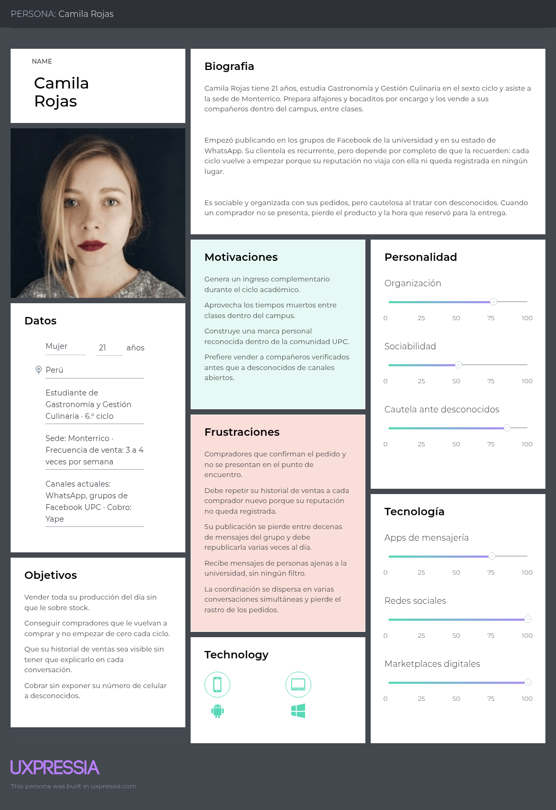

**Segmento objetivo #2: Estudiantes compradores**

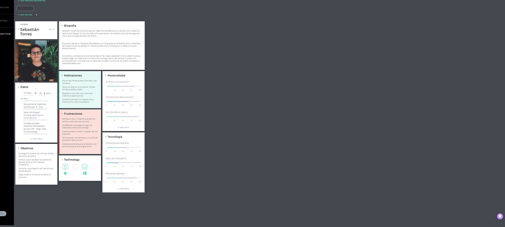

### 2.3.2. User Task Matrix

Las tareas que se presentan a continuación corresponden a actividades que ambos segmentos realizan para cumplir sus objetivos, con independencia de que exista una solución de software. Cada una se califica según su frecuencia y su importancia para cada arquetipo.

| Tarea | Camila Rojas (vendedora), Frecuencia | Camila Rojas, Importancia | Sebastián Torres (comprador), Frecuencia | Sebastián Torres, Importancia |
|---|---|---|---|---|
| Verificar la identidad institucional de la otra parte | Alta | Alta | Alta | Alta |
| Publicar un aviso con fotografías, precio y condición | Alta | Alta | Baja | Baja |
| Buscar un producto o servicio determinado | Baja | Media | Alta | Alta |
| Filtrar la oferta por campus de entrega | Media | Alta | Alta | Alta |
| Filtrar la oferta por categoría | Baja | Media | Alta | Media |
| Comparar precios entre distintas publicaciones | Baja | Baja | Alta | Alta |
| Revisar la reputación de la otra parte (rating y número de ventas) | Media | Media | Alta | Alta |
| Iniciar y sostener la conversación de coordinación | Alta | Alta | Alta | Alta |
| Acordar hora y punto de encuentro dentro del campus | Alta | Alta | Alta | Alta |
| Enviar o verificar la constancia de pago | Alta | Alta | Media | Alta |
| Concretar la entrega presencial | Alta | Alta | Alta | Alta |
| Gestionar una cancelación o un incumplimiento del encuentro | Media | Alta | Baja | Media |

Cuatro tareas resultan de frecuencia e importancia alta para ambos arquetipos: verificar la identidad institucional, sostener la conversación de coordinación, acordar el punto de encuentro y concretar la entrega. Estas constituyen el núcleo de la experiencia y son las que deben resolverse con el menor esfuerzo posible para el usuario.

Las tareas de descubrimiento (buscar, filtrar por categoría y comparar precios) son de importancia alta únicamente para el estudiante comprador, mientras que para la vendedora resultan marginales. Publicar un aviso y enviar la constancia de pago presentan la asimetría inversa. Ambos segmentos, por tanto, requieren recorridos distintos aunque compartan la misma plataforma.

### 2.3.3. User Journey Mapping

Para el segmento de estudiantes vendedores se consideró el recorrido desde que preparan el producto o servicio hasta que concretan la entrega y esperan una nueva compra. Para el segmento de estudiantes compradores se consideró desde que detectan la necesidad de un producto hasta que lo reciben y evalúan volver a comprarle al mismo vendedor. En ambos casos se representa el estado actual, que transcurre en grupos de redes sociales, mensajería instantánea y encuentros presenciales en campus.

**Segmento objetivo #1: Estudiantes vendedores**

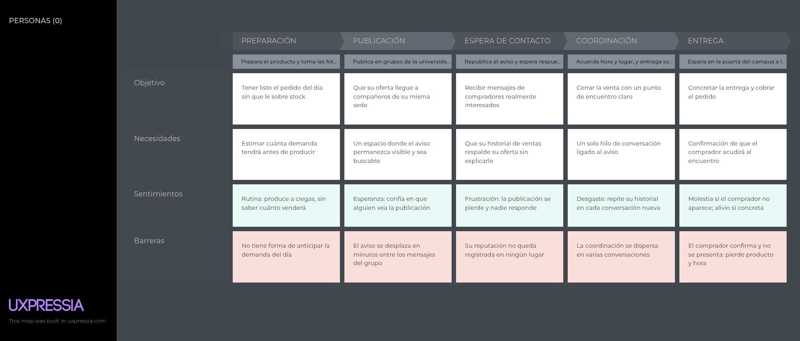

**Segmento objetivo #2: Estudiantes compradores**

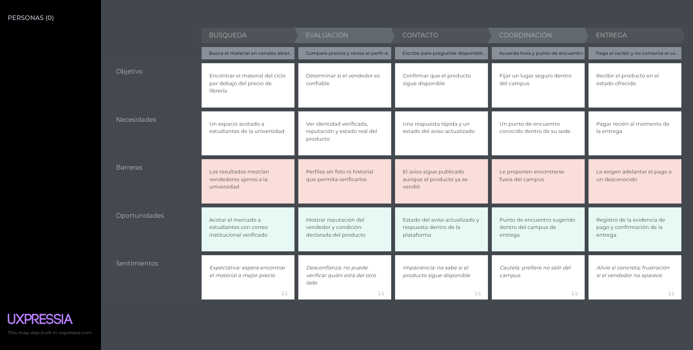

### 2.3.4. Empathy Mapping

**Segmento objetivo #1: Estudiantes vendedores**

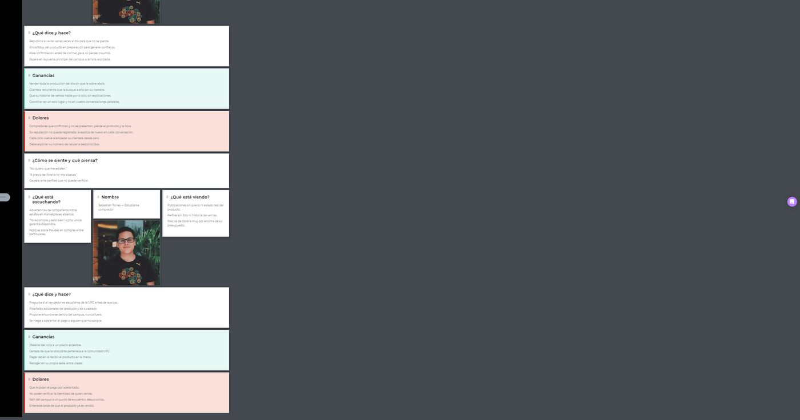

**Segmento objetivo #2: Estudiantes compradores**

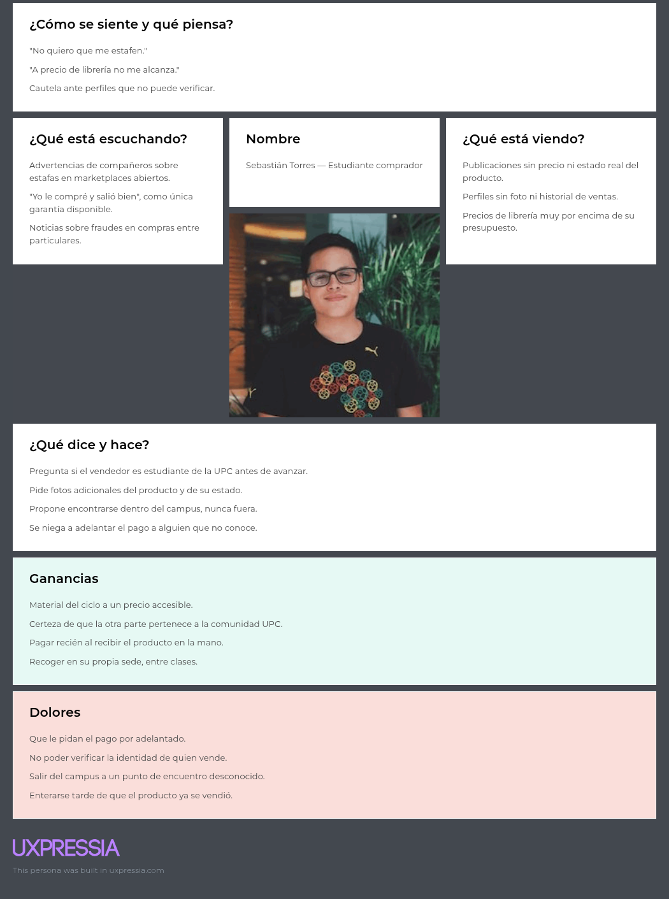

### 2.3.5. As-is Scenario Mapping

El recorrido actual de ambos segmentos transcurre en grupos de redes sociales y mensajería instantánea, sin verificación de identidad ni reputación acumulada. La experiencia negativa se concentra en la espera de contacto para la vendedora y en la evaluación del vendedor para el comprador, fases en las que la confianza debe improvisarse con recursos ajenos a la plataforma.

**Segmento objetivo #1: Estudiantes vendedores**

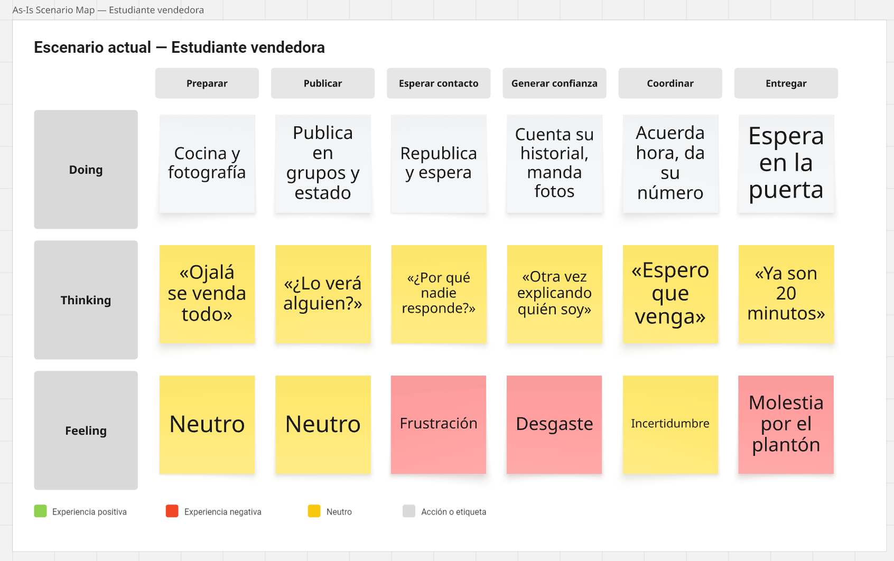

**Segmento objetivo #2: Estudiantes compradores**

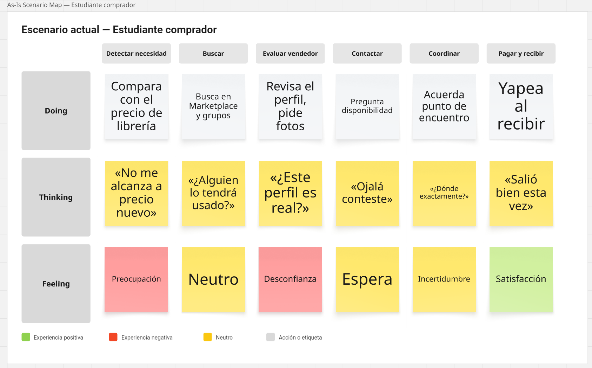

## 2.4. Ubiquitous Language

El siguiente glosario reúne los términos del dominio del marketplace universitario de UPC-X, empleados de forma consistente por el equipo y los stakeholders a lo largo del proyecto (Evans, 2003).

| Term (English) | Definición |
|---|---|
| **Listing** (*Aviso*) | Publicación mediante la cual un estudiante vendedor ofrece un producto o servicio a la comunidad. Está compuesta por fotografías, título, precio, categoría, campus de entrega, condición y descripción. |
| **Institutional Verification** (*Verificación institucional*) | Proceso por el cual un estudiante acredita su pertenencia a la UPC mediante su correo institucional `@upc.edu.pe`. Constituye el requisito de acceso a la comunidad. |
| **UPC Verified Badge** (*Sello UPC verificado*) | Distintivo que acredita que la identidad de un estudiante fue validada mediante la verificación institucional. Es la señal visible de pertenencia a la comunidad y condición para publicar avisos o contactar a otros miembros. |
| **Student Seller** (*Estudiante vendedor*) | Miembro verificado de la comunidad UPC que publica avisos para ofrecer productos, servicios o tutorías a otros estudiantes. |
| **Student Buyer** (*Estudiante comprador*) | Miembro verificado de la comunidad UPC que busca, evalúa y adquiere los productos o servicios ofrecidos por otros estudiantes. |
| **Category** (*Categoría*) | Clasificación de un aviso según el tipo de oferta: comida, libros, calculadoras, tecnología o tutorías. |
| **Item Condition** (*Condición*) | Estado declarado por el vendedor respecto del bien ofrecido, por ejemplo "usado, muy buen estado" o "recién hechos". |
| **Delivery Campus** (*Campus de entrega*) | Sede UPC (Monterrico, San Miguel, San Isidro o Villa) en la que el vendedor y el comprador acuerdan concretar la entrega. |
| **Meeting Point** (*Punto de encuentro*) | Lugar específico dentro del campus de entrega, acordado durante la conversación, donde ocurre el intercambio del bien. |
| **Peer-to-Peer Transaction** (*Transacción entre pares*) | Intercambio de un producto o servicio acordado directamente entre dos estudiantes de la comunidad, sin un intermediario que custodie el pago. |
| **Payment Voucher** (*Voucher de pago*) | Constancia de una transferencia realizada mediante billetera digital, compartida dentro de la conversación como evidencia del pago. Incluye monto, fecha, hora y número de operación. |
| **Seller Rating** (*Rating del vendedor*) | Reputación de un estudiante vendedor, expresada en una escala de hasta 5.0 y construida a partir de las transacciones que ha concretado dentro de la comunidad. |
| **Sales Count** (*Número de ventas*) | Cantidad acumulada de transacciones concretadas por un estudiante vendedor. Junto con el rating conforma su historial de reputación. |
| **Repeat Purchase Mark** (*Marca de compra recurrente*) | Indicador sobre un aviso que señala que el producto o servicio es recurrente y puede volver a adquirirse al mismo vendedor. |
| **Featured Listing** (*Aviso destacado*) | Aviso resaltado dentro del descubrimiento debido a su demanda reciente en la comunidad. |
| **Safety Notice** (*Aviso de seguridad*) | Recomendación permanente sobre las buenas prácticas de la transacción: coordinar dentro del campus, pagar al momento de la entrega y no adelantar montos elevados a desconocidos. |
| **No-Show** (*Plantón*) | Situación en la que una de las partes no acude al punto de encuentro acordado, dejando la transacción sin concretar. |


<div class="page"></div>

# Capítulo III: Requirements Specification

En este capítulo se especifica el estado To-Be de la solución: el escenario propuesto una vez que los segmentos utilizan UPC-X, el alcance funcional expresado en User Stories, Technical Stories y Spike Stories, la priorización del trabajo en el Product Backlog y la relación entre el objetivo de negocio y los entregables que lo hacen posible.

## 3.1. To-Be Scenario Mapping

Mientras el escenario actual documentado en la sección 2.3.5 se distribuye entre grupos de redes sociales, mensajería instantánea y encuentros no formalizados, el escenario propuesto concentra el recorrido completo dentro de la plataforma: el descubrimiento de la oferta, la verificación de la identidad institucional, la coordinación de la entrega, el registro de la evidencia de pago y la confirmación del encuentro.

**Segmento objetivo #1: Estudiantes vendedores**

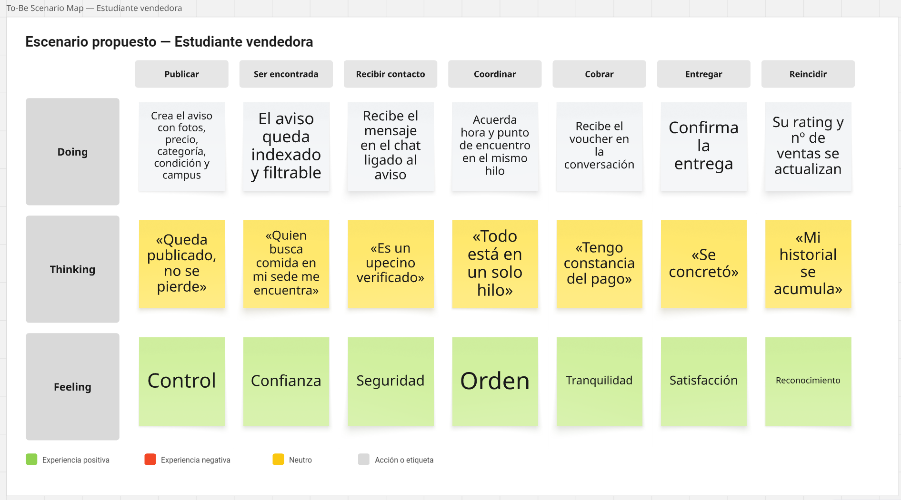

**Segmento objetivo #2: Estudiantes compradores**

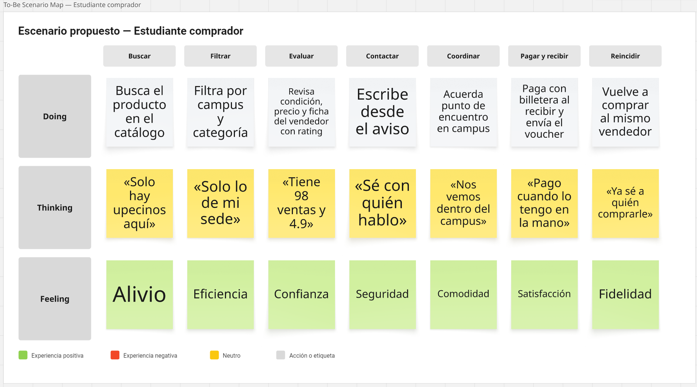


## 3.2. User Stories

En esta sección se especifica el conjunto de historias de usuario del producto digital UPC-X, agrupadas según los ocho Epics que definen las capacidades funcionales del sistema. Cada historia de usuario cuenta con su respectiva prioridad, rol de usuario y criterios de aceptación redactados en lenguaje Gherkin (Given-When-Then), orientados a escenarios reales y comprobables dentro del alcance de un marketplace universitario.

### Epics

| ID | Título | Descripción |
|:---|:---|:---|
| **EP01** | **Verificación e identidad institucional** | **Como** estudiante de la UPC, **quiero** registrarme e iniciar sesión exclusivamente con mi correo `@upc.edu.pe`, **para** interactuar en una plataforma cerrada donde todos los miembros están autenticados institucionalmente. |
| **EP02** | **Publicación de avisos** | **Como** estudiante vendedor, **quiero** publicar y gestionar avisos de mis productos o servicios con fotografías, precio, condición y sede, **para** ofrecerlos de forma clara a la comunidad universitaria. |
| **EP03** | **Descubrimiento de la oferta** | **Como** estudiante comprador, **quiero** buscar, categorizar y filtrar las publicaciones por campus y tipo de producto, **para** encontrar oportunamente lo que requiero en mi sede de estudio. |
| **EP04** | **Confianza y reputación** | **Como** usuario de UPC-X, **quiero** consultar calificaciones, sellos institucionales e historial de transacciones, **para** evaluar la seriedad de la contraparte antes de coordinar un intercambio. |
| **EP05** | **Mensajería y coordinación** | **Como** comprador o vendedor, **quiero** comunicarme mediante un chat interno enlazado al aviso, **para** resolver dudas y pactar un punto de encuentro físico dentro del campus universitario. |
| **EP06** | **Pago y evidencia** | **Como** usuario involucrado en un acuerdo, **quiero** registrar la constancia visual del pago digital (Yape/Plin) y confirmar la entrega del artículo, **para** cerrar la transacción con respaldo mutuo. |
| **EP07** | **Perfil y publicaciones propias** | **Como** miembro activo de la plataforma, **quiero** consultar mis datos institucionales, revisar mis publicaciones vigentes y mis métricas, **para** gestionar mi actividad en el marketplace. |
| **EP08** | **Landing page y captación** | **Como** visitante o nuevo usuario, **quiero** acceder a una página web informativa con la propuesta de valor, términos de servicio y soporte bilingüe, **para** informarme sobre la plataforma y acceder al sistema. |

---
### 3.2.1. User Stories

---
#### US01

<table>
  <tr>
    <th width="14%">Story ID</th>
    <th width="46%">User</th>
    <th width="20%">Priority</th>
    <th width="20%">Epic</th>
  </tr>
  <tr>
    <td align="center">US01</td>
    <td>Estudiante comprador / Estudiante vendedor</td>
    <td align="center">Alta</td>
    <td align="center">EP01</td>
  </tr>
  <tr>
    <th>Title</th>
    <td colspan="3">Registro con correo institucional</td>
  </tr>
  <tr>
    <th colspan="4">Description</th>
  </tr>
  <tr>
    <td colspan="4"><strong>Como</strong> estudiante comprador o vendedor de la UPC, <strong>quiero</strong> registrarme con mi correo institucional, <strong>para</strong> acceder a la plataforma universitaria.</td>
  </tr>
  <tr>
    <th colspan="4">Acceptance Criteria</th>
  </tr>
  <tr>
    <td colspan="4">Escenario 1: Registro con dominio institucional permitido <strong>Given</strong> el estudiante comprador o vendedor ingresa un correo con terminación <code>@upc.edu.pe</code> <strong>When</strong> solicita el registro en la plataforma <strong>Then</strong> el sistema valida el dominio y envía un código de activación a dicho buzón.<br>Escenario 2: Rechazo de correos comerciales o externos <strong>Given</strong> el estudiante comprador o vendedor ingresa un correo comercial (ej. Gmail, Outlook) <strong>When</strong> solicita el registro en la plataforma <strong>Then</strong> el sistema rechaza el proceso y notifica que solo se permiten cuentas <code>@upc.edu.pe</code>.</td>
  </tr>
</table>

---

#### US02

<table>
  <tr>
    <th width="14%">Story ID</th>
    <th width="46%">User</th>
    <th width="20%">Priority</th>
    <th width="20%">Epic</th>
  </tr>
  <tr>
    <td align="center">US02</td>
    <td>Estudiante comprador / Estudiante vendedor</td>
    <td align="center">Alta</td>
    <td align="center">EP01</td>
  </tr>
  <tr>
    <th>Title</th>
    <td colspan="3">Verificación mediante código de un solo uso</td>
  </tr>
  <tr>
    <th colspan="4">Description</th>
  </tr>
  <tr>
    <td colspan="4"><strong>Como</strong> estudiante comprador o vendedor registrado, <strong>quiero</strong> validar mi cuenta ingresando el código recibido por correo, <strong>para</strong> activar mi acceso al sistema.</td>
  </tr>
  <tr>
    <th colspan="4">Acceptance Criteria</th>
  </tr>
  <tr>
    <td colspan="4">Escenario 1: Código correcto y dentro del plazo de vigencia <strong>Given</strong> el estudiante comprador o vendedor recibe el código numérico en su buzón universitario <strong>When</strong> introduce el código exacto antes de que expire su validez <strong>Then</strong> el sistema activa la cuenta y confirma la verificación institucional.<br>Escenario 2: Código erróneo o expirado <strong>Given</strong> el código ingresado no coincide con el emitido o ya venció <strong>When</strong> el estudiante comprador o vendedor envía la solicitud de verificación <strong>Then</strong> el sistema deniega el acceso y permite solicitar un reenvío de código.</td>
  </tr>
</table>

---

#### US03

<table>
  <tr>
    <th width="14%">Story ID</th>
    <th width="46%">User</th>
    <th width="20%">Priority</th>
    <th width="20%">Epic</th>
  </tr>
  <tr>
    <td align="center">US03</td>
    <td>Estudiante comprador / Estudiante vendedor</td>
    <td align="center">Alta</td>
    <td align="center">EP01</td>
  </tr>
  <tr>
    <th>Title</th>
    <td colspan="3">Inicio de sesión con credenciales institucionales</td>
  </tr>
  <tr>
    <th colspan="4">Description</th>
  </tr>
  <tr>
    <td colspan="4"><strong>Como</strong> estudiante comprador o vendedor verificado, <strong>quiero</strong> autenticarme con mi correo y contraseña, <strong>para</strong> acceder a mi cuenta.</td>
  </tr>
  <tr>
    <th colspan="4">Acceptance Criteria</th>
  </tr>
  <tr>
    <td colspan="4">Escenario 1: Autenticación exitosa <strong>Given</strong> el estudiante comprador o vendedor introduce su correo <code>@upc.edu.pe</code> y contraseña correcta <strong>When</strong> solicita iniciar sesión <strong>Then</strong> el sistema valida las credenciales y da acceso al catálogo principal.<br>Escenario 2: Credenciales incorrectas <strong>Given</strong> el estudiante comprador o vendedor introduce credenciales no coincidentes <strong>When</strong> solicita iniciar sesión <strong>Then</strong> el sistema deniega el acceso e informa el error de autenticación.</td>
  </tr>
</table>

---

#### US04

<table>
  <tr>
    <th width="14%">Story ID</th>
    <th width="46%">User</th>
    <th width="20%">Priority</th>
    <th width="20%">Epic</th>
  </tr>
  <tr>
    <td align="center">US04</td>
    <td>Estudiante comprador / Estudiante vendedor</td>
    <td align="center">Media</td>
    <td align="center">EP01</td>
  </tr>
  <tr>
    <th>Title</th>
    <td colspan="3">Restablecimiento de contraseña olvidada</td>
  </tr>
  <tr>
    <th colspan="4">Description</th>
  </tr>
  <tr>
    <td colspan="4"><strong>Como</strong> estudiante comprador o vendedor registrado, <strong>quiero</strong> solicitar el restablecimiento de mi contraseña mediante mi correo institucional, <strong>para</strong> recuperar mi acceso.</td>
  </tr>
  <tr>
    <th colspan="4">Acceptance Criteria</th>
  </tr>
  <tr>
    <td colspan="4">Escenario 1: Envío de enlace de recuperación <strong>Given</strong> el estudiante comprador o vendedor indica su correo institucional registrado <strong>When</strong> solicita el restablecimiento de acceso <strong>Then</strong> el sistema envía un enlace o código de recuperación temporal al correo indicado.<br>Escenario 2: Correo inexistente en la base de datos <strong>Given</strong> el estudiante comprador o vendedor introduce un correo que no pertenece a ninguna cuenta activa <strong>When</strong> solicita la recuperación <strong>Then</strong> el sistema indica que no existe una cuenta asociada a esa dirección.</td>
  </tr>
</table>

---

#### US05

<table>
  <tr>
    <th width="14%">Story ID</th>
    <th width="46%">User</th>
    <th width="20%">Priority</th>
    <th width="20%">Epic</th>
  </tr>
  <tr>
    <td align="center">US05</td>
    <td>Estudiante comprador / Estudiante vendedor</td>
    <td align="center">Baja</td>
    <td align="center">EP01</td>
  </tr>
  <tr>
    <th>Title</th>
    <td colspan="3">Cierre voluntario de sesión</td>
  </tr>
  <tr>
    <th colspan="4">Description</th>
  </tr>
  <tr>
    <td colspan="4"><strong>Como</strong> estudiante comprador o vendedor autenticado, <strong>quiero</strong> cerrar mi sesión de forma manual, <strong>para</strong> resguardar la privacidad de mi perfil en el dispositivo.</td>
  </tr>
  <tr>
    <th colspan="4">Acceptance Criteria</th>
  </tr>
  <tr>
    <td colspan="4">Escenario 1: Cierre de sesión satisfactorio <strong>Given</strong> el estudiante comprador o vendedor mantiene una sesión activa en la aplicación <strong>When</strong> confirma la acción de cerrar sesión <strong>Then</strong> el sistema revoca el token de sesión y solicita autenticarse nuevamente para acceder a la cuenta.<br>Escenario 2: Acceso posterior al cierre de sesión <strong>Given</strong> el estudiante comprador o vendedor cerró su sesión en el dispositivo <strong>When</strong> otra persona intenta consultar sus conversaciones o publicaciones desde ese dispositivo <strong>Then</strong> el sistema solicita autenticarse antes de mostrar cualquier información de la cuenta.</td>
  </tr>
</table>

---

#### US06

<table>
  <tr>
    <th width="14%">Story ID</th>
    <th width="46%">User</th>
    <th width="20%">Priority</th>
    <th width="20%">Epic</th>
  </tr>
  <tr>
    <td align="center">US06</td>
    <td>Estudiante comprador / Estudiante vendedor</td>
    <td align="center">Media</td>
    <td align="center">EP01</td>
  </tr>
  <tr>
    <th>Title</th>
    <td colspan="3">Visualización de restricciones de cuenta pendiente de verificación</td>
  </tr>
  <tr>
    <th colspan="4">Description</th>
  </tr>
  <tr>
    <td colspan="4"><strong>Como</strong> estudiante comprador o vendedor con verificación pendiente, <strong>quiero</strong> conocer las acciones restringidas en la plataforma, <strong>para</strong> entender por qué debo validar mi correo institucional antes de interactuar.</td>
  </tr>
  <tr>
    <th colspan="4">Acceptance Criteria</th>
  </tr>
  <tr>
    <td colspan="4">Escenario 1: Intento de publicación o contacto sin verificación completada <strong>Given</strong> el estudiante comprador o vendedor inició sesión pero mantiene pendiente la validación de su correo <code>@upc.edu.pe</code> <strong>When</strong> intenta publicar un aviso o iniciar una conversación con la otra parte <strong>Then</strong> el sistema bloquea la acción, informa que la cuenta no está verificada y ofrece la opción de completar la activación institucional.<br>Escenario 2: Levantamiento de restricciones tras la verificación <strong>Given</strong> el estudiante comprador o vendedor con verificación pendiente completa la validación de su correo <code>@upc.edu.pe</code> <strong>When</strong> vuelve a intentar publicar un aviso o iniciar una conversación <strong>Then</strong> el sistema permite la acción sin restricciones.</td>
  </tr>
</table>

---

#### US07

<table>
  <tr>
    <th width="14%">Story ID</th>
    <th width="46%">User</th>
    <th width="20%">Priority</th>
    <th width="20%">Epic</th>
  </tr>
  <tr>
    <td align="center">US07</td>
    <td>Estudiante vendedor</td>
    <td align="center">Alta</td>
    <td align="center">EP02</td>
  </tr>
  <tr>
    <th>Title</th>
    <td colspan="3">Creación de aviso de venta</td>
  </tr>
  <tr>
    <th colspan="4">Description</th>
  </tr>
  <tr>
    <td colspan="4"><strong>Como</strong> estudiante vendedor, <strong>quiero</strong> crear una publicación con título, precio, categoría, condición y campus, <strong>para</strong> ofrecer mi producto a la comunidad.</td>
  </tr>
  <tr>
    <th colspan="4">Acceptance Criteria</th>
  </tr>
  <tr>
    <td colspan="4">Escenario 1: Publicación con datos completos <strong>Given</strong> el estudiante vendedor completa todos los campos requeridos del aviso <strong>When</strong> confirma la publicación <strong>Then</strong> el sistema guarda el aviso y lo hace visible en el catálogo de ofertas.<br>Escenario 2: Omisión de datos obligatorios <strong>Given</strong> el estudiante vendedor omite campos esenciales como el precio o el campus de entrega <strong>When</strong> intenta publicar el aviso <strong>Then</strong> el sistema detiene el proceso e indica los datos que deben completarse.</td>
  </tr>
</table>

---

#### US08

<table>
  <tr>
    <th width="14%">Story ID</th>
    <th width="46%">User</th>
    <th width="20%">Priority</th>
    <th width="20%">Epic</th>
  </tr>
  <tr>
    <td align="center">US08</td>
    <td>Estudiante vendedor</td>
    <td align="center">Alta</td>
    <td align="center">EP02</td>
  </tr>
  <tr>
    <th>Title</th>
    <td colspan="3">Carga de imagen principal del producto</td>
  </tr>
  <tr>
    <th colspan="4">Description</th>
  </tr>
  <tr>
    <td colspan="4"><strong>Como</strong> estudiante vendedor, <strong>quiero</strong> adjuntar una fotografía clara del artículo ofertado, <strong>para</strong> que los compradores evalúen su estado real.</td>
  </tr>
  <tr>
    <th colspan="4">Acceptance Criteria</th>
  </tr>
  <tr>
    <td colspan="4">Escenario 1: Subida de archivo de imagen válido <strong>Given</strong> el estudiante vendedor selecciona un archivo de imagen en formato JPG o PNG de tamaño adecuado <strong>When</strong> guarda la publicación <strong>Then</strong> el sistema almacena la imagen y la asocia como portada del anuncio.<br>Escenario 2: Archivo de formato no soportado <strong>Given</strong> el estudiante vendedor intenta cargar un archivo en formato incompatible o corrupto <strong>When</strong> procesa la carga <strong>Then</strong> el sistema cancela la operación y notifica los formatos permitidos.</td>
  </tr>
</table>

---

#### US09

<table>
  <tr>
    <th width="14%">Story ID</th>
    <th width="46%">User</th>
    <th width="20%">Priority</th>
    <th width="20%">Epic</th>
  </tr>
  <tr>
    <td align="center">US09</td>
    <td>Estudiante vendedor</td>
    <td align="center">Media</td>
    <td align="center">EP02</td>
  </tr>
  <tr>
    <th>Title</th>
    <td colspan="3">Declaración de la condición del artículo</td>
  </tr>
  <tr>
    <th colspan="4">Description</th>
  </tr>
  <tr>
    <td colspan="4"><strong>Como</strong> estudiante vendedor, <strong>quiero</strong> seleccionar la condición del artículo (Nuevo, Como nuevo, Usado), <strong>para</strong> informar con transparencia el estado del producto.</td>
  </tr>
  <tr>
    <th colspan="4">Acceptance Criteria</th>
  </tr>
  <tr>
    <td colspan="4">Escenario 1: Asignación de condición del producto <strong>Given</strong> el estudiante vendedor redacta o modifica una publicación <strong>When</strong> escoge una opción del catálogo de condiciones disponibles <strong>Then</strong> el sistema registra el valor y lo expone en la ficha del producto.<br>Escenario 2: Condición no aplicable a servicios <strong>Given</strong> el estudiante vendedor publica un servicio o una tutoría <strong>When</strong> completa los datos del aviso <strong>Then</strong> el sistema no solicita la condición del artículo y publica el aviso sin ese dato.</td>
  </tr>
</table>

---

#### US10

<table>
  <tr>
    <th width="14%">Story ID</th>
    <th width="46%">User</th>
    <th width="20%">Priority</th>
    <th width="20%">Epic</th>
  </tr>
  <tr>
    <td align="center">US10</td>
    <td>Estudiante vendedor</td>
    <td align="center">Alta</td>
    <td align="center">EP02</td>
  </tr>
  <tr>
    <th>Title</th>
    <td colspan="3">Asignación de campus de entrega</td>
  </tr>
  <tr>
    <th colspan="4">Description</th>
  </tr>
  <tr>
    <td colspan="4"><strong>Como</strong> estudiante vendedor, <strong>quiero</strong> definir en qué sede de la UPC puedo entregar el bien (Monterrico, San Miguel, San Isidro o Villa), <strong>para</strong> acordar encuentros donde estudio.</td>
  </tr>
  <tr>
    <th colspan="4">Acceptance Criteria</th>
  </tr>
  <tr>
    <td colspan="4">Escenario 1: Selección de sede universitaria <strong>Given</strong> el estudiante vendedor dispone de sedes predefinidas en el formulario <strong>When</strong> marca la sede donde puede realizar la entrega <strong>Then</strong> el sistema vincula la publicación a dicha sede para el filtrado geográfico.<br>Escenario 2: Aviso sin sede asignada <strong>Given</strong> el estudiante vendedor no indica una sede de entrega <strong>When</strong> intenta publicar el aviso <strong>Then</strong> el sistema detiene la publicación e indica que debe elegir una sede.</td>
  </tr>
</table>

---

#### US11

<table>
  <tr>
    <th width="14%">Story ID</th>
    <th width="46%">User</th>
    <th width="20%">Priority</th>
    <th width="20%">Epic</th>
  </tr>
  <tr>
    <td align="center">US11</td>
    <td>Estudiante vendedor</td>
    <td align="center">Media</td>
    <td align="center">EP02</td>
  </tr>
  <tr>
    <th>Title</th>
    <td colspan="3">Edición de precio y descripción de aviso propio</td>
  </tr>
  <tr>
    <th colspan="4">Description</th>
  </tr>
  <tr>
    <td colspan="4"><strong>Como</strong> estudiante vendedor, <strong>quiero</strong> actualizar el precio o detalles de un aviso activo, <strong>para</strong> adaptarme a la demanda de los estudiantes.</td>
  </tr>
  <tr>
    <th colspan="4">Acceptance Criteria</th>
  </tr>
  <tr>
    <td colspan="4">Escenario 1: Actualización de datos de la publicación <strong>Given</strong> el estudiante vendedor accede a un anuncio de su autoría <strong>When</strong> modifica el precio y confirma los cambios <strong>Then</strong> el sistema actualiza la información de forma inmediata en el catálogo.<br>Escenario 2: Edición de un aviso ajeno <strong>Given</strong> un estudiante intenta modificar un aviso que no es de su autoría <strong>When</strong> envía los cambios <strong>Then</strong> el sistema rechaza la edición y conserva la información original.</td>
  </tr>
</table>

---

#### US12

<table>
  <tr>
    <th width="14%">Story ID</th>
    <th width="46%">User</th>
    <th width="20%">Priority</th>
    <th width="20%">Epic</th>
  </tr>
  <tr>
    <td align="center">US12</td>
    <td>Estudiante vendedor</td>
    <td align="center">Media</td>
    <td align="center">EP02</td>
  </tr>
  <tr>
    <th>Title</th>
    <td colspan="3">Cambio de estado de aviso a "Vendido"</td>
  </tr>
  <tr>
    <th colspan="4">Description</th>
  </tr>
  <tr>
    <td colspan="4"><strong>Como</strong> estudiante vendedor, <strong>quiero</strong> marcar una publicación como vendida, <strong>para</strong> que otros estudiantes no sigan consultando por ella.</td>
  </tr>
  <tr>
    <th colspan="4">Acceptance Criteria</th>
  </tr>
  <tr>
    <td colspan="4">Escenario 1: Desactivación de producto vendido <strong>Given</strong> un producto acordado y entregado <strong>When</strong> el estudiante vendedor cambia el estado a "Vendido" <strong>Then</strong> el sistema oculta el aviso de los resultados de búsqueda activa.<br>Escenario 2: Consulta de un aviso vendido <strong>Given</strong> un aviso se encuentra marcado como "Vendido" <strong>When</strong> un estudiante comprador accede a él mediante un enlace guardado <strong>Then</strong> el sistema informa que el aviso ya no está disponible e impide iniciar una nueva conversación.</td>
  </tr>
</table>

---

#### US13

<table>
  <tr>
    <th width="14%">Story ID</th>
    <th width="46%">User</th>
    <th width="20%">Priority</th>
    <th width="20%">Epic</th>
  </tr>
  <tr>
    <td align="center">US13</td>
    <td>Estudiante vendedor</td>
    <td align="center">Baja</td>
    <td align="center">EP02</td>
  </tr>
  <tr>
    <th>Title</th>
    <td colspan="3">Eliminación voluntaria de publicación</td>
  </tr>
  <tr>
    <th colspan="4">Description</th>
  </tr>
  <tr>
    <td colspan="4"><strong>Como</strong> estudiante vendedor, <strong>quiero</strong> retirar definitivamente un aviso publicado por error o descarte, <strong>para</strong> depurar mis anuncios.</td>
  </tr>
  <tr>
    <th colspan="4">Acceptance Criteria</th>
  </tr>
  <tr>
    <td colspan="4">Escenario 1: Eliminación definitiva de aviso <strong>Given</strong> el estudiante vendedor consulta una de sus publicaciones vigentes <strong>When</strong> confirma la acción de eliminación <strong>Then</strong> el sistema remueve la publicación de la base de datos de avisos activos.<br>Escenario 2: Eliminación no confirmada <strong>Given</strong> el estudiante vendedor solicita eliminar una de sus publicaciones vigentes <strong>When</strong> decide no confirmar la acción <strong>Then</strong> el sistema conserva la publicación sin cambios.</td>
  </tr>
</table>

---

#### US14

<table>
  <tr>
    <th width="14%">Story ID</th>
    <th width="46%">User</th>
    <th width="20%">Priority</th>
    <th width="20%">Epic</th>
  </tr>
  <tr>
    <td align="center">US14</td>
    <td>Estudiante vendedor</td>
    <td align="center">Baja</td>
    <td align="center">EP02</td>
  </tr>
  <tr>
    <th>Title</th>
    <td colspan="3">Marcado de oferta como producto continuo</td>
  </tr>
  <tr>
    <th colspan="4">Description</th>
  </tr>
  <tr>
    <td colspan="4"><strong>Como</strong> estudiante vendedor de alimentos o servicios, <strong>quiero</strong> señalar mi aviso como oferta continua, <strong>para</strong> indicar disponibilidad recurrente de stock.</td>
  </tr>
  <tr>
    <th colspan="4">Acceptance Criteria</th>
  </tr>
  <tr>
    <td colspan="4">Escenario 1: Distintivo de disponibilidad recurrente <strong>Given</strong> el estudiante vendedor publica un servicio o bien consumible periódico (ej. tutorías, snacks) <strong>When</strong> declara el aviso como oferta continua <strong>Then</strong> el sistema identifica el aviso como oferta de disponibilidad recurrente.<br>Escenario 2: Retiro de la condición de oferta continua <strong>Given</strong> el aviso está declarado como oferta continua <strong>When</strong> el estudiante vendedor desactiva esa condición <strong>Then</strong> el sistema deja de identificarlo como oferta recurrente y lo trata como un aviso de unidad única.</td>
  </tr>
</table>

---

#### US15

<table>
  <tr>
    <th width="14%">Story ID</th>
    <th width="46%">User</th>
    <th width="20%">Priority</th>
    <th width="20%">Epic</th>
  </tr>
  <tr>
    <td align="center">US15</td>
    <td>Estudiante comprador</td>
    <td align="center">Alta</td>
    <td align="center">EP03</td>
  </tr>
  <tr>
    <th>Title</th>
    <td colspan="3">Exploración del catálogo de publicaciones recientes</td>
  </tr>
  <tr>
    <th colspan="4">Description</th>
  </tr>
  <tr>
    <td colspan="4"><strong>Como</strong> estudiante comprador, <strong>quiero</strong> examinar las ofertas más recientes en la pantalla principal, <strong>para</strong> conocer los productos que se ofrecen en la universidad.</td>
  </tr>
  <tr>
    <th colspan="4">Acceptance Criteria</th>
  </tr>
  <tr>
    <td colspan="4">Escenario 1: Carga de listado principal <strong>Given</strong> existen publicaciones activas en la plataforma <strong>When</strong> el estudiante comprador accede al catálogo general <strong>Then</strong> el sistema presenta las ofertas con foto, título, precio, condición y campus.<br>Escenario 2: Catálogo sin publicaciones activas <strong>Given</strong> no existen publicaciones activas en la plataforma <strong>When</strong> el estudiante comprador accede al catálogo general <strong>Then</strong> el sistema informa que aún no hay ofertas disponibles e invita a publicar el primer aviso.</td>
  </tr>
</table>

---

#### US16

<table>
  <tr>
    <th width="14%">Story ID</th>
    <th width="46%">User</th>
    <th width="20%">Priority</th>
    <th width="20%">Epic</th>
  </tr>
  <tr>
    <td align="center">US16</td>
    <td>Estudiante comprador</td>
    <td align="center">Alta</td>
    <td align="center">EP03</td>
  </tr>
  <tr>
    <th>Title</th>
    <td colspan="3">Búsqueda de avisos por término clave</td>
  </tr>
  <tr>
    <th colspan="4">Description</th>
  </tr>
  <tr>
    <td colspan="4"><strong>Como</strong> estudiante comprador, <strong>quiero</strong> buscar productos mediante palabras clave, <strong>para</strong> localizar un artículo específico (ej. "Calculadora", "Stewart").</td>
  </tr>
  <tr>
    <th colspan="4">Acceptance Criteria</th>
  </tr>
  <tr>
    <td colspan="4">Escenario 1: Coincidencia en búsqueda <strong>Given</strong> existen avisos cuyo título o descripción coincide con la consulta <strong>When</strong> el estudiante comprador ejecuta la búsqueda <strong>Then</strong> el sistema presenta únicamente las publicaciones asociadas al término ingresado.<br>Escenario 2: Sin coincidencias encontradas <strong>Given</strong> ningún aviso concuerda con las palabras introducidas <strong>When</strong> el estudiante comprador ejecuta la búsqueda <strong>Then</strong> el sistema muestra un mensaje indicando que no se hallaron resultados coincidentes.</td>
  </tr>
</table>

---

#### US17

<table>
  <tr>
    <th width="14%">Story ID</th>
    <th width="46%">User</th>
    <th width="20%">Priority</th>
    <th width="20%">Epic</th>
  </tr>
  <tr>
    <td align="center">US17</td>
    <td>Estudiante comprador</td>
    <td align="center">Alta</td>
    <td align="center">EP03</td>
  </tr>
  <tr>
    <th>Title</th>
    <td colspan="3">Filtrado de ofertas por campus de entrega</td>
  </tr>
  <tr>
    <th colspan="4">Description</th>
  </tr>
  <tr>
    <td colspan="4"><strong>Como</strong> estudiante comprador, <strong>quiero</strong> filtrar las ofertas por mi sede de estudio, <strong>para</strong> ver únicamente lo que puedo recoger de forma presencial.</td>
  </tr>
  <tr>
    <th colspan="4">Acceptance Criteria</th>
  </tr>
  <tr>
    <td colspan="4">Escenario 1: Aplicación de filtro por campus <strong>Given</strong> un listado de publicaciones de diversas sedes <strong>When</strong> el estudiante comprador selecciona su campus habitual (ej. San Miguel) <strong>Then</strong> el sistema actualiza la vista mostrando únicamente ofertas con entrega en esa sede.<br>Escenario 2: Sede sin ofertas disponibles <strong>Given</strong> ninguna publicación activa tiene entrega en la sede seleccionada <strong>When</strong> el estudiante comprador aplica el filtro <strong>Then</strong> el sistema informa que no hay ofertas para esa sede y permite limpiar el filtro.</td>
  </tr>
</table>

---

#### US18

<table>
  <tr>
    <th width="14%">Story ID</th>
    <th width="46%">User</th>
    <th width="20%">Priority</th>
    <th width="20%">Epic</th>
  </tr>
  <tr>
    <td align="center">US18</td>
    <td>Estudiante comprador</td>
    <td align="center">Media</td>
    <td align="center">EP03</td>
  </tr>
  <tr>
    <th>Title</th>
    <td colspan="3">Filtrado de ofertas por categoría</td>
  </tr>
  <tr>
    <th colspan="4">Description</th>
  </tr>
  <tr>
    <td colspan="4"><strong>Como</strong> estudiante comprador, <strong>quiero</strong> segmentar las ofertas por rubro académico o servicio, <strong>para</strong> enfocar mi búsqueda en lo que necesito.</td>
  </tr>
  <tr>
    <th colspan="4">Acceptance Criteria</th>
  </tr>
  <tr>
    <td colspan="4">Escenario 1: Selección de categoría específica <strong>Given</strong> el estudiante comprador consulta las categorías disponibles (Comida, Libros, Calculadoras, Tecnología, Tutorías) <strong>When</strong> selecciona una categoría de interés <strong>Then</strong> el sistema expone exclusivamente los avisos pertenecientes a dicha clasificación.<br>Escenario 2: Categoría sin avisos <strong>Given</strong> la categoría elegida no tiene publicaciones activas <strong>When</strong> el estudiante comprador la selecciona <strong>Then</strong> el sistema informa que no hay avisos en esa categoría y permite volver a todas las categorías.</td>
  </tr>
</table>

---

#### US19

<table>
  <tr>
    <th width="14%">Story ID</th>
    <th width="46%">User</th>
    <th width="20%">Priority</th>
    <th width="20%">Epic</th>
  </tr>
  <tr>
    <td align="center">US19</td>
    <td>Estudiante comprador</td>
    <td align="center">Baja</td>
    <td align="center">EP03</td>
  </tr>
  <tr>
    <th>Title</th>
    <td colspan="3">Ordenamiento de avisos por precio</td>
  </tr>
  <tr>
    <th colspan="4">Description</th>
  </tr>
  <tr>
    <td colspan="4"><strong>Como</strong> estudiante comprador, <strong>quiero</strong> ordenar las publicaciones de menor a mayor precio, <strong>para</strong> identificar las alternativas más accesibles.</td>
  </tr>
  <tr>
    <th colspan="4">Acceptance Criteria</th>
  </tr>
  <tr>
    <td colspan="4">Escenario 1: Reordenamiento ascendente de precios <strong>Given</strong> un conjunto de resultados de búsqueda o catálogo <strong>When</strong> el estudiante comprador selecciona el criterio "Menor precio" <strong>Then</strong> el sistema reordena los resultados presentando primero las ofertas de menor costo monetario.<br>Escenario 2: Ordenamiento combinado con filtros <strong>Given</strong> el estudiante comprador aplicó filtros de sede o de categoría <strong>When</strong> selecciona el criterio "Menor precio" <strong>Then</strong> el sistema reordena los resultados sin perder los filtros aplicados.</td>
  </tr>
</table>

---

#### US20

<table>
  <tr>
    <th width="14%">Story ID</th>
    <th width="46%">User</th>
    <th width="20%">Priority</th>
    <th width="20%">Epic</th>
  </tr>
  <tr>
    <td align="center">US20</td>
    <td>Estudiante comprador</td>
    <td align="center">Alta</td>
    <td align="center">EP03</td>
  </tr>
  <tr>
    <th>Title</th>
    <td colspan="3">Visualización del detalle completo de la publicación</td>
  </tr>
  <tr>
    <th colspan="4">Description</th>
  </tr>
  <tr>
    <td colspan="4"><strong>Como</strong> estudiante comprador, <strong>quiero</strong> abrir la vista detallada de un aviso, <strong>para</strong> analizar fotos ampliadas, descripción exhaustiva y datos del vendedor.</td>
  </tr>
  <tr>
    <th colspan="4">Acceptance Criteria</th>
  </tr>
  <tr>
    <td colspan="4">Escenario 1: Apertura de ficha completa <strong>Given</strong> el estudiante comprador localiza un aviso de interés en el catálogo <strong>When</strong> selecciona la publicación <strong>Then</strong> el sistema presenta las fotografías, la descripción extendida, campus, estado y perfil básico del estudiante vendedor.<br>Escenario 2: Aviso que ya no está disponible <strong>Given</strong> el aviso fue retirado o se encuentra reservado <strong>When</strong> el estudiante comprador intenta consultarlo <strong>Then</strong> el sistema informa su estado e impide iniciar una nueva operación.</td>
  </tr>
</table>

---

#### US21

<table>
  <tr>
    <th width="14%">Story ID</th>
    <th width="46%">User</th>
    <th width="20%">Priority</th>
    <th width="20%">Epic</th>
  </tr>
  <tr>
    <td align="center">US21</td>
    <td>Estudiante comprador</td>
    <td align="center">Baja</td>
    <td align="center">EP03</td>
  </tr>
  <tr>
    <th>Title</th>
    <td colspan="3">Marcar el producto como favorito</td>
  </tr>
  <tr>
    <th colspan="4">Description</th>
  </tr>
  <tr>
    <td colspan="4"><strong>Como</strong> estudiante comprador, <strong>quiero</strong> guardar avisos en mi lista personal de favoritos, <strong>para</strong> revisarlos o compararlos posteriormente.</td>
  </tr>
  <tr>
    <th colspan="4">Acceptance Criteria</th>
  </tr>
  <tr>
    <td colspan="4">Escenario 1: Inclusión en lista de guardados <strong>Given</strong> el estudiante comprador consulta una oferta activa <strong>When</strong> guarda la oferta en favoritos <strong>Then</strong> el sistema registra el aviso en la lista de favoritos del estudiante.<br>Escenario 2: Aviso guardado previamente <strong>Given</strong> el aviso ya forma parte de la lista de favoritos del estudiante comprador <strong>When</strong> intenta guardarlo nuevamente <strong>Then</strong> el sistema mantiene un solo registro del aviso en la lista.</td>
  </tr>
</table>

---

#### US22

<table>
  <tr>
    <th width="14%">Story ID</th>
    <th width="46%">User</th>
    <th width="20%">Priority</th>
    <th width="20%">Epic</th>
  </tr>
  <tr>
    <td align="center">US22</td>
    <td>Estudiante comprador</td>
    <td align="center">Baja</td>
    <td align="center">EP03</td>
  </tr>
  <tr>
    <th>Title</th>
    <td colspan="3">Quitar producto de la lista de favoritos</td>
  </tr>
  <tr>
    <th colspan="4">Description</th>
  </tr>
  <tr>
    <td colspan="4"><strong>Como</strong> estudiante comprador, <strong>quiero</strong> quitar una publicación de mis favoritos, <strong>para</strong> mantener depurada mi lista de artículos de interés.</td>
  </tr>
  <tr>
    <th colspan="4">Acceptance Criteria</th>
  </tr>
  <tr>
    <td colspan="4">Escenario 1: Exclusión de la lista personal <strong>Given</strong> un aviso previamente guardado en la lista de favoritos <strong>When</strong> el estudiante comprador decide desmarcarlo <strong>Then</strong> el sistema retira el aviso de dicha lista de forma inmediata.<br>Escenario 2: Deshacer la exclusión <strong>Given</strong> el estudiante comprador acaba de quitar un aviso de su lista de favoritos <strong>When</strong> elige deshacer la acción <strong>Then</strong> el sistema restituye el aviso en la lista.</td>
  </tr>
</table>

---

#### US23

<table>
  <tr>
    <th width="14%">Story ID</th>
    <th width="46%">User</th>
    <th width="20%">Priority</th>
    <th width="20%">Epic</th>
  </tr>
  <tr>
    <td align="center">US23</td>
    <td>Estudiante comprador</td>
    <td align="center">Alta</td>
    <td align="center">EP04</td>
  </tr>
  <tr>
    <th>Title</th>
    <td colspan="3">Visualización del distintivo "UPC Verificado"</td>
  </tr>
  <tr>
    <th colspan="4">Description</th>
  </tr>
  <tr>
    <td colspan="4"><strong>Como</strong> estudiante comprador, <strong>quiero</strong> ver el sello de verificación institucional en la ficha del vendedor, <strong>para</strong> confirmar que es un estudiante acreditado.</td>
  </tr>
  <tr>
    <th colspan="4">Acceptance Criteria</th>
  </tr>
  <tr>
    <td colspan="4">Escenario 1: Presencia del distintivo de verificación <strong>Given</strong> el estudiante vendedor completó la autenticación con correo <code>@upc.edu.pe</code> <strong>When</strong> el estudiante comprador examina su publicación o perfil <strong>Then</strong> el sistema exhibe el distintivo "UPC Verificado" junto al nombre del estudiante vendedor.<br>Escenario 2: Cuenta sin verificación completada <strong>Given</strong> el estudiante no completó la validación de su correo institucional <strong>When</strong> otro estudiante consulta su perfil <strong>Then</strong> el sistema no muestra el distintivo "UPC Verificado".</td>
  </tr>
</table>

---

#### US24

<table>
  <tr>
    <th width="14%">Story ID</th>
    <th width="46%">User</th>
    <th width="20%">Priority</th>
    <th width="20%">Epic</th>
  </tr>
  <tr>
    <td align="center">US24</td>
    <td>Estudiante comprador</td>
    <td align="center">Media</td>
    <td align="center">EP04</td>
  </tr>
  <tr>
    <th>Title</th>
    <td colspan="3">Consulta de calificación y ventas previas del vendedor</td>
  </tr>
  <tr>
    <th colspan="4">Description</th>
  </tr>
  <tr>
    <td colspan="4"><strong>Como</strong> estudiante comprador, <strong>quiero</strong> conocer el promedio de estrellas y número de ventas del vendedor, <strong>para</strong> juzgar su fiabilidad antes de comprar.</td>
  </tr>
  <tr>
    <th colspan="4">Acceptance Criteria</th>
  </tr>
  <tr>
    <td colspan="4">Escenario 1: Vendedor con antecedentes registrados <strong>Given</strong> el estudiante vendedor cuenta con operaciones previas concluidas <strong>When</strong> el estudiante comprador consulta el detalle de la publicación <strong>Then</strong> el sistema expone su puntaje promedio (escala de 1 a 5) y la cantidad de entregas realizadas.<br>Escenario 2: Vendedor nuevo sin historial <strong>Given</strong> el estudiante vendedor no registra transacciones previas en el sistema <strong>When</strong> el estudiante comprador consulta su aviso <strong>Then</strong> el sistema especifica que se trata de un "Vendedor nuevo sin historial".</td>
  </tr>
</table>

---

#### US25

<table>
  <tr>
    <th width="14%">Story ID</th>
    <th width="46%">User</th>
    <th width="20%">Priority</th>
    <th width="20%">Epic</th>
  </tr>
  <tr>
    <td align="center">US25</td>
    <td>Estudiante comprador</td>
    <td align="center">Alta</td>
    <td align="center">EP04</td>
  </tr>
  <tr>
    <th>Title</th>
    <td colspan="3">Emisión de calificación con estrellas al vendedor</td>
  </tr>
  <tr>
    <th colspan="4">Description</th>
  </tr>
  <tr>
    <td colspan="4"><strong>Como</strong> estudiante comprador, <strong>quiero</strong> calificar al vendedor tras concretar el trato, <strong>para</strong> contribuir a la reputación comunitaria.</td>
  </tr>
  <tr>
    <th colspan="4">Acceptance Criteria</th>
  </tr>
  <tr>
    <td colspan="4">Escenario 1: Calificación sobre transacción cerrada <strong>Given</strong> una transacción presencial confirmada en el sistema <strong>When</strong> el estudiante comprador registra una puntuación entre 1 y 5 estrellas <strong>Then</strong> el sistema almacena la calificación y recalcula el promedio del estudiante vendedor.<br>Escenario 2: Restricción sin transacción previa <strong>Given</strong> un estudiante comprador y un vendedor que no tienen un intercambio concretado <strong>When</strong> el comprador intenta calificar al vendedor <strong>Then</strong> el sistema bloquea la opción de calificación.</td>
  </tr>
</table>

---

#### US26

<table>
  <tr>
    <th width="14%">Story ID</th>
    <th width="46%">User</th>
    <th width="20%">Priority</th>
    <th width="20%">Epic</th>
  </tr>
  <tr>
    <td align="center">US26</td>
    <td>Estudiante vendedor</td>
    <td align="center">Media</td>
    <td align="center">EP04</td>
  </tr>
  <tr>
    <th>Title</th>
    <td colspan="3">Calificación de cumplimiento al comprador</td>
  </tr>
  <tr>
    <th colspan="4">Description</th>
  </tr>
  <tr>
    <td colspan="4"><strong>Como</strong> estudiante vendedor, <strong>quiero</strong> valorar el cumplimiento del comprador tras el encuentro, <strong>para</strong> reconocer a estudiantes responsables.</td>
  </tr>
  <tr>
    <th colspan="4">Acceptance Criteria</th>
  </tr>
  <tr>
    <td colspan="4">Escenario 1: Valoración de puntualidad y trato <strong>Given</strong> una entrega presencial culminada con éxito <strong>When</strong> el estudiante vendedor registra la evaluación hacia el estudiante comprador <strong>Then</strong> el sistema computa el registro en el historial de cumplimiento del comprador.<br>Escenario 2: Valoración sin entrega concretada <strong>Given</strong> la entrega fue cancelada o no se concretó <strong>When</strong> el estudiante vendedor intenta valorar al comprador <strong>Then</strong> el sistema bloquea la valoración.</td>
  </tr>
</table>

---

#### US27

<table>
  <tr>
    <th width="14%">Story ID</th>
    <th width="46%">User</th>
    <th width="20%">Priority</th>
    <th width="20%">Epic</th>
  </tr>
  <tr>
    <td align="center">US27</td>
    <td>Estudiante comprador / Estudiante vendedor</td>
    <td align="center">Alta</td>
    <td align="center">EP04</td>
  </tr>
  <tr>
    <th>Title</th>
    <td colspan="3">Notificación de advertencia de seguridad en campus</td>
  </tr>
  <tr>
    <th colspan="4">Description</th>
  </tr>
  <tr>
    <td colspan="4"><strong>Como</strong> estudiante comprador o vendedor negociando un trato, <strong>quiero</strong> visualizar recomendaciones de seguridad en pantalla, <strong>para</strong> acordar entregas seguras en el campus.</td>
  </tr>
  <tr>
    <th colspan="4">Acceptance Criteria</th>
  </tr>
  <tr>
    <td colspan="4">Escenario 1: Despliegue de pauta de seguridad <strong>Given</strong> el estudiante comprador o vendedor accede a la vista de un aviso o al chat de acuerdo <strong>When</strong> se presenta el contenido del aviso o del acuerdo <strong>Then</strong> el sistema muestra la recomendación de seguridad: *"Pacta siempre en zonas concurridas de la sede y paga al recibir el producto"*.<br>Escenario 2: Recomendación al proponer el encuentro <strong>Given</strong> el estudiante comprador o vendedor propone un punto y un horario de encuentro <strong>When</strong> registra la propuesta <strong>Then</strong> el sistema muestra nuevamente la recomendación de pactar en zonas concurridas de la sede.</td>
  </tr>
</table>

---

#### US28

<table>
  <tr>
    <th width="14%">Story ID</th>
    <th width="46%">User</th>
    <th width="20%">Priority</th>
    <th width="20%">Epic</th>
  </tr>
  <tr>
    <td align="center">US28</td>
    <td>Estudiante comprador / Estudiante vendedor</td>
    <td align="center">Media</td>
    <td align="center">EP04</td>
  </tr>
  <tr>
    <th>Title</th>
    <td colspan="3">Envío de reporte sobre publicación indebida</td>
  </tr>
  <tr>
    <th colspan="4">Description</th>
  </tr>
  <tr>
    <td colspan="4"><strong>Como</strong> estudiante comprador o vendedor, <strong>quiero</strong> reportar una publicación que incumpla las normas, <strong>para</strong> alertar sobre irregularidades o bienes prohibidos.</td>
  </tr>
  <tr>
    <th colspan="4">Acceptance Criteria</th>
  </tr>
  <tr>
    <td colspan="4">Escenario 1: Registro de denuncia de contenido <strong>Given</strong> el estudiante comprador o vendedor detecta un artículo inapropiado o datos engañosos <strong>When</strong> envía el reporte seleccionando el motivo de la infracción <strong>Then</strong> el sistema confirma la recepción del reporte y marca el aviso para revisión.<br>Escenario 2: Reporte sin motivo <strong>Given</strong> el estudiante comprador o vendedor intenta enviar un reporte sin indicar el motivo <strong>When</strong> confirma el envío <strong>Then</strong> el sistema detiene el proceso y solicita seleccionar el motivo de la infracción.</td>
  </tr>
</table>

---

#### US29

<table>
  <tr>
    <th width="14%">Story ID</th>
    <th width="46%">User</th>
    <th width="20%">Priority</th>
    <th width="20%">Epic</th>
  </tr>
  <tr>
    <td align="center">US29</td>
    <td>Estudiante comprador</td>
    <td align="center">Alta</td>
    <td align="center">EP05</td>
  </tr>
  <tr>
    <th>Title</th>
    <td colspan="3">Inicio de chat privado enlazado al aviso</td>
  </tr>
  <tr>
    <th colspan="4">Description</th>
  </tr>
  <tr>
    <td colspan="4"><strong>Como</strong> estudiante comprador, <strong>quiero</strong> abrir una conversación directa desde la ficha del producto, <strong>para</strong> consultar disponibilidad con el vendedor.</td>
  </tr>
  <tr>
    <th colspan="4">Acceptance Criteria</th>
  </tr>
  <tr>
    <td colspan="4">Escenario 1: Creación de conversación vinculada <strong>Given</strong> el estudiante comprador se ubica en el detalle de una publicación activa <strong>When</strong> solicita contactar al vendedor <strong>Then</strong> el sistema abre una sala de chat privada vinculada específicamente a ese aviso.<br>Escenario 2: Reapertura de conversación existente <strong>Given</strong> ya existía un chat previo entre el estudiante comprador y el vendedor sobre el mismo artículo <strong>When</strong> el comprador solicita el contacto <strong>Then</strong> el sistema retoma el hilo de mensajes previo sin generar duplicados.</td>
  </tr>
</table>

---

#### US30

<table>
  <tr>
    <th width="14%">Story ID</th>
    <th width="46%">User</th>
    <th width="20%">Priority</th>
    <th width="20%">Epic</th>
  </tr>
  <tr>
    <td align="center">US30</td>
    <td>Estudiante comprador / Estudiante vendedor</td>
    <td align="center">Alta</td>
    <td align="center">EP05</td>
  </tr>
  <tr>
    <th>Title</th>
    <td colspan="3">Envío y recepción de mensajes de texto en chat</td>
  </tr>
  <tr>
    <th colspan="4">Description</th>
  </tr>
  <tr>
    <td colspan="4"><strong>Como</strong> estudiante comprador o vendedor en negociación, <strong>quiero</strong> intercambiar mensajes escritos con la contraparte, <strong>para</strong> pactar los detalles de la compraventa.</td>
  </tr>
  <tr>
    <th colspan="4">Acceptance Criteria</th>
  </tr>
  <tr>
    <td colspan="4">Escenario 1: Envío de mensaje en la sala <strong>Given</strong> el estudiante comprador o vendedor redacta un mensaje en una conversación activa <strong>When</strong> confirma el envío <strong>Then</strong> el sistema publica el mensaje en el hilo cronológico con su marca temporal.<br>Escenario 2: Mensaje no enviado <strong>Given</strong> la conexión falla durante el envío de un mensaje <strong>When</strong> el estudiante comprador o vendedor confirma el envío <strong>Then</strong> el sistema conserva el texto y permite reintentar el envío sin duplicarlo.</td>
  </tr>
</table>

---

#### US31

<table>
  <tr>
    <th width="14%">Story ID</th>
    <th width="46%">User</th>
    <th width="20%">Priority</th>
    <th width="20%">Epic</th>
  </tr>
  <tr>
    <td align="center">US31</td>
    <td>Estudiante comprador / Estudiante vendedor</td>
    <td align="center">Alta</td>
    <td align="center">EP05</td>
  </tr>
  <tr>
    <th>Title</th>
    <td colspan="3">Visualización de bandeja general de conversaciones</td>
  </tr>
  <tr>
    <th colspan="4">Description</th>
  </tr>
  <tr>
    <td colspan="4"><strong>Como</strong> estudiante comprador o vendedor activo, <strong>quiero</strong> acceder a la lista consolidada de mis conversaciones, <strong>para</strong> gestionar mis compras y ventas pendientes.</td>
  </tr>
  <tr>
    <th colspan="4">Acceptance Criteria</th>
  </tr>
  <tr>
    <td colspan="4">Escenario 1: Carga de bandeja de mensajes <strong>Given</strong> el estudiante comprador o vendedor mantiene conversaciones activas <strong>When</strong> accede a su bandeja de mensajes <strong>Then</strong> el sistema expone las conversaciones ordenadas por fecha de último mensaje, indicando el producto y la contraparte.<br>Escenario 2: Bandeja sin conversaciones <strong>Given</strong> el estudiante comprador o vendedor no ha iniciado ni recibido conversaciones <strong>When</strong> accede a su bandeja de mensajes <strong>Then</strong> el sistema informa que las conversaciones se inician desde el detalle de un aviso.</td>
  </tr>
</table>

---

#### US32

<table>
  <tr>
    <th width="14%">Story ID</th>
    <th width="46%">User</th>
    <th width="20%">Priority</th>
    <th width="20%">Epic</th>
  </tr>
  <tr>
    <td align="center">US32</td>
    <td>Estudiante comprador / Estudiante vendedor</td>
    <td align="center">Media</td>
    <td align="center">EP05</td>
  </tr>
  <tr>
    <th>Title</th>
    <td colspan="3">Distintivo visual de mensajes no leídos</td>
  </tr>
  <tr>
    <th colspan="4">Description</th>
  </tr>
  <tr>
    <td colspan="4"><strong>Como</strong> estudiante comprador o vendedor, <strong>quiero</strong> visualizar un indicador de mensajes entrantes, <strong>para</strong> responder a tiempo a mis acuerdos de compra o venta.</td>
  </tr>
  <tr>
    <th colspan="4">Acceptance Criteria</th>
  </tr>
  <tr>
    <td colspan="4">Escenario 1: Presencia de contenido no leído <strong>Given</strong> la contraparte remite un nuevo mensaje al chat <strong>When</strong> el estudiante comprador o vendedor consulta sus conversaciones <strong>Then</strong> el sistema indica la cantidad de mensajes pendientes de lectura.<br>Escenario 2: Lectura de los mensajes pendientes <strong>Given</strong> existen mensajes no leídos en una conversación <strong>When</strong> el estudiante comprador o vendedor abre esa conversación <strong>Then</strong> el sistema marca los mensajes como leídos y actualiza la cantidad de pendientes.</td>
  </tr>
</table>

---

#### US33

<table>
  <tr>
    <th width="14%">Story ID</th>
    <th width="46%">User</th>
    <th width="20%">Priority</th>
    <th width="20%">Epic</th>
  </tr>
  <tr>
    <td align="center">US33</td>
    <td>Estudiante comprador / Estudiante vendedor</td>
    <td align="center">Alta</td>
    <td align="center">EP05</td>
  </tr>
  <tr>
    <th>Title</th>
    <td colspan="3">Selección de punto de encuentro sugerido en sede</td>
  </tr>
  <tr>
    <th colspan="4">Description</th>
  </tr>
  <tr>
    <td colspan="4"><strong>Como</strong> estudiante comprador o vendedor negociando un intercambio, <strong>quiero</strong> seleccionar un punto de encuentro sugerido para la sede o indicar otro lugar visible y concurrido dentro del campus, <strong>para</strong> fijar un lugar seguro y visible.</td>
  </tr>
  <tr>
    <th colspan="4">Acceptance Criteria</th>
  </tr>
  <tr>
    <td colspan="4">Escenario 1: Pacto de punto en campus <strong>Given</strong> un estudiante comprador y un estudiante vendedor coordinan la entrega en la sede San Miguel <strong>When</strong> eligen un punto de la lista de sugerencias para esa sede o escriben otro punto dentro del campus <strong>Then</strong> el sistema registra dicho punto como lugar acordado de entrega y aclara que la sugerencia no supone validación oficial de la universidad.<br>Escenario 2: Punto en una sede distinta a la del aviso <strong>Given</strong> el aviso tiene entrega en una sede determinada <strong>When</strong> el estudiante comprador o vendedor propone un punto de encuentro en otra sede <strong>Then</strong> el sistema rechaza la diferencia y solicita corregir la sede para que corresponda al aviso.</td>
  </tr>
</table>

---

#### US34

<table>
  <tr>
    <th width="14%">Story ID</th>
    <th width="46%">User</th>
    <th width="20%">Priority</th>
    <th width="20%">Epic</th>
  </tr>
  <tr>
    <td align="center">US34</td>
    <td>Estudiante comprador / Estudiante vendedor</td>
    <td align="center">Media</td>
    <td align="center">EP05</td>
  </tr>
  <tr>
    <th>Title</th>
    <td colspan="3">Coordinación de fecha y hora para el encuentro</td>
  </tr>
  <tr>
    <th colspan="4">Description</th>
  </tr>
  <tr>
    <td colspan="4"><strong>Como</strong> estudiante comprador o vendedor negociando un intercambio, <strong>quiero</strong> registrar la hora y día pactados, <strong>para</strong> conciliar el encuentro entre horarios de clase.</td>
  </tr>
  <tr>
    <th colspan="4">Acceptance Criteria</th>
  </tr>
  <tr>
    <td colspan="4">Escenario 1: Registro formal de horario <strong>Given</strong> el estudiante comprador y el estudiante vendedor concuerdan un momento de entrega presencial <strong>When</strong> confirman la fecha y rango horario acordado <strong>Then</strong> el sistema actualiza la ficha del acuerdo con los datos de tiempo pactados.<br>Escenario 2: Cambio de una propuesta aceptada <strong>Given</strong> la fecha y la hora ya fueron aceptadas por ambas partes <strong>When</strong> uno de los estudiantes modifica la propuesta <strong>Then</strong> el sistema invalida la aceptación previa y solicita que la contraparte vuelva a aceptarla.</td>
  </tr>
</table>

---

#### US35

<table>
  <tr>
    <th width="14%">Story ID</th>
    <th width="46%">User</th>
    <th width="20%">Priority</th>
    <th width="20%">Epic</th>
  </tr>
  <tr>
    <td align="center">US35</td>
    <td>Estudiante comprador / Estudiante vendedor</td>
    <td align="center">Baja</td>
    <td align="center">EP05</td>
  </tr>
  <tr>
    <th>Title</th>
    <td colspan="3">Cancelación de la coordinación pactada</td>
  </tr>
  <tr>
    <th colspan="4">Description</th>
  </tr>
  <tr>
    <td colspan="4"><strong>Como</strong> estudiante comprador o vendedor con imprevisto justificado, <strong>quiero</strong> cancelar el encuentro pactado informando a la otra parte, <strong>para</strong> desestimar el compromiso sin penalizaciones.</td>
  </tr>
  <tr>
    <th colspan="4">Acceptance Criteria</th>
  </tr>
  <tr>
    <td colspan="4">Escenario 1: Cancelación antes del encuentro <strong>Given</strong> una coordinación fijada previamente en el chat <strong>When</strong> el estudiante comprador o vendedor confirma la cancelación del encuentro <strong>Then</strong> el sistema notifica a la contraparte y cambia el estado de la coordinación a "Cancelada".<br>Escenario 2: Coordinación ya concluida <strong>Given</strong> la entrega ya fue confirmada por ambas partes <strong>When</strong> uno de los estudiantes intenta cancelar la coordinación <strong>Then</strong> el sistema rechaza la cancelación porque la transacción está cerrada.</td>
  </tr>
</table>

---

#### US36

<table>
  <tr>
    <th width="14%">Story ID</th>
    <th width="46%">User</th>
    <th width="20%">Priority</th>
    <th width="20%">Epic</th>
  </tr>
  <tr>
    <td align="center">US36</td>
    <td>Estudiante comprador</td>
    <td align="center">Alta</td>
    <td align="center">EP06</td>
  </tr>
  <tr>
    <th>Title</th>
    <td colspan="3">Carga de imagen de constancia de pago</td>
  </tr>
  <tr>
    <th colspan="4">Description</th>
  </tr>
  <tr>
    <td colspan="4"><strong>Como</strong> estudiante comprador, <strong>quiero</strong> adjuntar la captura del voucher de transferencia en el chat, <strong>para</strong> dejar respaldo fehaciente del dinero enviado.</td>
  </tr>
  <tr>
    <th colspan="4">Acceptance Criteria</th>
  </tr>
  <tr>
    <td colspan="4">Escenario 1: Subida de captura de transferencia <strong>Given</strong> el estudiante comprador completó la transferencia mediante billetera digital <strong>When</strong> carga la captura del comprobante en la conversación <strong>Then</strong> el sistema registra la imagen como evidencia de pago en la conversación del acuerdo.<br>Escenario 2: Captura en formato no válido <strong>Given</strong> el estudiante comprador intenta adjuntar un archivo que no es una imagen JPG o PNG <strong>When</strong> confirma la carga <strong>Then</strong> el sistema rechaza el archivo e indica los formatos permitidos.</td>
  </tr>
</table>

---

#### US37

<table>
  <tr>
    <th width="14%">Story ID</th>
    <th width="46%">User</th>
    <th width="20%">Priority</th>
    <th width="20%">Epic</th>
  </tr>
  <tr>
    <td align="center">US37</td>
    <td>Estudiante vendedor</td>
    <td align="center">Alta</td>
    <td align="center">EP06</td>
  </tr>
  <tr>
    <th>Title</th>
    <td colspan="3">Confirmación de recepción de constancia de pago</td>
  </tr>
  <tr>
    <th colspan="4">Description</th>
  </tr>
  <tr>
    <td colspan="4"><strong>Como</strong> estudiante vendedor, <strong>quiero</strong> declarar que recibí el pago tras revisar el comprobante, <strong>para</strong> dejar constancia de que el dinero llegó a mi billetera.</td>
  </tr>
  <tr>
    <th colspan="4">Acceptance Criteria</th>
  </tr>
  <tr>
    <td colspan="4">Escenario 1: Vendedor declara la recepción del pago <strong>Given</strong> el voucher se encuentra cargado en el hilo de la conversación <strong>When</strong> el estudiante vendedor revisa su billetera y confirma la recepción <strong>Then</strong> el sistema registra la evidencia de pago como "Recibida" por el vendedor.<br>Escenario 2: Pago no reconocido <strong>Given</strong> el voucher se encuentra cargado en el hilo de la conversación <strong>When</strong> el estudiante vendedor no identifica el abono en su billetera <strong>Then</strong> el sistema registra la evidencia como "Con discrepancia" y notifica al estudiante comprador.</td>
  </tr>
</table>

---

#### US38

<table>
  <tr>
    <th width="14%">Story ID</th>
    <th width="46%">User</th>
    <th width="20%">Priority</th>
    <th width="20%">Epic</th>
  </tr>
  <tr>
    <td align="center">US38</td>
    <td>Estudiante comprador / Estudiante vendedor</td>
    <td align="center">Alta</td>
    <td align="center">EP06</td>
  </tr>
  <tr>
    <th>Title</th>
    <td colspan="3">Confirmación de entrega presencial concretada</td>
  </tr>
  <tr>
    <th colspan="4">Description</th>
  </tr>
  <tr>
    <td colspan="4"><strong>Como</strong> estudiante comprador o vendedor, <strong>quiero</strong> registrar "Entrega completada", <strong>para</strong> dar por concluida la compraventa presencial en el campus.</td>
  </tr>
  <tr>
    <th colspan="4">Acceptance Criteria</th>
  </tr>
  <tr>
    <td colspan="4">Escenario 1: Cierre mutuo de la operación física <strong>Given</strong> el estudiante comprador y el estudiante vendedor se encuentran y completan el intercambio <strong>When</strong> ambos confirman la entrega en la aplicación <strong>Then</strong> el sistema registra el estado como "Completada" y habilita la calificación mutua.<br>Escenario 2: Confirmación de una sola parte <strong>Given</strong> solo uno de los estudiantes confirmó la entrega <strong>When</strong> la contraparte aún no registra su confirmación <strong>Then</strong> el sistema mantiene la transacción como pendiente y no habilita la calificación.</td>
  </tr>
</table>

---

#### US39

<table>
  <tr>
    <th width="14%">Story ID</th>
    <th width="46%">User</th>
    <th width="20%">Priority</th>
    <th width="20%">Epic</th>
  </tr>
  <tr>
    <td align="center">US39</td>
    <td>Estudiante comprador / Estudiante vendedor</td>
    <td align="center">Media</td>
    <td align="center">EP06</td>
  </tr>
  <tr>
    <th>Title</th>
    <td colspan="3">Registro de inasistencia al punto de encuentro ("No-Show")</td>
  </tr>
  <tr>
    <th colspan="4">Description</th>
  </tr>
  <tr>
    <td colspan="4"><strong>Como</strong> estudiante comprador o vendedor que asistió al lugar pactado, <strong>quiero</strong> reportar si la otra parte no se presentó, <strong>para</strong> dejar registro del incumplimiento.</td>
  </tr>
  <tr>
    <th colspan="4">Acceptance Criteria</th>
  </tr>
  <tr>
    <td colspan="4">Escenario 1: Reporte por inasistencia presencial <strong>Given</strong> transcurrido el tiempo límite de espera convenido sin presencia de la contraparte <strong>When</strong> el estudiante comprador o vendedor presente confirma la opción "No se presentó" <strong>Then</strong> el sistema cancela la entrega y registra la incidencia en el perfil de la contraparte.<br>Escenario 2: Registro antes de la hora pactada <strong>Given</strong> todavía no se cumple la hora acordada para el encuentro <strong>When</strong> el estudiante comprador o vendedor intenta registrar la inasistencia <strong>Then</strong> el sistema rechaza el registro hasta que se cumpla el tiempo de espera convenido.</td>
  </tr>
</table>

---

#### US40

<table>
  <tr>
    <th width="14%">Story ID</th>
    <th width="46%">User</th>
    <th width="20%">Priority</th>
    <th width="20%">Epic</th>
  </tr>
  <tr>
    <td align="center">US40</td>
    <td>Estudiante comprador / Estudiante vendedor</td>
    <td align="center">Baja</td>
    <td align="center">EP06</td>
  </tr>
  <tr>
    <th>Title</th>
    <td colspan="3">Consulta de historial de transacciones finalizadas</td>
  </tr>
  <tr>
    <th colspan="4">Description</th>
  </tr>
  <tr>
    <td colspan="4"><strong>Como</strong> estudiante comprador o vendedor, <strong>quiero</strong> consultar el resumen de mis transacciones concluidas, <strong>para</strong> llevar seguimiento de mis gastos o ingresos del ciclo.</td>
  </tr>
  <tr>
    <th colspan="4">Acceptance Criteria</th>
  </tr>
  <tr>
    <td colspan="4">Escenario 1: Listado cronológico de transacciones <strong>Given</strong> el estudiante comprador o vendedor completó intercambios en la plataforma <strong>When</strong> consulta su historial de operaciones cerradas <strong>Then</strong> el sistema presenta la relación de transacciones pasadas con fecha, importe y artículo.<br>Escenario 2: Historial sin transacciones <strong>Given</strong> el estudiante comprador o vendedor no tiene transacciones concluidas <strong>When</strong> consulta su historial de operaciones cerradas <strong>Then</strong> el sistema informa que todavía no registra operaciones.</td>
  </tr>
</table>

---

#### US41

<table>
  <tr>
    <th width="14%">Story ID</th>
    <th width="46%">User</th>
    <th width="20%">Priority</th>
    <th width="20%">Epic</th>
  </tr>
  <tr>
    <td align="center">US41</td>
    <td>Estudiante comprador / Estudiante vendedor</td>
    <td align="center">Alta</td>
    <td align="center">EP07</td>
  </tr>
  <tr>
    <th>Title</th>
    <td colspan="3">Edición de datos de contacto y preferencias de sede</td>
  </tr>
  <tr>
    <th colspan="4">Description</th>
  </tr>
  <tr>
    <td colspan="4"><strong>Como</strong> estudiante comprador o vendedor, <strong>quiero</strong> actualizar mi campus frecuente de entrega y mi nombre visible, <strong>para</strong> mantener mis canales de coordinación al día en futuras operaciones.</td>
  </tr>
  <tr>
    <th colspan="4">Acceptance Criteria</th>
  </tr>
  <tr>
    <td colspan="4">Escenario 1: Actualización exitosa de campus habitual y nombre <strong>Given</strong> el estudiante comprador o vendedor se ubica en el formulario de edición de su cuenta <strong>When</strong> modifica su campus preferente (Monterrico, San Miguel, San Isidro o Villa) o su nombre visible y guarda los cambios <strong>Then</strong> el sistema almacena los nuevos valores y los refleja en sus publicaciones o solicitudes activas.<br>Escenario 2: Nombre visible vacío <strong>Given</strong> el estudiante comprador o vendedor deja vacío su nombre visible <strong>When</strong> guarda los cambios <strong>Then</strong> el sistema rechaza la actualización e indica que el nombre es obligatorio.</td>
  </tr>
</table>

---

#### US42

<table>
  <tr>
    <th width="14%">Story ID</th>
    <th width="46%">User</th>
    <th width="20%">Priority</th>
    <th width="20%">Epic</th>
  </tr>
  <tr>
    <td align="center">US42</td>
    <td>Estudiante vendedor</td>
    <td align="center">Media</td>
    <td align="center">EP07</td>
  </tr>
  <tr>
    <th>Title</th>
    <td colspan="3">Configuración de número telefónico de cobro</td>
  </tr>
  <tr>
    <th colspan="4">Description</th>
  </tr>
  <tr>
    <td colspan="4"><strong>Como</strong> estudiante vendedor, <strong>quiero</strong> registrar o actualizar mi número de billetera digital en mi cuenta, <strong>para</strong> compartirlo con un solo toque dentro del chat durante una negociación.</td>
  </tr>
  <tr>
    <th colspan="4">Acceptance Criteria</th>
  </tr>
  <tr>
    <td colspan="4">Escenario 1: Registro de número de cobro válido <strong>Given</strong> el estudiante vendedor introduce un número de teléfono celular de 9 dígitos <strong>When</strong> confirma el guardado en sus opciones de cuenta <strong>Then</strong> el sistema valida el formato y permite compartir el número de cobro en los chats donde actúa como vendedor.<br>Escenario 2: Número con formato inválido <strong>Given</strong> el estudiante vendedor introduce un número con menos de 9 dígitos o con caracteres no numéricos <strong>When</strong> confirma el guardado <strong>Then</strong> el sistema rechaza el dato e indica el formato esperado.</td>
  </tr>
</table>

---

#### US43

<table>
  <tr>
    <th width="14%">Story ID</th>
    <th width="46%">User</th>
    <th width="20%">Priority</th>
    <th width="20%">Epic</th>
  </tr>
  <tr>
    <td align="center">US43</td>
    <td>Estudiante vendedor</td>
    <td align="center">Alta</td>
    <td align="center">EP07</td>
  </tr>
  <tr>
    <th>Title</th>
    <td colspan="3">Gestión integral de mis publicaciones</td>
  </tr>
  <tr>
    <th colspan="4">Description</th>
  </tr>
  <tr>
    <td colspan="4"><strong>Como</strong> estudiante vendedor, <strong>quiero</strong> acceder a un panel con mis avisos clasificados por estado (activos, pausados y vendidos), <strong>para</strong> controlar el stock y republicar ofertas sin reescribir la información.</td>
  </tr>
  <tr>
    <th colspan="4">Acceptance Criteria</th>
  </tr>
  <tr>
    <td colspan="4">Escenario 1: Cambio de estado de una publicación propia <strong>Given</strong> el estudiante vendedor revisa su catálogo de avisos propios <strong>When</strong> selecciona una publicación activa y conmuta su estado a "Pausado" <strong>Then</strong> el sistema actualiza de inmediato la disponibilidad del artículo ocultándolo temporalmente del catálogo público.<br>Escenario 2: Reactivación de una publicación pausada <strong>Given</strong> el estudiante vendedor tiene una publicación en estado "Pausado" <strong>When</strong> la reactiva <strong>Then</strong> el sistema vuelve a mostrarla en el catálogo público con la misma información.</td>
  </tr>
</table>

---

#### US44

<table>
  <tr>
    <th width="14%">Story ID</th>
    <th width="46%">User</th>
    <th width="20%">Priority</th>
    <th width="20%">Epic</th>
  </tr>
  <tr>
    <td align="center">US44</td>
    <td>Estudiante comprador / Estudiante vendedor</td>
    <td align="center">Baja</td>
    <td align="center">EP07</td>
  </tr>
  <tr>
    <th>Title</th>
    <td colspan="3">Consulta de valoraciones y resumen de reputación propia</td>
  </tr>
  <tr>
    <th colspan="4">Description</th>
  </tr>
  <tr>
    <td colspan="4"><strong>Como</strong> estudiante comprador o vendedor, <strong>quiero</strong> revisar el promedio de estrellas y el desglose de calificaciones que me dejaron otros compañeros, <strong>para</strong> conocer mi nivel de fiabilidad dentro de la comunidad.</td>
  </tr>
  <tr>
    <th colspan="4">Acceptance Criteria</th>
  </tr>
  <tr>
    <td colspan="4">Escenario 1: Despliegue de métricas de reputación acumuladas <strong>Given</strong> el estudiante comprador o vendedor completó intercambios calificados por contrapartes <strong>When</strong> ingresa a su resumen de reputación <strong>Then</strong> el sistema muestra la cantidad de operaciones cerradas, el promedio general obtenido (escala 1 a 5) y el total de valoraciones positivas registradas.<br>Escenario 2: Estudiante sin valoraciones <strong>Given</strong> el estudiante comprador o vendedor no ha recibido calificaciones <strong>When</strong> ingresa a su resumen de reputación <strong>Then</strong> el sistema informa que todavía no cuenta con valoraciones.</td>
  </tr>
</table>

---

#### US45

<table>
  <tr>
    <th width="14%">Story ID</th>
    <th width="46%">User</th>
    <th width="20%">Priority</th>
    <th width="20%">Epic</th>
  </tr>
  <tr>
    <td align="center">US45</td>
    <td>Visitante del segmento estudiantes compradores / Visitante del segmento estudiantes vendedores</td>
    <td align="center">Alta</td>
    <td align="center">EP08</td>
  </tr>
  <tr>
    <th>Title</th>
    <td colspan="3">Visualización de la propuesta de valor en la Landing Page</td>
  </tr>
  <tr>
    <th colspan="4">Description</th>
  </tr>
  <tr>
    <td colspan="4"><strong>Como</strong> visitante del segmento de estudiantes compradores o vendedores, <strong>quiero</strong> navegar por una landing page clara y moderna, <strong>para</strong> conocer los beneficios de comprar y vender seguro dentro de la UPC.</td>
  </tr>
  <tr>
    <th colspan="4">Acceptance Criteria</th>
  </tr>
  <tr>
    <td colspan="4">Escenario 1: Carga de contenidos comerciales informativos <strong>Given</strong> un visitante accede al portal público mediante navegador web <strong>When</strong> carga la página de inicio <strong>Then</strong> el sistema presenta la propuesta de valor, la explicación del funcionamiento, las ventajas de seguridad y testimonios de estudiantes.<br>Escenario 2: Consulta desde el navegador del celular <strong>Given</strong> un visitante accede a la landing page desde el navegador de su celular <strong>When</strong> carga la página de inicio <strong>Then</strong> el sistema presenta el mismo contenido en una sola columna y con el mismo orden de lectura.</td>
  </tr>
</table>

---

#### US46

<table>
  <tr>
    <th width="14%">Story ID</th>
    <th width="46%">User</th>
    <th width="20%">Priority</th>
    <th width="20%">Epic</th>
  </tr>
  <tr>
    <td align="center">US46</td>
    <td>Visitante del segmento estudiantes compradores / Visitante del segmento estudiantes vendedores</td>
    <td align="center">Alta</td>
    <td align="center">EP08</td>
  </tr>
  <tr>
    <th>Title</th>
    <td colspan="3">Acceso rápido mediante llamada a la acción</td>
  </tr>
  <tr>
    <th colspan="4">Description</th>
  </tr>
  <tr>
    <td colspan="4"><strong>Como</strong> visitante del segmento de estudiantes compradores o vendedores, <strong>quiero</strong> contar con enlaces visibles para iniciar sesión o registrarme, <strong>para</strong> acceder directamente a la aplicación web o móvil.</td>
  </tr>
  <tr>
    <th colspan="4">Acceptance Criteria</th>
  </tr>
  <tr>
    <td colspan="4">Escenario 1: Acceso desde la llamada a la acción <strong>Given</strong> el visitante examina la landing page informativa <strong>When</strong> elige comenzar o registrarse <strong>Then</strong> el sistema lo redirige de inmediato al flujo de acceso de la aplicación.<br>Escenario 2: Visitante con cuenta existente <strong>Given</strong> el visitante ya tiene una cuenta verificada <strong>When</strong> elige iniciar sesión desde la landing page <strong>Then</strong> el sistema lo dirige al ingreso de la aplicación sin pasar por el registro.</td>
  </tr>
</table>

---

#### US47

<table>
  <tr>
    <th width="14%">Story ID</th>
    <th width="46%">User</th>
    <th width="20%">Priority</th>
    <th width="20%">Epic</th>
  </tr>
  <tr>
    <td align="center">US47</td>
    <td>Visitante del segmento estudiantes compradores / Visitante del segmento estudiantes vendedores</td>
    <td align="center">Media</td>
    <td align="center">EP08</td>
  </tr>
  <tr>
    <th>Title</th>
    <td colspan="3">Selector de idioma (Español / Inglés)</td>
  </tr>
  <tr>
    <th colspan="4">Description</th>
  </tr>
  <tr>
    <td colspan="4"><strong>Como</strong> visitante del segmento de estudiantes compradores o vendedores, <strong>quiero</strong> cambiar el idioma de la página entre Inglés y Español, <strong>para</strong> consultar la información en mi lengua de preferencia.</td>
  </tr>
  <tr>
    <th colspan="4">Acceptance Criteria</th>
  </tr>
  <tr>
    <td colspan="4">Escenario 1: Alternancia de idioma de visualización <strong>Given</strong> la página se carga en su idioma por defecto (Inglés) <strong>When</strong> el visitante elige Español como idioma <strong>Then</strong> el sistema presenta todo el contenido informativo en el idioma seleccionado.<br>Escenario 2: Idioma elegido en una nueva visita <strong>Given</strong> el visitante eligió Español como idioma <strong>When</strong> vuelve a abrir la landing page <strong>Then</strong> el sistema presenta el contenido en el idioma elegido.</td>
  </tr>
</table>

---

#### US48

<table>
  <tr>
    <th width="14%">Story ID</th>
    <th width="46%">User</th>
    <th width="20%">Priority</th>
    <th width="20%">Epic</th>
  </tr>
  <tr>
    <td align="center">US48</td>
    <td>Visitante del segmento estudiantes compradores / Visitante del segmento estudiantes vendedores</td>
    <td align="center">Media</td>
    <td align="center">EP08</td>
  </tr>
  <tr>
    <th>Title</th>
    <td colspan="3">Consulta de Términos de Servicio y Normas Éticas</td>
  </tr>
  <tr>
    <th colspan="4">Description</th>
  </tr>
  <tr>
    <td colspan="4"><strong>Como</strong> visitante del segmento de estudiantes compradores o vendedores, <strong>quiero</strong> consultar los términos y condiciones de servicio en el pie de página, <strong>para</strong> conocer mis derechos, privacidad de datos y normas de uso.</td>
  </tr>
  <tr>
    <th colspan="4">Acceptance Criteria</th>
  </tr>
  <tr>
    <td colspan="4">Escenario 1: Despliegue de acuerdos legales y de convivencia <strong>Given</strong> el visitante navega por el pie de página de la landing page <strong>When</strong> selecciona el enlace "Términos y Condiciones" <strong>Then</strong> el sistema presenta el documento completo con las políticas de privacidad y los lineamientos éticos de la comunidad.<br>Escenario 2: Consulta desde la aplicación <strong>Given</strong> el estudiante comprador o vendedor inició sesión en la aplicación <strong>When</strong> consulta los términos y condiciones desde el pie de página <strong>Then</strong> el sistema presenta el mismo documento publicado en la landing page.</td>
  </tr>
</table>

---

#### US49

<table>
  <tr>
    <th width="14%">Story ID</th>
    <th width="46%">User</th>
    <th width="20%">Priority</th>
    <th width="20%">Epic</th>
  </tr>
  <tr>
    <td align="center">US49</td>
    <td>Visitante del segmento estudiantes compradores / Visitante del segmento estudiantes vendedores</td>
    <td align="center">Media</td>
    <td align="center">EP08</td>
  </tr>
  <tr>
    <th>Title</th>
    <td colspan="3">Consulta de preguntas frecuentes</td>
  </tr>
  <tr>
    <th colspan="4">Description</th>
  </tr>
  <tr>
    <td colspan="4"><strong>Como</strong> visitante del segmento de estudiantes compradores o vendedores con dudas, <strong>quiero</strong> consultar una sección de preguntas frecuentes, <strong>para</strong> comprender cómo se realizan los pagos y las entregas seguras.</td>
  </tr>
  <tr>
    <th colspan="4">Acceptance Criteria</th>
  </tr>
  <tr>
    <td colspan="4">Escenario 1: Despliegue de respuesta sobre entregas en campus <strong>Given</strong> el visitante explora las preguntas frecuentes de la landing <strong>When</strong> selecciona una duda sobre lugares de encuentro <strong>Then</strong> el sistema presenta la respuesta con las reglas de coordinación presencial en sedes.<br>Escenario 2: Consulta sobre pagos <strong>Given</strong> el visitante explora las preguntas frecuentes <strong>When</strong> selecciona una duda sobre los pagos <strong>Then</strong> el sistema explica que el pago se realiza fuera de UPC-X mediante billeteras digitales y que la plataforma solo registra la constancia.</td>
  </tr>
</table>

---

#### US50

<table>
  <tr>
    <th width="14%">Story ID</th>
    <th width="46%">User</th>
    <th width="20%">Priority</th>
    <th width="20%">Epic</th>
  </tr>
  <tr>
    <td align="center">US50</td>
    <td>Visitante del segmento estudiantes compradores / Visitante del segmento estudiantes vendedores</td>
    <td align="center">Baja</td>
    <td align="center">EP08</td>
  </tr>
  <tr>
    <th>Title</th>
    <td colspan="3">Formulario de contacto y soporte técnico</td>
  </tr>
  <tr>
    <th colspan="4">Description</th>
  </tr>
  <tr>
    <td colspan="4"><strong>Como</strong> visitante del segmento de estudiantes compradores o vendedores con dudas específicas, <strong>quiero</strong> enviar un mensaje mediante un formulario de contacto, <strong>para</strong> comunicarme con el equipo de soporte de RichStudent.</td>
  </tr>
  <tr>
    <th colspan="4">Acceptance Criteria</th>
  </tr>
  <tr>
    <td colspan="4">Escenario 1: Envío de formulario de consulta <strong>Given</strong> el visitante completa su correo y su mensaje de duda <strong>When</strong> envía el formulario de soporte <strong>Then</strong> el sistema valida los campos y confirma que la consulta fue remitida.<br>Escenario 2: Formulario incompleto <strong>Given</strong> el visitante deja vacío el correo o el mensaje <strong>When</strong> envía el formulario de soporte <strong>Then</strong> el sistema indica los datos que faltan y conserva lo ya escrito.</td>
  </tr>
</table>

### 3.2.2. Technical Stories

---
#### TS01

<table>
  <tr>
    <th width="14%">Story ID</th>
    <th width="46%">User</th>
    <th width="20%">Priority</th>
    <th width="20%">Epic</th>
  </tr>
  <tr>
    <td align="center">TS01</td>
    <td>Developer</td>
    <td align="center">Alta</td>
    <td align="center">EP01</td>
  </tr>
  <tr>
    <th>Title</th>
    <td colspan="3">Servicio de inicio de sesión con correo universitario</td>
  </tr>
  <tr>
    <th colspan="4">Description</th>
  </tr>
  <tr>
    <td colspan="4"><strong>Como</strong> desarrollador del equipo, <strong>quiero</strong> programar el servicio de ingreso con la cuenta universitaria, <strong>para</strong> comprobar que el estudiante pertenece a la UPC y permitirle entrar al sistema de forma segura.</td>
  </tr>
  <tr>
    <th colspan="4">Acceptance Criteria</th>
  </tr>
  <tr>
    <td colspan="4">Escenario 1: Ingreso exitoso con cuenta institucional válida <strong>Given</strong> el developer envía <code>POST /api/auth/login</code> con un correo <code>@upc.edu.pe</code> verificado y su contraseña correcta <strong>When</strong> la API procesa la solicitud <strong>Then</strong> responde <code>200 OK</code> y abre la sesión: entrega el token en el cuerpo al cliente móvil (<code>X-UPCX-Client: mobile</code>) o una cookie HttpOnly a la web.<br>Escenario 2: Rechazo por contraseña equivocada <strong>Given</strong> el developer envía <code>POST /api/auth/login</code> con una contraseña que no corresponde al correo <strong>When</strong> la API valida las credenciales <strong>Then</strong> responde <code>401 Unauthorized</code> con un mensaje de credenciales inválidas.</td>
  </tr>
</table>

---

#### TS02

<table>
  <tr>
    <th width="14%">Story ID</th>
    <th width="46%">User</th>
    <th width="20%">Priority</th>
    <th width="20%">Epic</th>
  </tr>
  <tr>
    <td align="center">TS02</td>
    <td>Developer</td>
    <td align="center">Alta</td>
    <td align="center">EP02</td>
  </tr>
  <tr>
    <th>Title</th>
    <td colspan="3">Servicio para guardar nuevos avisos de venta</td>
  </tr>
  <tr>
    <th colspan="4">Description</th>
  </tr>
  <tr>
    <td colspan="4"><strong>Como</strong> desarrollador del equipo, <strong>quiero</strong> programar el servicio que guarda las publicaciones, <strong>para</strong> que los anuncios de los vendedores con fotos, precio, campus y estado queden guardados en el sistema.</td>
  </tr>
  <tr>
    <th colspan="4">Acceptance Criteria</th>
  </tr>
  <tr>
    <td colspan="4">Escenario 1: Guardado correcto de un aviso completo <strong>Given</strong> el developer envía <code>POST /api/listings</code> con la sesión del vendedor y el título, descripción, precio, sede de entrega, categoría, condición del producto y foto de portada <strong>When</strong> la API valida que la información esté completa <strong>Then</strong> responde <code>200 OK</code> con el identificador y los datos del aviso creado.<br>Escenario 2: Rechazo por datos obligatorios vacíos <strong>Given</strong> el developer envía <code>POST /api/listings</code> sin precio o sin sede de entrega <strong>When</strong> la API valida los campos <strong>Then</strong> responde <code>400 Bad Request</code> con el mensaje y el código del error de validación.</td>
  </tr>
</table>

---

#### TS03

<table>
  <tr>
    <th width="14%">Story ID</th>
    <th width="46%">User</th>
    <th width="20%">Priority</th>
    <th width="20%">Epic</th>
  </tr>
  <tr>
    <td align="center">TS03</td>
    <td>Developer</td>
    <td align="center">Alta</td>
    <td align="center">EP03</td>
  </tr>
  <tr>
    <th>Title</th>
    <td colspan="3">Servicio para buscar y filtrar ofertas por sede y categoría</td>
  </tr>
  <tr>
    <th colspan="4">Description</th>
  </tr>
  <tr>
    <td colspan="4"><strong>Como</strong> desarrollador del equipo, <strong>quiero</strong> programar el servicio de búsqueda y filtrado, <strong>para</strong> mostrarle a los compradores los avisos disponibles según su campus y el tipo de producto que buscan.</td>
  </tr>
  <tr>
    <th colspan="4">Acceptance Criteria</th>
  </tr>
  <tr>
    <td colspan="4">Escenario 1: Búsqueda con productos disponibles en la sede <strong>Given</strong> el developer envía <code>GET /api/listings?campus=San%20Miguel&category=Libros</code> <strong>When</strong> la API consulta las publicaciones disponibles con esos filtros <strong>Then</strong> responde <code>200 OK</code> con únicamente los avisos que coinciden con esa sede y categoría.<br>Escenario 2: Búsqueda sin productos coincidentes <strong>Given</strong> el developer envía <code>GET /api/listings</code> con filtros que no tienen publicaciones disponibles <strong>When</strong> la API consulta las publicaciones <strong>Then</strong> responde <code>200 OK</code> con una lista vacía.</td>
  </tr>
</table>

---

#### TS04

<table>
  <tr>
    <th width="14%">Story ID</th>
    <th width="46%">User</th>
    <th width="20%">Priority</th>
    <th width="20%">Epic</th>
  </tr>
  <tr>
    <td align="center">TS04</td>
    <td>Developer</td>
    <td align="center">Alta</td>
    <td align="center">EP05</td>
  </tr>
  <tr>
    <th>Title</th>
    <td colspan="3">Servicio para enviar y guardar mensajes del chat</td>
  </tr>
  <tr>
    <th colspan="4">Description</th>
  </tr>
  <tr>
    <td colspan="4"><strong>Como</strong> desarrollador del equipo, <strong>quiero</strong> programar el servicio de mensajería interna, <strong>para</strong> guardar las conversaciones entre el comprador y el vendedor sobre un aviso en particular.</td>
  </tr>
  <tr>
    <th colspan="4">Acceptance Criteria</th>
  </tr>
  <tr>
    <td colspan="4">Escenario 1: Envío y guardado de un mensaje en la conversación <strong>Given</strong> el developer envía <code>POST /api/conversations/{id}/messages</code> con el texto del mensaje y la sesión de un participante <strong>When</strong> la API confirma que el usuario participa en la conversación <strong>Then</strong> responde <code>200 OK</code> con la conversación actualizada, que incluye el mensaje guardado y su fecha y hora de envío.<br>Escenario 2: Bloqueo a personas ajenas a la conversación <strong>Given</strong> el developer envía <code>GET</code> o <code>POST /api/conversations/{id}/messages</code> con la sesión de un estudiante que no participa en ella <strong>When</strong> la API verifica quién realiza la acción <strong>Then</strong> responde <code>403 Forbidden</code> e indica que no tiene permiso sobre esa conversación.</td>
  </tr>
</table>

---

#### TS05

<table>
  <tr>
    <th width="14%">Story ID</th>
    <th width="46%">User</th>
    <th width="20%">Priority</th>
    <th width="20%">Epic</th>
  </tr>
  <tr>
    <td align="center">TS05</td>
    <td>Developer</td>
    <td align="center">Alta</td>
    <td align="center">EP06</td>
  </tr>
  <tr>
    <th>Title</th>
    <td colspan="3">Servicio para adjuntar la foto del comprobante de pago</td>
  </tr>
  <tr>
    <th colspan="4">Description</th>
  </tr>
  <tr>
    <td colspan="4"><strong>Como</strong> desarrollador del equipo, <strong>quiero</strong> programar el servicio para subir la imagen del comprobante, <strong>para</strong> dejar constancia del dinero transferido en el acuerdo.</td>
  </tr>
  <tr>
    <th colspan="4">Acceptance Criteria</th>
  </tr>
  <tr>
    <td colspan="4">Escenario 1: Registro exitoso de la foto del comprobante <strong>Given</strong> el developer envía <code>POST /api/conversations/{id}/payment-evidences</code> con la imagen del comprobante de un acuerdo aceptado por ambas partes <strong>When</strong> la API valida que el acuerdo esté en <code>agreed</code> y que el archivo sea JPEG o PNG <strong>Then</strong> responde <code>200 OK</code> y registra la evidencia en estado "Enviada".<br>Escenario 2: Rechazo de comprobante en acuerdos no vigentes <strong>Given</strong> el developer envía <code>POST /api/conversations/{id}/payment-evidences</code> cuando el acuerdo está completado, cancelado o aún sin aceptar <strong>When</strong> la API revisa el estado del acuerdo <strong>Then</strong> responde <code>409 Conflict</code> e indica que el acuerdo no admite comprobantes.</td>
  </tr>
</table>

---

#### TS06

<table>
  <tr>
    <th width="14%">Story ID</th>
    <th width="46%">User</th>
    <th width="20%">Priority</th>
    <th width="20%">Epic</th>
  </tr>
  <tr>
    <td align="center">TS06</td>
    <td>Developer</td>
    <td align="center">Media</td>
    <td align="center">EP04</td>
  </tr>
  <tr>
    <th>Title</th>
    <td colspan="3">Servicio para calificar al vendedor y actualizar sus estrellas</td>
  </tr>
  <tr>
    <th colspan="4">Description</th>
  </tr>
  <tr>
    <td colspan="4"><strong>Como</strong> desarrollador del equipo, <strong>quiero</strong> programar el servicio de calificaciones, <strong>para</strong> guardar las estrellas que recibe cada participante y calcular su reputación en el perfil.</td>
  </tr>
  <tr>
    <th colspan="4">Acceptance Criteria</th>
  </tr>
  <tr>
    <td colspan="4">Escenario 1: Registro de estrellas tras una entrega completada <strong>Given</strong> el developer envía <code>POST /api/conversations/{id}/reviews</code> con una puntuación del 1 al 5 sobre un acuerdo completado <strong>When</strong> la API comprueba que el autor participó en el acuerdo y que aún no lo calificó <strong>Then</strong> responde <code>200 OK</code> con la conversación actualizada, que incluye la reseña.<br>Escenario 2: Rechazo de notas fuera del rango permitido <strong>Given</strong> el developer envía <code>POST /api/conversations/{id}/reviews</code> con una puntuación menor a 1 o mayor a 5 <strong>When</strong> la API valida el valor recibido <strong>Then</strong> responde <code>400 Bad Request</code> e indica que la puntuación debe estar entre 1 y 5.</td>
  </tr>
</table>

---
### 3.2.3. Spike Stories

---
#### SP-01

<table>
  <tr>
    <th width="14%">Story ID</th>
    <th width="46%">User</th>
    <th width="20%">Priority</th>
    <th width="20%">Epic</th>
  </tr>
  <tr>
    <td align="center">SP-01</td>
    <td>Developer</td>
    <td align="center">Alta</td>
    <td align="center">EP01</td>
  </tr>
  <tr>
    <th>Title</th>
    <td colspan="3">Investigación de opciones para verificar correos universitarios</td>
  </tr>
  <tr>
    <th colspan="4">Description</th>
  </tr>
  <tr>
    <td colspan="4"><strong>Como</strong> desarrollador del equipo, <strong>quiero</strong> investigar formas sencillas de comprobar cuentas <code>@upc.edu.pe</code>, <strong>para</strong> elegir un método seguro y fácil de armar para el proyecto.</td>
  </tr>
  <tr>
    <th colspan="4">Acceptance Criteria</th>
  </tr>
  <tr>
    <td colspan="4">Escenario 1: Comparación de opciones revisadas <strong>Given</strong> el equipo revisa alternativas para enviar códigos al correo institucional <strong>When</strong> termina la revisión técnica <strong>Then</strong> el equipo deja un documento corto comparando el envío de códigos por correo frente a enlaces directos, explicando cuál es más fácil de usar para los estudiantes.<br>Escenario 2: Elección del método de trabajo <strong>Given</strong> las opciones ya fueron comparadas <strong>When</strong> el equipo se reúne a decidir <strong>Then</strong> se deja por escrito la opción elegida y se arma una prueba pequeña que demuestre que el código llega al correo.</td>
  </tr>
</table>

---

#### SP-02

<table>
  <tr>
    <th width="14%">Story ID</th>
    <th width="46%">User</th>
    <th width="20%">Priority</th>
    <th width="20%">Epic</th>
  </tr>
  <tr>
    <td align="center">SP-02</td>
    <td>Developer</td>
    <td align="center">Media</td>
    <td align="center">EP06</td>
  </tr>
  <tr>
    <th>Title</th>
    <td colspan="3">Investigación del manejo de fotos de comprobantes de pago</td>
  </tr>
  <tr>
    <th colspan="4">Description</th>
  </tr>
  <tr>
    <td colspan="4"><strong>Como</strong> desarrollador del equipo, <strong>quiero</strong> averiguar cómo guardar y mostrar las capturas de transferencias en el chat, <strong>para</strong> definir la forma más práctica de respaldar el pago sin complicar el sistema.</td>
  </tr>
  <tr>
    <th colspan="4">Acceptance Criteria</th>
  </tr>
  <tr>
    <td colspan="4">Escenario 1: Prueba de guardado de imágenes <strong>Given</strong> el equipo busca dónde almacenar las fotos de los comprobantes <strong>When</strong> se realizan pruebas con carpetas del servidor y servicios en la nube <strong>Then</strong> el equipo anota qué opción carga más rápido y gasta menos espacio.<br>Escenario 2: Definición del flujo en la aplicación <strong>Given</strong> los resultados de las pruebas de almacenamiento <strong>When</strong> se define cómo funcionará el chat <strong>Then</strong> el equipo acuerda que el comprador subirá la foto manualmente y el vendedor confirmará si le llegó el dinero a su billetera digital.</td>
  </tr>
</table>

---

#### SP-03

<table>
  <tr>
    <th width="14%">Story ID</th>
    <th width="46%">User</th>
    <th width="20%">Priority</th>
    <th width="20%">Epic</th>
  </tr>
  <tr>
    <td align="center">SP-03</td>
    <td>Developer</td>
    <td align="center">Media</td>
    <td align="center">EP08</td>
  </tr>
  <tr>
    <th>Title</th>
    <td colspan="3">Investigación de herramientas para publicar la página web</td>
  </tr>
  <tr>
    <th colspan="4">Description</th>
  </tr>
  <tr>
    <td colspan="4"><strong>Como</strong> desarrollador del equipo, <strong>quiero</strong> revisar opciones gratuitas para publicar la página de presentación en internet, <strong>para</strong> que cualquier estudiante pueda verla desde su celular o computadora sin pagar servidores caros.</td>
  </tr>
  <tr>
    <th colspan="4">Acceptance Criteria</th>
  </tr>
  <tr>
    <td colspan="4">Escenario 1: Comparación de sitios de publicación <strong>Given</strong> el equipo revisa plataformas gratuitas para páginas web como GitHub Pages <strong>When</strong> se evalúa la facilidad de configuración y la velocidad de carga <strong>Then</strong> el equipo anota los puntos a favor y en contra de cada plataforma.<br>Escenario 2: Publicación de una página de prueba <strong>Given</strong> la plataforma para la página ya fue seleccionada <strong>When</strong> se sube el código inicial <strong>Then</strong> la página queda visible en un enlace público y carga correctamente en navegadores móviles y de computadora.</td>
  </tr>
</table>

---
## 3.3. Product Backlog

El Product Backlog reúne las historias de usuario priorizadas según el valor que aportan al negocio. El orden sitúa en primer lugar las historias del sitio web estático, que comunican la propuesta de valor y captan a los primeros usuarios desde el Sprint 1. Luego van la publicación y el descubrimiento de avisos, después el acceso a la comunidad verificada y al final la mensajería, la coordinación y la evidencia de pago.

La estimación se expresa en Story Points siguiendo la secuencia de Fibonacci, donde un valor mayor indica mayor esfuerzo y complejidad relativa.

El Product Backlog se gestiona en Trello y está disponible públicamente en [https://trello.com/b/BRl5BkKh](https://trello.com/b/BRl5BkKh).

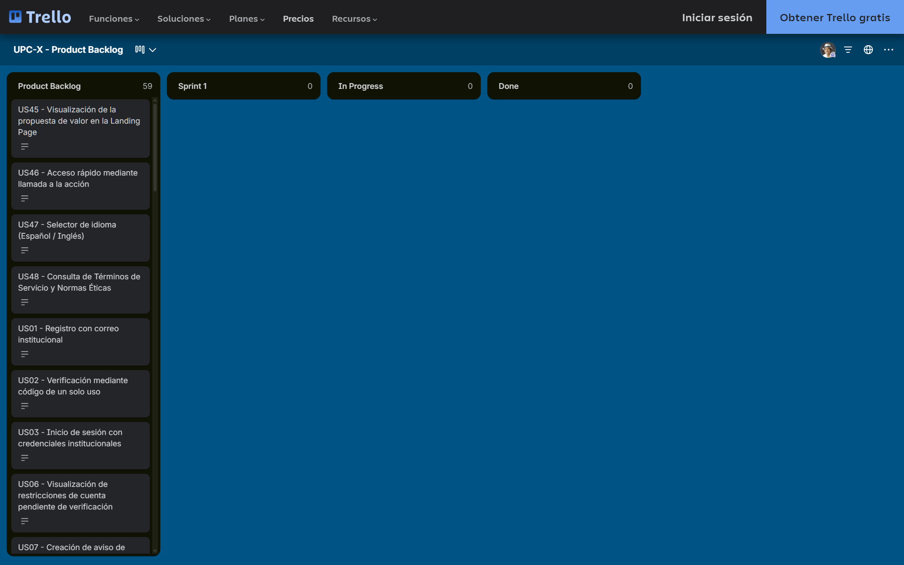

| # Orden | User Story Id | Título | Descripción | Story Points (1 / 2 / 3 / 5 / 8) |
|:---:|:---:|:---|:---|:---:|
| 1 | US45 | Visualización de la propuesta de valor en la Landing Page | Como visitante del segmento de estudiantes compradores o vendedores, quiero navegar por una landing page clara y moderna, para conocer los beneficios de comprar y vender seguro dentro de la UPC. | 3 |
| 2 | US46 | Acceso rápido mediante llamada a la acción | Como visitante del segmento de estudiantes compradores o vendedores, quiero contar con enlaces visibles para iniciar sesión o registrarme, para acceder directamente a la aplicación web o móvil. | 2 |
| 3 | US47 | Selector de idioma (Español / Inglés) | Como visitante del segmento de estudiantes compradores o vendedores, quiero cambiar el idioma de la página entre Inglés y Español, para consultar la información en mi lengua de preferencia. | 2 |
| 4 | US48 | Consulta de Términos de Servicio y Normas Éticas | Como visitante del segmento de estudiantes compradores o vendedores, quiero consultar los términos y condiciones de servicio en el pie de página, para conocer mis derechos, privacidad de datos y normas de uso. | 2 |
| 5 | US49 | Consulta de preguntas frecuentes | Como visitante del segmento de estudiantes compradores o vendedores con dudas, quiero consultar una sección de preguntas frecuentes, para comprender cómo se realizan los pagos y las entregas seguras. | 2 |
| 6 | US50 | Formulario de contacto y soporte técnico | Como visitante del segmento de estudiantes compradores o vendedores con dudas específicas, quiero enviar un mensaje mediante un formulario de contacto, para comunicarme con el equipo de soporte de RichStudent. | 2 |
| 7 | US07 | Creación de aviso de venta | Como estudiante vendedor, quiero crear una publicación con título, precio, categoría, condición y campus, para ofrecer mi producto a la comunidad. | 8 |
| 8 | US08 | Carga de imagen principal del producto | Como estudiante vendedor, quiero adjuntar una fotografía clara del artículo ofertado, para que los compradores evalúen su estado real. | 5 |
| 9 | US09 | Declaración de la condición del artículo | Como estudiante vendedor, quiero seleccionar la condición del artículo (Nuevo, Como nuevo, Usado), para informar con transparencia el estado del producto. | 2 |
| 10 | US10 | Asignación de campus de entrega | Como estudiante vendedor, quiero definir en qué sede de la UPC puedo entregar el bien (Monterrico, San Miguel, San Isidro o Villa), para acordar encuentros donde estudio. | 3 |
| 11 | US15 | Exploración del catálogo de publicaciones recientes | Como estudiante comprador, quiero examinar las ofertas más recientes en la pantalla principal, para conocer los productos que se ofrecen en la universidad. | 5 |
| 12 | US16 | Búsqueda de avisos por término clave | Como estudiante comprador, quiero buscar productos mediante palabras clave, para localizar un artículo específico (ej. "Calculadora", "Stewart"). | 5 |
| 13 | US17 | Filtrado de ofertas por campus de entrega | Como estudiante comprador, quiero filtrar las ofertas por mi sede de estudio, para ver únicamente lo que puedo recoger de forma presencial. | 3 |
| 14 | US18 | Filtrado de ofertas por categoría | Como estudiante comprador, quiero segmentar las ofertas por rubro académico o servicio, para enfocar mi búsqueda en lo que necesito. | 3 |
| 15 | US20 | Visualización del detalle completo de la publicación | Como estudiante comprador, quiero abrir la vista detallada de un aviso, para analizar fotos ampliadas, descripción exhaustiva y datos del vendedor. | 5 |
| 16 | US01 | Registro con correo institucional | Como estudiante comprador o vendedor de la UPC, quiero registrarme con mi correo institucional, para acceder a la plataforma universitaria. | 5 |
| 17 | US02 | Verificación mediante código de un solo uso | Como estudiante comprador o vendedor registrado, quiero validar mi cuenta ingresando el código recibido por correo, para activar mi acceso al sistema. | 5 |
| 18 | US03 | Inicio de sesión con credenciales institucionales | Como estudiante comprador o vendedor verificado, quiero autenticarme con mi correo y contraseña, para acceder a mi cuenta. | 3 |
| 19 | US06 | Visualización de restricciones de cuenta pendiente de verificación | Como estudiante comprador o vendedor con verificación pendiente, quiero conocer las acciones restringidas en la plataforma, para entender por qué debo validar mi correo institucional antes de interactuar. | 2 |
| 20 | US23 | Visualización del distintivo "UPC Verificado" | Como estudiante comprador, quiero ver el sello de verificación institucional en la ficha del vendedor, para confirmar que es un estudiante acreditado. | 2 |
| 21 | US27 | Notificación de advertencia de seguridad en campus | Como estudiante comprador o vendedor negociando un trato, quiero visualizar recomendaciones de seguridad en pantalla, para acordar entregas seguras en el campus. | 1 |
| 22 | US29 | Inicio de chat privado enlazado al aviso | Como estudiante comprador, quiero abrir una conversación directa desde la ficha del producto, para consultar disponibilidad con el vendedor. | 8 |
| 23 | US30 | Envío y recepción de mensajes de texto en chat | Como estudiante comprador o vendedor en negociación, quiero intercambiar mensajes escritos con la contraparte, para pactar los detalles de la compraventa. | 5 |
| 24 | US31 | Visualización de bandeja general de conversaciones | Como estudiante comprador o vendedor activo, quiero acceder a la lista consolidada de mis conversaciones, para gestionar mis compras y ventas pendientes. | 5 |
| 25 | US32 | Distintivo visual de mensajes no leídos | Como estudiante comprador o vendedor, quiero visualizar un indicador de mensajes entrantes, para responder a tiempo a mis acuerdos de compra o venta. | 2 |
| 26 | US33 | Selección de punto de encuentro sugerido en sede | Como estudiante comprador o vendedor negociando un intercambio, quiero seleccionar un punto de encuentro sugerido para la sede o indicar otro lugar visible y concurrido dentro del campus, para fijar un lugar seguro y visible. | 5 |
| 27 | US34 | Coordinación de fecha y hora para el encuentro | Como estudiante comprador o vendedor negociando un intercambio, quiero registrar la hora y día pactados, para conciliar el encuentro entre horarios de clase. | 3 |
| 28 | US36 | Carga de imagen de constancia de pago | Como estudiante comprador, quiero adjuntar la captura del voucher de transferencia en el chat, para dejar respaldo fehaciente del dinero enviado. | 5 |
| 29 | US37 | Confirmación de recepción de constancia de pago | Como estudiante vendedor, quiero declarar que recibí el pago tras revisar el comprobante, para dejar constancia de que el dinero llegó a mi billetera. | 3 |
| 30 | US38 | Confirmación de entrega presencial concretada | Como estudiante comprador o vendedor, quiero registrar "Entrega completada", para dar por concluida la compraventa presencial en el campus. | 5 |
| 31 | US24 | Consulta de calificación y ventas previas del vendedor | Como estudiante comprador, quiero conocer el promedio de estrellas y número de ventas del vendedor, para juzgar su fiabilidad antes de comprar. | 3 |
| 32 | US25 | Emisión de calificación con estrellas al vendedor | Como estudiante comprador, quiero calificar al vendedor tras concretar el trato, para contribuir a la reputación comunitaria. | 5 |
| 33 | US26 | Calificación de cumplimiento al comprador | Como estudiante vendedor, quiero valorar el cumplimiento del comprador tras el encuentro, para reconocer a estudiantes responsables. | 3 |
| 34 | US11 | Edición de precio y descripción de aviso propio | Como estudiante vendedor, quiero actualizar el precio o detalles de un aviso activo, para adaptarme a la demanda de los estudiantes. | 3 |
| 35 | US12 | Cambio de estado de aviso a "Vendido" | Como estudiante vendedor, quiero marcar una publicación como vendida, para que otros estudiantes no sigan consultando por ella. | 2 |
| 36 | US41 | Edición de datos de contacto y preferencias de sede | Como estudiante comprador o vendedor, quiero actualizar mi campus frecuente de entrega y mi nombre visible, para mantener mis canales de coordinación al día en futuras operaciones. | 3 |
| 37 | US42 | Configuración de número telefónico de cobro | Como estudiante vendedor, quiero registrar o actualizar mi número de billetera digital en mi cuenta, para compartirlo con un solo toque dentro del chat durante una negociación. | 3 |
| 38 | US43 | Gestión integral de mis publicaciones | Como estudiante vendedor, quiero acceder a un panel con mis avisos clasificados por estado (activos, pausados y vendidos), para controlar el stock y republicar ofertas sin reescribir la información. | 5 |
| 39 | US19 | Ordenamiento de avisos por precio | Como estudiante comprador, quiero ordenar las publicaciones de menor a mayor precio, para identificar las alternativas más accesibles. | 2 |
| 40 | US21 | Marcar el producto como favorito | Como estudiante comprador, quiero guardar avisos en mi lista personal de favoritos, para revisarlos o compararlos posteriormente. | 2 |
| 41 | US22 | Quitar producto de la lista de favoritos | Como estudiante comprador, quiero quitar una publicación de mis favoritos, para mantener depurada mi lista de artículos de interés. | 2 |
| 42 | US14 | Marcado de oferta como producto continuo | Como estudiante vendedor de alimentos o servicios, quiero señalar mi aviso como oferta continua, para indicar disponibilidad recurrente de stock. | 2 |
| 43 | US35 | Cancelación de la coordinación pactada | Como estudiante comprador o vendedor con imprevisto justificado, quiero cancelar el encuentro pactado informando a la otra parte, para desestimar el compromiso sin penalizaciones. | 2 |
| 44 | US39 | Registro de inasistencia al punto de encuentro ("No-Show") | Como estudiante comprador o vendedor que asistió al lugar pactado, quiero reportar si la otra parte no se presentó, para dejar registro del incumplimiento. | 3 |
| 45 | US40 | Consulta de historial de transacciones finalizadas | Como estudiante comprador o vendedor, quiero consultar el resumen de mis transacciones concluidas, para llevar seguimiento de mis gastos o ingresos del ciclo. | 3 |
| 46 | US44 | Consulta de valoraciones y resumen de reputación propia | Como estudiante comprador o vendedor, quiero revisar el promedio de estrellas y el desglose de calificaciones que me dejaron otros compañeros, para conocer mi nivel de fiabilidad dentro de la comunidad. | 3 |
| 47 | US13 | Eliminación voluntaria de publicación | Como estudiante vendedor, quiero retirar definitivamente un aviso publicado por error o descarte, para depurar mis anuncios. | 2 |
| 48 | US28 | Envío de reporte sobre publicación indebida | Como estudiante comprador o vendedor, quiero reportar una publicación que incumpla las normas, para alertar sobre irregularidades o bienes prohibidos. | 3 |
| 49 | US04 | Restablecimiento de contraseña olvidada | Como estudiante comprador o vendedor registrado, quiero solicitar el restablecimiento de mi contraseña mediante mi correo institucional, para recuperar mi acceso. | 3 |
| 50 | US05 | Cierre voluntario de sesión | Como estudiante comprador o vendedor autenticado, quiero cerrar mi sesión de forma manual, para resguardar la privacidad de mi perfil en el dispositivo. | 1 |
## 3.4. Impact Mapping

El objetivo de negocio planteado para el primer incremento consiste en alcanzar doscientos estudiantes UPC verificados y cincuenta transacciones concretadas durante el primer mes posterior al lanzamiento en las sedes de Monterrico y San Miguel. Los actores considerados son el estudiante vendedor, el estudiante comprador y el visitante que aún no se ha registrado.

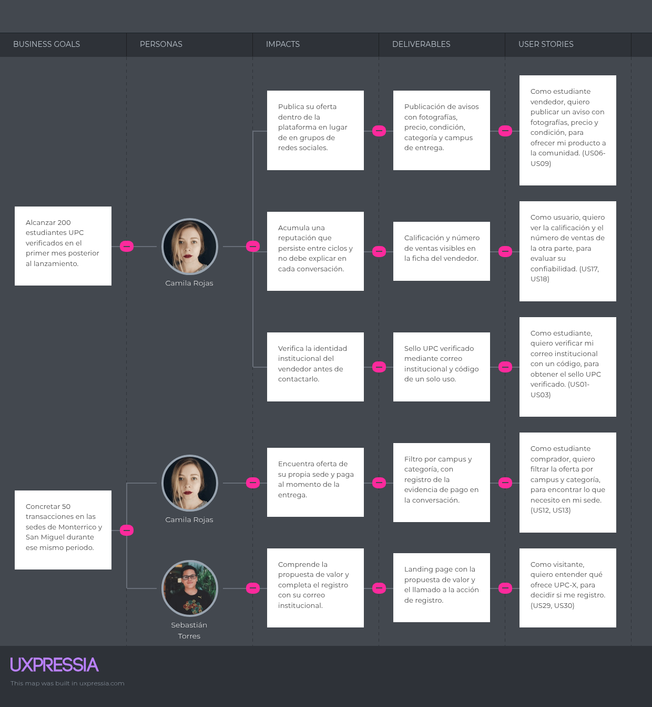


<div class="page"></div>


# Capítulo IV: Product Design

Este capítulo reúne las decisiones de diseño, la arquitectura de información, los artefactos de interfaz y el modelo de software de UPC-X. Para la aplicación móvil incluye 51 wireframes, 51 mock-ups, seis wireflows y seis User Flows; para la aplicación web, 96 vistas exportadas como 192 wireframes y 192 mock-ups de escritorio y navegador móvil, con ocho wireflows y ocho User Flows. Se completa con el diseño de la landing y los modelos de arquitectura, clases y datos.


## 4.1. Style Guidelines

Las decisiones de estilo de UPC-X se centralizan en esta sección y se aplican a los prototipos y a sus componentes reutilizables. El objetivo es que la landing page, la aplicación web y la aplicación móvil comuniquen una experiencia cercana a la comunidad UPC, pero también segura y clara para transacciones entre pares. Los lineamientos de esta sección se aplican a los flujos priorizados: verificación institucional, exploración de avisos, detalle de una publicación, contacto, conversación y publicación de avisos.

El sistema se especifica mediante tokens de color y tipografía, componentes reutilizables y una escala de espaciado consistente. Esto permite que una decisión visual se replique sin redefinirse en cada pantalla.

### 4.1.1. General Style Guidelines

#### Branding y tono de comunicación

UPC-X utiliza una identidad sobria y contemporánea. El granate es el color de acción y conexión con la identidad UPC; el verde se reserva para comunicar confianza, verificación y confirmación. El tono es cercano, directo y respetuoso: se usan etiquetas cortas y verbos de acción como **Publicar aviso**, **Contactar a Camila**, **Entrar al marketplace** y **Ver en el feed**. Los mensajes de seguridad o de éxito deben explicar el siguiente paso y no depender únicamente del color.

El tono es más serio que divertido, porque el estudiante coordina dinero y un encuentro; casual en el trato, porque habla con compañeros de su universidad; respetuoso con la otra parte, y sereno, sin mensajes de urgencia que presionen una compra.

La base del sistema es Material Design 3: su escala tipográfica, los estados de los componentes, las áreas táctiles mínimas y el uso de hojas inferiores, diálogos y snackbars, con los colores y fuentes propios de UPC-X.

#### Color

| Token | Valor | Uso principal |
|---|---:|---|
| `background` | `#F6F5F3` | Fondo general de la interfaz. |
| `foreground` | `#1C1B1A` | Texto principal e iconografía de alto contraste. |
| `card` | `#FFFFFF` | Tarjetas, superficies y campos. |
| `primary` | `#A6192E` | CTAs, acciones principales, enlaces destacados y foco. |
| `secondary` | `#ECEBE8` | Superficies secundarias. |
| `muted` / `muted-foreground` | `#F0EFEC` / `#68635F` | Fondos y texto secundario; el texto se oscureció para lectura sobre fondo cálido. |
| `accent` | `#0B6B5B` | Cuenta UPC verificada y estados de confianza. |
| `yape` | `#742384` | Representación visual de evidencia de pago Yape. |
| `border` | `#E4E2DD` | Separadores, inputs y límites de tarjetas. |

El acceso usa una base granate `#360C16` a `#641023`, con una luz secundaria `#82313D`; el resto de vistas prioriza fondos cálidos y superficies blancas. Las combinaciones principales superan el mínimo 4.5:1 establecido por [WCAG 2.2 para texto normal](https://www.w3.org/WAI/WCAG22/Understanding/contrast-minimum) (W3C, 2023): `primary` sobre blanco alcanza 7.50:1, `accent` 6.43:1 y `muted-foreground` 5.93:1. Este último alcanza 5.45:1 sobre `background`. Los estados combinan texto, icono y color.

#### Tipografía, espaciado y forma

Los títulos, precios y énfasis usan **Plus Jakarta Sans**; los párrafos, etiquetas, controles y textos de apoyo usan **Inter**. Esta separación mantiene jerarquía sin introducir más familias tipográficas. Los tamaños se basan en una escala legible y deben evitar valores arbitrarios cuando exista un equivalente de la escala definida.

El sistema usa un margen lateral habitual de 22 px, separaciones de 8, 12, 16 y 20 px, controles de 48–50 px de altura y tarjetas de 17–25 px de radio según jerarquía. Los títulos de pantalla usan 22–26 px; precios destacados, 24–28 px; párrafos de interfaz, 12–13 px. Los avatares son circulares y los chips distinguen filtros activos mediante relleno, texto y selección explícita. La aplicación móvil ajusta estas medidas a un teléfono real, como se explica en 4.1.3.

Los componentes reutilizables definidos para el producto son `Avatar`, `CampusBadge`, `VerifiedBadge`, `Rating`, `BottomNav`, `ProductCard`, `FilterChip`, `BottomSheet`, `ConfirmationDialog`, `Snackbar` y `PaymentEvidenceCard`. Las etiquetas de campus, categoría y estado se presentan como chips compactos; las acciones principales usan botones granate con texto explícito. `PaymentEvidenceCard` es un componente propio de UPC-X: no reproduce la interfaz de Yape o Plin y deja claro que la plataforma solo conserva una constancia compartida por el estudiante.

#### Diseño inclusivo e interacción

- Mantener texto legible sobre cada superficie y un indicador de foco visible en controles interactivos.
- Ofrecer objetivos táctiles amplios; los botones de navegación inferior y CTAs no deben depender de iconos sin etiqueta accesible.
- Identificar productos, campus y estados mediante texto además de color, iconos o imágenes.
- Incluir texto alternativo significativo en imágenes de publicaciones y no usar el voucher de pago como única prueba comprensible de una transacción.
- Externalizar los textos para soportar español latinoamericano (`es_419`) e inglés (`en_US`). En la aplicación móvil, `es_419` es el idioma predeterminado y fallback, mientras que `en_US` es seleccionable desde el ingreso y el perfil. Los importes se muestran en soles peruanos de acuerdo con el locale activo.

### 4.1.2. Web Style Guidelines

La aplicación web autenticada de 4.6 comparte los tokens del producto y adapta la organización a navegador: encabezado con Inicio, Guardados, Chats, Perfil y Publicar; filtros laterales en el catálogo; detalle en dos columnas y chat con bandeja, conversación y contexto. A 390 px los bloques se apilan, los filtros tienen su propia vista y Publicar conserva un acceso central etiquetado. Los puntos de adaptación son 1150 y 700 px. La landing mantiene su función informativa y su composición independiente.

La landing page traduce el mismo sistema visual a una pantalla amplia: navegación superior, hero granate con la propuesta de valor, secciones informativas sobre fondo cálido con tarjetas blancas, testimonios, preguntas frecuentes y llamados a la acción. El diseño se elaboró sobre un lienzo de escritorio de 1440 px y otro de navegador móvil de 390 px.

En web, la jerarquía prioriza primero la propuesta de valor y el CTA **Probar demo**, después el problema, las características y el funcionamiento, y finalmente la prueba social, las preguntas frecuentes y el cierre. La navegación usa etiquetas breves —**Cómo funciona**, **Características**, **Testimonios** y **Preguntas frecuentes**— que dirigen a secciones reconocibles de la misma página. Cada CTA lleva a un destino concreto: **Crear cuenta** e **Iniciar sesión** abren el acceso de la aplicación web, **Probar demo** abre el prototipo móvil y **Ver cómo funciona** desplaza a la explicación correspondiente.

La versión responsive conserva esta jerarquía: el contenido se reordena verticalmente, las imágenes no contienen información esencial sin una alternativa textual y la navegación se adapta a controles táctiles sin reducir la legibilidad. Las vistas privadas usan `noindex,nofollow`, y la landing pública usa metadatos localizados y un atributo `lang` dinámico (`en` o `es-419`).

### 4.1.3. Mobile Style Guidelines

La aplicación móvil comparte tokens, tono y componentes con la landing, pero prioriza tareas frecuentes de una sola mano: explorar publicaciones, aplicar filtros, revisar un detalle, contactar al vendedor, conversar y publicar un aviso. La referencia visual del prototipo utiliza un marco de hasta 420 px de ancho, navegación inferior persistente y tarjetas de lectura rápida.

La navegación inferior objetivo contiene cinco posiciones simétricas: **Inicio**, **Guardados**, **Publicar**, **Chats** y **Perfil**. **Publicar** ocupa la posición central y se distingue como la acción de creación; el badge de Chats se deriva de los mensajes no leídos. Los detalles, conversaciones y formularios secundarios se presentan dentro de una pila de navegación que conserva el contexto y responde al control de retroceso de la plataforma.

Los flujos móviles son:

1. Correo institucional `@upc.edu.pe` → código de verificación → cuenta verificada → marketplace.
2. Feed con buscador y filtros de campus/categoría → detalle de producto → contacto con el vendedor.
3. Conversación → envío de mensaje o evidencia de pago → coordinación del encuentro.

4. Publicación en dos pasos → previsualización → confirmación → administración del aviso.
5. Guardados → detalle → conversación; perfil → historial, publicaciones, preferencias y salida.

El marco de referencia de las láminas mide 412 × 915 unidades; el lienzo completo mide 760 × 980 e incluye una columna de anotaciones. Los wireframes emplean un mismo vocabulario de grises, bordes, placeholders y notas numeradas. Los tokens de marca se aplican en los mock-ups.

#### Densidad de la aplicación implementada

Al probar la aplicación en un teléfono real, quienes la revisaron señalaron que todo se veía demasiado grande, y la medición lo confirmó. En un Samsung de 384 × 832 dp (píxeles independientes de la densidad), con la letra del sistema sin cambios, el acceso no cabía en la pantalla, el primer aviso de Inicio empezaba al 38 % de la altura y Perfil ocupaba más de dos pantallas. La causa estaba en la aplicación: superaba las medidas de las láminas, dibujadas para un marco mayor, y heredaba un espaciado de letras pensado para otra fuente.

La implementación toma la densidad de las láminas, pero no sus textos de 9 a 11 unidades, demasiado pequeños para el uso diario:

| Elemento | Láminas | Aplicación |
|---|---:|---:|
| Margen lateral | 22 | 16 |
| Título de pantalla | 24 | 22 |
| Texto de párrafo | 12–13 | 14 |
| Texto secundario y de apoyo | 11 y 9 | 13 y 12 |
| Botón y campo: alto y radio | 50 y 13–14 | 48 y 12 |
| Barra inferior: alto, icono y texto | 67, 22 y 10 | 60, 24 y 11 |

Con estas medidas el acceso cabe entero, el primer aviso empieza al 28 % de la altura y Perfil ocupa una pantalla. El texto no baja de 12 dp, salvo los 11 dp de la barra inferior; las áreas táctiles conservan 48 dp y se respeta la escala de letra del sistema. El botón central de la barra muestra solo el signo **+**: conserva **Publicar** como nombre accesible y sigue indicando cuándo está activo, de acuerdo con las pautas de 4.1.1.

#### 4.1.3.1. iOS Mobile Style Guidelines

En iOS, el diseño respeta las áreas seguras, el teclado nativo y las convenciones de retorno mediante un botón visible de navegación. Los controles de acción conservan etiquetas textuales, mientras que los iconos de apoyo cuentan con nombres accesibles. Las capas de detalle y conversación se cierran sin depender de un gesto exclusivo y los avisos de éxito, como **¡Cuenta verificada!**, se anuncian también mediante texto.

#### 4.1.3.2. Android Mobile Style Guidelines

En Android, la aplicación mantiene la misma estructura visual y admite la navegación de retroceso del sistema para cerrar detalle o conversación antes de abandonar la sección actual. Los componentes táctiles conservan estados de presión y foco; la navegación inferior, los filtros y el CTA de publicación mantienen áreas de interacción adecuadas. La apariencia se mantiene coherente con el sistema UPC-X, sin sustituir señales de identidad, verificación o seguridad por convenciones exclusivamente visuales.

## 4.2. Information Architecture

La arquitectura de información de UPC-X parte de una sola identidad `Student`. “Comprador” y “vendedor” no son tipos de cuenta ni modos que el estudiante deba seleccionar: son roles contextuales que surgen cuando consulta un aviso ajeno o administra uno propio. Esta decisión evita duplicar perfiles, configuraciones y reputación.

El contenido se organiza alrededor de cinco objetos: estudiantes, avisos, conversaciones, transacciones y reseñas. Cada conversación conserva el aviso y los participantes que la originaron; de ese modo, el título, el precio, el vendedor y los mensajes permanecen coherentes durante todo el recorrido.

### 4.2.1. Organization Systems

UPC-X combina tres sistemas de organización:

- **Jerárquico:** acceso → navegación principal → vistas de detalle o tareas secundarias.
- **Secuencial:** verificación, publicación y cierre de una transacción se resuelven mediante pasos ordenados.
- **Matricial:** el catálogo puede explorarse combinando búsqueda, campus, categoría, tipo, condición y rango de precio.

La estructura objetivo es la siguiente:

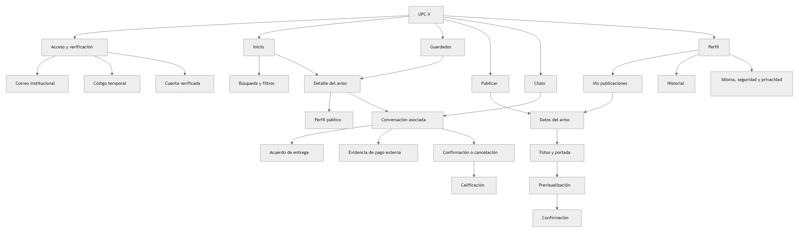

El sistema prioriza las tareas de mayor frecuencia en la barra inferior. Las páginas de detalle no se convierten en destinos principales porque dependen de un aviso, conversación o transacción específicos.

### 4.2.2. Labeling Systems

Las etiquetas usan sustantivos breves para destinos y verbos explícitos para acciones. Se evita emplear “venta” como sinónimo de publicación y “pago verificado” cuando UPC-X no puede comprobar una operación externa.

| Elemento | Etiqueta principal | Criterio |
|---|---|---|
| Catálogo | **Inicio** | Punto de entrada para explorar la oferta. |
| Lista personal | **Guardados** | Describe avisos marcados, no una compra confirmada. |
| Creación | **Publicar** / **Publicar aviso** | Acción explícita disponible para cualquier estudiante verificado. |
| Mensajería | **Chats** | Término breve y conocido por el segmento. |
| Cuenta | **Perfil** | Reúne identidad, reputación, historial y configuración. |
| Confianza | **Correo UPC verificado** | Comunica exactamente qué se verificó, sin garantizar identidad civil o conducta. |
| Constancia | **Evidencia de pago** | Evita afirmar que UPC-X procesó o validó el pago. |
| Oferta | **Aviso** | Abarca productos, servicios y tutorías. |
| Resultado | **Entrega completada** / **No se concretó** | Distingue éxito y cancelación sin depender del color. |

Todos los textos visibles se externalizan. La aplicación móvil usa `es_419` como idioma inicial y fallback, y permite elegir `en_US` desde acceso y perfil. Cuando una traducción inglesa no existe se muestra la versión `es_419`; los datos demostrativos —categorías, condiciones, fechas relativas y mensajes— también deben localizarse.

### 4.2.3. SEO Tags and Meta Tags

La estrategia SEO se aplica a la landing pública, no a las vistas privadas de las aplicaciones móvil y web. Las vistas privadas usan `noindex,nofollow`; la landing pública habilita la indexación y se definen metadatos localizados.

| Etiqueta | Español latinoamericano | Inglés |
|---|---|---|
| `title` | UPC-X — Compra, vende e intercambia entre estudiantes UPC | UPC-X — Buy, sell and exchange with UPC students |
| `description` | Marketplace web y móvil para estudiantes UPC verificados que coordinan compras, ventas, servicios y tutorías dentro del campus. | Web and mobile marketplace for verified UPC students to coordinate products, services and tutoring on campus. |
| `keywords` | marketplace UPC, estudiantes UPC, compra y venta en campus, avisos entre estudiantes, tutorías UPC | UPC marketplace, student classifieds, campus exchange, student services, tutoring |
| `lang` | `es-419` | `en` |
| `og:type` | `website` | `website` |
| `og:site_name` | `UPC-X` | `UPC-X` |
| `author` | `RichStudent` | `RichStudent` |

La landing incluye `canonical`, `og:title`, `og:description`, `og:image`, Twitter Card y `hreflang` para `es-419`, `en` y `x-default`. Este último identifica la versión de fallback cuando ningún idioma coincide, conforme a la [guía de versiones localizadas de Google Search Central](https://developers.google.com/search/docs/advanced/crawling/localized-versions) (Google, s. f.). Los títulos y descripciones deben coincidir con el idioma activo. El nombre de la startup es RichStudent; UPC-X es el producto.

| Vista de la aplicación web | `title` | `description` | `keywords` | `author` | `robots` |
|---|---|---|---|---|---|
| Catálogo | UPC-X · Catálogo de avisos | Avisos de productos, servicios y tutorías publicados por estudiantes UPC verificados, filtrables por sede y categoría. | catálogo UPC-X, avisos UPC, compra entre estudiantes | RichStudent | `noindex, nofollow` |
| Detalle del aviso | UPC-X · título del aviso | Precio, condición, sede de entrega y reputación del vendedor. | aviso UPC-X, detalle del producto, vendedor verificado | RichStudent | `noindex, nofollow` |
| Chats | UPC-X · Chats | Conversaciones del estudiante ligadas a cada aviso. | chats UPC-X, mensajes, coordinación de entrega | RichStudent | `noindex, nofollow` |
| Perfil | UPC-X · Mi perfil | Datos, reputación, publicaciones e historial del estudiante. | perfil UPC-X, reputación, historial | RichStudent | `noindex, nofollow` |

La URL canónica corresponde al dominio público de la landing. La imagen social lleva texto alternativo y coincide con el idioma de la página.

### 4.2.4. Searching Systems

La búsqueda primaria consulta el título y la descripción del aviso. Los resultados se refinan mediante filtros combinables y permanecen sincronizados con la consulta actual.

| Mecanismo | Valores iniciales | Respuesta esperada |
|---|---|---|
| Texto | Palabra o frase | Coincidencia por título y descripción. |
| Campus | Todos, Monterrico, San Miguel, San Isidro, Villa | Solo avisos con entrega en la sede seleccionada. |
| Categoría | Comida, libros, calculadoras, tecnología, tutorías | Solo avisos de la categoría. |
| Tipo | Producto, servicio, tutoría | Diferencia bienes de prestaciones. |
| Condición | Nuevo, como nuevo, usado | Aplica únicamente a productos. |
| Precio | Mínimo y máximo | Limita resultados al rango indicado. |
| Orden | Recientes, precio ascendente/descendente | Reordena sin modificar filtros. |

El sistema muestra la cantidad de resultados, los filtros activos y una acción **Limpiar filtros**. También contempla estados de carga, error, catálogo vacío y búsqueda sin coincidencias. No se muestran avisos retirados; un aviso reservado permanece identificable, pero no permite iniciar una nueva transacción.

### 4.2.5. Navigation Systems

La navegación principal se mantiene visible en las cinco áreas de primer nivel. El botón Atrás cierra primero hojas, diálogos o vistas de detalle y solo después abandona la sección. Enlaces profundos a avisos o conversaciones restauran la sección padre correspondiente.

| Origen | Acción | Destino | Retorno |
|---|---|---|---|
| Inicio/Guardados | Seleccionar aviso ajeno | Detalle | Lista y posición anteriores. |
| Detalle ajeno | Contactar | Conversación ligada al aviso | Detalle. |
| Detalle propio | Administrar | Edición/estado del aviso | Detalle propio. |
| Publicar | Confirmar | Éxito → aviso publicado | Feed o perfil. |
| Chats | Seleccionar hilo | Conversación correspondiente | Bandeja de chats. |
| Conversación | Coordinar entrega | Hoja de acuerdo | Conversación. |
| Perfil | Mis publicaciones | Avisos propios | Perfil. |

El contador de Chats se calcula a partir de mensajes no leídos. El estado seleccionado se comunica visualmente y mediante semántica accesible (`aria-current` en web o su equivalente en Flutter).

## 4.3. Landing Page UI Design
Para el desarrollo de los wireframes y mock-ups de la landing page de UPC-X se utiliza **Figma**, en un archivo propio separado del de las aplicaciones: [UPC-X · Landing Page](https://www.figma.com/design/tBrjbqyscC9ipYJxQLYy12/UPC-X-Landing-Page). Los wireframes definen estructura, jerarquía y secuencia de lectura; los mock-ups incorporan el sistema visual de la sección 4.1. La landing es informativa y de captación: no reemplaza las aplicaciones web y móvil, donde ocurren las transacciones.

La página organiza el contenido en ocho bloques con un orden fijo: inicio con la propuesta de valor, problema, características, funcionamiento, testimonios, preguntas frecuentes con formulario de contacto, llamado a la acción y pie de página. Cada bloque responde a una historia del visitante: propuesta de valor, funcionamiento y testimonios (US45); enlaces para crear cuenta e iniciar sesión (US46); selector de idioma español/inglés (US47); términos y condiciones en el pie (US48); preguntas frecuentes sobre pagos y entregas (US49), y formulario de contacto (US50). El diseño de escritorio mide 1440 px de ancho y el de navegador móvil, 390 px.

<p align="center"><a href="https://www.figma.com/design/tBrjbqyscC9ipYJxQLYy12/UPC-X-Landing-Page?node-id=0-1">Wireframes en Figma</a> · <a href="https://www.figma.com/design/tBrjbqyscC9ipYJxQLYy12/UPC-X-Landing-Page?node-id=1-2">Mock-ups en Figma</a> · <a href="https://www.figma.com/design/tBrjbqyscC9ipYJxQLYy12/UPC-X-Landing-Page?node-id=1-3">Estilos y variables en Figma</a></p>

### 4.3.1. Landing Page Wireframe
El recorrido comienza con la propuesta de valor y las acciones principales, explica el problema, las características y el funcionamiento, presenta testimonios y preguntas frecuentes, y concluye con un segundo llamado a la acción y el footer. Esta secuencia permite comprender el producto antes de solicitar una acción. Los wireframes usan solo grises, contornos y placeholders cruzados para las imágenes, de modo que la jerarquía se evalúa sin depender del color.

La jerarquía se construye con un titular dominante por bloque, una etiqueta superior y un párrafo de apoyo. La proximidad agrupa ícono, título y descripción en cada tarjeta, y la repetición de tarjetas del mismo tamaño permite comparar problemas y características. El contraste de tamaño y relleno separa la acción primaria de la secundaria. En diseño inclusivo, cada acción tiene texto visible, los controles miden al menos 48 px de alto, el foco es visible y el formulario indica qué dato falta sin borrar lo escrito.

**Desktop Web Browser.** Ocho secciones a 1440 px, en el orden en que se recorren.

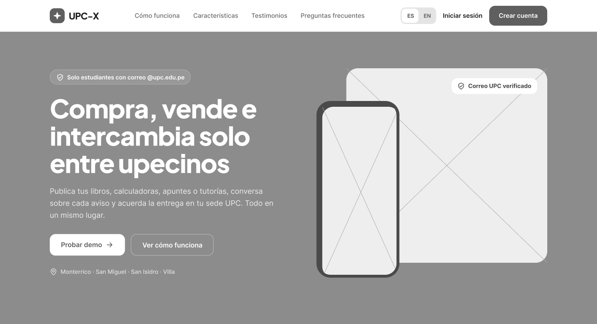
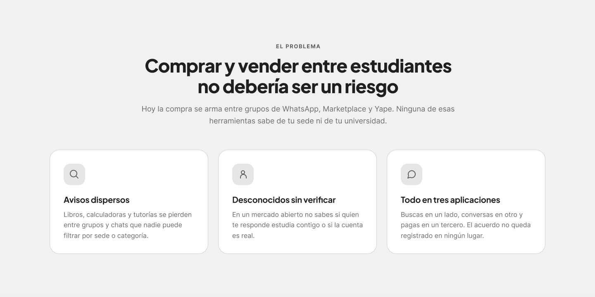
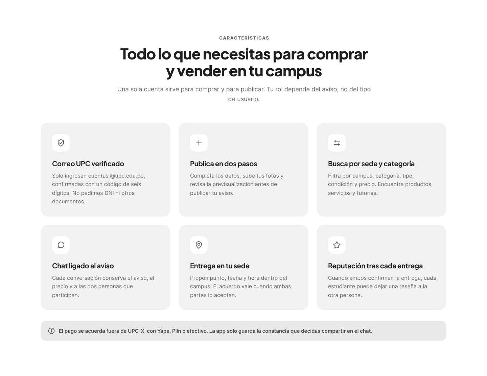
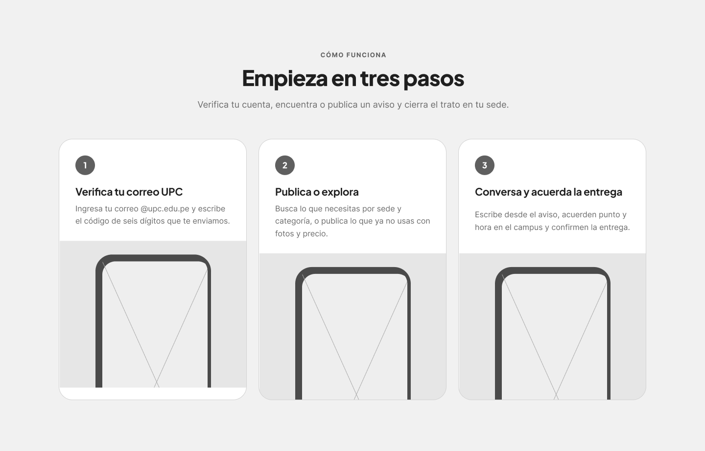
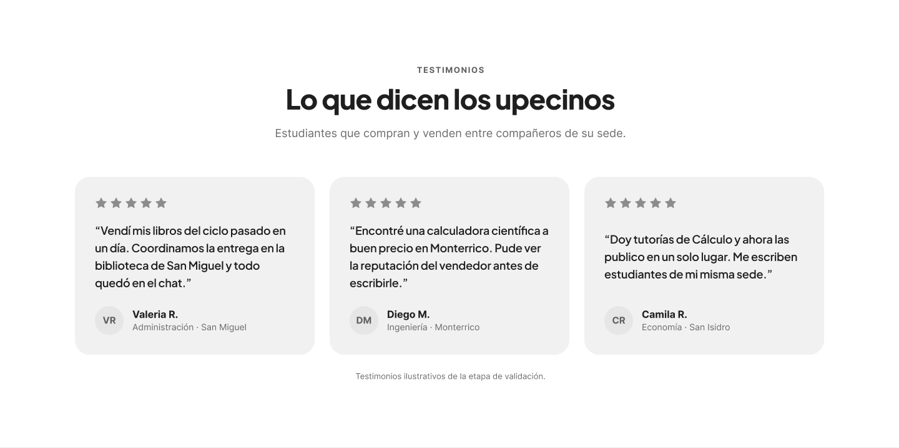
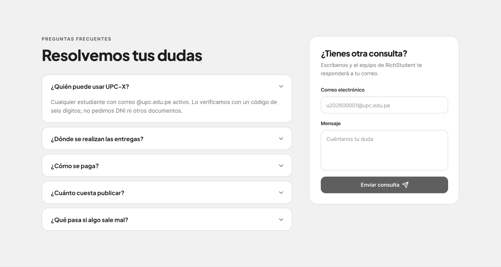
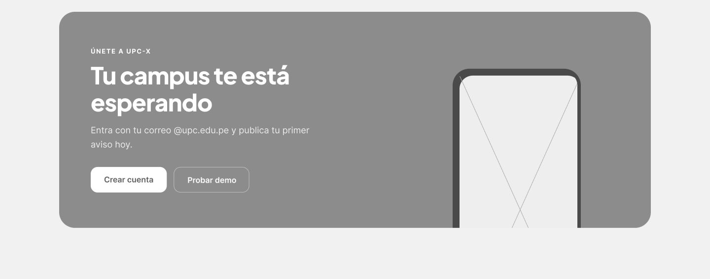
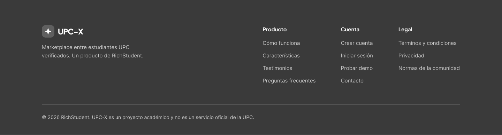

<p align="center"><a href="https://www.figma.com/design/tBrjbqyscC9ipYJxQLYy12/UPC-X-Landing-Page?node-id=2-815">LP-01</a> · <a href="https://www.figma.com/design/tBrjbqyscC9ipYJxQLYy12/UPC-X-Landing-Page?node-id=2-1062">LP-02</a> · <a href="https://www.figma.com/design/tBrjbqyscC9ipYJxQLYy12/UPC-X-Landing-Page?node-id=2-1139">LP-03</a> · <a href="https://www.figma.com/design/tBrjbqyscC9ipYJxQLYy12/UPC-X-Landing-Page?node-id=2-1298">LP-04</a> · <a href="https://www.figma.com/design/tBrjbqyscC9ipYJxQLYy12/UPC-X-Landing-Page?node-id=2-1390">LP-05</a> · <a href="https://www.figma.com/design/tBrjbqyscC9ipYJxQLYy12/UPC-X-Landing-Page?node-id=2-1564">LP-06</a> · <a href="https://www.figma.com/design/tBrjbqyscC9ipYJxQLYy12/UPC-X-Landing-Page?node-id=2-1743">LP-07</a> · <a href="https://www.figma.com/design/tBrjbqyscC9ipYJxQLYy12/UPC-X-Landing-Page?node-id=2-1795">LP-08</a></p>

**Mobile Web Browser.** En navegador móvil, la especificación responsive dispone una sola columna con el mismo orden de lectura: encabezado compacto con selector de idioma y botón de menú, propuesta de valor con las acciones a todo el ancho, imagen de apoyo, tarjetas apiladas, pasos, testimonios, preguntas frecuentes, formulario, cierre y footer. El menú despliega los enlaces internos y las acciones de cuenta. La página continua se muestra en cuatro columnas que se leen de izquierda a derecha.

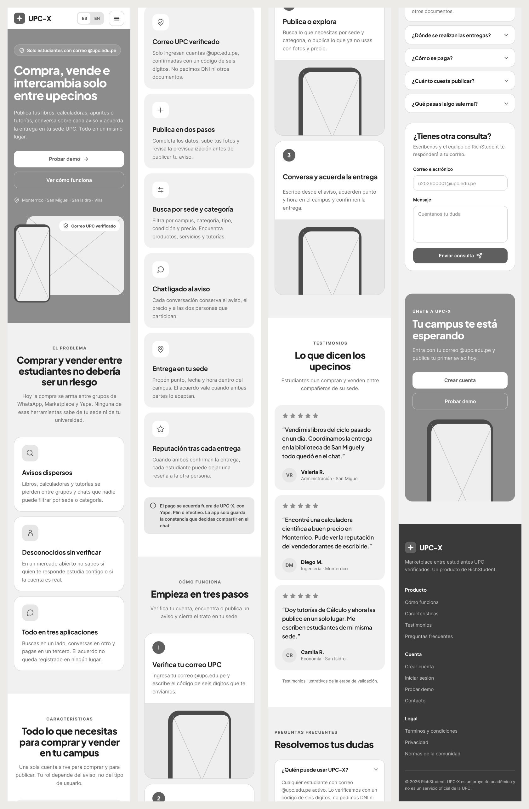

<p align="center"><a href="https://www.figma.com/design/tBrjbqyscC9ipYJxQLYy12/UPC-X-Landing-Page?node-id=2-1889">Wireframe móvil en Figma</a></p>

### 4.3.2. Landing Page Mock-up
Los mock-ups aplican el granate `#A6192E` como color de acción, un hero con el degradado granate de la pantalla de acceso (`#360C16` a `#641023`), fondos cálidos `#F6F5F3`, tarjetas blancas y el verde `#0B6B5B` para la verificación y el aviso sobre pagos. Los títulos usan Plus Jakarta Sans y los textos, Inter. Las capturas del celular provienen de los mock-ups de 4.4.3, de modo que la landing muestra el producto diseñado. Ninguna imagen contiene por sí sola información indispensable: cada una tiene texto alternativo y su mensaje se repite en el texto. La versión pública incluye selector de idioma, foco visible y metadatos localizados. En Figma, los colores están enlazados a la colección de variables del archivo.

**Desktop Web Browser.**

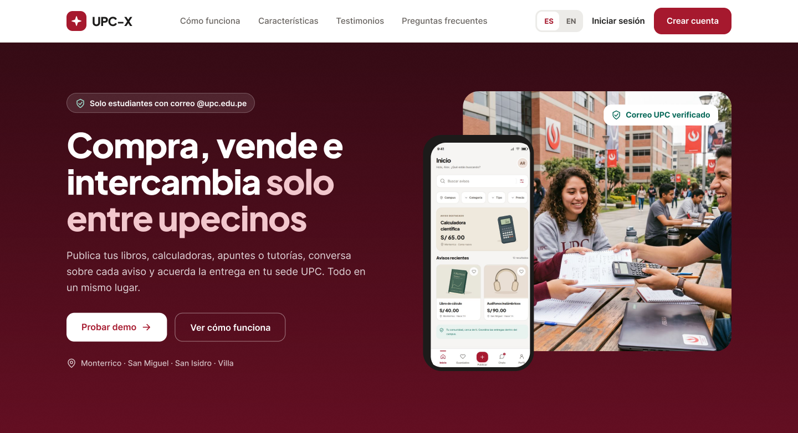
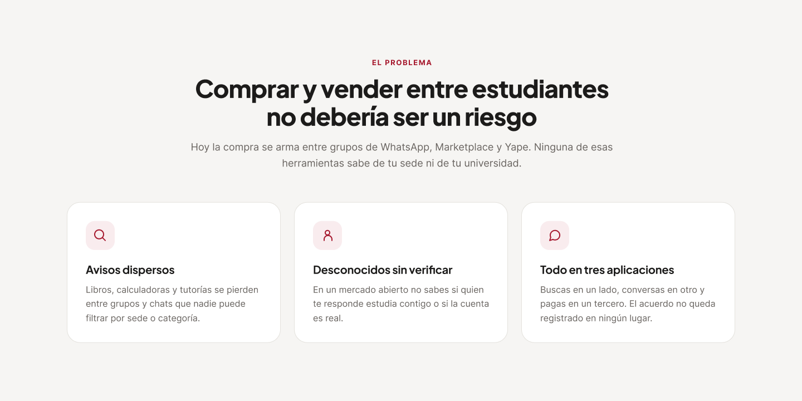
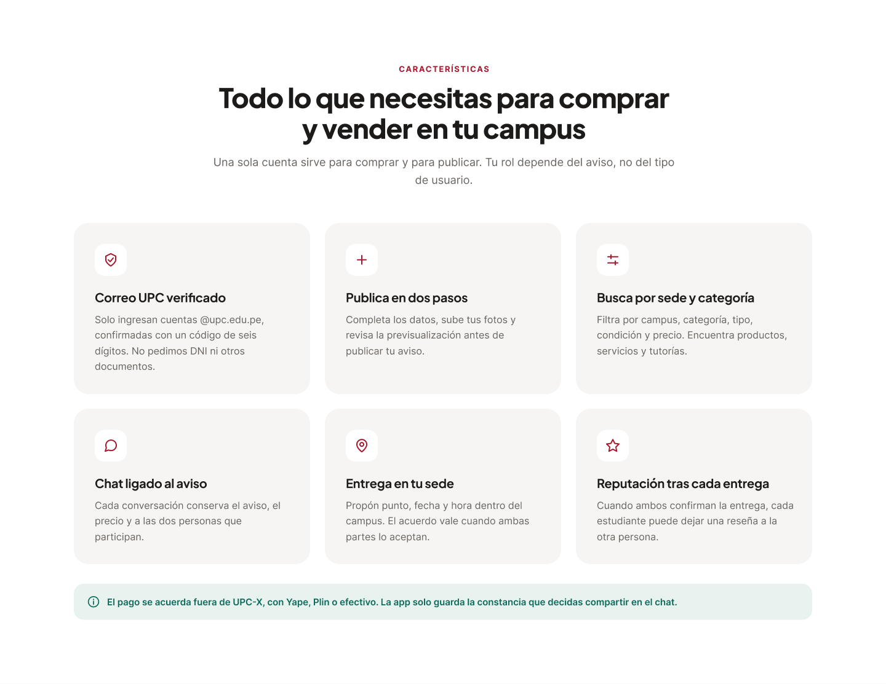
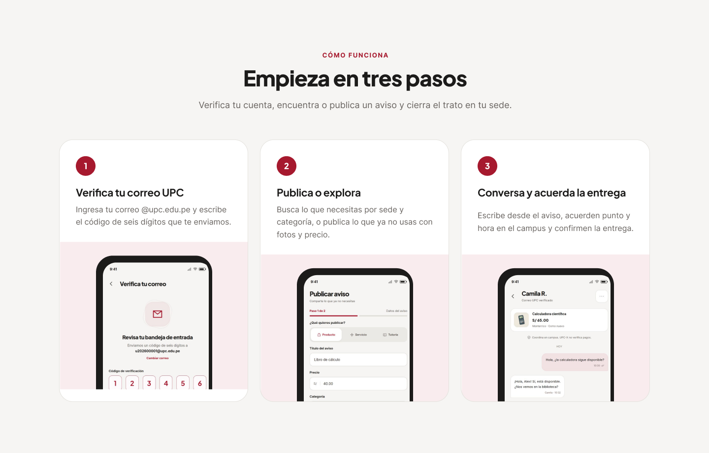
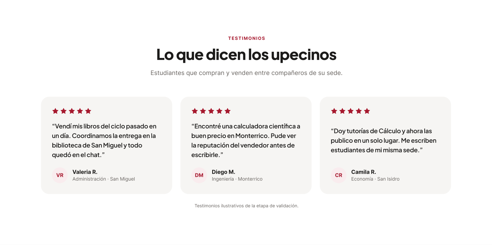
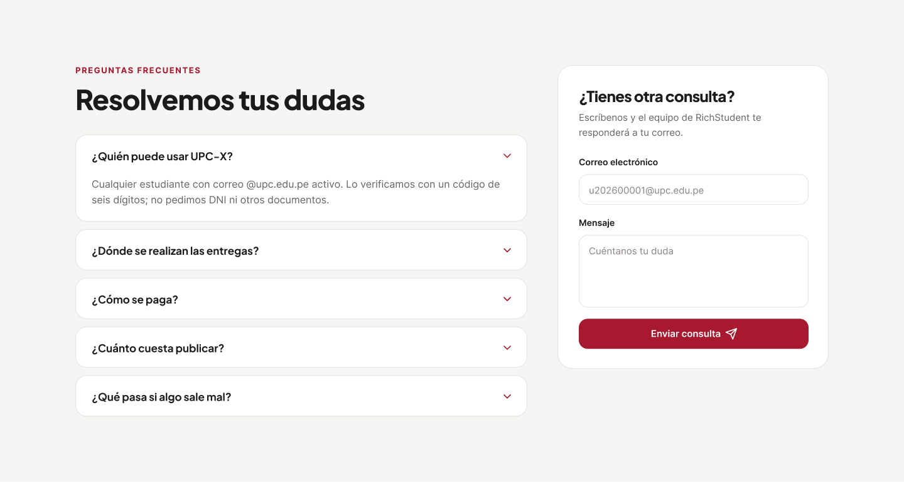
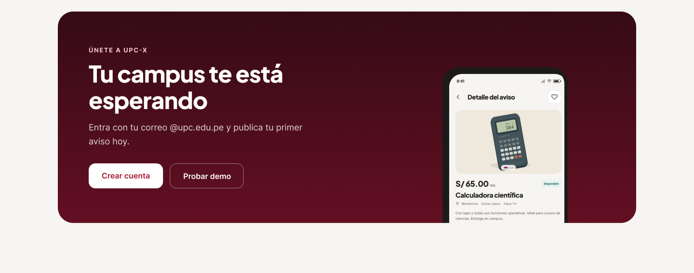
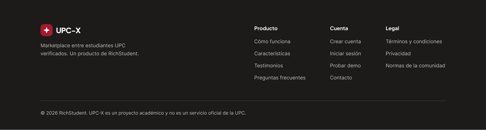

<p align="center"><a href="https://www.figma.com/design/tBrjbqyscC9ipYJxQLYy12/UPC-X-Landing-Page?node-id=1-1145">LP-01</a> · <a href="https://www.figma.com/design/tBrjbqyscC9ipYJxQLYy12/UPC-X-Landing-Page?node-id=1-1388">LP-02</a> · <a href="https://www.figma.com/design/tBrjbqyscC9ipYJxQLYy12/UPC-X-Landing-Page?node-id=1-1465">LP-03</a> · <a href="https://www.figma.com/design/tBrjbqyscC9ipYJxQLYy12/UPC-X-Landing-Page?node-id=1-1624">LP-04</a> · <a href="https://www.figma.com/design/tBrjbqyscC9ipYJxQLYy12/UPC-X-Landing-Page?node-id=1-1710">LP-05</a> · <a href="https://www.figma.com/design/tBrjbqyscC9ipYJxQLYy12/UPC-X-Landing-Page?node-id=1-1884">LP-06</a> · <a href="https://www.figma.com/design/tBrjbqyscC9ipYJxQLYy12/UPC-X-Landing-Page?node-id=1-2063">LP-07</a> · <a href="https://www.figma.com/design/tBrjbqyscC9ipYJxQLYy12/UPC-X-Landing-Page?node-id=1-2113">LP-08</a></p>

**Mobile Web Browser.** Se conservan los mismos tokens; las columnas pasan a bloques verticales, los botones ocupan todo el ancho y las capturas del celular se reducen sin perder su texto alternativo.

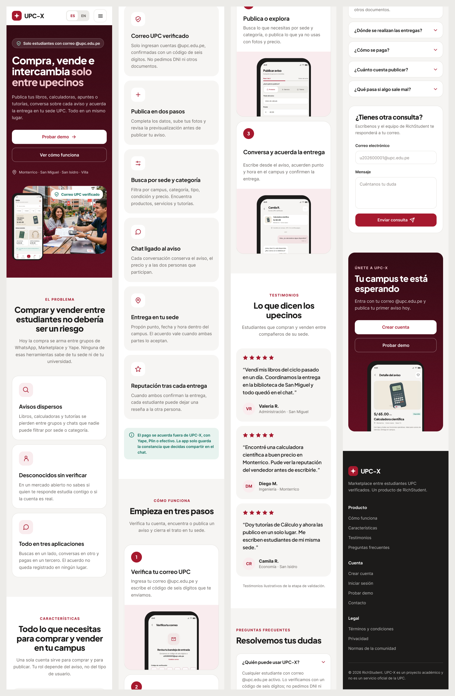

<p align="center"><a href="https://www.figma.com/design/tBrjbqyscC9ipYJxQLYy12/UPC-X-Landing-Page?node-id=1-3211">Mock-up móvil en Figma</a></p>

## 4.4. Mobile Applications UX/UI Design

El diseño móvil ofrece una única experiencia para estudiantes. Los dos segmentos comparten cuenta, navegación y reputación; el rol depende de quién es propietario del aviso y quién inicia la conversación. Los artefactos se organizan por objetivos de usuario para conservar trazabilidad con los User Personas, el To-Be Scenario Mapping y el Product Backlog.

### 4.4.1. Mobile Applications Wireframes

Los wireframes se definen sobre una retícula móvil de una columna. El set es común para Android e iOS; las adaptaciones de plataforma se documentan en 4.5. Se incluyen 14 pantallas principales y 37 estados derivados. Cada cambio relevante de estado tiene un identificador con sufijo, por ejemplo M-02b para código vencido y M-13a para confirmación pendiente.

La tabla relaciona cada pantalla con las User Stories que atiende. En la aplicación móvil el estudiante ingresa con su correo institucional y un código temporal; el acceso con contraseña y su recuperación (US03 y US04) están en la aplicación web.

<p align="center"><a href="https://www.figma.com/design/QGamFXN1K46XmRBrmCYpq9/UPC-X-Diseno-y-prototipos?node-id=2-2">Wireframes móviles en Figma (51 pantallas)</a></p>

| ID | Pantalla/estado | Objetivo y elementos esenciales | Historias |
|---|---|---|---|
| M-01 | Acceso | Correo institucional, idioma, términos y CTA. | US01 |
| M-02 | Verificación | OTP editable, expiración, reenvío, error y éxito. | US02, US06 |
| M-03 | Inicio | Búsqueda, filtros, destacado, resultados y estados vacío/error. | US15–US19 |
| M-04 | Guardados | Lista personal y estado vacío. | US21, US22 |
| M-05 | Detalle ajeno | Galería, condición, campus, reputación, seguridad y contacto. | US20, US23, US24, US27 |
| M-06 | Detalle propio | Estado del aviso, editar, reservar, completar y retirar. | US11–US13 |
| M-07 | Publicar/editar | Paso 1: tipo, título, precio, categoría, condición y campus. M-07a: fotos, portada y descripción. | US07–US10, US14 |
| M-08 | Previsualización/éxito | Revisión previa y confirmación del aviso publicado. | US07 |
| M-09 | Chats | Hilos con aviso, contraparte, último mensaje y no leídos. | US31, US32 |
| M-10 | Conversación | Mensajes, imágenes, seguridad y contexto del aviso. | US29, US30 |
| M-11 | Acuerdo | Campus, punto, fecha, hora y confirmación. | US33, US34 |
| M-12 | Evidencia de pago | Imagen adjunta, metadatos, estado, reemplazo y discrepancia. | US36, US37 |
| M-13 | Cierre y reseña | Confirmación bilateral, no concretado y calificación. | US25, US26, US35, US38, US39 |
| M-14 | Perfil | Identidad, reputación, historial, avisos propios, idioma y sesión. | US05, US40–US44 |

#### M-01 — Acceso

Presenta el correo institucional, el idioma y el consentimiento antes del envío de un código. La cuenta es única para comprar y publicar. El estado M-01a explica cómo corregir un correo inválido conservando lo escrito.

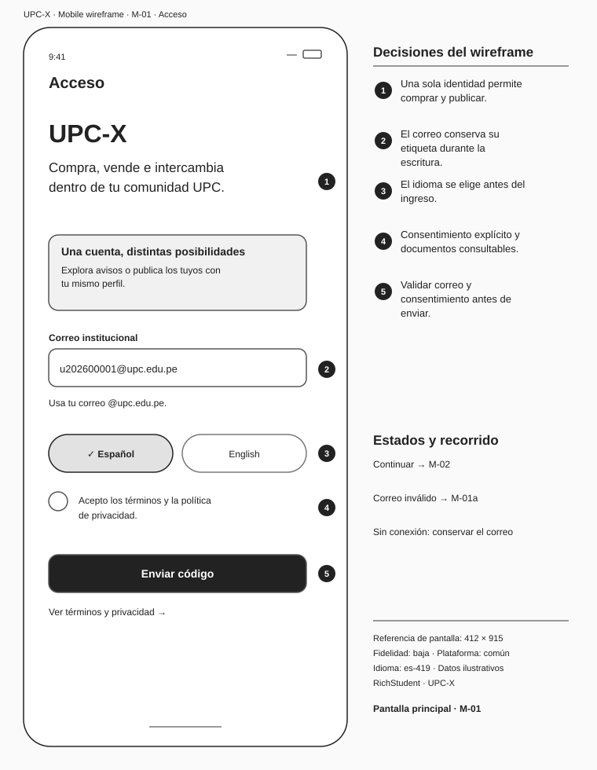

#### M-02 — Verificación

Mantiene el correo de destino visible y separa el vencimiento del código del tiempo de espera para reenviar. Se permite cambiar de correo, editar o pegar los seis dígitos. El éxito indica correo verificado, sin garantizar identidad civil.

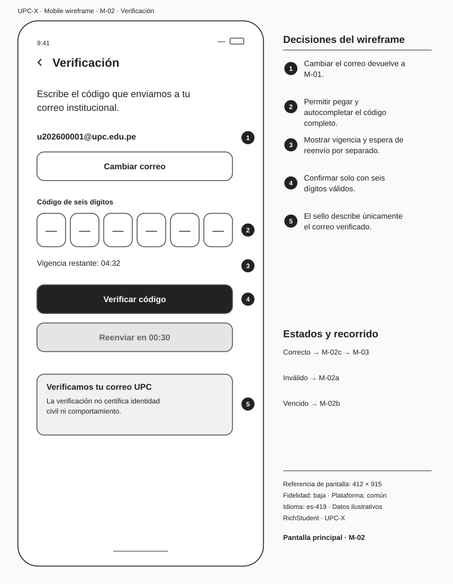

#### M-03 — Inicio

Presenta búsqueda, filtros, destacado separado de resultados y cinco destinos inferiores. La hoja M-03a amplía los filtros con condición, rango de precio y orden; M-03b, M-03c y M-03d representan vacío, carga y error de red.

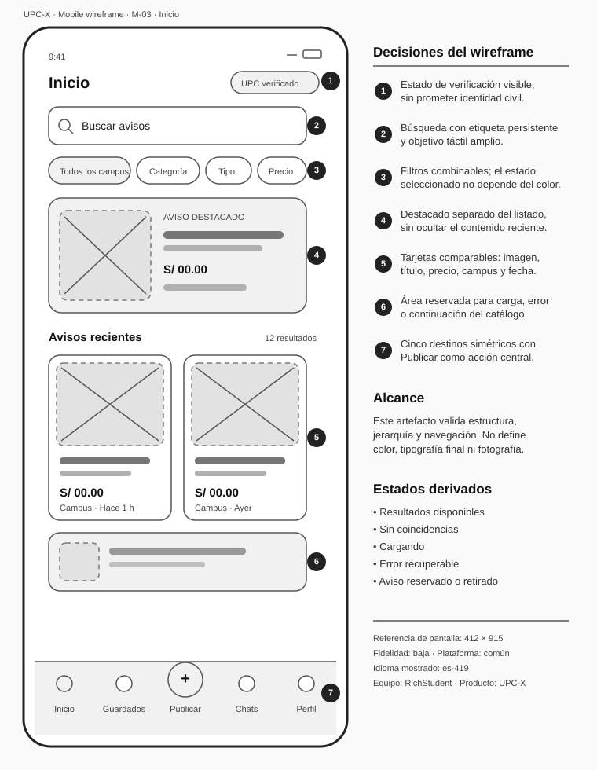

#### M-04 — Guardados

Reúne avisos elegidos por el estudiante y permite retirarlos de la lista. Guardar no reserva: cada tarjeta conserva la disponibilidad actual. El estado vacío propone explorar avisos y el retorno desde detalle recupera Guardados.

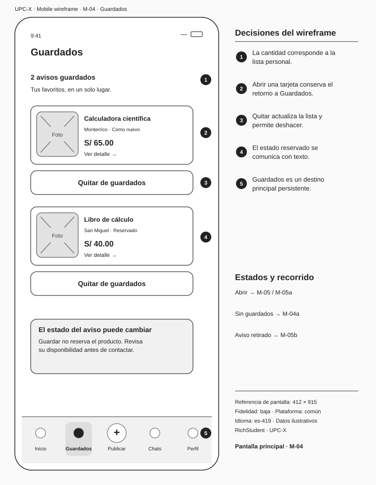

#### M-05 — Detalle ajeno

Ordena galería, título, precio, condición, campus y descripción antes del perfil del vendedor y la acción de contacto. El perfil público M-05c muestra reputación sin publicar el correo completo. Un aviso reservado o retirado informa su estado e impide iniciar una nueva operación.

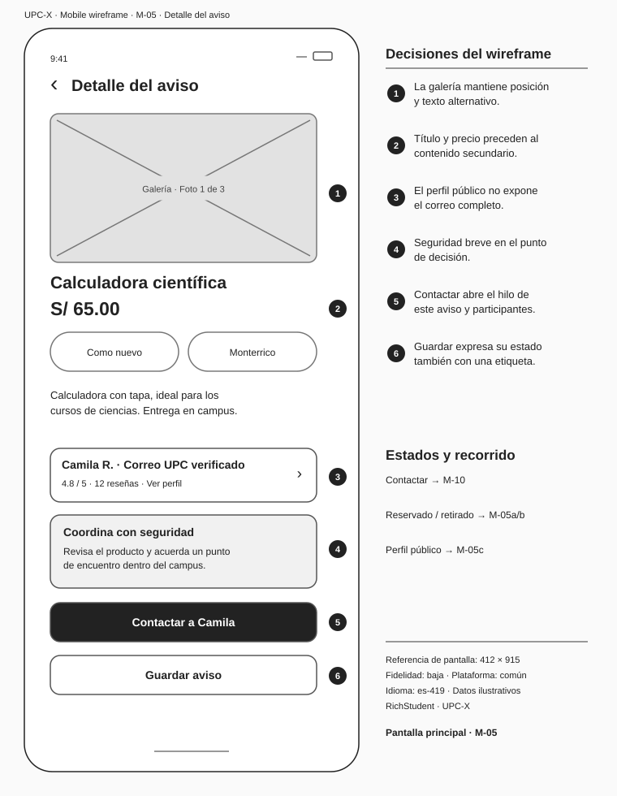

#### M-06 — Detalle propio

Presenta acciones exclusivas del propietario: editar, reservar para una conversación, gestionar la entrega y retirar. Gestionar entrega abre M-13; completar el aviso requiere las dos confirmaciones. La retirada dispone de confirmación y pantalla de resultado, preservando mensajes históricos.

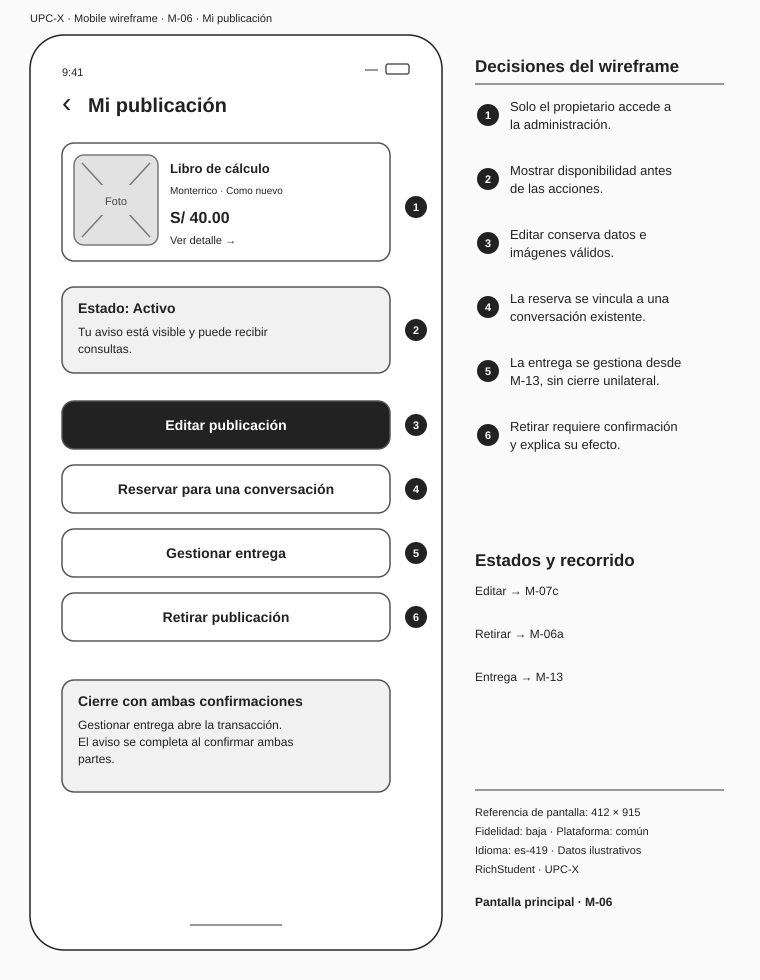

#### M-07 — Publicar o editar

La creación se divide en dos pasos para mantener controles legibles: datos del aviso en M-07, fotos y descripción en M-07a. La condición solo aplica a productos; la portada depende del orden elegido. M-07b muestra errores concretos y M-07c distingue editar un aviso existente de crear otro.

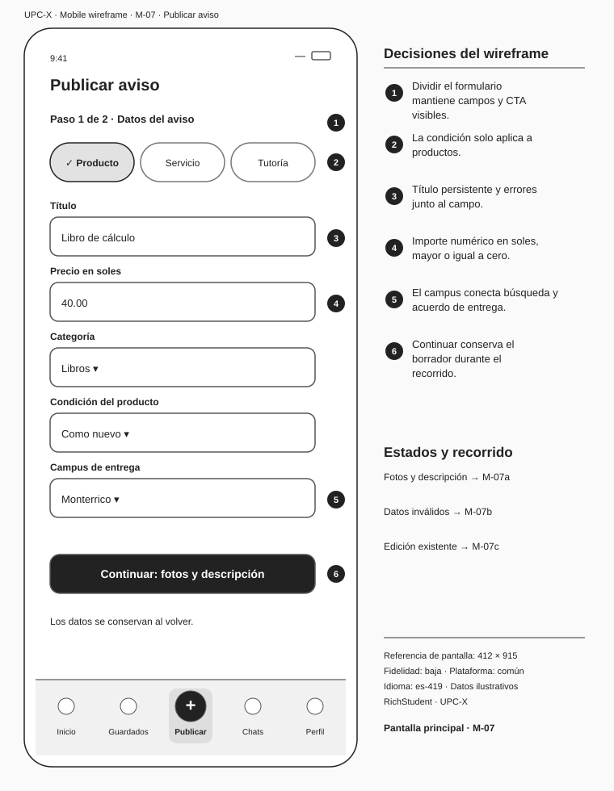

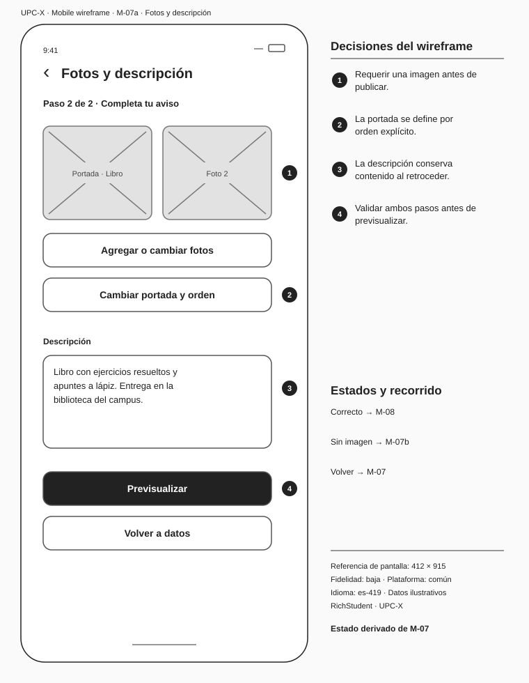

#### M-08 — Previsualización y éxito

Permite revisar el contenido antes de hacerlo visible. Volver a editar conserva los datos; publicar espera una respuesta exitosa antes de mostrar M-08a. Desde la confirmación se accede al mismo aviso en M-06.

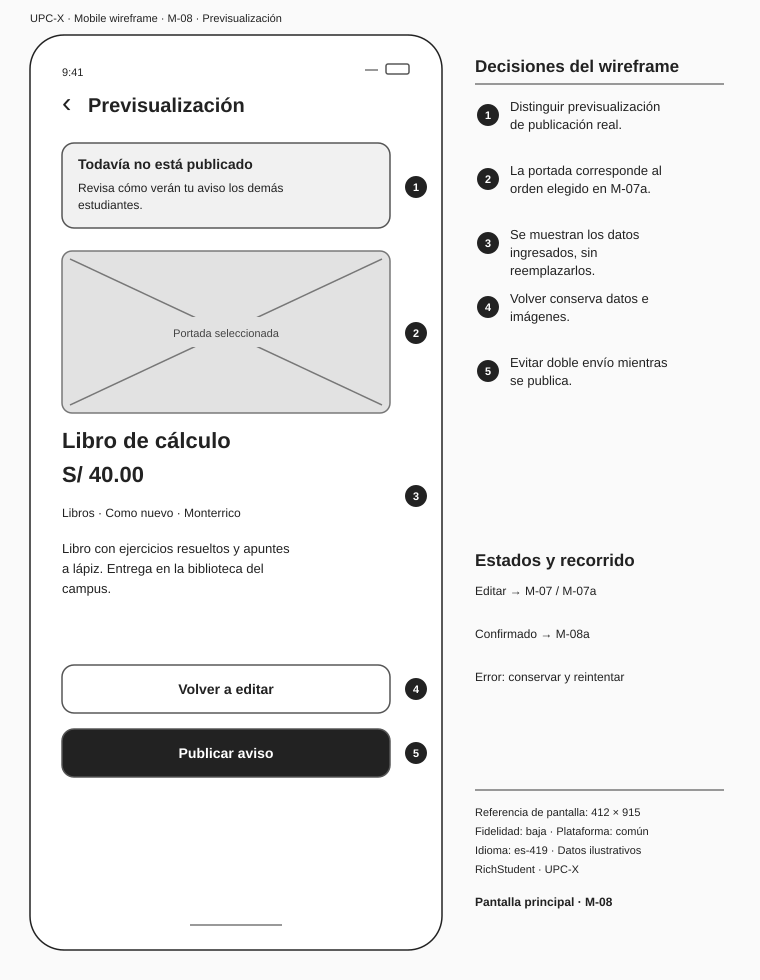

#### M-09 — Chats

Cada fila identifica contraparte, aviso y último mensaje. Los no leídos se expresan mediante contador textual y filtro. El estado sin conversaciones explica que un hilo se inicia desde el detalle de un aviso.

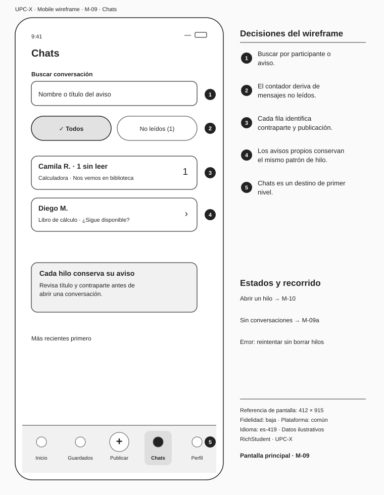

#### M-10 — Conversación

Conserva el aviso, la contraparte y el estado de envío en pantalla. Desde el hilo se accede al acuerdo, a la evidencia opcional y al cierre. M-10a muestra un mensaje no enviado con opciones de reintento y edición, evitando perder o duplicar el texto.

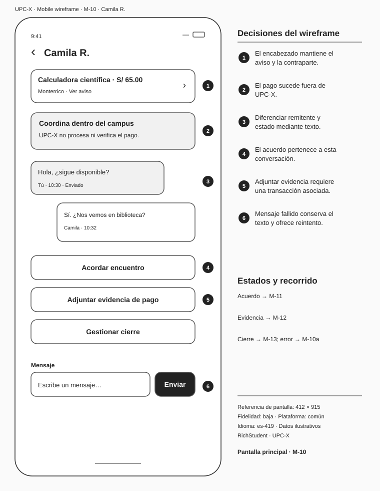

#### M-11 — Acuerdo

Registra campus, punto, fecha, hora y precio. Enviar una propuesta no equivale a aceptarla por ambas partes. M-11a advierte diferencias con el campus del aviso y M-11b muestra el acuerdo aceptado; cualquier cambio requiere renovar la aceptación.

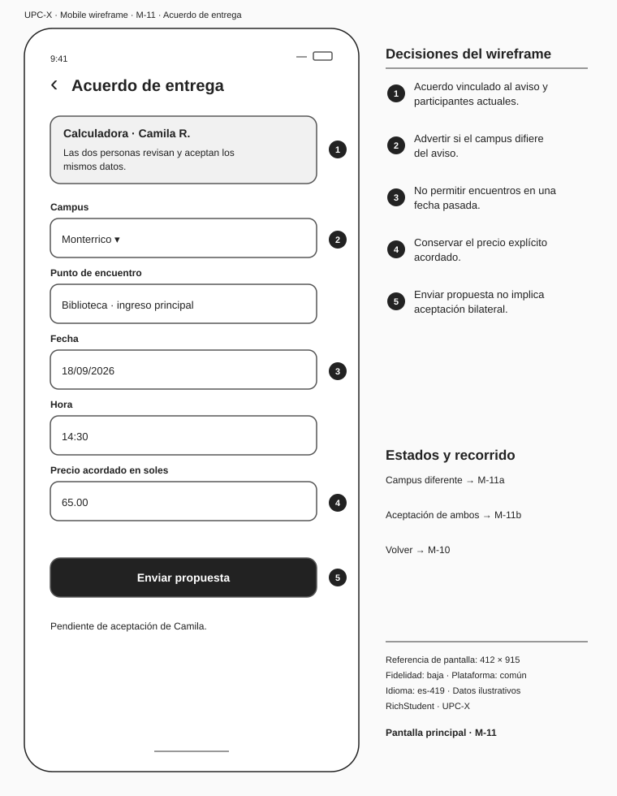

#### M-12 — Evidencia de pago

Combina la captura con medio, importe y referencia parcial propios de UPC-X. La evidencia es opcional y privada para los participantes. Los estados enviada, recibida y con discrepancia registran declaraciones; ninguno certifica una operación bancaria. Una corrección posterior conserva el registro previo.

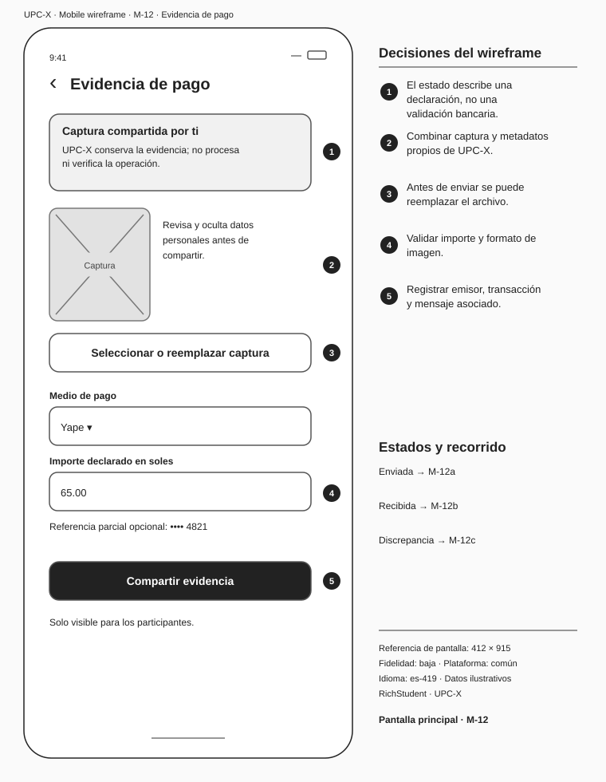

#### M-13 — Cierre y reseña

Distingue las confirmaciones del estudiante y de su contraparte. Una confirmación deja la entrega pendiente; ambas habilitan una reseña por persona. Cancelar exige confirmar el motivo y no habilita calificación. Las láminas M-13a a M-13d hacen visibles estas transiciones.


#### M-14 — Perfil

Centraliza reputación, publicaciones propias, historial, datos editables, idioma y salida. Compras y ventas son filtros del historial de una misma cuenta. Cerrar sesión requiere confirmar y permite volver para guardar cambios pendientes.


#### Estados derivados y recuperación

La tabla reúne los estados derivados de cada pantalla y la forma en que el estudiante se recupera en cada caso.

**M-01 · Acceso (M-01a).** Corregir el dominio sin borrar el correo.

<p align="center"></p>

**M-02 · Verificación (M-02a, M-02b, M-02c).** Código incorrecto, vencido y verificación exitosa.

<p align="center">  </p>

**M-03 · Inicio (M-03a, M-03b, M-03c, M-03d).** Filtros completos, sin coincidencias, carga y reintento de red.

<p align="center">   </p>

**M-04 · Guardados (M-04a, M-04b).** Lista vacía y eliminación con opción de deshacer.

<p align="center"> </p>

**M-05 · Detalle ajeno (M-05a, M-05b, M-05c).** Reservado, retirado y perfil público.

<p align="center">  </p>

**M-06 · Detalle propio (M-06a, M-06b, M-06c).** Confirmar retirada, visualizar resultado y seleccionar conversación para reservar.

<p align="center">  </p>

**M-07 · Publicar o editar (M-07a, M-07b, M-07c).** Segundo paso, validación y edición del mismo aviso.

<p align="center">  </p>

**M-08 · Previsualización y éxito (M-08a).** Confirmar publicación y abrir su administración.

<p align="center"></p>

**M-09 · Chats (M-09a).** Sin hilos: iniciar desde un aviso.

<p align="center"></p>

**M-10 · Conversación (M-10a).** Conservar y reenviar un mensaje fallido.

<p align="center"></p>

**M-11 · Acuerdo (M-11a, M-11b, M-11c).** Revisar campus, consultar acuerdo y aceptar desde la perspectiva de la contraparte.

<p align="center">  </p>

**M-12 · Evidencia de pago (M-12a, M-12b, M-12c, M-12d).** Evidencia enviada, recepción declarada, discrepancia y controles del receptor.

<p align="center">   </p>

**M-13 · Cierre y reseña (M-13a, M-13b, M-13c, M-13d).** Pendiente, reseña habilitada, cancelar y reseña enviada.

<p align="center">   </p>

**M-14 · Perfil (M-14a, M-14b, M-14c, M-14d).** Publicaciones propias, historial, preferencias y salida confirmada.

<p align="center">   </p>

#### Principios de diseño y criterios de interacción

Los wireframes aplican proximidad al agrupar etiqueta y control, jerarquía al priorizar título y CTA, y prevención de errores mediante revisión previa y confirmación de cambios sensibles. Las acciones nuevas se dibujan generalmente con 48 unidades de alto. La implementación debe reservar áreas táctiles de al menos [48 × 48 dp en Android](https://developer.android.com/guide/topics/ui/accessibility/apps) (Android Developers, s. f.) y adaptar la interacción según las [guías de accesibilidad de Apple](https://developer.apple.com/design/human-interface-guidelines/accessibility/) (Apple, s. f.). Los iconos pequeños, los enlaces y los chips de la referencia M-03 necesitan áreas de interacción ampliadas.

Los wireframes incorporan título y descripción accesible, y los estados se comunican mediante texto. El foco, la lectura con tecnologías de asistencia, el teclado, el escalado de texto y el desplazamiento se comprueban en el prototipo. La barra inferior pertenece a los destinos principales; detalle, conversación, hojas y confirmaciones usan retorno al contexto anterior.

### 4.4.2. Mobile Applications Wireflow Diagrams

Los seis wireflows conectan las pantallas con objetivos del estudiante. Cada wireflow incluye miniaturas de los wireframes anteriores, flechas con acciones y filas separadas para la ruta esperada y las alternativas. Una flecha con dos acciones resume pasos intermedios, y el diagrama que acompaña a cada wireflow explicita las decisiones. Los estados con sufijo representan cambios de pantalla visibles.

<p align="center"><a href="https://www.figma.com/design/QGamFXN1K46XmRBrmCYpq9/UPC-X-Diseno-y-prototipos?node-id=2-4">Página de wireflows móviles en Figma</a></p>

**UG-01 — Acceder como estudiante verificado.** Persona: Camila Rojas (vendedora) y Sebastián Torres (comprador). Objetivo: ingresar sin compartir documentos personales.

El estudiante ingresa su correo, recibe el código y verifica su propiedad. Un correo inválido devuelve a edición, un código incorrecto permite corregir y uno vencido requiere reenvío. Solo el éxito permite entrar al catálogo.


<p align="center"><a href="https://www.figma.com/design/QGamFXN1K46XmRBrmCYpq9/UPC-X-Diseno-y-prototipos?node-id=17-25036">Wireflow UG-01 en Figma</a> · <a href="https://www.figma.com/proto/QGamFXN1K46XmRBrmCYpq9/UPC-X-Diseno-y-prototipos?node-id=5-325&starting-point-node-id=5%3A325&page-id=0%3A1&scaling=scale-down">Prototipo desde UG-01</a></p>


**UG-02 — Encontrar y contactar por un aviso.** Persona: Sebastián Torres (comprador). Objetivo: evaluar una oferta y conversar con la persona correcta.

La búsqueda mantiene consulta y filtros durante carga, vacío o error. Desde un resultado disponible se consulta detalle y reputación antes de contactar. Los avisos reservados o retirados permiten recuperar el listado sin iniciar una nueva operación.


<p align="center"><a href="https://www.figma.com/design/QGamFXN1K46XmRBrmCYpq9/UPC-X-Diseno-y-prototipos?node-id=17-25541">Wireflow UG-02 en Figma</a> · <a href="https://www.figma.com/proto/QGamFXN1K46XmRBrmCYpq9/UPC-X-Diseno-y-prototipos?node-id=3-2&starting-point-node-id=3%3A2&page-id=0%3A1&scaling=scale-down">Prototipo desde UG-02</a></p>


**UG-03 — Publicar y administrar una oferta.** Persona: Camila Rojas (vendedora). Objetivo: hacer visible una oferta completa y mantenerla actualizada.

El primer paso recoge los datos; el segundo, fotos, portada y descripción. La previsualización permite corregir antes de publicar. El éxito abre el detalle propio, donde editar mantiene el identificador del aviso y retirar requiere confirmación.


<p align="center"><a href="https://www.figma.com/design/QGamFXN1K46XmRBrmCYpq9/UPC-X-Diseno-y-prototipos?node-id=17-26389">Wireflow UG-03 en Figma</a> · <a href="https://www.figma.com/proto/QGamFXN1K46XmRBrmCYpq9/UPC-X-Diseno-y-prototipos?node-id=7-1731&starting-point-node-id=7%3A1731&page-id=0%3A1&scaling=scale-down">Prototipo desde UG-03</a></p>


**UG-04 — Coordinar y cerrar una transacción.** Persona: Sebastián Torres y Camila Rojas. Objetivo: conservar contexto y evidencia sin que UPC-X procese el pago.

La propuesta de encuentro exige aceptación de ambos participantes. La evidencia de pago es opcional: desde la conversación se puede gestionar la entrega sin adjuntar captura. La confirmación individual mantiene la operación pendiente; ambas confirmaciones habilitan una reseña por estudiante. Cancelar no habilita reputación.


<p align="center"><a href="https://www.figma.com/design/QGamFXN1K46XmRBrmCYpq9/UPC-X-Diseno-y-prototipos?node-id=17-27079">Wireflow UG-04 en Figma</a> · <a href="https://www.figma.com/proto/QGamFXN1K46XmRBrmCYpq9/UPC-X-Diseno-y-prototipos?node-id=7-2449&starting-point-node-id=7%3A2449&page-id=0%3A1&scaling=scale-down">Prototipo desde UG-04</a></p>


**UG-05 — Guardar y recuperar avisos.** Persona: Sebastián Torres (comprador). Objetivo: mantener una lista personal para decidir después.

Guardar desde M-05 incorpora el aviso a M-04; abrirlo recupera su disponibilidad actual. Si la lista está vacía, M-04a conduce a Inicio. Un aviso reservado no se convierte en una reserva del usuario por estar guardado; quitarlo actualiza la lista y ofrece deshacer.


<p align="center"><a href="https://www.figma.com/design/QGamFXN1K46XmRBrmCYpq9/UPC-X-Diseno-y-prototipos?node-id=17-27949">Wireflow UG-05 en Figma</a> · <a href="https://www.figma.com/proto/QGamFXN1K46XmRBrmCYpq9/UPC-X-Diseno-y-prototipos?node-id=7-488&starting-point-node-id=7%3A488&page-id=0%3A1&scaling=scale-down">Prototipo desde UG-05</a></p>

**UG-06 — Consultar historial y gestionar perfil.** Persona: Camila Rojas y Sebastián Torres. Objetivo: administrar preferencias, publicaciones e historial desde una misma cuenta.

M-14 distribuye las tareas hacia publicaciones propias, historial y preferencias. Guardar vuelve al perfil y cerrar sesión exige M-14d antes de regresar a Acceso. El filtro compras/ventas clasifica transacciones y no cambia el tipo de cuenta.


<p align="center"><a href="https://www.figma.com/design/QGamFXN1K46XmRBrmCYpq9/UPC-X-Diseno-y-prototipos?node-id=17-28584">Wireflow UG-06 en Figma</a> · <a href="https://www.figma.com/proto/QGamFXN1K46XmRBrmCYpq9/UPC-X-Diseno-y-prototipos?node-id=7-4071&starting-point-node-id=7%3A4071&page-id=0%3A1&scaling=scale-down">Prototipo desde UG-06</a></p>

### 4.4.3. Mobile Applications Mock-ups

Los mock-ups parten de la estructura de los wireframes. El conjunto contiene 51 pantallas, 14 principales y 37 estados derivados, con los mismos IDs de los wireframes. Cada captura mide 824 × 1830 px y representa una pantalla de 412 × 915 a escala 2×.

<p align="center"><a href="https://www.figma.com/design/QGamFXN1K46XmRBrmCYpq9/UPC-X-Diseno-y-prototipos?node-id=0-1">Mock-ups móviles en Figma (51 pantallas)</a></p>


#### Identidad, componentes y contenido

El granate concentra las acciones principales; verde indica verificación o confirmación, ámbar señala espera y rose identifica errores o acciones sensibles. Las superficies cálidas dan continuidad entre catálogo, formularios y conversación. Plus Jakarta Sans define títulos y precios; Inter se utiliza en campos, navegación y lectura.

La propuesta incluye ilustraciones vectoriales originales de calculadora, libro y audífonos, avatares con iniciales e iconografía lineal. La captura de pago no reproduce la interfaz de Yape o Plin, y las fotos de los usuarios ocupan los mismos contenedores de producto sin alterar la jerarquía.

| Componente | Decisión visual | Aplicación |
|---|---|---|
| Navegación inferior | Cinco destinos, Publicar central y activo identificable. | M-03, M-04, M-07, M-09, M-14 y estados principales. |
| ProductCard / galería | Imagen con superficie cálida, precio prominente y campus. | Inicio, guardados, detalle y previsualización. |
| Campos y CTA | Etiqueta persistente, error cercano y acción primaria granate. | Acceso, OTP, publicación, acuerdo y perfil. |
| VerifiedBadge | Escudo y texto que limita el alcance al correo institucional. | Perfil, detalle y acceso verificado. |
| PaymentEvidenceCard | Miniatura, medio, importe, emisor y estado declarativo. | M-12 y sus cuatro estados. |
| Confirmaciones | Dos participantes visibles y estado individual. | M-13, pendiente y habilitación de reseña. |
| Diálogos | Contexto atenuado, efecto explicado y salida reversible antes de confirmar. | Retirar, cancelar entrega y cerrar sesión. |

#### M-01 — Acceso

La marca ocupa el encabezado y el formulario se presenta sobre una superficie clara. Correo, idioma y consentimiento conducen a un único CTA; el error conserva el dato introducido.


#### M-02 — Verificación

Los seis dígitos, el correo de destino y la vigencia se leen por separado. Error, vencimiento y éxito tienen tratamiento visual propio y opciones de recuperación.


#### M-03 — Inicio

La búsqueda precede a filtros y destacado. Las tarjetas muestran precio y campus, mientras que la barra inferior mantiene los cinco destinos principales. El producto destacado se diferencia de los recientes por composición y superficie.


#### M-04 — Guardados

Las tarjetas incorporan disponibilidad y una acción de retirada de la lista. El vacío explica el propósito de la sección y la eliminación permite deshacer.


#### M-05 — Detalle del aviso

La galería se combina con precio, condición, campus y perfil del vendedor. Contactar permanece en la zona inferior de acciones; la reserva deshabilita nuevas operaciones y explica por qué.


#### M-06 — Mi publicación

La administración separa las acciones de contenido, reserva, entrega y retirada. El estado activo es visible y retirar abre un diálogo con el título del aviso y sus consecuencias.


#### M-07 — Publicar aviso

El indicador de paso explica el avance. Datos, fotos y descripción se distribuyen en dos vistas; los errores se muestran junto al campo y mantienen el borrador. La edición distingue guardar cambios de publicar un aviso nuevo.


El segundo paso, M-07a, incluye portada, fotos y descripción.


#### M-08 — Previsualización

Reutiliza el lenguaje visual del catálogo y deja explícito que el aviso todavía no está publicado. El resultado exitoso identifica el producto recién creado.


#### M-09 — Chats

Avatares, título del aviso, último mensaje y contador distinguen los hilos. El filtro de no leídos conserva una jerarquía simple y la ausencia de conversaciones propone explorar avisos.


#### M-10 — Conversación

El contexto del aviso permanece sobre los mensajes. El color y la alineación distinguen remitentes, y las acciones de acuerdo, evidencia y cierre conservan el hilo seleccionado.


#### M-11 — Acuerdo de entrega

Los campos presentan lugar, fecha, hora y precio. La contraparte dispone de una vista propia para aceptar o proponer cambios; la confirmación bilateral utiliza una superficie verde y un resumen estable.


#### M-12 — Evidencia de pago

La tarjeta híbrida mantiene la captura separada de los metadatos y del estado declarado. El receptor puede declarar recepción o discrepancia, sin atribuir esa comprobación a UPC-X.


#### M-13 — Cierre y reseña

Cada confirmación identifica a su participante. La espera mantiene la calificación bloqueada; ambas confirmaciones habilitan escala de valoración y comentario. Cancelar muestra sus consecuencias antes de confirmar.


#### M-14 — Perfil

El bloque de identidad reúne reputación y correo verificado. Publicaciones, historial y preferencias son accesos de una misma cuenta, y la salida se confirma mediante diálogo.


#### Cobertura de estados y alcance

Los 37 estados derivados incluyen correo y código inválidos, expiración, carga, errores de red, vacío, reservado/retirado, validación del aviso, confirmaciones, discrepancia y salida. M-11c y M-12d muestran explícitamente la perspectiva de la contraparte.

Las pantallas se presentan en español e incluyen el selector de idioma para cambiar a inglés.

### 4.4.4. Mobile Applications User Flow Diagrams

Los User Flows derivan de los wireflows y agregan decisiones, errores y recuperación. El happy path atraviesa la rama afirmativa; las ramas laterales representan unhappy paths que deben poder resolverse sin perder los datos válidos ingresados.

<p align="center"><a href="https://www.figma.com/design/QGamFXN1K46XmRBrmCYpq9/UPC-X-Diseno-y-prototipos?node-id=2-3">Página de User Flows móviles en Figma</a></p>


La regla de integridad central es que `Conversation`, `Deal`, `PaymentEvidence` y `Review` conservan el mismo aviso y participantes. Si el aviso fue retirado, la conversación histórica permanece legible, pero no se puede iniciar una nueva operación.

#### Decisiones por objetivo de usuario

La siguiente matriz complementa el flujo global y vincula cada objetivo con las pantallas y condiciones de los wireflows. Los seis User Flows exportados incorporan las capturas de alta fidelidad de 4.4.3; los wireflows de 4.4.2 conservan sus miniaturas de baja fidelidad para mostrar la evolución del diseño.

| Objetivo | Ruta esperada | Alternativa y recuperación | Condición de salida |
|---|---|---|---|
| UG-01: acceder | M-01 → M-02 → M-02c → M-03 | M-01a: corregir correo; M-02a/b: corregir o reenviar. | Correo verificado y sesión activa. |
| UG-02: encontrar/contactar | M-03 → M-03a → M-05 → M-10 | M-03b/d: limpiar o reintentar; M-05a/b: volver; M-05c: revisar reputación. | Conversación con el aviso y contraparte seleccionados. |
| UG-03: publicar/administrar | M-07 → M-07a → M-08 → M-08a → M-06 | M-07b: corregir; M-07c: editar; M-06a/b: retirar con confirmación. | Aviso publicado o cambio confirmado sobre el mismo aviso. |
| UG-04: coordinar/cerrar | M-10 → M-11 → M-11b → M-13 → M-13a → M-13b → M-13d | M-12 opcional; M-11a: revisar campus; M-12c: aclarar; M-13c: cancelar. | Dos confirmaciones y reseña, o cancelación sin reseña. |
| UG-05: guardar | M-05 → M-04 → M-05 | M-04a: explorar; M-05a/b: disponibilidad; quitar permite deshacer. | Lista personal actualizada. |
| UG-06: cuenta | M-14 → M-14a/b/c → M-14 | Validación conserva preferencias; M-14d: confirmar o cancelar salida. | Consulta completada, preferencias guardadas o sesión cerrada. |

**UG-01 · Acceso.** Persona: Camila Rojas y Sebastián Torres, al ingresar a la plataforma. Decisiones: correo inválido, código incorrecto y vencimiento con recuperación.


<p align="center"><a href="https://www.figma.com/design/QGamFXN1K46XmRBrmCYpq9/UPC-X-Diseno-y-prototipos?node-id=17-6826">User Flow UG-01 en Figma</a> · <a href="https://www.figma.com/proto/QGamFXN1K46XmRBrmCYpq9/UPC-X-Diseno-y-prototipos?node-id=5-325&starting-point-node-id=5%3A325&page-id=0%3A1&scaling=scale-down">Prototipo desde UG-01</a></p>

**UG-02 · Explorar y contactar.** Persona: Sebastián Torres, comprador que evalúa una oferta. Decisiones: filtros, vacío, error de red, disponibilidad y reputación.


<p align="center"><a href="https://www.figma.com/design/QGamFXN1K46XmRBrmCYpq9/UPC-X-Diseno-y-prototipos?node-id=17-8731">User Flow UG-02 en Figma</a> · <a href="https://www.figma.com/proto/QGamFXN1K46XmRBrmCYpq9/UPC-X-Diseno-y-prototipos?node-id=3-2&starting-point-node-id=3%3A2&page-id=0%3A1&scaling=scale-down">Prototipo desde UG-02</a></p>

**UG-03 · Publicar y administrar.** Persona: Camila Rojas, vendedora que crea o mantiene su aviso. Decisiones: dos pasos, corrección, éxito, edición, reserva y retirada.


<p align="center"><a href="https://www.figma.com/design/QGamFXN1K46XmRBrmCYpq9/UPC-X-Diseno-y-prototipos?node-id=17-12790">User Flow UG-03 en Figma</a> · <a href="https://www.figma.com/proto/QGamFXN1K46XmRBrmCYpq9/UPC-X-Diseno-y-prototipos?node-id=7-1731&starting-point-node-id=7%3A1731&page-id=0%3A1&scaling=scale-down">Prototipo desde UG-03</a></p>

**UG-04 · Coordinar y cerrar.** Persona: Sebastián Torres y Camila Rojas, los dos participantes de una operación. Decisiones: aceptación, evidencia opcional, discrepancia, cierre bilateral y cancelación.


<p align="center"><a href="https://www.figma.com/design/QGamFXN1K46XmRBrmCYpq9/UPC-X-Diseno-y-prototipos?node-id=17-15711">User Flow UG-04 en Figma</a> · <a href="https://www.figma.com/proto/QGamFXN1K46XmRBrmCYpq9/UPC-X-Diseno-y-prototipos?node-id=7-2449&starting-point-node-id=7%3A2449&page-id=0%3A1&scaling=scale-down">Prototipo desde UG-04</a></p>

**UG-05 · Guardados.** Persona: Sebastián Torres, comprador que conserva opciones. Decisiones: guardar, recuperar, quitar, deshacer y disponibilidad.


<p align="center"><a href="https://www.figma.com/design/QGamFXN1K46XmRBrmCYpq9/UPC-X-Diseno-y-prototipos?node-id=17-20356">User Flow UG-05 en Figma</a> · <a href="https://www.figma.com/proto/QGamFXN1K46XmRBrmCYpq9/UPC-X-Diseno-y-prototipos?node-id=7-488&starting-point-node-id=7%3A488&page-id=0%3A1&scaling=scale-down">Prototipo desde UG-05</a></p>

**UG-06 · Perfil.** Persona: Camila Rojas y Sebastián Torres, al administrar su cuenta. Decisiones: historial, publicaciones, preferencias y salida confirmada.


<p align="center"><a href="https://www.figma.com/design/QGamFXN1K46XmRBrmCYpq9/UPC-X-Diseno-y-prototipos?node-id=17-23218">User Flow UG-06 en Figma</a> · <a href="https://www.figma.com/proto/QGamFXN1K46XmRBrmCYpq9/UPC-X-Diseno-y-prototipos?node-id=7-4071&starting-point-node-id=7%3A4071&page-id=0%3A1&scaling=scale-down">Prototipo desde UG-06</a></p>

Cada User Flow identifica la Persona, el objetivo y las acciones o condiciones entre pantallas. Las filas separan la ruta esperada de las alternativas; una flecha con varias acciones resume pasos intermedios. La matriz anterior y el flujo global explicitan las decisiones.

## 4.5. Mobile Applications Prototyping

El prototipo móvil recorre las rutas esperadas y alternativas de los User Flows con datos coherentes entre pantallas. La barra inferior da acceso a los cinco destinos principales, el retorno cierra primero la capa abierta y cada acción sensible, como retirar un aviso o cancelar una entrega, pide confirmación.

El escenario principal utiliza a Sebastián Torres como comprador, a Camila Rojas como vendedora y una calculadora de S/ 65.00 con entrega en Monterrico; el escenario de publicación utiliza un libro de S/ 40.00. En el cierre se alterna la perspectiva de ambos participantes, de modo que cada uno confirma solo su parte.

El prototipo navegable está en Figma, con un punto de inicio por objetivo. Desde el panel de flujos del prototipo se puede cambiar de objetivo sin volver al archivo.

<p align="center"><a href="https://www.figma.com/proto/QGamFXN1K46XmRBrmCYpq9/UPC-X-Diseno-y-prototipos?node-id=5-325&starting-point-node-id=5%3A325&page-id=0%3A1&scaling=scale-down">UG-01 Acceso</a> · <a href="https://www.figma.com/proto/QGamFXN1K46XmRBrmCYpq9/UPC-X-Diseno-y-prototipos?node-id=3-2&starting-point-node-id=3%3A2&page-id=0%3A1&scaling=scale-down">UG-02 Explorar y contactar</a> · <a href="https://www.figma.com/proto/QGamFXN1K46XmRBrmCYpq9/UPC-X-Diseno-y-prototipos?node-id=7-1731&starting-point-node-id=7%3A1731&page-id=0%3A1&scaling=scale-down">UG-03 Publicar y administrar</a> · <a href="https://www.figma.com/proto/QGamFXN1K46XmRBrmCYpq9/UPC-X-Diseno-y-prototipos?node-id=7-2449&starting-point-node-id=7%3A2449&page-id=0%3A1&scaling=scale-down">UG-04 Coordinar y cerrar</a> · <a href="https://www.figma.com/proto/QGamFXN1K46XmRBrmCYpq9/UPC-X-Diseno-y-prototipos?node-id=7-488&starting-point-node-id=7%3A488&page-id=0%3A1&scaling=scale-down">UG-05 Guardados</a> · <a href="https://www.figma.com/proto/QGamFXN1K46XmRBrmCYpq9/UPC-X-Diseno-y-prototipos?node-id=7-4071&starting-point-node-id=7%3A4071&page-id=0%3A1&scaling=scale-down">UG-06 Perfil</a></p>

#### Video de navegación del prototipo móvil

<p align="center"><a href="https://upcedupe-my.sharepoint.com/personal/u201821684_upc_edu_pe/_layouts/15/stream.aspx?id=%2Fpersonal%2Fu201821684%5Fupc%5Fedu%5Fpe%2FDocuments%2Fupcx%2Dprototipo%2Dmovil%2Emp4&nav=eyJyZWZlcnJhbEluZm8iOnsicmVmZXJyYWxBcHAiOiJPbmVEcml2ZUZvckJ1c2luZXNzIiwicmVmZXJyYWxBcHBQbGF0Zm9ybSI6IldlYiIsInJlZmVycmFsTW9kZSI6InZpZXciLCJyZWZlcnJhbFZpZXciOiJNeUZpbGVzTGlua0NvcHkifX0&ga=1&referrer=StreamWebApp%2EWeb&referrerScenario=AddressBarCopied%2Eview%2Ebb1861d7%2Df7e3%2D435c%2D830b%2D0fd2df50abfd"></a></p>

El video (2 min 59 s) recorre el prototipo móvil de Figma: verificación del correo, inicio con avisos, detalle del aviso, acuerdo de entrega, conversación con evidencia de pago, perfil y publicación. [Ver el video](https://upcedupe-my.sharepoint.com/personal/u201821684_upc_edu_pe/_layouts/15/stream.aspx?id=%2Fpersonal%2Fu201821684%5Fupc%5Fedu%5Fpe%2FDocuments%2Fupcx%2Dprototipo%2Dmovil%2Emp4&nav=eyJyZWZlcnJhbEluZm8iOnsicmVmZXJyYWxBcHAiOiJPbmVEcml2ZUZvckJ1c2luZXNzIiwicmVmZXJyYWxBcHBQbGF0Zm9ybSI6IldlYiIsInJlZmVycmFsTW9kZSI6InZpZXciLCJyZWZlcnJhbFZpZXciOiJNeUZpbGVzTGlua0NvcHkifX0&ga=1&referrer=StreamWebApp%2EWeb&referrerScenario=AddressBarCopied%2Eview%2Ebb1861d7%2Df7e3%2D435c%2D830b%2D0fd2df50abfd).

### 4.5.1. Android Mobile Applications Prototyping

Android es la primera variante de referencia. Se diseña sobre un viewport equivalente a Pixel 8 (412 × 915), respetando barras del sistema, áreas seguras, navegación Atrás, teclado, objetivos de 48 dp y patrones de Material para sheets, diálogos y snackbars. El retorno cierra primero el teclado, después la hoja o detalle actual y finalmente cambia de destino.

Recorridos mínimos navegables: verificación correcta e incorrecta; buscar con y sin resultados; guardar; publicar con validación; editar/retirar; conversar por un aviso específico; acordar un encuentro; adjuntar evidencia; confirmar o cancelar; calificar; cambiar idioma y cerrar sesión.

### 4.5.2. iOS Mobile Applications Prototyping

La variante iOS conserva arquitectura de información, contenido y marca, pero adapta safe areas, barra de estado, navegación hacia atrás, teclado, selectores, hojas modales y feedback a las convenciones de iOS. Los objetivos táctiles mínimos son de 44 × 44 pt y ninguna tarea depende exclusivamente de un gesto.

No se mantiene una segunda lógica funcional: ambas variantes comparten los mismos Screen IDs, historias y datos de prueba. Una lista de adaptación controla las diferencias visuales para impedir que Android e iOS se conviertan en productos divergentes.

#### Matriz de adaptación y guion de demostración

| Elemento | Android | iOS | Comportamiento compartido |
|---|---|---|---|
| Marco y áreas seguras | Referencia de diseño 412 × 915; reservar barras del sistema. | Ajustar a un dispositivo iOS documentado y sus áreas seguras. | El contenido no queda debajo de barras o teclado. |
| Retorno | Botón del sistema y retorno visible en vistas secundarias. | Retorno visible y gesto de navegación como alternativa. | Restaurar lista, filtro y borrador anteriores. |
| Selección e ingreso | Teclados y selectores adaptados a Android. | Teclados y selectores adaptados a iOS. | Correo, OTP, moneda, fecha y hora con validación. |
| Hojas y diálogos | Patrones de hoja, diálogo y feedback de Android. | Presentaciones equivalentes adaptadas a iOS. | Cerrar una capa no abandona la tarea principal. |
| Accesibilidad | Revisar foco, TalkBack y áreas táctiles. | Revisar foco, VoiceOver y texto ampliado. | Etiquetas, errores y estado expresados semánticamente. |

El video de cada variante muestra: ingreso con error y recuperación; búsqueda con y sin resultados; guardar y contactar; publicación en dos pasos con error y éxito; edición o retirada; acuerdo y discrepancia de evidencia; cierre pendiente y bilateral; reseña; cambio de idioma y salida.

## 4.6. Web Applications UX/UI Design

La aplicación web de UPC-X permite a estudiantes verificados explorar, publicar, conversar y coordinar desde el navegador. Comparte el dominio y las reglas de la aplicación móvil; la landing informativa permanece documentada por separado en 4.3. Se mantiene una identidad Student: comprador y vendedor son perspectivas de una operación, no tipos de cuenta.

La propuesta retoma a **Camila Rojas (vendedora)** y **Sebastián Torres (comprador)**, sus tareas y escenarios To-Be. Cubre las historias US01 a US44 y US48 a US50.

Son 96 vistas y estados, con 192 wireframes y 192 mock-ups: una exportación de escritorio y otra de navegador móvil por vista y fidelidad. Incluyen las 51 correspondencias con la aplicación móvil y las historias propias de la web. Se añaden **ocho wireflows y ocho User Flows**, uno por objetivo.

### 4.6.1. Web Applications Wireframes

Los wireframes representan jerarquía, agrupación y acciones con contornos y placeholders de imágenes. El escritorio parte de 1440 px y una retícula de contenido de hasta 1264 px; el navegador móvil se exporta a 390 px. Las páginas admiten desplazamiento vertical y conservan el orden de lectura. Las maquetas para navegador móvil son una adaptación web y no sustituyen los diseños nativos de 4.4.

<p align="center"><a href="https://www.figma.com/design/QGamFXN1K46XmRBrmCYpq9/UPC-X-Diseno-y-prototipos?node-id=2-7">Wireframes de escritorio en Figma</a> · <a href="https://www.figma.com/design/QGamFXN1K46XmRBrmCYpq9/UPC-X-Diseno-y-prototipos?node-id=2-8">Wireframes de navegador móvil en Figma</a></p>

**W-01 · Acceso.** Registro, contraseña y recuperación de cuenta.


<p align="center"></p>

**W-02 · Verificación.** OTP, vencimiento y restricciones de cuenta pendiente.


<p align="center"></p>

**W-03 · Catálogo.** Búsqueda, filtros combinables, orden por precio, carga, vacío y error.


<p align="center"></p>

**W-04 · Guardados.** Lista personal, quitar y deshacer.


<p align="center"></p>

**W-05 · Detalle ajeno.** Disponibilidad, perfil público y reporte.


<p align="center"></p>

**W-06 · Aviso propio.** Reserva, pausa, reactivación, venta y retirada.


<p align="center"></p>

**W-07 · Publicación.** Información, fotografías, validación y oferta continua.


<p align="center"></p>

**W-08 · Previsualización.** Revisión y confirmación antes de publicar.


<p align="center"></p>

**W-09 · Chats.** Bandeja, mensajes no leídos y lista vacía.


<p align="center"></p>

**W-10 · Conversación.** Perspectivas del comprador y de la vendedora; error de envío y cobro.


<p align="center"></p>

**W-11 · Acuerdo.** Lugar, fecha y hora, revisión de contraparte y campus incorrecto.


<p align="center"></p>

**W-12 · Evidencia.** Constancia opcional, declaración del receptor y discrepancia.


<p align="center"></p>

**W-13 · Cierre.** Confirmación bilateral, reseñas, cancelación e inasistencia.


<p align="center"></p>

**W-14 · Perfil.** Actividad, reputación, preferencias, cobro y salida.


<p align="center"></p>

**W-15 · Ayuda.** Preguntas frecuentes sobre pagos, campus y confianza.


<p align="center"></p>

**W-16 · Soporte.** Contacto, validación y confirmación de recepción.


<p align="center"></p>

**W-17 · Términos.** Consulta del resumen de términos y privacidad.


<p align="center"></p>

Cada familia agrupa sus estados derivados y conserva la correspondencia con las pantallas M de la aplicación móvil. El catálogo reserva una columna para filtros en escritorio y una vista de filtros en móvil. El chat separa bandeja, mensajes y contexto en escritorio; en móvil se consulta primero la bandeja y después la conversación. Los formularios conservan resumen y acciones sin comprimir campos para hacer entrar toda la página en el primer viewport.

Los principios de diseño se traducen en proximidad entre etiqueta y campo, jerarquía de acciones, consistencia de destinos y recuperación junto al error. Los estados reservado, retirado y pendiente de verificación explican por qué una acción no está disponible. Se incluyen foco visible y controles etiquetados; la accesibilidad funcional se comprueba en el prototipo.

### 4.6.2. Web Applications Wireflow Diagrams

Cada wireflow enlaza las pantallas de baja fidelidad que resultan de una acción o evento. El objetivo, la Persona y las condiciones están escritos en la lámina. Los seis objetivos compartidos con móvil se mantienen; UG-07 y UG-08 cubren reportes y soporte.

<p align="center"><a href="https://www.figma.com/design/QGamFXN1K46XmRBrmCYpq9/UPC-X-Diseno-y-prototipos?node-id=2-10">Página de wireflows web en Figma</a></p>

**UG-01 · Acceder y recuperar la cuenta.** Persona: Camila Rojas y Sebastián Torres. Ingresar con una cuenta institucional verificada y recuperar el acceso cuando sea necesario.


<p align="center"><a href="https://www.figma.com/design/QGamFXN1K46XmRBrmCYpq9/UPC-X-Diseno-y-prototipos?node-id=36-114165">Wireflow UG-01 en Figma</a> · <a href="https://www.figma.com/proto/QGamFXN1K46XmRBrmCYpq9/UPC-X-Diseno-y-prototipos?node-id=22-7143&starting-point-node-id=22%3A7143&page-id=2%3A5&scaling=scale-down-width">Prototipo en escritorio</a> · <a href="https://www.figma.com/proto/QGamFXN1K46XmRBrmCYpq9/UPC-X-Diseno-y-prototipos?node-id=35-48502&starting-point-node-id=35%3A48502&page-id=2%3A6&scaling=scale-down">Prototipo en navegador móvil</a></p>

**UG-02 · Encontrar y contactar una oferta.** Persona: Sebastián Torres · comprador. Encontrar una oferta por campus y precio, evaluar a su autor y abrir el chat correcto.


<p align="center"><a href="https://www.figma.com/design/QGamFXN1K46XmRBrmCYpq9/UPC-X-Diseno-y-prototipos?node-id=36-119135">Wireflow UG-02 en Figma</a> · <a href="https://www.figma.com/proto/QGamFXN1K46XmRBrmCYpq9/UPC-X-Diseno-y-prototipos?node-id=18-6826&starting-point-node-id=18%3A6826&page-id=2%3A5&scaling=scale-down-width">Prototipo en escritorio</a> · <a href="https://www.figma.com/proto/QGamFXN1K46XmRBrmCYpq9/UPC-X-Diseno-y-prototipos?node-id=20-24936&starting-point-node-id=20%3A24936&page-id=2%3A6&scaling=scale-down">Prototipo en navegador móvil</a></p>

**UG-03 · Publicar y administrar avisos.** Persona: Camila Rojas · vendedora. Publicar una oferta con fotos y administrar su disponibilidad conservando el contexto.


<p align="center"><a href="https://www.figma.com/design/QGamFXN1K46XmRBrmCYpq9/UPC-X-Diseno-y-prototipos?node-id=36-128621">Wireflow UG-03 en Figma</a> · <a href="https://www.figma.com/proto/QGamFXN1K46XmRBrmCYpq9/UPC-X-Diseno-y-prototipos?node-id=35-30628&starting-point-node-id=35%3A30628&page-id=2%3A5&scaling=scale-down-width">Prototipo en escritorio</a> · <a href="https://www.figma.com/proto/QGamFXN1K46XmRBrmCYpq9/UPC-X-Diseno-y-prototipos?node-id=35-63359&starting-point-node-id=35%3A63359&page-id=2%3A6&scaling=scale-down">Prototipo en navegador móvil</a></p>

**UG-04 · Coordinar, documentar y cerrar la entrega.** Persona: Sebastián Torres y Camila Rojas · dos perspectivas. Acordar el encuentro, compartir evidencia opcional y cerrar con la confirmación de ambos.


<p align="center"><a href="https://www.figma.com/design/QGamFXN1K46XmRBrmCYpq9/UPC-X-Diseno-y-prototipos?node-id=36-135923">Wireflow UG-04 en Figma</a> · <a href="https://www.figma.com/proto/QGamFXN1K46XmRBrmCYpq9/UPC-X-Diseno-y-prototipos?node-id=35-35316&starting-point-node-id=35%3A35316&page-id=2%3A5&scaling=scale-down-width">Prototipo en escritorio</a> · <a href="https://www.figma.com/proto/QGamFXN1K46XmRBrmCYpq9/UPC-X-Diseno-y-prototipos?node-id=35-74765&starting-point-node-id=35%3A74765&page-id=2%3A6&scaling=scale-down">Prototipo en navegador móvil</a></p>

**UG-05 · Guardar y recuperar avisos.** Persona: Sebastián Torres · comprador. Conservar ofertas de interés sin reservarlas ni modificar su disponibilidad.


<p align="center"><a href="https://www.figma.com/design/QGamFXN1K46XmRBrmCYpq9/UPC-X-Diseno-y-prototipos?node-id=36-144583">Wireflow UG-05 en Figma</a> · <a href="https://www.figma.com/proto/QGamFXN1K46XmRBrmCYpq9/UPC-X-Diseno-y-prototipos?node-id=24-11357&starting-point-node-id=24%3A11357&page-id=2%3A5&scaling=scale-down-width">Prototipo en escritorio</a> · <a href="https://www.figma.com/proto/QGamFXN1K46XmRBrmCYpq9/UPC-X-Diseno-y-prototipos?node-id=35-53223&starting-point-node-id=35%3A53223&page-id=2%3A6&scaling=scale-down">Prototipo en navegador móvil</a></p>

**UG-06 · Gestionar perfil, actividad y cobro.** Persona: Camila Rojas y Sebastián Torres. Mantener los datos propios, revisar actividad y reputación y cerrar la sesión.


<p align="center"><a href="https://www.figma.com/design/QGamFXN1K46XmRBrmCYpq9/UPC-X-Diseno-y-prototipos?node-id=36-147486">Wireflow UG-06 en Figma</a> · <a href="https://www.figma.com/proto/QGamFXN1K46XmRBrmCYpq9/UPC-X-Diseno-y-prototipos?node-id=35-43608&starting-point-node-id=35%3A43608&page-id=2%3A5&scaling=scale-down-width">Prototipo en escritorio</a> · <a href="https://www.figma.com/proto/QGamFXN1K46XmRBrmCYpq9/UPC-X-Diseno-y-prototipos?node-id=35-90592&starting-point-node-id=35%3A90592&page-id=2%3A6&scaling=scale-down">Prototipo en navegador móvil</a></p>

**UG-07 · Comunicar una irregularidad.** Persona: Camila Rojas y Sebastián Torres. Reportar una publicación indebida o declarar una inasistencia con contexto y sin sanciones automáticas.


<p align="center"><a href="https://www.figma.com/design/QGamFXN1K46XmRBrmCYpq9/UPC-X-Diseno-y-prototipos?node-id=36-152458">Wireflow UG-07 en Figma</a> · <a href="https://www.figma.com/proto/QGamFXN1K46XmRBrmCYpq9/UPC-X-Diseno-y-prototipos?node-id=24-12140&starting-point-node-id=24%3A12140&page-id=2%3A5&scaling=scale-down-width">Prototipo en escritorio</a> · <a href="https://www.figma.com/proto/QGamFXN1K46XmRBrmCYpq9/UPC-X-Diseno-y-prototipos?node-id=35-58379&starting-point-node-id=35%3A58379&page-id=2%3A6&scaling=scale-down">Prototipo en navegador móvil</a></p>

**UG-08 · Consultar ayuda y contactar soporte.** Persona: Visitante, Camila Rojas o Sebastián Torres. Comprender las reglas y solicitar ayuda por un canal identificado.


<p align="center"><a href="https://www.figma.com/design/QGamFXN1K46XmRBrmCYpq9/UPC-X-Diseno-y-prototipos?node-id=36-155484">Wireflow UG-08 en Figma</a> · <a href="https://www.figma.com/proto/QGamFXN1K46XmRBrmCYpq9/UPC-X-Diseno-y-prototipos?node-id=35-47378&starting-point-node-id=35%3A47378&page-id=2%3A5&scaling=scale-down-width">Prototipo en escritorio</a> · <a href="https://www.figma.com/proto/QGamFXN1K46XmRBrmCYpq9/UPC-X-Diseno-y-prototipos?node-id=35-93439&starting-point-node-id=35%3A93439&page-id=2%3A6&scaling=scale-down">Prototipo en navegador móvil</a></p>

Las flechas que cambian de participante lo indican expresamente: revisar como Camila no es una acción disponible en la sesión de Sebastián. Un cambio de filtros, error o confirmación se representa mediante otra vista. Los caminos alternativos y las condiciones de salida se explican por objetivo en 4.6.4, usando la misma definición de rutas para ambos niveles de fidelidad.

### 4.6.3. Web Applications Mock-ups

Los mock-ups aplican el sistema visual de 4.1: granate para acciones, verde para verificación y confirmaciones, fondo cálido, tarjetas blancas, Inter para lectura y Plus Jakarta Sans para jerarquía. Las ilustraciones originales y los datos son demostrativos.

<p align="center"><a href="https://www.figma.com/design/QGamFXN1K46XmRBrmCYpq9/UPC-X-Diseno-y-prototipos?node-id=2-5">Mock-ups de escritorio en Figma</a> · <a href="https://www.figma.com/design/QGamFXN1K46XmRBrmCYpq9/UPC-X-Diseno-y-prototipos?node-id=2-6">Mock-ups de navegador móvil en Figma</a></p>

**W-01 · Acceso.** Registro, contraseña y recuperación de cuenta.


<p align="center"></p>

**W-02 · Verificación.** OTP, vencimiento y restricciones de cuenta pendiente.


<p align="center"></p>

**W-03 · Catálogo.** Búsqueda, filtros combinables, orden por precio, carga, vacío y error.


<p align="center"></p>

**W-04 · Guardados.** Lista personal, quitar y deshacer.


<p align="center"></p>

**W-05 · Detalle ajeno.** Disponibilidad, perfil público y reporte.


<p align="center"></p>

**W-06 · Aviso propio.** Reserva, pausa, reactivación, venta y retirada.


<p align="center"></p>

**W-07 · Publicación.** Información, fotografías, validación y oferta continua.


<p align="center"></p>

**W-08 · Previsualización.** Revisión y confirmación antes de publicar.


<p align="center"></p>

**W-09 · Chats.** Bandeja, mensajes no leídos y lista vacía.


<p align="center"></p>

**W-10 · Conversación.** Perspectivas del comprador y de la vendedora; error de envío y cobro.


<p align="center"></p>

**W-11 · Acuerdo.** Lugar, fecha y hora, revisión de contraparte y campus incorrecto.


<p align="center"></p>

**W-12 · Evidencia.** Constancia opcional, declaración del receptor y discrepancia.


<p align="center"></p>

**W-13 · Cierre.** Confirmación bilateral, reseñas, cancelación e inasistencia.


<p align="center"></p>

**W-14 · Perfil.** Actividad, reputación, preferencias, cobro y salida.


<p align="center"></p>

**W-15 · Ayuda.** Preguntas frecuentes sobre pagos, campus y confianza.


<p align="center"></p>

**W-16 · Soporte.** Contacto, validación y confirmación de recepción.


<p align="center"></p>

**W-17 · Términos.** Consulta del resumen de términos y privacidad.


<p align="center"></p>

Las 17 familias agrupan 79 variantes, entre ellas recuperación de acceso, reportes, cobro, oferta continua y perspectivas de ambos participantes. Cada vista se presenta a 1440 px en escritorio y a 390 px en navegador móvil. En móvil, las columnas se apilan y Publicar conserva un acceso visible.

**Continuidad del dominio:** OTP verifica el registro; el ingreso posterior incorpora la contraseña exigida por US03. En US37 se usa «Declaro haber recibido el pago»: el receptor revisa su cuenta y UPC-X conserva una declaración sin certificar transferencias. Marcar Vendido oculta una oferta única; solo la confirmación de ambos habilita reseñas. US35 cancela tras confirmación de un participante y notifica al otro. Reportes e inasistencias no implican sanción automática.

### 4.6.4. Web Applications User Flow Diagrams

Los User Flows derivan de las mismas rutas que generan los wireflows, sustituyendo cada vista por su mock-up final. Mantienen Persona, objetivo, decisiones, happy path y unhappy paths. Los IDs permiten contrastar ambas fidelidades sin reinterpretar las reglas.

<p align="center"><a href="https://www.figma.com/design/QGamFXN1K46XmRBrmCYpq9/UPC-X-Diseno-y-prototipos?node-id=2-9">Página de User Flows web en Figma</a></p>

El siguiente esquema sitúa los destinos de primer nivel. Los ocho diagramas con capturas que lo acompañan contienen los recorridos y alternativas de cada objetivo.


#### UG-01 · Acceder y recuperar la cuenta

**Persona:** Camila Rojas y Sebastián Torres. **Objetivo:** Ingresar con una cuenta institucional verificada y recuperar el acceso cuando sea necesario.


<p align="center"><a href="https://www.figma.com/design/QGamFXN1K46XmRBrmCYpq9/UPC-X-Diseno-y-prototipos?node-id=36-62120">User Flow UG-01 en Figma</a> · <a href="https://www.figma.com/proto/QGamFXN1K46XmRBrmCYpq9/UPC-X-Diseno-y-prototipos?node-id=22-7143&starting-point-node-id=22%3A7143&page-id=2%3A5&scaling=scale-down-width">Prototipo en escritorio</a> · <a href="https://www.figma.com/proto/QGamFXN1K46XmRBrmCYpq9/UPC-X-Diseno-y-prototipos?node-id=35-48502&starting-point-node-id=35%3A48502&page-id=2%3A6&scaling=scale-down">Prototipo en navegador móvil</a></p>

- Registro: `W-01 → W-02 → W-02c → W-03`. Enviar código; Verificar código válido; Entrar al catálogo.
- Correo o código incorrecto: `W-01a → W-01 → W-02a → W-02`. Corregir correo; Enviar código; respuesta incorrecta; Corregir y volver a verificar.
- Código vencido y restricciones: `W-02d → W-02b → W-02 → W-02c`. Completar verificación; código vencido; Solicitar otro código; Verificar el código nuevo.
- Inicio de sesión: `W-01b → W-01c → W-01b → W-03`. Credenciales incorrectas; Corregir credenciales; Credenciales correctas.
- Recuperación: `W-01d → W-01f → W-01g → W-01i → W-01b`. Solicitar enlace; Abrir enlace vigente en correo; Guardar contraseña válida; Volver al ingreso.
- Recuperación alternativa: `W-01e → W-01d → W-01h → W-01f`. Corregir dirección; Enlace abierto fuera de vigencia; Solicitar otro enlace.
- Contraseña no coincidente: `W-01g → W-01j → W-01i`. Guardar contraseñas distintas; Corregir y guardar.

#### UG-02 · Encontrar y contactar una oferta

**Persona:** Sebastián Torres · comprador. **Objetivo:** Encontrar una oferta por campus y precio, evaluar a su autor y abrir el chat correcto.


<p align="center"><a href="https://www.figma.com/design/QGamFXN1K46XmRBrmCYpq9/UPC-X-Diseno-y-prototipos?node-id=36-68804">User Flow UG-02 en Figma</a> · <a href="https://www.figma.com/proto/QGamFXN1K46XmRBrmCYpq9/UPC-X-Diseno-y-prototipos?node-id=18-6826&starting-point-node-id=18%3A6826&page-id=2%3A5&scaling=scale-down-width">Prototipo en escritorio</a> · <a href="https://www.figma.com/proto/QGamFXN1K46XmRBrmCYpq9/UPC-X-Diseno-y-prototipos?node-id=20-24936&starting-point-node-id=20%3A24936&page-id=2%3A6&scaling=scale-down">Prototipo en navegador móvil</a></p>

- Explorar y contactar: `W-03 → W-03a → W-03g → W-05 → W-10`. Seleccionar filtros; Aplicar filtros; Abrir calculadora; Contactar a Camila.
- Orden por precio: `W-03 → W-03e → W-05`. Precio menor a mayor; aplicar orden; Abrir calculadora.
- Catálogo vacío: `W-03f → W-07`. Publicar el primer aviso.
- Sin resultados: `W-03a → W-03b → W-03`. Aplicar rango sin coincidencias; Limpiar filtros.
- Error de red: `W-03d → W-03c → W-03`. Reintentar; Carga correcta.
- Disponibilidad y reputación: `W-05a → W-03 → W-05b → W-03`. Volver: reservado; Abrir enlace retirado; Explorar otra oferta.
- Evaluar a la contraparte: `W-05 → W-05c → W-05 → W-10`. Ver perfil público; Volver al aviso; Contactar.

#### UG-03 · Publicar y administrar avisos

**Persona:** Camila Rojas · vendedora. **Objetivo:** Publicar una oferta con fotos y administrar su disponibilidad conservando el contexto.


<p align="center"><a href="https://www.figma.com/design/QGamFXN1K46XmRBrmCYpq9/UPC-X-Diseno-y-prototipos?node-id=36-80561">User Flow UG-03 en Figma</a> · <a href="https://www.figma.com/proto/QGamFXN1K46XmRBrmCYpq9/UPC-X-Diseno-y-prototipos?node-id=35-30628&starting-point-node-id=35%3A30628&page-id=2%3A5&scaling=scale-down-width">Prototipo en escritorio</a> · <a href="https://www.figma.com/proto/QGamFXN1K46XmRBrmCYpq9/UPC-X-Diseno-y-prototipos?node-id=35-63359&starting-point-node-id=35%3A63359&page-id=2%3A6&scaling=scale-down">Prototipo en navegador móvil</a></p>

- Publicación: `W-07 → W-07a → W-08 → W-08a → W-06`. Continuar; Previsualizar; Publicar; Ver mi aviso.
- Validación y fotos: `W-07b → W-07 → W-07e → W-07a`. Corregir datos; Continuar; archivo rechazado; Elegir JPG o PNG válido.
- Edición y oferta continua: `W-07c → W-06 → W-07d → W-08b → W-08c → W-06h`. Guardar cambios; Editar; activar oferta continua; Revisar disponibilidad recurrente; Publicar oferta continua; Ver disponibilidad recurrente.
- Reserva: `W-06 → W-06c → W-06g`. Reservar; Seleccionar conversación de Sebastián y confirmar.
- Pausa y reactivación: `W-14a → W-06e → W-06f → W-06`. Pausar publicación; Reactivar mismo aviso; Ver publicación.
- Venta y retirada: `W-06d → W-14i → W-06a → W-06b`. Confirmar vendido; Abrir otro aviso; retirar; Confirmar retirada.

#### UG-04 · Coordinar, documentar y cerrar la entrega

**Persona:** Sebastián Torres y Camila Rojas · dos perspectivas. **Objetivo:** Acordar el encuentro, compartir evidencia opcional y cerrar con la confirmación de ambos.


<p align="center"><a href="https://www.figma.com/design/QGamFXN1K46XmRBrmCYpq9/UPC-X-Diseno-y-prototipos?node-id=36-89531">User Flow UG-04 en Figma</a> · <a href="https://www.figma.com/proto/QGamFXN1K46XmRBrmCYpq9/UPC-X-Diseno-y-prototipos?node-id=35-35316&starting-point-node-id=35%3A35316&page-id=2%3A5&scaling=scale-down-width">Prototipo en escritorio</a> · <a href="https://www.figma.com/proto/QGamFXN1K46XmRBrmCYpq9/UPC-X-Diseno-y-prototipos?node-id=35-74765&starting-point-node-id=35%3A74765&page-id=2%3A6&scaling=scale-down">Prototipo en navegador móvil</a></p>

- Encuentro: `W-10 → W-11 → W-11c → W-11b`. Proponer encuentro; Enviar propuesta; Camila revisa; Camila acepta.
- Campus y mensaje fallido: `W-11a → W-11 → W-10a → W-10`. Corregir campus; Volver al chat; envío falla; Reintentar mensaje.
- Datos de cobro y evidencia opcional: `W-10b → W-12 → W-12a → W-12d → W-12b`. Sebastián paga externamente; adjunta; Compartir captura; Camila abre evidencia; Camila declara recepción.
- Discrepancia: `W-12d → W-12c → W-12 → W-12a`. No reconozco el pago; Aclarar y corregir captura; Compartir nueva evidencia.
- Cierre bilateral: `W-13 → W-13a → W-13k → W-13b → W-13d`. Sebastián confirma entrega; Cambiar perspectiva: Camila revisa; Camila confirma; Sebastián puede calificar; Enviar reseña de Camila.
- Valoración del comprador: `W-13a → W-13j → W-14j`. Ambos confirman; Camila califica; Enviar valoración de Sebastián.
- Cancelación notificada: `W-13c → W-13g → W-13h → W-13i`. Confirmar cancelación; Camila recibe notificación; Consultar cancelación.
- Volver sin cancelar: `W-13c → W-13`. Cerrar confirmación y conservar encuentro.

#### UG-05 · Guardar y recuperar avisos

**Persona:** Sebastián Torres · comprador. **Objetivo:** Conservar ofertas de interés sin reservarlas ni modificar su disponibilidad.


<p align="center"><a href="https://www.figma.com/design/QGamFXN1K46XmRBrmCYpq9/UPC-X-Diseno-y-prototipos?node-id=36-99559">User Flow UG-05 en Figma</a> · <a href="https://www.figma.com/proto/QGamFXN1K46XmRBrmCYpq9/UPC-X-Diseno-y-prototipos?node-id=24-11357&starting-point-node-id=24%3A11357&page-id=2%3A5&scaling=scale-down-width">Prototipo en escritorio</a> · <a href="https://www.figma.com/proto/QGamFXN1K46XmRBrmCYpq9/UPC-X-Diseno-y-prototipos?node-id=35-53223&starting-point-node-id=35%3A53223&page-id=2%3A6&scaling=scale-down">Prototipo en navegador móvil</a></p>

- Guardar y abrir: `W-05 → W-04 → W-05 → W-10`. Guardar; abrir Guardados; Abrir calculadora; Contactar a Camila.
- Quitar y deshacer: `W-04 → W-04b → W-04`. Quitar de Guardados; Deshacer.
- Lista vacía: `W-04a → W-03 → W-05a`. Explorar avisos; Abrir oferta reservada.

#### UG-06 · Gestionar perfil, actividad y cobro

**Persona:** Camila Rojas y Sebastián Torres. **Objetivo:** Mantener los datos propios, revisar actividad y reputación y cerrar la sesión.


<p align="center"><a href="https://www.figma.com/design/QGamFXN1K46XmRBrmCYpq9/UPC-X-Diseno-y-prototipos?node-id=36-103351">User Flow UG-06 en Figma</a> · <a href="https://www.figma.com/proto/QGamFXN1K46XmRBrmCYpq9/UPC-X-Diseno-y-prototipos?node-id=35-43608&starting-point-node-id=35%3A43608&page-id=2%3A5&scaling=scale-down-width">Prototipo en escritorio</a> · <a href="https://www.figma.com/proto/QGamFXN1K46XmRBrmCYpq9/UPC-X-Diseno-y-prototipos?node-id=35-90592&starting-point-node-id=35%3A90592&page-id=2%3A6&scaling=scale-down">Prototipo en navegador móvil</a></p>

- Perfil y validación: `W-14 → W-14c → W-14h → W-14g`. Editar perfil; Guardar con nombre vacío; Corregir y guardar.
- Datos de cobro: `W-14e → W-14f → W-14e → W-10b`. Guardar número incompleto; Corregir número; Guardar; compartir en chat.
- Actividad y reputación: `W-14 → W-14b → W-14j → W-14a`. Consultar historial; Volver a Perfil; ver reputación; Volver a Perfil; mis publicaciones.
- Sesión: `W-14 → W-14d → W-01b`. Cerrar sesión; Confirmar salida.
- Conservar sesión: `W-14d → W-14`. Volver al perfil sin cerrar.

#### UG-07 · Comunicar una irregularidad

**Persona:** Camila Rojas y Sebastián Torres. **Objetivo:** Reportar una publicación indebida o declarar una inasistencia con contexto y sin sanciones automáticas.


<p align="center"><a href="https://www.figma.com/design/QGamFXN1K46XmRBrmCYpq9/UPC-X-Diseno-y-prototipos?node-id=36-108502">User Flow UG-07 en Figma</a> · <a href="https://www.figma.com/proto/QGamFXN1K46XmRBrmCYpq9/UPC-X-Diseno-y-prototipos?node-id=24-12140&starting-point-node-id=24%3A12140&page-id=2%3A5&scaling=scale-down-width">Prototipo en escritorio</a> · <a href="https://www.figma.com/proto/QGamFXN1K46XmRBrmCYpq9/UPC-X-Diseno-y-prototipos?node-id=35-58379&starting-point-node-id=35%3A58379&page-id=2%3A6&scaling=scale-down">Prototipo en navegador móvil</a></p>

- Reporte de aviso: `W-05 → W-05d → W-05e → W-03`. Reportar publicación; Enviar motivo y descripción; Volver al catálogo.
- Corregir reporte: `W-05f → W-05d → W-05e`. Completar motivo y descripción; Enviar reporte.
- Inasistencia: `W-13 → W-13e → W-13f → W-14b`. No se presentó; Registrar declaración; Consultar historial.

#### UG-08 · Consultar ayuda y contactar soporte

**Persona:** Visitante, Camila Rojas o Sebastián Torres. **Objetivo:** Comprender las reglas y solicitar ayuda por un canal identificado.


<p align="center"><a href="https://www.figma.com/design/QGamFXN1K46XmRBrmCYpq9/UPC-X-Diseno-y-prototipos?node-id=36-112100">User Flow UG-08 en Figma</a> · <a href="https://www.figma.com/proto/QGamFXN1K46XmRBrmCYpq9/UPC-X-Diseno-y-prototipos?node-id=35-47378&starting-point-node-id=35%3A47378&page-id=2%3A5&scaling=scale-down-width">Prototipo en escritorio</a> · <a href="https://www.figma.com/proto/QGamFXN1K46XmRBrmCYpq9/UPC-X-Diseno-y-prototipos?node-id=35-93439&starting-point-node-id=35%3A93439&page-id=2%3A6&scaling=scale-down">Prototipo en navegador móvil</a></p>

- Ayuda y condiciones: `W-15 → W-17 → W-15`. Consultar términos y privacidad; Volver a Ayuda.
- Contacto: `W-15 → W-16 → W-16b → W-15`. Contactar soporte; Enviar solicitud completa; Volver a Ayuda.
- Formulario incompleto: `W-16a → W-16 → W-16b`. Corregir campos indicados; Enviar solicitud.

## 4.7. Web Applications Prototyping

El prototipo web implementa la interacción de los ocho User Goals en Desktop Web Browser y Mobile Web Browser. Mantiene el contexto del aviso, los participantes, los filtros y los borradores al navegar, y la adaptación responsive conserva las acciones y el orden semántico. En escritorio el encabezado reúne los destinos principales y a 390 px los bloques se apilan.

El guion comienza con registro, verificación, ingreso y recuperación; continúa con búsqueda, guardados, publicación y administración; muestra las dos perspectivas del chat, acuerdo, evidencia opcional, cierre bilateral y cancelación; termina con perfil, reportes y ayuda. Se repite en escritorio y navegador móvil, incluyendo rutas alternativas, idioma, teclado y foco.

Los prototipos navegables están en Figma, con un punto de inicio por objetivo en cada formato:

| Objetivo | Desktop Web Browser | Mobile Web Browser |
|---|---|---|
| UG-01 Acceder y recuperar la cuenta | [Abrir](https://www.figma.com/proto/QGamFXN1K46XmRBrmCYpq9/UPC-X-Diseno-y-prototipos?node-id=22-7143&starting-point-node-id=22%3A7143&page-id=2%3A5&scaling=scale-down-width) | [Abrir](https://www.figma.com/proto/QGamFXN1K46XmRBrmCYpq9/UPC-X-Diseno-y-prototipos?node-id=35-48502&starting-point-node-id=35%3A48502&page-id=2%3A6&scaling=scale-down) |
| UG-02 Encontrar y contactar una oferta | [Abrir](https://www.figma.com/proto/QGamFXN1K46XmRBrmCYpq9/UPC-X-Diseno-y-prototipos?node-id=18-6826&starting-point-node-id=18%3A6826&page-id=2%3A5&scaling=scale-down-width) | [Abrir](https://www.figma.com/proto/QGamFXN1K46XmRBrmCYpq9/UPC-X-Diseno-y-prototipos?node-id=20-24936&starting-point-node-id=20%3A24936&page-id=2%3A6&scaling=scale-down) |
| UG-03 Publicar y administrar avisos | [Abrir](https://www.figma.com/proto/QGamFXN1K46XmRBrmCYpq9/UPC-X-Diseno-y-prototipos?node-id=35-30628&starting-point-node-id=35%3A30628&page-id=2%3A5&scaling=scale-down-width) | [Abrir](https://www.figma.com/proto/QGamFXN1K46XmRBrmCYpq9/UPC-X-Diseno-y-prototipos?node-id=35-63359&starting-point-node-id=35%3A63359&page-id=2%3A6&scaling=scale-down) |
| UG-04 Coordinar, documentar y cerrar la entrega | [Abrir](https://www.figma.com/proto/QGamFXN1K46XmRBrmCYpq9/UPC-X-Diseno-y-prototipos?node-id=35-35316&starting-point-node-id=35%3A35316&page-id=2%3A5&scaling=scale-down-width) | [Abrir](https://www.figma.com/proto/QGamFXN1K46XmRBrmCYpq9/UPC-X-Diseno-y-prototipos?node-id=35-74765&starting-point-node-id=35%3A74765&page-id=2%3A6&scaling=scale-down) |
| UG-05 Guardar y recuperar avisos | [Abrir](https://www.figma.com/proto/QGamFXN1K46XmRBrmCYpq9/UPC-X-Diseno-y-prototipos?node-id=24-11357&starting-point-node-id=24%3A11357&page-id=2%3A5&scaling=scale-down-width) | [Abrir](https://www.figma.com/proto/QGamFXN1K46XmRBrmCYpq9/UPC-X-Diseno-y-prototipos?node-id=35-53223&starting-point-node-id=35%3A53223&page-id=2%3A6&scaling=scale-down) |
| UG-06 Gestionar perfil, actividad y cobro | [Abrir](https://www.figma.com/proto/QGamFXN1K46XmRBrmCYpq9/UPC-X-Diseno-y-prototipos?node-id=35-43608&starting-point-node-id=35%3A43608&page-id=2%3A5&scaling=scale-down-width) | [Abrir](https://www.figma.com/proto/QGamFXN1K46XmRBrmCYpq9/UPC-X-Diseno-y-prototipos?node-id=35-90592&starting-point-node-id=35%3A90592&page-id=2%3A6&scaling=scale-down) |
| UG-07 Comunicar una irregularidad | [Abrir](https://www.figma.com/proto/QGamFXN1K46XmRBrmCYpq9/UPC-X-Diseno-y-prototipos?node-id=24-12140&starting-point-node-id=24%3A12140&page-id=2%3A5&scaling=scale-down-width) | [Abrir](https://www.figma.com/proto/QGamFXN1K46XmRBrmCYpq9/UPC-X-Diseno-y-prototipos?node-id=35-58379&starting-point-node-id=35%3A58379&page-id=2%3A6&scaling=scale-down) |
| UG-08 Consultar ayuda y contactar soporte | [Abrir](https://www.figma.com/proto/QGamFXN1K46XmRBrmCYpq9/UPC-X-Diseno-y-prototipos?node-id=35-47378&starting-point-node-id=35%3A47378&page-id=2%3A5&scaling=scale-down-width) | [Abrir](https://www.figma.com/proto/QGamFXN1K46XmRBrmCYpq9/UPC-X-Diseno-y-prototipos?node-id=35-93439&starting-point-node-id=35%3A93439&page-id=2%3A6&scaling=scale-down) |

#### Video de navegación del prototipo web

<p align="center"><a href="https://upcedupe-my.sharepoint.com/personal/u201821684_upc_edu_pe/_layouts/15/stream.aspx?id=%2Fpersonal%2Fu201821684%5Fupc%5Fedu%5Fpe%2FDocuments%2Fupcx%2Dprototipo%2Dweb%2Emp4&nav=eyJyZWZlcnJhbEluZm8iOnsicmVmZXJyYWxBcHAiOiJPbmVEcml2ZUZvckJ1c2luZXNzIiwicmVmZXJyYWxBcHBQbGF0Zm9ybSI6IldlYiIsInJlZmVycmFsTW9kZSI6InZpZXciLCJyZWZlcnJhbFZpZXciOiJNeUZpbGVzTGlua0NvcHkifX0&ga=1&referrer=StreamWebApp%2EWeb&referrerScenario=AddressBarCopied%2Eview%2E6d0f62de%2D2c30%2D4747%2Da9a1%2D6b3985f9dd02"></a></p>

El video (4 min 02 s) recorre el prototipo de Desktop Web Browser en Figma: exploración con filtros, detalle del aviso, propuesta de encuentro en el campus, confirmación bilateral de la entrega y perfil con actividad. [Ver el video](https://upcedupe-my.sharepoint.com/personal/u201821684_upc_edu_pe/_layouts/15/stream.aspx?id=%2Fpersonal%2Fu201821684%5Fupc%5Fedu%5Fpe%2FDocuments%2Fupcx%2Dprototipo%2Dweb%2Emp4&nav=eyJyZWZlcnJhbEluZm8iOnsicmVmZXJyYWxBcHAiOiJPbmVEcml2ZUZvckJ1c2luZXNzIiwicmVmZXJyYWxBcHBQbGF0Zm9ybSI6IldlYiIsInJlZmVycmFsTW9kZSI6InZpZXciLCJyZWZlcnJhbFZpZXciOiJNeUZpbGVzTGlua0NvcHkifX0&ga=1&referrer=StreamWebApp%2EWeb&referrerScenario=AddressBarCopied%2Eview%2E6d0f62de%2D2c30%2D4747%2Da9a1%2D6b3985f9dd02).

## 4.8. Domain-Driven Software Architecture

La arquitectura de UPC-X sigue el enfoque de un **monolito modular**: una única API Spring Boot, compartida por la aplicación móvil y la aplicación web, con PostgreSQL para los datos estructurados y un almacén de objetos para las imágenes. Los bounded contexts **Identity & Access**, **Marketplace**, **Communication**, **Transactions & Reputation**, **Media** y **Support** organizan las responsabilidades del dominio dentro de ese mismo despliegue; no constituyen microservicios independientes.

Los diagramas siguen el modelo C4 en sus tres primeros niveles: contexto del sistema, contenedores y componentes de la API.

| Bounded Context | Responsabilidad | Entidades principales |
|---|---|---|
| Identity & Access | Registro, OTP, sesión y perfil institucional. | Student, Challenge, PendingSignup, SessionToken |
| Marketplace | Publicación, clasificación, búsqueda, guardados y disponibilidad. | Listing, ListingDetails, ListingPhotos; guardados en `favorites`. |
| Communication | Conversaciones, mensajes, lecturas y notificaciones vinculadas a un aviso. | Conversation, Message; lecturas en `conversation_reads` y avisos en `notifications`. |
| Transactions & Reputation | Acuerdo, evidencia externa, confirmación y calificación. | Deal, DealTerms, DealEvent, PaymentEvidence, Review |
| Media | Carga, validación y acceso controlado a imágenes. | Image |
| Support | Reportes de avisos y solicitudes de ayuda. | Report, SupportTicket, GuestSupportTicket |

### 4.8.1. Software Architecture Context Diagram

El visitante consulta la landing y puede registrar una consulta de soporte sin cuenta; el estudiante verificado compra y vende con una misma identidad. UPC-X gestiona publicaciones, conversaciones, acuerdos y reputación, y se apoya en un proveedor de correo para entregar los códigos de verificación y recuperación. Yape y Plin se relacionan únicamente con el estudiante: la plataforma no tiene integración bancaria ni certifica pagos, y la captura opcional del pago la aporta el propio estudiante.


### 4.8.2. Software Architecture Container Diagrams

La landing es un sitio estático informativo; su único uso de la API es registrar consultas de soporte sin sesión con `POST /api/support/guest`, sin cookies ni credenciales y con CORS limitado a su origen. La aplicación móvil en Flutter y la aplicación web en Vue consumen una API REST documentada con OpenAPI. El backend en Java 21 y Spring Boot concentra la autorización y las transacciones; PostgreSQL 17, versionado con Flyway, guarda los datos estructurados, mientras que las fotos y evidencias se almacenan fuera de la base de datos, en un bucket privado. Solo la API accede a los datos y a los proveedores externos.

La aplicación móvil se autentica con un token bearer guardado en almacenamiento seguro y la web, con una cookie HttpOnly y Secure. Para mantener la política `SameSite=Lax`, la aplicación web y la API se publican bajo el mismo sitio HTTPS. El despliegue aloja la base de datos en Neon, los archivos en Cloudflare R2 y el envío de correo en Resend.


### 4.8.3. Software Architecture Components Diagrams

El nivel 3 amplía el contenedor de la API. La entrada y seguridad valida cada solicitud y obtiene la identidad desde la sesión; los módulos de identidad, catálogo, comunicación y acuerdos implementan los casos de uso del dominio; la persistencia transaccional encapsula el acceso SQL y los bloqueos, y los adaptadores de correo y medios aíslan a los proveedores externos. Todos los componentes comparten proceso y despliegue.


Las reglas transversales son la autorización por identidad verificada y por recurso, la validación de archivos, los límites de uso, la localización y un formato de errores consistente. Aceptar un encuentro no equivale a confirmar la entrega: solo las confirmaciones de ambos participantes completan la transacción y habilitan las reseñas. La API nunca certifica un pago a partir de una captura.

#### Límites, agregados y decisiones de diseño

| Agregado o capacidad | Regla que protege | Pantallas relacionadas |
|---|---|---|
| Student / verificación | Correo institucional único y OTP vigente de un solo uso. | M-01, M-02, M-14 |
| Listing | Solo su propietario edita; publicar requiere datos válidos y portada. | M-03 a M-08 |
| Conversation | Un hilo por aviso y comprador; solo sus dos participantes acceden. | M-09, M-10 |
| Deal | Acuerdo bilateral, transiciones válidas y dos confirmaciones para completar. | M-11, M-13 |
| PaymentEvidence | Captura privada, mensaje del mismo hilo y estado declarado por participante autorizado. | M-12 |
| Review | Autor participante, entrega completada y una reseña por autor/transacción. | M-13, M-14 |

La API se plantea inicialmente como una aplicación modular desplegable de forma conjunta: los bounded contexts no implican microservicios separados. Los servicios de aplicación coordinan cambios que afectan a más de un agregado; por ejemplo, completar una transacción y marcar su aviso como vendido deben ejecutarse de forma atómica. Los adaptadores de correo y objetos permanecen sustituibles.

La landing mantiene un alcance informativo y solo usa el endpoint público de soporte; la aplicación web y la aplicación móvil consumen la misma API para los recorridos autenticados del marketplace.

## 4.9. Software Object-Oriented Design

El diseño orientado a objetos de UPC-X representa las principales entidades que intervienen en las actividades de compra, venta e intercambio entre estudiantes de la Universidad Peruana de Ciencias Aplicadas.

El modelo considera al estudiante como la entidad principal del sistema. Un mismo estudiante puede desempeñarse como comprador o vendedor dependiendo de la interacción que realice dentro de la plataforma, por lo que ambos comportamientos se representan mediante la clase `Student` y no mediante entidades independientes. La identidad del usuario actual se obtiene de la sesión.

Para facilitar la comprensión del dominio, las clases se organizan en seis grupos que coinciden con los bounded contexts: Identity & Access, Marketplace, Media, Communication, Transactions & Reputation y Support. También se incluye un conjunto de enumeraciones que restringe los posibles estados y tipos utilizados por determinadas entidades.

Esta organización permite representar funcionalidades como la verificación mediante correo institucional, publicación de productos, servicios y tutorías, comunicación entre estudiantes, registro de evidencias de pago, coordinación de encuentros en sedes UPC y generación de reputación a partir de las transacciones realizadas.

### 4.9.1. Class Diagrams

El diagrama de clases de UPC-X presenta las clases del paquete `domain/model` de la API y sus relaciones. Los estereotipos distinguen agregados, entidades, objetos de valor y eventos; como en el código, los agregados se referencian entre sí por identificador.

El grupo `Identity & Access` contiene `Student`, que representa a un miembro de la comunidad UPC, y `Challenge`, el código temporal enviado al correo institucional para verificar la cuenta, restablecer la contraseña o iniciar sesión sin contraseña. Durante el registro, `PendingSignup` conserva el nombre y la contraseña propuestos hasta que el código se confirma. `SessionToken` genera el token opaco de sesión; la base de datos solo guarda su hash.

El grupo `Marketplace` contiene `Listing`, que representa los productos, servicios o tutorías publicados. Sus datos descriptivos forman el objeto de valor `ListingDetails`, y sus fotos, `ListingPhotos`: de una a cinco imágenes, la primera de las cuales es la portada. Los guardados se registran en la tabla `favorites` mediante un servicio de aplicación, sin clase de dominio propia. El grupo `Media` contiene `Image`, la referencia a un objeto del bucket privado con su propietario y su propósito: foto de aviso o captura de pago.

El grupo `Communication` representa las interacciones entre estudiantes. Cada `Conversation` une un aviso con un comprador; el vendedor se deriva del aviso. Cada `Message` conserva su remitente y, opcionalmente, un `clientId` que evita duplicar un envío reintentado. Las lecturas y las notificaciones se guardan en `conversation_reads` y `notifications` desde servicios de aplicación.

El grupo `Transactions & Reputation` representa las operaciones acordadas. `Deal` guarda la coordinación dentro de una conversación; sus condiciones (`DealTerms`) incluyen precio, sede, punto y fecha del encuentro, y cada paso queda registrado como `DealEvent`. `PaymentEvidence` asocia una captura privada y los datos declarados del pago (`PaymentDetails`) a un acuerdo, sin certificar el pago. La entrega se completa únicamente después de la confirmación de ambas partes; entonces cada participante puede registrar como máximo una `Review` sobre su contraparte. Si una de las partes no se presenta, la otra registra la inasistencia y el acuerdo queda como `NO_SHOW`.

El grupo `Support` contiene `Report`, la denuncia de un aviso que lo deja marcado para revisión, y las solicitudes de ayuda de estudiantes (`SupportTicket`) y de visitantes sin cuenta (`GuestSupportTicket`).

Las enumeraciones restringen el propósito de los códigos, la sede, la categoría, el tipo, la condición y el estado de los avisos, el propósito de las imágenes, el estado y los eventos de los acuerdos, el método de pago y el estado de las evidencias. El código las usa para validar valores que se persisten como texto.


La cardinalidad de mensajes admite un hilo recién creado sin mensajes; la de reseñas se limita a dos mediante las reglas de participante y unicidad.

### 4.9.2. Class Dictionary

A continuación se presenta el diccionario de clases del dominio de UPC-X. Para cada clase se especifican sus atributos, operaciones y responsabilidades. El signo `?` indica un atributo opcional.

#### Student

Agregado del contexto Identity & Access. Representa a un estudiante de la comunidad UPC, que compra y vende con la misma cuenta.

| Elemento | Tipo | Descripción |
|---|---|---|
| `id` | UUID | Identificador único del estudiante. |
| `email` | String | Correo institucional `@upc.edu.pe`; único. |
| `name` | String | Nombre mostrado en el perfil y en los avisos. |
| `passwordHash` | String? | Hash de la contraseña; nulo en una cuenta creada al pedir un código de acceso que aún no definió contraseña. |
| `verified` | boolean | Indica que el estudiante confirmó la propiedad del correo. |
| `campus` | String? | Sede habitual, validada con `Campus`. |
| `career` | String? | Carrera mostrada en el perfil. |
| `cycle` | String? | Ciclo académico declarado. |
| `language` | String | Idioma preferido: `es` o `en`. |
| `paymentPhone` | String? | Número de billetera digital de nueve dígitos que el vendedor puede compartir en el chat. |
| `hasPassword()` | Método | Indica si la cuenta ya tiene contraseña. |

#### Challenge

Entidad del contexto Identity & Access. Representa el código de seis dígitos enviado al correo institucional.

| Elemento | Tipo | Descripción |
|---|---|---|
| `id` | UUID | Identificador único del código. |
| `studentId` | UUID | Estudiante al que se envió. |
| `purpose` | ChallengePurpose | Verificar la cuenta, restablecer la contraseña o iniciar sesión. |
| `secretHash` | String | Hash del código; el valor original no se conserva. |
| `expiresAt` | Instant | Vencimiento, diez minutos después de la emisión. |
| `attempts` | int | Intentos realizados; con cinco el código deja de aceptarse. |
| `used` | boolean | Indica que el código ya se utilizó. |
| `pending` | PendingSignup? | Nombre y contraseña propuestos durante el registro. |
| `issue()` | Método | Emite un código nuevo. |
| `isOpen()` | Método | Comprueba que el código no se usó, no venció y no agotó sus intentos. |
| `attempt()` | Método | Registra un intento y marca el código como usado si coincide. |
| `claim()` | Método | Indica el efecto de la confirmación: aplicar el registro pendiente, conservar la nueva contraseña o descartar datos pendientes. |

#### PendingSignup y SessionToken

Objetos de valor del contexto Identity & Access.

| Elemento | Tipo | Descripción |
|---|---|---|
| `PendingSignup.pendingName` | String | Nombre propuesto durante el registro. |
| `PendingSignup.pendingPasswordHash` | String | Hash de la contraseña propuesta. |
| `SessionToken.value` | String | Token opaco entregado al cliente; no aparece en los registros. |
| `SessionToken.generate()` | Método | Genera un token aleatorio seguro. |
| `SessionToken.digest()` | Método | Calcula el hash que se guarda en `sessions.token_hash`. |

#### Listing

Agregado del contexto Marketplace. Representa una oferta publicada por un estudiante: producto, servicio o tutoría.

| Elemento | Tipo | Descripción |
|---|---|---|
| `id` | UUID | Identificador único de la publicación. |
| `sellerId` | UUID | Estudiante propietario del aviso. |
| `details` | ListingDetails | Datos descriptivos y clasificación del aviso. |
| `photos` | List&lt;UUID&gt; | Imágenes del aviso, de una a cinco; la primera es la portada. |
| `status` | ListingStatus | Estado de disponibilidad. |
| `reservedDealId` | UUID? | Acuerdo que reservó o vendió una oferta única; nulo sin reserva. |
| `publish()` | Método | Crea el aviso en estado `AVAILABLE`. |
| `revise()` | Método | Actualiza los datos y las fotos de un aviso no retirado. |
| `changeStatus()` | Método | Pausa, reactiva o marca como vendido el aviso según las transiciones permitidas; una oferta continua no se vende. |
| `withdraw()` | Método | Retira el aviso por decisión del vendedor; sus conversaciones y acuerdos se conservan. |
| `ensureOpenTo()` | Método | Impide contactar un aviso propio o no disponible. |
| `reserveFor()` / `releaseReservationOf()` | Método | Reserva una oferta única cuando ambos aceptan un acuerdo y la libera si este se revisa o cancela. |
| `sellThrough()` | Método | Marca como vendida una oferta única al completarse su acuerdo; una oferta continua sigue disponible. |

La marca de revisión por reportes es la columna `listings.under_review`, que el contexto Support actualiza mediante la fachada del marketplace.

#### ListingDetails y ListingPhotos

Objetos de valor del contexto Marketplace.

| Elemento | Tipo | Descripción |
|---|---|---|
| `title` | String | Título del aviso. |
| `description` | String | Descripción del producto, servicio o tutoría. |
| `price` | BigDecimal | Precio no negativo. |
| `campus` | String | Sede de entrega, validada con `Campus`. |
| `category` | String | Categoría, validada con `Category`. |
| `condition` | String? | Condición, validada con `ListingCondition`; obligatoria para productos y no aplicable a servicios o tutorías. |
| `type` | String | Tipo, validado con `ListingType`; `product` por omisión. |
| `continuous` | boolean | Oferta de disponibilidad recurrente, como tutorías o snacks. |
| `ListingPhotos.ids` | List&lt;UUID&gt; | Fotos ordenadas, con un máximo de cinco (`MAX`). |

#### Image

Agregado del contexto Media. Representa un archivo guardado en el bucket privado.

| Elemento | Tipo | Descripción |
|---|---|---|
| `id` | UUID | Identificador único de la imagen. |
| `ownerId` | UUID | Estudiante que la subió. |
| `objectKey` | String | Clave del objeto en el almacenamiento; única. |
| `purpose` | ImagePurpose | Foto de aviso o captura de pago. |
| `upload()` | Método | Registra una imagen nueva de un propietario y propósito. |

#### Conversation

Agregado del contexto Communication. Representa el hilo entre un comprador y el vendedor de un aviso.

| Elemento | Tipo | Descripción |
|---|---|---|
| `id` | UUID | Identificador único de la conversación. |
| `listingId` | UUID | Aviso que originó la conversación. |
| `buyerId` | UUID | Estudiante que contactó al vendedor. |
| `sellerId` | UUID | Propietario del aviso; se deriva del aviso y no se guarda en la conversación. |
| `ensureParticipant()` | Método | Restringe el acceso a los dos participantes. |
| `isBuyer()` | Método | Indica si un estudiante es el comprador del hilo. |

#### Message

Entidad del contexto Communication. Representa un mensaje de texto dentro de una conversación.

| Elemento | Tipo | Descripción |
|---|---|---|
| `id` | UUID | Identificador único del mensaje. |
| `conversationId` | UUID | Conversación a la que pertenece. |
| `senderId` | UUID | Participante que lo envió. |
| `content` | String | Texto del mensaje. |
| `clientId` | UUID? | Identificador generado por el cliente para no duplicar un envío reintentado. |
| `post()` | Método | Crea un mensaje nuevo. |

#### Deal

Agregado del contexto Transactions & Reputation. Representa un acuerdo de encuentro entre el comprador y el vendedor de un aviso, dentro de una conversación. Cualquier cambio de condiciones pasa por sus reglas.

| Elemento | Tipo | Descripción |
|---|---|---|
| `id` | UUID | Identificador único del acuerdo. |
| `conversationId` | UUID | Conversación que originó el acuerdo. |
| `proposerId` | UUID | Estudiante que propuso las condiciones vigentes. |
| `terms` | DealTerms | Precio, sede, punto de encuentro y fecha y hora acordados. |
| `revision` | int | Versión de las condiciones; permite aceptar solo las condiciones que la pantalla mostró. |
| `status` | DealStatus | `PROPOSED`, `AGREED`, `COMPLETED`, `CANCELLED` o `NO_SHOW`. |
| `buyerAccepted`, `sellerAccepted` | boolean | Aceptación de cada participante sobre la propuesta vigente. |
| `buyerConfirmed`, `sellerConfirmed` | boolean | Confirmación de entrega de cada participante. |
| `propose()` | Método | Crea el acuerdo con la aceptación de quien lo propone. |
| `revise()` | Método | Reemplaza las condiciones, aumenta `revision` y devuelve el acuerdo a `PROPOSED`. |
| `accept()` | Método | Registra la aceptación de un participante; con ambas, el acuerdo pasa a `AGREED`. |
| `confirmDelivery()` | Método | Registra la confirmación de entrega de un participante; con ambas, el acuerdo pasa a `COMPLETED`. |
| `reportNoShow()` | Método | Registra que la contraparte no se presentó, una vez pasado el tiempo de espera de 15 minutos tras la hora del encuentro. |
| `cancel()` | Método | Cancela el acuerdo abierto con un motivo opcional. |
| `expire()` | Método | Cancela por vencimiento un acuerdo `AGREED` sin confirmaciones, siete días después del encuentro. |
| `takeEvents()` | Método | Entrega los eventos generados para guardarlos una sola vez. |

El aviso se obtiene mediante `conversationId → Conversation.listingId`; comprador y vendedor se derivan del mismo hilo y aviso. Las aceptaciones del encuentro son distintas de las confirmaciones de entrega: ambas aceptaciones cambian `PROPOSED` a `AGREED`; ambas confirmaciones cambian `AGREED` a `COMPLETED`. Modificar una propuesta invalida sus aceptaciones previas y la devuelve a `PROPOSED`. Un acuerdo completado, cancelado o con inasistencia es terminal.

#### DealTerms, Participant y DealEvent

Objetos de valor y evento del contexto Transactions & Reputation.

| Elemento | Tipo | Descripción |
|---|---|---|
| `DealTerms.price` | BigDecimal | Precio acordado. |
| `DealTerms.campus` | String | Sede del encuentro; debe coincidir con la del aviso. |
| `DealTerms.meetingPoint` | String | Punto de encuentro dentro de la sede. |
| `DealTerms.meetingAt` | OffsetDateTime | Fecha y hora del encuentro; debe ser futura al proponer. |
| `DealTerms.requireFitFor()` | Método | Valida la sede y la fecha frente al aviso. |
| `Participant` | (id, buyer) | Participante que actúa y si es el comprador. |
| `DealEvent` | (id, dealId, actorId?, type, reason?) | Paso del historial del acuerdo, con su tipo `DealEventType` y un motivo opcional. |

#### PaymentEvidence

Agregado del contexto Transactions & Reputation. Representa la constancia de un pago realizado por un medio externo a UPC-X.

| Elemento | Tipo | Descripción |
|---|---|---|
| `id` | UUID | Identificador único de la evidencia. |
| `conversationId` | UUID | Conversación del acuerdo. |
| `dealId` | UUID | Acuerdo al que pertenece. |
| `authorId` | UUID | Participante que adjuntó la captura. |
| `imageId` | UUID | Captura privada, con propósito `PAYMENT_EVIDENCE`. |
| `details` | PaymentDetails | Método, importe y referencia declarados. |
| `replacesId` | UUID? | Evidencia anterior que esta corrige. |
| `status` | EvidenceStatus | Enviada, recibida o en discrepancia. |
| `reviewerId` | UUID? | Contraparte que declaró la recepción o la discrepancia. |
| `note` | String? | Comentario opcional de una discrepancia. |
| `attach()` | Método | Adjunta la evidencia al acuerdo, o una corrección de otra. |
| `declareReceived()` | Método | Registra que la contraparte reconoce el pago. |
| `dispute()` | Método | Registra que la contraparte no reconoce el pago. |
| `ensureCorrectableBy()` | Método | Permite corregir solo al autor, en el mismo acuerdo, una vez y antes de que se declare recibida. |

UPC-X registra únicamente la evidencia proporcionada por los estudiantes y no procesa directamente las operaciones financieras realizadas mediante Yape, Plin u otros medios externos.

#### PaymentDetails

Objeto de valor del contexto Transactions & Reputation.

| Elemento | Tipo | Descripción |
|---|---|---|
| `method` | PaymentMethod? | Medio de pago declarado. |
| `amount` | BigDecimal? | Importe declarado, mayor que cero. |
| `reference` | String? | Referencia parcial de hasta cuatro caracteres alfanuméricos; nunca el número completo. |

#### Review

Agregado del contexto Transactions & Reputation. Representa la valoración que un participante registra después de completar un acuerdo. La combinación `dealId + reviewerId` es única y el destinatario se deriva como la contraparte.

| Elemento | Tipo | Descripción |
|---|---|---|
| `id` | UUID | Identificador único de la reseña. |
| `dealId` | UUID | Acuerdo completado que habilita la reseña. |
| `reviewerId` | UUID | Participante que emite la valoración. |
| `rating` | int | Calificación de 1 a 5. |
| `comment` | String? | Comentario opcional. |
| `write()` | Método | Registra la valoración. |

#### Report

Agregado del contexto Support. Representa la denuncia de un estudiante sobre un aviso que incumple las normas.

| Elemento | Tipo | Descripción |
|---|---|---|
| `id` | UUID | Identificador único del reporte. |
| `reporterId` | UUID | Estudiante que reporta. |
| `listingId` | UUID | Aviso reportado. |
| `reason` | String | Motivo: `prohibited_item`, `misleading`, `suspected_fraud`, `offensive` u `other`. |
| `detail` | String? | Detalle opcional del motivo. |
| `create()` | Método | Registra el reporte; el servicio marca el aviso para revisión. |

#### SupportTicket y GuestSupportTicket

Agregados del contexto Support. Representan solicitudes de ayuda de un estudiante autenticado y de un visitante sin cuenta.

| Elemento | Tipo | Descripción |
|---|---|---|
| `id` | UUID | Identificador único del ticket. |
| `SupportTicket.studentId` | UUID | Estudiante que solicita ayuda. |
| `GuestSupportTicket.email` | String | Correo de contacto del visitante. |
| `subject` | String | Asunto de la solicitud. |
| `body` | String | Texto de la solicitud. |
| `create()` | Método | Registra la solicitud en estado abierto. |

#### Enumerations

Las siguientes enumeraciones restringen los valores que usan las clases del dominio. Cada valor se persiste con su código en minúsculas o, para sede, categoría y condición, con su nombre visible.

| Enumeración | Valores | Descripción |
|---|---|---|
| `ChallengePurpose` | `VERIFY`, `RESET`, `LOGIN` | Uso de un código temporal. |
| `Campus` | `MONTERRICO`, `SAN_MIGUEL`, `SAN_ISIDRO`, `VILLA` | Sedes UPC para la entrega y el encuentro. |
| `Category` | `TECHNOLOGY`, `BOOKS`, `CLOTHING`, `OTHER` | Categoría de una publicación. |
| `ListingType` | `PRODUCT`, `SERVICE`, `TUTORING` | Tipo de oferta publicada. |
| `ListingCondition` | `NEW`, `LIKE_NEW`, `USED` | Condición de un producto. |
| `ListingStatus` | `AVAILABLE`, `PAUSED`, `RESERVED`, `SOLD`, `WITHDRAWN` | Disponibilidad de una publicación. |
| `ImagePurpose` | `LISTING`, `PAYMENT_EVIDENCE` | Uso de una imagen. |
| `DealStatus` | `PROPOSED`, `AGREED`, `COMPLETED`, `CANCELLED`, `NO_SHOW` | Etapas de un acuerdo. |
| `DealEventType` | `PROPOSED`, `REVISED`, `ACCEPTED`, `CONFIRMED`, `CANCELLED`, `NO_SHOW_REPORTED`, `EXPIRED` | Pasos registrados en el historial de un acuerdo. |
| `PaymentMethod` | `YAPE`, `PLIN`, `OTHER` | Medio de pago declarado. |
| `EvidenceStatus` | `SENT`, `RECEIVED`, `DISPUTED` | Lo declarado por las partes; no una verificación financiera de UPC-X. |

## 4.10. Database Design

UPC-X utiliza PostgreSQL 17 como base de datos relacional, con acceso mediante Spring JDBC y migraciones versionadas con Flyway (V1 a V13). Las imágenes se almacenan fuera de la base de datos, en un bucket privado, y las tablas conservan únicamente sus referencias.

El modelo consta de 17 tablas y 36 claves foráneas. Identidad y acceso usa `students`, `challenges` y `sessions`; el marketplace, `images`, `listings`, `listing_images` y `favorites`; la comunicación, `conversations`, `messages`, `conversation_reads` y `notifications`; los acuerdos y la reputación, `deals`, `deal_events`, `payment_evidences` y `reviews`, y el soporte, `reports` y `support_tickets`. Las sedes y las categorías se definen en el código y no son tablas; la sede también se valida con una restricción CHECK. `Challenge` se persiste en `challenges`, `Deal` en `deals` e `Image` en `images`; los tickets de estudiantes y de visitantes comparten `support_tickets`. Las sesiones opacas tienen su propia tabla y el estudiante no se duplica como comprador o vendedor.

`payment_evidences` registra la captura privada, el método, el importe, una referencia parcial y lo declarado por la contraparte, sin certificar el pago. Sus claves foráneas compuestas aseguran que la evidencia y su acuerdo pertenecen a la misma conversación, que la captura es una imagen del propio autor con propósito `payment_evidence` y que una corrección reemplaza una evidencia del mismo autor y acuerdo. Las contraseñas, los códigos OTP y los tokens de sesión se guardan como hashes, con sus reglas de vigencia.

### 4.10.1. Relational/Non-Relational Database Diagram

El diagrama entidad–relación se generó a partir del esquema que crean las migraciones y representa las 17 tablas con todas sus columnas en un único lienzo, agrupadas por contexto. Cada tabla aparece una sola vez y marca sus claves primarias (`PK`) y foráneas (`FK`); el punto indica una columna obligatoria. Las relaciones usan la notación pata de cuervo, distinguen referencias obligatorias, opcionales y únicas, y llevan el nombre de las columnas que las originan. El vendedor se obtiene de `listings.seller_id` y el comprador de `conversations.buyer_id`; el acuerdo referencia la conversación sin duplicar a sus participantes.


| Tabla | Claves y restricciones relevantes |
|---|---|
| `students` | PK `id`; UNIQUE `email` con formato `@upc.edu.pe`; `password_hash` opcional; sede validada; idioma `es` o `en`. |
| `challenges` / `sessions` | Código con hash, propósito (`verify`, `reset` o `login`), intentos, uso, vencimiento y registro pendiente opcional. Sesión con `token_hash` como PK y vencimiento. |
| `images` | FK `owner_id`; UNIQUE `object_key`; tipo de contenido y propósito (`listing` o `payment_evidence`). |
| `listings` | FK `seller_id`, `image_id` (portada) y `reserved_deal_id` opcional; sede, tipo, condición y estado validados con CHECK y categoría validada en el código; precio no negativo; condición solo para productos; una oferta continua no se reserva ni se vende; `under_review` marca los avisos reportados. |
| `listing_images` | PK (`listing_id`, `image_id`); UNIQUE (`listing_id`, `position`) con posiciones de 0 a 4. |
| `favorites` | PK (`student_id`, `listing_id`). |
| `conversations` | FK `listing_id` y `buyer_id`; UNIQUE (`listing_id`, `buyer_id`) para reutilizar el hilo existente. |
| `messages` | FK `conversation_id` y `sender_id`; UNIQUE parcial (`conversation_id`, `sender_id`, `client_id`) que evita duplicar un envío reintentado. |
| `conversation_reads` | PK (`conversation_id`, `student_id`); última lectura de cada participante. |
| `notifications` | FK destinatario, acuerdo, conversación y actor opcional distinto del destinatario; tipo validado y `read_at` para distinguir las no leídas. |
| `deals` | FK `conversation_id` y `proposer_id`; UNIQUE parcial: a lo sumo una coordinación activa (`proposed` o `agreed`) por hilo; CHECK de ambas aceptaciones para `agreed` y de ambas confirmaciones para `completed`; `revision` ≥ 1. |
| `deal_events` | FK `deal_id` y `actor_id` opcional; tipo de evento validado y motivo opcional. |
| `payment_evidences` | FK compuestas (`deal_id`, `conversation_id`), (`image_id`, `author_id`, `image_purpose`) y (`replaces_id`, `deal_id`, `author_id`); UNIQUE `image_id` y `replaces_id`; método `yape`, `plin` u `other`; importe positivo; referencia alfanumérica de hasta cuatro caracteres; quien revisa no es el autor; nota solo en `disputed`. |
| `reviews` | FK `deal_id` y `reviewer_id`; UNIQUE (`deal_id`, `reviewer_id`); calificación de 1 a 5. |
| `reports` / `support_tickets` | Reporte con FK `reporter_id` y `listing_id`, motivo y estado validados, y UNIQUE parcial de un reporte abierto por estudiante y aviso; `deal_id` permanece nulo por restricción. Ticket de un estudiante (`student_id`) o de un visitante (`contact_email`), exactamente uno de los dos, con asunto, texto y estado. |

#### Integridad, concurrencia y consultas

Las claves foráneas y las restricciones UNIQUE y CHECK cubren la integridad estructural. Las reglas que relacionan varias entidades se validan dentro de la transacción: el comprador es distinto del vendedor, el remitente o autor pertenece a la conversación, la reserva corresponde al mismo aviso y la reseña solo se admite tras una entrega completada. La participación y la restricción `UNIQUE (deal_id, reviewer_id)` limitan las reseñas a dos por acuerdo.

Publicar exige una foto propia como portada. Cada paso de un acuerdo bloquea primero el aviso y después el acuerdo, de modo que dos solicitudes simultáneas sobre el mismo aviso no pueden obtener reservas distintas. La primera confirmación mantiene el acuerdo en `agreed`; la segunda lo completa y actualiza la disponibilidad en la misma transacción. Una oferta continua no se reserva ni se vende de forma global. Los eventos y las notificaciones se registran dentro de la misma transacción.

Los índices de consulta son `listings(created_at)`, `listings(seller_id, created_at)`, `conversations(last_activity_at)`, `conversations(buyer_id)`, `messages(conversation_id, created_at, id)`, `deals(conversation_id, created_at, id)`, `deal_events(deal_id, created_at, id)`, `notifications(recipient_id, created_at, id)` y su variante parcial para no leídas, `favorites(student_id, created_at)` y `payment_evidences(conversation_id, created_at)`. Las colas de moderación usan `reports(status, created_at, id)` y `support_tickets(status, created_at, id)`, y `sessions(expires_at)` permite limpiar sesiones vencidas.

Los borradores se conservan durante la navegación y no se consideran publicaciones activas. Cada conversación admite a lo sumo una coordinación activa (`proposed` o `agreed`). Una coordinación cancelada o con inasistencia queda cerrada y se conserva en el historial; las partes pueden acordar una nueva en el mismo chat, hasta tres no concretadas por conversación. En una oferta continua, el mismo comprador puede coordinar otra compra después de completar la anterior; cada coordinación completada admite una reseña por participante y la reputación considera la más reciente de cada par de estudiantes. La regla sigue la práctica de otros marketplaces: una reserva cancelada no se restaura, pero se puede crear otra con la misma contraparte (Airbnb, s. f.), y los intentos por artículo tienen un tope (eBay, s. f.).

<div class="page"></div>

# Capítulo V: Product Implementation
En este capítulo se describe la implementación del producto <b>UPC-X</b> por parte de la startup <b>RichStudent</b>, abarcando la configuración del entorno de desarrollo, la gestión del código fuente, las convenciones de estilo, la configuración de despliegue y las evidencias de ejecución del Sprint #1, así como los acuerdos de servicio y los enlaces a los productos desplegados.

## 5.1. Software Configuration Management
El equipo ha establecido el siguiente conjunto de herramientas para asegurar una configuración de entorno de desarrollo unificada, que permita una colaboración efectiva y el cumplimiento de los objetivos del proyecto. Esas herramientas cubren las diferentes actividades del ciclo de vida del producto digital.

### 5.1.1. Software Development Environment Configuration
#### Project Management
* **Discord** - plataforma para la comunicación en tiempo real entre los miembros del equipo. A través de canales organizados por temas y funciones se realizan reuniones, coordinación diaria y soporte instantáneo durante todo el desarrollo. Ruta de referencia: https://discord.com
#### Requirements Management
* **GitHub Issues** - usado para registrar, etiquetar y dar trazabilidad a los requerimientos funcionales y no funcionales junto con los bugs y mejoras detectadas durante el desarrollo. Ruta de referencia: https://github.com
#### Product UX/UI Design
* **Figma** - herramienta principal para el diseño de interfaces gráficas (UI) y la experiencia de usuario (UX). Permite que varios miembros colaboren simultáneamente en prototipos interactivos, estructuras visuales y pruebas de diseño. Archivos del proyecto: [UPC-X · Diseño y prototipos](https://www.figma.com/design/QGamFXN1K46XmRBrmCYpq9/UPC-X-Diseno-y-prototipos) (aplicaciones móvil y web) y [UPC-X · Landing Page](https://www.figma.com/design/tBrjbqyscC9ipYJxQLYy12/UPC-X-Landing-Page). Ruta de referencia: https://www.figma.com
* **UXPressia** - complementa el trabajo de UX al permitir la creación y documentación de User Personas, Customer Journey Maps y Empathy Maps, alineando las decisiones de diseño con las necesidades del usuario. Ruta de referencia: https://uxpressia.com
* **Trello** - facilita la organización visual de tareas, ideas y flujos de trabajo mediante tableros, listas y tarjetas. Permite priorizar funcionalidades centradas en el usuario y dar seguimiento al progreso. Ruta de referencia: https://trello.com
#### Software Development
* **Landing Page:** <b>HTML5, CSS3 y JavaScript</b> sin frameworks, editada en WebStorm y desplegada en GitHub Pages. Es la vitrina comercial del producto y el primer entregable del Sprint #1. Ruta de referencia: https://www.jetbrains.com/webstorm
* **Web Frontend (Aplicación Web):** <b>Vue 3.5 con TypeScript 5.9</b>, compilada con <b>Vite 7</b> sobre VS Code. Usa PrimeVue 4 como biblioteca de componentes, Vue Router para la navegación y vue-i18n para los textos en español e inglés, conforme a los wireframes y prototipos definidos en §4.6 y §4.7. Permite a estudiantes verificados explorar y publicar avisos, guardar favoritos, conversar, acordar encuentros en campus, registrar la evidencia de pago y confirmar entregas entre pares. Ruta de referencia: https://vuejs.org
* **Mobile App:** <b>Flutter 3.47.4 (Dart 3.13.3)</b> sobre <b>Android Studio</b>. Implementa el acceso institucional, la publicación de avisos y la coordinación de compraventa del primer incremento, con la paleta y la tipografía definidas en §4.1. Los pagos se acuerdan fuera de UPC-X. Ruta de referencia: https://flutter.dev
* **Backend / API** — <b>Spring Boot (Java 21)</b> sobre IntelliJ IDEA. La API aplica autenticación, permisos por participante y persistencia transaccional. Ruta de referencia: https://www.jetbrains.com/idea
* **Servicios de desarrollo** — Docker Compose con PostgreSQL y Mailpit, que captura los correos de verificación sin enviarlos a destinatarios reales. La web y la aplicación móvil consumen la misma API Spring Boot. Ruta de referencia: https://www.docker.com
* **Base de datos** — PostgreSQL 17 con migraciones versionadas mediante Flyway y acceso transaccional desde Spring. En producción la base de datos está en Neon, un servicio PostgreSQL cloud serverless, en la región de Ohio. Ruta de referencia: https://neon.tech
#### Software Testing
* **JUnit y Spring Boot Test** — pruebas de la API, ejecutadas con `./mvnw verify`. Ruta de referencia: https://junit.org
* **Vitest** — pruebas unitarias de componentes, servicios y validaciones de la aplicación web. Ruta de referencia: https://vitest.dev
* **Playwright** — pruebas end-to-end de la aplicación web en navegador. Ruta de referencia: https://playwright.dev
* **flutter_test** — pruebas de la aplicación móvil y de su cliente HTTP. Ruta de referencia: https://docs.flutter.dev/testing
* **Bruno** — colección de solicitudes para probar manualmente los endpoints de la API. Ruta de referencia: https://www.usebruno.com
* **GitHub Actions** — integración continua: compila y prueba cada repositorio de código en cada push y pull request. Ruta de referencia: https://github.com/features/actions
#### Software Deployment
* **Git** — sistema de control de versiones para gestionar el historial de cambios. Ruta de referencia: https://git-scm.com
* **GitKraken** — cliente Git con interfaz gráfica para gestionar visualmente ramas, commits, conflictos y flujos de trabajo. Ruta de referencia: https://www.gitkraken.com
* **GitHub Pages** — hosting estático de la Landing Page. Ruta de referencia: https://pages.github.com
* **Render** — aloja la API como servicio Docker y la aplicación web como sitio estático. Neon aloja PostgreSQL; Cloudflare R2, las imágenes, y Resend envía el correo transaccional. Ruta de referencia: https://render.com
* **Cloudflare** — DNS del dominio `upcx.tech`, con `api.upcx.tech` para la API y `app.upcx.tech` para la aplicación web. Ruta de referencia: https://www.cloudflare.com
#### Software Documentation
* **GitHub** — repositorio remoto centralizado, revisiones por Pull Request, registro de incidencias y documentación viva del proyecto. Ruta de referencia: https://github.com
* **Swagger / OpenAPI** — para documentar los endpoints del backend RESTful. Ruta de referencia: https://swagger.io/specification

### 5.1.2. Source Code Management

El control de versiones se realiza con Git y GitHub en la organización [UPC-X](https://github.com/UPC-X). Cada producto tiene su propio repositorio:

| Producto | Repositorio |
| :--- | :--- |
| Informe del proyecto | https://github.com/UPC-X/report-UPC |
| Landing Page | https://github.com/UPC-X/Landing-Page |
| Web Services (API RESTful) | https://github.com/UPC-X/upcx-api |
| Frontend Web Application | https://github.com/UPC-X/upcx-web |
| Native Mobile Application | https://github.com/UPC-X/upcx-mobile |

El repositorio de Web Services contiene el proyecto Spring Boot junto con sus pruebas, el contrato OpenAPI y la colección de Bruno.

El flujo de trabajo aplica GitFlow, según el modelo de ramas propuesto por Vincent Driessen:

* **`main`**: versiones estables. En la landing, es la rama que publica GitHub Pages.
* **`develop`**: integración de las funcionalidades terminadas antes de pasar a `main`.
* **`feature/<descripcion-breve>`**: una rama por funcionalidad, creada desde `develop`, por ejemplo `feature/chapter5`, `feature/landing-redesign` o `feature/mobile-design-alignment`.
* **`release/<version>`**: preparación de una versión antes de integrarla en `main` y `develop`, por ejemplo `release/1.0.0`.
* **`hotfix/<descripcion-breve>`**: correcciones urgentes sobre `main`, que se integran también en `develop`.

Las versiones siguen Semantic Versioning 2.0.0 (`MAJOR.MINOR.PATCH`): `MAJOR` aumenta con cambios incompatibles, `MINOR` con funcionalidades compatibles y `PATCH` con correcciones. Los mensajes de commit siguen Conventional Commits, con los tipos `feat`, `fix`, `docs`, `test`, `ci`, `refactor` y `chore` y un ámbito opcional; por ejemplo, `feat: configurar el correo de soporte del formulario de contacto` o `docs(chapter5): redactar el acuerdo SaaS`.

En los repositorios de código, el workflow `CI` de GitHub Actions se ejecuta en cada push a `main` o `develop` y en cada pull request. Sus jobs `api-checks`, `web-checks` y `mobile-checks` compilan el proyecto y ejecutan sus pruebas antes de integrar un cambio.

### 5.1.3. Source Code Style Guide & Conventions

#### HTML
* **Cierre de etiquetas:** Cerrar todos los elementos de forma explícita.
* **Sintaxis:** Usar minúsculas para nombres de elementos y atributos para mantener la legibilidad.
* **Atributos:** Usar comillas dobles cuando los atributos contengan espacios.
* **Accesibilidad y dimensiones:** Especificar `alt`, `width` y `height` en imágenes: ``.

#### CSS
* **Nombres de clases:** Utilizar nombres breves y autodescriptivos.
* **Nomenclatura:** Separar nombres de clases e IDs con guiones (`#video-id`, `.hero-shadow`).
* **Valores nulos:** No especificar la unidad de medida cuando el valor sea `0`.
* **Estructura:** Separar declaraciones y selectores en líneas distintas para favorecer la legibilidad.

#### JavaScript (Landing)
* **Guía de estilo:** Se siguen las recomendaciones de [Airbnb JavaScript Style Guide](https://github.com/airbnb/javascript).
* **Nomenclatura:**
  * `camelCase` para variables y funciones.
  * `PascalCase` para clases.
  * `kebab-case` para nombres de archivos.
* **Framework / UI:** La landing no usa frameworks. El layout se resuelve con CSS Grid y Flexbox, y los textos en inglés se cargan desde `js/i18n.js`; el español está escrito en el HTML.

#### TypeScript y Vue (Web App)
* **Guía de estilo:** Se sigue la [Vue Style Guide](https://vuejs.org/style-guide/) oficial, con componentes de archivo único (`.vue`) escritos con `<script setup lang="ts">`.
* **Nomenclatura:**
  * `PascalCase` para componentes y sus archivos (`CatalogCard.vue`).
  * `camelCase` para variables, funciones y servicios (`apiClient.ts`).
  * `kebab-case` para las rutas (`/acceso/iniciar-sesion`).
* **Formato:** Prettier, comprobado con `npm run format:check`; el tipado se valida con `vue-tsc` en cada compilación.

#### Dart (Flutter)
* **Guía de estilo:** Se sigue la [Effective Dart Style Guide](https://dart.dev/effective-dart) de la documentación oficial.
* **Nomenclatura:**
  * `PascalCase` para nombres de clases.
  * `camelCase` para identificadores.
  * `snake_case` para nombres de archivos y carpetas.
* **Linter:** Paquete `flutter_lints` activado por defecto.

#### Java (Spring Boot)
* **Guía de estilo:** Convenciones estándar de Java, con nombres descriptivos en inglés y formato consistente.
* **Formato:** Indentación estándar de 4 espacios.
* **Nomenclatura:**
  * `PascalCase` para nombres de clases.
  * `camelCase` para métodos y variables.
  * Minúsculas continuas para nombres de paquetes.

#### Gherkin
* **Uso:** Lenguaje específico de dominio (DSL) para Behavior-Driven Development (BDD).
* **Estructura:** Uso de saltos de línea para separar escenarios y las palabras clave `Given`, `When`, `Then` y `And` para estructurar cada criterio de aceptación.


### 5.1.4. Software Deployment Configuration
El despliegue del producto diferencia los componentes estáticos de los servicios backend.

#### Landing Page (GitHub Pages)
GitHub Pages publica la rama `main` del repositorio `UPC-X/Landing-Page` desde su carpeta raíz.

1. Los archivos públicos (`index.html`, `terminos.html` y las carpetas `css/`, `js/` y `assets/`) se mantienen en la raíz del repositorio.
2. Los cambios se desarrollan en una rama `feature/*` y se integran en `main`.
3. En **Settings > Pages**, la fuente de publicación es la rama **main** y la carpeta **/ (root)**.
4. GitHub Pages publica el sitio en [https://upc-x.github.io/Landing-Page/](https://upc-x.github.io/Landing-Page/).

#### Web Services (API RESTful)
1. La API se compila y prueba con Maven (`./mvnw verify`).
2. El `Dockerfile` genera una imagen en dos etapas basada en Eclipse Temurin 21, que se ejecuta con un usuario sin privilegios y expone el puerto 8080.
3. La configuración se recibe por variables de entorno: conexión a PostgreSQL (`DB_URL`, `DB_USER`, `DB_PASSWORD`), servidor de correo (`MAIL_HOST`, `MAIL_PORT`, `MAIL_USER`, `MAIL_PASSWORD`, `MAIL_FROM`), orígenes permitidos por CORS (`WEB_ORIGIN`, una lista separada por comas que en producción incluye la aplicación web y la landing), cookies seguras (`COOKIE_SECURE`), puerto (`PORT`) y directorio de imágenes (`UPLOAD_DIR`). El perfil `production` fija R2 y Resend como proveedores, que reciben `R2_ENDPOINT`, `R2_BUCKET`, `R2_ACCESS_KEY_ID`, `R2_SECRET_ACCESS_KEY` y `RESEND_API_KEY`.
4. Flyway aplica las migraciones pendientes de la base de datos al iniciar la aplicación.
5. En desarrollo, Docker Compose levanta PostgreSQL, Mailpit y, opcionalmente, la propia API.
6. En producción, `render.yaml` define el servicio Docker en Render (región Ohio, junto a la base de datos de Neon), con el perfil `production`, PostgreSQL en Neon, imágenes en Cloudflare R2 y correo en Resend. El autodeploy está desactivado; cada promoción exige dispatch explícito, candidato y recibo staging verificados. El 31/10/2026 el corte 0.8.0 se promovió de esa forma ([run 41273661782](https://github.com/UPC-X/upcx-api/actions/runs/41273661782)), con recibo de producción y el detalle del capítulo VII.
7. La API se publica en [https://api.upcx.tech](https://api.upcx.tech/api/openapi.json); su estado se consulta en `/actuator/health/readiness`, que comprueba también la conexión con la base de datos.

#### Frontend Web Application
1. La aplicación se compila con `npm run build`, que genera los archivos estáticos de producción.
2. En desarrollo, `npm run dev` sirve la aplicación en `http://127.0.0.1:4200` contra la API local.
3. El navegador lee `/config.json`; en desarrollo se conserva origen vacío para el proxy Vite. Producción usa un origen HTTPS explícito; el nuevo staging conserva `apiBase` vacío porque web y API se sirven desde el mismo contenedor y origen.
4. Producción conserva su sitio estático con rewrite SPA y `https://api.upcx.tech` como destino. `scripts/write-runtime-config.mjs` genera la configuración desde `UPCX_API_ORIGIN`. El staging aprobado usa un único servicio Render Free: Spring sirve `dist/`, las rutas SPA y `/api` en el hostname HTTPS que asigne Render, sin dominios personalizados. Las sesiones web usan cookie `HttpOnly`, `Secure` y `SameSite=Lax`. Ese servicio, `upcx-staging`, se creó el 31/10/2026 desde `deploy/render.staging.yaml` y publica en `https://upcx-staging.onrender.com` el mismo candidato que después pasó a producción.

#### Native Mobile Application
1. La aplicación se compila con `flutter build apk`; la dirección de la API se define con `--dart-define=API_URL=<url>`.
2. El workflow `CI` analiza, prueba y compila `qa` debug para comprobar el código; ya no publica ese APK. El workflow central de Firebase exige candidato/staging verificados, origen HTTPS real y clave QA estable; su primera ejecución, el 31/10/2026, distribuyó la versión 1.0.0-qa (2) compilada contra staging. La compilación de CI no acredita distribución remota ni firma de producción.

## 5.2. Product Implementation & Deployment

### 5.2.1. Sprint Backlogs
#### Sprint 1
#### Sprint Planning Background
El Sprint #1 abarca la landing page de UPC-X y el primer incremento funcional de la aplicación web, la aplicación móvil y la API RESTful: acceso con correo institucional, publicación y búsqueda de avisos, conversación ligada al aviso y coordinación de la entrega en campus.

| Campo | Detalle |
| :--- | :--- |
| **Date** | 2026-08-31 |
| **Time** | 11:00 PM |
| **Location** | Reunión virtual mediante Discord |
| **Prepared By** | Murillo, Mathias Javier |
| **Attendees** | Mathias Javier Murillo, Eduardo Jose Cossar Sanchez, Gilbert Alonso Huarcaya Matias, Luis Manuel Espinoza Navarrete, Manuel Alejandro Molina Vásquez |
| **Sprint N°1 Review Summary** | Primer sprint del proyecto; no existe revisión previa. |
| **Sprint N°1 Retrospective Summary** | Al ser el primer sprint no se cuenta con retrospectiva previa. La retroalimentación y oportunidades de mejora se evaluarán al cierre del sprint. |
| **Sprint Goal** | **Our focus is on delivering the UPC-X landing page and the first working increment of the web application, the mobile application and the RESTful API. We believe it lets UPC students sign up with their institutional email, publish and find listings by campus and category, chat about a listing and close a delivery in campus. This will be confirmed when two verified students complete the whole journey, from sign-up to the bilateral delivery confirmation, on the deployed web application and on the Android app.** |
| **Sprint N°1 Velocity** | 105 |
| **Sum of Story Points** | 105 |

#### Sprint Backlog 1

El Sprint Backlog 1 reúne 27 User Stories y las Technical Stories TS01 a TS05, que suman 105 Story Points. Cada historia se descompone en tareas de ingeniería de 4 a 8 horas; en total son 49 tareas y 285 horas. El tablero del equipo está disponible en [https://trello.com/b/BRl5BkKh](https://trello.com/b/BRl5BkKh).

<p align="center">
  
</p>

| User Story Id | User Story Title | Task Id | Task Title | Description | Estimation (Hours) | Assigned To | Status |
| :---: | :--- | :---: | :--- | :--- | :---: | :--- | :---: |
| US45 | Visualización de la propuesta de valor en la Landing Page | T01 | Hero y propuesta de valor | Maquetar el hero, el problema y la propuesta de valor con los tokens de la guía de estilo. | 6 | Mathias Murillo | Done |
| US45 | Visualización de la propuesta de valor en la Landing Page | T02 | Secciones de características y funcionamiento | Construir las tarjetas de características y los pasos de cómo funciona UPC-X. | 6 | Gilbert Huarcaya | Done |
| US45 | Visualización de la propuesta de valor en la Landing Page | T03 | Testimonios y CTA final | Agregar los testimonios y el llamado a la acción final, adaptados a 390 px. | 5 | Manuel Molina | Done |
| US46 | Acceso rápido mediante llamada a la acción | T04 | Enlaces de acceso | Configurar los botones de iniciar sesión, crear cuenta y probar demo en el encabezado y el hero. | 4 | Mathias Murillo | Done |
| US47 | Selector de idioma (Español / Inglés) | T05 | Internacionalización de la landing | Externalizar los textos en `js/i18n.js`, cambiar `lang` y recordar el idioma elegido. | 6 | Luis Espinoza | Done |
| US48 | Consulta de Términos de Servicio y Normas Éticas | T06 | Página de términos | Redactar `terminos.html` con términos, privacidad y normas, y enlazarla desde el pie de página. | 6 | Eduardo Cossar | Done |
| US01 | Registro con correo institucional | T07 | Endpoint de registro | Implementar `POST /api/auth/register` con validación del dominio `@upc.edu.pe` y hash de la contraseña. | 6 | Luis Espinoza | Done |
| US01 | Registro con correo institucional | T08 | Formulario de registro web | Construir la vista de creación de cuenta con validación en cliente y mensajes de error. | 5 | Eduardo Cossar | Done |
| US01 | Registro con correo institucional | T09 | Registro en la app móvil | Implementar el formulario de registro en Flutter consumiendo la API. | 4 | Luis Espinoza | Done |
| US02 | Verificación mediante código de un solo uso | T10 | Código OTP y envío de correo | Generar el código de seis dígitos con vencimiento de 10 minutos y enviarlo por Resend; Mailpit en desarrollo. | 8 | Luis Espinoza | Done |
| US02 | Verificación mediante código de un solo uso | T11 | Pantallas de verificación | Construir la verificación y el reenvío del código en la web y en la app móvil. | 6 | Eduardo Cossar | Done |
| US03 | Inicio de sesión con credenciales institucionales | T12 | Sesiones web y móvil | Emitir la cookie HttpOnly para la web y el token bearer para la app móvil, con revocación al cerrar sesión. | 8 | Luis Espinoza | Done |
| US03 | Inicio de sesión con credenciales institucionales | T13 | Inicio de sesión web | Construir la vista de acceso y el manejo de la sesión en el cliente HTTP. | 5 | Mathias Murillo | Done |
| US06 | Visualización de restricciones de cuenta pendiente de verificación | T14 | Bloqueo de cuentas sin verificar | Restringir publicar y contactar hasta verificar el correo y mostrar el aviso correspondiente. | 4 | Luis Espinoza | Done |
| US07 | Creación de aviso de venta | T15 | Endpoint de publicación | Implementar `POST /api/listings` con validación de título, precio, sede, categoría y condición. | 6 | Luis Espinoza | Done |
| US07 | Creación de aviso de venta | T16 | Formulario de publicación web | Construir el formulario de aviso con previsualización y confirmación. | 8 | Eduardo Cossar | Done |
| US07 | Creación de aviso de venta | T17 | Publicación en la app móvil | Implementar la pestaña Publicar con previsualización en Flutter. | 6 | Luis Espinoza | Done |
| US08 | Carga de imagen principal del producto | T18 | Servicio de imágenes | Implementar `POST /api/images` con validación JPEG/PNG de hasta 5 MB y almacenamiento en Cloudflare R2. | 8 | Luis Espinoza | Done |
| US08 | Carga de imagen principal del producto | T19 | Selector de imagen | Agregar la carga de imagen en la web y con `image_picker` en la app móvil. | 5 | Eduardo Cossar | Done |
| US09 | Declaración de la condición del artículo | T20 | Campo de condición | Agregar la condición Nuevo/Usado al modelo, al formulario y a la ficha del aviso. | 4 | Eduardo Cossar | Done |
| US10 | Asignación de campus de entrega | T21 | Sedes UPC | Restringir la sede a Monterrico, San Miguel, San Isidro y Villa en la API y en los formularios. | 4 | Luis Espinoza | Done |
| US15 | Exploración del catálogo de publicaciones recientes | T22 | Catálogo web | Construir el catálogo con tarjetas de aviso, estados de carga y estado vacío. | 8 | Eduardo Cossar | Done |
| US15 | Exploración del catálogo de publicaciones recientes | T23 | Catálogo móvil | Implementar la pestaña Explorar en Flutter. | 5 | Luis Espinoza | Done |
| US16 | Búsqueda de avisos por término clave | T24 | Búsqueda por texto | Implementar el filtro `q` en `GET /api/listings` y el buscador en web y móvil. | 6 | Luis Espinoza | Done |
| US17 | Filtrado de ofertas por campus de entrega | T25 | Filtro por sede | Agregar el filtro `campus` en la API y en el panel de filtros del catálogo. | 4 | Eduardo Cossar | Done |
| US18 | Filtrado de ofertas por categoría | T26 | Filtro por categoría | Agregar el filtro `category` en la API y en el panel de filtros del catálogo. | 4 | Eduardo Cossar | Done |
| US20 | Visualización del detalle completo de la publicación | T27 | Detalle del aviso | Implementar `GET /api/listings/{id}` y la vista de detalle con datos del vendedor. | 6 | Mathias Murillo | Done |
| US23 | Visualización del distintivo "UPC Verificado" | T28 | Distintivo de verificación | Mostrar el sello de cuenta verificada en la tarjeta y el detalle del aviso. | 4 | Eduardo Cossar | Done |
| US27 | Notificación de advertencia de seguridad en campus | T29 | Aviso de encuentro seguro | Mostrar la pauta de encuentro en sede antes de contactar y al proponer un acuerdo. | 4 | Eduardo Cossar | Done |
| US29 | Inicio de chat privado enlazado al aviso | T30 | Apertura de conversación | Implementar `POST /api/listings/{id}/contact` con una conversación única por aviso y comprador. | 6 | Luis Espinoza | Done |
| US29 | Inicio de chat privado enlazado al aviso | T31 | Botón contactar | Agregar el botón Contactar en el detalle web y móvil cuando el aviso no es propio. | 4 | Mathias Murillo | Done |
| US30 | Envío y recepción de mensajes de texto en chat | T32 | Mensajería | Implementar el envío de mensajes con permisos por participante. | 6 | Luis Espinoza | Done |
| US30 | Envío y recepción de mensajes de texto en chat | T33 | Vista de conversación | Construir la conversación con actualización periódica en web y móvil. | 8 | Eduardo Cossar | Done |
| US31 | Visualización de bandeja general de conversaciones | T34 | Bandeja de conversaciones | Implementar `GET /api/conversations` ordenado por actividad y su vista en web y móvil. | 6 | Eduardo Cossar | Done |
| US33 | Selección de punto de encuentro sugerido en sede | T35 | Propuesta de encuentro | Implementar `POST /api/conversations/{id}/deal` con punto de encuentro y sede del aviso. | 6 | Luis Espinoza | Done |
| US34 | Coordinación de fecha y hora para el encuentro | T36 | Aceptación y reserva | Implementar la aceptación bilateral que reserva el aviso, con bloqueo transaccional. | 8 | Luis Espinoza | Done |
| US34 | Coordinación de fecha y hora para el encuentro | T37 | Formulario del acuerdo | Construir la propuesta y aceptación del encuentro en la conversación web. | 6 | Eduardo Cossar | Done |
| US36 | Carga de imagen de constancia de pago | T38 | Evidencia de pago | Implementar la carga privada de la constancia Yape o Plin, visible solo para los participantes. | 6 | Luis Espinoza | Done |
| US36 | Carga de imagen de constancia de pago | T39 | Vista de evidencia | Agregar la carga de la constancia en la conversación web. | 4 | Eduardo Cossar | Done |
| US37 | Confirmación de recepción de constancia de pago | T40 | Consulta de evidencia | Mostrar la constancia recibida a la contraparte del acuerdo. | 4 | Eduardo Cossar | Done |
| US38 | Confirmación de entrega presencial concretada | T41 | Confirmación bilateral | Implementar la confirmación de cada participante y el cierre cuando ambos confirman. | 6 | Luis Espinoza | Done |
| US38 | Confirmación de entrega presencial concretada | T42 | Cierre y reseña | Construir la confirmación de entrega y la reseña posterior en web y móvil. | 6 | Eduardo Cossar | Done |
| TS01-TS05 | Servicios de la API RESTful | T43 | Esquema y migraciones | Definir las tablas en PostgreSQL y las migraciones Flyway V1 a V3. | 8 | Luis Espinoza | Done |
| TS01-TS05 | Servicios de la API RESTful | T44 | Contrato OpenAPI | Redactar `docs/openapi.json` y la colección de Bruno. | 6 | Luis Espinoza | Done |
| TS01-TS05 | Servicios de la API RESTful | T45 | Pruebas de la API | Escribir las pruebas de integración y los scripts de humo y contrato. | 8 | Luis Espinoza | Done |
| TS01-TS05 | Servicios de la API RESTful | T46 | Pipeline de integración continua | Configurar el workflow `CI` con PostgreSQL y Mailpit para cada push y pull request. | 6 | Luis Espinoza | Done |
| TS01-TS05 | Servicios de la API RESTful | T47 | Despliegue de la API | Configurar `render.yaml`, Neon, Cloudflare R2, Resend y el dominio `api.upcx.tech`. | 8 | Luis Espinoza | Done |
| TS01-TS05 | Servicios de la API RESTful | T48 | Despliegue de la web | Publicar la web en Render como sitio estático con el dominio `app.upcx.tech` y la URL de la API. | 4 | Mathias Murillo | Done |
| TS01-TS05 | Servicios de la API RESTful | T49 | Pruebas de la web | Escribir las pruebas unitarias con Vitest y los recorridos end-to-end con Playwright. | 8 | Eduardo Cossar | Done |

#### Sprint 2
#### Sprint Planning Background
El Sprint #2 completa la gestión del aviso y de la cuenta sobre el incremento del Sprint 1: edición, estados y panel de avisos propios, favoritos, orden por precio, perfil con datos de cobro, reputación del vendedor y mensajes no leídos. Incluye tres investigaciones (SP-01 a SP-03) que fijaron cómo verificar el correo, dónde guardar las fotos de comprobantes y dónde publicar.

| Campo | Detalle |
| :--- | :--- |
| **Date** | 2026-10-06 al 2026-10-20 |
| **Time** | — |
| **Location** | — |
| **Prepared By** | — |
| **Attendees** | Mathias Javier Murillo, Eduardo Jose Cossar Sanchez, Gilbert Alonso Huarcaya Matias, Luis Manuel Espinoza Navarrete, Manuel Alejandro Molina Vásquez |
| **Sprint N°2 Review Summary** | El Sprint 1 entregó la landing y el primer incremento funcional: 27 User Stories y las Technical Stories TS01 a TS05, con 105 Story Points y 285 horas. El 09/10/2026 se publicó la web en Vue con los dominios app.upcx.tech y api.upcx.tech, y se agregó el reenvío del código de verificación desde el acceso (upcx-web #8 y #10). |
| **Sprint N°2 Retrospective Summary** | El primer despliegue necesitó varias correcciones: el puerto de PostgreSQL (upcx-api #8), el dominio de la API con la cookie SameSite=Lax (upcx-api #10 y #11) y el `config.json` de mismo origen en la web (upcx-web #6 y #7). Cada cambio llegó a `main` por un release aparte. Para el siguiente sprint se verifica la configuración de despliegue antes de promover y las tres aplicaciones se integran al mismo tiempo. |
| **Sprint Goal** | **Our focus is on letting students manage their own listings and account, and see the reputation of other students, on top of the first increment. We believe it lets sellers edit, pause and mark listings as sold, keep favorites, sort by price, set their payout number and see unread messages and seller ratings. This will be confirmed when a verified student completes these actions on the deployed web application and on the Android app against API v0.3.** |
| **Sprint N°2 Velocity** | 35 |
| **Sum of Story Points** | 35 |

#### Sprint Backlog 2

El Sprint Backlog 2 reúne 12 User Stories, la Technical Story TS06 y los spikes SP-01 a SP-03, que suman 35 Story Points. La TS06 y los spikes no llevan Story Points en el Product Backlog y se miden en horas. Cada historia se descompone en tareas de ingeniería de 4 a 8 horas; en total son 17 tareas y 95 horas. El tablero del equipo está disponible en [https://trello.com/b/BRl5BkKh](https://trello.com/b/BRl5BkKh).

<p align="center">
  
</p>

| User Story Id | User Story Title | Task Id | Task Title | Description | Estimation (Hours) | Assigned To | Status |
| :---: | :--- | :---: | :--- | :--- | :---: | :--- | :---: |
| US32 | Distintivo visual de mensajes no leídos | T50 | Contadores de no leídos | Agregar `unread_count` y `POST /api/conversations/{id}/read` a la bandeja de conversaciones. | 6 | Luis Espinoza | Done |
| US32 | Distintivo visual de mensajes no leídos | T51 | Indicador en la bandeja | Mostrar el indicador de mensajes pendientes en la bandeja web y en la app móvil. | 5 | Eduardo Cossar | Done |
| US24 | Consulta de calificación y ventas previas del vendedor | T52 | Promedio y ventas en el perfil | Mostrar el promedio de estrellas y las ventas del vendedor en el perfil público y en el aviso. | 6 | Eduardo Cossar | Done |
| US25 | Emisión de calificación con estrellas al vendedor | T53 | Reseña con estrellas | Permitir al comprador calificar al vendedor al cerrar el acuerdo, en web y móvil. | 6 | Eduardo Cossar | Done |
| US26 | Calificación de cumplimiento al comprador | T54 | Reseña del comprador | Permitir al vendedor valorar el cumplimiento del comprador tras el encuentro. | 5 | Gilbert Huarcaya | Done |
| TS06 | Servicio para calificar al vendedor y actualizar sus estrellas | T55 | Servicio de calificaciones | Calcular la reputación de cada participante y exponer el desglose por estrella en `GET /api/students/{id}`. | 8 | Luis Espinoza | Done |
| US11 | Edición de precio y descripción de aviso propio | T56 | Edición de aviso propio | Implementar la edición con permisos del dueño y el formulario de edición en web y móvil. | 6 | Luis Espinoza | Done |
| US12 | Cambio de estado de aviso a "Vendido" | T57 | Estado Vendido | Implementar `PUT /api/listings/{id}/status` y la acción de marcar como vendido. | 5 | Luis Espinoza | Done |
| US41 | Edición de datos de contacto y preferencias de sede | T58 | Edición de perfil | Implementar `PUT /api/me/profile` con campus frecuente y nombre visible, y su formulario web. | 6 | Eduardo Cossar | Done |
| US42 | Configuración de número telefónico de cobro | T59 | Número de cobro | Guardar el teléfono de cobro en la cuenta y compartirlo solo desde el chat con una acción explícita. | 5 | Manuel Molina | Done |
| US43 | Gestión integral de mis publicaciones | T60 | Panel de mis avisos | Construir el panel de avisos activos, pausados y vendidos con la acción de pausar y republicar. | 8 | Eduardo Cossar | Done |
| US19 | Ordenamiento de avisos por precio | T61 | Orden por precio | Agregar `sort=price_asc|price_desc` al catálogo y el selector de orden en web y móvil. | 4 | Luis Espinoza | Done |
| US21 | Marcar el producto como favorito | T62 | Favoritos | Implementar el alta idempotente de favoritos y la lista de guardados en web y móvil. | 6 | Luis Espinoza | Done |
| US22 | Quitar producto de la lista de favoritos | T63 | Quitar favorito | Implementar la baja de favoritos y su actualización inmediata en la lista. | 4 | Manuel Molina | Done |
| SP-01 | Investigación de opciones para verificar correos universitarios | T64 | Opciones de verificación | Comparar las opciones de verificación del correo institucional; se adoptó el código de un solo uso enviado por correo. | 6 | Luis Espinoza | Done |
| SP-02 | Investigación del manejo de fotos de comprobantes de pago | T65 | Fotos de comprobantes | Evaluar dónde guardar las fotos de comprobantes; se adoptó almacenamiento privado en Cloudflare R2 visible solo a los participantes. | 5 | Luis Espinoza | Done |
| SP-03 | Investigación de herramientas para publicar la página web | T66 | Publicación de la web | Comparar las herramientas para publicar la web; se adoptó Render con el dominio `api.upcx.tech` para la API. | 4 | Mathias Murillo | Done |

#### Sprint 3
#### Sprint Planning Background
El Sprint #3 cierra el ciclo de la transacción y la seguridad de la cuenta: ofertas continuas, cancelación del encuentro, registro de inasistencia, historial y reputación propia, reportes de avisos, recuperación de contraseña y cierre de sesión, además de las preguntas frecuentes y el formulario de contacto de la landing.

| Campo | Detalle |
| :--- | :--- |
| **Date** | 2026-10-21 al 2026-10-27 |
| **Time** | — |
| **Location** | — |
| **Prepared By** | — |
| **Attendees** | Mathias Javier Murillo, Eduardo Jose Cossar Sanchez, Gilbert Alonso Huarcaya Matias, Luis Manuel Espinoza Navarrete, Manuel Alejandro Molina Vásquez |
| **Sprint N°3 Review Summary** | El Sprint 2 entregó la API v0.3, con acceso por código, filtros del catálogo, fotos múltiples, pausa de avisos, mensajes sin leer, historial y desglose de reseñas (upcx-api #14 y #15), junto con el catálogo y el perfil de la web (upcx-web #12 y #14) y la app móvil rehecha por funcionalidades (upcx-mobile #5 y #6). El 20/10/2026 se promovió a `main` en los tres repositorios. |
| **Sprint N°3 Retrospective Summary** | Tras el release se corrigió la recuperación de cuenta para que el dueño del correo recupere una cuenta registrada por otra persona (upcx-api #18 y upcx-web #19). El historial de acuerdos cambió el contrato en 0.4.0 y obligó a promover la API, la web y la app móvil juntas (upcx-api #21). Para el cierre se unificó el contrato en 0.8.0 con 52 operaciones (upcx-api #28). |
| **Sprint Goal** | **Our focus is on closing the transaction cycle and the account safety of UPC-X. We believe it lets students cancel a meeting, declare a no-show, review their history and reputation, report a listing, and recover or close their session. This will be confirmed when two students complete, cancel and re-coordinate a deal, and a visitor reaches the FAQ and the contact form on the landing page.** |
| **Sprint N°3 Velocity** | 26 |
| **Sum of Story Points** | 26 |

#### Sprint Backlog 3

El Sprint Backlog 3 reúne 11 User Stories, que suman 26 Story Points. Cada historia se descompone en tareas de ingeniería de 4 a 6 horas; en total son 14 tareas y 75 horas. El tablero del equipo está disponible en [https://trello.com/b/BRl5BkKh](https://trello.com/b/BRl5BkKh).

<p align="center">
  
</p>

| User Story Id | User Story Title | Task Id | Task Title | Description | Estimation (Hours) | Assigned To | Status |
| :---: | :--- | :---: | :--- | :--- | :---: | :--- | :---: |
| US14 | Marcado de oferta como producto continuo | T67 | Oferta continua | Agregar el campo `continuous` y evitar que una oferta continua se reserve o se venda. | 5 | Luis Espinoza | Done |
| US35 | Cancelación de la coordinación pactada | T68 | Cancelación del encuentro | Implementar la cancelación con motivo opcional y su botón en el chat web y móvil. | 6 | Gilbert Huarcaya | Done |
| US39 | Registro de inasistencia al punto de encuentro ("No-Show") | T69 | Registro de inasistencia | Implementar `POST /api/conversations/{id}/deal/no-show` desde 15 minutos después del encuentro. | 6 | Gilbert Huarcaya | Done |
| US39 | Registro de inasistencia al punto de encuentro ("No-Show") | T70 | Pantalla de inasistencia | Mostrar la declaración de inasistencia y la liberación de la reserva en web y móvil. | 5 | Eduardo Cossar | Done |
| US40 | Consulta de historial de transacciones finalizadas | T71 | Historial de transacciones | Implementar `GET /api/me/history` y la vista de historial en el perfil web y móvil. | 6 | Gilbert Huarcaya | Done |
| US44 | Consulta de valoraciones y resumen de reputación propia | T72 | Resumen de reputación propia | Mostrar el promedio y el desglose por estrella de las reseñas recibidas, y contar las operaciones completadas. | 6 | Manuel Molina | Done |
| US13 | Eliminación voluntaria de publicación | T73 | Retiro de aviso | Implementar el retiro definitivo del aviso propio y su acción en web y móvil. | 5 | Eduardo Cossar | Done |
| US28 | Envío de reporte sobre publicación indebida | T74 | Reporte de aviso | Implementar el reporte de un aviso ajeno, que lo marca en revisión solo para su dueño. | 6 | Gilbert Huarcaya | Done |
| US28 | Envío de reporte sobre publicación indebida | T75 | Reporte en web y móvil | Agregar la acción de reportar en el detalle del aviso web y móvil. | 5 | Manuel Molina | Done |
| US04 | Restablecimiento de contraseña olvidada | T76 | Recuperación de contraseña | Implementar `POST /api/auth/forgot` y `/api/auth/reset`, y la recuperación de la cuenta del dueño del correo. | 6 | Luis Espinoza | Done |
| US04 | Restablecimiento de contraseña olvidada | T77 | Pantallas de recuperación | Construir las vistas de recuperación y de restablecimiento en la web. | 5 | Eduardo Cossar | Done |
| US05 | Cierre voluntario de sesión | T78 | Cierre de sesión | Revisar el cierre de sesión con la revocación de la sesión en web y móvil, con pruebas. | 4 | Manuel Molina | Done |
| US49 | Consulta de preguntas frecuentes | T79 | Preguntas frecuentes | Agregar la sección de preguntas frecuentes sobre pagos y entregas seguras a la landing. | 4 | Mathias Murillo | Done |
| US50 | Formulario de contacto y soporte técnico | T80 | Formulario de contacto | Configurar el formulario de contacto de la landing y el registro de consultas sin sesión con acuse. | 6 | Manuel Molina | Done |

Los Sprint 4 y 5, del ciclo To-Be, se presentan en [8.3.3.1. To-Be Sprint Backlogs](#8331-to-be-sprint-backlogs).

#### Aspect Leaders and Collaboration (LACX)
Para mejorar la organización y la comunicación se elaboró la matriz Leadership and Collaboration Matrix (LACX), donde se define quién asume el rol de líder (L) y quiénes participan como colaboradores (C) en cada aspecto clave de la landing page.

| Team Member | Hero Section | Propuesta de Valor | Funcionalidades | Cómo Funciona | Testimonios | CTA Final |
| :--- | :---: | :---: | :---: | :---: | :---: | :---: |
| **Murillo, Mathias Javier** | **L** | C | C | C | C | **L** |
| **Cossar Sanchez, Eduardo Jose** | C | **L** | C | C | L | C |
| **Huarcaya Matias, Gilbert Alonso** | C | C | **L** | C | C | C |
| **Espinoza Navarrete, Luis Manuel** | C | C | C | **L** | C | C |
| **Molina Vásquez, Manuel Alejandro** | C | C | C | C | **L** | C |

### 5.2.2. Implemented Landing Page Evidence

La landing implementa el diseño de la sección 4.3 en `UPC-X/Landing-Page`: ocho bloques con la propuesta de valor, el problema, las características, el funcionamiento, testimonios, preguntas frecuentes con formulario de contacto, un llamado a la acción y el pie de página, además de la página `terminos.html` con términos, privacidad y normas de la comunidad. El selector ES/EN cambia textos, `lang` y metadatos, y recuerda la elección. **Crear cuenta** e **Iniciar sesión** abren el acceso del prototipo web y **Probar demo**, el prototipo móvil. La auditoría del 1/11 (Anexo H) propone en el [PR 2](https://github.com/UPC-X/Landing-Page/pull/2) sustituir los testimonios ilustrativos por ejemplos de uso y llamar a ese botón **Ver prototipo móvil**; hasta su integración, la página publicada conserva esta versión.

La landing se revisó en Microsoft Edge a 1440 px y a 390 px, sin desplazamiento horizontal ni errores de consola. Una prueba automatizada comprobó el idioma inicial y el recordado, el menú móvil, el destino de cada llamado a la acción, la validación del formulario sin perder el texto y los términos en ambos idiomas. Desde el 31/10/2026 el formulario valida correo, asunto y mensaje y registra la consulta en la API con `POST /api/support/guest`, sin sesión ni credenciales. Muestra el número de ticket solo cuando la API confirma `201` con estado `open`; si se alcanza el límite de envíos (`429`), indica cuándo reintentar. `tests/support.test.cjs` comprueba esos dos casos, las respuestas inválidas o sin red y una configuración incorrecta (4 de 4 aprobadas). Se publicó después de promover la API 0.8.0. Para no crear tickets reales, en producción solo se comprobaron la página publicada y la política CORS. Las capturas siguientes corresponden a la revisión anterior, con el formulario sin asunto; la versión conectada aparece en 6.1.4. El sitio se publica en GitHub Pages desde la rama `main`.

<p align="center">
  <b>Landing Page de UPC-X — escritorio (1440 px)</b>
</p>

<p align="center">
  
</p>

<p align="center">
  <b>Navegador móvil (390 px): portada, menú y validación del formulario</b>
</p>

<p align="center">
  
</p>

<p align="center">
  <a href="https://upc-x.github.io/Landing-Page/">Acceder a la Landing Page de UPC-X</a> · <a href="https://github.com/UPC-X/Landing-Page">Repositorio</a> · <a href="https://www.figma.com/design/tBrjbqyscC9ipYJxQLYy12/UPC-X-Landing-Page">Diseño en Figma</a>
</p>

### 5.2.3. Implemented Frontend-Web Application Evidence

La aplicación web en Vue implementa el recorrido principal del primer incremento sobre la API Spring Boot: registro, verificación del correo institucional, exploración con filtros por sede y categoría, publicación, edición y retiro de avisos con foto, favoritos, conversación, acuerdo de encuentro, evidencia de pago, confirmación bilateral de la entrega, reseña y perfil con reputación. Está publicada en [https://app.upcx.tech](https://app.upcx.tech/acceso/iniciar-sesion) y consume la API desplegada en `https://api.upcx.tech`.

La suite de la aplicación tiene 244 pruebas unitarias con Vitest, en 33 archivos, y 162 pruebas end-to-end con Playwright; una de ellas recorre el flujo completo con dos cuentas y comprueba que la vista a 390 px no presenta desbordamiento horizontal. El workflow `CI` ejecuta las pruebas, el formato y la compilación de producción en cada push y pull request; el último build de `main` terminó sin errores.

<p align="center">
  <b>Inicio de sesión con correo institucional</b>
</p>

<p align="center">
  
</p>

<p align="center">
  <b>Creación de cuenta</b>
</p>

<p align="center">
  
</p>

<p align="center">
  <b>Confirmación bilateral de la entrega — escritorio</b>
</p>

<p align="center">
  
</p>

<p align="center">
  <b>Confirmación bilateral de la entrega — navegador móvil (390 px)</b>
</p>

<p align="center">
  
</p>

<p align="center">
  <a href="https://github.com/UPC-X/upcx-web">Repositorio de la aplicación web</a>
</p>

### 5.2.4. Acuerdo de Servicio - SaaS

El acuerdo de servicio de UPC-X se publica en la sección de términos de la landing: [Términos, privacidad y normas de la comunidad](https://upc-x.github.io/Landing-Page/terminos.html). La página está disponible en español y en inglés, y cada bloque cuenta con un enlace directo desde el pie de página de la landing.

| Bloque | Qué establece |
|---|---|
| Términos y condiciones | UPC-X es un marketplace web y móvil de estudiantes UPC, desarrollado como proyecto académico y sin vínculo oficial con la universidad. Solo pueden registrarse quienes verifican un correo `@upc.edu.pe`. Quien publica responde por la veracidad del aviso. La plataforma no procesa pagos: el pago se acuerda fuera de UPC-X y una constancia compartida solo se conserva como evidencia de la conversación. Las entregas se coordinan en una sede UPC de Lima y se completan cuando ambas personas confirman. Las reseñas exigen una entrega confirmada por las dos partes, los reportes son revisados por el equipo y UPC-X no es parte de las transacciones. |
| Política de privacidad | Enumera los datos tratados, su finalidad, quién los ve y su conservación. Reconoce los derechos de acceso, rectificación, cancelación y oposición conforme a la Ley N.º 29733, Ley de Protección de Datos Personales del Perú, que se ejercen por el formulario de contacto. No se solicita DNI y no se ceden datos con fines publicitarios. |
| Normas de la comunidad | Siete reglas de trato respetuoso, avisos prohibidos, entregas en lugares concurridos del campus, pagos, confirmación honesta de la entrega y reporte de incumplimientos. |

El acuerdo describe el funcionamiento del servicio durante el piloto, que no tiene costo para los estudiantes, y no establece un SLA ni una disponibilidad garantizada. Su redacción usa títulos jerárquicos, lenguaje directo y enlaces internos para facilitar la lectura y la navegación con teclado; el tratamiento de datos personales se alinea con la Ley N.º 29733.

### 5.2.5. Implemented Native-Mobile Application Evidence

La aplicación móvil `upcx-mobile`, desarrollada en Flutter, consume la misma API que la aplicación web. Se organiza en tres destinos principales —Explorar, Publicar y Conversaciones— y aplica la paleta y la tipografía definidas en la sección 4.1. El primer incremento implementa:

- **Cuenta:** acceso Android con correo institucional y OTP de seis dígitos, reenvío y token bearer en almacenamiento seguro. El acceso y recuperación por contraseña permanecen en la web; no se atribuyen a la interfaz Android.
- **Explorar:** búsqueda por texto, sede y categoría; detalle del aviso y contacto con el vendedor cuando el aviso está disponible y no es propio.
- **Publicar:** aviso con una foto JPEG o PNG, previsualización y confirmación.
- **Conversaciones:** mensajes, propuesta de encuentro con precio, punto del campus y fecha, aceptación, confirmación de la entrega por cada participante, cancelación y reseña tras el cierre bilateral. La conversación abierta se actualiza cada cinco segundos.
- **Pagos:** la interfaz indica que el pago se acuerda fuera de UPC-X.

El corte local 0.8.0 incorpora favoritos, constancias privadas y su revisión, perfil público/propio, reportes, notificaciones, edición de perfil, historial de compras/ventas y consulta de soporte. Android permite español/inglés persistidos y compartir voluntariamente el número de cobro como mensaje, sin publicarlo en el perfil ajeno.

El código se verifica con `flutter analyze` y con pruebas del cliente HTTP mediante `flutter test`. Una prueba de humo (`tool/api_smoke.dart`) ejecuta contra la API el inicio de sesión, la consulta de una compra completada, el envío de un mensaje y el cierre de sesión. El workflow `CI` repite el formato, el análisis y las pruebas, y compila un APK de depuración en cada push y pull request. La captura siguiente corresponde a una instalación histórica del primer incremento por USB en Samsung Galaxy S25 Ultra (SM-S938B); no acredita la instalación del corte 0.8.0. El 26/10/2026 no había un dispositivo ADB conectado para repetirla.

Para el entorno de producción la aplicación se compila con `--dart-define=API_URL=https://api.upcx.tech`, de modo que consume la misma API desplegada que la aplicación web.

<p align="center">
  <b>Pantalla de acceso de la aplicación móvil</b>
</p>

<p align="center">
  
</p>

<p align="center">
  <a href="https://github.com/UPC-X/upcx-mobile">Repositorio de la aplicación móvil</a>
</p>

### 5.2.6. Implemented RESTful API and/or Serverless Backend Evidence

La API RESTful de UPC-X está implementada con Spring Boot y Java 21. Usa PostgreSQL 17 con migraciones Flyway y accede a los datos mediante Spring JDBC, con bloqueos explícitos dentro de transacciones. Atiende a los dos clientes: la aplicación web se autentica con una cookie HttpOnly y la aplicación móvil, con un token bearer. Está desplegada en Render y publicada en `https://api.upcx.tech`; su contrato OpenAPI se sirve en [https://api.upcx.tech/api/openapi.json](https://api.upcx.tech/api/openapi.json).

Las pruebas (`./mvnw verify`, con 214 pruebas ejecutadas localmente el 26/10/2026, 0 fallos y 0 errores, incluidas unitarias, integración y BDD, y tres scripts de humo y contrato de extremo a extremo) cubren la verificación institucional, las sesiones web y móvil, los permisos entre participantes, la propiedad de las fotos, los mensajes, la aceptación del encuentro, las confirmaciones bilaterales, la reseña única, las reservas concurrentes, la cancelación, la protección CSRF y la recuperación de contraseña. En el entorno de desarrollo, Mailpit captura los códigos de verificación sin enviarlos a destinatarios reales. La API se distribuye también como imagen Docker, que se ejecuta con un usuario sin privilegios. El job `api-checks` del workflow `CI` ejecuta estas verificaciones con PostgreSQL y Mailpit en cada push y pull request.

<p align="center">
  <b>API en ejecución con su documentación interactiva (Swagger UI)</b>
</p>

<p align="center">
  
</p>

<p align="center">
  <a href="https://github.com/UPC-X/upcx-api">Repositorio de la API</a>
</p>

### 5.2.7. RESTful API documentation

La API se documenta con OpenAPI 3.0.3, versión **0.13.0**, con **64 operaciones** agrupadas en 10 recursos (tags). El contrato se publica en [https://api.upcx.tech/api/openapi.json](https://api.upcx.tech/api/openapi.json) y su vista interactiva de solo lectura en `/api/docs`. Todas las rutas parten de `https://api.upcx.tech/api`, que es la URL del servicio desplegado; en desarrollo local la base es `http://localhost:8080/api`.

#### Convenciones generales

**Autenticación.** La web usa una cookie `HttpOnly` con solicitudes con credenciales; la aplicación móvil envía `Authorization: Bearer <token>`. Las operaciones de escritura (POST, PUT, DELETE) incluyen además el encabezado `X-UPCX-Client` con valor `web` o `mobile`, que determina si la sesión se entrega como cookie o como token. Las operaciones marcadas como "no requiere sesión" son públicas.

**Formato.** Las entradas JSON usan `camelCase` y las filas de respuesta, `snake_case`. Los identificadores son UUID y las fechas, ISO 8601 en UTC. La API no procesa pagos: la evidencia de pago es opcional y no verifica ni procesa ningún cobro.

**Idioma y trazabilidad.** Sin `Accept-Language` los mensajes salen en inglés; con `es-419` salen en español. Cada respuesta incluye `X-Request-Id`, el identificador que la API escribe en sus registros para esa llamada.

**Errores.** Los errores de la API tienen la forma `{"message": "...", "code": "..."}`: `message` es el texto para mostrar y `code` es una clave estable que no cambia con el idioma, por ejemplo `deal.terms_changed`. Los clientes deciden con `code`, no con `message`.

```json
401 Unauthorized
{"message": "Inicia sesión para continuar.", "code": "auth.session_required"}
```

| Código | Significado |
|---|---|
| 400 | Campos inválidos o estado de entrada no válido |
| 401 | Sesión ausente o vencida, o credenciales rechazadas |
| 403 | Cuenta sin permiso, encabezado `X-UPCX-Client` ausente o inválido, o rechazo de CORS |
| 404 | Recurso inexistente o no visible para la cuenta |
| 409 | Conflicto con el estado actual del recurso |
| 413 | Archivo o solicitud por encima del tamaño permitido |
| 429 | Demasiados intentos; el encabezado `Retry-After` indica los segundos de espera |
| 503 | Proveedor de correo o almacenamiento no disponible temporalmente |

**Abreviación de los ejemplos.** Los cuerpos de respuesta son ejemplos con datos ficticios (`demo.0001@upc.edu.pe`, identificadores inventados). Cuando una estructura ya se mostró completa en una operación anterior, las siguientes la resumen y marcan con `"..."` los objetos o listas anidados que se omiten. En cada operación, los códigos de error listados son los que declara el contrato; los de la tabla anterior se aplican con ese significado.

#### Grupo Service

Metadatos públicos del servicio y este contrato.

##### GET `/meta`

**Obtener catálogos y puntos de encuentro sugeridos.** Público.

Autenticación: no requiere sesión.

Request: sin cuerpo.

Response `200`:

```json
{
  "campuses": ["Monterrico", "San Miguel", "San Isidro", "Villa"],
  "categories": ["Tecnología", "Libros", "Ropa", "Otros"],
  "conditions": ["Nuevo", "Como nuevo", "Usado"],
  "types": ["product", "service", "tutoring"],
  "campus_options": [{"value": "Monterrico", "label": "Monterrico"}],
  "suggested_meeting_points": {"Monterrico": ["Puerta principal", "Biblioteca"]}
}
```

##### GET `/openapi.json`

**Descargar el contrato OpenAPI de la API.** 

Autenticación: no requiere sesión.

Request: sin cuerpo.

Response `200`:

```json
{
  "openapi": "3.0.3",
  "info": {"title": "UPC-X API", "version": "0.13.0"},
  "servers": [{"url": "https://api.upcx.tech/api"}],
  "paths": {"...": "..."}
}
```

Errores: `403` sin permiso o encabezado `X-UPCX-Client` ausente.


#### Grupo Access

Registro institucional, códigos de inicio de sesión, recuperación de contraseña y sesiones.

##### POST `/auth/register`

**Registrar una cuenta y enviar un código.** Envía un código por correo.

Autenticación: no requiere sesión y encabezado `X-UPCX-Client`.

Request:

```json
{
  "email": "demo.0001@upc.edu.pe",
  "name": "Camila Rojas",
  "password": "ClaveSegura2026",
  "termsVersion": "2026-10"
}
```

Response `200`:

```json
{"challengeId": "6f1c2b0e-8d4a-4f1e-9c27-1a5b3e7d9f04"}
```

Errores: `400` campos o estado inválidos; `403` sin permiso o encabezado `X-UPCX-Client` ausente; `409` conflicto con el estado actual; `429` demasiados intentos (`Retry-After`); `503` proveedor de correo o almacenamiento no disponible.

##### POST `/auth/login`

**Iniciar sesión en web o móvil.** No envía correo.

Autenticación: no requiere sesión y encabezado `X-UPCX-Client`.

Request:

```json
{"email": "demo.0001@upc.edu.pe", "password": "ClaveSegura2026"}
```

Response `200`:

```json
{
  "message": "Operación realizada.",
  "student": {
    "id": "2d7c9e4f-5a1b-4c3d-8e6f-7a9b0c1d2e3f",
    "email": "demo.0001@upc.edu.pe",
    "name": "Camila Rojas",
    "campus": "Monterrico",
    "career": "Ingeniería de Software",
    "cycle": "7",
    "language": "es",
    "payment_phone": "987654321",
    "terms_version": "2026-10",
    "terms_accepted": false
  }
}
```

Errores: `400` campos o estado inválidos; `401` sesión ausente, vencida o credenciales rechazadas; `403` sin permiso o encabezado `X-UPCX-Client` ausente; `429` demasiados intentos (`Retry-After`).

##### POST `/auth/verify`

**Verificar el correo institucional.** Si el desafío es el de registro, aplica su nombre y su contraseña.

Autenticación: no requiere sesión y encabezado `X-UPCX-Client`.

Request:

```json
{"challengeId": "6f1c2b0e-8d4a-4f1e-9c27-1a5b3e7d9f04", "code": "482915"}
```

Response `200`:

```json
{"message": "Operación realizada."}
```

Errores: `400` campos o estado inválidos; `403` sin permiso o encabezado `X-UPCX-Client` ausente; `429` demasiados intentos (`Retry-After`).

##### POST `/auth/resend`

**Reenviar el código de verificación.** 

Autenticación: no requiere sesión y encabezado `X-UPCX-Client`.

Request:

```json
{"email": "demo.0001@upc.edu.pe", "challengeId": "6f1c2b0e-8d4a-4f1e-9c27-1a5b3e7d9f04"}
```

Response `200`:

```json
{"challengeId": "6f1c2b0e-8d4a-4f1e-9c27-1a5b3e7d9f04"}
```

Errores: `400` campos o estado inválidos; `403` sin permiso o encabezado `X-UPCX-Client` ausente; `429` demasiados intentos (`Retry-After`); `503` proveedor de correo o almacenamiento no disponible.

##### POST `/auth/forgot`

**Solicitar un código de recuperación.** También permite que una cuenta sin contraseña cree una.

Autenticación: no requiere sesión y encabezado `X-UPCX-Client`.

Request:

```json
{"email": "demo.0001@upc.edu.pe"}
```

Response `200`:

```json
{"challengeId": "6f1c2b0e-8d4a-4f1e-9c27-1a5b3e7d9f04"}
```

Errores: `400` campos o estado inválidos; `403` sin permiso o encabezado `X-UPCX-Client` ausente; `429` demasiados intentos (`Retry-After`); `503` proveedor de correo o almacenamiento no disponible.

##### POST `/auth/reset`

**Restablecer la contraseña y revocar las sesiones.** El código prueba que el correo es tuyo: una cuenta no verificada también queda verificada.

Autenticación: no requiere sesión y encabezado `X-UPCX-Client`.

Request:

```json
{
  "challengeId": "6f1c2b0e-8d4a-4f1e-9c27-1a5b3e7d9f04",
  "code": "482915",
  "password": "ClaveSegura2026"
}
```

Response `200`:

```json
{"message": "Operación realizada."}
```

Errores: `400` campos o estado inválidos; `403` sin permiso o encabezado `X-UPCX-Client` ausente; `429` demasiados intentos (`Retry-After`).

##### GET `/auth/me`

**Obtener la cuenta con sesión iniciada.** 

Autenticación: requiere sesión.

Request: sin cuerpo.

Response `200`:

```json
{
  "id": "2d7c9e4f-5a1b-4c3d-8e6f-7a9b0c1d2e3f",
  "email": "demo.0001@upc.edu.pe",
  "name": "Camila Rojas",
  "campus": "Monterrico",
  "career": "Ingeniería de Software",
  "cycle": "7",
  "language": "es",
  "payment_phone": "987654321",
  "terms_version": "2026-10",
  "terms_accepted": false
}
```

Errores: `401` sesión ausente, vencida o credenciales rechazadas; `403` sin permiso o encabezado `X-UPCX-Client` ausente.

##### POST `/auth/logout`

**Revocar la sesión recibida.** Es idempotente, incluso si no llega ninguna sesión.

Autenticación: no requiere sesión y encabezado `X-UPCX-Client`.

Request: sin cuerpo.

Response `200`:

```json
{"message": "Operación realizada."}
```

Errores: `403` sin permiso o encabezado `X-UPCX-Client` ausente.


#### Grupo Catalog

Anuncios, sus fotos, favoritos y reportes.

##### GET `/listings`

**Buscar anuncios no retirados.** El catálogo activo incluye los disponibles y los reservados; excluye los vendidos y los retirados.

Autenticación: requiere sesión.

| Parámetro | En | Obligatorio | Tipo y detalle |
|---|---|---|---|
| `q` | query | no | string.  |
| `campus` | query | no | string.  |
| `category` | query | no | string.  |
| `condition` | query | no | string — Nuevo, Como nuevo, Usado.  |
| `type` | query | no | string — product, service, tutoring.  |
| `min_price` | query | no | number.  |
| `max_price` | query | no | number.  |
| `sort` | query | no | string — recent, price_asc, price_desc, por defecto recent.  |
| `limit` | query | no | integer, por defecto 100.  |
| `offset` | query | no | integer, por defecto 0.  |
| `seller_id` | query | no | string (uuid). Filtra los anuncios activos por su vendedor. |

Request: sin cuerpo.

Response `200`:

```json
[
  {
    "id": "2d7c9e4f-5a1b-4c3d-8e6f-7a9b0c1d2e3f",
    "seller_id": "3f9a5c1e-2b7d-4e8a-a1c4-6d0f9b2e7a13",
    "title": "Calculadora Casio fx-991",
    "description": "Poco uso, con estuche",
    "price": 65.0,
    "campus": "Monterrico",
    "category": "Tecnología",
    "condition": "Nuevo",
    "image_id": "3f9a5c1e-2b7d-4e8a-a1c4-6d0f9b2e7a13",
    "image_ids": ["8a41f2c6-3d5e-4b7a-9c1d-2e4f6a8b0c13"],
    "status": "available",
    "created_at": "2026-10-09T13:20:41Z",
    "reserved_deal_id": null,
    "seller_name": "Camila Rojas",
    "type": "product",
    "continuous": false,
    "is_favorite": false,
    "under_review": false,
    "seller_rating": 65.0,
    "seller_review_count": 1,
    "seller_sales_count": 1
  }
]
```

Errores: `400` campos o estado inválidos; `401` sesión ausente, vencida o credenciales rechazadas; `403` sin permiso o encabezado `X-UPCX-Client` ausente.

##### POST `/listings`

**Publicar un anuncio con tu propia imagen.** Requiere los términos vigentes: responde 403 terms.acceptance_required hasta que los aceptes.

Autenticación: requiere sesión y encabezado `X-UPCX-Client`.

Request:

```json
{
  "title": "Calculadora Casio fx-991",
  "description": "Poco uso, con estuche",
  "price": 65.0,
  "campus": "Monterrico",
  "category": "Tecnología",
  "condition": "Nuevo",
  "imageIds": ["3f9a5c1e-2b7d-4e8a-a1c4-6d0f9b2e7a13"],
  "type": "product",
  "continuous": false
}
```

Response `200`:

```json
{
  "id": "2d7c9e4f-5a1b-4c3d-8e6f-7a9b0c1d2e3f",
  "seller_id": "3f9a5c1e-2b7d-4e8a-a1c4-6d0f9b2e7a13",
  "title": "Calculadora Casio fx-991",
  "description": "Poco uso, con estuche",
  "price": 65.0,
  "campus": "Monterrico",
  "category": "Tecnología",
  "condition": "Nuevo",
  "image_id": "3f9a5c1e-2b7d-4e8a-a1c4-6d0f9b2e7a13",
  "image_ids": ["8a41f2c6-3d5e-4b7a-9c1d-2e4f6a8b0c13"],
  "status": "available",
  "created_at": "2026-10-09T13:20:41Z",
  "reserved_deal_id": null,
  "type": "product",
  "continuous": false,
  "is_favorite": false,
  "under_review": false
}
```

Errores: `400` campos o estado inválidos; `401` sesión ausente, vencida o credenciales rechazadas; `403` sin permiso o encabezado `X-UPCX-Client` ausente; `404` recurso inexistente o no visible.

##### GET `/listings/{id}`

**Obtener el detalle de un anuncio.** Un anuncio retirado solo es visible para su dueño.

Autenticación: requiere sesión.

| Parámetro | En | Obligatorio | Tipo y detalle |
|---|---|---|---|
| `id` | path | sí | string (uuid).  |

Request: sin cuerpo.

Response `200`:

```json
{
  "id": "2d7c9e4f-5a1b-4c3d-8e6f-7a9b0c1d2e3f",
  "seller_id": "3f9a5c1e-2b7d-4e8a-a1c4-6d0f9b2e7a13",
  "title": "Calculadora Casio fx-991",
  "description": "Poco uso, con estuche",
  "price": 65.0,
  "campus": "Monterrico",
  "category": "Tecnología",
  "condition": "Nuevo",
  "image_id": "3f9a5c1e-2b7d-4e8a-a1c4-6d0f9b2e7a13",
  "image_ids": "...",
  "status": "available",
  "created_at": "2026-10-09T13:20:41Z",
  "reserved_deal_id": null,
  "seller_name": "Camila Rojas",
  "type": "product",
  "continuous": false,
  "is_favorite": false,
  "under_review": false,
  "seller_rating": 65.0,
  "seller_review_count": 1,
  "seller_sales_count": 1
}
```

Errores: `401` sesión ausente, vencida o credenciales rechazadas; `403` sin permiso o encabezado `X-UPCX-Client` ausente; `404` recurso inexistente o no visible.

##### PUT `/listings/{id}`

**Editar tu anuncio disponible.** Reemplaza los campos editables del anuncio.

Autenticación: requiere sesión y encabezado `X-UPCX-Client`.

| Parámetro | En | Obligatorio | Tipo y detalle |
|---|---|---|---|
| `id` | path | sí | string (uuid).  |

Request:

```json
{
  "title": "Calculadora Casio fx-991",
  "description": "Poco uso, con estuche",
  "price": 65.0,
  "campus": "Monterrico",
  "category": "Tecnología",
  "condition": "Nuevo",
  "imageIds": ["3f9a5c1e-2b7d-4e8a-a1c4-6d0f9b2e7a13"],
  "type": "product",
  "continuous": false
}
```

Response `200`:

```json
{
  "id": "2d7c9e4f-5a1b-4c3d-8e6f-7a9b0c1d2e3f",
  "seller_id": "3f9a5c1e-2b7d-4e8a-a1c4-6d0f9b2e7a13",
  "title": "Calculadora Casio fx-991",
  "description": "Poco uso, con estuche",
  "price": 65.0,
  "campus": "Monterrico",
  "category": "Tecnología",
  "condition": "Nuevo",
  "image_id": "3f9a5c1e-2b7d-4e8a-a1c4-6d0f9b2e7a13",
  "image_ids": "...",
  "status": "available",
  "created_at": "2026-10-09T13:20:41Z",
  "reserved_deal_id": null,
  "seller_name": "Camila Rojas",
  "type": "product",
  "continuous": false,
  "is_favorite": false,
  "under_review": false,
  "seller_rating": 65.0,
  "seller_review_count": 1,
  "seller_sales_count": 1
}
```

Errores: `400` campos o estado inválidos; `401` sesión ausente, vencida o credenciales rechazadas; `403` sin permiso o encabezado `X-UPCX-Client` ausente; `404` recurso inexistente o no visible; `409` conflicto con el estado actual.

##### DELETE `/listings/{id}`

**Retirar tu anuncio.** Retiro suave e idempotente: conserva los datos y el historial, y asigna status=withdrawn.

Autenticación: requiere sesión y encabezado `X-UPCX-Client`.

| Parámetro | En | Obligatorio | Tipo y detalle |
|---|---|---|---|
| `id` | path | sí | string (uuid).  |

Request: sin cuerpo.

Response `200`:

```json
{
  "id": "2d7c9e4f-5a1b-4c3d-8e6f-7a9b0c1d2e3f",
  "seller_id": "3f9a5c1e-2b7d-4e8a-a1c4-6d0f9b2e7a13",
  "title": "Calculadora Casio fx-991",
  "description": "Poco uso, con estuche",
  "price": 65.0,
  "campus": "Monterrico",
  "category": "Tecnología",
  "condition": "Nuevo",
  "image_id": "3f9a5c1e-2b7d-4e8a-a1c4-6d0f9b2e7a13",
  "image_ids": "...",
  "status": "available",
  "created_at": "2026-10-09T13:20:41Z",
  "reserved_deal_id": null,
  "seller_name": "Camila Rojas",
  "type": "product",
  "continuous": false,
  "is_favorite": false,
  "under_review": false,
  "seller_rating": 65.0,
  "seller_review_count": 1,
  "seller_sales_count": 1
}
```

Errores: `401` sesión ausente, vencida o credenciales rechazadas; `403` sin permiso o encabezado `X-UPCX-Client` ausente; `404` recurso inexistente o no visible; `409` conflicto con el estado actual.

##### PUT `/listings/{id}/status`

**Cambiar el estado de tu anuncio.** Pausa o reactiva un anuncio disponible o pausado, o lo marca como vendido.

Autenticación: requiere sesión y encabezado `X-UPCX-Client`.

| Parámetro | En | Obligatorio | Tipo y detalle |
|---|---|---|---|
| `id` | path | sí | string (uuid).  |

Request:

```json
{"status": "available"}
```

Response `200`:

```json
{
  "id": "2d7c9e4f-5a1b-4c3d-8e6f-7a9b0c1d2e3f",
  "seller_id": "3f9a5c1e-2b7d-4e8a-a1c4-6d0f9b2e7a13",
  "title": "Calculadora Casio fx-991",
  "description": "Poco uso, con estuche",
  "price": 65.0,
  "campus": "Monterrico",
  "category": "Tecnología",
  "condition": "Nuevo",
  "image_id": "3f9a5c1e-2b7d-4e8a-a1c4-6d0f9b2e7a13",
  "image_ids": "...",
  "status": "available",
  "created_at": "2026-10-09T13:20:41Z",
  "reserved_deal_id": null,
  "seller_name": "Camila Rojas",
  "type": "product",
  "continuous": false,
  "is_favorite": false,
  "under_review": false,
  "seller_rating": 65.0,
  "seller_review_count": 1,
  "seller_sales_count": 1
}
```

Errores: `400` campos o estado inválidos; `401` sesión ausente, vencida o credenciales rechazadas; `403` sin permiso o encabezado `X-UPCX-Client` ausente; `404` recurso inexistente o no visible; `409` conflicto con el estado actual.

##### GET `/me/listings`

**Listar tus anuncios.** Incluye los retirados, reservados y vendidos.

Autenticación: requiere sesión.

| Parámetro | En | Obligatorio | Tipo y detalle |
|---|---|---|---|
| `limit` | query | no | integer, por defecto 100.  |
| `offset` | query | no | integer, por defecto 0.  |
| `status` | query | no | string — available, paused, reserved, sold, withdrawn. Sin status devuelve todos tus anuncios. |

Request: sin cuerpo.

Response `200`:

```json
["..."]
```

Errores: `400` campos o estado inválidos; `401` sesión ausente, vencida o credenciales rechazadas; `403` sin permiso o encabezado `X-UPCX-Client` ausente.

##### GET `/me/favorites`

**Listar tus favoritos.** Excluye los anuncios retirados; conserva los demás estados.

Autenticación: requiere sesión.

| Parámetro | En | Obligatorio | Tipo y detalle |
|---|---|---|---|
| `limit` | query | no | integer, por defecto 100.  |
| `offset` | query | no | integer, por defecto 0.  |

Request: sin cuerpo.

Response `200`:

```json
[
  {
    "type": "product",
    "continuous": false,
    "id": "2d7c9e4f-5a1b-4c3d-8e6f-7a9b0c1d2e3f",
    "seller_id": "3f9a5c1e-2b7d-4e8a-a1c4-6d0f9b2e7a13",
    "title": "Calculadora Casio fx-991",
    "description": "Poco uso, con estuche",
    "price": 65.0,
    "campus": "Monterrico",
    "category": "Tecnología",
    "condition": "Nuevo",
    "image_id": "3f9a5c1e-2b7d-4e8a-a1c4-6d0f9b2e7a13",
    "image_ids": ["8a41f2c6-3d5e-4b7a-9c1d-2e4f6a8b0c13"],
    "status": "available",
    "created_at": "2026-10-09T13:20:41Z",
    "reserved_deal_id": null,
    "seller_name": "Camila Rojas",
    "favorited_at": "2026-10-09T13:20:41Z",
    "is_favorite": false,
    "under_review": false,
    "seller_rating": 65.0,
    "seller_review_count": 1,
    "seller_sales_count": 1
  }
]
```

Errores: `400` campos o estado inválidos; `401` sesión ausente, vencida o credenciales rechazadas; `403` sin permiso o encabezado `X-UPCX-Client` ausente.

##### PUT `/me/favorites/{id}`

**Guardar un anuncio en favoritos.** Idempotente.

Autenticación: requiere sesión y encabezado `X-UPCX-Client`.

| Parámetro | En | Obligatorio | Tipo y detalle |
|---|---|---|---|
| `id` | path | sí | string (uuid).  |

Request: sin cuerpo.

Response `200`:

```json
{
  "id": "2d7c9e4f-5a1b-4c3d-8e6f-7a9b0c1d2e3f",
  "seller_id": "3f9a5c1e-2b7d-4e8a-a1c4-6d0f9b2e7a13",
  "title": "Calculadora Casio fx-991",
  "description": "Poco uso, con estuche",
  "price": 65.0,
  "campus": "Monterrico",
  "category": "Tecnología",
  "condition": "Nuevo",
  "image_id": "3f9a5c1e-2b7d-4e8a-a1c4-6d0f9b2e7a13",
  "image_ids": "...",
  "status": "available",
  "created_at": "2026-10-09T13:20:41Z",
  "reserved_deal_id": null,
  "seller_name": "Camila Rojas",
  "type": "product",
  "continuous": false,
  "is_favorite": false,
  "under_review": false,
  "seller_rating": 65.0,
  "seller_review_count": 1,
  "seller_sales_count": 1
}
```

Errores: `401` sesión ausente, vencida o credenciales rechazadas; `403` sin permiso o encabezado `X-UPCX-Client` ausente; `404` recurso inexistente o no visible; `409` conflicto con el estado actual.

##### DELETE `/me/favorites/{id}`

**Quitar un anuncio de favoritos.** Idempotente, incluso si el favorito o el anuncio no existen.

Autenticación: requiere sesión y encabezado `X-UPCX-Client`.

| Parámetro | En | Obligatorio | Tipo y detalle |
|---|---|---|---|
| `id` | path | sí | string (uuid).  |

Request: sin cuerpo.

Response `200`:

```json
{"message": "Operación realizada."}
```

Errores: `401` sesión ausente, vencida o credenciales rechazadas; `403` sin permiso o encabezado `X-UPCX-Client` ausente.

##### POST `/images`

**Subir una imagen pública de anuncio.** JPEG o PNG de hasta 5 MB por archivo y 20 megapíxeles.

Autenticación: requiere sesión y encabezado `X-UPCX-Client`.

Request (`multipart/form-data`):

```json
{"file": "<archivo>", "thumb": "<archivo>"}
```

Response `200`:

```json
{
  "id": "2d7c9e4f-5a1b-4c3d-8e6f-7a9b0c1d2e3f",
  "url": "/api/images/3f9a5c1e-2b7d-4e8a-a1c4-6d0f9b2e7a13"
}
```

Errores: `400` campos o estado inválidos; `401` sesión ausente, vencida o credenciales rechazadas; `403` sin permiso o encabezado `X-UPCX-Client` ausente; `413` archivo demasiado grande; `503` proveedor de correo o almacenamiento no disponible; `429` demasiados intentos (`Retry-After`).

##### GET `/images/{id}`

**Descargar una imagen pública de anuncio.** 

Autenticación: no requiere sesión.

| Parámetro | En | Obligatorio | Tipo y detalle |
|---|---|---|---|
| `id` | path | sí | string (uuid).  |
| `variant` | query | no | string — full, thumb, por defecto full. Imagen completa o miniatura; las subidas antiguas usan la imagen completa para ambas. |

Request: sin cuerpo.

Response `200` (image/png): Imagen JPEG o PNG saneada

Respuesta alternativa `302`: redirección a la CDN de medios, solo cuando está configurada.

Errores: `403` sin permiso o encabezado `X-UPCX-Client` ausente; `404` recurso inexistente o no visible; `503` proveedor de correo o almacenamiento no disponible.

##### POST `/listings/{id}/reports`

**Reportar el anuncio de otro estudiante para revisión.** Requiere sesión.

Autenticación: requiere sesión y encabezado `X-UPCX-Client`.

| Parámetro | En | Obligatorio | Tipo y detalle |
|---|---|---|---|
| `id` | path | sí | string (uuid).  |

Request:

```json
{"reason": "prohibited_item", "detail": "El aviso no corresponde a lo publicado."}
```

Response `200`:

```json
{
  "id": "2d7c9e4f-5a1b-4c3d-8e6f-7a9b0c1d2e3f",
  "listing_id": "8a41f2c6-3d5e-4b7a-9c1d-2e4f6a8b0c13",
  "reason": "prohibited_item",
  "detail": "El aviso no corresponde a lo publicado.",
  "status": "open",
  "created_at": "2026-10-09T13:20:41Z"
}
```

Errores: `400` campos o estado inválidos; `401` sesión ausente, vencida o credenciales rechazadas; `403` sin permiso o encabezado `X-UPCX-Client` ausente; `404` recurso inexistente o no visible; `409` conflicto con el estado actual; `429` demasiados intentos (`Retry-After`).


#### Grupo Profile

Perfil propio, reputación pública y tratos completados.

##### GET `/me/history`

**Historial de tratos completados.** Los tratos completados del estudiante, del más reciente al más antiguo.

Autenticación: requiere sesión.

| Parámetro | En | Obligatorio | Tipo y detalle |
|---|---|---|---|
| `role` | query | no | string — buying, selling, por defecto buying. Compras (buying) o ventas (selling). |
| `limit` | query | no | integer, por defecto 100.  |
| `offset` | query | no | integer, por defecto 0.  |

Request: sin cuerpo.

Response `200`:

```json
[
  {
    "deal_id": "8a41f2c6-3d5e-4b7a-9c1d-2e4f6a8b0c13",
    "conversation_id": "3f9a5c1e-2b7d-4e8a-a1c4-6d0f9b2e7a13",
    "listing_id": "8a41f2c6-3d5e-4b7a-9c1d-2e4f6a8b0c13",
    "title": "Calculadora Casio fx-991",
    "price": 65.0,
    "campus": "Monterrico",
    "meeting_at": "2026-11-20T15:00:00Z",
    "counterpart_name": "Camila Rojas",
    "reviewed": false
  }
]
```

Errores: `400` campos o estado inválidos; `401` sesión ausente, vencida o credenciales rechazadas.

##### PUT `/me/profile`

**Editar tu perfil.** Actualiza nombre, campus, carrera, ciclo, idioma y teléfono de pago.

Autenticación: requiere sesión y encabezado `X-UPCX-Client`.

Request:

```json
{
  "name": "Camila Rojas",
  "campus": "",
  "career": "Ingeniería de Software",
  "cycle": "7",
  "language": "es",
  "paymentPhone": "987654321"
}
```

Response `200`:

```json
{
  "id": "2d7c9e4f-5a1b-4c3d-8e6f-7a9b0c1d2e3f",
  "email": "demo.0001@upc.edu.pe",
  "name": "Camila Rojas",
  "campus": "Monterrico",
  "career": "Ingeniería de Software",
  "cycle": "7",
  "language": "es",
  "payment_phone": "987654321",
  "terms_version": "2026-10",
  "terms_accepted": false
}
```

Errores: `400` campos o estado inválidos; `401` sesión ausente, vencida o credenciales rechazadas; `403` sin permiso o encabezado `X-UPCX-Client` ausente.

##### GET `/students/{id}`

**Obtener el perfil y la reputación de un estudiante.** Visible para usuarios con sesión; no expone el correo ni los identificadores de tratos.

Autenticación: requiere sesión.

| Parámetro | En | Obligatorio | Tipo y detalle |
|---|---|---|---|
| `id` | path | sí | string (uuid).  |
| `limit` | query | no | integer, por defecto 100.  |
| `offset` | query | no | integer, por defecto 0.  |

Request: sin cuerpo.

Response `200`:

```json
{
  "id": "2d7c9e4f-5a1b-4c3d-8e6f-7a9b0c1d2e3f",
  "name": "Camila Rojas",
  "campus": "Monterrico",
  "career": "Ingeniería de Software",
  "cycle": "7",
  "rating": 65.0,
  "review_count": 1,
  "sales_count": 1,
  "completed_deals_count": 1,
  "no_show_declarations": 1,
  "reviews": [
    {
      "id": "2d7c9e4f-5a1b-4c3d-8e6f-7a9b0c1d2e3f",
      "reviewer_id": "2d7c9e4f-5a1b-4c3d-8e6f-7a9b0c1d2e3f",
      "rating": 5,
      "comment": "Puntual y amable.",
      "created_at": "2026-10-09T13:20:41Z",
      "reviewer_name": "Diego Salas"
    }
  ],
  "rating_breakdown": {"1": 1, "2": 1, "3": 1, "4": 1, "5": 1},
  "active_listings_count": 1,
  "blocked_by_me": false
}
```

Errores: `400` campos o estado inválidos; `401` sesión ausente, vencida o credenciales rechazadas; `403` sin permiso o encabezado `X-UPCX-Client` ausente; `404` recurso inexistente o no visible.

##### POST `/me/terms`

**Aceptar los términos de uso vigentes.** Registra que el estudiante con sesión aceptó esta versión y la fecha en que lo hizo.

Autenticación: requiere sesión y encabezado `X-UPCX-Client`.

Request:

```json
{"version": "0.13.0"}
```

Response `200`:

```json
{"message": "Operación realizada."}
```

Errores: `400` campos o estado inválidos; `401` sesión ausente, vencida o credenciales rechazadas; `403` sin permiso o encabezado `X-UPCX-Client` ausente; `409` conflicto con el estado actual.

##### POST `/me/deletion/code`

**Solicitar el código que confirma la eliminación de tu cuenta.** Envía un código al correo del estudiante con sesión, válido por diez minutos y cinco intentos.

Autenticación: requiere sesión y encabezado `X-UPCX-Client`.

Request: sin cuerpo.

Response `200`:

```json
{"challengeId": "6f1c2b0e-8d4a-4f1e-9c27-1a5b3e7d9f04"}
```

Errores: `401` sesión ausente, vencida o credenciales rechazadas; `403` sin permiso o encabezado `X-UPCX-Client` ausente; `409` conflicto con el estado actual; `429` demasiados intentos (`Retry-After`); `503` proveedor de correo o almacenamiento no disponible.

##### POST `/me/deletion`

**Eliminar tu cuenta con el código enviado por correo.** No se puede deshacer.

Autenticación: requiere sesión y encabezado `X-UPCX-Client`.

Request:

```json
{"challengeId": "6f1c2b0e-8d4a-4f1e-9c27-1a5b3e7d9f04", "code": "482915"}
```

Response `200`:

```json
{"message": "Operación realizada."}
```

Errores: `400` campos o estado inválidos; `401` sesión ausente, vencida o credenciales rechazadas; `403` sin permiso o encabezado `X-UPCX-Client` ausente; `409` conflicto con el estado actual.


#### Grupo Conversations

Una conversación por anuncio y comprador, con sus mensajes.

##### POST `/listings/{id}/contact`

**Abrir una conversación con el vendedor.** Solo anuncios disponibles.

Autenticación: requiere sesión y encabezado `X-UPCX-Client`.

| Parámetro | En | Obligatorio | Tipo y detalle |
|---|---|---|---|
| `id` | path | sí | string (uuid).  |

Request: sin cuerpo.

Response `200`:

```json
{
  "id": "2d7c9e4f-5a1b-4c3d-8e6f-7a9b0c1d2e3f",
  "listing_id": "8a41f2c6-3d5e-4b7a-9c1d-2e4f6a8b0c13",
  "buyer_id": "3f9a5c1e-2b7d-4e8a-a1c4-6d0f9b2e7a13",
  "created_at": "2026-10-09T13:20:41Z",
  "last_activity_at": "2026-10-09T13:20:41Z"
}
```

Errores: `400` campos o estado inválidos; `401` sesión ausente, vencida o credenciales rechazadas; `403` sin permiso o encabezado `X-UPCX-Client` ausente; `404` recurso inexistente o no visible; `409` conflicto con el estado actual.

##### GET `/conversations`

**Listar tus conversaciones por actividad reciente.** 

Autenticación: requiere sesión.

| Parámetro | En | Obligatorio | Tipo y detalle |
|---|---|---|---|
| `limit` | query | no | integer, por defecto 100.  |
| `offset` | query | no | integer, por defecto 0.  |
| `listing_id` | query | no | string (uuid). Filtra tus hilos sobre este anuncio. |
| `unread` | query | no | boolean, por defecto False. true devuelve solo los hilos con mensajes sin leer de la contraparte. |

Request: sin cuerpo.

Response `200`:

```json
[
  {
    "id": "2d7c9e4f-5a1b-4c3d-8e6f-7a9b0c1d2e3f",
    "listing_id": "8a41f2c6-3d5e-4b7a-9c1d-2e4f6a8b0c13",
    "buyer_id": "3f9a5c1e-2b7d-4e8a-a1c4-6d0f9b2e7a13",
    "created_at": "2026-10-09T13:20:41Z",
    "last_activity_at": "2026-10-09T13:20:41Z",
    "title": "Calculadora Casio fx-991",
    "seller_name": "Camila Rojas",
    "buyer_name": "Diego Salas",
    "last_message": "Hola, ¿sigue disponible?",
    "last_message_at": "2026-10-09T13:20:41Z",
    "unread_count": 1,
    "contact_closed": false,
    "blocked_by_me": false,
    "last_message_has_photo": false,
    "last_message_has_voice": false
  }
]
```

Errores: `400` campos o estado inválidos; `401` sesión ausente, vencida o credenciales rechazadas; `403` sin permiso o encabezado `X-UPCX-Client` ausente.

##### GET `/conversations/{id}`

**Obtener mensajes, tratos y reseñas.** Solo participantes.

Autenticación: requiere sesión.

| Parámetro | En | Obligatorio | Tipo y detalle |
|---|---|---|---|
| `id` | path | sí | string (uuid).  |
| `include_messages` | query | no | boolean, por defecto True. false conserva los metadatos, tratos y reseñas, y devuelve una lista de mensajes vacía para consultas incrementales. |
| `If-None-Match` | header | no | string. Validador de una respuesta previa con include_messages=false; la autorización del participante siempre se verifica. |

Request: sin cuerpo.

Response `200`:

```json
{
  "id": "2d7c9e4f-5a1b-4c3d-8e6f-7a9b0c1d2e3f",
  "listing_id": "8a41f2c6-3d5e-4b7a-9c1d-2e4f6a8b0c13",
  "buyer_id": "3f9a5c1e-2b7d-4e8a-a1c4-6d0f9b2e7a13",
  "created_at": "2026-10-09T13:20:41Z",
  "last_activity_at": "2026-10-09T13:20:41Z",
  "seller_id": "3f9a5c1e-2b7d-4e8a-a1c4-6d0f9b2e7a13",
  "title": "Calculadora Casio fx-991",
  "campus": "Monterrico",
  "price": 65.0,
  "listing_status": "available",
  "continuous": false,
  "seller_name": "Camila Rojas",
  "buyer_name": "Diego Salas",
  "messages": [
    {
      "id": "2d7c9e4f-5a1b-4c3d-8e6f-7a9b0c1d2e3f",
      "conversation_id": "3f9a5c1e-2b7d-4e8a-a1c4-6d0f9b2e7a13",
      "sender_id": "2d7c9e4f-5a1b-4c3d-8e6f-7a9b0c1d2e3f",
      "content": "Hola, ¿sigue disponible?",
      "created_at": "2026-10-09T13:20:41Z",
      "client_id": "3f9a5c1e-2b7d-4e8a-a1c4-6d0f9b2e7a13",
      "image_id": "3f9a5c1e-2b7d-4e8a-a1c4-6d0f9b2e7a13",
      "reply_to_id": "8a41f2c6-3d5e-4b7a-9c1d-2e4f6a8b0c13",
      "voice_note_id": "3f9a5c1e-2b7d-4e8a-a1c4-6d0f9b2e7a13",
      "voice_duration_ms": 8500
    }
  ],
  "deal": {
    "id": "2d7c9e4f-5a1b-4c3d-8e6f-7a9b0c1d2e3f",
    "conversation_id": "3f9a5c1e-2b7d-4e8a-a1c4-6d0f9b2e7a13",
    "price": 65.0,
    "campus": "Monterrico",
    "meeting_point": "Puerta principal, Monterrico",
    "meeting_at": "2026-11-20T15:00:00Z",
    "buyer_accepted": false,
    "seller_accepted": false,
    "buyer_confirmed": false,
    "seller_confirmed": false,
    "status": "proposed",
    "proposer_id": "8a41f2c6-3d5e-4b7a-9c1d-2e4f6a8b0c13",
    "revision": 1,
    "created_at": "2026-10-09T13:20:41Z",
    "updated_at": "2026-10-09T13:20:41Z",
    "agreed_at": "2026-10-09T13:20:41Z",
    "holds_reservation": false,
    "events": ["..."],
    "reviews": ["..."]
  },
  "deal_history": [
    {
      "id": "2d7c9e4f-5a1b-4c3d-8e6f-7a9b0c1d2e3f",
      "conversation_id": "3f9a5c1e-2b7d-4e8a-a1c4-6d0f9b2e7a13",
      "price": 65.0,
      "campus": "Monterrico",
      "meeting_point": "Puerta principal, Monterrico",
      "meeting_at": "2026-11-20T15:00:00Z",
      "buyer_accepted": false,
      "seller_accepted": false,
      "buyer_confirmed": false,
      "seller_confirmed": false,
      "status": "proposed",
      "proposer_id": "8a41f2c6-3d5e-4b7a-9c1d-2e4f6a8b0c13",
      "revision": 1,
      "created_at": "2026-10-09T13:20:41Z",
      "updated_at": "2026-10-09T13:20:41Z",
      "agreed_at": "2026-10-09T13:20:41Z",
      "holds_reservation": false,
      "events": "...",
      "reviews": "..."
    }
  ],
  "reviews": [
    {
      "id": "2d7c9e4f-5a1b-4c3d-8e6f-7a9b0c1d2e3f",
      "deal_id": "8a41f2c6-3d5e-4b7a-9c1d-2e4f6a8b0c13",
      "reviewer_id": "2d7c9e4f-5a1b-4c3d-8e6f-7a9b0c1d2e3f",
      "rating": 5,
      "comment": "Puntual y amable.",
      "created_at": "2026-10-09T13:20:41Z"
    }
  ],
  "contact_closed": false,
  "blocked_by_me": false,
  "listing_photo_id": "3f9a5c1e-2b7d-4e8a-a1c4-6d0f9b2e7a13"
}
```

Respuesta alternativa `304`: metadatos de la conversación sin cambios; no lleva cuerpo y los mensajes incrementales se piden solo tras un `200` con cambios.

Errores: `401` sesión ausente, vencida o credenciales rechazadas; `403` sin permiso o encabezado `X-UPCX-Client` ausente; `404` recurso inexistente o no visible; `400` campos o estado inválidos.

##### POST `/conversations/{id}/read`

**Marcar una conversación como leída.** Guarda cuándo la leyó el estudiante.

Autenticación: requiere sesión y encabezado `X-UPCX-Client`.

| Parámetro | En | Obligatorio | Tipo y detalle |
|---|---|---|---|
| `id` | path | sí | string (uuid).  |

Request: sin cuerpo.

Response `200`:

```json
{"message": "Operación realizada."}
```

Errores: `401` sesión ausente, vencida o credenciales rechazadas; `403` sin permiso o encabezado `X-UPCX-Client` ausente; `404` recurso inexistente o no visible.

##### POST `/conversations/{id}/messages`

**Enviar un mensaje como participante.** clientId es opcional.

Autenticación: requiere sesión y encabezado `X-UPCX-Client`.

| Parámetro | En | Obligatorio | Tipo y detalle |
|---|---|---|---|
| `id` | path | sí | string (uuid).  |
| `return` | query | no | string — conversation, message, por defecto conversation. message devuelve solo el mensaje recién entregado (o la entrega idempotente original). Por defecto se conserva la respuesta completa de la conversación. |

Request:

```json
{
  "content": "Hola, ¿sigue disponible?",
  "clientId": "6f1c2b0e-8d4a-4f1e-9c27-1a5b3e7d9f04",
  "replyTo": "3f9a5c1e-2b7d-4e8a-a1c4-6d0f9b2e7a13"
}
```

Response `200`:

```json
{
  "id": "2d7c9e4f-5a1b-4c3d-8e6f-7a9b0c1d2e3f",
  "listing_id": "8a41f2c6-3d5e-4b7a-9c1d-2e4f6a8b0c13",
  "buyer_id": "3f9a5c1e-2b7d-4e8a-a1c4-6d0f9b2e7a13",
  "created_at": "2026-10-09T13:20:41Z",
  "last_activity_at": "2026-10-09T13:20:41Z",
  "seller_id": "3f9a5c1e-2b7d-4e8a-a1c4-6d0f9b2e7a13",
  "title": "Calculadora Casio fx-991",
  "campus": "Monterrico",
  "price": 65.0,
  "listing_status": "available",
  "continuous": false,
  "seller_name": "Camila Rojas",
  "buyer_name": "Diego Salas",
  "messages": [
    {
      "id": "2d7c9e4f-5a1b-4c3d-8e6f-7a9b0c1d2e3f",
      "conversation_id": "3f9a5c1e-2b7d-4e8a-a1c4-6d0f9b2e7a13",
      "sender_id": "2d7c9e4f-5a1b-4c3d-8e6f-7a9b0c1d2e3f",
      "content": "Hola, ¿sigue disponible?",
      "created_at": "2026-10-09T13:20:41Z",
      "client_id": "3f9a5c1e-2b7d-4e8a-a1c4-6d0f9b2e7a13",
      "image_id": "3f9a5c1e-2b7d-4e8a-a1c4-6d0f9b2e7a13",
      "reply_to_id": "8a41f2c6-3d5e-4b7a-9c1d-2e4f6a8b0c13",
      "voice_note_id": "3f9a5c1e-2b7d-4e8a-a1c4-6d0f9b2e7a13",
      "voice_duration_ms": 8500
    }
  ],
  "deal": {
    "id": "2d7c9e4f-5a1b-4c3d-8e6f-7a9b0c1d2e3f",
    "conversation_id": "3f9a5c1e-2b7d-4e8a-a1c4-6d0f9b2e7a13",
    "price": 65.0,
    "campus": "Monterrico",
    "meeting_point": "Puerta principal, Monterrico",
    "meeting_at": "2026-11-20T15:00:00Z",
    "buyer_accepted": false,
    "seller_accepted": false,
    "buyer_confirmed": false,
    "seller_confirmed": false,
    "status": "proposed",
    "proposer_id": "8a41f2c6-3d5e-4b7a-9c1d-2e4f6a8b0c13",
    "revision": 1,
    "created_at": "2026-10-09T13:20:41Z",
    "updated_at": "2026-10-09T13:20:41Z",
    "agreed_at": "2026-10-09T13:20:41Z",
    "holds_reservation": false,
    "events": ["..."],
    "reviews": ["..."]
  },
  "deal_history": [
    {
      "id": "2d7c9e4f-5a1b-4c3d-8e6f-7a9b0c1d2e3f",
      "conversation_id": "3f9a5c1e-2b7d-4e8a-a1c4-6d0f9b2e7a13",
      "price": 65.0,
      "campus": "Monterrico",
      "meeting_point": "Puerta principal, Monterrico",
      "meeting_at": "2026-11-20T15:00:00Z",
      "buyer_accepted": false,
      "seller_accepted": false,
      "buyer_confirmed": false,
      "seller_confirmed": false,
      "status": "proposed",
      "proposer_id": "8a41f2c6-3d5e-4b7a-9c1d-2e4f6a8b0c13",
      "revision": 1,
      "created_at": "2026-10-09T13:20:41Z",
      "updated_at": "2026-10-09T13:20:41Z",
      "agreed_at": "2026-10-09T13:20:41Z",
      "holds_reservation": false,
      "events": "...",
      "reviews": "..."
    }
  ],
  "reviews": [
    {
      "id": "2d7c9e4f-5a1b-4c3d-8e6f-7a9b0c1d2e3f",
      "deal_id": "8a41f2c6-3d5e-4b7a-9c1d-2e4f6a8b0c13",
      "reviewer_id": "2d7c9e4f-5a1b-4c3d-8e6f-7a9b0c1d2e3f",
      "rating": 5,
      "comment": "Puntual y amable.",
      "created_at": "2026-10-09T13:20:41Z"
    }
  ],
  "contact_closed": false,
  "blocked_by_me": false,
  "listing_photo_id": "3f9a5c1e-2b7d-4e8a-a1c4-6d0f9b2e7a13"
}
```

Errores: `400` campos o estado inválidos; `401` sesión ausente, vencida o credenciales rechazadas; `403` sin permiso o encabezado `X-UPCX-Client` ausente; `404` recurso inexistente o no visible; `409` conflicto con el estado actual; `429` demasiados intentos (`Retry-After`).

##### GET `/conversations/{id}/messages`

**Obtener los mensajes nuevos de tu conversación.** Solo participantes.

Autenticación: requiere sesión.

| Parámetro | En | Obligatorio | Tipo y detalle |
|---|---|---|---|
| `id` | path | sí | string (uuid).  |
| `after` | query | no | string (uuid). Cursor exclusivo: el id de un mensaje del mismo hilo. Un cursor desconocido o de otro hilo responde 400. |
| `limit` | query | no | integer, por defecto 100.  |

Request: sin cuerpo.

Response `200`:

```json
[
  {
    "id": "2d7c9e4f-5a1b-4c3d-8e6f-7a9b0c1d2e3f",
    "conversation_id": "3f9a5c1e-2b7d-4e8a-a1c4-6d0f9b2e7a13",
    "sender_id": "2d7c9e4f-5a1b-4c3d-8e6f-7a9b0c1d2e3f",
    "content": "Hola, ¿sigue disponible?",
    "created_at": "2026-10-09T13:20:41Z",
    "client_id": "3f9a5c1e-2b7d-4e8a-a1c4-6d0f9b2e7a13",
    "image_id": "3f9a5c1e-2b7d-4e8a-a1c4-6d0f9b2e7a13",
    "reply_to_id": "8a41f2c6-3d5e-4b7a-9c1d-2e4f6a8b0c13",
    "voice_note_id": "3f9a5c1e-2b7d-4e8a-a1c4-6d0f9b2e7a13",
    "voice_duration_ms": 8500
  }
]
```

Errores: `400` campos o estado inválidos; `401` sesión ausente, vencida o credenciales rechazadas; `403` sin permiso o encabezado `X-UPCX-Client` ausente; `404` recurso inexistente o no visible.

##### POST `/conversations/{id}/photos`

**Enviar una foto como participante.** Una foto privada para la conversación, con pie de foto opcional.

Autenticación: requiere sesión y encabezado `X-UPCX-Client`.

| Parámetro | En | Obligatorio | Tipo y detalle |
|---|---|---|---|
| `id` | path | sí | string (uuid).  |

Request (`multipart/form-data`):

```json
{
  "file": "<archivo>",
  "caption": "Vista frontal",
  "clientId": "6f1c2b0e-8d4a-4f1e-9c27-1a5b3e7d9f04",
  "replyTo": "3f9a5c1e-2b7d-4e8a-a1c4-6d0f9b2e7a13"
}
```

Response `200`:

```json
{
  "id": "2d7c9e4f-5a1b-4c3d-8e6f-7a9b0c1d2e3f",
  "conversation_id": "3f9a5c1e-2b7d-4e8a-a1c4-6d0f9b2e7a13",
  "sender_id": "2d7c9e4f-5a1b-4c3d-8e6f-7a9b0c1d2e3f",
  "content": "Hola, ¿sigue disponible?",
  "created_at": "2026-10-09T13:20:41Z",
  "client_id": "3f9a5c1e-2b7d-4e8a-a1c4-6d0f9b2e7a13",
  "image_id": "3f9a5c1e-2b7d-4e8a-a1c4-6d0f9b2e7a13",
  "reply_to_id": "8a41f2c6-3d5e-4b7a-9c1d-2e4f6a8b0c13",
  "voice_note_id": "3f9a5c1e-2b7d-4e8a-a1c4-6d0f9b2e7a13",
  "voice_duration_ms": 8500
}
```

Errores: `400` campos o estado inválidos; `401` sesión ausente, vencida o credenciales rechazadas; `403` sin permiso o encabezado `X-UPCX-Client` ausente; `404` recurso inexistente o no visible; `409` conflicto con el estado actual; `413` archivo demasiado grande; `429` demasiados intentos (`Retry-After`); `503` proveedor de correo o almacenamiento no disponible.

##### GET `/messages/{id}/photo`

**Descargar la foto de un mensaje como participante.** Requiere la sesión del comprador o del vendedor en la conversación.

Autenticación: requiere sesión.

| Parámetro | En | Obligatorio | Tipo y detalle |
|---|---|---|---|
| `id` | path | sí | string (uuid).  |

Request: sin cuerpo.

Response `200` (image/png): JPEG o PNG privado y saneado; nunca se guarda en el bucket público.

Errores: `401` sesión ausente, vencida o credenciales rechazadas; `403` sin permiso o encabezado `X-UPCX-Client` ausente; `404` recurso inexistente o no visible; `503` proveedor de correo o almacenamiento no disponible.

##### POST `/conversations/{id}/voice-notes`

**Enviar una nota de voz como participante.** Una nota de voz privada grabada en la app, sin texto.

Autenticación: requiere sesión y encabezado `X-UPCX-Client`.

| Parámetro | En | Obligatorio | Tipo y detalle |
|---|---|---|---|
| `id` | path | sí | string (uuid).  |

Request (`multipart/form-data`):

```json
{
  "file": "<archivo>",
  "durationMs": 500,
  "clientId": "6f1c2b0e-8d4a-4f1e-9c27-1a5b3e7d9f04",
  "replyTo": "3f9a5c1e-2b7d-4e8a-a1c4-6d0f9b2e7a13"
}
```

Response `200`:

```json
{
  "id": "2d7c9e4f-5a1b-4c3d-8e6f-7a9b0c1d2e3f",
  "conversation_id": "3f9a5c1e-2b7d-4e8a-a1c4-6d0f9b2e7a13",
  "sender_id": "2d7c9e4f-5a1b-4c3d-8e6f-7a9b0c1d2e3f",
  "content": "Hola, ¿sigue disponible?",
  "created_at": "2026-10-09T13:20:41Z",
  "client_id": "3f9a5c1e-2b7d-4e8a-a1c4-6d0f9b2e7a13",
  "image_id": "3f9a5c1e-2b7d-4e8a-a1c4-6d0f9b2e7a13",
  "reply_to_id": "8a41f2c6-3d5e-4b7a-9c1d-2e4f6a8b0c13",
  "voice_note_id": "3f9a5c1e-2b7d-4e8a-a1c4-6d0f9b2e7a13",
  "voice_duration_ms": 8500
}
```

Errores: `400` campos o estado inválidos; `401` sesión ausente, vencida o credenciales rechazadas; `403` sin permiso o encabezado `X-UPCX-Client` ausente; `404` recurso inexistente o no visible; `409` conflicto con el estado actual; `413` archivo demasiado grande; `429` demasiados intentos (`Retry-After`); `503` proveedor de correo o almacenamiento no disponible.

##### GET `/messages/{id}/voice`

**Descargar la nota de voz de un mensaje como participante.** Requiere la sesión del comprador o del vendedor en la conversación.

Autenticación: requiere sesión.

| Parámetro | En | Obligatorio | Tipo y detalle |
|---|---|---|---|
| `id` | path | sí | string (uuid).  |

Request: sin cuerpo.

Response `200` (audio/mp4): Audio privado en el contenedor detectado al subirlo; nunca se guarda en el bucket público.

Errores: `401` sesión ausente, vencida o credenciales rechazadas; `403` sin permiso o encabezado `X-UPCX-Client` ausente; `404` recurso inexistente o no visible; `503` proveedor de correo o almacenamiento no disponible.


#### Grupo Deals

Encuentros acordados dentro de una conversación, desde la propuesta hasta las reseñas.

##### POST `/conversations/{id}/deal`

**Proponer un encuentro futuro en el campus del anuncio.** Como máximo un trato abierto (propuesto o acordado) por conversación (409 deal.exists).

Autenticación: requiere sesión y encabezado `X-UPCX-Client`.

| Parámetro | En | Obligatorio | Tipo y detalle |
|---|---|---|---|
| `id` | path | sí | string (uuid).  |

Request:

```json
{
  "price": 65.0,
  "campus": "Monterrico",
  "meetingPoint": "Puerta principal, Monterrico",
  "meetingAt": "2026-11-20T15:00:00Z"
}
```

Response `200`:

```json
{
  "id": "2d7c9e4f-5a1b-4c3d-8e6f-7a9b0c1d2e3f",
  "listing_id": "8a41f2c6-3d5e-4b7a-9c1d-2e4f6a8b0c13",
  "buyer_id": "3f9a5c1e-2b7d-4e8a-a1c4-6d0f9b2e7a13",
  "created_at": "2026-10-09T13:20:41Z",
  "last_activity_at": "2026-10-09T13:20:41Z",
  "seller_id": "3f9a5c1e-2b7d-4e8a-a1c4-6d0f9b2e7a13",
  "title": "Calculadora Casio fx-991",
  "campus": "Monterrico",
  "price": 65.0,
  "listing_status": "available",
  "continuous": false,
  "seller_name": "Camila Rojas",
  "buyer_name": "Diego Salas",
  "messages": "...",
  "deal": "...",
  "deal_history": "...",
  "reviews": "...",
  "contact_closed": false,
  "blocked_by_me": false,
  "listing_photo_id": "3f9a5c1e-2b7d-4e8a-a1c4-6d0f9b2e7a13"
}
```

Errores: `400` campos o estado inválidos; `401` sesión ausente, vencida o credenciales rechazadas; `403` sin permiso o encabezado `X-UPCX-Client` ausente; `404` recurso inexistente o no visible; `409` conflicto con el estado actual.

##### PUT `/conversations/{id}/deal`

**Reprogramar el encuentro y pedir a la contraparte que lo acepte de nuevo.** Solo los participantes pueden cambiar un encuentro propuesto o acordado antes de cualquier confirmación de entrega.

Autenticación: requiere sesión y encabezado `X-UPCX-Client`.

| Parámetro | En | Obligatorio | Tipo y detalle |
|---|---|---|---|
| `id` | path | sí | string (uuid).  |

Request:

```json
{
  "price": 65.0,
  "campus": "Monterrico",
  "meetingPoint": "Puerta principal, Monterrico",
  "meetingAt": "2026-11-20T15:00:00Z",
  "dealId": "3f9a5c1e-2b7d-4e8a-a1c4-6d0f9b2e7a13"
}
```

Response `200`:

```json
{
  "id": "2d7c9e4f-5a1b-4c3d-8e6f-7a9b0c1d2e3f",
  "listing_id": "8a41f2c6-3d5e-4b7a-9c1d-2e4f6a8b0c13",
  "buyer_id": "3f9a5c1e-2b7d-4e8a-a1c4-6d0f9b2e7a13",
  "created_at": "2026-10-09T13:20:41Z",
  "last_activity_at": "2026-10-09T13:20:41Z",
  "seller_id": "3f9a5c1e-2b7d-4e8a-a1c4-6d0f9b2e7a13",
  "title": "Calculadora Casio fx-991",
  "campus": "Monterrico",
  "price": 65.0,
  "listing_status": "available",
  "continuous": false,
  "seller_name": "Camila Rojas",
  "buyer_name": "Diego Salas",
  "messages": "...",
  "deal": "...",
  "deal_history": "...",
  "reviews": "...",
  "contact_closed": false,
  "blocked_by_me": false,
  "listing_photo_id": "3f9a5c1e-2b7d-4e8a-a1c4-6d0f9b2e7a13"
}
```

Errores: `400` campos o estado inválidos; `401` sesión ausente, vencida o credenciales rechazadas; `403` sin permiso o encabezado `X-UPCX-Client` ausente; `404` recurso inexistente o no visible; `409` conflicto con el estado actual.

##### POST `/conversations/{id}/deal/accept`

**Aceptar el encuentro y reservar cuando ambos acepten.** Cuando ambos aceptan, el trato pasa a acordado y reserva un anuncio de unidad única; una oferta continua no se reserva.

Autenticación: requiere sesión y encabezado `X-UPCX-Client`.

| Parámetro | En | Obligatorio | Tipo y detalle |
|---|---|---|---|
| `id` | path | sí | string (uuid).  |

Request:

```json
{"dealId": "3f9a5c1e-2b7d-4e8a-a1c4-6d0f9b2e7a13", "revision": 1}
```

Response `200`:

```json
{
  "id": "2d7c9e4f-5a1b-4c3d-8e6f-7a9b0c1d2e3f",
  "listing_id": "8a41f2c6-3d5e-4b7a-9c1d-2e4f6a8b0c13",
  "buyer_id": "3f9a5c1e-2b7d-4e8a-a1c4-6d0f9b2e7a13",
  "created_at": "2026-10-09T13:20:41Z",
  "last_activity_at": "2026-10-09T13:20:41Z",
  "seller_id": "3f9a5c1e-2b7d-4e8a-a1c4-6d0f9b2e7a13",
  "title": "Calculadora Casio fx-991",
  "campus": "Monterrico",
  "price": 65.0,
  "listing_status": "available",
  "continuous": false,
  "seller_name": "Camila Rojas",
  "buyer_name": "Diego Salas",
  "messages": "...",
  "deal": "...",
  "deal_history": "...",
  "reviews": "...",
  "contact_closed": false,
  "blocked_by_me": false,
  "listing_photo_id": "3f9a5c1e-2b7d-4e8a-a1c4-6d0f9b2e7a13"
}
```

Errores: `400` campos o estado inválidos; `401` sesión ausente, vencida o credenciales rechazadas; `403` sin permiso o encabezado `X-UPCX-Client` ausente; `404` recurso inexistente o no visible; `409` conflicto con el estado actual.

##### POST `/conversations/{id}/deal/confirm`

**Confirmar tu entrega y cerrar cuando ambos confirmen.** Confirma tu parte de la entrega en un trato acordado; cuando ambos confirman, el trato pasa a completado y vende un anuncio de unidad única.

Autenticación: requiere sesión y encabezado `X-UPCX-Client`.

| Parámetro | En | Obligatorio | Tipo y detalle |
|---|---|---|---|
| `id` | path | sí | string (uuid).  |

Request:

```json
{"dealId": "3f9a5c1e-2b7d-4e8a-a1c4-6d0f9b2e7a13"}
```

Response `200`:

```json
{
  "id": "2d7c9e4f-5a1b-4c3d-8e6f-7a9b0c1d2e3f",
  "listing_id": "8a41f2c6-3d5e-4b7a-9c1d-2e4f6a8b0c13",
  "buyer_id": "3f9a5c1e-2b7d-4e8a-a1c4-6d0f9b2e7a13",
  "created_at": "2026-10-09T13:20:41Z",
  "last_activity_at": "2026-10-09T13:20:41Z",
  "seller_id": "3f9a5c1e-2b7d-4e8a-a1c4-6d0f9b2e7a13",
  "title": "Calculadora Casio fx-991",
  "campus": "Monterrico",
  "price": 65.0,
  "listing_status": "available",
  "continuous": false,
  "seller_name": "Camila Rojas",
  "buyer_name": "Diego Salas",
  "messages": "...",
  "deal": "...",
  "deal_history": "...",
  "reviews": "...",
  "contact_closed": false,
  "blocked_by_me": false,
  "listing_photo_id": "3f9a5c1e-2b7d-4e8a-a1c4-6d0f9b2e7a13"
}
```

Errores: `400` campos o estado inválidos; `401` sesión ausente, vencida o credenciales rechazadas; `403` sin permiso o encabezado `X-UPCX-Client` ausente; `404` recurso inexistente o no visible; `409` conflicto con el estado actual.

##### POST `/conversations/{id}/deal/cancel`

**Cancelar un trato con un motivo opcional y liberar la reserva si la tiene.** Cualquiera de los participantes cancela un trato propuesto o acordado.

Autenticación: requiere sesión y encabezado `X-UPCX-Client`.

| Parámetro | En | Obligatorio | Tipo y detalle |
|---|---|---|---|
| `id` | path | sí | string (uuid).  |

Request:

```json
{"dealId": "3f9a5c1e-2b7d-4e8a-a1c4-6d0f9b2e7a13", "reason": "Cambio de planes"}
```

Response `200`:

```json
{
  "id": "2d7c9e4f-5a1b-4c3d-8e6f-7a9b0c1d2e3f",
  "listing_id": "8a41f2c6-3d5e-4b7a-9c1d-2e4f6a8b0c13",
  "buyer_id": "3f9a5c1e-2b7d-4e8a-a1c4-6d0f9b2e7a13",
  "created_at": "2026-10-09T13:20:41Z",
  "last_activity_at": "2026-10-09T13:20:41Z",
  "seller_id": "3f9a5c1e-2b7d-4e8a-a1c4-6d0f9b2e7a13",
  "title": "Calculadora Casio fx-991",
  "campus": "Monterrico",
  "price": 65.0,
  "listing_status": "available",
  "continuous": false,
  "seller_name": "Camila Rojas",
  "buyer_name": "Diego Salas",
  "messages": "...",
  "deal": "...",
  "deal_history": "...",
  "reviews": "...",
  "contact_closed": false,
  "blocked_by_me": false,
  "listing_photo_id": "3f9a5c1e-2b7d-4e8a-a1c4-6d0f9b2e7a13"
}
```

Errores: `400` campos o estado inválidos; `401` sesión ausente, vencida o credenciales rechazadas; `403` sin permiso o encabezado `X-UPCX-Client` ausente; `404` recurso inexistente o no visible; `409` conflicto con el estado actual.

##### POST `/conversations/{id}/deal/no-show`

**Declarar que la contraparte no llegó.** Un participante, en un trato acordado sin confirmaciones de entrega (409 deal.no_show_after_delivery), desde 15 minutos después de meeting_at (409 deal.no_show_too_early).

Autenticación: requiere sesión y encabezado `X-UPCX-Client`.

| Parámetro | En | Obligatorio | Tipo y detalle |
|---|---|---|---|
| `id` | path | sí | string (uuid).  |

Request:

```json
{"dealId": "3f9a5c1e-2b7d-4e8a-a1c4-6d0f9b2e7a13"}
```

Response `200`:

```json
{
  "id": "2d7c9e4f-5a1b-4c3d-8e6f-7a9b0c1d2e3f",
  "listing_id": "8a41f2c6-3d5e-4b7a-9c1d-2e4f6a8b0c13",
  "buyer_id": "3f9a5c1e-2b7d-4e8a-a1c4-6d0f9b2e7a13",
  "created_at": "2026-10-09T13:20:41Z",
  "last_activity_at": "2026-10-09T13:20:41Z",
  "seller_id": "3f9a5c1e-2b7d-4e8a-a1c4-6d0f9b2e7a13",
  "title": "Calculadora Casio fx-991",
  "campus": "Monterrico",
  "price": 65.0,
  "listing_status": "available",
  "continuous": false,
  "seller_name": "Camila Rojas",
  "buyer_name": "Diego Salas",
  "messages": "...",
  "deal": "...",
  "deal_history": "...",
  "reviews": "...",
  "contact_closed": false,
  "blocked_by_me": false,
  "listing_photo_id": "3f9a5c1e-2b7d-4e8a-a1c4-6d0f9b2e7a13"
}
```

Errores: `400` campos o estado inválidos; `401` sesión ausente, vencida o credenciales rechazadas; `403` sin permiso o encabezado `X-UPCX-Client` ausente; `404` recurso inexistente o no visible; `409` conflicto con el estado actual.

##### POST `/conversations/{id}/reviews`

**Reseñar un trato completado.** Una reseña por participante y trato completado; con dealId, también un trato anterior de la conversación.

Autenticación: requiere sesión y encabezado `X-UPCX-Client`.

| Parámetro | En | Obligatorio | Tipo y detalle |
|---|---|---|---|
| `id` | path | sí | string (uuid).  |

Request:

```json
{"rating": 5, "comment": "Puntual y amable.", "dealId": "3f9a5c1e-2b7d-4e8a-a1c4-6d0f9b2e7a13"}
```

Response `200`:

```json
{
  "id": "2d7c9e4f-5a1b-4c3d-8e6f-7a9b0c1d2e3f",
  "listing_id": "8a41f2c6-3d5e-4b7a-9c1d-2e4f6a8b0c13",
  "buyer_id": "3f9a5c1e-2b7d-4e8a-a1c4-6d0f9b2e7a13",
  "created_at": "2026-10-09T13:20:41Z",
  "last_activity_at": "2026-10-09T13:20:41Z",
  "seller_id": "3f9a5c1e-2b7d-4e8a-a1c4-6d0f9b2e7a13",
  "title": "Calculadora Casio fx-991",
  "campus": "Monterrico",
  "price": 65.0,
  "listing_status": "available",
  "continuous": false,
  "seller_name": "Camila Rojas",
  "buyer_name": "Diego Salas",
  "messages": "...",
  "deal": "...",
  "deal_history": "...",
  "reviews": "...",
  "contact_closed": false,
  "blocked_by_me": false,
  "listing_photo_id": "3f9a5c1e-2b7d-4e8a-a1c4-6d0f9b2e7a13"
}
```

Errores: `400` campos o estado inválidos; `401` sesión ausente, vencida o credenciales rechazadas; `403` sin permiso o encabezado `X-UPCX-Client` ausente; `404` recurso inexistente o no visible; `409` conflicto con el estado actual.


#### Grupo Payment evidence

Comprobantes opcionales que declaran los participantes; UPC-X no verifica pagos.

##### GET `/conversations/{id}/payment-evidences`

**Obtener las evidencias privadas de una conversación.** Solo participantes, también después de cerrar o cancelar.

Autenticación: requiere sesión.

| Parámetro | En | Obligatorio | Tipo y detalle |
|---|---|---|---|
| `id` | path | sí | string (uuid).  |

Request: sin cuerpo.

Response `200`:

```json
[
  {
    "id": "2d7c9e4f-5a1b-4c3d-8e6f-7a9b0c1d2e3f",
    "conversation_id": "3f9a5c1e-2b7d-4e8a-a1c4-6d0f9b2e7a13",
    "deal_id": "8a41f2c6-3d5e-4b7a-9c1d-2e4f6a8b0c13",
    "author_id": "3f9a5c1e-2b7d-4e8a-a1c4-6d0f9b2e7a13",
    "image_id": "3f9a5c1e-2b7d-4e8a-a1c4-6d0f9b2e7a13",
    "image_url": "/api/images/3f9a5c1e-2b7d-4e8a-a1c4-6d0f9b2e7a13",
    "created_at": "2026-10-09T13:20:41Z",
    "method": "yape",
    "amount": "65.00",
    "reference": "4821",
    "status": "sent",
    "reviewed_by": "2d7c9e4f-5a1b-4c3d-8e6f-7a9b0c1d2e3f",
    "reviewed_at": "2026-10-09T13:20:41Z",
    "note": "El monto no coincide.",
    "replaces_id": "3f9a5c1e-2b7d-4e8a-a1c4-6d0f9b2e7a13",
    "replaced_by": "8a41f2c6-3d5e-4b7a-9c1d-2e4f6a8b0c13"
  }
]
```

Errores: `401` sesión ausente, vencida o credenciales rechazadas; `403` sin permiso o encabezado `X-UPCX-Client` ausente; `404` recurso inexistente o no visible.

##### POST `/conversations/{id}/payment-evidences`

**Adjuntar un comprobante opcional a un trato acordado.** Solo participantes de un trato acordado; en un anuncio de unidad única, el trato debe conservar su reserva.

Autenticación: requiere sesión y encabezado `X-UPCX-Client`.

| Parámetro | En | Obligatorio | Tipo y detalle |
|---|---|---|---|
| `id` | path | sí | string (uuid).  |

Request (`multipart/form-data`):

```json
{
  "file": "<archivo>",
  "method": "yape",
  "amount": "65.00",
  "reference": "4821",
  "dealId": "3f9a5c1e-2b7d-4e8a-a1c4-6d0f9b2e7a13",
  "replacesId": "6f1c2b0e-8d4a-4f1e-9c27-1a5b3e7d9f04"
}
```

Response `200`:

```json
{
  "id": "2d7c9e4f-5a1b-4c3d-8e6f-7a9b0c1d2e3f",
  "conversation_id": "3f9a5c1e-2b7d-4e8a-a1c4-6d0f9b2e7a13",
  "deal_id": "8a41f2c6-3d5e-4b7a-9c1d-2e4f6a8b0c13",
  "author_id": "3f9a5c1e-2b7d-4e8a-a1c4-6d0f9b2e7a13",
  "image_id": "3f9a5c1e-2b7d-4e8a-a1c4-6d0f9b2e7a13",
  "image_url": "/api/images/3f9a5c1e-2b7d-4e8a-a1c4-6d0f9b2e7a13",
  "created_at": "2026-10-09T13:20:41Z",
  "method": "yape",
  "amount": "65.00",
  "reference": "4821",
  "status": "sent",
  "reviewed_by": "2d7c9e4f-5a1b-4c3d-8e6f-7a9b0c1d2e3f",
  "reviewed_at": "2026-10-09T13:20:41Z",
  "note": "El monto no coincide.",
  "replaces_id": "3f9a5c1e-2b7d-4e8a-a1c4-6d0f9b2e7a13",
  "replaced_by": "8a41f2c6-3d5e-4b7a-9c1d-2e4f6a8b0c13"
}
```

Errores: `400` campos o estado inválidos; `401` sesión ausente, vencida o credenciales rechazadas; `403` sin permiso o encabezado `X-UPCX-Client` ausente; `404` recurso inexistente o no visible; `409` conflicto con el estado actual; `413` archivo demasiado grande; `503` proveedor de correo o almacenamiento no disponible; `429` demasiados intentos (`Retry-After`).

##### GET `/payment-evidences/{id}/image`

**Descargar una imagen de evidencia como participante.** Requiere la sesión del comprador o del vendedor.

Autenticación: requiere sesión.

| Parámetro | En | Obligatorio | Tipo y detalle |
|---|---|---|---|
| `id` | path | sí | string (uuid).  |

Request: sin cuerpo.

Response `200` (image/png): JPEG o PNG privado y saneado; nunca se guarda en el bucket público.

Errores: `401` sesión ausente, vencida o credenciales rechazadas; `403` sin permiso o encabezado `X-UPCX-Client` ausente; `404` recurso inexistente o no visible; `503` proveedor de correo o almacenamiento no disponible.

##### POST `/payment-evidences/{id}/received`

**Declarar recibido el pago del comprobante.** Solo la contraparte de quien lo subió, una vez, mientras esté enviado y no haya sido corregido.

Autenticación: requiere sesión y encabezado `X-UPCX-Client`.

| Parámetro | En | Obligatorio | Tipo y detalle |
|---|---|---|---|
| `id` | path | sí | string (uuid).  |

Request: sin cuerpo.

Response `200`:

```json
{
  "id": "2d7c9e4f-5a1b-4c3d-8e6f-7a9b0c1d2e3f",
  "conversation_id": "3f9a5c1e-2b7d-4e8a-a1c4-6d0f9b2e7a13",
  "deal_id": "8a41f2c6-3d5e-4b7a-9c1d-2e4f6a8b0c13",
  "author_id": "3f9a5c1e-2b7d-4e8a-a1c4-6d0f9b2e7a13",
  "image_id": "3f9a5c1e-2b7d-4e8a-a1c4-6d0f9b2e7a13",
  "image_url": "/api/images/3f9a5c1e-2b7d-4e8a-a1c4-6d0f9b2e7a13",
  "created_at": "2026-10-09T13:20:41Z",
  "method": "yape",
  "amount": "65.00",
  "reference": "4821",
  "status": "sent",
  "reviewed_by": "2d7c9e4f-5a1b-4c3d-8e6f-7a9b0c1d2e3f",
  "reviewed_at": "2026-10-09T13:20:41Z",
  "note": "El monto no coincide.",
  "replaces_id": "3f9a5c1e-2b7d-4e8a-a1c4-6d0f9b2e7a13",
  "replaced_by": "8a41f2c6-3d5e-4b7a-9c1d-2e4f6a8b0c13"
}
```

Errores: `400` campos o estado inválidos; `401` sesión ausente, vencida o credenciales rechazadas; `403` sin permiso o encabezado `X-UPCX-Client` ausente; `404` recurso inexistente o no visible; `409` conflicto con el estado actual; `429` demasiados intentos (`Retry-After`).

##### POST `/payment-evidences/{id}/disputed`

**Marcar una discrepancia en el comprobante.** Solo la contraparte de quien lo subió, una vez, mientras esté enviado y no haya sido corregido.

Autenticación: requiere sesión y encabezado `X-UPCX-Client`.

| Parámetro | En | Obligatorio | Tipo y detalle |
|---|---|---|---|
| `id` | path | sí | string (uuid).  |

Request:

```json
{"note": "El monto no coincide."}
```

Response `200`:

```json
{
  "id": "2d7c9e4f-5a1b-4c3d-8e6f-7a9b0c1d2e3f",
  "conversation_id": "3f9a5c1e-2b7d-4e8a-a1c4-6d0f9b2e7a13",
  "deal_id": "8a41f2c6-3d5e-4b7a-9c1d-2e4f6a8b0c13",
  "author_id": "3f9a5c1e-2b7d-4e8a-a1c4-6d0f9b2e7a13",
  "image_id": "3f9a5c1e-2b7d-4e8a-a1c4-6d0f9b2e7a13",
  "image_url": "/api/images/3f9a5c1e-2b7d-4e8a-a1c4-6d0f9b2e7a13",
  "created_at": "2026-10-09T13:20:41Z",
  "method": "yape",
  "amount": "65.00",
  "reference": "4821",
  "status": "sent",
  "reviewed_by": "2d7c9e4f-5a1b-4c3d-8e6f-7a9b0c1d2e3f",
  "reviewed_at": "2026-10-09T13:20:41Z",
  "note": "El monto no coincide.",
  "replaces_id": "3f9a5c1e-2b7d-4e8a-a1c4-6d0f9b2e7a13",
  "replaced_by": "8a41f2c6-3d5e-4b7a-9c1d-2e4f6a8b0c13"
}
```

Errores: `400` campos o estado inválidos; `401` sesión ausente, vencida o credenciales rechazadas; `403` sin permiso o encabezado `X-UPCX-Client` ausente; `404` recurso inexistente o no visible; `409` conflicto con el estado actual; `429` demasiados intentos (`Retry-After`).


#### Grupo Inbox and support

Notificaciones, contadores de no leídos y solicitudes de soporte privadas.

##### GET `/me/notifications`

**Listar tus notificaciones.** Tus notificaciones en orden descendente estable (created_at,id).

Autenticación: requiere sesión.

| Parámetro | En | Obligatorio | Tipo y detalle |
|---|---|---|---|
| `limit` | query | no | integer, por defecto 100.  |
| `offset` | query | no | integer, por defecto 0.  |
| `unread` | query | no | boolean, por defecto False. true devuelve solo las notificaciones sin read_at. |

Request: sin cuerpo.

Response `200`:

```json
[
  {
    "id": "2d7c9e4f-5a1b-4c3d-8e6f-7a9b0c1d2e3f",
    "kind": "deal_proposed",
    "deal_id": "8a41f2c6-3d5e-4b7a-9c1d-2e4f6a8b0c13",
    "conversation_id": "3f9a5c1e-2b7d-4e8a-a1c4-6d0f9b2e7a13",
    "actor_id": "2d7c9e4f-5a1b-4c3d-8e6f-7a9b0c1d2e3f",
    "actor_name": "Camila Rojas",
    "listing_title": "Calculadora Casio fx-991",
    "read_at": "2026-10-09T13:20:41Z",
    "created_at": "2026-10-09T13:20:41Z"
  }
]
```

Errores: `400` campos o estado inválidos; `401` sesión ausente, vencida o credenciales rechazadas; `403` sin permiso o encabezado `X-UPCX-Client` ausente.

##### POST `/me/notifications/read`

**Marcar tus notificaciones como leídas.** Sin cuerpo ni ids, marca todas tus notificaciones.

Autenticación: requiere sesión y encabezado `X-UPCX-Client`.

Request:

```json
{"ids": ["6f1c2b0e-8d4a-4f1e-9c27-1a5b3e7d9f04"]}
```

Response `200`:

```json
{"message": "Operación realizada."}
```

Errores: `400` campos o estado inválidos; `401` sesión ausente, vencida o credenciales rechazadas; `403` sin permiso o encabezado `X-UPCX-Client` ausente.

##### GET `/me/summary`

**Obtener contadores exactos de notificaciones y chats.** 

Autenticación: requiere sesión.

Request: sin cuerpo.

Response `200`:

```json
{"unread_notifications": 1, "unread_conversations": 1, "unread_messages": 1}
```

Errores: `401` sesión ausente, vencida o credenciales rechazadas; `403` sin permiso o encabezado `X-UPCX-Client` ausente.

##### POST `/support`

**Enviar una solicitud de soporte privada.** Requiere sesión.

Autenticación: requiere sesión y encabezado `X-UPCX-Client`.

Request:

```json
{"subject": "Consulta sobre mi cuenta", "body": "Hola, ¿sigue disponible?"}
```

Response `200`:

```json
{
  "id": "2d7c9e4f-5a1b-4c3d-8e6f-7a9b0c1d2e3f",
  "subject": "Consulta sobre mi cuenta",
  "body": "Hola, ¿sigue disponible?",
  "status": "open",
  "created_at": "2026-10-09T13:20:41Z"
}
```

Errores: `400` campos o estado inválidos; `401` sesión ausente, vencida o credenciales rechazadas; `403` sin permiso o encabezado `X-UPCX-Client` ausente; `429` demasiados intentos (`Retry-After`).

##### POST `/support/guest`

**Enviar una solicitud de soporte de un visitante.** Recepción pública para US50; no se requiere cuenta ni correo institucional.

Autenticación: no requiere sesión y encabezado `X-UPCX-Client`.

Request:

```json
{
  "email": "demo.0001@upc.edu.pe",
  "subject": "Consulta sobre mi cuenta",
  "body": "Hola, ¿sigue disponible?"
}
```

Response `201`:

```json
{"id": "2d7c9e4f-5a1b-4c3d-8e6f-7a9b0c1d2e3f", "status": "open"}
```

Errores: `400` campos o estado inválidos; `403` sin permiso o encabezado `X-UPCX-Client` ausente; `429` demasiados intentos (`Retry-After`).

##### GET `/me/support`

**Listar tus solicitudes de soporte.** Solo los tickets del estudiante con sesión, en orden descendente estable (created_at,id).

Autenticación: requiere sesión.

| Parámetro | En | Obligatorio | Tipo y detalle |
|---|---|---|---|
| `limit` | query | no | integer, por defecto 100.  |
| `offset` | query | no | integer, por defecto 0.  |

Request: sin cuerpo.

Response `200`:

```json
["..."]
```

Errores: `400` campos o estado inválidos; `401` sesión ausente, vencida o credenciales rechazadas; `403` sin permiso o encabezado `X-UPCX-Client` ausente.


#### Grupo Safety

Bloqueos entre estudiantes y reportes sobre su conducta.

##### POST `/students/{id}/block`

**Bloquear a un estudiante.** Idempotente.

Autenticación: requiere sesión y encabezado `X-UPCX-Client`.

| Parámetro | En | Obligatorio | Tipo y detalle |
|---|---|---|---|
| `id` | path | sí | string (uuid).  |

Request: sin cuerpo.

Response `200`:

```json
{"message": "Operación realizada."}
```

Errores: `400` campos o estado inválidos; `401` sesión ausente, vencida o credenciales rechazadas; `403` sin permiso o encabezado `X-UPCX-Client` ausente; `404` recurso inexistente o no visible.

##### DELETE `/students/{id}/block`

**Desbloquear a un estudiante.** Idempotente.

Autenticación: requiere sesión y encabezado `X-UPCX-Client`.

| Parámetro | En | Obligatorio | Tipo y detalle |
|---|---|---|---|
| `id` | path | sí | string (uuid).  |

Request: sin cuerpo.

Response `200`:

```json
{"message": "Operación realizada."}
```

Errores: `401` sesión ausente, vencida o credenciales rechazadas; `403` sin permiso o encabezado `X-UPCX-Client` ausente.

##### GET `/me/blocks`

**Listar los estudiantes que bloqueaste.** Solo los bloqueos hechos por el estudiante con sesión, del más reciente al más antiguo.

Autenticación: requiere sesión.

| Parámetro | En | Obligatorio | Tipo y detalle |
|---|---|---|---|
| `limit` | query | no | integer, por defecto 100.  |
| `offset` | query | no | integer, por defecto 0.  |

Request: sin cuerpo.

Response `200`:

```json
[
  {
    "student_id": "3f9a5c1e-2b7d-4e8a-a1c4-6d0f9b2e7a13",
    "name": "Camila Rojas",
    "created_at": "2026-10-09T13:20:41Z"
  }
]
```

Errores: `400` campos o estado inválidos; `401` sesión ausente, vencida o credenciales rechazadas; `403` sin permiso o encabezado `X-UPCX-Client` ausente.

##### POST `/students/{id}/reports`

**Reportar la conducta de un estudiante para revisión.** Requiere sesión.

Autenticación: requiere sesión y encabezado `X-UPCX-Client`.

| Parámetro | En | Obligatorio | Tipo y detalle |
|---|---|---|---|
| `id` | path | sí | string (uuid).  |

Request:

```json
{
  "reason": "harassment",
  "detail": "El aviso no corresponde a lo publicado.",
  "conversationId": "6f1c2b0e-8d4a-4f1e-9c27-1a5b3e7d9f04",
  "messageId": "8a41f2c6-3d5e-4b7a-9c1d-2e4f6a8b0c13"
}
```

Response `200`:

```json
{
  "id": "2d7c9e4f-5a1b-4c3d-8e6f-7a9b0c1d2e3f",
  "reported_id": "2d7c9e4f-5a1b-4c3d-8e6f-7a9b0c1d2e3f",
  "conversation_id": "3f9a5c1e-2b7d-4e8a-a1c4-6d0f9b2e7a13",
  "message_id": "2d7c9e4f-5a1b-4c3d-8e6f-7a9b0c1d2e3f",
  "reason": "harassment",
  "detail": "El aviso no corresponde a lo publicado.",
  "status": "open",
  "created_at": "2026-10-09T13:20:41Z"
}
```

Errores: `400` campos o estado inválidos; `401` sesión ausente, vencida o credenciales rechazadas; `403` sin permiso o encabezado `X-UPCX-Client` ausente; `404` recurso inexistente o no visible; `409` conflicto con el estado actual; `429` demasiados intentos (`Retry-After`).


#### Grupo Measurement

Participación en la medición del producto y en los eventos que pueden reportar los clientes (secciones 8.2.8 y 8.3.1 del informe). Nada sale de la API sin consentimiento.

##### GET `/me/analytics`

**Leer la decisión de medición y las condiciones del experimento.** Responde con Cache-Control: no-store.

Autenticación: requiere sesión.

Request: sin cuerpo.

Response `200`:

```json
{"consent": false, "version": "0.13.0", "current_version": "2026-10", "experiments": {}}
```

Errores: `401` sesión ausente, vencida o credenciales rechazadas.

##### PUT `/me/analytics`

**Unirse o salir de la medición del producto.** Otorgar el consentimiento con otra versión responde 409 analytics.consent_outdated.

Autenticación: requiere sesión y encabezado `X-UPCX-Client`.

Request:

```json
{"consent": false, "version": "0.13.0"}
```

Response `200`:

```json
{"consent": false, "version": "0.13.0", "current_version": "2026-10", "experiments": "..."}
```

Errores: `400` campos o estado inválidos; `401` sesión ausente, vencida o credenciales rechazadas; `403` sin permiso o encabezado `X-UPCX-Client` ausente; `409` conflicto con el estado actual.

##### POST `/me/analytics/events`

**Reportar eventos del cliente del plan de medición.** Valida cada evento contra el plan antes de enviar cualquiera (analytics.event_unknown, analytics.property_not_allowed, analytics.property_invalid, analytics.too_many_events).

Autenticación: requiere sesión y encabezado `X-UPCX-Client`.

Request:

```json
{
  "events": [
    {
      "id": "2d7c9e4f-5a1b-4c3d-8e6f-7a9b0c1d2e3f",
      "name": "experiment_exposed",
      "occurredAt": "2026-10-09T13:20:41Z",
      "properties": {}
    }
  ]
}
```

Response `200`:

```json
{"accepted": 1}
```

Errores: `400` campos o estado inválidos; `401` sesión ausente, vencida o credenciales rechazadas; `403` sin permiso o encabezado `X-UPCX-Client` ausente; `429` demasiados intentos (`Retry-After`).

#### Resumen por grupo

| Grupo | Operaciones |
|---|---|
| Service | 2 |
| Access | 8 |
| Catalog | 13 |
| Profile | 6 |
| Conversations | 10 |
| Deals | 7 |
| Payment evidence | 5 |
| Inbox and support | 6 |
| Safety | 4 |
| Measurement | 3 |
| **Total** | **64** |

Las siguientes capturas muestran la documentación interactiva de la API agrupada por recurso:

<p align="center">
  <b>Auth: registro, verificación, sesión y recuperación de contraseña</b>
</p>

<p align="center">
  
</p>

<p align="center">
  <b>Images: carga y consulta de imágenes</b>
</p>

<p align="center">
  
</p>

<p align="center">
  <b>Marketplace: avisos, conversaciones, acuerdos y reseñas</b>
</p>

<p align="center">
  
</p>

### 5.2.8. Team Collaboration Insights

El Sprint 1 se organizó con la matriz LACX de la sección 5.2.1 para la landing y con el Sprint Backlog para la API, la aplicación web y la aplicación móvil. Cada producto tiene su repositorio en la organización UPC-X y sigue el flujo GitFlow de la sección 5.1.2: las funcionalidades se desarrollan en ramas `feature/*`, se integran a `develop` mediante Pull Requests y pasan a `main` con un Pull Request de release, después de que el workflow de integración continua compila y prueba el cambio.

La API y la aplicación móvil fueron implementadas por Luis Manuel Espinoza Navarrete; la aplicación web, por Eduardo Jose Cossar Sanchez y Luis Manuel Espinoza Navarrete, con la integración y el despliegue de Mathias Javier Murillo; la landing, por Luis Manuel Espinoza Navarrete y Mathias Javier Murillo a partir de los bloques asignados en la matriz LACX. Las siguientes capturas de GitHub muestran la colaboración en cada repositorio de producto. La landing es pública y presenta el gráfico de contribuciones; la API, la aplicación web y la aplicación móvil son repositorios privados, por lo que se muestra su historial de commits en la rama `main`, con el autor de cada cambio y los Pull Requests integrados.

<p align="center">
  <b>Landing Page: contribuciones por integrante</b>
</p>

<p align="center">
  
</p>

<p align="center">
  <b>API RESTful: historial de commits en main</b>
</p>

<p align="center">
  
</p>

<p align="center">
  <b>Aplicación web: historial de commits en main</b>
</p>

<p align="center">
  
</p>

<p align="center">
  <b>Aplicación móvil: historial de commits en main</b>
</p>

<p align="center">
  
</p>

## 5.3. Video About-the-Product

El video *About-the-Product* presenta UPC-X, el marketplace desarrollado por RichStudent para facilitar la compra, venta e intercambio de productos y servicios entre estudiantes de la UPC. Su objetivo es dar a conocer la propuesta de valor de la plataforma mediante un contenido promocional dirigido a estudiantes compradores y vendedores.

El video inicia mostrando las dificultades que enfrentan los estudiantes al utilizar múltiples canales para comprar o vender productos. Posteriormente, presenta UPC-X y sus principales funcionalidades: registro con correo institucional, exploración de publicaciones, filtros de búsqueda, publicación de avisos y coordinación de entregas dentro del campus.

Asimismo, incluye las opiniones recogidas de estudiantes vendedores y compradores, destacando sus necesidades y expectativas respecto a una plataforma universitaria. Finalmente, se presenta una invitación a formar parte de la comunidad UPC-X.

**Duración estimada:** 1 minuto y 25 segundos.

**Video About-the-Product:**


**Enlaces del video:**

- Link en OneDrive: https://upcedupe-my.sharepoint.com/:v:/g/personal/u202312109_upc_edu_pe/IQCJqoT7kii1Qo79pYYGU7rWAdIPp8qdmVRVK_gchywOJtI?nav=eyJyZWZlcnJhbEluZm8iOnsicmVmZXJyYWxBcHAiOiJTdHJlYW1XZWJBcHAiLCJyZWZlcnJhbFZpZXciOiJTaGFyZURpYWxvZy1MaW5rIiwicmVmZXJyYWxBcHBQbGF0Zm9ybSI6IldlYiIsInJlZmVycmFsTW9kZSI6InZpZXcifX0%3D&e=eEVpa6
- Link de youtube: https://youtu.be/f2roV32o_ro

<div class="page"></div>

# Capítulo VI: Product Verification & Validation

El corte 0.8.0 reúne API, web y Android, con evidencias del 26, 27 y 31/10/2026. Se distinguen **pruebas locales ejecutadas**, **checks remotos y entrega cloud comprobados** y **validación con participantes pendiente**. La existencia de una prueba o plantilla no acredita una entrevista o auditoría realizada. Los PRs y SHA del corte (Anexo E) identifican la integración en `main`; los registros de activación y de entrega (Anexo F) conservan las comprobaciones y sus límites. La matriz de evidencia (Anexo I) relaciona los resultados con las actividades que faltan para cerrar el capítulo.

| Sección | Evidencia disponible al 31/10 | Pendiente para el cierre |
|---|---|---|
| 6.1. Testing Suites & Validation | El candidato integrado repitió en GitHub Actions 216 pruebas Java, 333 unitarias web, 220 E2E, 139 pruebas Flutter, 18 de Python y los smokes; antes se habían registrado comprobaciones dirigidas en Android físico. En staging se aprobó un recorrido completo por API con cuentas sintéticas. | Aceptación en navegador con OTP real, TalkBack, permisos cancelados/denegados y otros dispositivos; aceptación con participantes. El seguimiento del 1/11 comprobó OTP y selector/carga de fotos en Samsung y registra nuevas suites en la auditoría de lanzamiento (Anexo H). Las cifras de distintas ejecuciones no se suman. |
| 6.2. Static testing & Verification | Análisis estático, triage, contrato de 52 operaciones (también servido por staging y producción) y revisiones asistidas con correcciones y revalidación. | Registrar la revisión independiente de integrantes, con responsable y decisión; mantener el seguimiento de deuda del triage. |
| 6.3. Validation Interviews | Guion, seis fichas, formato de registro (6.3.2) y formato de evaluación preparados. | Ejecutar al menos tres entrevistas por segmento, registrar videos y analizar las tareas observadas. |
| 6.4. Auditoría de Experiencias de Usuario | Auditoría realizada a SecuraNet (7 hallazgos) y auditoría recibida de SANUVI (17 hallazgos), con sus capturas. | Corregir los hallazgos recibidos y registrar el commit o captura de cada corrección en 6.4.2.4. |

## 6.1. Testing Suites & Validation

El diagrama relaciona las suites con sus evidencias y con las actividades de validación que aún requieren participantes. Las cajas azules representan las suites descritas; la verde resume evidencia técnica registrada y las amarillas señalan actividades pendientes al 27/10/2026.

<p align="center"></p>

*Figura 6.1. Relación entre verificación técnica y validación con participantes, elaborada en Excalidraw.*

Los flujos siguientes identifican preparación, acciones, aserciones y rutas alternativas de pruebas existentes. La relación de casos y código figura en el Anexo J, que identifica cada test por su commit. Las escenas son nativas de Excalidraw y se exportaron a PNG; generar estas figuras no añade una ejecución de pruebas.

### 6.1.1. Core Entities Unit Tests

Los agregados `Listing`, `Deal`, `PaymentEvidence`, `Challenge` y solicitudes de soporte se comprueban con JUnit sin servicios cloud. Los casos cubren estados permitidos, edición/pausa de avisos, reserva exclusiva, aceptación con revisión vigente, cierre bilateral, cancelación, inasistencia, vencimiento y reseña. Las pruebas del cliente verifican mapeo de respuestas, contadores, validaciones, perfil e idioma. En el corte del 26/10, Android completó 126 pruebas sin fallos, análisis sin incidencias, formato de 81 archivos sin cambios y compilaciones QA debug y release. El release usó una clave QA estable y su firma se verificó; el build sin variables de firma fue rechazado correctamente. El manifiesto Android (Anexo E, E.5) conserva ese archivo histórico y su SHA256: no es distribuible porque su origen staging fue retirado. Esto no acredita instalación o distribución. Se evalúan resultados y reglas de negocio, no solo la presencia de métodos.

En la ejecución local del 26/10/2026, Maven completó **214 pruebas, 0 fallos y 0 errores**, incluidas pruebas de integración y BDD; ese total no se presenta como 214 pruebas unitarias. `verify` completó también SpotBugs, PMD, CPD y JaCoCo (duración de la ejecución: 3 min 38 s). El artefacto JaCoCo registró 1581 líneas cubiertas y 70 no cubiertas (95,8 %), y 621 ramas cubiertas y 102 no cubiertas (85,9 %); son medidas de esta ejecución local, sin umbral de bloqueo configurado. El entorno fue PostgreSQL y Mailpit locales descartables, sin cuentas o constancias reales. El número de pruebas no se usa para inferir cobertura ni calidad por sí solo.

La comprobación del empaquetado del 27/10 elevó el total Java a **216 pruebas**. La revisión Android posterior completó **139 pruebas Flutter**, análisis y compilación QA, con instalación física documentada en 6.1.4. Los resultados y SHA se conservan en el registro de activación (Anexo F); los porcentajes JaCoCo anteriores siguen identificando exclusivamente la ejecución del 26/10.

Como caso representativo, `DealTest.bothConfirmationsCompleteAnAgreedDeal` prepara un acuerdo aceptado, verifica que la primera confirmación y su repetición mantengan `AGREED`, y comprueba que la contraparte complete la entrega y genere los dos eventos esperados. El control negativo usa otro fixture en `PROPOSED` y espera `DomainException`, tipo `CONFLICT`, código `deal.not_agreed`. La figura distingue ambos fixtures y sigue Arrange–Act–Assert.

<p align="center"></p>

*Figura 6.2. Flujo unitario del cierre bilateral y su control negativo.*

### 6.1.2. Core Integration Tests

Las pruebas de integración recorren Spring, la cadena de seguridad, PostgreSQL y Flyway. Comprueban propiedad de publicaciones/imágenes, privacidad entre participantes, sesiones cookie/bearer, atomicidad, carreras de reserva/reportes, comprobantes y conteos exactos. El incremento 0.8.0 añade soporte de visitantes (`POST /api/support/guest` → `201 {id,status}`), teléfono de cobro de nueve dígitos y el conteo de acuerdos completados independiente de reseñas.

`scripts/smoke.py` y `scripts/smoke_mvp.py` crean estudiantes sintéticos a través de la API y reciben OTP en Mailpit. `tool/api_smoke.dart` del móvil usa su cliente HTTP real con un handoff temporal de esas cuentas; comprueba compatibilidad de modelos y operaciones. El 26/10/2026 ambos smokes de API pasaron contra PostgreSQL/Mailpit locales descartables; se comprobó también recepción 201, privacidad/campos del soporte visitante y metadatos en inglés. El smoke Dart sobre el mismo handoff también pasó: autenticó, interpretó conversaciones/comprobantes/perfiles, consultó contadores y notificaciones, comprobó polling incremental y reintento idempotente y revocó su sesión. Se ejecutan exclusivamente contra la base descartable de CI/local. El handoff contiene credenciales sintéticas y no se publica como artefacto.

`GuestSupportIntegrationTests` combina Spring, seguridad y PostgreSQL a través de MockMvc. El flujo de US50 comprueba recepción y persistencia de la consulta, ausencia de vínculo automático con una cuenta, privacidad del historial y errores 400/403/429. La transacción del test revierte los datos de prueba; este recorrido no se presenta como una petición TCP desde navegador.

<p align="center"></p>

*Figura 6.3. Flujo de integración de soporte visitante, privacidad y cuota.*

### 6.1.3. Core Behavior-Driven Development

Los escenarios Gherkin viven en `src/test/resources/features`, con etiquetas `@USxx` que enlazan con el Anexo D. Cucumber comprueba acceso institucional, publicación, ofertas continuas, encuentro, revisión de condiciones, cancelación, cierre, comprobantes, inasistencia, notificaciones y soporte. El soporte a visitantes se verifica como recepción de ticket y validación de campos; no se afirma atención humana instantánea. El reporte `target/cucumber/acceptance.html` permite inspeccionar pasos y resultados después de ejecutar Maven.

El ejemplo de US38 procede de `delivery_confirmation.feature`. `AcceptanceTests` carga los escenarios, `CoordinationSteps` traduce las frases y `ScenarioWorld` atraviesa MockMvc con la seguridad real y PostgreSQL. El correo se sustituye por un mailer de prueba. La ruta con una confirmación verifica `AGREED` y el rechazo 409 de reseñas; con ambas verifica `COMPLETED`, aviso vendido y dos reseñas aceptadas. El hook `After` elimina los datos sintéticos.

```gherkin
@US38
Feature: Confirming the delivery
  The sale closes only when both students confirm that the delivery happened on campus.

  Background:
    Given Ana is a verified student
    And Bruno is a verified student
    And Ana published a listing delivered at the "Monterrico" campus
    And Bruno contacted Ana about the listing
    And Bruno and Ana accepted a meeting

  Scenario: Both students confirm and the sale is completed
    When Bruno confirms the delivery
    And Ana confirms the delivery
    Then the deal is "completed"
    And the listing is sold
    And both students can rate each other

  Scenario: Only one student confirmed
    When Bruno confirms the delivery
    Then the deal stays pending
    And neither student can rate the other yet
```

<p align="center"></p>

*Figura 6.4. Flujo BDD: escenario, runner, steps y aserciones observables.*

### 6.1.4. Core System Tests

La figura compara dos recorridos con alcances distintos: W16 automatiza el navegador y la API real; la revisión Android verifica recuperación con un dispositivo físico y la API local por USB. Se conservan separados los resultados de ambos y las suites con respuestas simuladas.

<p align="center"></p>

*Figura 6.5. Flujos de sistema web y recuperación Android con sus aserciones y límites.*

La corrida local del 26/10 completó **230 pruebas Playwright, cero fallos, cero omitidas y cero reintentos**, con API real habilitada y un worker como en CI (509,9 s). Incluye escenarios simulados y suites live, escritorio y viewport móvil. Las 332 pruebas unitarias web, el build y la exclusión de previews también pasaron. Durante la validación se corrigieron el reconocimiento de lectura del chat y selectores desactualizados del recorrido de soporte; el registro de revisión (Anexo K) explica el tratamiento.

La revisión del 27/10 añadió correcciones del inicio del catálogo, limpieza de filtros e imágenes no disponibles. Aprobó **333 pruebas unitarias web y 220 casos Playwright sobre el contenedor con web compilada y API, sin reintentos**; las 12 pruebas de previews se conservan en desarrollo. El registro de activación (Anexo F) presenta capturas antes/después, procedencia de la imagen reutilizada y el aislamiento corregido de un test de acceso. Los totales de ambos días corresponden a suites y empaquetados identificados por separado; no se suman ni acreditan aceptación cloud o con participantes.

Playwright dispone de pruebas con respuestas simuladas y de pruebas `*-live.spec.ts` contra la API real. Estas últimas solo se activan con `UPCX_LIVE_API=1`; omitirlas no demuestra integración. El workflow candidato prepara API/PostgreSQL/Mailpit aislados y ejecuta ambos proyectos de Playwright, escritorio y viewport móvil, además del smoke Dart. El build productivo se inspecciona con `scripts/check-preview-build.mjs` para excluir rutas y datos de demostración.

El 31/10/2026 ese workflow se completó por primera vez sobre los tres SHA del corte ([run 41265231185](https://github.com/UPC-X/upcx-api/actions/runs/41265231185)). Pasaron sin fallos 216 pruebas Java, 333 unitarias web, 12 de previews, 220 casos Playwright, 139 pruebas Flutter y 18 de Python. Los smokes HTTP, el cliente Dart y Playwright, en escritorio y viewport móvil, corrieron contra la imagen de origen único con API real y datos sintéticos. Un primer intento ([run 41263112116](https://github.com/UPC-X/upcx-api/actions/runs/41263112116)) se detuvo en `mvnw verify`: el `WEB_ORIGIN` del job reemplazaba los orígenes por defecto y cuatro pruebas de CORS recibían 403. El [PR #34](https://github.com/UPC-X/upcx-api/pull/34) limitó la variable al paso que arranca el contenedor, sin modificar ninguna prueba.

**Aceptación en staging.** Con el candidato desplegado en `https://upcx-staging.onrender.com`, se recorrió el flujo principal contra la API cloud con dos cuentas sintéticas, vendedor y comprador, creadas directamente en la base staging con sesiones de un día.

- El vendedor subió una imagen y publicó un aviso.
- El comprador lo contactó, escribió y propuso el acuerdo; al aceptarlo, el aviso pasó a `reserved`.
- El comprador subió un comprobante sintético privado, que el vendedor leyó y marcó como recibido.
- Ambos confirmaron la entrega: el acuerdo quedó `completed`, el aviso `sold` y se registraron dos reseñas.
- Tras cerrar sesión, `/auth/me` respondió 401.

Como las cuentas se sembraron en la base, este recorrido no ejercita el OTP por correo. Siguen pendientes la aceptación en navegador con OTP real y sus capturas.

Estas capturas corresponden a soporte contra **API local real y datos sintéticos**, con ambos viewports. Sus casos pasaron en la corrida completa; el manifiesto de capturas distingue su origen de las imágenes con respuestas interceptadas.

<p align="center"></p>

<p align="center"></p>

La validación Android nativa requiere instalación, versión/build y resultado por tarea. El 26/10 no había dispositivo ADB; el 27/10 se completaron comprobaciones dirigidas por USB en Samsung SM-S938B con Android 16 y un package QA separado: acceso con código y teclado, sesión recuperada, catálogo, navegación, búsqueda y envío sin conexión con reintento único. Se corrigieron insets, limpieza de búsqueda, conservación del siguiente borrador y opciones recortadas al ampliar el texto al 200 %. El APK final instalado y su hash se verificaron en el dispositivo; aprobaron 139 pruebas y el CI del SHA integrado por PR #18. Las capturas y la sonda profile (Anexo F) identifican fuentes, resultados y límites. Ese corte del 27/10 no acredita aceptación remota. El seguimiento del 1/11 (Anexo H) confirmó OTP en el APK Firebase y recorridos controlados contra staging, incluido selector/carga de fotos; detectó y corrigió estados obsoletos de comprobante/cierre en una actualización QA local. Quedan pendientes TalkBack, permisos cancelados/denegados, más dispositivos, aceptación de una nueva entrega Firebase con las correcciones, participantes y el video App Validation.

Estas dos capturas pertenecen al ensayo Android local del 27/10: primero el error con borrador conservado y después el envío recuperado. El conteo de un único mensaje y la procedencia de cada imagen se describen en el registro por USB (Anexo F, F.6).

<p align="center"> </p>

Las siguientes capturas documentan presentación y recuperación de campos con **API interceptada y datos sintéticos**, según el manifiesto de capturas; no son evidencia de integración HTTP real, entrega cloud ni entrevistas.

<p align="center"></p>

<p align="center"></p>

<p align="center"></p>

## 6.2. Static testing & Verification

### 6.2.1. Static Code Analysis

#### 6.2.1.1. Coding standard & Code conventions

La web usa Prettier, TypeScript/Vue y Vitest; Android ejecuta `dart format --output=none --set-exit-if-changed`, `flutter analyze` y `flutter test`. Java separa dominio, aplicación, infraestructura e interfaces por contexto; las respuestas se contrastan con OpenAPI y Bruno. CI ejecuta estos checks antes de sellar un candidato. Los comandos, versiones SDK fijadas y reportes se conservan junto al código. El resumen local del 26/10 (Anexo E, E.3) identifica lo ejecutado y sus limitaciones; en ese corte se registraron seis pruebas del controlador de release con proveedores simulados y seis archivos de workflows validados con actionlint 1.7.12. La comprobación posterior del 27/10 registró 18 pruebas Python de controles de entrega, según el registro de activación (Anexo F).

#### 6.2.1.2. Code Quality & Code Security

Maven produce JaCoCo, SpotBugs con FindSecBugs, PMD y CPD. SpotBugs/PMD/CPD son informativos en este corte: no se presentan como un bloqueo automático de vulnerabilidades ni como ausencia de riesgos. El triage estático (Anexo L) registra el inventario inicial de 51 SpotBugs, 5 PMD y 0 duplicaciones, separa dos alertas nuevas del código preexistente y documenta tratamiento/deuda. Las prioridades de scanner no se equiparan a severidad de seguridad; el criterio de salida es cero críticos/altos confirmados sin tratamiento. La revisión incluye permisos de participantes, cookie segura/HttpOnly, CORS exacto, límites por identidad/IP, archivos recodificados y privados, validación de correo/teléfono, ausencia de secretos en artefactos y exclusión de previews. `python scripts/check_contract.py` valida el contrato 0.8.0 con **52 operaciones** y la correspondencia de Bruno; no reemplaza pruebas de ejecución de cada respuesta.

El flujo de verificación distingue los checks obligatorios de los reportes informativos y la revisión de riesgos. Un scanner no aprueba automáticamente la seguridad del producto: el triage contrasta cada ubicación y determina su tratamiento. El reescaneo de `GuestSupportRateLimiter` se conserva como ejemplo del ciclo hallazgo → corrección → repetición, con 49 hallazgos totales y cero en esa clase.

<p align="center"></p>

*Figura 6.6. Flujo de análisis estático, tratamiento de deuda y revisión de riesgos.*

### 6.2.2. Reviews

La revisión asistida del incremento (Anexo K) documenta defectos observados y revalidación, incluido el rechazo de candidatos de workflows fuera de `main`. La aprobación humana del equipo y sus enlaces de PR se registran aparte.

La revisión del incremento contrasta cada historia modificada con interfaz, API, casos negativos y evidencia. Antes de integrar se registra: revisor real, SHA/PR, observación, decisión y repetición del caso. No se atribuyen revisiones a integrantes ni se enlazan PR todavía no publicados. Casos prioritarios: visitante sin sesión recibe ticket; puntos se presentan como sugerencias; el teléfono no se divulga automáticamente; Android conserva idioma/perfil; historial, reseñas y acuerdos completados muestran cantidades correctas. Los hallazgos se mantienen abiertos hasta verificar la corrección.

## 6.3. Validation Interviews

En esta sección se presenta el proceso de validación de UPC-X, desarrollado por la startup RichStudent, cuyo propósito es evaluar la experiencia de usuario mediante la interacción directa de representantes de los segmentos objetivo con el Landing Page y las aplicaciones web y móvil.

A diferencia de las entrevistas exploratorias realizadas en el Capítulo II, estas sesiones buscan identificar problemas de usabilidad, dificultades de navegación, comprensión de funcionalidades y oportunidades de mejora en los flujos principales de la plataforma.

Para ello, se han planificado seis entrevistas de validación, distribuidas entre estudiantes vendedores y estudiantes compradores. Los participantes realizarán tareas representativas de sus actividades dentro de UPC-X y compartirán sus apreciaciones sobre la experiencia. Los resultados servirán como base para las evaluaciones heurísticas y la identificación de mejoras del producto.

### 6.3.1. Diseño de Entrevistas

El diseño de las entrevistas contempla la evaluación del Landing Page y las aplicaciones de UPC-X mediante tareas prácticas y preguntas abiertas. Se busca observar cómo los participantes utilizan las funcionalidades de la plataforma, identificando dificultades sin intervenir directamente en la ejecución de las tareas.

**Objetivos de la validación**

- Evaluar la claridad de la información y facilidad de navegación del Landing Page.
- Comprobar la usabilidad de los principales User Flows de las aplicaciones web y móvil.
- Identificar dificultades durante la búsqueda, publicación y gestión de productos.
- Evaluar la comprensión de los procesos de comunicación, coordinación y cierre de intercambios.
- Recopilar observaciones sobre accesibilidad, confianza y experiencia general.

**Segmentos y participantes**

| Segmento objetivo | Cantidad de entrevistas | Enfoque de validación |
|---|---|---|
| Estudiantes vendedores | 3 | Publicación y administración de productos, comunicación con compradores y gestión de intercambios. |
| Estudiantes compradores | 3 | Búsqueda de productos, consulta de publicaciones, comunicación con vendedores y coordinación de compras. |

Las sesiones tendrán una duración estimada de 25 a 35 minutos. Se utilizarán las versiones de prueba de las aplicaciones y datos de demostración, sin realizar transferencias monetarias reales. Se solicitará el consentimiento de cada participante para registrar la entrevista en video.

#### Validación del Landing Page

La validación del Landing Page será común para ambos segmentos. Se solicitará a los participantes explorar el sitio e identificar la propuesta de valor de UPC-X, sus funcionalidades principales y los medios disponibles para acceder a la plataforma.

**Tareas de validación:**

1. Explorar el Landing Page e identificar el propósito de UPC-X.
2. Localizar información sobre las características y beneficios de la plataforma.
3. Identificar cómo acceder a las aplicaciones.
4. Cambiar el idioma y localizar los medios de ayuda o contacto.

**Preguntas de validación:**

1. ¿Qué entiendes que ofrece UPC-X después de explorar la página?
2. ¿Qué tan sencillo te resultó encontrar la información que buscabas?
3. ¿Qué opinas de la organización visual y la navegación del sitio?
4. ¿Encontraste alguna sección o elemento que no comprendieras?
5. ¿Qué información agregarías o modificarías para mejorar la página?

#### Validación de las aplicaciones web y móvil

Para las aplicaciones se evaluarán los User Flows establecidos en el Capítulo IV, considerando los recorridos principales y situaciones alternativas. Las sesiones alternarán el uso de la aplicación web y Android para observar la experiencia en ambas plataformas.

**Flujos de validación comunes**

| ID | Tarea de validación | User Flow relacionado |
|---|---|---|
| T01 | Comprender el servicio, cambiar de idioma y localizar ayuda desde el Landing Page. | UG-08 |
| T02 | Enviar una consulta de soporte como visitante. | UG-08 |
| T03 | Acceder mediante correo institucional y verificar la cuenta. | UG-01 |
| T04 | Buscar un producto, aplicar filtros, revisar sus detalles y guardarlo. | UG-02, UG-05 |
| T05 | Comunicarse con la contraparte y coordinar un encuentro mediante un punto sugerido. | UG-04 |
| T06 | Revisar una constancia de pago de prueba y comprender su finalidad. | UG-04 |
| T07 | Confirmar una entrega, realizar una reseña y consultar el historial. | UG-04, UG-06 |
| T08 | Actualizar información del perfil, cambiar de idioma y gestionar datos de cobro de prueba. | UG-06 |

Las tareas se presentarán sin explicar previamente cómo completarlas. Se priorizarán los flujos principales de cada segmento y se registrarán las dificultades observadas durante su ejecución.

#### Segmento Objetivo 1: Estudiantes vendedores

Para este segmento, la validación se centrará en determinar si los estudiantes pueden publicar productos, administrar sus anuncios y coordinar intercambios de manera clara y segura.

**Tareas específicas:**

1. Publicar un producto incluyendo descripción, imágenes y precio.
2. Consultar, editar y pausar una publicación existente.
3. Responder a un comprador mediante la mensajería.
4. Coordinar o modificar las condiciones de un encuentro.
5. Confirmar una entrega y consultar el historial de transacciones.
6. Reactivar o volver a publicar un anuncio cuando corresponda.

**Preguntas de validación:**

1. ¿Qué tan sencillo te resultó publicar un producto en UPC-X?
2. ¿Encontraste alguna dificultad al editar o administrar tus publicaciones?
3. ¿Cómo describirías la experiencia de comunicación con un posible comprador?
4. ¿Qué opinas del proceso para coordinar y confirmar una entrega?
5. ¿Qué información necesitarías para sentir mayor confianza al vender mediante la plataforma?
6. ¿Qué funcionalidad mejorarías para facilitar tus ventas?

#### Segmento Objetivo 2: Estudiantes compradores

Para este segmento, la validación se enfocará en la facilidad para encontrar productos relevantes, evaluar publicaciones, comunicarse con vendedores y completar el proceso de intercambio.

**Tareas específicas:**

1. Buscar un producto mediante el catálogo y sus filtros.
2. Revisar la descripción, precio y perfil del vendedor.
3. Guardar una publicación de interés.
4. Contactar al vendedor para consultar la disponibilidad del producto.
5. Coordinar un encuentro y revisar las condiciones acordadas.
6. Cancelar una propuesta, consultar su notificación y revisar el historial de intercambios.

**Preguntas de validación:**

1. ¿Qué tan fácil te resultó encontrar el producto que buscabas?
2. ¿La información de las publicaciones fue suficiente para evaluar una posible compra?
3. ¿Cómo describirías tu experiencia al contactar y coordinar con un vendedor?
4. ¿Qué opinas de las opciones disponibles para organizar un encuentro?
5. ¿Qué dificultades encontraste durante el proceso de búsqueda o compra?
6. ¿Qué cambios realizarías para mejorar tu experiencia como comprador?

#### Procedimiento de evaluación

Durante cada sesión, el entrevistador presentará las tareas y solicitará al participante expresar sus pensamientos mientras utiliza la plataforma. Se observará su comportamiento sin proporcionar instrucciones adicionales durante el primer intento.

Para cada tarea se registrarán los siguientes aspectos:

- **Resultado:** completada sin ayuda, completada con ayuda, no completada o no ejecutada.
- **Tiempo de ejecución:** duración necesaria para completar o abandonar la tarea.
- **Dificultades:** errores, confusiones o problemas de navegación identificados.
- **Observaciones:** comentarios y recomendaciones expresados por el participante.
- **Facilidad percibida:** valoración opcional del 1 al 5, acompañada de una explicación.

Finalmente, se solicitará una apreciación general sobre UPC-X, considerando su utilidad, facilidad de uso y confianza percibida. La información recopilada permitirá documentar los resultados de cada entrevista y realizar posteriormente las evaluaciones según heurísticas de usabilidad, arquitectura de información y diseño inclusivo.

### 6.3.2. Registro de Entrevistas

**Cinco de las seis entrevistas de validación tienen su video, su captura y su resumen registrados (E01, E02, E04, E05 y E06); de la sexta, E03, se registró el video.** Los resúmenes de E01 y E06 se redactaron a partir de la transcripción de sus videos. Una sesión se acredita cuando se registran su video, su captura y los datos del participante, con su consentimiento. Las entrevistas de needfinding del capítulo II no se reutilizan como validaciones del producto. El registro sigue el formato de la sección [2.2.2](#222-registro-de-entrevistas) y añade la fecha, el dispositivo y el consentimiento de grabación. El resultado por tarea de cada sesión se anota en una ficha con el formato del Anexo G (G.7).

| Sesión | Segmento | Estado | Evidencia |
|---|---|---|---|
| E04 | Vendedor | Registrada | Video y captura |
| E05 | Vendedor | Registrada | Video y captura |
| E06 | Vendedor | Registrada | Video, captura y resumen |
| E01 | Comprador | Registrada | Video, captura y resumen |
| E02 | Comprador | Registrada | Video y captura |
| E03 | Comprador | En registro | Video; faltan la captura y los datos del participante |

La agenda de tres semanas (Anexo G, G.8) propone preparación en la primera semana, sesiones en la segunda y correcciones/repetición en la tercera. Los nombres y horarios se registrarán cuando se acuerden, sin convertir la agenda propuesta en evidencia de ejecución.

#### Registro de estudiantes vendedores

##### Entrevista de validación E04


| | |
| :--- | :--- |
| **Entrevistador:** | Molina Vásquez Manuel Alejandro |
| **Entrevistado:** | Milenko Rubén Cayanchi Ávila |
| **Edad:** | 20 |
| **Segmento:** | Estudiantes vendedores |
| **Fecha:** | 11/11/2026 |
| **Dispositivo y plataforma:** | Aplicación Web |
| **Consentimiento de grabación:** | Aprobado |
| **Inicio de la entrevista:** | 00:00 |
| **Duración:** | 08:07 |
| **Enlace:** | https://upcedupe-my.sharepoint.com/:v:/g/personal/u20221g231_upc_edu_pe/IQCdqU19aXguRZ78_rAX-lrWAYwGP_3JaJ-8oPkkC1dxV04?nav=eyJyZWZlcnJhbEluZm8iOnsicmVmZXJyYWxBcHAiOiJPbmVEcml2ZUZvckJ1c2luZXNzIiwicmVmZXJyYWxBcHBQbGF0Zm9ybSI6IldlYiIsInJlZmVycmFsTW9kZSI6InZpZXciLCJyZWZlcnJhbFZpZXciOiJNeUZpbGVzTGlua0NvcHkifX0&e=xurace |
| **Registro por tarea:** | Formato de ficha del Anexo G (G.7) |

| |
| :--- |
| **Resumen:** Milenko Rubén Cayanche Ávila, estudiante de ingeniería de software de veinte años en la UPC de San Miguel, participó en la entrevista de validación para evaluar el rol de vendedor en la plataforma UPC-X. Durante la sesión, comentó que solía vender artículos previamente mediante WhatsApp y recomendación de boca en boca, lidiando con la alta competencia en redes sociales externas. Al probar el flujo de la aplicación, destacó que el proceso para registrar y publicar productos es sumamente sencillo, intuitivo y fácil de aprender, valorando también el chat interno y los puntos de entrega sugeridos en el campus. Finalmente, señaló que adoptaría la plataforma de forma definitiva si logra una mayor difusión entre la comunidad estudiantil, y recomendó añadir enlaces a redes sociales o detalles de validación institucional en los perfiles de vendedor para fortalecer la confianza de los compradores. |

##### Entrevista de validación E05


| | |
| :--- | :--- |
| **Entrevistador:** | Huarcaya Matias Gilbert Alonso |
| **Entrevistado:** | Fiorella Grisel Cordova Pinchi |
| **Edad:** | 30 |
| **Segmento:** | Estudiantes vendedores |
| **Fecha:** | 12/11/2026 |
| **Dispositivo y plataforma:** | Aplicación móvil Android y Landing Page en laptop |
| **Consentimiento de grabación:** | Aprobado |
| **Inicio de la entrevista:** | 00:00 |
| **Duración:** | 10:32 |
| **Enlace:** | https://upcedupe-my.sharepoint.com/:v:/g/personal/u202322187_upc_edu_pe/IQBNzb2DbmWAQqjR1_Jc_rTJATjnINQK5P06kAMXSqjWjpo?nav=eyJyZWZlcnJhbEluZm8iOnsicmVmZXJyYWxBcHAiOiJPbmVEcml2ZUZvckJ1c2luZXNzIiwicmVmZXJyYWxBcHBQbGF0Zm9ybSI6IldlYiIsInJlZmVycmFsTW9kZSI6InZpZXciLCJyZWZlcnJhbFZpZXciOiJNeUZpbGVzTGlua0NvcHkifX0&e=9syPpy |
| **Registro por tarea:** | Formato de ficha del Anexo G (G.7) |

| |
| :--- |
| **Resumen:** Fiorella Grisel Cordova Pinchi, estudiante de décimo ciclo de treinta años, participó en la entrevista de validación para evaluar el rol de vendedor en UPC-X. Entendió la propuesta del Landing Page en pocos segundos, cambió el idioma y envió una consulta de soporte sin ayuda. En la aplicación móvil publicó un perfume de catálogo como producto de prueba, lo editó, lo pausó y respondió a una compradora con facilidad, y valoró que su número de WhatsApp no se comparta y que quien compra sea un estudiante verificado. Tardó en ubicar la sugerencia de punto de encuentro porque confundió su ícono con el envío de ubicación, y dudó al interpretar la constancia de pago, que no le indicaba si el pago ya estaba confirmado. Pidió que la aplicación recuerde los pagos pendientes y que las reseñas del comprador se vean antes de aceptar un encuentro. Calificó la facilidad de uso con 4 sobre 5. |

##### Entrevista de validación E06


| | |
| :--- | :--- |
| **Entrevistador:** | Eduardo Jose Cossar Sanchez |
| **Entrevistado:** | Valeria Mendoza |
| **Edad:** | 21 años |
| **Segmento:** | Estudiantes vendedores |
| **Fecha:** | — |
| **Dispositivo y plataforma:** | Aplicación web en Chrome, con pantalla compartida en videollamada |
| **Consentimiento de grabación:** | Aprobado, a pedido del entrevistador al inicio de la sesión |
| **Inicio de la entrevista:** | 00:00 |
| **Duración:** | 7:40 |
| **Enlace:** | https://drive.google.com/file/d/1K48PsRhwTlocGwNUadBb-CI2jWxp8d94/view?usp=sharing |
| **Registro por tarea:** | Formato de ficha del Anexo G (G.7) |

| |
| :--- |
| **Resumen:** Valeria Mendoza, estudiante vendedora, probó UPC-X en la web con el entrevistador. Antes había vendido por WhatsApp y otras redes. Entendió que es una plataforma para que los estudiantes compren y vendan entre ellos y le pareció interesante porque «las publicaciones se pierden entre tantos mensajes» en los grupos de WhatsApp e Instagram. Encontró las preguntas frecuentes, el contacto y el cambio de idioma, aunque prefiere usar la plataforma en español, y al inicio no supo si la opción del prototipo móvil le permitiría usar la aplicación o solo ver cómo funciona. Publicó unos audífonos usados con nombre, precio, descripción y fotos; le pareció un proceso «bastante completo», pero dudó porque pasó por la información, las fotos y una pantalla de revisión, y pensó que ya había publicado al terminar de subir las imágenes; pidió que se note en qué paso está y cuándo se publica definitivamente. Editó el precio sin dificultad, pero tuvo que pensar la diferencia entre pausar y retirar, y valoró poder reactivar una publicación sin crearla de nuevo. En la coordinación del encuentro entendió que una persona propone las condiciones y la otra las acepta, y señaló que cualquier cambio de horario debe quedar confirmado por ambos. Lo que más le gustó fue publicar, conversar y coordinar entregas en una misma plataforma, algo «más organizado que utilizar varios grupos y aplicaciones». Cambiaría los estados de las publicaciones y los acuerdos para que sean más visibles y agregaría mensajes claros al completar una acción importante. Consideraría usarla para vender si hay suficientes estudiantes y si puede revisar sus perfiles y calificaciones antes de coordinar una venta. |


#### Registro de estudiantes compradores

##### Entrevista de validación E01


| | |
| :--- | :--- |
| **Entrevistador:** | Eduardo Jose Cossar Sanchez |
| **Entrevistado:** | Daniela Paredes |
| **Edad:** | 20 años |
| **Segmento:** | Estudiantes compradores |
| **Fecha:** | — |
| **Dispositivo y plataforma:** | Aplicación web en Chrome, con pantalla compartida en videollamada |
| **Consentimiento de grabación:** | — |
| **Inicio de la entrevista:** | 00:00 |
| **Duración:** | 2:53 |
| **Enlace:** | https://drive.google.com/file/d/1J-BsSvitUQQjNBQR-dqU2QSOBBt6yZAS/view?usp=sharing |
| **Registro por tarea:** | Formato de ficha del Anexo G (G.7) |

| |
| :--- |
| **Resumen:** Daniela Paredes, estudiante compradora, recorrió UPC-X en la web mientras el entrevistador le mostraba las pantallas. En el Landing Page encontró la opción de registrarse o iniciar sesión y la información de cómo funciona, que le ayudó a entender el proceso. En la búsqueda de productos le pareció «bastante práctico» filtrar, aunque al principio tuvo que revisar cuáles filtros estaban activos y si debía confirmar la búsqueda. En el perfil encontró «la mayor parte» de lo que buscaba; para ella es importante que las fotografías sean reales y coincidan con la descripción, y si algo no está claro le preguntaría directamente al vendedor. Lo que más le gustó fue buscar con filtros y revisar la información del vendedor antes de contactarlo. Consideraría usar UPC-X para comprar si hay suficientes publicaciones y encuentra lo que necesita, y la ve como una buena alternativa, «especialmente para libros y materiales de estudio». La sesión no incluyó la compra completa, el pago ni la coordinación de entrega. |

##### Entrevista de validación E02


| | |
| :--- | :--- |
| **Entrevistador:** | Luis Manuel Espinoza Navarrete |
| **Entrevistado:** | Nicolás Castro Solorza |
| **Edad:** | 21 años |
| **Segmento:** | Estudiantes compradores |
| **Fecha:** | 13/11/2026 |
| **Dispositivo y plataforma:** | Laptop (aplicación web), en español y con una breve prueba en inglés |
| **Consentimiento de grabación:** | Autorizó usar la conversación como testimonio y su nombre |
| **Inicio de la entrevista:** | 0:00 |
| **Duración:** | 9:26 min |
| **Enlace:** | [Entrevista de validación E02](https://upcedupe-my.sharepoint.com/:v:/g/personal/u201821684_upc_edu_pe/IQCFyD7xC2PGTZMsm3kJrC9TAZVzpANR7mXdJKcEeG3kjnk?nav=eyJyZWZlcnJhbEluZm8iOnsicmVmZXJyYWxBcHAiOiJPbmVEcml2ZUZvckJ1c2luZXNzIiwicmVmZXJyYWxBcHBQbGF0Zm9ybSI6IldlYiIsInJlZmVycmFsTW9kZSI6InZpZXciLCJyZWZlcnJhbFZpZXciOiJNeUZpbGVzTGlua0NvcHkifX0&e=eojsRI) |
| **Registro por tarea:** | Formato de ficha del Anexo G (G.7) |

| |
| :--- |
| **Resumen:** Nicolás participó nuevamente, ahora en la entrevista de validación como estudiante comprador. Al comprarle a un desconocido le preocupa que no se presente, que el producto no sea como en la foto o que no sea realmente un estudiante. Probó UPC-X desde su laptop, sobre todo en español y con una breve prueba en inglés. Lo describió como un marketplace entre estudiantes de la UPC con entrega en el campus. Creó su cuenta con su correo institucional, un registro que le pareció razonable porque asegura que los usuarios sean estudiantes, y sabe que si el código no llega debe revisar su carpeta de spam. Encontró el producto que buscaba con los filtros por sede y categoría, y se fijó en la reputación y las reseñas del vendedor. Entendió el punto sugerido como un lugar del campus que propone la app y se sintió seguro por entregar dentro de la universidad. Interpretó la constancia de pago como una declaración de lo ocurrido, que no demuestra que el banco acreditó el pago, y probó el cierre con la confirmación de ambas partes, la reseña y el historial. Describió la experiencia como concisa y clara: lo más fácil fue encontrar el aviso y lo más difícil, los selectores de fecha y hora para coordinar el encuentro. Se perdió al volver a los filtros después de bajar, porque desaparecen, y al leer el chat, que se ve pequeño y con mensajes poco distinguibles. Confiaría en UPC-X por los vendedores verificados y la entrega dentro de las sedes, y para seguir usándola después de la venta pediría avisos de productos nuevos sin exceso y respuestas rápidas. Lo primero que cambiaría es que los filtros queden fijos al bajar. Daría un 8 sobre 10 a su recomendación y autorizó usar la conversación como testimonio, con su nombre. |

##### Entrevista de validación E03


| | |
| :--- | :--- |
| **Entrevistador:** | Mathias Javier Murillo |
| **Entrevistado:** | — |
| **Edad:** | — |
| **Segmento:** | Estudiantes compradores |
| **Fecha:** | 13/11/2026 |
| **Dispositivo y plataforma:** | — |
| **Consentimiento de grabación:** | — |
| **Inicio de la entrevista:** | — |
| **Duración:** | 1:45 min |
| **Enlace:** | [Entrevista de validación E03](https://upcedupe.sharepoint.com/:v:/s/UPC-X/IQDBFebqn1-ZTYsl-n0kZ-mhAQKVbYIW-l3Vyt7k6g7NjjQ?e=I1kzJq) |
| **Registro por tarea:** | Formato de ficha del Anexo G (G.7) |

| |
| :--- |
| **Resumen:** — |

### 6.3.3. Evaluaciones según heurísticas

Esta evaluación sigue la estructura de una evaluación heurística (aplicación evaluada, tareas, escala de severidad, tabla resumen y descripción de problemas) a las sesiones de validación de [6.3.2](#632-registro-de-entrevistas) cuyo resumen ya describe lo que dijo y vio cada participante: E02 (comprador), E04 y E05 (vendedores). Los resúmenes de E01 y E06 se redactaron después, a partir de sus videos: E01 confirma la duda sobre los filtros activos de la búsqueda y E06 añade dos dudas al publicar, cuándo queda publicado el aviso al terminar los tres pasos y qué diferencia hay entre pausarlo y retirarlo. E03 no se incluye porque solo tiene video. Las severidades son una propuesta del equipo basada en lo que cada participante manifestó, no el resultado de una medición, y no se generalizan a toda la comunidad UPC. Su formato completo sigue esa misma estructura.

**Aplicación evaluada.** Landing Page y aplicación UPC-X, en web (laptop) y Android QA, con los datos sintéticos del candidato vigente.

**Tareas evaluadas.** Comprender la propuesta y cambiar el idioma; crear la cuenta con correo institucional; buscar y filtrar un producto; revisar la reputación del vendedor; publicar, editar y pausar un producto; conversar y coordinar el encuentro; interpretar la constancia de pago; cerrar la entrega con reseña e historial. **No incluidas:** pagos reales, verificación bancaria e iOS.

**Escala de severidad.** 1, superficial; 2, menor; 3, mayor (frecuente o impide resolver la tarea sin ayuda); 4, muy grave (impide continuar).

| # | Problema | Severidad | Heurística o principio | Fuente |
|---|---|---|---|---|
| 1 | Los filtros desaparecen al bajar y el comprador se pierde al volver a ellos | 2 | Usabilidad: control y libertad del usuario | E02 |
| 2 | El chat se ve pequeño y sus mensajes se distinguen poco | 2 | Diseño inclusivo: percepción y legibilidad | E02 |
| 3 | Los selectores de fecha y hora para coordinar el encuentro resultan difíciles | 2 | Usabilidad: eficiencia y flexibilidad de uso | E02 |
| 4 | El ícono de la sugerencia de punto de encuentro se confunde con el envío de ubicación | 2 | Usabilidad: coincidencia con el mundo real y reconocimiento | E05 |
| 5 | La constancia de pago no indica si el pago ya está confirmado | 3 | Usabilidad: visibilidad del estado del sistema | E05 |
| 6 | El perfil del vendedor no ofrece señales adicionales de confianza, como enlaces o validación institucional | 1 | Arquitectura de información: ¿es confiable y se encuentra? | E04 |

**Descripción de problemas.**

- **Problema 1: filtros que desaparecen (severidad 2).** En E02, el comprador usó los filtros por sede y categoría para encontrar su producto, pero se perdió al volver a ellos después de bajar, porque dejan de estar visibles. *Recomendación:* mantener los filtros accesibles durante el desplazamiento o ofrecer un acceso fijo para volver a ellos.
- **Problema 2: chat pequeño (severidad 2).** En E02, el participante describió el chat como pequeño y con mensajes poco distinguibles. *Recomendación:* aumentar el tamaño del texto y diferenciar con claridad los mensajes propios de los ajenos, con contraste suficiente.
- **Problema 3: selectores de fecha y hora (severidad 2).** En E02, fueron lo más difícil de la experiencia al coordinar el encuentro. *Recomendación:* ofrecer opciones rápidas de horario junto al selector.
- **Problema 4: ícono del punto de encuentro (severidad 2).** En E05, la vendedora tardó en ubicar la sugerencia porque confundió su ícono con el envío de ubicación. *Recomendación:* usar un ícono y una etiqueta distintos para el punto sugerido.
- **Problema 5: estado de la constancia de pago (severidad 3).** En E05, la participante dudó al interpretarla porque no le indicaba si el pago ya estaba confirmado, y pidió que la aplicación recuerde los pagos pendientes. En E02, el comprador la interpretó como una declaración de lo ocurrido que no demuestra la acreditación bancaria. *Recomendación:* mostrar de forma explícita que la constancia es una declaración, no una confirmación del banco, y listar los pagos pendientes.
- **Problema 6: señales de confianza del vendedor (severidad 1).** En E04, el participante recomendó añadir enlaces a redes sociales o detalles de validación institucional en los perfiles de vendedor. *Recomendación:* evaluar esta mejora en el backlog antes de implementarla.

Estas observaciones coinciden con dos hallazgos de la auditoría recibida de [6.4.2](#642-auditoría-recibida): el chat de tamaño reducido (hallazgo 3, problema 2 de esta tabla) y los selectores de fecha y hora (hallazgo 4, problema 3). Ambos siguen sin corregir en la web 0.13.0. De los 17 hallazgos de esa auditoría, 4 de móvil están corregidos (PR #36 a #39 de upcx-mobile) y 13 de web siguen sin corregir; cada uno tiene su acción de mejora en 6.4.2.4.

## 6.4. Auditoría de Experiencias de Usuario

Esta sección reúne las dos auditorías de experiencia de usuario del curso: la que RichStudent realizó al producto SecuraNet (6.4.1) y la que el grupo SANUVI realizó a UPC-X (6.4.2). Ambas usan la escala de severidad de 1 a 4 y la misma estructura de auditoría, e identifican las heurísticas de Nielsen vulneradas.

### 6.4.1. Auditoría realizada

#### 6.4.1.1. Información del grupo auditado

| Campo | Dato |
|---|---|
| Startup auditada | SecuraNet |
| Producto | SecuraNet |
| Integrantes | Diego Roberto Campbolanco Guzman, Mathias Andree Cárdenas Huaman, Godoy Santillan, Jesus Andres, Salazar Miranda Mateo Paolo, Chavez Bardales Esteban Eduardo |
| Repositorio / despliegue | https://github.com/DEJAMICE |

**Tareas a evaluar**

El alcance de esta evaluación incluye la revisión de la usabilidad de las siguientes tareas de la plataforma SecuraNet, considerando su aplicación web, móvil y landing page:

1. Registro de una cuenta nueva ciudadana y concesión de permisos de sistema (Ubicación, Bluetooth, Notificaciones).
2. Exploración del mapa interactivo, consulta de zonas de riesgo y filtrado de reportes comunitarios.
3. Configuración y trazado de rutas seguras asistidas por Inteligencia Artificial (origen, destino y modo de transporte).
4. Activación de Alerta SOS manual desde la interfaz web o móvil, y mediante botón de pánico físico IoT.
5. Simulación de detección de anomalías por sensores y cancelación preventiva con temporizador.
6. Gestión de la red de confianza (registro, búsqueda y asignación de contactos prioritarios).
7. Sincronización y prueba de conectividad de dispositivos de hardware IoT (Bluetooth Low Energy).
8. Publicación y visualización de reportes comunitarios de incidentes en la vía pública.
9. Consulta del historial de alertas e incidentes con filtros cronológicos y de estado.
10. Gestión de perfil de usuario, preferencias de seguridad y selección de planes del modelo freemium.

**No están incluidas en esta versión de la evaluación las siguientes tareas:**

1. Pruebas de carga masiva o estrés sobre la infraestructura de la API en Render.
2. Integración de pasarelas de pago reales para la suscripción al plan Premium.
3. Evaluación de funcionalidades administrativas de nivel gubernamental o policial externo.
4. Funcionalidades que no se encuentren disponibles en las versiones web y móvil prototipadas para esta entrega.

#### 6.4.1.2. Cronograma de auditoría realizada

| Fecha | Actividad | Participantes | Duración |
|---|---|---|---|
| 02/11/2026 | Envío y preparación de paquetes de prueba y prototipos interactivos | Equipo SecuraNet | 01:00 |
| 05/11/2026 | Evaluación de usabilidad de la interfaz web y flujos de autenticación | Mathias Cárdenas, Mateo Salazar | 01:30 |
| 07/11/2026 | Revisión del comportamiento visual en flujos críticos (simulación SOS y temporizadores) | Esteban Chávez, Diego Campbolanco | 01:30 |
| 09/11/2026 | Verificación de interacciones cartográficas y ruteo asistido por IA | Jesús Godoy, Diego Campbolanco | 02:00 |
| 11/11/2026 | Consolidación y clasificación de problemas de interfaz detectados | Equipo SecuraNet | 02:00 |
| 12/11/2026 | Elaboración e integración del informe final de auditoría heurística | Mathias Cárdenas | 01:30 |

#### 6.4.1.3. Contenido de auditoría realizada

**Escala de severidad.** Los errores identificados se puntúan según la siguiente escala:

| Nivel | Descripción |
|:---:|---|
| 1 | Problema cosmético que no afecta significativamente la experiencia. |
| 2 | Problema menor que puede generar confusión o incomodidad. |
| 3 | Problema importante que dificulta la realización de una tarea. |
| 4 | Problema crítico que impide completar una tarea o provoca errores graves. |

**Tabla resumen**

| # | Problema | Escala de severidad | Heurística / Principio violado | Recomendación |
|---:|---|:---:|---|---|
| 1 | Al registrar una cuenta nueva en la interfaz web, el sistema muestra un estado de carga prolongado («CREANDO CUENTA...») sin barras de progreso o mensajes explicativos. | 3 | Visibilidad del estado del sistema (H1). | Optimizar la respuesta asíncrona del *backend* e implementar una barra de progreso o un indicador textual que detalle los pasos iniciales de configuración. |
| 2 | Inexistencia de un selector, menú o botón de cambio de idioma en el panel web de la plataforma. | 2 | Flexibilidad y eficiencia de uso (H7). | Añadir un control multilingüe (Español/Inglés) en la barra superior o en la sección de configuración para adaptar la interfaz a usuarios extranjeros. |
| 3 | Durante la simulación de alerta SOS, el número central del temporizador rota solidariamente junto con la barra de progreso circular, generando molestia visual. | 2 | Diseño estético y minimalista (H8). | Ajustar el componente gráfico para que la barra rote de forma independiente, manteniendo el dígito numérico estático, orientado y centrado en todo momento. |
| 4 | Al ingresar manualmente un punto de origen (A) y destino (B) en el módulo de rutas seguras, el mapa interactivo no se actualiza ni redibuja el trayecto. | 4 | Coherencia entre el sistema y el mundo real (H2). | Corregir la sincronización de eventos en el *frontend* para que cualquier modificación en los campos de texto dispare el recálculo y renderizado de la polilínea en Leaflet. |
| 5 | El botón «Ver en mapa» en las tarjetas de reportes comunitarios no redirige al visor cartográfico, limitándose a emitir una notificación flotante (*toast*). | 3 | Reconocimiento antes que recuerdo (H6). | Programar la redirección automática del botón hacia el módulo cartográfico, centrando y resaltando el marcador georreferenciado del incidente seleccionado. |
| 6 | El selector de «Tipo de Peligro / Incidentes» en el reporte comunitario restringe la entrada a opciones cerradas, sin permitir ingresar descripciones libres. | 3 | Flexibilidad y eficiencia de uso (H7). | Añadir una opción mixta o categoría abierta («Otro») que despliegue un campo de texto editable para reportar eventos atípicos con total libertad. |
| 7 | Las tarjetas informativas superiores del panel principal («Alertas Activas», «Contactos de Confianza», etc.) tienen apariencia interactiva pero carecen de enlaces. | 2 | Consistencia y estándares (H4). | Dotar de interactividad a las tarjetas superiores para que funcionen como accesos directos (*shortcuts*) hacia sus respectivas secciones de gestión. |

**Recomendaciones detalladas**

##### Problema n°1: Demora prolongada y opacidad de estado en la creación de cuentas

**Severidad:** 3 | **Heurística violada:** Visibilidad del estado del sistema (H1)

**Problema:** Al enviar el formulario de registro de una cuenta nueva, la interfaz muestra el mensaje «CREANDO CUENTA...» con un círculo de carga estático, pero la operación demora demasiado sin brindar retroalimentación sobre el progreso real.

**Recomendación:** Optimizar los tiempos de respuesta del endpoint de registro e incorporar mensajes dinámicos (ej. «Verificando credenciales...», «Configurando red de seguridad...») para tranquilizar al usuario durante la espera.


##### Problema n°2: Ausencia de soporte multilingüe en la interfaz web

**Severidad:** 2 | **Heurística violada:** Flexibilidad y eficiencia de uso (H7)

**Problema:** La plataforma web carece de un selector de idioma, lo que limita la usabilidad para transeúntes extranjeros o estudiantes de intercambio en Lima Metropolitana.

**Recomendación:** Integrar un conmutador de idioma (Español/Inglés) en el menú de navegación superior o en las configuraciones generales del perfil.


##### Problema n°3: Rotación solidaria del dígito numérico en el temporizador de alerta

**Severidad:** 2 | **Heurística violada:** Diseño estético y minimalista (H8)

**Problema:** El número central del temporizador de prueba gira junto con el trazo de la barra de progreso, afectando la legibilidad rápida bajo situaciones de tensión.

**Recomendación:** Separar las capas de renderizado para que la animación circular de carga sea independiente del texto numérico, el cual debe mantenerse estático y centrado.


##### Problema n°4: Falta de actualización dinámica en el mapa al definir origen y destino

**Severidad:** 4 | **Heurística violada:** Coherencia entre el sistema y el mundo real (H2)

**Problema:** Al ingresar coordenadas o nombres en los campos de origen (A) y destino (B), el mapa de rutas seguras no se actualiza de manera reactiva, estancándose en trayectos por defecto.

**Recomendación:** Asegurar la reactividad en el *framework* cliente (Vue 3) conectando los eventos de cambio de input con la API de ruteo para redibujar el trayecto cartográfico de manera inmediata.


##### Problema n°5: Comportamiento inadecuado del botón «Ver en mapa» en reportes comunitarios

**Severidad:** 3 | **Heurística violada:** Reconocimiento antes que recuerdo (H6)

**Problema:** Pulsar el botón «Ver en mapa» en las tarjetas comunitarias solo muestra un mensaje emergente (*toast*) en la esquina superior derecha, defraudando la expectativa de navegación cartográfica.

**Recomendación:** Modificar el evento del botón para redirigir directamente al usuario hacia el mapa interactivo de la aplicación con el foco centrado en el incidente reportado.


##### Problema n°6: Rigidez en el catálogo de tipos de incidentes comunitarios

**Severidad:** 3 | **Heurística violada:** Flexibilidad y eficiencia de uso (H7)

**Problema:** El formulario de reportes limita las opciones a cuatro categorías preestablecidas sin permitir al usuario detallar libremente un acontecimiento fuera de ese alcance.

**Recomendación:** Habilitar un campo de texto abierto complementario o una categoría genérica personalizable para enriquecer los reportes ciudadanos.


##### Problema n°7: Falta de interactividad en los indicadores de resumen del panel principal

**Severidad:** 2 | **Heurística violada:** Consistencia y estándares (H4)

**Problema:** Las tarjetas de métricas del *dashboard* («Alertas Activas», «Contactos de Confianza», «Dispositivos IoT») sugieren interactividad visual pero no reaccionan ni redirigen al hacer clic sobre ellas.

**Recomendación:** Programar eventos de redirección o enlaces internos en cada tarjeta superior para que actúen como accesos directos funcionales a las vistas detalladas correspondientes.

### 6.4.2. Auditoría recibida

#### 6.4.2.1. Información del grupo auditor

| Campo | Dato |
|---|---|
| Startup auditora | SANUVI |
| Producto del equipo auditor | Ferova Platform (FerovaClinic y FerovaFamily) |
| Auditor responsable | Vitaly Arturo Baca Camargo |
| Startup auditada | RichStudent |
| Producto auditado | UPC-X |
| Integrantes del equipo auditado | Gilbert Alonso Huarcaya Matias, Luis Manuel Espinoza Navarrete, Eduardo Jose Cossar Sanchez, Manuel Alejandro Molina Vásquez, Mathias Javier Murillo |
| Fuente del informe | [Capítulo VI del informe de SANUVI, sección 6.4.1](https://github.com/SANUVI-Diseno-de-Experimentos-SW/sanuvi-report/blob/develop/docs/chapter-VI.md) |

El alcance cubrió las diez tareas de UPC-X que figuran en su informe: acceso con correo institucional y código, registro, exploración con filtros por sede y categoría, publicación y administración de avisos, favoritos, detalle y contacto con el vendedor, conversaciones, acuerdos de encuentro, evidencias de pago y confirmación de entrega, y perfil con reputación e historial. Quedaron fuera la validación directa de pagos por Yape o Plin, las suscripciones Premium, las pruebas de carga o seguridad de la API, las funciones administrativas internas y lo no disponible en las versiones web y móvil entregadas.

#### 6.4.2.2. Cronograma de auditoría recibida

| Fecha | Actividad | Participantes | Duración |
|---|---|---|---|
| 10/11/2026 | Envío de solicitud de información al equipo RichStudent | Vitaly Arturo Baca Camargo | 00:15 |
| 11/11/2026 | Recepción y revisión de información del proyecto UPC-X | Vitaly Arturo Baca Camargo | 00:30 |
| 12/11/2026 | Evaluación de usabilidad de la aplicación web | Vitaly Arturo Baca Camargo | 01:30 |
| 13/11/2026 | Identificación y clasificación de problemas encontrados | Vitaly Arturo Baca Camargo | 01:00 |
| 14/11/2026 | Elaboración del informe de auditoría | Vitaly Arturo Baca Camargo | 01:30 |
| 15/11/2026 | Revisión y entrega del informe de auditoría | Vitaly Arturo Baca Camargo | 00:30 |

Las fechas del 14 y 15/11 corresponden a la planificación que consta en el informe de SANUVI.

#### 6.4.2.3. Contenido de auditoría recibida

**Escala de severidad**

| Nivel | Descripción |
|:---:|---|
| 1 | Problema cosmético que no afecta significativamente la experiencia. |
| 2 | Problema menor que puede generar confusión o incomodidad. |
| 3 | Problema importante que dificulta la realización de una tarea. |
| 4 | Problema crítico que impide completar una tarea o provoca errores graves. |

**Tabla resumen**

| # | Problema | Escala de severidad | Heurística / Principio violado | Recomendación |
|---:|---|:---:|---|---|
| 1 | Los filtros del marketplace desaparecen al desplazarse hacia abajo por los productos, obligando al usuario a regresar a la parte superior para modificarlos. | 3 | Flexibilidad y eficiencia de uso (H7). | Implementar un panel de filtros lateral fijo (*sticky*) o un botón flotante que permita acceder a los filtros sin interrumpir la navegación por los productos. |
| 2 | El buscador y los filtros del marketplace no presentan una diferenciación visual suficientemente clara, dificultando la comprensión de sus funciones. | 2 | Correspondencia entre el sistema y el mundo real (H2). | Diferenciar visualmente el buscador de los filtros, agrupando estos últimos en una sección independiente y utilizando etiquetas e iconografía claras. |
| 3 | En la vista de conversación con el vendedor, el contenido del chat y los datos del producto tienen dimensiones reducidas, dificultando la lectura y comprensión de la información. | 3 | Diseño estético y minimalista (H8). | Ampliar el área de conversación, mejorar el tamaño de los textos y reorganizar la información del producto para facilitar su lectura y consulta. |
| 4 | Los selectores de fecha y hora para proponer un encuentro presentan una apariencia visual antigua y poco intuitiva, especialmente al utilizar el calendario desplegable. | 2 | Consistencia y estándares (H4). | Implementar componentes modernos de selección de fecha y hora, con una interfaz visual uniforme, controles claros y una navegación sencilla. |
| 5 | La opción «Cerrar sesión» aparece duplicada en el menú lateral y en la sección principal del perfil, generando redundancia en las acciones disponibles. | 2 | Consistencia y estándares (H4). | Mantener una única opción para cerrar sesión, preferentemente en el menú lateral, evitando duplicaciones innecesarias. |
| 6 | La sección «Acuerdos anteriores» presenta información poco organizada, dificultando identificar rápidamente el estado del acuerdo, el motivo de cancelación y los pasos realizados. | 3 | Reconocimiento antes que recuerdo (H6). | Rediseñar cada acuerdo mediante tarjetas estructuradas que destaquen el estado, precio, fecha, punto de encuentro y motivo de cancelación. Incorporar una línea de tiempo visual para representar los pasos del acuerdo. |
| 7 | En el centro de ayuda, las preguntas frecuentes permiten mantener varias respuestas abiertas simultáneamente, provocando acumulación de contenido y dificultando la navegación. | 2 | Diseño estético y minimalista (H8). | Implementar un comportamiento de acordeón exclusivo (*single accordion*), donde al abrir una pregunta se cierre automáticamente la respuesta anterior. |
| 8 | El correo electrónico de contacto del centro de ayuda no presenta una integración visual suficientemente clara como enlace de contacto, aunque dispone de un vínculo. | 2 | Visibilidad del estado del sistema (H1). | Presentar el correo como un elemento interactivo claramente identificable, manteniendo su hipervínculo y agregando una acción visible para abrir la aplicación de correo. |
| 9 | En la versión móvil del marketplace, el saludo «Hola, Vitaly» aparece demasiado cerca de la parte superior de la pantalla, generando una distribución visual poco equilibrada. | 2 | Diseño estético y minimalista (H8). | Incrementar el espaciado superior del contenido, respetar las áreas seguras del dispositivo y mejorar la distribución vertical del encabezado. |
| 10 | La vista móvil «Gestionar cierre» presenta los acuerdos anteriores y sus respectivos pasos mediante bloques de texto poco diferenciados, dificultando la comprensión de la información. | 3 | Reconocimiento antes que recuerdo (H6). | Reorganizar la información en tarjetas con jerarquía visual, etiquetas de estado, iconografía y una línea de tiempo que permita identificar fácilmente cada etapa del acuerdo. |
| 11 | En la publicación de avisos desde dispositivos móviles, la opción para agregar fotografías únicamente permite seleccionar imágenes de la galería, sin ofrecer directamente la posibilidad de tomar una fotografía del producto. | 3 | Flexibilidad y eficiencia de uso (H7). | Incorporar dos opciones claramente diferenciadas: «Tomar fotografía» y «Seleccionar de galería», solicitando los permisos de cámara correspondientes cuando sea necesario. |
| 12 | La ventana emergente «Perfil del vendedor» presenta información de reputación poco clara, ya que muestra al vendedor como «QA Equipo 1», pero posteriormente aparece una reseña identificada como «QA Equipo 2», generando confusión sobre la identidad del vendedor y el autor de la valoración. | 3 | Consistencia y estándares (H4). | Reorganizar la información del perfil y diferenciar claramente los datos del vendedor de las reseñas recibidas. Mostrar el nombre del autor de cada reseña mediante una etiqueta identificativa y asegurar que las valoraciones correspondan al perfil consultado. |
| 13 | La sección "Mi reputación" presenta las estadísticas de intercambios, opiniones positivas, ventas completadas y avisos activos como texto simple, sin una jerarquía visual clara. Además, existe demasiado espacio vacío y no se muestra una representación visual de la calificación del usuario. | 2 | H8: Estética y diseño minimalista. H1: Visibilidad del estado del sistema. | Rediseñar la sección mediante tarjetas individuales para cada indicador, incorporando iconos, cifras destacadas y una representación visual mediante estrellas para la calificación. Cuando no existan reseñas, mostrar un estado vacío ilustrado y un mensaje explicativo. |
| 14 | Durante la selección de fotografías del aviso, la imagen se muestra con un recorte y ampliación excesivos dentro del espacio asignado, impidiendo visualizar correctamente el producto completo. Además, no se ofrecen controles para ajustar el encuadre de la fotografía. | 3 | H7: Flexibilidad y eficiencia de uso. H8: Estética y diseño minimalista. | Incorporar herramientas para ajustar el encuadre, ampliar, reducir y posicionar la fotografía. Permitir visualizar la imagen completa antes de confirmar su selección. |
| 15 | Los botones de gestión de la publicación presentan una distribución desordenada, tamaños desiguales y textos divididos en varias líneas, dificultando la identificación de las acciones. Además, algunas opciones como «Retirar aviso» y «Marcar como vendido» pueden generar confusión sobre sus consecuencias. | 3 | Estética y diseño minimalista (Heurística 8) y Prevención de errores (Heurística 5). | Reorganizar las acciones según su importancia, mantener botones de dimensiones uniformes y agrupar las opciones secundarias en un menú desplegable. Asimismo, incorporar mensajes de confirmación para las acciones que modifican el estado de la publicación. |
| 16 | El campo «Precio en soles» no establece un límite máximo para el importe ingresado, permitiendo registrar cantidades excesivamente elevadas que podrían generar publicaciones con precios irreales o errores al momento de publicar el aviso. | 3 | Prevención de errores (Heurística 5). | Establecer un importe máximo permitido para el precio, validar que el valor ingresado se encuentre dentro del rango establecido y mostrar un mensaje de advertencia cuando se supere dicho límite. |
| 17 | Los mensajes del chat presentan el mismo color y alineación, sin una diferenciación visual clara entre los mensajes enviados y recibidos por los participantes, dificultando identificar quién intervino en la conversación. | 3 | Visibilidad del estado del sistema (Heurística 1) y Consistencia y estándares (Heurística 4). | Diferenciar los mensajes mediante colores, alineaciones y estilos de burbuja según el emisor, permitiendo reconocer rápidamente los mensajes propios y los del otro participante. |

**Recomendaciones detalladas**

##### Problema n°1: Pérdida de visibilidad de los filtros al desplazarse en el marketplace

**Severidad:** 3 | **Heurística violada:** Flexibilidad y eficiencia de uso (H7)

**Problema:** Los filtros del marketplace desaparecen al desplazarse hacia abajo por el catálogo de productos, obligando al usuario a regresar manualmente hasta la parte superior de la página cada vez que desea modificar o aplicar un nuevo criterio de filtrado.

<div align="center">

</div>

**Recomendación:** Implementar un panel de filtros lateral fijo (*sticky*) o un botón de acción flotante que permita acceder y modificar los filtros en cualquier momento sin interrumpir la navegación por los productos.

---

##### Problema n°2: Falta de diferenciación visual entre el buscador y los filtros

**Severidad:** 2 | **Heurística violada:** Correspondencia entre el sistema y el mundo real (H2)

**Problema:** El buscador principal y los controles de filtrado del marketplace no presentan una separación ni diferenciación visual suficientemente clara en la interfaz, lo que dificulta al usuario distinguir rápidamente el alcance y la función de cada herramienta.

<div align="center">

</div>

**Recomendación:** Diferenciar visualmente la barra de búsqueda de los filtros de categoría o atributos, agrupando estos últimos en un contenedor o sección independiente y utilizando etiquetas descriptivas e iconografía clara.

---

##### Problema n°3: Dimensiones reducidas en el chat y datos del producto en la vista de conversación

**Severidad:** 3 | **Heurística violada:** Diseño estético y minimalista (H8)

**Problema:** En la vista de conversación con el vendedor, tanto el contenedor del chat como el resumen con los datos del producto presentan dimensiones muy reducidas, dificultando la lectura cómoda de los mensajes y la consulta de los detalles del artículo.

<div align="center">

</div>

**Recomendación:** Ampliar el área destinada a la ventana de conversación, incrementar el tamaño tipográfico de los textos y reorganizar la tarjeta informativa del producto para facilitar su lectura y consulta rápida.

---

##### Problema n°4: Apariencia desactualizada y poco intuitiva en selectores de fecha y hora

**Severidad:** 2 | **Heurística violada:** Consistencia y estándares (H4)

**Problema:** Los selectores de fecha y hora utilizados para proponer un encuentro presentan una apariencia visual antigua y poco intuitiva, especialmente al interactuar con el calendario desplegable, rompiendo con la línea gráfica del resto de la plataforma.

<div align="center">

</div>

**Recomendación:** Implementar componentes modernos y estandarizados de selección de fecha y hora (*date/time pickers*), manteniendo una interfaz visual uniforme con el sistema de diseño, controles claros y una navegación sencilla.

---

##### Problema n°5: Duplicidad de la opción «Cerrar sesión» en menú lateral y perfil

**Severidad:** 2 | **Heurística violada:** Consistencia y estándares (H4)

**Problema:** La acción «Cerrar sesión» aparece duplicada simultáneamente en el menú de navegación lateral y dentro del área principal de la sección de perfil, generando redundancia innecesaria en las acciones disponibles de la cuenta.

<div align="center">

</div>

**Recomendación:** Mantener una única ubicación estándar para la acción de cerrar sesión, preferentemente al final del menú lateral de navegación o en el menú de usuario superior, eliminando duplicaciones en el contenido central.

---

##### Problema n°6: Desorganización de la información en la sección «Acuerdos anteriores»

**Severidad:** 3 | **Heurística violada:** Reconocimiento antes que recuerdo (H6)

**Problema:** La sección «Acuerdos anteriores» muestra los datos de forma plana y poco estructurada, lo que dificulta al usuario identificar de un vistazo el estado final del acuerdo, el motivo de cancelación y la secuencia de pasos realizados.

<div align="center">

</div>

**Recomendación:** Rediseñar cada registro mediante tarjetas estructuradas que destaquen mediante insignias (*badges*) el estado, precio, fecha, punto de encuentro y motivo de cancelación, incorporando además una línea de tiempo visual (*stepper*) para representar los pasos completados del acuerdo.

---

##### Problema n°7: Acumulación de respuestas abiertas simultáneamente en preguntas frecuentes

**Severidad:** 2 | **Heurística violada:** Diseño estético y minimalista (H8)

**Problema:** En la sección del centro de ayuda, el listado de preguntas frecuentes permite mantener múltiples respuestas desplegadas al mismo tiempo, provocando una acumulación excesiva de texto en pantalla y alargando innecesariamente el desplazamiento vertical.

<div align="center">

</div>

**Recomendación:** Implementar un comportamiento de acordeón exclusivo (*single accordion*), de modo que al desplegar una nueva pregunta se contraiga automáticamente la respuesta que se encontraba abierta previamente.

---

##### Problema n°8: Falta de affordance visual en el enlace de correo de contacto del centro de ayuda

**Severidad:** 2 | **Heurística violada:** Visibilidad del estado del sistema (H1)

**Problema:** En el centro de ayuda, la dirección de correo electrónico de soporte no presenta señales visuales claras (como color distintivo, subrayado o botón) que indiquen que se trata de un enlace interactivo, pese a contar internamente con el hipervínculo mailto:.

<div align="center">

</div>

**Recomendación:** Presentar el correo electrónico como un elemento interactivo claramente identificable mediante color de enlace, iconografía de sobre o botón de acción secundaria que indique explícitamente la apertura del cliente de correo o la opción de copiar la dirección.

---

##### Problema n°9: Espaciado superior insuficiente en el saludo de la versión móvil

**Severidad:** 2 | **Heurística violada:** Diseño estético y minimalista (H8)

**Problema:** En la vista móvil del marketplace, el encabezado de bienvenida «Hola, Vitaly» se posiciona demasiado pegado al borde superior del contenedor, generando una composición visual apretada y poco equilibrada.

<div align="center">

</div>

**Recomendación:** Incrementar el margen o espaciado interno superior (*padding-top*) del contenedor principal, respetando las áreas seguras (*safe areas*) del dispositivo móvil y mejorando la respiración visual del encabezado.

---

##### Problema n°10: Bloques de texto poco diferenciados en la vista móvil «Gestionar cierre»

**Severidad:** 3 | **Heurística violada:** Reconocimiento antes que recuerdo (H6)

**Problema:** En la versión móvil de la vista «Gestionar cierre», los acuerdos anteriores y el historial de sus respectivos pasos se presentan como bloques continuos de texto sin jerarquía ni separación clara, dificultando el escaneo rápido de la información en pantallas pequeñas.

<div align="center">

</div>

**Recomendación:** Reorganizar la información en tarjetas individuales con jerarquía tipográfica clara, etiquetas de estado con código de color, iconografía de apoyo y una línea de tiempo compacta que permita identificar fácilmente cada etapa del acuerdo en móvil.

---

##### Problema n°11: Ausencia de opción para tomar fotografías directamente desde la cámara en móvil

**Severidad:** 3 | **Heurística violada:** Flexibilidad y eficiencia de uso (H7)

**Problema:** Durante el flujo de publicación de avisos desde dispositivos móviles, el control para agregar imágenes únicamente abre el selector de archivos de la galería, impidiendo al usuario capturar una fotografía del producto en el momento con la cámara de su teléfono.

<div align="center">

</div>

**Recomendación:** Incorporar un menú de selección o dos acciones claramente diferenciadas al subir imágenes en móvil: «Tomar fotografía» (invocando la cámara con los permisos correspondientes) y «Seleccionar de la galería».

---

##### Problema n°12: Confusión de identidad entre vendedor y autor de reseña en «Perfil del vendedor»

**Severidad:** 3 | **Heurística violada:** Consistencia y estándares (H4)

**Problema:** La ventana emergente «Perfil del vendedor» muestra información ambigua sobre la reputación: encabeza la vista identificando al vendedor como «QA Equipo 1», pero en el listado inferior muestra una reseña asociada a «QA Equipo 2» sin especificar quién es el evaluador y quién el evaluado.

<div align="center">

</div>

**Recomendación:** Reestructurar el modal diferenciando visualmente la cabecera con los datos del vendedor respecto a la sección de comentarios recibidos. Incluir etiquetas explícitas (ej. «Reseña escrita por: [Nombre del comprador]») y validar que las valoraciones listadas correspondan efectivamente al vendedor consultado.

---

##### Problema n°13: Falta de jerarquía visual y representación gráfica en «Mi reputación»

**Severidad:** 2 | **Heurística violada:** Diseño estético y minimalista (H8) / Visibilidad del estado del sistema (H1)

**Problema:** La sección «Mi reputación» presenta las métricas de intercambios, opiniones positivas, ventas completadas y avisos activos como líneas de texto simple sin jerarquía visual, dejando grandes espacios vacíos y omitiendo una representación gráfica de la calificación promedio del usuario.

<div align="center">

</div>

**Recomendación:** Rediseñar el panel utilizando tarjetas de resumen (*KPI cards*) para cada indicador con iconos e indicadores numéricos destacados, además de incorporar una visualización mediante estrellas para la calificación general. En caso de no contar con reseñas, mostrar un estado vacío (*empty state*) ilustrado con un mensaje orientativo.

---

##### Problema n°14: Recorte excesivo y falta de controles de ajuste al seleccionar fotografías

**Severidad:** 3 | **Heurística violada:** Flexibilidad y eficiencia de uso (H7) / Diseño estético y minimalista (H8)

**Problema:** Al cargar fotografías para un aviso, la previsualización aplica un recorte (*crop*) y zoom automático excesivo dentro del marco asignado, cortando partes importantes del producto y sin ofrecer controles para que el usuario ajuste el encuadre.

<div align="center">

</div>

**Recomendación:** Integrar un componente de edición básica al subir imágenes que permita ajustar el encuadre, ampliar, reducir (*zoom in/out*) y reposicionar la fotografía, garantizando una vista previa fiel a cómo se publicará el anuncio.

---

##### Problema n°15: Distribución desordenada y ambigüedad en los botones de gestión de la publicación

**Severidad:** 3 | **Heurística violada:** Diseño estético y minimalista (H8) / Prevención de errores (H5)

**Problema:** Los botones de acción para gestionar una publicación presentan una alineación desordenada, tamaños desiguales y etiquetas de texto partidas en múltiples líneas. Además, acciones críticas como «Retirar aviso» y «Marcar como vendido» carecen de diferenciación y explicación sobre sus consecuencias.

<div align="center">

</div>

**Recomendación:** Estandarizar el tamaño y alineación de los botones priorizando la acción principal, agrupar las acciones secundarias o destructivas en un menú desplegable («Más opciones») e implementar modales de confirmación que expliquen el impacto de retirar o marcar como vendido un aviso antes de ejecutar la acción.

---

##### Problema n°16: Falta de validación de límite máximo en el campo «Precio en soles»

**Severidad:** 3 | **Heurística violada:** Prevención de errores (H5)

**Problema:** El campo numérico «Precio en soles» del formulario de publicación no cuenta con un tope máximo ni validación de longitud, permitiendo ingresar cifras desproporcionadas o irreales que pueden generar errores de visualización o distorsionar el catálogo.

<div align="center">

</div>

<div align="center">

</div>

**Recomendación:** Definir e implementar una validación de importe máximo razonable tanto en el *frontend* como en el *backend*, restringiendo la cantidad de dígitos permitidos y mostrando un mensaje de advertencia en línea cuando el monto ingresado supere el límite establecido.

---

##### Problema n°17: Ausencia de diferenciación visual entre mensajes enviados y recibidos en el chat

**Severidad:** 3 | **Heurística violada:** Visibilidad del estado del sistema (H1) / Consistencia y estándares (H4)

**Problema:** En la interfaz de mensajería, todas las burbujas de texto utilizan exactamente el mismo color de fondo y se alinean del mismo lado del contenedor, impidiendo distinguir rápidamente cuáles mensajes fueron enviados por el usuario actual y cuáles pertenecen al interlocutor.

<div align="center">

</div>

**Recomendación:** Aplicar el estándar convencional de interfaces de chat: alinear los mensajes propios a la derecha con un color de acento diferenciador, y posicionar los mensajes recibidos a la izquierda con un tono neutro, facilitando el seguimiento inmediato de la conversación.

#### 6.4.2.4. Resumen de modificaciones para subsanar hallazgos

Los 17 hallazgos se contrastaron con la versión 0.13.0 de la web, la API y la aplicación móvil. Cuatro hallazgos de móvil están corregidos y trece de web siguen sin corregir. Cada fila lleva el PR o el archivo que respalda su estado, y los hallazgos sin corregir llevan su acción de mejora.

Los PR de móvil #36 a #39 (16 y 17/11) corrigen los hallazgos 9, 10, 11 y 17, con el detalle por hallazgo en la tabla siguiente. La revisión local aprobó 317 pruebas Flutter y comprobaciones de densidad con pantallas pequeñas, español/inglés y texto ampliado. La cámara del hallazgo 11 abre una aplicación del sistema y todavía no se recorrió en un dispositivo. La instalación local por USB se distingue de la distribución QA por Firebase.

| Hallazgo | Resumen | Severidad | Estado | Modificación realizada | Evidencia (commit / captura) | Responsable |
|---|---|:---:|---|---|---|---|
| 1 | Filtros del marketplace no visibles al desplazarse | 3 | Sin corregir | Ninguna. Los filtros siguen en una columna sin posición fija. Acción de mejora: fijar la columna con `position: sticky` en escritorio y, en móvil, abrir los filtros desde un botón flotante. | `src/assets/styles/marketplace.css` (web 0.13.0) | Titular |
| 2 | Buscador y filtros sin diferenciación visual | 2 | Sin corregir | Ninguna. En móvil el botón de filtros comparte fila con el buscador. Acción de mejora: separar el buscador en su propia fila y mostrar los filtros activos como fichas con icono. | `src/assets/styles/marketplace.css` (web 0.13.0) | Titular |
| 3 | Chat y datos del producto de tamaño reducido | 3 | Sin corregir | Ninguna. La ventana del chat mide 440 px y el texto 13 px. Acción de mejora: dar a la ventana una altura relativa a la pantalla, subir el texto a 15 px y ampliar la tarjeta del producto. | `src/assets/styles/chats.css` (web 0.13.0) | Titular |
| 4 | Selectores de fecha y hora con apariencia antigua | 2 | Sin corregir | Ninguna. Se usan los controles nativos del navegador. Acción de mejora: reemplazarlos por selectores propios con la línea gráfica de la plataforma y horarios rápidos. | `src/components/deals/DealPanel.vue` (web 0.13.0) | Titular |
| 5 | «Cerrar sesión» duplicado | 2 | Sin corregir | Ninguna. La opción aparece en el pie, en el menú del perfil y en los accesos rápidos del perfil. Acción de mejora: dejar solo la del menú del perfil y quitar las otras dos. | `src/layouts/AppShell.vue`, `src/views/ProfileView.vue` (web 0.13.0) | Titular |
| 6 | «Acuerdos anteriores» poco organizado | 3 | Sin corregir | Sin cambio posterior a la auditoría. Cada acuerdo ya muestra resultado, precio, lugar, fecha y pasos con su motivo (web #20, 21/10). Acción de mejora: presentar los pasos como línea de tiempo con iconos y destacar el motivo de cancelación. | `src/components/deals/DealHistory.vue` (web 0.13.0) | Titular |
| 7 | Preguntas frecuentes con varias respuestas abiertas | 2 | Sin corregir | Ninguna. Dos respuestas se abren al cargar y se pueden mantener abiertas varias. Acción de mejora: acordeón exclusivo, con todas las preguntas cerradas al entrar. | `src/views/HelpView.vue` (web 0.13.0) | Titular |
| 8 | Correo de contacto sin affordance de enlace | 2 | Sin corregir | Sin cambio posterior a la auditoría. La página ya ofrece el botón «Abrir correo» con icono de sobre. Acción de mejora: dar al correo mismo color de enlace, subrayado e icono, y añadir la opción de copiar la dirección. | `src/views/HelpView.vue` (web 0.13.0) | Titular |
| 9 | Saludo móvil sin espaciado superior | 2 | Corregido en móvil #36 (16/11): cabeceras y áreas seguras con espaciado coherente | Cabeceras y áreas seguras con espaciado coherente; pruebas de densidad con texto ampliado. | [Móvil #36](https://github.com/UPC-X/upcx-mobile/pull/36) | Titular |
| 10 | «Gestionar cierre» móvil con bloques indiferenciados | 3 | Corregido en móvil #37 (16/11) y #39 (17/11): el trato vive en el chat | Trato dentro del chat; estados diferenciados, iconos y línea de tiempo en su detalle. | [Móvil #37](https://github.com/UPC-X/upcx-mobile/pull/37), [#39](https://github.com/UPC-X/upcx-mobile/pull/39) | Titular |
| 11 | Sin opción de cámara al subir fotos en móvil | 3 | Corregido en móvil #36 (16/11): cámara o galería al publicar | Selector con «Tomar una foto» y galería al publicar. La cámara abre una aplicación del sistema y aún no se recorrió en un dispositivo. | [Móvil #36](https://github.com/UPC-X/upcx-mobile/pull/36) | Titular |
| 12 | Vendedor y autor de reseña confundidos en el perfil | 3 | Sin corregir | Ninguna. Cada reseña del modal muestra solo el nombre y la nota. Acción de mejora: separar la cabecera del vendedor de la lista y rotular cada reseña con «Reseña escrita por» y el nombre del comprador. | `src/views/ListingView.vue` (web 0.13.0) | Titular |
| 13 | «Mi reputación» sin jerarquía visual | 2 | Sin corregir | Ninguna. Las métricas siguen como líneas de texto y el promedio no tiene estrellas. Acción de mejora: tarjetas por indicador con iconos y cifras, estrellas para el promedio y un estado vacío cuando no hay reseñas. | `src/components/closeout/StudentReputation.vue` (web 0.13.0) | Titular |
| 14 | Recorte excesivo y sin ajuste de encuadre en fotos | 3 | Sin corregir | Ninguna. Las fotos se recortan a 220 px de alto y no hay controles de encuadre. Acción de mejora: mostrar la foto completa en la vista previa y añadir zoom y reposicionado antes de confirmar. | `src/assets/styles/publication.css`, `src/components/listings/PublicationPhotos.vue` (web 0.13.0) | Titular |
| 15 | Botones de gestión de la publicación desordenados | 3 | Sin corregir | Ninguna. Las acciones están en dos filas de botones iguales. «Retirar» pide confirmación; «Marcar como vendido» y «Pausar» no. Acción de mejora: una acción principal, las demás en un menú «Más opciones» y confirmación con el efecto de cada acción. | `src/components/listings/OwnListingActions.vue` (web 0.13.0) | Titular |
| 16 | «Precio en soles» sin límite máximo | 3 | Sin corregir | Sin corregir en web. La API rechaza importes mayores a 99 999 999,99 y la aplicación móvil lo valida con mensaje en línea (móvil #6, 20/10). Acción de mejora: aplicar el mismo tope en la validación del formulario web, con un mensaje junto al campo. | `src/features/listings/validation.ts` (web 0.13.0) | Titular |
| 17 | Mensajes del chat sin diferenciación emisor/receptor | 3 | Corregido en móvil #36 y #38 (16/11): propios en granate a la derecha | Propios a la derecha en granate; recibidos a la izquierda en tono neutro; hora y referencia de respuesta. | [Móvil #36](https://github.com/UPC-X/upcx-mobile/pull/36), [#38](https://github.com/UPC-X/upcx-mobile/pull/38) | Titular |


# Capítulo VII: DevOps Practices

La automatización está integrada en `main` y documentada en el [runbook de entrega y operación vigente](https://github.com/UPC-X/upcx-api/blob/main/docs/release-runbook.md). El 31/10/2026 (hora de Lima; 1/11 en UTC) se ejecutó por primera vez la entrega completa del corte 0.8.0:

- candidato integrado de tres SHA;
- servicio staging creado y promovido con recibo;
- aceptación por API con datos sintéticos;
- ensayo de respaldo y restauración;
- distribución Android QA;
- promoción a producción del mismo candidato.

Dos intentos se detuvieron en sus controles y se corrigieron por PR sin relajar los gates. Autodeploy sigue desactivado en todos los servicios. El registro de entrega (Anexo F) reúne runs, recibos, deploys y tiempos; el estado de activación (Anexo F) conserva la preparación previa de Neon, R2, Resend y Firebase.

| Sección | Estado acreditado al 31/10 | Pendiente |
|---|---|---|
| 7.1. Continuous Integration | Checks por repositorio y [candidato integrado](https://github.com/UPC-X/upcx-api/actions/runs/41265231185) con `candidate.json` descargable. El primer intento, detenido por CORS, se corrigió por PR. | Revisión de cada PR por otro integrante antes de integrar. |
| 7.2. Continuous Delivery | `upcx-staging` creado desde su Blueprint y [promovido con recibo](https://github.com/UPC-X/upcx-api/actions/runs/41270614291). APK QA 1.0.0-qa (2) [distribuido por Firebase](https://github.com/UPC-X/upcx-api/actions/runs/41272672709) con autenticación WIF. | Nueva distribución QA con las correcciones del 1/11 y aceptación con participantes; aceptación en navegador con OTP real. El OTP y recorridos controlados del APK distribuido ya se comprobaron en Samsung. |
| 7.3. Continuous deployment | Respaldo y restauración ensayados en staging. Rama Neon de respaldo antes de [promover a producción](https://github.com/UPC-X/upcx-api/actions/runs/41273661782) el mismo candidato, con recibo y tags `v0.8.0`. | Volcado cifrado de producción y copia de medios R2 fuera del proveedor. |
| 7.4. Continuous Monitoring | Fallo real del primer deploy de staging: aviso por email en el mismo minuto, diagnóstico en logs y servicio live dos minutos después. Línea de eventos y ancho de banda en el panel. | CPU/RAM no disponibles en el panel Free observado; telemetría de aplicación pendiente de implementar. |

## 7.1. Continuous Integration

El corte del 26/10 obtuvo checks remotos aprobados en [API](https://github.com/UPC-X/upcx-api/actions/runs/40447376831), [web](https://github.com/UPC-X/upcx-web/actions/runs/40414073004) y [Android](https://github.com/UPC-X/upcx-mobile/actions/runs/40415572906). En esas ejecuciones, la web rápida de CI aprobó 212 escenarios y omitió los 18 live de forma explícita; la corrida local con API real aprobó los 230 sin omisiones. API aprobó verify, catorce pruebas Python, contrato de 52 operaciones y smokes. El avance del 27/10 registra por separado 216 pruebas Java, 18 Python y, tras la revisión del catálogo, 333 unitarias web y 220 E2E empaquetadas sin reintentos en el registro de activación (Anexo F). Hasta el reinicio de la cuota de Actions del 1/11 (UTC), las cargas auxiliares se rechazaban, con avisos visibles. Después del reinicio, el integrador publicó `candidate.json` y los recibos se cargaron sin rechazo. Esos artefactos descargables, y no los checks individuales, son los que habilitan una promoción.

### 7.1.1. Tools and Practices

GitHub Actions conserva checks por repositorio: Maven/PostgreSQL/Mailpit/contrato en API, Prettier/Vitest/TypeScript/build/Playwright en web y formato/análisis/pruebas/build en Flutter. Java 21, PostgreSQL 17, Node desde `.nvmrc` y Flutter desde `.flutter-version` fijan el entorno. Se usan permisos mínimos; CI local/aislado no necesita credenciales de producción. Los cambios se revisan antes de integrar y los reportes diferencian pruebas ejecutadas, fallidas y omitidas.

**Benchmark de alternativas para el pipeline.** La selección parte de criterios del propio proyecto: presupuesto de US$0, repositorios ya alojados en GitHub, tres productos (API Java, web y Flutter) y un equipo pequeño que necesita mantener poco. La valoración va de 1 (cumple poco) a 3 (cumple bien) y resume las restricciones ya documentadas en este capítulo; no es una medición de rendimiento entre herramientas.

| Etapa | Alternativa | Costo con presupuesto US$0 | Integración con los repositorios | Mantenimiento para el equipo | Total | Decisión |
|---|---|---|---|---|---|---|
| Integración (7.1) | **GitHub Actions** | 3: incluido, con una cuota que se agotó y reinició | 3: nativa en los tres repositorios | 3: sin servidor propio | **9** | Elegida |
| Integración (7.1) | GitLab CI | 3: nivel gratuito | 1: exigiría migrar o espejar los repositorios | 2 | 6 | Descartada |
| Integración (7.1) | Jenkins | 2: software libre, pero requiere un servidor | 2: por webhooks | 1: instalación y actualización propias | 5 | Descartada |
| Entrega móvil (7.2) | **Firebase App Distribution** | 3: sin costo | 3: acción de GitHub con Workload Identity Federation, sin claves | 3 | **9** | Elegida |
| Entrega móvil (7.2) | Prueba interna de Google Play | 2: requiere cuenta de desarrollador | 2 | 1: revisión y publicación de la tienda | 5 | Descartada para QA |
| Entrega móvil (7.2) | APK compartido a mano | 3 | 1: sin trazabilidad al candidato | 1 | 5 | Descartada |
| Despliegue (7.3) | **Render, plan gratuito** | 3: sin costo, con arranque en frío | 3: despliegue por API desde el workflow | 3 | **9** | Elegida |
| Despliegue (7.3) | Servidor propio o VPS | 1: costo mensual | 2 | 1: administración del sistema | 4 | Descartada |
| Monitoreo (7.4) | **Panel y logs de Render, health de Spring y estados de Actions** | 3: sin costo | 3 | 3 | **9** | Elegida como mínimo gratuito |
| Monitoreo (7.4) | Plataforma de observabilidad externa | 1: planes de pago para retención y alertas | 2 | 1: instrumentación adicional | 4 | Fuera del alcance por costo |

La alternativa elegida en cada etapa es la que mejor cumple las tres restricciones a la vez. El costo es la limitación principal: por eso el monitoreo no ofrece percentiles nativos de latencia ni telemetría de CPU y memoria, como se explica en 7.4.1.

### 7.1.2. Build & Test Suite Pipeline Components

`integration.yml`, activado con `workflow_dispatch`, exige tres SHA completos e inmutables para API, web y móvil. Obtiene esos commits, prepara servicios descartables, ejecuta verificaciones y build de los tres productos, smokes de API, cliente Dart real y Playwright con `UPCX_LIVE_API=1`. Después de todos los checks publica `candidate.json` con contrato, repositorios/SHA, digest, run ID e intento. No sella un candidato si falla una etapa. El handoff privado vive temporalmente en el runner y no se sube; los reportes auxiliares duran siete días y el candidato y los recibos obligatorios, treinta días.

**Estado al 31/10:** el primer run multirrepositorio exitoso es el [41265231185](https://github.com/UPC-X/upcx-api/actions/runs/41265231185), lanzado desde `main` con API `320faaf`, web `daa71ec` y móvil `3872885`. Todas sus etapas pasaron y publicó `candidate.json` con contrato 0.8.0 y digest `475ee33b…`; el artefacto se descargó y validó antes de promover. El intento anterior, [41263112116](https://github.com/UPC-X/upcx-api/actions/runs/41263112116), no selló candidato porque falló `mvnw verify` (6.1.4). La corrección se integró por el [PR #34](https://github.com/UPC-X/upcx-api/pull/34) a `develop` y el [PR #35](https://github.com/UPC-X/upcx-api/pull/35) a `main`. Esperar el reinicio de la cuota permitió ejecutarlo sin modificar el presupuesto de US$0.

El diagrama representa el flujo implementado con la evidencia del 31/10:
- **azul:** automatización definida;
- **verde:** etapas ejecutadas con run, recibo o registro;
- **rojo:** la rama que detiene la entrega cuando no hay candidato, como en el primer intento;
- **amarillo:** lo que sigue pendiente.

La aceptación y el ensayo de respaldo/restauración son requisitos operativos: se ejecutaron por separado y no se deducen de los gates automáticos. El disparador automático de staging permanece desactivado.

<p align="center"></p>

*Figura 7.1. Pipeline de integración, entrega y promoción del mismo candidato, elaborado en Excalidraw.*

Los tests de `test_release_control.py` simulan respuestas de proveedores y comprueban el rechazo de workflows fallidos o ajenos, intentos distintos y recibos de otro candidato. `test_production_cannot_promote_another_candidate` relaciona ese control con la rama de promoción del diagrama. El [código del controlador y sus tests](https://github.com/UPC-X/upcx-api/blob/4d1446bd50d21e8ad717fb558e19e8d2abf71931/scripts/test_release_control.py) no realiza despliegues al ejecutar estas pruebas simuladas.

## 7.2. Continuous Delivery

### 7.2.1. Tools and Practices

El titular creó Firebase `upc-x-4aaaa`, aportó su App ID y ejecutó el alta de identidad federada en Cloud Shell. Provider y cuenta de servicio están registrados como variables de Actions, y la distribución del 31/10 comprobó la autenticación efectiva por Workload Identity Federation, sin claves de cuenta de servicio. Los secretos de firma QA están en Actions y la clave estable se custodia con acceso local restringido. El APK release firmado del 26/10 se conserva como evidencia histórica y no es distribuible: apunta al hostname staging retirado. El workflow reconstruyó el SHA móvil del candidato con el origen HTTPS del servicio staging después de verificar su recibo, según la guía `upcx-api/docs/staging-bootstrap.md` y el runbook de entrega de la API. La revisión física anterior por USB usó una compilación profile y API local; no equivale a la distribución Firebase.

Los secretos `STAGING_RENDER_API_KEY`, `PRODUCTION_RENDER_API_KEY` y `REPOS_READ_TOKEN` están guardados en GitHub, y `upcx-qa-testers` está registrado en `QA_FIREBASE_TESTER_GROUP`. El [preflight desde main del 27/10](https://github.com/UPC-X/upcx-api/actions/runs/40521137770) aprobó acceso a contenidos de web/móvil y consulta de los dos servicios Render de producción, sin crear recursos ni desplegar; ambos tenían autodeploy Off. Ese día el panel Firebase mostraba la aplicación QA y el grupo con un verificador, sin versiones distribuidas. El registro inicial de accesos (Anexo E, E.6) se conserva con su fecha. El registro de activación (Anexo F) documenta la preparación, y el registro de entrega (Anexo F), los runs del 31/10.

Se separan CI, staging y producción. Staging usa un único contenedor Free con web compilada y API en el mismo origen, sin dominios personalizados; conserva base/rol y bucket propios con datos sintéticos. Los archivos `deploy/render.staging.yaml` y `deploy/render.production.example.yaml` describen recursos y configuración. El primero creó `upcx-staging` el 31/10 como Blueprint propio. El segundo se adopta sobre los servicios existentes para no duplicar producción. En staging `/config.json` usa `apiBase` vacío para el mismo origen; Spring sirve rutas SPA y conserva errores API/health. Producción sigue usando web estática con origen HTTPS explícito. Los secretos permanecen en Render/GitHub y no en el artefacto estático. Para GitHub Free privado se usan secrets/variables de repositorio con prefijos `STAGING_`, `PRODUCTION_` y `QA_`; no se requieren environments ni reviewers protegidos de pago. El dispatch de promoción/distribución se limita a `main`; staging dispone además de un disparador automático desde un candidato exitoso de `main`, condicionado por `STAGING_AUTO_DEPLOY_ENABLED=true`, que aún no se ha activado; los permisos de escritura y la revisión humana se gestionan por el titular, con su evidencia separada.

### 7.2.2. Stages Deployment Pipeline Components

`deploy.yml` recibe el run ID candidato por dispatch o, solo para staging, por `workflow_run` del integrador exitoso de `main` cuando se habilita la variable indicada. Verifica con GitHub que el workflow esperado terminó exitosamente y que el artefacto corresponde a su intento. Para staging fija el SHA web exacto, despliega el `commitId` API en un único servicio Free sin dominios personalizados y espera `live`. Comprueba readiness, configuración same-origin y `/release.json` con ambos SHA empaquetados. El recibo schema 2 identifica ese único deploy y el origen HTTPS real. El acceso de build al repositorio privado usa un secreto BuildKit preparado antes de importar el Blueprint; su modo de preparación no despliega ni acredita aceptación. Publica el recibo staging únicamente tras pasar esas verificaciones. Ese recibo prueba el despliegue técnico del candidato y no equivale a revisión humana, auditoría UX o aceptación de participantes. Rechaza servicios con autodeploy activo para evitar que un commit no probado sustituya al candidato.

**Ejecución del 31/10:**

1. El modo restringido de `deploy.yml` ([run 41266769066](https://github.com/UPC-X/upcx-api/actions/runs/41266769066)) preparó el grupo de entorno `upcx-staging-build` con la credencial de lectura para el build, sin desplegar.
2. Se importó el Blueprint desde `main` con la ruta `deploy/render.staging.yaml`. Dejarla vacía habría tomado el `render.yaml` raíz, que describe producción. La vista previa mostró solo `upcx-staging`, Free y sin dominios.
3. Render lanzó el primer deploy al crear el servicio, aunque autodeploy estaba en Off; ese deploy falló y se analiza en 7.4.3.
4. Se registraron el ID real del servicio en `STAGING_RENDER_SERVICE_ID` y su origen en `QA_API_ORIGIN`.
5. La promoción ([run 41270614291](https://github.com/UPC-X/upcx-api/actions/runs/41270614291)) desplegó el commit `320faaf` y publicó el recibo schema 2 (`single-service`, deploy `dep-dbjbd3bbc2fs73cb94o0`).
6. En vivo se comprobaron `/release.json` con los SHA exactos, `/config.json` con `apiBase` vacío, OpenAPI 0.8.0 con 52 operaciones y Flyway 13 de 13.

Android QA usa package separado `.qa`, nombre distinguible, origen HTTPS y firma estable custodiada por el titular. `distribute-android.yml` exige candidato exitoso y recibo staging del mismo corte, compila ese SHA móvil y distribuye APK firmado a un grupo Firebase consentido, mediante ADC/Workload Identity Federation. El 31/10, el [run 41272672709](https://github.com/UPC-X/upcx-api/actions/runs/41272672709) compiló el SHA móvil `3872885` contra `https://upcx-staging.onrender.com` y firmó el APK (59,1 MB). Luego distribuyó la versión 1.0.0-qa (2) al grupo `upcx-qa-testers`, cuyo único verificador es el titular; Firebase le envió la invitación en el mismo minuto. Un intento previo ([run 41271394372](https://github.com/UPC-X/upcx-api/actions/runs/41271394372)) se detuvo al leer el recibo: el paso compila dentro de `mobile/` y buscaba el archivo con una ruta relativa a la raíz. La corrección pasó por los [PR #36](https://github.com/UPC-X/upcx-api/pull/36) y [#37](https://github.com/UPC-X/upcx-api/pull/37) y no cambió candidato ni recibo. El 1/11 el verificador confirmó que descargó la versión desde Firebase, la instaló y pudo abrir UPC-X QA. Confirmó que lo hizo en Samsung SM-S938B con Android 16. La confirmación inicial fue reportada por el titular. Más tarde el mismo día se inspeccionaron por USB paquete y versión; el titular completó el OTP directamente y se observó el catálogo con sesión. Se probaron recorridos con datos ficticios contra staging y se corrigieron comprobante/cierre en una actualización QA local 1.0.0-qa (3), que no sustituye la entrega Firebase. La auditoría del 1/11 (Anexo H) identifica el alcance y los artefactos. Para declarar terminada App Validation faltan aceptación con participantes, nueva entrega con las correcciones y video. App Distribution puede usarse sin cargo en Spark; no se activa Test Lab ni facturación. [Documentación Firebase](https://firebase.google.com/docs/app-distribution/android/distribute-cli), [planes](https://firebase.google.com/docs/projects/billing/firebase-pricing-plans).

## 7.3. Continuous deployment

### 7.3.1. Tools and Practices

El corte implementa **staging automático después del integrador exitoso de main**, desactivado hasta configurar `STAGING_AUTO_DEPLOY_ENABLED=true`, y **promoción a producción mediante dispatch explícito desde main**. No hay despliegue automático de producción: el titular desactivó autodeploy en los servicios y la configuración integrada mantiene `render.yaml` en Off. El 31/10 la promoción se lanzó solo después de contar con el candidato descargable, staging creado con sus secretos separados, la aceptación por API y el ensayo de respaldo/restauración. Los workflows no dependen de GitHub environments, que requieren planes superiores en repositorios privados; tampoco se afirman protecciones de revisión humana no configuradas. El controlador exige autodeploy Off y coteja nombre de servicio y repositorio para prevenir cruce entre destinos. La [guía de arranque de staging](https://github.com/UPC-X/upcx-api/blob/main/docs/staging-bootstrap.md) advierte que crear un servicio puede iniciar su primer build aunque autodeploy esté desactivado, y así ocurrió con `upcx-staging` (7.4.3).

El diagnóstico de almacenamiento encontró aproximadamente 372 GiB-h acumulados de Actions en octubre, casi todos del historial móvil, con presupuesto de cero y reinicio confirmado por el titular para el 1/11/2026. La limpieza autorizada respaldó y verificó 43 reportes antiguos antes de retirarlos, liberando 18.508.064 bytes; conservó los tres reportes más recientes, ejecuciones y logs. Los reportes auxiliares nuevos duran siete días y el APK QA de compilación deja de publicarse; candidato y recibos conservan treinta días y son obligatorios. Borrar reduce almacenamiento actual, pero no revierte uso acumulado del ciclo. Tras el reinicio del 1/11 (UTC), el candidato, los recibos y las notas de distribución se cargaron sin rechazo. La evidencia de almacenamiento (Anexo E, E.7) registra resultados y checksum del respaldo privado.

### 7.3.2. Production Deployment Pipeline Components

Para `production`, `deploy.yml` exige el candidato y un run staging exitoso de ese mismo digest y los mismos tres SHA. Solo entonces despliega API/web por commit exacto y conserva un recibo de producción. El proceso es secuencial, no atómico entre servicios; un fallo detiene la promoción y activa el runbook. Un rollback de Render recupera código, no deshace Flyway. Por eso el runbook pide respaldo, ensayo de restauración aislado y comprobación de compatibilidad antes de promover. [Despliegue por commit](https://render.com/docs/deploys), [API de Render](https://api-docs.render.com/reference/create-deploy).

**Respaldo y restauración.** Antes de promover se ensayó la restauración en staging. Un `pg_dump` en formato custom de la base staging (58.105 bytes, SHA-256 `77e55876…a1df59`) se cifró con DPAPI fuera de Git y se restauró en una base nueva y vacía del mismo proyecto. Flyway (13 de 13) y los conteos de las nueve tablas comparadas coincidieron con el origen; el acuerdo restaurado conservó estado `completed` y sus cuatro eventos. El volcado tardó 12,5 s y la restauración 21 s, y la base de prueba se borró al terminar.

Para producción se creó la rama Neon `backup-production-20261101` desde `production`, sin vencimiento, minutos antes de promover. Es una copia instantánea de datos y esquema dentro de Neon; no se tomó un volcado externo ni copia de los medios R2 de producción. V13 vuelve opcional `student_id` en `support_tickets` y agrega `contact_email` con una restricción que las filas existentes ya cumplen; no borra ni transforma datos.

**Promoción del 31/10.** El titular registró `PRODUCTION_RENDER_API_KEY`, y `WEB_ORIGIN` de la API se amplió a `https://app.upcx.tech,https://upc-x.github.io` para la landing. Con eso, el [run 41273661782](https://github.com/UPC-X/upcx-api/actions/runs/41273661782):

1. verificó la procedencia del candidato `475ee33b…` frente al recibo staging;
2. desplegó por commit exacto la API (`dep-dbjc31vlk1mc738qs91g`) y la web (`dep-dbjc4fp42hec73cjffo0`);
3. publicó el recibo de producción (schema 2, `split`).

Duró 3 min 40 s. Después se comprobó desde fuera, sin crear datos:

- el contrato servido es 0.8.0 con 52 operaciones;
- readiness responde `UP`;
- la web apunta a `https://api.upcx.tech`;
- CORS acepta la web y la landing y rechaza un origen ajeno con 403.

No se ejecutaron smokes contra producción. Los tags `v0.8.0` marcan en cada repositorio los commits desplegados, y a continuación se publicó la landing con el formulario conectado ([PR #1](https://github.com/UPC-X/Landing-Page/pull/1)).

## 7.4. Continuous Monitoring

### 7.4.1. Tools and Practices

El mínimo gratuito utiliza panel/logs de Render, health de Spring y estados de Actions. `X-Request-Id` relaciona respuesta y log sin publicar cuerpos privados. Se mantiene liveness como chequeo de proceso y readiness a demanda para base de datos. Los percentiles nativos de latencia requieren workspace Pro; este corte los mide en pruebas controladas y separa arranque en frío de uso activo. No se afirma SLO de disponibilidad continua en planes gratuitos. [Métricas Render](https://render.com/docs/service-metrics).

### 7.4.2. Monitoring Pipeline Components

Durante un despliegue se observa estado Render, commit, readiness y configuración web. En el plan Free, el panel Metrics muestra el ancho de banda saliente y la línea de eventos del servicio. Memoria y CPU solo se ven con un plan de cómputo pago, por lo que este corte no las reporta. La captura del 31/10 muestra los deploys del commit `320faaf` en `upcx-staging`: el fallido de las 22:44, el recuperado a las 22:46 y el de la promoción a las 22:50.

<p align="center"></p>

No se programan pings a API/readiness/docs ni precalentamiento para impedir suspensión: Render Free duerme tras 15 minutos sin tráfico y comparte 750 horas mensuales por workspace. Los datos persisten fuera del disco efímero y el mantenimiento recupera tareas al arrancar. El proceso vivo puede perder Neon sin fallar liveness; se documenta esa limitación en vez de declarar una detección que no existe. [Render Free](https://render.com/docs/free).

### 7.4.3. Alerting Pipeline Components

Las alertas nativas de Render cubren fallos de build/deploy y servicio unhealthy, junto a los avisos de Actions; el destino configurado es Email con Only failure notifications. En lugar del fallo provocado que preveía el procedimiento, se registró un incidente real en staging, no planificado:

| Paso | Registro (31/10/2026, hora de Lima) |
|---|---|
| Evento | El primer deploy del Blueprint (`dep-dbjb9iu7bikc73eutlb0`, commit `320faaf`) falló a las 22:44. |
| Detección | Render marcó el deploy como fallido en la línea de eventos del servicio. |
| Notificación | El email «deploy failed for upcx-staging» llegó al buzón del titular a las 22:44:01. |
| Diagnóstico | Los logs mostraron `PlaceholderResolutionException`: `WEB_ORIGIN`, que el Blueprint toma de `RENDER_EXTERNAL_URL` del propio servicio, aún no estaba resuelta al arrancar. |
| Resolución | Un segundo deploy del Blueprint, con la variable ya resuelta, quedó live a las 22:46. |
| Verificación | `/release.json` devolvió los SHA del candidato y readiness respondió `UP`; la promoción a staging partió de ese servicio sano. |
| Responsable | Titular del repositorio, con revisión asistida. |

El incidente afectó solo a staging, sin usuarios, y se recuperó en dos minutos; por eso no se repitió con un fallo provocado. No hay reglas custom automáticas de SLO, latencia o errores de aplicación en este corte. Si se amplía ese alcance, incorporar telemetría push y verificar sus reglas; no mantener el servicio despierto con sondas externas.

### 7.4.4. Notification Pipeline Components

Render permite email para fallos; los éxitos y recuperación usan Slack si se conecta ese canal. Actions puede enviar avisos de workflows fallidos al responsable. Firebase notifica a miembros del grupo al distribuir una versión, por lo que su ejecución requiere testers consentidos. **Estado al 31/10:** llegaron al titular tres tipos de aviso:
- el email de fallo de Render (7.4.3);
- los avisos «Run failed» de GitHub de los dos intentos detenidos, del candidato y de la distribución;
- la invitación de Firebase App Distribution para la versión 1.0.0-qa (2), a las 23:29, al terminar la distribución.

Los runs del candidato, de las promociones a staging y producción y de la distribución están enlazados en este capítulo, con sus recibos en el registro de entrega (Anexo F). La instalación y apertura QA fueron confirmadas por el titular el 1/11 en Samsung SM-S938B con Android 16. Ese día se comprobaron OTP y recorridos controlados; la auditoría de lanzamiento (Anexo H) registra correcciones y los requisitos todavía abiertos. La aceptación con participantes, el video y la nueva entrega QA corregida siguen pendientes. [Notificaciones Render](https://render.com/docs/notifications), [avisos Actions](https://docs.github.com/en/subscriptions-and-notifications/how-tos/managing-github-actions-notifications).

La figura recorre el incidente de 7.4.3: detección, recepción del aviso, diagnóstico, recuperación y verificación. Verde marca los pasos con evidencia, rojo el fallo y gris los límites del corte.

<p align="center"></p>

*Figura 7.2. Alerta y recuperación observadas en staging el 31/10/2026.*

### 7.4.5. Incremento de eficiencia y medición pendiente

El 3 de noviembre de 2026 se integró en `develop` un incremento compatible del contrato 0.10.0 para reducir las esperas de acceso, catálogo, fotos y chat. Comprende BCrypt con menor coste y verificación fuera de la transacción, fotos reducidas en los clientes y saneadas sin redibujarlas en la API, variantes de imagen completa y miniatura, subidas anticipadas, caché y revalidación, reintentos de lectura durante el despertar y sondeo condicional de conversaciones. La API conserva la privacidad de los comprobantes; la entrega pública de fotos es configurable y requiere preparar DNS, buckets y migración antes de activarla. La ruta de ejecución sigue siendo JVM con AppCDS: la prueba AOT no produjo un binario nativo entregable.

El banco local de Docker, limitado a 0,1 CPU y 512 MB, con avisos, mensajes e imágenes sintéticos, dio estos resultados en dos ejecuciones con el archivo de clases válido:

| Medida | Ejecución 1 | Ejecución 2 | Meta del plan |
|---|---:|---:|---:|
| Arranque hasta liveness, con esquema migrado | 46,65 s | 36,37 s | Menos de 50 s en JVM |
| Primer login tras arrancar | 3,64 s | 1,82 s | Sin meta propia |
| Login con el servidor despierto, mediana de 5 | 1,30 s | 0,70 s | Menos de 1,5 s |

Las primeras mediciones del incremento, de 145,43 s y 75,68 s, corrieron con un archivo de clases que la JVM rechazaba sin avisar, porque se entrenaba en otra imagen; ahora el build falla si eso ocurre. El [registro de rendimiento de la API](https://github.com/UPC-X/upcx-api/blob/develop/docs/rendimiento.md) reúne condiciones, fuentes y límites. Estas cifras comparan decisiones de código, pero no representan el despertar remoto de Render ni la latencia hasta Ohio.

En un Samsung SM-S938B con Android 16, compilación de perfil y API local por USB, el catálogo apareció desde disco a una mediana de 309 ms desde el intent en arranque frío, 308 ms con el servidor respondiendo 503 y 303 ms con la conexión rechazada, en cinco arranques por caso. Cinco JPEG sintéticos de 12 MP se redujeron un 72,08 % en bytes, sin EXIF y con la orientación corregida. El [registro móvil](https://github.com/UPC-X/upcx-mobile/blob/develop/docs/rendimiento.md) detalla ese recorrido. Es un teléfono de gama alta: no sustituye la prueba en otros dispositivos.

La revisión de este incremento encontró además defectos que las pruebas previas no cubrían, ya corregidos con su regresión: un fallo de correo consumía la espera y el cupo diario, y un diálogo que no debía cerrarse cedía a la tecla Escape, entre otros. El corte quedó con 299 pruebas de Java, 307 de Flutter y 404 unitarias web, además de los recorridos de navegador y los smokes contra una API local.

El mismo día el incremento llegó a staging, se distribuyó la QA (10) y, por decisión del titular y antes de la revisión de los verificadores, se desplegó en producción con respaldo previo y las fotos migradas al CDN, que respondió con acierto de caché. En staging, tras 21 minutos sin tráfico, el servidor despertó en 94,38 s, frente a 124 s antes, sin alcanzar la meta de 50 s. La revisión final encontró la causa: los servicios ya creados conservaban opciones anteriores de la JVM. Corregidas, despertó en 36,35 s en una medición tras 23 minutos sin tráfico, y las fotos de la QA y de la web pasaron a pedirse directamente al CDN, sin esperar a la API. El login con cuenta inexistente tardó de 0,65 a 0,95 s con el servidor despierto. Las fotos migradas se sirven desde el CDN con acierto de caché, sin comprobantes en el bucket público, y la QA (10) abrió el catálogo desde disco en modo avión. Un último recorrido en el teléfono encontró una espera que seguía pendiente: si la app se cerraba tras un cambio confirmado, como guardar un aviso, o tras cambiar de idioma, sin volver a leer el catálogo, el siguiente arranque con el servidor dormido mostraba tarjetas vacías. Con la corrección, y el servidor dormido, el catálogo con sus fotos se vio en una captura terminada 1,39 s después de abrir la app, y la API respondió antes de 40,5 s, en una medición. Esa versión de la app se envió a los verificadores como QA (13). Se conserva el veredicto **No cumple** de M-05 de la auditoría de lanzamiento (Anexo H): siguen pendientes la revisión de los verificadores, una entrega real de correo tras mover el DNS, las cuotas reales y los criterios de aceptación acordados. Las pruebas técnicas locales no sustituyen esa validación operativa ni la aceptación con participantes.

# Part III: Experiment-Driven Lifecycle

# Capítulo VIII: Experiment-Driven Development

El capítulo parte del corte 0.8.0 de los capítulos VI y VII y de su registro de entrega (Anexo F). La planificación y el diseño de 8.1 y 8.2 se fijaron el 13/11/2026. Las entrevistas de validación de [6.3.2](#632-registro-de-entrevistas), hechas del 11 al 13 de noviembre sobre la versión 0.10.0 y antes del rediseño, dan evidencia exploratoria para Q01; el piloto con las fichas de EX01 no se ha ejecutado. Entre el 16 y el 17 de noviembre el equipo integró en `develop` un rediseño del trato y del chat que toca las preguntas Q02 a Q05, y el 24 de noviembre integró el consentimiento, la medición y la variante de EX02. Ningún experimento con variantes tiene todavía datos de participantes, así que H01 a H04 no se aceptan ni se rechazan.

## 8.1. Experiment Planning

### 8.1.1. As-Is Summary

UPC-X dispone de catálogo, conversaciones vinculadas al aviso, reputación, coordinación de encuentro, comprobantes privados y cierre bilateral. El candidato integrado se desplegó en staging y producción; Android QA se distribuyó por Firebase y el titular confirmó instalación y apertura en Samsung SM-S938B con Android 16. Las pruebas técnicas y el recorrido por API con actores sintéticos verifican reglas del producto, pero no establecen adopción, confianza percibida ni impacto sobre el cierre de intercambios reales.

Las cuatro hipótesis Lean UX de [1.2.2.3](#1223-lean-ux-hypothesis-statements) siguen abiertas. En [6.3.2](#632-registro-de-entrevistas) hay cinco entrevistas de validación con video y captura (E01, E02, E04, E05 y E06), cuyos resultados se analizan en [8.4.1](#841-analysis-and-interpretation-of-results), y [6.4](#64-auditoría-de-experiencias-de-usuario) reúne las auditorías de experiencia de usuario; no hay mediciones de uso consentido ni asignación experimental instrumentada. La mejora de confianza frente a otros canales tampoco tiene una comparación observada. Los objetivos de 200 usuarios activos y 50 transacciones del primer mes de 1.2.2.2 son aspiraciones, sin línea base ni fecha de inicio de medición confirmadas.

### 8.1.2. Raw Material: Assumptions, Knowledge Gaps, Ideas, Claims

| ID | Tipo y fuente | Premisa o brecha a investigar |
|---|---|---|
| R01 | Suposición, 1.2.2.3, hipótesis del flujo único | Al concentrar búsqueda y coordinación, el estudiante mantendrá la conversación en UPC-X. Iniciar un chat no demuestra por sí mismo que no se trasladó a WhatsApp. |
| R02 | Afirmación a contrastar, 1.2.2.2–1.2.2.3 | La reputación visible reduce el abandono del detalle. Que un contador se calcule correctamente no demuestra ese efecto. |
| R03 | Suposición, 1.2.2.3, hipótesis del voucher | Adjuntar una constancia favorece el cierre. Subir una imagen puede ser solo una tarea adicional y no acredita pago ni entrega. |
| R04 | Idea y premisa, 1.2.2.2–1.2.2.3 | Las sugerencias por campus facilitan un acuerdo de encuentro. Falta saber si se entienden y si se confunden con puntos oficiales. |
| R05 | Brecha, 6.1.4 y 6.3 | Falta observar si las personas distinguen propuesta, aceptación, comprobante recibido y cierre bilateral, y si comprenden quién puede ver la imagen. |

### 8.1.3. Experiment-Ready Questions

| ID | Tipo | Pregunta y límite de la respuesta |
|---|---|---|
| Q01 | Exploratoria, R05 | ¿Qué entienden compradores y vendedores al revisar una constancia y confirmar una entrega en web y Android QA? Se observará el primer intento y se pedirá explicar el resultado, sin pagos reales. |
| Q02 | Belief-led, R01 | ¿Una explicación más clara del contacto interno aumenta la proporción de participantes que inicia una conversación en UPC-X durante siete días, frente a la interfaz 0.8.0? La salida a otros canales se preguntará aparte. |
| Q03 | Belief-led, R02 | ¿Acercar la reputación existente a la acción de contacto reduce el abandono del primer detalle visitado, frente a su posición actual, en compradores nuevos? |
| Q04 | Belief-led, R03 | ¿Explicar mejor el carácter opcional y privado del comprobante aumenta el cierre bilateral de los acuerdos aceptados, frente al texto actual, sin inducir pagos ni carga obligatoria? |
| Q05 | Belief-led, R04 | ¿Aclarar las sugerencias de encuentro y la alternativa de otro punto aumenta la proporción de conversaciones con encuentro aceptado por ambas partes, frente al selector actual? |

La población propuesta son estudiantes UPC compradores y vendedores que consientan participar. El entorno inicial será staging y el APK QA; cada tarjeta identifica tarea, periodo y unidad de observación. Los objetivos son comprensión y comportamiento dentro de ese entorno, sin generalizarlos a transacciones reales. Una pregunta sobre preferencia o confianza frente a Marketplace requiere un protocolo comparativo adicional; estas preguntas no la resuelven indirectamente.

### 8.1.4. Question Backlog

El backlog **broad** contiene Q01–Q05. El backlog **deep** desarrolla primero Q01 y la preparación de Q02; los demás experimentos quedan detrás de esos requisitos. La puntuación siguiente es una propuesta editorial de prioridad, no una evaluación consensuada del equipo ni una probabilidad de que la respuesta sea correcta.

Se usa una escala 1–3: **C**, confianza previa basada en evidencia de participantes (1: sin medición; 3: evidencia replicada); **R**, riesgo de mantener la premisa equivocada; **I**, impacto de resolverla; **J**, interés para la siguiente decisión. La prioridad es `P = (4 − C) + R + I + J`. Se atiende primero P mayor; en empate gana R mayor y, si persiste, la dependencia operativa.

| Orden | Pregunta | Por qué investigar | C | R | I | J | P | Decisión que puede cambiar |
|---|---|---|---:|---:|---:|---:|---:|---|
| 1 | Q01 | Una confusión sobre pago, privacidad o cierre puede perjudicar al estudiante. | 1 | 3 | 3 | 3 | 12 | Corregir explicación/flujo antes de instrumentar una comparación. |
| 2 | Q02 | El flujo único es la principal propuesta de valor. | 1 | 3 | 3 | 3 | 12 | Mantener o revisar la presentación del contacto interno. |
| 3 | Q03 | La reputación puede estar presente sin ayudar a decidir. | 1 | 3 | 3 | 2 | 11 | Mantener o cambiar su ubicación, conservando datos veraces. |
| 4 | Q04 | Cargar más imágenes podría añadir fricción y riesgo sin mejorar el cierre. | 1 | 3 | 2 | 2 | 10 | Mantener la explicación actual o ensayar una más clara. |
| 5 | Q05 | Un encuentro aceptado necesita que ambos entiendan las condiciones. | 1 | 2 | 3 | 2 | 10 | Revisar etiquetas/ayuda del selector, sin atribuir respaldo oficial. |

Q01 precede a Q02 por seguridad y comprensión; Q04 precede a Q05 por el mayor riesgo en el empate. La revisión del equipo puede cambiar los juicios, pero debe conservar la razón y la nueva puntuación antes de ejecutar.

### 8.1.5. Experiment Cards

Todas las medidas mencionadas en las tarjetas se definen en 8.2.2. El **frente** identifica pregunta, por qué, hipótesis y Simplest Useful Thing; el **reverso** fija medidas, condiciones y escala. EX01 se exploró con las entrevistas de validación de 6.3.2, que no usaron las fichas de tareas; el piloto con fichas sigue sin ejecutarse. EX02 tiene su variante y su medición implementadas en 0.13.0 (staging). EX03 a EX05 no se iniciaron.

| Tarjeta | Frente: pregunta, motivo, hipótesis y cosa más simple y útil | Reverso: medidas, condiciones y escala |
|---|---|---|
| EX01 — Q01 | Evitar confusión sobre privacidad, pago y entrega. Pregunta exploratoria sin hipótesis causal. Observar una tarea de comprobante/cierre y pedir que la persona explique el resultado antes de ayudarla. | M05 y G01. Seis sesiones propuestas, tres compradores y tres vendedores, con contraparte y constancias sintéticas. Registrar cliente, idioma, ayuda y orden reales. Si aparece una interpretación de pago certificado, acceso público o cierre unilateral, revisar el diseño antes de seguir. |
| EX02 — Q02 | Examinar la premisa del flujo único. H01/H01₀. Comparar la interfaz actual con una variante de texto/ubicación del contacto interno, conservando funciones y reglas. | M01; G01 y G02. Control A: 0.8.0; B: «Escribir al vendedor en UPC-X», con la nota de que la conversación sigue dentro de UPC-X. Asignación por participante, estable entre clientes; siete días de seguimiento completo. Objetivo heredado: M01 de B ≥60 %, junto a diferencia B−A. Escala por calcular con línea base; 8.2.5 solo presenta un escenario. |
| EX03 — Q03 | Saber si la presentación de la reputación influye en el abandono. H02/H02₀. Reubicar la información existente sin inventar ratings ni ventas. | M04; G01 y G02. A: ubicación actual; B: bloque junto al contacto, aún no implementado. Compradores nuevos; primera visita elegible por participante. Objetivo heredado: M04 de B <30 %, junto a diferencia B−A. Escala pendiente de línea base y MDE acordado. |
| EX04 — Q04 | Evitar considerar la subida de comprobantes como un éxito suficiente. H03/H03₀. Comparar dos explicaciones del carácter opcional y privado, sin exigir imagen ni transferencia. | M03 principal, M06 diagnóstica y M05; G01 y G02. A: texto actual; B: explicación propuesta, aún no implementada. Acuerdos aceptados con siete días completos de seguimiento. El 40 % de M06 de la hipótesis inicial no decide el éxito; debe evaluarse M03 sin deteriorar comprensión. Escala pendiente. |
| EX05 — Q05 | Saber si se entienden mejor las opciones del encuentro. H04/H04₀. Comparar el selector actual con etiquetas/ayuda más claras y opción de punto alternativo. | M02; G01 y G02. A: 0.8.0; B: variante no implementada. Primer chat elegible por participante, con un mensaje y siete días completos de seguimiento. Objetivo heredado: M02 de B ≥50 %, junto a diferencia B−A. Escala pendiente. |

## 8.2. Experiment Design

### 8.2.1. Hypotheses

Las condiciones A y B son propuestas de comparación. Los umbrales del capítulo I se conservan como objetivos de producto, no como líneas base, diferencias esperadas ni evidencia de efecto. Las hipótesis de trabajo y sus nulas se refieren al contraste entre condiciones; superar un umbral en B no demuestra una mejora respecto de A.

| ID | Hipótesis de trabajo | Hipótesis nula | Relación con Lean UX |
|---|---|---|---|
| H01 | La variante B aumenta M01 respecto de A: `pB − pA > 0`. | H01₀: `pB − pA = 0`; una diferencia observada puede deberse al azar. | Operacionaliza el contacto de la primera hipótesis. La ausencia de salida a WhatsApp no se deduce de M01. |
| H02 | B reduce M04 respecto de A: `pB − pA < 0`. | H02₀: `pB − pA = 0`. | Segunda hipótesis, abandono del detalle; objetivo B <30 %. |
| H03 | La explicación B aumenta M03 respecto de A: `pB − pA > 0`, conservando comprensión y privacidad. | H03₀: `pB − pA = 0`. | Revisa la tercera hipótesis: M06 ≥40 % era un proxy de carga de imágenes, no una medida de entregas completadas. Se conserva como antecedente diagnóstico. |
| H04 | B aumenta M02 respecto de A: `pB − pA > 0`. | H04₀: `pB − pA = 0`. | Cuarta hipótesis, coordinación de encuentro; objetivo B ≥50 %. |

EX01 es exploratorio y no necesita una hipótesis nula. La inspección de pocas sesiones puede encontrar problemas de comprensión, pero no acepta ni rechaza las nulas de EX02–EX05. Los contrastes posteriores serán bilaterales para detectar también deterioro; una diferencia significativa en dirección contraria no apoya la hipótesis de trabajo.

### 8.2.2. Domain Business Metrics

Las definiciones siguientes son las del experimento. Desde el corte 0.13.0 la instrumentación de 8.2.8 existe en staging, pero todavía no hay un dataset de participantes con el que calcularlas. Cuando el denominador sea cero o falte seguimiento completo, el resultado será **no calculable**, nunca cero. Las exclusiones y pérdidas se mostrarán por separado.

| ID | Definición y fórmula | Recolección prevista | Meta y decisión |
|---|---|---|---|
| M01 — Activación de conversación | `100 × participantes que envían ≥1 mensaje a una contraparte / participantes elegibles que buscan o publican`. Una entrada por participante y condición, siete días desde su primera búsqueda/publicación elegible; contactar sin mensaje no basta. | Exposición consentida y evento de mensaje persistido, con rol y periodo completos. Pregunta posterior separada sobre otros canales. | ≥60 % heredado de 1.2.2.3, sin línea base observada. KPI principal de EX02. No acredita conversación recíproca ni exclusividad de canal. |
| M02 — Encuentro aceptado | `100 × primeros chats elegibles con acuerdo de encuentro aceptado por ambas partes / primeros chats elegibles con ≥1 mensaje`. Cada participante aporta un caso; seguimiento de siete días desde ese mensaje. | Mensaje y transición de aceptación persistidos. No cuenta una propuesta sin aceptación ni el clic en una sugerencia. | ≥50 % heredado de 1.2.2.3. KPI principal de EX05; no equivale a entrega presencial. |
| M03 — Cierre bilateral | `100 × primeros acuerdos aceptados elegibles que llegan a completed / primeros acuerdos aceptados elegibles`. Uno por participante; siete días desde aceptación. Cancelaciones y expiraciones permanecen en el denominador. | Transiciones canónicas del backend, contadas una vez por acuerdo; no número de clics de confirmación. | KPI principal de EX04: diferencia B−A y su incertidumbre. Sin objetivo absoluto nuevo hasta medir la línea base. En staging mide cumplimiento de la tarea sintética, no ventas reales. |
| M04 — Abandono del detalle | `100 × participantes cuya primera visita al detalle termina sin contacto ni favorito / participantes con primera visita elegible`. Ventana de 30 minutos activos; salir antes de actuar cuenta abandono. Una visita sin cierre ni ventana completa se informa como incompleta. | Eventos de detalle mostrado, acciones y fin de visita; registro manual en el piloto. Excluir fallos previos a cargar el detalle y reportarlos en G02. | <30 % heredado de 1.2.2.3. Diagnóstico de confianza, no prueba directa de ella. Una lectura satisfecha también puede terminar sin contacto. |
| M05 — Comprensión de la tarea | `personas que explican correctamente cada criterio / personas que ejecutaron esa tarea`. Informar recuento por criterio y segmento, sin sumar personas entre tareas. Criterios: imagen privada, sin certificación bancaria, recepción distinta de pago y cierre con ambas confirmaciones. | Ficha de sesión y explicación antes de ayuda, siguiendo el guion de 6.3. Registrar ayuda/no ejecución por separado. | Propuesta de salida del piloto: ninguna confusión crítica observada antes de exponer variantes. No es una estimación poblacional ni demuestra ausencia de riesgo. |
| M06 — Constancia adjunta | `100 × primeros chats elegibles con ≥1 constancia persistida / primeros chats elegibles con ≥1 mensaje`. Un caso por participante y siete días de seguimiento. | Persistencia de evidencia, solo metadatos de transición; sin imagen ni contenido en analítica. | 40 % es el objetivo histórico de la tercera hipótesis, solo diagnóstico. Una subida no demuestra pago ni mejora de M03; no se incentiva su carga. |
| G01 — Incidente de privacidad | Número de accesos indebidos, exposición de secretos/datos privados o confusión crítica con consecuencias durante una sesión. | Registro restringido del incidente; informe público sin cuerpos ni identificadores personales. | Cero tolerancia: detener la sesión y corregir antes de continuar. Un cero observado no certifica seguridad. |
| G02 — Fallo técnico de tarea | `tareas iniciadas bloqueadas por error técnico / tareas iniciadas`, separado por cliente, condición y arranque en frío. No contar dos veces un mismo fallo por reintentos. | Ficha y código de error permitido, sin cuerpo privado; estado del servicio y versión. | Todo bloqueo se investiga antes de atribuir abandonos al diseño. No se fija un porcentaje de tolerancia sin línea base. |

La selección limita los KPI principales a M01, M02 y M03. M04 y M06 diagnostican premisas concretas; M05 y G01/G02 evitan que una aparente mejora esconda confusión o fallos. Los 200 usuarios activos y 50 intercambios del primer mes siguen como aspiraciones del negocio: se definirá su cohorte real y su ventana antes de usarlos como criterio de lanzamiento; no se comparan con seis entrevistas ni con fixtures de staging.

### 8.2.3. Measures

El piloto conserva por tarea resultado sin ayuda/con ayuda/no completada/no ejecutada, explicación y referencia al momento del video consentido. Esas observaciones alimentan M05 y el diagnóstico; no se convierten en puntos de una escala de confianza inventada. Se reutilizan el guion (Anexo G) y las fichas de 6.3 solo cuando se realice la sesión y se registre su alcance experimental; las plantillas vacías no son datos.

Las tasas de EX02–EX05 usarán una única observación elegible por participante. Para tareas con dos actores se fija un participante focal y una contraparte sintética estable: no se cuentan ambos como observaciones independientes del mismo acuerdo. Una fase posterior con pares reales deberá aleatorizar y analizar al nivel del par, y recalcular la escala. La cohorte, la condición y el evento inicial se fijan antes de observar el resultado; los reintentos no crean nuevos casos.

### 8.2.4. Conditions

El control A conserva la interfaz y reglas del corte 0.8.0; B modifica únicamente el texto o ubicación señalados por cada tarjeta. Desde 0.13.0 solo existe la variante B de EX02 (`ex02_contacto`); las de EX03–EX05 no se han implementado. No se oculta reputación real, no se inventan ventas y no se debilitan identidad, autorización, advertencias o privacidad para crear un control.

En el piloto se observará primero la interfaz actual. Si después se muestra una alternativa a la misma persona, se registrará el orden y se tratará como comparación exploratoria con aprendizaje, no como A/B independiente. Para una prueba confirmatoria se asignará una condición por participante antes de su primera exposición, se conservará entre web y móvil y se evitará exposición simultánea a experimentos del mismo tema. Mantener tareas, inventario sintético, contraparte, versiones y condiciones del servicio comparables; registrar cliente/idioma y arranque en frío sin confundir su efecto con el de la variante.

Se solicitará consentimiento y se permitirá retirarse sin perder acceso al producto. Correos, OTP y credenciales quedan fuera de grabaciones y analítica. Se detendrá la sesión ante G01, un bloqueo que impida la tarea o una solicitud de retirada. Las sesiones incompletas y retiradas se describirán con sus denominadores y motivos permitidos; no se sustituirán silenciosamente por resultados favorables. No se ejecutarán experimentos ni creación de datos de prueba en producción.

### 8.2.5. Scale Calculations and Decisions

**Piloto exploratorio:** seis participantes propuestos, tres por segmento, reutilizando la planificación de 6.3 cuando se recluten y consientan. Esta escala permite observar problemas y probar el instrumento; no tiene potencia declarada para contrastar H01–H04. Con tres personas por segmento no se interpreta un porcentaje como representativo de la UPC.

**Escenario ilustrativo para un único contraste de dos proporciones:** si la tasa control fuera `pA=0,50` y el cambio mínimo valioso fuera `pB=0,65` (MDE de 15 puntos porcentuales), con grupos independientes del mismo tamaño, α bilateral de 0,05 y potencia de 0,80, la aproximación normal sin corrección de continuidad sería:

```text
p̄ = (pA + pB) / 2
n por grupo = techo([z(0,975) × √(2p̄(1−p̄))
                    + z(0,80) × √(pA(1−pA)+pB(1−pB))]² / (pB−pA)²)
             = 170 participantes analizables por grupo; 340 en total.
Con una pérdida hipotética del 20 %:
reclutamiento por grupo = techo(170 / 0,80) = 213; 426 en total.
```

Estos valores son supuestos de diseño, no una línea base medida, reclutamiento disponible ni compromiso del equipo. α controla el error Tipo I del contraste previsto; la potencia limita el error Tipo II bajo el efecto supuesto. El MDE expresa una diferencia absoluta valiosa, no un aumento relativo del 15 %. La unidad de cálculo es una persona independiente con un caso, no sesiones, clics ni los dos lados de un acuerdo.

La decisión propuesta es comenzar con el piloto y la verificación de datos. Antes de un A/B, medir una línea base comparable, acordar MDE y pérdidas, recalcular n y comprobar que el reclutamiento sea viable. Fijar métrica principal, regla de parada y análisis antes de recoger resultados, sin detener por un p-valor favorable. Si se contrastan varias hipótesis como una familia, predefinir el ajuste por multiplicidad y recalcular la escala; el ejemplo de α=0,05 no autoriza cuatro contrastes confirmatorios sin ajuste. Si la muestra no es viable, mantener el estudio como exploratorio y reportar esa limitación.

### 8.2.6. Methods Selection

La cosa más simple y útil para Q01 es la observación moderada y la explicación de la persona, no una prueba A/B. Para Q02–Q05 el piloto examinará comprensión y viabilidad de las tareas; después, una comparación aleatorizada solo se justifica si existen variantes verificadas, consentimiento, instrumentación y escala suficiente. Las entrevistas pueden explicar dudas; los eventos describen acciones; ninguna de ambas fuentes aislada demuestra causalidad.

Se conservarán resultados por condición y cliente, los numeradores/denominadores, las pérdidas y la incertidumbre apropiada al método finalmente elegido. No se mezclarán resultados sintéticos, sesiones del equipo, pruebas automatizadas y comportamiento de participantes. Un aprendizaje negativo puede llevar a mantener 0.8.0; implementar una variante no es el resultado obligatorio de una tarjeta.

### 8.2.7. Data Analytics: Goals, KPIs and Metrics Selection

| Objetivo de aprendizaje | KPI/diagnóstico | Revisión y decisión propuesta |
|---|---|---|
| Iniciar coordinación dentro de UPC-X | M01 principal de EX02; salida a otro canal como observación separada | Al completar siete días por cohorte, comparar condiciones sin afirmar exclusividad de canal. |
| Acordar un encuentro comprensible | M02 principal de EX05; M05 | Comparar aceptación real del acuerdo, no solo selección de un punto. |
| Completar la entrega sin confundir constancia y pago | M03 principal de EX04; M06 y M05 | Evaluar cierre bilateral y comprensión; no elegir variante solo por aumentar archivos subidos. |
| Entender el papel de la reputación | M04 de EX03 y explicación de la persona | Contrastar abandono y motivos; no llamar confianza al simple clic. |

G01 y G02 acompañan todas las tarjetas. El equipo deberá asignar moderación, revisión de calidad de datos y análisis antes de abrir una cohorte; no se atribuyen todavía esas responsabilidades a un integrante. La decisión se registrará con tarjeta, versiones, rango de fechas, recuentos, limitaciones y cambio propuesto; sin resultados disponibles, no se recomienda aún una variante ganadora.

### 8.2.8. Web and Mobile Tracking Plan

**Estado: implementado en staging (contrato 0.13.0); producción sin cambios.** El proveedor es PostHog (región US). Solo la API habla con PostHog: web y Android envían sus eventos a `POST /api/me/analytics/events`, que los acepta únicamente si la persona dio su consentimiento y si el evento y cada campo figuran en el esquema permitido. Cualquier otro campo se rechaza. Cada evento lleva un identificador propio, que se conserva en los reintentos, y la clave seudónima `analytics_id` del participante en lugar de su cuenta. Incluye experimento/condición (`$feature/ex02_contacto`), entorno, cliente y versión. La landing envía aparte solo `$pageview` y `cta_clicked`, sin cookies ni almacenamiento, y respeta Do Not Track y Global Privacy Control. Los tiempos se almacenarán en UTC y se presentarán en Lima. La clave seudónima sigue requiriendo custodia: no se la declara anónima.

| Evento | Momento y fuente canónica | Uso |
|---|---|---|
| `experiment_exposed` | Cliente muestra por primera vez la condición asignada, después de consentimiento. Misma asignación web/Android. | Elegibilidad, cohorte y detección de cruces. No cuenta un prerender oculto. |
| `search_completed`, `listing_published` | Cliente termina búsqueda; API confirma publicación persistida. No registrar términos ni contenido. | Inicio de ventana y denominador de M01. |
| `listing_detail_viewed`, `listing_detail_ended`, `listing_saved` | Cliente muestra contenido cargado, termina visita o recibe confirmación del favorito. Pausar tiempo activo al pasar a segundo plano. | M04 y detección de visitas incompletas. |
| `conversation_message_created` | API confirma el mensaje persistido; excluir contraparte y mensajes del moderador. | Numerador M01 y elegibilidad M02/M06. No registrar el cuerpo. |
| `deal_accepted`, `deal_completed` | API confirma la transición persistida; completar solo tras ambas confirmaciones. | M02 y M03, deduplicados por caso/transición. |
| `payment_evidence_created` | API confirma metadatos persistidos de la constancia. | M06; sin imagen, URL, comprobante ni datos bancarios. |
| `task_technical_failure` | Registro del moderador o error permitido del cliente, vinculado a una tarea y sin duplicar reintentos. | G02; sin mensajes libres de excepción ni cuerpos privados. |

Dónde se emite cada evento en el corte 0.13.0:

| Evento | Emisor | Implementación |
|---|---|---|
| `experiment_exposed` | Web y Android | Una vez por sesión, cuando un participante ve el detalle de un aviso ajeno con su condición. |
| `search_completed` | Web y Android | Al terminar una búsqueda pedida por la persona: número de filtros, número de resultados y si hubo texto, nunca el texto. |
| `listing_detail_viewed`, `listing_detail_ended`, `listing_saved` | Web y Android | Por visita, con un identificador aleatorio. `active_seconds` se pausa cuando la pestaña o la app pasan a segundo plano y `outcome` es `contact`, `favorite` o `none`. |
| `listing_published`, `conversation_message_created` | API | Después de guardar el aviso o el mensaje. El identificador se deriva del recurso, así un reintento no duplica el hecho. |
| `deal_accepted`, `deal_completed`, `payment_evidence_created` | API | Después de confirmarse la transición (`AFTER_COMMIT`); el acuerdo cuenta para ambas partes que participan. |
| `task_technical_failure` | Ficha del moderador | El esquema lo admite con un código de error validado; los clientes todavía no lo emiten. |

La asignación de EX02 toma el primer byte de SHA-256(experimento + clave seudónima): si es par, la condición es A; si es impar, B. La calcula la API y la entrega en `GET /api/me/analytics`, así que es la misma en web y Android y no cambia entre sesiones. Al retirarse se borra la clave; un consentimiento posterior crea otra, sin enlace con la anterior. Al cerrar la cuenta se borra el consentimiento.

M05 y G01 se recogen en fichas restringidas, no como grabación automática del contenido del usuario. El export analítico permitirá códigos de tarea/caso sintéticos y categorías de error, sin correo, nombre, teléfono, OTP, cookie, token, IP, URL completa, texto de búsqueda/chat ni imagen. Las referencias internas necesarias para deduplicar no se publicarán y se mantendrán separadas del export. Los reintentos conservarán el identificador del evento y una restricción de unicidad por transición impedirá duplicar un hecho de negocio.

Antes de usar estos datos se comprobarán ausencia de eventos previos al consentimiento, asignación única, marcas temporales ordenadas, cobertura de ambos clientes y ausencia de campos privados. Mensajes, aceptación y cierre se reconciliarán con los estados sintéticos canónicos, sin sumar los eventos de frontend y backend como dos resultados. Un evento perdido se marca como cobertura incompleta; no como abandono ni resultado cero. Se propone acceso solo al equipo encargado y borrado de datos analíticos del piloto a los 30 días de cerrar su análisis; plazo, custodio y retirada deberán acordarse con los participantes antes de recoger datos. Los videos del curso conservan su consentimiento y acceso por separado.

## 8.3. Experimentation

Esta sección transforma los requisitos del plan en trabajo. En el sprint To-Be se implementaron el consentimiento, el esquema de eventos, la asignación estable y la variante B de EX02 (corte 0.13.0, desplegado en staging). Antes, entre el 16 y el 17 de noviembre, se integró el rediseño del trato y del chat (US54 a US57). Todavía no hay resultados experimentales con variantes: las entrevistas To-Be y el análisis de EX02 requieren participantes.

### 8.3.1. To-Be User Stories

Los identificadores continúan después de US50 y TS06 y no reemplazan historias implementadas del Anexo D. Las mejoras visuales de EX02–EX05 se refinan solo después de Q01; su presencia aquí no afirma que sean necesarias ni que hayan sido aceptadas por participantes.

| ID | Historia propuesta | Criterios de aceptación verificables |
|---|---|---|
| US51 | Como estudiante invitado a una prueba, quiero conocer qué acciones se medirán y decidir participar, para conservar control sobre mis datos. | Sin consentimiento no se emiten eventos analíticos; rechazar conserva las funciones del producto; la explicación identifica propósito, datos y plazo acordado sin prometer anonimato. |
| US52 | Como participante, quiero retirar mi participación, para detener la medición sin perder mi cuenta. | Retirar impide nuevos eventos, aplica el procedimiento de borrado acordado e informa su alcance; no borra ni expone conversaciones de otra persona. |
| US53 | Como comprador que explora un aviso, quiero reconocer cómo iniciar la coordinación en UPC-X, para entender dónde continúa la conversación. | Control y variante conservan el mismo destino; no abren canales externos ni alteran permisos; su evaluación usa EX02, sin declarar mejora por implementar el texto. |
| TS07 | Como equipo, queremos validar un esquema mínimo de eventos, para medir sin registrar contenido privado. | Campos permitidos y versionados, bloqueo antes de consentimiento, deduplicación y rechazo de campos prohibidos; pruebas con datos sintéticos. |
| TS08 | Como equipo, queremos una asignación estable por participante y experimento, para evitar cruces entre condiciones. | Persiste entre web/Android; no depende del resultado; impide exposición simultánea a experimentos incompatibles; se prueba el caso de retirada. |
| TS09 | Como equipo, queremos obtener M01–M06 y G01/G02 con su cohorte, para decidir con denominadores auditables. | Un caso elegible por participante, ventanas completas, pérdidas y duplicados explícitos; reconciliación con fixtures canónicos y resultado no calculable cuando corresponda. |
| US54 | Como comprador que explora el catálogo, quiero ver la calificación y las ventas confirmadas del vendedor en cada aviso, para decidir antes de abrir el detalle. | Catálogo, detalle, favoritos y publicaciones propias traen calificación, número de reseñas y ventas del vendedor; el promedio cuenta la última reseña de cada autor; sin reseñas no se muestran estrellas. |
| US55 | Como estudiante, quiero cerrar un trato acordando solo el precio y fijar lugar y hora únicamente si los necesito, para no completar datos que todavía no conozco. | Lugar y hora son opcionales; sin hora no se puede reportar inasistencia; el trato acordado caduca a los siete días; el historial muestra la fecha del acuerdo cuando no hubo encuentro. |
| US56 | Como estudiante, quiero enviar fotos, notas de voz y respuestas citadas en el chat, y acreditar el pago con una foto, para coordinar todo en la misma conversación. | Fotos y notas de voz privadas, solo para las dos partes; un reintento con el mismo `clientId` no duplica el mensaje; la pantalla de comprobantes se retira y sus enlaces abren el cierre del trato. |
| US57 | Como estudiante, quiero que el chat me avise cuando escribo un número de celular, para saber qué pierdo si sigo la conversación fuera de UPC-X. | El aviso aparece sin bloquear el envío; se retira el botón para compartir el número de cobro; la regla es la misma en web y Android. |

US54 a US57 son las historias del rediseño integrado en `develop` el 16 y 17 de noviembre. Sus criterios salen de los pull requests que las implementan, listados en 8.3.3.1.

### 8.3.2. To-Be Product Backlog

| Orden | Ítem | Pregunta/tarjeta | Dependencia y salida propuesta | Estado |
|---|---|---|---|---|
| 1 | Ejecutar piloto de comprensión con instrumentos de 6.3 | Q01 / EX01 | Reclutamiento, consentimiento y acceso QA/staging; fichas de tareas y hallazgos reales. | Exploratorio con las entrevistas de 6.3.2; piloto con fichas sin ejecutar |
| 2 | US51 y US52 — consentimiento y retirada | Todas | Revisar el protocolo del piloto; acordar custodia/plazo y conservar acceso al producto. | Implementado en 0.13.0 (staging) |
| 3 | TS07 — eventos mínimos | Todas | US51/US52; esquema, privacidad y deduplicación comprobados localmente. | Implementado en 0.13.0 (staging) |
| 4 | TS08 — asignación y exclusión | EX02–EX05 | TS07; asignación estable y ausencia de contaminación. | Implementado para EX02; la exclusión entre experimentos se aplicará cuando exista un segundo experimento |
| 5 | TS09 — cohortes y métricas | EX02–EX05 | TS07/TS08; verificar cobertura, medir línea base y recalcular escala antes del A/B. | En curso: eventos llegando a PostHog desde staging; tablero en 8.3.3.5 |
| 6 | US53 — variante del contacto interno | Q02 / EX02 | Q01 sin confusión crítica; diseño/revisión y control equivalente. No promover sin candidato y evidencia. | Condición B implementada en staging; su evaluación sigue sujeta al piloto |
| 7 | Refinar variantes de reputación, constancia y encuentro | Q03–Q05 / EX03–EX05 | Hallazgos del piloto, línea base, escala viable y revisión de privacidad; crear historias específicas después del aprendizaje. | Sustituido por US54 a US56 (ítems 8 a 10) |
| 8 | US54: reputación del vendedor en cada aviso | Q03 | API y móvil. | Implementado en 0.13.0 (staging) |
| 9 | US55: trato con solo el precio | Q05 | API, web y móvil. | Implementado en 0.13.0 (staging) |
| 10 | US56: fotos, notas de voz y pago acreditado con una foto | Q04 | API, web y móvil. | Implementado en 0.13.0 (staging) |
| 11 | US57: aviso ante un número de celular | Q02 | Web y móvil. | Implementado en 0.13.0 (staging) |

Las historias no tienen Story Points asignados. Los cambios de producto siguen el flujo feature → `develop` por PR y CI, candidato integrado y staging; una modificación de este capítulo no despliega instrumentación ni promueve variantes a producción. La versión 0.13.0, que reúne los dos Sprint To-Be, se promovió a `main` y a staging el 25 de noviembre.

### 8.3.3. Pipeline-supported, Experiment-Driven To-Be Software Platform Lifecycle

El incremento To-Be pasó por el mismo pipeline del capítulo VII: cada cambio entra a `develop` por pull request, la CI ejecuta las pruebas y la verificación del contrato, y solo después se promueve a `main` y a producción. El 16 y el 17 de noviembre se integraron en `develop` catorce pull requests de la API, la aplicación web y la aplicación móvil, y el 24 de noviembre otros tres con la medición. El 25 de noviembre la versión 0.13.0 se promovió a `main` en los tres repositorios ([#59](https://github.com/UPC-X/upcx-api/pull/59) de la API, [#45](https://github.com/UPC-X/upcx-web/pull/45) y [#49](https://github.com/UPC-X/upcx-web/pull/49) de la web y [#43](https://github.com/UPC-X/upcx-mobile/pull/43) de la app), y el flujo de promoción del candidato verificado la desplegó en staging, que responde con el contrato 0.13.0. El último despliegue de la API a producción es el de la versión 0.10.0, del 4 de noviembre.

#### 8.3.3.1. To-Be Sprint Backlogs

El Sprint 4, el primero To-Be, se integró en `develop` el 16 y el 17 de noviembre. Lleva a la conversación del aviso todo lo que antes estaba en pantallas aparte: el precio, el pago, el encuentro y el cierre. También muestra la reputación del vendedor desde el catálogo. Cada historia se relaciona con la pregunta del backlog de 8.1.4 que toca.

| Historia | Pregunta | API | Web | Móvil |
|---|---|---|---|---|
| US54: reputación del vendedor en cada aviso | Q03 | [#56](https://github.com/UPC-X/upcx-api/pull/56) | Sin cambio | [#39](https://github.com/UPC-X/upcx-mobile/pull/39) |
| US55: trato con solo el precio | Q05 | [#57](https://github.com/UPC-X/upcx-api/pull/57) | [#40](https://github.com/UPC-X/upcx-web/pull/40), [#41](https://github.com/UPC-X/upcx-web/pull/41), [#42](https://github.com/UPC-X/upcx-web/pull/42) | [#40](https://github.com/UPC-X/upcx-mobile/pull/40), [#41](https://github.com/UPC-X/upcx-mobile/pull/41) |
| US56: fotos, notas de voz y pago con foto | Q04 | [#55](https://github.com/UPC-X/upcx-api/pull/55), [#57](https://github.com/UPC-X/upcx-api/pull/57) | [#39](https://github.com/UPC-X/upcx-web/pull/39), [#40](https://github.com/UPC-X/upcx-web/pull/40) | [#37](https://github.com/UPC-X/upcx-mobile/pull/37), [#38](https://github.com/UPC-X/upcx-mobile/pull/38), [#40](https://github.com/UPC-X/upcx-mobile/pull/40) |
| US57: aviso ante un número de celular | Q02 | Sin cambio | [#43](https://github.com/UPC-X/upcx-web/pull/43) | [#37](https://github.com/UPC-X/upcx-mobile/pull/37) |

El pull request [#36](https://github.com/UPC-X/upcx-mobile/pull/36) completó el sprint con ajustes de identidad visual y la cámara al publicar.

El Sprint 5 implementa los ítems 2 a 6 del backlog de 8.3.2, del 24 al 25/11/2026. Su objetivo es que el experimento EX02 pueda ejecutarse en staging: participación con consentimiento, eventos del plan 8.2.8 enviados a PostHog sin datos privados y la misma condición en web y Android. No se asignan Story Points retroactivos.

| Ítem | Historia | Entregable | Integración |
|---|---|---|---|
| Consentimiento y retirada | US51, US52 | `GET/PUT /api/me/analytics`, tabla `analytics_consents` (migración V23) y pantalla «Mejorar UPC-X con tu uso» en el perfil web y Android. | API [#58](https://github.com/UPC-X/upcx-api/pull/58), web [#44](https://github.com/UPC-X/upcx-web/pull/44), móvil [#42](https://github.com/UPC-X/upcx-mobile/pull/42) |
| Esquema de eventos | TS07 | `POST /api/me/analytics/events` con lista de eventos y campos permitidos; hechos de la API después de guardarse; envío a PostHog desde la API. | API #58 |
| Asignación estable | TS08 | Condición de `ex02_contacto` calculada por la API a partir de la clave seudónima. | API #58 |
| Variante del contacto | US53 / EX02 | Condición B en el detalle del aviso, web y Android. | Web #44, móvil #42 |
| Landing | TS07 | Visitas y clics en llamados a la acción sin cookies. | Landing [#5](https://github.com/UPC-X/Landing-Page/pull/5) |
| Métricas | TS09 | Dashboard en PostHog con M01–M04, M06, exposición, G02 y landing (8.3.3.5). | Configuración de PostHog |
| Entrega | — | Contrato 0.13.0 en `main` y candidata integrada desplegada en staging; producción sigue en 0.10.0. | API [#59](https://github.com/UPC-X/upcx-api/pull/59), web [#45](https://github.com/UPC-X/upcx-web/pull/45), móvil [#43](https://github.com/UPC-X/upcx-mobile/pull/43) |

Cada cambio siguió el flujo feature → `develop` por PR con CI en verde, y luego `develop` → `main`. La candidata integró los tres SHA de `main` y el despliegue a staging se hizo con `deploy.yml`.

El tablero del equipo registra ambos sprints como listas propias, a continuación de los Sprint 1 a 3: [https://trello.com/b/BRl5BkKh](https://trello.com/b/BRl5BkKh).

<p align="center">
  <b>Sprint 4 y Sprint 5 en el tablero del equipo</b>
</p>

<p align="center">
  
</p>


#### 8.3.3.2. Implemented To-Be Landing Page Evidence

La landing mide visitas y clics en sus llamados a la acción para el objetivo de adquisición de 8.2.7 ([PR #5](https://github.com/UPC-X/Landing-Page/pull/5), publicado el 25/11/2026). `js/analytics.js` envía a PostHog un `$pageview` por carga y un `cta_clicked` con `cta` igual a `signup`, `login` o `demo`, leído de los atributos `data-cta` que ya tenían los botones. No usa cookies ni `localStorage` y no crea perfiles de persona: cada carga es un visitante anónimo nuevo. Solo envía el origen de la referencia, no la URL completa. Desde el 25/11/2026 el proyecto de PostHog tiene activado «Discard client IP data», así que no guarda la IP de ningún evento, ni de la landing ni de la API; los eventos que llegaron antes de ese día sí la conservan. Una visita posterior al cambio llegó sin `$ip`. Si el navegador declara Do Not Track o Global Privacy Control, no envía nada, y sin `posthogKey` en `config.json` tampoco. Como la landing no tiene sesión, aquí no hay consentimiento por cuenta: lo reemplaza esta medición sin identificador persistente.

En la página publicada se comprobó que el envío a `us.i.posthog.com/i/v0/e/` responde 200, que no se guardan cookies ni datos locales y que las visitas aparecen en el insight «Landing — visitas y llamados a la acción» del dashboard de 8.3.3.5.

<p align="center">
  <b>Landing Page publicada: portada</b>
</p>

<p align="center">
  
</p>

<p align="center">
  <b>Landing Page: pago fuera de UPC-X y constancia compartida en el chat</b>
</p>

<p align="center">
  
</p>

#### 8.3.3.3. Implemented To-Be Frontend-Web Application Evidence

En `UPC-X/upcx-web` el rediseño entró con los pull requests [#39](https://github.com/UPC-X/upcx-web/pull/39) a [#43](https://github.com/UPC-X/upcx-web/pull/43). El chat muestra fotos y respuestas citadas, graba y reproduce notas de voz de hasta dos minutos y avisa sin bloquear cuando alguien escribe un número de celular. Se retiró el botón para compartir el número de cobro. «Cerrar trato» acuerda el precio y «Fijar lugar y hora» es una casilla opcional que propone el primer punto sugerido de la sede y el mediodía del día siguiente. La página de comprobantes también se retiró: el pago se acredita con una foto en el chat y los enlaces antiguos abren el cierre del trato.

La verificación de [#43](https://github.com/UPC-X/upcx-web/pull/43) pasó el formato, los tipos, el presupuesto del bundle, la exclusión de las vistas de ejemplo y 192 pruebas end-to-end sobre el build de producción. Otras 16 se omitieron porque necesitan la API real.

Las capturas siguientes son de la web de `develop` contra la API 0.13.0 en un entorno local, con datos sintéticos.

<p align="center">
  <b>Chat del aviso: trato aceptado y nota al escribir un número de celular</b>
</p>

<p align="center">
  
</p>

<p align="center">
  <b>Trato acordado solo con el precio, sin lugar ni hora</b>
</p>

<p align="center">
  
</p>

La aplicación web incorpora la medición en [PR #44](https://github.com/UPC-X/upcx-web/pull/44). La prueba en staging encontró que la sección del perfil no se mostraba con el build de producción: sus textos no pasaban por la precompilación de vue-i18n. Se corrigió en [PR #48](https://github.com/UPC-X/upcx-web/pull/48), con una E2E que falla sin el arreglo. [PR #46](https://github.com/UPC-X/upcx-web/pull/46) ajustó las E2E con sesión simulada para la candidata integrada.

- **US51 y US52:** el perfil tiene en Preferencias la sección «Mejorar UPC-X con tu uso». Explica qué se registra y qué no, y permite participar o dejar de participar. Rechazar o retirarse no cambia nada más de la cuenta.
- **TS07:** `analyticsService` solo encola eventos si hay consentimiento. Los envía a la API en lotes de hasta 20 cada 5 s y, al ocultar la página, con `keepalive`. Un lote que falla se reintenta con los mismos identificadores. El catálogo informa `search_completed` sin el texto buscado; el detalle de un aviso ajeno informa la visita, el tiempo activo (pausado cuando la pestaña se oculta), el guardado y si terminó en contacto.
- **US53:** con la condición B, el botón dice «Escribir al vendedor en UPC-X» y debajo explica que la conversación sigue dentro de UPC-X y que el número no se comparte. Ambas condiciones abren el mismo chat.

Pruebas: `analyticsService.spec.ts` verifica que sin consentimiento no se envía nada, que se usa la condición asignada y que un lote fallido se reintenta con los mismos identificadores. La CI de web (unitarias, E2E simuladas, formato y build) pasó en cada PR. La ruta de acceso pesa 60,4 KiB comprimidos, dentro del presupuesto de 90 KiB.

**Prueba en staging (25/11/2026, web `feea320`, API `c0adc90`).** Se usaron dos cuentas sintéticas `qa-medicion-*@upc.edu.pe`, verificadas con el código que staging deja en su log, y un aviso sintético. El comprador participó desde su perfil (condición A) y buscó «Calculadora». Abrió el aviso, lo guardó, contactó y escribió; la vendedora respondió desde el cliente móvil. Después se retiró: el estado pasó a «no participas» y un lote enviado en ese estado fue descartado (`accepted: 0`). Volvió a participar con una clave nueva; a la tercera le tocó la condición B. A PostHog llegaron `search_completed`, `listing_detail_viewed`, `listing_detail_ended` (con `outcome: contact`), `listing_saved`, `experiment_exposed` y dos `conversation_message_created`, cada uno con `client`, `environment: staging` y `$feature/ex02_contacto`. Ninguno llevó texto, correo ni nombre. Una segunda prueba, con las cuentas `qa-trato-*` y ambas participando, recorrió el trato completo por la API como cliente móvil. La vendedora publicó un aviso y el comprador escribió y propuso un trato con solo el precio. La vendedora lo aceptó, el comprador adjuntó una constancia sintética y los dos confirmaron la entrega, con lo que el aviso quedó vendido. Llegaron `listing_published`, `conversation_message_created`, `payment_evidence_created`, y `deal_accepted` y `deal_completed` una vez por cada parte; todos ya sin `$ip`. **Hallazgos abiertos, agrupados para una próxima ronda de cambios:** (1) si la pestaña se cierra o se recarga en el detalle, no se envía `listing_detail_ended` y la visita queda incompleta, que es como 8.2.2 la trata; para no perder esos casos falta enviar el cierre al ocultar la página. (2) La nota de la condición B se muestra sin el margen ni el tamaño previstos.

<p align="center">
  <b>Perfil web: participación en la medición (US51/US52)</b>
</p>

<p align="center">
  
</p>
<p align="center">
  <b>Detalle del aviso, condición A de EX02</b>
</p>

<p align="center">
  
</p>
<p align="center">
  <b>Detalle del aviso, condición B de EX02 (US53)</b>
</p>

<p align="center">
  
</p>

#### 8.3.3.4. Implemented To-Be Native-Mobile Application Evidence

El rediseño de `UPC-X/upcx-mobile` entró con los pull requests [#36](https://github.com/UPC-X/upcx-mobile/pull/36) a [#41](https://github.com/UPC-X/upcx-mobile/pull/41). Una barra fija bajo el nombre de la conversación reúne el aviso, el estado del trato y la única acción que toca en ese momento: cerrar trato, aceptar, confirmar la entrega o calificar. El chat envía fotos, respuestas y notas de voz, y un mensaje con un número de celular lleva debajo una nota sobre lo que se pierde fuera de UPC-X, sin bloquear el envío. Lugar y hora son opcionales; cuando no hubo encuentro, el historial muestra la fecha del acuerdo. Las tarjetas y el detalle muestran la calificación y las ventas confirmadas del vendedor, y caben en pantallas pequeñas y con texto ampliado. En la revisión en teléfono también se corrigió que el contenido de Inicio se deslizara por detrás de los iconos de Android.

Cada pull request terminó con `flutter analyze` sin observaciones y entre 310 y 318 pruebas aprobadas, según el estado de su rama. La CI comprueba el formato, el cliente HTTP y la compilación Android.

Las capturas son de la app Android compilada desde `develop` en un emulador, contra la API 0.13.0 en un entorno local y con datos sintéticos: el catálogo con la calificación y las ventas del vendedor, la barra del trato con el pago acreditado con una foto, la nota bajo un mensaje con un número de celular y la pantalla de participación en la medición.

<p align="center">
  <b>App Android: catálogo con reputación, trato en el chat, nota ante un número de celular y participación en la medición</b>
</p>

<p align="center">
  
</p>

La medición llega a Android en [PR #42](https://github.com/UPC-X/upcx-mobile/pull/42):

- **US51 y US52:** pantalla Perfil → «Mejorar UPC-X con tu uso».
- **TS07:** `AnalyticsController` mantiene la cola de eventos y la envía a la API al llenarse un lote, cada 5 s y cuando la app pasa a segundo plano. `listing_detail_ended` cuenta solo el tiempo con la app visible (`AppLifecycleListener`). Al cerrar sesión se olvidan la decisión, la condición y la cola.
- **US53:** la condición B cambia el botón inferior del detalle del aviso y añade la misma nota que en la web.

La condición la entrega la API, así que una misma cuenta ve la misma condición en Android y en la web. Pruebas: `analytics_controller_test.dart` (sin consentimiento, condición asignada con una sola exposición, reintento con los mismos identificadores y retirada). La suite local tuvo 316 pruebas en verde, y la CI `mobile-checks` (análisis, pruebas y build) pasó en el PR y en `main`. El APK QA con 0.13.0 no se ha distribuido por Firebase.

#### 8.3.3.5. Implemented To-Be RESTful API and/or Serverless Backend Evidence

Los pull requests [#55](https://github.com/UPC-X/upcx-api/pull/55) a [#57](https://github.com/UPC-X/upcx-api/pull/57) de `UPC-X/upcx-api` llevaron el contrato a la versión 0.12.0, con 61 operaciones y una petición de Bruno por cada una.

- [#55](https://github.com/UPC-X/upcx-api/pull/55) añade fotos privadas y respuestas en el chat (migración V20). La foto se sanea y se reduce a 1600 px, y solo la leen el comprador y el vendedor de la conversación.
- [#56](https://github.com/UPC-X/upcx-api/pull/56) incluye en cada aviso la calificación, el número de reseñas y las ventas del vendedor. El promedio cuenta la última reseña de cada autor, igual que el perfil público.
- [#57](https://github.com/UPC-X/upcx-api/pull/57) hace opcionales el lugar y la hora del trato (V21). Sin hora no se puede reportar inasistencia y el trato acordado caduca siete días después. También añade notas de voz privadas de hasta dos minutos y 2 MB, cuyo formato se comprueba por sus bytes (V22).

La verificación de [#57](https://github.com/UPC-X/upcx-api/pull/57) ejecutó 312 pruebas sin fallos y una nueva del historial, y `scripts/check_contract.py` confirmó que OpenAPI y Bruno coinciden. La CI ejecuta `verify` y los recorridos HTTP con validación del contrato.

La API concentra la medición en el módulo `analytics` ([PR #58](https://github.com/UPC-X/upcx-api/pull/58), contrato OpenAPI 0.13.0, 64 operaciones):

| Operación | Comportamiento |
|---|---|
| `GET /api/me/analytics` | Devuelve la decisión, la versión de la explicación y las condiciones asignadas (vacías sin consentimiento). `Cache-Control: no-store`. |
| `PUT /api/me/analytics` | Participar exige la versión vigente de la explicación (`409 analytics.consent_outdated` si es otra). Retirarse borra la clave seudónima. |
| `POST /api/me/analytics/events` | Lote de 1 a 20 eventos, con límite de 120 cada 10 min por estudiante. Sin consentimiento responde `accepted: 0` y descarta. Rechaza eventos, campos o valores fuera del esquema (`analytics.event_unknown`, `property_not_allowed`, `property_invalid`). |

La tabla `analytics_consents` (migración V23) guarda solo la decisión, la versión, la clave seudónima y la fecha. Una restricción impide tener clave sin consentimiento, y cerrar la cuenta borra la fila. Los hechos de negocio (aviso publicado, mensaje, acuerdo aceptado, entrega completada y constancia) se registran después de confirmarse la transacción, nunca antes. PostHog los recibe por `/batch/` con `$geoip_disable`, de modo que no se guarda la ubicación por IP. El envío se hace en un hilo aparte con una cola acotada a 200 eventos: si PostHog falla, la API sigue respondiendo y descarta lo que no cabe. Sin `POSTHOG_API_KEY` (local y CI) los eventos se descartan.

Pruebas: `AnalyticsIntegrationTests` (sin consentimiento no sale nada; condición estable y solo campos permitidos; rechazos; retirada con clave nueva y cierre de cuenta; un mensaje reintentado conserva su identificador) y `ExperimentAssignmentTest` (misma condición para la misma clave y reparto equilibrado en 4.000 claves). La suite de la API pasó con 320 pruebas; `check_contract.py` confirma 64 operaciones y una petición Bruno por cada una (`bruno/Measurement`).

**TS09.** En el proyecto de PostHog, el dashboard «UPC-X — Medición del capítulo VIII (TS09)» tiene un insight por métrica: M01, M02, M03, M04 y M06, exposición de EX02, G02 y landing. Cada uno se separa por entorno y condición, cuenta un caso por participante y toma la condición de su primer evento. Las ventanas de siete días y las exclusiones de 8.2.2 se aplican en el análisis de 8.4; M05 y G01 salen de las fichas de sesión. Los datos de staging son sintéticos y no se usan como resultado.

<p align="center">
  <b>Dashboard de PostHog con los datos sintéticos de staging (TS09)</b>
</p>

<p align="center">
  
</p>

<p align="center">
  <b>Documentación interactiva de la API 0.13.0</b>
</p>

<p align="center">
  
</p>

<p align="center">
  <b>Operaciones de medición en el contrato 0.13.0</b>
</p>

<p align="center">
  
</p>

#### 8.3.3.6. Team Collaboration Insights

El informe se desarrolla en el repositorio [UPC-X/report-UPC](https://github.com/UPC-X/report-UPC) y el producto, en [upcx-api](https://github.com/UPC-X/upcx-api), [upcx-web](https://github.com/UPC-X/upcx-web), [upcx-mobile](https://github.com/UPC-X/upcx-mobile) y [Landing-Page](https://github.com/UPC-X/Landing-Page). Desde el 16 de noviembre se fusionaron 5 pull requests en la API, 11 en la web, 8 en la aplicación móvil, 1 en la landing y 4 en el informe. Los del producto pasaron su CI en verde antes de fusionarse. Las capturas siguientes muestran los de la API, la web y la aplicación móvil.

<p align="center">
  <b>API RESTful: pull requests fusionados desde el 16/11</b>
</p>

<p align="center">
  
</p>

<p align="center">
  <b>Aplicación web: pull requests fusionados desde el 16/11</b>
</p>

<p align="center">
  
</p>

<p align="center">
  <b>Aplicación móvil: pull requests fusionados desde el 16/11</b>
</p>

<p align="center">
  
</p>

### 8.3.4. To-Be Validation Interviews

Las seis entrevistas de validación del corte As-Is se diseñaron y registraron en la sección 6.3 y no se repiten aquí. Esta sección parte de ellas para cerrar el sprint To-Be: resume qué encontraron, qué cambió en el producto por esos hallazgos y cómo se validarán con participantes las funciones nuevas del capítulo VIII (consentimiento de medición y variante del contacto de EX02). Esas seis entrevistas se hicieron entre el 11 y el 13 de noviembre con la versión 0.10.0, antes del rediseño de 8.3.3, y aportan evidencia exploratoria para EX01 (Q01); para esa tarjeta importan sobre todo T05 a T07, que cubren el encuentro, la constancia y el cierre. Su análisis está en [8.4.1](#841-analysis-and-interpretation-of-results).

#### 8.3.4.1. Diseño de Entrevistas

Las sesiones To-Be conservan el protocolo, los segmentos, el consentimiento de grabación y las tareas T01–T08 de la sección 6.3.1 y del guion (Anexo G). Solo se agregan las tareas de lo que el sprint To-Be cambió. Se usan staging o la variante QA de Android con datos sintéticos, nunca producción.

| ID | Tarea To-Be | Historia | Qué se observa |
|---|---|---|---|
| T09 | Desde el perfil, leer «Mejorar UPC-X con tu uso», decidir si participa y luego retirarse. | US51, US52 | Si la persona explica con sus palabras qué se registra y qué no (texto, fotos, correo, nombre y teléfono), que la clave es seudónima y no anónima, y que retirarse no le quita acceso. |
| T10 | Abrir un aviso ajeno e iniciar el contacto con la condición asignada (A: «Contactar a…»; B: «Escribir a… en UPC-X» con la nota de que el número no se comparte). | US53 / EX02 | Dónde espera que siga la conversación y si busca salir a otro canal. Se registra la condición mostrada; ambas abren el mismo chat. |
| T11 | Explicar, al terminar, qué datos cree que UPC-X guardó durante la sesión. | TS07 | Si alguna expectativa contradice el plan de 8.2.8; una contradicción se registra como hallazgo de privacidad (G01) antes de seguir. |

Cada participante ve una sola condición de EX02, la que asigna la API al dar su consentimiento, y la conserva en web y Android. Quien no participa ve la condición A. Por eso estas sesiones sirven para comprobar comprensión y privacidad (M05, G01), no para comparar A y B: esa comparación necesita la escala de 8.2.5.

| Segmento | Sesiones To-Be | Enfoque |
|---|---|---|
| Estudiantes compradores | 3 | T09, T10 y T11 después de T04. |
| Estudiantes vendedores | 3 | T09 y T11 después de T05; T10 desde una cuenta compradora sintética. |

#### 8.3.4.2. Registro de Entrevistas

**Cierre de las entrevistas As-Is.** Las fichas completas, videos y capturas están en la sección 6.3.2.

| Sesión | Segmento | Estado al cierre del sprint |
|---|---|---|
| E01 | Comprador | Registrada con resumen |
| E02 | Comprador | Registrada con resumen |
| E03 | Comprador | Video; faltan captura, datos del participante y resumen |
| E04 | Vendedor | Registrada con resumen |
| E05 | Vendedor | Registrada con resumen |
| E06 | Vendedor | Registrada con resumen |

Hallazgos de las tres sesiones con resumen (E02, E04 y E05) y respuesta del producto. Son observaciones de personas concretas y no se generalizan al segmento.

| Hallazgo | Sesión | Respuesta en el producto |
|---|---|---|
| Valoran que el número de WhatsApp no se comparta y que la contraparte sea un estudiante verificado. | E05, E02 | Es la premisa de US53: la condición B de EX02 lo dice junto al botón de contacto (0.13.0). Que se valore no demuestra que cambie el contacto; eso lo mide M01. |
| Los selectores de fecha y hora fueron lo más difícil de coordinar. | E02 | Desde 0.12.0 un trato puede cerrarse solo con el precio; lugar y hora son opcionales. |
| La sugerencia de punto de encuentro se confundió con enviar la ubicación. | E05 | Sigue abierto; se vuelve a observar con T05. |
| La constancia de pago no aclaraba si el pago estaba confirmado. | E05 | Desde 0.12.0 el comprobante se envía como foto en el chat. Si eso aclara que no certifica el pago se vuelve a observar con T06. |
| Piden ver la reputación de la contraparte antes de acordar. | E04, E05 | La reputación del vendedor se muestra en cada aviso. |
| Los filtros desaparecen al bajar y el chat se ve pequeño. | E02 | Pendientes de corrección. |

**Sesiones To-Be (T09–T11).** Todavía no hay sesiones registradas. Cada sesión se acreditará con su video, su ficha en `docs/validacion/entrevistas/` y la condición de EX02 que vio el participante. Hasta entonces, el consentimiento y la variante solo tienen como evidencia las pruebas automatizadas y la prueba en staging de 8.3.3.

## 8.4. Experiment Aftermath & Analysis

### 8.4.1. Analysis and Interpretation of Results

Solo EX01 tiene evidencia, y es exploratoria. EX02 tiene su variante y su medición integradas desde el 24 de noviembre, pero ningún participante ha pasado por ella; EX03 a EX05 no se ejecutaron. Por eso H01 a H04 no se aceptan ni se rechazan y sus hipótesis nulas se mantienen. El análisis de EX01 sigue los cuatro pasos de la fase: suficiencia de la evidencia, examen, implicancias y decisión.

#### Suficiencia de la evidencia

De las seis sesiones, cinco tienen un resumen con lo que la persona hizo y dijo: E01 y E02, compradores, y E04, E05 y E06, vendedores. E03 tiene solo un video de 1:45 min, sin los datos del participante. El examen de M05 usa E02, E04 y E05, cuyas sesiones recorrieron el pago y la entrega; E01 y E06 no recorrieron el comprobante de pago ni el cierre de la entrega; aportan dudas sobre la búsqueda, la publicación y cuándo se considera aceptado un acuerdo. Como Q01 es exploratoria, esa evidencia alcanza para encontrar problemas de comprensión, no para estimar cuántos estudiantes los tendrían.

#### Examen de la evidencia

| Criterio de M05 | E02, comprador | E04, vendedor | E05, vendedora | Recuento |
|---|---|---|---|---|
| Imagen privada | No registrado | No registrado | No registrado | No calculable |
| Sin certificación bancaria | Correcto: la describió como una declaración que no demuestra que el banco acreditó el pago | No registrado | Dudó: la constancia no le indicaba si el pago ya estaba confirmado | 1 de 2 |
| Recepción distinta de pago | No registrado por separado | No registrado | No registrado por separado | No calculable |
| Cierre bilateral | Cerró con la confirmación de ambas partes, la reseña y el historial | No registrado | No registrado | 1 de 1 |

Ningún resumen registra un incidente de privacidad (G01) ni un bloqueo técnico (G02). Eso no significa cero: las fichas de tareas no se llenaron, así que G01 y G02 quedan sin medir.

Las sesiones también dejaron evidencia sobre las demás preguntas:

- **Encuentro (Q05).** E05 tardó en ubicar la sugerencia de punto porque confundió su ícono con el envío de ubicación, y para E02 lo más difícil fue elegir la fecha y la hora. E02 entendió el punto sugerido como un lugar del campus que propone la app, y E04 valoró esas sugerencias.
- **Reputación (Q03).** E02 revisó la reputación y las reseñas del vendedor antes de decidir. E04 recomendó mostrar redes sociales o la validación institucional en el perfil del vendedor, y E05 pidió ver las reseñas del comprador antes de aceptar un encuentro.
- **Canal (Q02).** E05 valoró que su WhatsApp no se comparta. E04, que antes vendía por WhatsApp, dijo que usaría UPC-X si se difunde entre los estudiantes. Ninguna sesión observó si la conversación sigue fuera de UPC-X.

E05 calificó la facilidad de uso con 4 sobre 5, y E02 daría un 8 sobre 10 a su recomendación. Los problemas de usabilidad sin relación con el backlog, como los filtros que desaparecen al bajar y el chat pequeño que señaló E02, se tratan en 6.3.3.

#### Implicancias

La duda de E05 aparece justo en el paso donde hay dinero de por medio: sin saber si el pago se confirmó, la imagen no le sirvió para decidir. El encuentro fue el paso más difícil para dos de las tres personas. Y la reputación se usa para decidir, pero los vendedores también quieren saber con quién tratan.

EX01 no responde si la imagen se entiende como privada ni si se distingue recibir una constancia de recibir el dinero, porque esas preguntas no se hicieron. Tampoco dice nada de la versión rediseñada, porque las sesiones son anteriores al 16 de noviembre. Con tres personas no se puede hablar de porcentajes ni de la UPC en general.

En la minirretrospectiva quedó un aprendizaje: las fichas de tareas debían llenarse durante cada sesión, con las cuatro preguntas de comprensión. Sin ellas, los criterios dependen de lo que el resumen alcanzó a contar.

#### Conclusión y decisión

Q01 queda respondida en parte: un comprador entendió la constancia como una declaración y cerró el trato con ambas confirmaciones, y una vendedora no supo si el pago estaba confirmado. Como la pregunta es exploratoria, no se calcula nivel de significación ni p-value.

El rediseño integrado en `develop` el 16 y 17 de noviembre cambió las tres zonas donde aparecieron dudas: el pago se acredita con una foto en el chat, el lugar y la hora son opcionales y la reputación del vendedor se ve en cada aviso de la app móvil. Las sesiones no prueban que esos cambios resuelvan las dudas. Por eso se decide repetir EX01 sobre la versión rediseñada, ahora con la ficha y las cuatro preguntas de comprensión, antes de medir cualquier variante. Además, EX03, EX04 y EX05 pierden su condición de control, porque la reputación ya está en cada aviso, la pantalla de comprobantes ya no existe y el selector de encuentro es opcional. Sus preguntas se reformulan en 8.4.2.

### 8.4.2. Re-scored and Re-prioritized Question Backlog

Cada pregunta se volvió a puntuar con la escala de 8.1.4, `P = (4 − C) + R + I + J`. Q03, Q04 y Q05 se reformularon como Q03b, Q04b y Q05b, porque el rediseño cambió lo que comparaban. Las sesiones dejaron además dos premisas nuevas: E05 quiere conocer la reputación del comprador antes de aceptar (Q06), y E04 condiciona su uso a que UPC-X se difunda (Q07).

| Orden | Pregunta | C | R | I | J | P antes | P ahora | Motivo del cambio |
|---:|---|---:|---:|---:|---:|---:|---:|---|
| 1 | Q01: ¿Qué entienden compradores y vendedores al revisar el pago y confirmar la entrega? Se repite sobre la versión rediseñada. | 1 | 3 | 3 | 3 | 12 | 12 | La duda de E05 sigue sin respuesta para la foto en el chat; la evidencia de 0.10.0 no se traslada a la versión nueva. |
| 2 | Q05b: ¿Hacer opcionales el lugar y la hora aumenta los tratos que llegan al cierre bilateral, sin aumentar los encuentros incumplidos que ya no se pueden reportar? | 1 | 3 | 3 | 3 | 10 | 12 | El encuentro fue lo más difícil para E02 y E05, y el rediseño lo cambió sin compararlo. |
| 3 | Q02: ¿Una explicación más clara del contacto interno aumenta la proporción de participantes que inicia una conversación en UPC-X? | 1 | 3 | 3 | 3 | 12 | 12 | No hay evidencia nueva sobre el canal. La variante B de EX02 ya está integrada; falta reclutar la cohorte. |
| 4 | Q07: ¿Por qué canales conocen los estudiantes UPC-X y qué los llevaría a publicar ahí en lugar de en WhatsApp? Exploratoria. | 1 | 3 | 3 | 2 | — | 11 | Nueva, a partir de E04. |
| 5 | Q04b: ¿Acreditar el pago con una foto en el chat mantiene el cierre bilateral frente a la pantalla de comprobantes de 0.10.0? | 1 | 3 | 3 | 2 | 10 | 11 | La pantalla se retiró sin comparación; hace falta la línea base de M03 en 0.10.0. |
| 6 | Q03b: ¿Ver la calificación y las ventas del vendedor en cada aviso reduce el abandono del primer detalle visitado? | 2 | 2 | 3 | 2 | 11 | 9 | E02 usó la reputación para decidir y el cambio ya está integrado; queda medir su efecto. |
| 7 | Q06: ¿Mostrar al vendedor la reputación del comprador antes de aceptar un trato reduce los tratos cancelados? | 1 | 2 | 2 | 2 | — | 9 | Nueva, a partir de E05. |

En los empates de 12 y de 11 el riesgo es igual, así que decide la dependencia operativa. Q01 va primero porque toca el pago y es requisito de las demás. Q05b puede observarse en las mismas sesiones de EX01, mientras que Q02 necesita TS07 a TS09 para el seguimiento de siete días. Q07 no depende de instrumentación y Q04b necesita una línea base. Entre Q03b y Q06, Q03b va antes porque el cambio ya existe y solo falta medirlo.

El backlog broad contiene las siete preguntas. El deep sigue la cadena del pago: Q01 sobre la versión rediseñada y, con esa respuesta, Q04b.

## 8.5. Continuous Learning

### 8.5.1. Shareback Session Artifacts: Learning Workflow

El Learning Workflow mueve cada pregunta del backlog por seis estados. Una pregunta no pasa al siguiente sin el artefacto que lo acredita.

| Estado | Para entrar hay que tener | Artefacto |
|---|---|---|
| Backlog | Pregunta con motivo y puntuación C, R, I y J | Fila de 8.1.4 |
| Diseñada | Tarjeta con frente y reverso, métricas de 8.2.2 y condiciones | Tarjeta de 8.1.5 |
| En ejecución | Consentimiento, instrumentación probada y cohorte fijada antes de observar resultados | Registro de la cohorte |
| Evidencia suficiente | Cantidad de datos revisada contra la escala de 8.2.5, sin mirar resultados | Recuento por condición |
| Analizada | Hipótesis puesta a prueba, métricas de salud revisadas y qué no dice el experimento | Análisis de 8.4.1 |
| Decidida y comunicada | Conclusión con decisión de producto, backlog repuntuado y sesión de Shareback | Acta de la sesión y 8.4.2 |

La revisión de los datos ocurre en dos puntos: poco después de empezar, para confirmar que se está recolectando, y cuando se estima que hay suficiente, para revisar la cantidad y no los resultados. Con la evidencia suficiente se organiza, se responde la pregunta contrastando la hipótesis nula con el nivel de significación fijado en 8.2.5 y se revisan G01 y G02 antes de concluir. Cada experimento cierra con una minirretrospectiva del equipo sobre qué se hizo mal y qué se perdió.

**Sesión de Shareback.** Se hace al cerrar cada experimento y deja un acta con cinco partes: objetivos de largo plazo recordados, metas fijadas con anticipación y su razón, resultados con su evidencia, lecciones aprendidas y metas de la siguiente sesión. El acta enlaza la tarjeta, las versiones, el rango de fechas, los recuentos y las limitaciones, y se guarda en `docs/validacion/shareback/`.

**Estado actual de las preguntas.**

| Pregunta | Tarjeta | Estado |
|---|---|---|
| Q01 | EX01 | Analizada en la versión 0.10.0; vuelve a En ejecución sobre la versión rediseñada |
| Q05b | EX05 | Backlog; la tarjeta se rehace |
| Q02 | EX02 | Diseñada; variante y medición implementadas en 0.13.0 (staging) |
| Q07 | — | Backlog |
| Q04b | EX04 | Backlog; la tarjeta se rehace |
| Q03b | EX03 | Backlog; la tarjeta se rehace |
| Q06 | — | Backlog |

#### Shareback de EX01

- **Objetivos de largo plazo.** 200 usuarios activos y 50 intercambios en el primer mes ([1.2.2.2](#1222-lean-ux-assumptions)), con estudiantes que coordinan y cierran dentro de UPC-X.
- **Meta fijada antes del experimento.** Ninguna confusión crítica sobre el pago, la privacidad o el cierre antes de exponer variantes, medida con M05.
- **Resultados.** En las tres sesiones documentadas, un comprador entendió la constancia como una declaración y cerró con ambas confirmaciones; una vendedora no supo si el pago estaba confirmado. La privacidad de la imagen y la diferencia entre constancia y dinero quedaron sin medir.
- **Lecciones.** Las fichas se llenan durante la sesión, con las cuatro preguntas de comprensión. Una sesión sin resumen no cuenta como evidencia.
- **Metas para la siguiente sesión.** Repetir EX01 sobre la versión rediseñada con fichas completas, definir M02 para tratos sin encuentro y obtener la línea base de M03 en 0.10.0.

## 8.6. To-Be Software Platform Pre-launch

### 8.6.1. About-the-Product Intro Video

### 8.6.2. Resumen usando Gees FrameWork

La matriz mira el sistema desde cuatro lentes, global, económica, ambiental y social, y describe UPC-X tal como está desplegado en el corte 0.13.0; lo que todavía no se cumple figura como brecha y no como logro.

| Lente GEES | Indicador o criterio clave | Hallazgo y estado del sistema | Estándar de referencia |
|---|---|---|---|
| Global | Soberanía de los datos, interoperabilidad y dependencia de proveedores. | Los datos se alojan en Estados Unidos: PostgreSQL en Neon y la API en Render, ambos en Ohio, y PostHog en su región US. Las imágenes están en Cloudflare R2 y el correo sale por Resend. Para la API, la cookie web y el token móvil usan HTTPS. El contrato OpenAPI 0.13.0 y la colección Bruno documentan las 64 operaciones. La interfaz está en español e inglés. **Brecha:** la transferencia de datos fuera del Perú todavía no se informa en los términos con el detalle que exige la ley. | Ley N.º 29733 de Protección de Datos Personales (Perú); ISO/IEC 27001 e ISO/IEC 27701; OpenAPI 3. |
| Economic | Costo de operación, eficiencia y sostenibilidad del piloto. | Todo el piloto funciona en planes gratuitos: Render Free, Neon, R2, Resend, Firebase App Distribution y PostHog. No hay pagos ni costo mensual fijo. El precio es el arranque en frío de Render Free; la app avisa mientras despierta el servidor y reintenta las lecturas. UPC-X no cobra comisión ni intermedia el pago entre estudiantes. **Brecha:** con más tráfico se necesitará un plan pagado, y no se ha calculado ese umbral. | ISO/IEC 25010 (eficiencia de desempeño); costo total de propiedad (TCO). |
| Environmental | Consumo de cómputo, transferencia de datos y huella digital. | Los servicios gratuitos se suspenden sin tráfico, así que no queda un servidor encendido sin uso. Las fotos se reducen y comprimen en el dispositivo antes de subirse. La ruta de acceso web tiene un presupuesto de 90 KiB comprimidos que el CI comprueba (hoy 60,4 KiB). La entrega en las sedes evita envíos a domicilio y la reutilización entre estudiantes alarga la vida útil de los objetos. **Brecha:** no se mide la energía ni las emisiones de los proveedores. | ISO 14001; GHG Protocol (alcance 3, servicios en la nube); Sustainable Web Design. |
| Social | Accesibilidad, protección de quien usa la plataforma y equidad. | Solo entran estudiantes con correo institucional. El chat no expone el número de teléfono, hay bloqueo y reporte, y el comprobante de pago es privado y solo lo ven las dos partes. La medición necesita consentimiento explícito (US51), se puede retirar sin perder la cuenta (US52) y no registra texto, fotos, correo, nombre ni teléfono. El color principal sobre blanco alcanza un contraste de 7,5:1. **Brecha:** faltan la revisión con TalkBack y corregir en la web los hallazgos de la auditoría de SANUVI (6.4.2). | WCAG 2.2; ISO 26000; ODS 4 y 12 de la ONU. |


<div class="page"></div>

# Matriz de Evaluación Ética y de Impacto

La matriz recorre las dimensiones en que UPC-X puede afectar a las personas y deja las acciones de diseño que ya están en el producto o que el equipo adopta. Las magnitudes son estimaciones cualitativas del equipo a partir de las entrevistas y las auditorías de los capítulos II y VI; no son mediciones.

| Dimensión | Riesgos e impactos | A quién afecta y con qué magnitud | Mitigación y acciones de diseño |
|---|---|---|---|
| 1. Salud pública y seguridad | Negativo: el encuentro presencial entre desconocidos puede terminar en robo, acoso o una cita incumplida. Positivo: encontrarse en el campus es más seguro que en un punto lejano. | Estudiantes compradores y vendedores. Magnitud alta si ocurre, con probabilidad baja por el filtro institucional. | Solo entra quien verifica su correo `@upc.edu.pe`. Los puntos sugeridos son del campus del aviso y se aclara que no son puntos oficiales de la universidad. Hay reporte de avisos y soporte para estudiantes con sesión. |
| 2. Inclusión y accesibilidad | Negativo: usuarios con baja visión o con teléfonos modestos pueden quedar fuera. Positivo: la interfaz existe en español y en inglés. | Estudiantes con discapacidad visual o con equipos de gama baja. Magnitud media. | Se probó la ampliación del texto al 200 % en Android y se corrigieron las opciones recortadas. La revisión con TalkBack sigue abierta como brecha del producto. |
| 3. Impacto social y cultural | Positivo: reduce el costo de conseguir material de estudio y fortalece la confianza dentro de la comunidad. Negativo: la reputación visible puede castigar a quien empieza. | Comunidad estudiantil de la UPC. Magnitud media. | La reputación solo muestra datos reales, sin ratings inventados. La reseña se habilita únicamente tras el cierre bilateral, de modo que no se califica a quien no completó un intercambio. |
| 4. Impacto económico | Positivo: el estudiante compra y vende sin intermediarios. Negativo: un fraude con la constancia causa una pérdida directa y la plataforma no certifica el pago. | Estudiantes con poco presupuesto. Magnitud media por operación. | La interfaz declara que una constancia no es un pago certificado y separa recepción de dinero. Q04b evaluará que esa explicación se entienda sin inducir a subir más imágenes. |
| 5. Impacto ambiental (antrópico) | Positivo: reutilizar objetos alarga su vida útil. Negativo: la infraestructura en la nube y las fotos consumen energía. | Medio ambiente, de forma indirecta. Magnitud baja y no medida. | Las fotos se reducen y comprimen en el dispositivo antes de subirse y se guardan en almacenamiento de objetos. El equipo no ha medido la huella de la reutilización ni la de la infraestructura. |
| 6. Enfoque global | Negativo: el producto debe cumplir la normativa peruana de datos personales y depende de los correos institucionales de la universidad. | Equipo y usuarios. Magnitud media. | Términos, política de privacidad y normas de la comunidad se publican y se aceptan al registrarse. La verificación institucional no se debilita para facilitar el acceso. Los datos de la medición y de la infraestructura se alojan en Estados Unidos, y la transferencia fuera del Perú todavía no se informa en los términos con el detalle que exige la ley. |
| 7. Revelación de peligros y responsabilidad | Negativo: la constancia de pago puede mostrar datos bancarios, y un número de cobro escrito en el chat queda a la vista de la otra parte. La analítica de los experimentos podría guardar datos privados o medir a alguien sin que lo sepa. | Quien sube la constancia o cobra, y quienes participan en los experimentos. Magnitud alta para la persona afectada. | La constancia solo la ven las dos partes del acuerdo. El chat avisa cuando alguien escribe un número de celular y ya no tiene botón para compartir el número de cobro. La medición exige consentimiento previo, se puede retirar sin perder la cuenta y no registra imágenes, textos del chat ni búsquedas. Antes de exponer a alguien, cada cambio se prueba en staging con datos sintéticos, y una sola infracción de G01 detiene el experimento. Los datos del piloto se borran a los 30 días de cerrar su análisis (8.2.8). Las brechas abiertas, como la transferencia de datos fuera del Perú sin detalle en los términos y la revisión con TalkBack, se declaran en este informe y en el GEES de 8.6.2. Se siguen la Ley N.° 29733 y los códigos de ética de ACM e IEEE Computer Society. |


# Conclusiones

## Conclusiones y recomendaciones

### Conclusiones

El análisis competitivo del Capítulo II mostró que existen plataformas orientadas a comunidades universitarias (UniPedidos, Appetite y E-UPSJB), pero ninguna de ellas atiende de forma específica a la comunidad UPC ni junta en un mismo flujo la verificación institucional, la coordinación dentro del campus y la reputación acumulada del vendedor. UPC-X apunta justamente a ese espacio.

El trabajo de Needfinding permitió construir dos arquetipos con recorridos y motivaciones distintas: la estudiante vendedora, cuya reputación no persiste entre ciclos y que asume el costo de los encuentros incumplidos, y el estudiante comprador, cuya decisión se detiene ante la imposibilidad de verificar con quién está tratando. Al comparar los dos Empathy Maps se ve que a ambos les falta lo mismo, saber con quién están tratando. Por eso la identidad verificada y la reputación visible sirven al vendedor y al comprador a la vez, y tiene sentido un marketplace de dos lados.

La comparación entre los Scenario Maps del estado actual y del estado propuesto concentra el valor de la solución en tres puntos: la verificación institucional como condición de entrada, la coordinación dentro de un único hilo ligado al aviso, y el registro de la evidencia de pago en el momento de la entrega. Las fases en las que hoy les va peor son la espera de un contacto, en el caso del vendedor, y la evaluación del vendedor, en el caso del comprador, y ahí es donde entra el producto.

El Impact Map estableció la trazabilidad entre el objetivo de negocio y el alcance funcional: cada entregable se vincula con historias de usuario concretas del Product Backlog, y así cada parte del alcance tiene un resultado de negocio detrás.

El diseño del Capítulo IV tradujo esas historias en ocho objetivos de usuario, con sus User Flows, wireframes, mock-ups y prototipos para la aplicación web y la aplicación móvil. La arquitectura separa el dominio en módulos de identidad, catálogo, conversaciones y reputación detrás de una sola API, y esa decisión se mantuvo en la implementación: la web y la aplicación móvil consumen el mismo backend y comparten las mismas reglas.

El Sprint 1 entregó la landing y el primer incremento funcional de UPC-X: 27 User Stories y cinco Technical Stories, que suman 105 Story Points y 285 horas de trabajo. En ese corte histórico la API exponía 33 operaciones; la versión 0.8.0, en producción desde el 31/10/2026, reúne 52. La aplicación web está publicada en app.upcx.tech y la API en api.upcx.tech, y un estudiante puede registrarse con su correo institucional, publicar un aviso, conversar con el vendedor, acordar el encuentro y cerrar la entrega con la confirmación de ambas partes.

En el corte histórico del Sprint 1 se registraron 27 pruebas de integración en la API, y 244 pruebas unitarias y 162 end-to-end en la aplicación web. Los resultados posteriores del incremento 0.8.0 se documentan por ejecución en el capítulo VI. El flujo GitFlow, los Pull Requests y la integración continua permitieron que cinco integrantes trabajaran en paralelo sobre cinco repositorios, y en cada uno se puede ver quién cambió qué.

### Conclusiones del AV2

Entre el 7 y el 28 de octubre el producto pasó del esquema de datos v0.3 a la versión 0.8.0 en la API, la aplicación web y la aplicación móvil. Se agregaron el ingreso con código enviado por correo, la recuperación de una cuenta por quien es dueño del correo, el catálogo con filtros, fotos y estados del aviso, el historial de acuerdos con inasistencia y comprobantes con respuesta, las notificaciones con contadores exactos, los reportes de avisos y el soporte para estudiantes con sesión y para visitantes. El contrato OpenAPI reúne 52 operaciones, y la API responde en inglés salvo que el cliente pida español (es-419).

Las cifras provienen de los artefactos de verificación del corte 0.8.0 y se revisan en el capítulo VI: 216 pruebas de Java, 333 pruebas unitarias y 220 pruebas end-to-end en la web, y 139 pruebas en la aplicación Flutter. La matriz del Anexo D permite recorrer cada historia desde el contrato hasta sus pruebas.

El corte 0.8.0 queda registrado por SHA en cada repositorio, con su fecha y su resultado de verificación, de modo que cada cifra puede rastrearse hasta su commit. El 31/10/2026 ese mismo candidato pasó por staging y llegó a producción con recibos de cada paso y tags `v0.8.0`; la distribución Android QA salió del mismo corte.

El aprendizaje metodológico del AV2 es que una afirmación del informe solo se acepta si tiene un artefacto que la respalde. Esa regla vale para el producto y para el propio informe.

### Conclusiones del TB2

Las entrevistas de validación del 11 al 13 de noviembre cambiaron el producto antes que cualquier experimento con variantes. Entre el 16 y el 17 de noviembre el chat pasó a concentrar el trato: fotos, respuestas, notas de voz, un trato que se cierra solo con el precio, el aviso cuando alguien escribe un número de celular y la reputación del vendedor en cada aviso. Esos cambios salieron de lo que dijeron los estudiantes, no de una hipótesis comprobada, y por eso el backlog de preguntas de 8.4.2 pide repetir EX01 sobre la versión rediseñada.

La versión 0.13.0 deja lista la medición de EX02 con consentimiento: la persona decide si participa, puede retirarse sin perder la cuenta, la variante se asigna de forma estable y la API solo acepta los eventos del esquema permitido. Está en `main` y en staging, y PostHog recibe los eventos sin la IP. Ningún participante ha pasado todavía por EX02, así que H01 a H04 siguen sin aceptarse ni rechazarse.

La matriz GEES y la matriz de evaluación ética y de impacto dejaron escritas las brechas que siguen abiertas: la transferencia de datos fuera del Perú todavía no se detalla en los términos, falta la revisión con TalkBack, no se ha medido la huella ambiental y no se ha calculado cuándo haría falta salir de los planes gratuitos.

### Recomendaciones

Mantener la verificación con el correo institucional @upc.edu.pe como condición de entrada al producto, porque es la base de la confianza entre compradores y vendedores que las entrevistas identificaron como el principal obstáculo para comprar entre pares.

Seguir con una sola API para la aplicación web y la móvil, así cada regla de negocio se programa y se prueba una sola vez.

Integrar a la rama principal solo mediante Pull Requests que hayan pasado el workflow de integración continua, en todos los repositorios del producto.

Mantener el vocabulario de la sección 2.4 en las historias de usuario, en los artefactos de diseño y en el código, y así todo el equipo usa las mismas palabras.

Ejecutar EX02 con una cohorte real antes de tomar nuevas decisiones sobre el contacto, y repetir EX01 con fichas completas sobre la versión rediseñada.

Informar en los términos y en la política de privacidad dónde se alojan los datos antes de abrir la medición a más estudiantes.

<div class="page"></div>

## Video App Validation

## Video About-the-Team

<div class="page"></div>

# Bibliografía

ACM/IEEE-CS Joint Task Force on Software Engineering Ethics and Professional Practices. (1999). *Software engineering code of ethics and professional practice* (versión 5.2). Association for Computing Machinery e IEEE Computer Society. https://www.acm.org/code-of-ethics/software-engineering-code

Airbnb. (s. f.). *Rebook a canceled home reservation*. Airbnb Help Center. Recuperado el 20 de octubre de 2026, de https://www.airbnb.com/help/article/2988

Android Developers. (s. f.). *Make apps more accessible*. https://developer.android.com/guide/topics/ui/accessibility/apps

Apple. (s. f.). *Accessibility*. Human Interface Guidelines. https://developer.apple.com/design/human-interface-guidelines/accessibility/

Appetite. (s. f.). *Appetite: Tu marketplace universitario*. Recuperado el 13 de septiembre de 2026, de https://hey-appetite.com/

Association for Computing Machinery. (2018). *ACM code of ethics and professional conduct*. https://www.acm.org/code-of-ethics

Centro para el Análisis de Políticas Públicas en Educación Superior. (s. f.). *Invertir en el talento*. https://www.cappes.org/invertireneltalento

ComexPerú. (2025, 22 de agosto). *Avances en la estrategia de interoperabilidad del BCRP en los pagos digitales*. https://www.comexperu.org.pe/articulo/avances-en-la-estrategia-de-interoperabilidad-del-bcrp-en-los-pagos-digitales

El Comercio. (2026). *Estudiar, pero no poder continuar: la brecha económica que amenaza a 881 mil alumnos de educación superior cada año*. https://elcomercio.pe/lima/estudiar-pero-no-poder-continuar-la-brecha-economica-que-amenaza-a-881-mil-alumnos-de-educacion-superior-cada-ano-noticia/

Gestión. (2026). *Educación: más de 881,000 estudiantes de nivel superior en riesgo de continuar formación por falta de dinero*. https://gestion.pe/peru/educacion-mas-de-881000-estudiantes-de-nivel-superior-en-riesgo-de-continuar-formacion-por-falta-de-dinero-noticia/

E-UPSJB. (s. f.). *E-UPSJB: Marketplace universitario sin comisiones*. Recuperado el 13 de septiembre de 2026, de https://www.emprendesanjuanino.com/

eBay. (s. f.). *Adding Best Offer to your listing and sending offers to buyers*. eBay Help. Recuperado el 20 de octubre de 2026, de https://www.ebay.com.au/help/selling/listings/buy-now-format/add-best-offer?id=4144

Evans, E. (2003). *Domain-driven design: Tackling complexity in the heart of software*. Addison-Wesley.

Google. (s. f.). *Tell Google about localized versions of your page*. Google Search Central. https://developers.google.com/search/docs/advanced/crawling/localized-versions

Gothelf, J., y Seiden, J. (2021). *Lean UX: Designing great products with agile teams* (3.ª ed.). O’Reilly Media.

Instituto Nacional de Defensa de la Competencia y de la Protección de la Propiedad Intelectual. (s. f.). *Reclama Virtual*. https://enlinea.indecopi.gob.pe/reclamavirtual/

La República. (2025a, 9 de marzo). *Reclama Virtual: conoce la plataforma de Indecopi para realizar reclamos en caso de tener problemas con una compra por internet*. https://larepublica.pe/economia/2025/03/09/reclama-virtual-conoce-la-plataforma-de-indecopi-para-realizar-reclamos-en-caso-de-tener-problemas-con-una-compra-por-internet-atmp-476010

La República. (2025b, 3 de agosto). *Suplantan identidad de estudiante peruano para estafar en Marketplace y roban más de S/20.000*. https://larepublica.pe/sociedad/2025/08/03/suplantan-identidad-de-estudiante-peruano-para-estafar-en-marketplace-y-roban-mas-de-s20000-me-han-demandado-evat-ntpe-104940

La República. (2025c, 9 de enero). *Sunedu: la universidad con más demanda en Lima Metropolitana es privada y supera los 96.000 matriculados*. https://larepublica.pe/sociedad/2025/01/09/sunedu-la-universidad-con-mas-demanda-en-lima-metropolitana-es-privada-y-supera-los-96000-matriculados-135198

Progressa Lean. (s. f.). *5W+2H: Técnica de análisis de problemas*. https://www.progressalean.com/5w2h-tecnica-de-analisis-de-problemas/

RichStudent. (2026). *UPC-X* [Prototipo Figma]. https://modem-palm-13537798.figma.site/

Superintendencia Nacional de Educación Superior Universitaria. (2017, 6 de octubre). *Sunedu otorga licenciamiento a la Universidad Peruana de Ciencias Aplicadas*. https://www.sunedu.gob.pe/sunedu-otorga-licenciamiento-universidad-peruana-de-ciencias-aplicadas-upc/

UniPedidos. (s. f.). *UniPedidos: Tu marketplace universitario PUCP*. Recuperado el 13 de septiembre de 2026, de https://www.unipedidos.app/

Universidad Peruana de Ciencias Aplicadas. (2026). *1ASI0732 Diseño de Experimentos de Ingeniería de Software: Final project statement* (Periodo 202620, NRC 9082) [Documento de enunciado del curso].

Universidad Peruana de Ciencias Aplicadas. (s. f.). *Campus*. Recuperado el 13 de septiembre de 2026, de https://www.upc.edu.pe/nosotros/campus/

W3C. (2023). *Understanding success criterion 1.4.3: Contrast (minimum)*. Web Content Accessibility Guidelines 2.2. https://www.w3.org/WAI/WCAG22/Understanding/contrast-minimum


<div class="page"></div>

<div class="page"></div>

# Anexos

## Anexo A. Productos desplegados

| Producto | URL |
| :--- | :--- |
| Landing Page | https://upc-x.github.io/Landing-Page/ |
| Aplicación web | https://app.upcx.tech/acceso/iniciar-sesion |
| API RESTful (documentación interactiva) | https://api.upcx.tech/api/docs |
| Contrato OpenAPI | https://api.upcx.tech/api/openapi.json |

## Anexo B. Repositorios

| Repositorio | URL |
| :--- | :--- |
| Informe del proyecto | https://github.com/UPC-X/report-UPC |
| Landing Page | https://github.com/UPC-X/Landing-Page |
| API RESTful | https://github.com/UPC-X/upcx-api |
| Aplicación web | https://github.com/UPC-X/upcx-web |
| Aplicación móvil | https://github.com/UPC-X/upcx-mobile |

## Anexo C. Diseño y gestión del producto

| Recurso | URL |
| :--- | :--- |
| Figma de las aplicaciones web y móvil | https://www.figma.com/design/QGamFXN1K46XmRBrmCYpq9/UPC-X-Diseno-y-prototipos |
| Figma de la Landing Page | https://www.figma.com/design/tBrjbqyscC9ipYJxQLYy12/UPC-X-Landing-Page |
| Product Backlog y sprints en Trello | https://trello.com/b/BRl5BkKh |

## Anexo D. Matriz de trazabilidad

La matriz vincula el backlog con el contrato OpenAPI 0.8.0, los contextos, las rutas y las pruebas del corte inicial del 26/10/2026 y su seguimiento del 27/10. El corte verificable (Anexo E) conserva los commits iniciales y registra por separado los SHA y PR integrados en `main` de API, web y móvil. El 31/10/2026 ese corte se promovió a producción con el candidato verificado del capítulo VII; la columna de estado describe implementación, no validación con usuarios. Las operaciones son relativas a `/api`. Las pruebas enumeradas son trazabilidad de código, y sus resultados efectivos se registran en el capítulo VI y la matriz de evidencia.

- **Implementada**: la API, cuando interviene, y las aplicaciones que corresponden cubren la historia.
- **Parcial**: falta una aplicación o una parte de la historia; la nota indica qué falta.
- **Pendiente**: sin implementación. Ninguna historia del backlog está en este estado.

La evidencia nombra archivos de prueba: escenarios Cucumber (`.feature`) y pruebas de integración o de dominio de `upcx-api`; pruebas unitarias de `src/` y e2e de Playwright de `e2e/` en `upcx-web` (`.spec.ts`); y pruebas de `upcx-mobile` (`_test.dart`). Las historias de la landing se comprobaron como describe la sección 5.2.2.

| Historia | Contrato | API | Web | Móvil | Evidencia | Estado |
| :--- | :--- | :--- | :--- | :--- | :--- | :--- |
| US01 Registro con correo institucional | `POST /auth/register`, `POST /auth/code` | Identity & Access | `/acceso/registro` | `/acceso` | `institutional_access.feature`, `PendingSignupIntegrationTests`, `access.spec.ts`, `app_test.dart` | Implementada |
| US02 Verificación mediante código de un solo uso | `POST /auth/verify`, `POST /auth/resend`, `POST /auth/code/verify` | Identity & Access | `/acceso/verificacion` | `/acceso/verificar` | `institutional_access.feature`, `AccessCodeIntegrationTests`, `ChallengeTest`, `access.spec.ts` | Implementada |
| US03 Inicio de sesión con credenciales institucionales | `POST /auth/login`, `POST /auth/code/verify`, `GET /auth/me` | Identity & Access | `/acceso/iniciar-sesion` | `/acceso`, con un código enviado al correo en lugar de contraseña | `AuthConcurrencyIntegrationTests`, `AccessCodeIntegrationTests`, `access.spec.ts`, `session.spec.ts`, `session_controller_test.dart` | Implementada |
| US04 Restablecimiento de contraseña olvidada | `POST /auth/forgot`, `POST /auth/reset` | Identity & Access | `/acceso/recuperar`, `/acceso/restablecer` | No aplica: la app no usa contraseña | `PendingSignupIntegrationTests`, `AuthConcurrencyIntegrationTests`, `access.spec.ts` | Implementada |
| US05 Cierre voluntario de sesión | `POST /auth/logout` | Identity & Access | Menú de la cuenta | `/perfil` | `useLogout.spec.ts`, `profile-live.spec.ts`, `session_controller_test.dart` | Implementada |
| US06 Visualización de restricciones de cuenta pendiente de verificación | `POST /auth/login`, `POST /auth/verify` | Identity & Access | `/acceso/verificacion` | `/acceso/verificar`: el código verifica la cuenta al ingresar | `PendingSignupIntegrationTests`, `access.spec.ts` | Implementada: una cuenta sin verificar no obtiene sesión y la verificación indica el paso pendiente |
| US07 Creación de aviso de venta | `POST /listings`, `POST /images` | Marketplace, Media | `/publicar`, `/publicar/previsualizacion` | `/publicar` | `listing_publication.feature`, `ListingTest`, `marketplace-live.spec.ts`, `publish_draft_test.dart`, `publish_screen_test.dart` | Implementada |
| US08 Carga de imagen principal del producto | `POST /images`, `GET /images/{id}` | Media | `/publicar` | `/publicar` | `ImageServiceTests`, `MediaStorageTests`, `MarketV03bIntegrationTests`, `publish_draft_test.dart` | Implementada |
| US09 Declaración de la condición del artículo | `GET /meta`, `POST /listings` | Marketplace | `/publicar` | `/publicar` | `CatalogV03IntegrationTests`, `publish_draft_test.dart` | Implementada |
| US10 Asignación de campus de entrega | `GET /meta`, `POST /listings` | Marketplace | `/publicar` | `/publicar` | `listing_publication.feature`, `CatalogV03IntegrationTests` | Implementada |
| US11 Edición de precio y descripción de aviso propio | `PUT /listings/{id}` | Marketplace | `/mis-avisos/:id` y `/publicar` | `/aviso/:id/editar` | `MarketV03bIntegrationTests`, `marketplace-live.spec.ts`, `publish_draft_test.dart` | Implementada |
| US12 Cambio de estado de aviso a "Vendido" | `PUT /listings/{id}/status` | Marketplace | `/mis-avisos/:id` | `/mis-avisos` | `continuous_offer.feature`, `MarketV03bIntegrationTests`, `marketplace-live.spec.ts` | Implementada |
| US13 Eliminación voluntaria de publicación | `DELETE /listings/{id}` | Marketplace | `/mis-avisos/:id` | `/mis-avisos` | `marketplaceService.spec.ts`, `marketplace-live.spec.ts`, `listing_repository_test.dart` | Implementada: el retiro conserva los datos y el historial |
| US14 Marcado de oferta como producto continuo | `POST /listings`, `PUT /listings/{id}` | Marketplace, Transactions & Reputation | `/publicar` | `/publicar` | `continuous_offer.feature`, `DealHistoryIntegrationTests`, `marketplace-live.spec.ts`, `chat_models_test.dart` | Implementada |
| US15 Exploración del catálogo de publicaciones recientes | `GET /listings` | Marketplace | `/inicio` | `/inicio` | `CatalogV03IntegrationTests`, `useCatalog.spec.ts`, `catalog_controller_test.dart` | Implementada |
| US16 Búsqueda de avisos por término clave | `GET /listings` (`q`) | Marketplace | `/inicio` | `/inicio` | `CatalogV03IntegrationTests`, `useCatalog.spec.ts`, `catalog_controller_test.dart` | Implementada |
| US17 Filtrado de ofertas por campus de entrega | `GET /listings` (`campus`) | Marketplace | `/inicio` | `/inicio` | `CatalogV03IntegrationTests`, `useCatalog.spec.ts`, `catalog_controller_test.dart` | Implementada |
| US18 Filtrado de ofertas por categoría | `GET /listings` (`category`) | Marketplace | `/inicio` | `/inicio` | `CatalogV03IntegrationTests`, `useCatalog.spec.ts`, `catalog_controller_test.dart` | Implementada |
| US19 Ordenamiento de avisos por precio | `GET /listings` (`sort`) | Marketplace | `/inicio` | `/inicio` | `CatalogV03IntegrationTests`, `useCatalog.spec.ts`, `catalog_controller_test.dart` | Implementada |
| US20 Visualización del detalle completo de la publicación | `GET /listings/{id}`, `GET /students/{id}` | Marketplace, Transactions & Reputation | `/avisos/:id` | `/aviso/:id` | `CatalogSummaryIntegrationTests`, `marketplace-live.spec.ts`, `models_test.dart` | Implementada |
| US21 Marcar el producto como favorito | `PUT /me/favorites/{id}`, `GET /me/favorites` | Marketplace | `/avisos/:id`, `/guardados` | `/aviso/:id`, `/guardados` | `CatalogSummaryIntegrationTests`, `marketplace-live.spec.ts`, `saved_controller_test.dart` | Implementada |
| US22 Quitar producto de la lista de favoritos | `DELETE /me/favorites/{id}` | Marketplace | `/avisos/:id`, `/guardados` | `/aviso/:id`, `/guardados` | `CatalogSummaryIntegrationTests`, `marketplace-live.spec.ts`, `saved_controller_test.dart` | Implementada |
| US23 Visualización del distintivo "UPC Verificado" | Sin operación propia: toda cuenta con sesión está verificada | Identity & Access | `/inicio`, `/avisos/:id` | `/aviso/:id`, `/estudiantes/:id`, `/chats/:id` | `PendingSignupIntegrationTests`, `access.spec.ts`, `profile.spec.ts` | Implementada |
| US24 Consulta de calificación y ventas previas del vendedor | `GET /students/{id}` | Transactions & Reputation | `/avisos/:id` | `/estudiantes/:id` | `CatalogSummaryIntegrationTests`, `MarketV03bIntegrationTests`, `useStudentReputation.spec.ts`, `models_test.dart` | Implementada |
| US25 Emisión de calificación con estrellas al vendedor | `POST /conversations/{id}/reviews` | Transactions & Reputation | `/conversaciones/:id/cierre` | `/chats/:id/cierre` | `delivery_confirmation.feature`, `NotificationIntegrationTests`, `closeout.spec.ts`, `deal_screens_test.dart` | Implementada |
| US26 Calificación de cumplimiento al comprador | `POST /conversations/{id}/reviews` | Transactions & Reputation | `/conversaciones/:id/cierre` | `/chats/:id/cierre` | `delivery_confirmation.feature`, `NotificationIntegrationTests`, `closeout.spec.ts`, `deal_screens_test.dart` | Implementada |
| US27 Notificación de advertencia de seguridad en campus | Sin operación propia | No aplica | `/avisos/:id`, `/conversaciones/:id/acuerdo` | `/chats/:id/acuerdo` | `deals.spec.ts`, `safety_notice_test.dart` | Implementada en 0.8.0: lugar visible y concurrido, campus y cautela con adelantos; validación empírica pendiente |
| US28 Envío de reporte sobre publicación indebida | `POST /listings/{id}/reports` | Support | `/avisos/:id` | `/aviso/:id` | `reports_and_tickets.feature`, `SupportIntegrationTests`, `reports.spec.ts`, `listing_report_test.dart` | Implementada |
| US29 Inicio de chat privado enlazado al aviso | `POST /listings/{id}/contact` | Communication | `/avisos/:id`, `/conversaciones/:id` | `/aviso/:id`, `/chats/:id` | `smoke.py`, `marketplaceService.spec.ts`, `chats-live.spec.ts` | Implementada |
| US30 Envío y recepción de mensajes de texto en chat | `GET /conversations/{id}/messages`, `POST /conversations/{id}/messages` | Communication | `/conversaciones/:id` | `/chats/:id` | `notification_inbox.feature`, `CommunicationIncrementalIntegrationTests`, `chats.spec.ts`, `conversation_controller_test.dart` | Implementada |
| US31 Visualización de bandeja general de conversaciones | `GET /conversations`, `GET /conversations/{id}` | Communication | `/chats` | `/chats` | `CommunicationIncrementalIntegrationTests`, `chats.spec.ts`, `inbox_controller_test.dart` | Implementada |
| US32 Distintivo visual de mensajes no leídos | `GET /me/summary`, `POST /conversations/{id}/read` | Communication | Insignias de Chats y Alertas | Insignias de la barra inferior | `notification_inbox.feature`, `NotificationIntegrationTests`, `MarketV03bIntegrationTests`, `unreadStore.spec.ts`, `inbox_controller_test.dart` | Implementada |
| US33 Selección de punto de encuentro sugerido en sede | `GET /meta`, `POST /conversations/{id}/deal`, `PUT /conversations/{id}/deal` | Transactions & Reputation | `/conversaciones/:id/acuerdo` | `/chats/:id/acuerdo` | `meeting_coordination.feature`, `deals.spec.ts`, `deal_screens_test.dart`, `models_test.dart` | Implementada en 0.8.0 con criterio actualizado: sugerencias por campus y punto alternativo; sin respaldo oficial atribuido a la universidad |
| US34 Coordinación de fecha y hora para el encuentro | `POST /conversations/{id}/deal`, `PUT /conversations/{id}/deal`, `POST /conversations/{id}/deal/accept` | Transactions & Reputation | `/conversaciones/:id/acuerdo` | `/chats/:id/acuerdo` | `meeting_coordination.feature`, `DealRevisionIntegrationTests`, `deals.spec.ts`, `deals-live.spec.ts`, `deal_acceptance_test.dart`, `deal_screens_test.dart` | Implementada |
| US35 Cancelación de la coordinación pactada | `POST /conversations/{id}/deal/cancel` | Transactions & Reputation | `/conversaciones/:id/acuerdo` | `/chats/:id/acuerdo` | `deal_cancellation.feature`, `DealHistoryIntegrationTests`, `DealTest`, `deals.spec.ts`, `deal_screens_test.dart` | Implementada |
| US36 Carga de imagen de constancia de pago | `GET /conversations/{id}/payment-evidences`, `POST /conversations/{id}/payment-evidences`, `GET /payment-evidences/{id}/image` | Transactions & Reputation, Media | `/conversaciones/:id/evidencias` | `/chats/:id/comprobante` | `payment_evidence.feature`, `PaymentEvidenceTests`, `payment-evidences.spec.ts`, `payment-evidences-live.spec.ts`, `deal_rules_test.dart` | Implementada |
| US37 Confirmación de recepción de constancia de pago | `POST /payment-evidences/{id}/received`, `POST /payment-evidences/{id}/disputed` | Transactions & Reputation | `/conversaciones/:id/evidencias` | `/chats/:id/comprobante` | `payment_evidence.feature`, `PaymentEvidenceReviewIntegrationTests`, `PaymentEvidenceTest`, `payment-evidences-live.spec.ts`, `deal_screens_test.dart` | Implementada |
| US38 Confirmación de entrega presencial concretada | `POST /conversations/{id}/deal/confirm` | Transactions & Reputation | `/conversaciones/:id/cierre` | `/chats/:id/cierre` | `delivery_confirmation.feature`, `DealTest`, `closeout.spec.ts`, `closeout-live.spec.ts`, `chat_models_test.dart` | Implementada |
| US39 Registro de inasistencia al punto de encuentro ("No-Show") | `POST /conversations/{id}/deal/no-show` | Transactions & Reputation | `/conversaciones/:id/cierre` | `/chats/:id/cierre` | `no_show.feature`, `NotificationIntegrationTests`, `DealTest`, `closeout.spec.ts`, `deal_screens_test.dart` | Implementada |
| US40 Consulta de historial de transacciones finalizadas | `GET /me/history` | Transactions & Reputation | `/perfil` | `/historial` desde `/perfil` | `MarketV03bIntegrationTests`, `profile.spec.ts`, `profile_completion_test.dart` | Implementada en 0.8.0: compras/ventas y acceso al acuerdo; validación empírica pendiente |
| US41 Edición de datos de contacto y preferencias de sede | `PUT /me/profile`, `GET /auth/me` | Identity & Access | `/perfil` | `/perfil/editar` | `CatalogV03IntegrationTests`, `useAccountForm.spec.ts`, `profile.spec.ts`, `profile_completion_test.dart` | Implementada en 0.8.0: nombre/campus/preferencias persistidos; validación empírica pendiente |
| US42 Configuración de número telefónico de cobro | `PUT /me/profile`, `POST /conversations/{id}/messages` | Identity & Access, Communication | `/perfil`, `/conversaciones/:id` | `/perfil/editar`, `/chats/:id` | `ProfilePaymentPhoneIntegrationTests`, `useAccountForm.spec.ts`, `chats.spec.ts`, `payment_phone_share_test.dart`, `profile_completion_test.dart` | Implementada en 0.8.0: nueve dígitos, privado hasta compartirlo explícitamente como mensaje propio |
| US43 Gestión integral de mis publicaciones | `GET /me/listings`, `PUT /listings/{id}/status`, `POST /listings` | Marketplace | `/mis-avisos`, `/mis-avisos/:id` | `/mis-avisos`, `/aviso/:id/republicar` | `CatalogSummaryIntegrationTests`, `profile.spec.ts`, `marketplace-live.spec.ts`, `listing_repository_test.dart` | Implementada |
| US44 Consulta de valoraciones y resumen de reputación propia | `GET /students/{id}` | Transactions & Reputation | `/perfil` | `/reputacion` desde `/perfil` | `MarketV03bIntegrationTests`, `CatalogSummaryIntegrationTests`, `useStudentReputation.spec.ts`, `profile.spec.ts`, `own_reputation_test.dart` | Implementada en 0.8.0; `completed_deals_count` separa acuerdos completados de reseñas |
| US45 Visualización de la propuesta de valor en la Landing Page | No aplica | No aplica | Landing Page | No aplica | Sección 5.2.2 | Implementada |
| US46 Acceso rápido mediante llamada a la acción | No aplica | No aplica | Landing Page, con enlaces a la aplicación web | No aplica | Sección 5.2.2 | Implementada |
| US47 Selector de idioma (Español / Inglés) | `PUT /me/profile` para preferencia autenticada | Identity & Access | Landing Page y `/perfil` | Selector de idioma Android persistido | `profile.spec.ts`, `locale_controller_test.dart`, `app_test.dart` | Implementada; Android bilingüe ampliado en el corte local |
| US48 Consulta de Términos de Servicio y Normas Éticas | No aplica | No aplica | Landing Page y `/terminos` | No aplica | Sección 5.2.2, `help-terms.spec.ts` | Implementada |
| US49 Consulta de preguntas frecuentes | No aplica | No aplica | Landing Page y `/ayuda` | No aplica | Sección 5.2.2, `help-terms.spec.ts` | Implementada |
| US50 Formulario de contacto y soporte técnico | `POST /support/guest`, `POST /support`, `GET /me/support` | Support | Landing Page y `/soporte` | `/soporte`, `/soporte/historial` | `reports_and_tickets.feature`, `GuestSupportIntegrationTests`, `SupportIntegrationTests`, `support.spec.ts`, `support-live.spec.ts`, `support_history_test.dart` | Implementada en 0.8.0: visitante registra consulta con correo y recibe 201/id/status; autenticados consultan tickets propios. No implica respuesta humana inmediata |

Resultado del inventario de código: se incorporó el cierre de las siete brechas identificadas el 21/10 (US27, US33, US40, US41, US42, US44 y US50), además del bilingüismo Android. La aceptación conjunta y empírica se determina con los resultados del capítulo VI; el corte que las implementa está en producción desde el 31/10/2026, pero no se afirma que cincuenta historias hayan sido validadas por usuarios.

Algunas operaciones no corresponden a una historia del backlog. `GET /me/notifications` y `POST /me/notifications/read` alimentan el buzón de `/notificaciones` en ambas aplicaciones (`NotificationIntegrationTests`, `notifications.spec.ts`, `notifications_controller_test.dart`). `GET /openapi.json` publica el contrato, que `/api/docs` muestra con Swagger UI. Desde la versión 0.7.1, la API cancela un acuerdo aceptado si nadie confirmó la entrega siete días después del encuentro, y avisa a ambas partes (`OperationSchedulerTests`, `DealTest`).

El modelo relacional de la sección 4.10 es el diseño objetivo. El esquema implementado está en las migraciones Flyway V1 a V13 de `upcx-api`.

## Anexo E. Registro verificable del corte 0.8.0

**E.1. Corte inicial del 26/10/2026** (rama `feature/cierre-0.8.0-20261026`). SHA abreviados a 12 caracteres.

| Repositorio | SHA | Pull Request |
| :--- | :--- | :--- |
| `upcx-api` | `8325d33321f4` | [PR 28](https://github.com/UPC-X/upcx-api/pull/28) |
| `upcx-web` | `5d866605f0700` | [PR 27](https://github.com/UPC-X/upcx-web/pull/27) |
| `upcx-mobile` | `755240db2727` | [PR 15](https://github.com/UPC-X/upcx-mobile/pull/15) |
| `Landing-Page` | `606b9fa63650` | [PR 1](https://github.com/UPC-X/Landing-Page/pull/1) |

**E.2. Integración en `main` del 27/10/2026.**

| Repositorio | SHA integrado | Pull Request | Observación |
| :--- | :--- | :--- | :--- |
| `upcx-api` | `e63baac599b5` | [PR 32](https://github.com/UPC-X/upcx-api/pull/32) | Solo documentación; la funcionalidad entró por el [PR 31](https://github.com/UPC-X/upcx-api/pull/31), SHA `4d1446bd50d2` |
| `upcx-web` | `daa71ec1e14f` | [PR 30](https://github.com/UPC-X/upcx-web/pull/30) | Incluye la revisión del catálogo |
| `upcx-mobile` | `38728851436f` | [PR 18](https://github.com/UPC-X/upcx-mobile/pull/18) | Código validado en `44467bcc6887` |

El staging previsto en ese corte es un único servicio Free de Render con la web compilada y la API en el origen `onrender.com` asignado, sin dominios propios.

**E.3. Resultados locales del 26/10/2026.**

| Comprobación | Resultado |
| :--- | :--- |
| API, JUnit y Cucumber | 214 pruebas, 0 fallos, 0 errores, 0 omitidas |
| Cobertura JaCoCo | 1.581 líneas cubiertas y 70 sin cubrir (95,8 %); 621 ramas cubiertas y 102 sin cubrir (85,9 %) |
| Análisis estático inicial | 51 SpotBugs, 5 PMD, 0 duplicaciones CPD; tras la corrección, 49 SpotBugs |
| Contrato | OpenAPI 0.8.0 con 52 operaciones, consistente con la colección Bruno |
| Controlador de entrega | 6 pruebas con proveedores simulados; 6 archivos de workflows con actionlint 1.7.12 sin errores |
| Web | 332 pruebas unitarias; compilación y exclusión de previews correctas; 230 E2E de Playwright sin fallos, omitidas ni reintentos, con un worker y API real local (509,9 s) |
| Android | 126 pruebas, análisis sin incidencias, formato de 81 archivos sin cambios, compilaciones QA debug y release correctas; la compilación release sin variables de firma fue rechazada como se esperaba |
| CI en la nube | API: [run 40447376831](https://github.com/UPC-X/upcx-api/actions/runs/40447376831) correcto, con la carga de reportes rechazada por cuota; web: [run 40414073004](https://github.com/UPC-X/upcx-web/actions/runs/40414073004), 212 E2E correctas y 18 omitidas; Android: [run 40415572906](https://github.com/UPC-X/upcx-mobile/actions/runs/40415572906), 126 pruebas |

**E.4. Validación del 27/10/2026.**

| Comprobación | Resultado |
| :--- | :--- |
| Empaquetado de origen único | 216 pruebas Java, 18 Python, 332 unitarias web, 218 E2E empaquetadas sin reintentos y 12 pruebas de previews ejecutadas en desarrollo; smokes HTTP y cliente Dart correctos |
| Revisión del catálogo | 333 unitarias web y 220 E2E empaquetadas sin reintentos; el primer intento aprobó 219 y falló una, porque un doble incompleto dejó pasar una petición privada sin sesión al backend real, que respondió 401; se completó el doble y se repitió el caso ocho veces. CI: [run 40591530733](https://github.com/UPC-X/upcx-web/actions/runs/40591530733) |
| Android final | 139 pruebas Flutter, formato de 85 archivos y análisis sin incidencias; [CI 40620458116](https://github.com/UPC-X/upcx-mobile/actions/runs/40620458116) correcto |

**E.5. Artefactos Android QA.** El historial de compilaciones locales se identifica por su SHA-256.

- Compilación release firmada del 26/10, `app-qa-release.apk`, 59.027.743 bytes: `ac1fff8147a058e92f675bf821a1672c8fe6adff8e59d99b5bf485203034241e`. Compilada contra un origen de staging que se retiró, por lo que no es distribuible.
- Instalada por USB antes del seguimiento (código `787a9f9`), 42.532.436 bytes: `f5573c4bc6dda066a713c12fd97be22876d293ed4afc25c3028e19e963468f83`.
- Seguimiento (código `6903cb0`, 135 pruebas, [CI 40609142936](https://github.com/UPC-X/upcx-mobile/actions/runs/40609142936)): `e343f6f43cb3739c4a4ae3a69bd89a21a200e40a482a4d6347db973eba3dc8d7`.
- APK final (código `44467bcc`, integrado en `38728851436f`), 42.532.436 bytes: `f4c49ced5b175ad7c93a27d349543a0653e30ea8a047dda011947fe0eaa1740b`. El hash se recalculó en el teléfono y coincide.

Todos son compilaciones de perfil o release para revisión local, conectadas a la API local por USB (`127.0.0.1:8080`) salvo la primera. Ninguna acredita distribución ni aceptación cloud.

**E.6. Comprobación de accesos del 26/10/2026** (lectura de cuatro peticiones autenticadas, sin despliegues ni lectura de variables; [run 40447376857](https://github.com/UPC-X/upcx-api/actions/runs/40447376857), correcto, con 6 pruebas de comportamiento simuladas).

| Elemento | Resultado |
| :--- | :--- |
| `upcx-api` en Render (`srv-db2ijcd9fdbs739hs4vg`) | Servicio web, rama `main`, autodeploy desactivado, no suspendido |
| `upcx-web` en Render (`srv-db43rhjtqb8s73dvbhvg`) | Sitio estático, rama `main`, autodeploy desactivado, no suspendido |
| Lectura de `upcx-web` y `upcx-mobile` | `package.json` y `pubspec.yaml` en `main` leídos con el token de lectura; el alcance efectivo de otros permisos del token no se verificó |
| Historial del autodeploy de producción | En el run 40426286626 figuraba activado (intento 1, 27/10 00:25 UTC) y desactivado (intento 2, 01:22 UTC) |

**E.7. Almacenamiento de Actions** (observado el 27/10/2026). La organización usa GitHub Free (0,5 GB incluidos; 659 de 2.000 minutos usados), con presupuesto en cero. El almacenamiento acumulado de octubre fue de 372,0 GiB-hora brutos (1,08 de `upcx-api` y 370,92 de `upcx-mobile`), con 0,00025 de neto tras el descuento incluido. La limpieza respaldó, verificó con SHA256 y CRC y retiró 43 de 46 reportes generados de `upcx-api`: se liberaron 18.508.064 bytes y quedaron 3 reportes (1.168.844 bytes) más recientes de cada tipo. El reinicio del ciclo es el 1/11/2026.

## Anexo F. Activación y entrega del corte 0.8.0

**F.1. Entrega del 31/10/2026** (hora de Lima; GitHub, Render y Neon la registran el 1/11 en UTC). En staging se usaron solo datos sintéticos; en producción no se ejecutaron smokes ni envíos, y la verificación fue por lecturas públicas y preflight CORS.

| Paso | Run o referencia | Resultado |
| :--- | :--- | :--- |
| Intento previo del candidato | [41263112116](https://github.com/UPC-X/upcx-api/actions/runs/41263112116) | Falló en la verificación de API y contrato: `WEB_ORIGIN` definido a nivel de job sustituía los orígenes por defecto y cuatro pruebas de CORS recibían 403. Corregido en los [PR 34](https://github.com/UPC-X/upcx-api/pull/34) y [PR 35](https://github.com/UPC-X/upcx-api/pull/35) sin relajar los controles |
| Candidato | [41265231185](https://github.com/UPC-X/upcx-api/actions/runs/41265231185), 02:26:49 a 02:49:14 UTC | Correcto. Contrato 0.8.0; API `320faaf22f67`, web `daa71ec1e14f`, móvil `38728851436f`; identificador `475ee33b2e3f785bb59e5018b7999359ebd445e638435835b47fccd51087b04f` |
| Acceso de build | [41266769066](https://github.com/UPC-X/upcx-api/actions/runs/41266769066) | Servicio Free `upcx-staging` (`srv-dbjb9im7bikc73eutjbg`) importado desde `deploy/render.staging.yaml` |
| Primer deploy de staging | `dep-dbjb9iu7bikc73eutlb0` | Falló a las 22:44 por `PlaceholderResolutionException` (`WEB_ORIGIN` sin resolver); correo de fallo a las 03:44:01 UTC; un segundo deploy quedó live a las 22:46 |
| Promoción a staging | [41270614291](https://github.com/UPC-X/upcx-api/actions/runs/41270614291), 03:48:19 a 03:50:47 UTC | Correcta. Recibo de esquema 2, `single-service`, deploy `dep-dbjbd3bbc2fs73cb94o0`; comprobados `release.json` con los SHA exactos, `config.json` con `apiBase` vacío, OpenAPI 0.8.0 con 52 operaciones y Flyway 13 de 13 |
| Distribución Android QA | Intento previo [41271394372](https://github.com/UPC-X/upcx-api/actions/runs/41271394372) (falló por una ruta relativa, corregida en los [PR 36](https://github.com/UPC-X/upcx-api/pull/36) y [PR 37](https://github.com/UPC-X/upcx-api/pull/37)); [41272672709](https://github.com/UPC-X/upcx-api/actions/runs/41272672709), 04:19:56 a 04:29:09 UTC | Correcta. Versión `1.0.0-qa (2)`, paquete `pe.edu.upc.upcx_mobile.qa`, 59,1 MB, API `https://upcx-staging.onrender.com`, autenticación por Workload Identity Federation sin claves de cuenta de servicio, grupo `upcx-qa-testers` con un verificador |
| Respaldo de producción | Rama Neon `backup-production-20261101` | Copia instantánea de datos y esquema creada a las 23:33 (hora de Lima), sin caducidad; no incluye objetos de R2 ni un volcado externo |
| Promoción a producción | [41273661782](https://github.com/UPC-X/upcx-api/actions/runs/41273661782), 04:35:08 a 04:38:48 UTC | Correcta, con las entradas candidato 41265231185 y staging 41270614291. Recibo de esquema 2 `split` con deploys `dep-dbjc31vlk1mc738qs91g` (API) y `dep-dbjc4fp42hec73cjffo0` (web); SHA-256 del recibo `94be77212e370df97e049a1b5839f0dfbb092431228cae7ee318d90fb971fe1a` |
| Landing | [PR 1](https://github.com/UPC-X/Landing-Page/pull/1), fusión `beef2d4`, 04:41:28 UTC; Pages construido a las 04:42:02 | 4 de 4 pruebas locales; la página publicada usa el campo de asunto, `js/support.js` y `config.json` hacia `https://api.upcx.tech` |

Verificación de producción: `https://api.upcx.tech/api/openapi.json` responde 0.8.0 con 52 operaciones, incluida `/api/support/guest`; readiness en UP y liveness 200; `https://app.upcx.tech/config.json` apunta a `https://api.upcx.tech`; el preflight CORS responde 200 con `Access-Control-Allow-Origin` propio para `https://app.upcx.tech` y `https://upc-x.github.io`, y 403 para un origen ajeno. Los tags `v0.8.0` apuntan a API `320faaf22f67`, web `daa71ec1e14f` y móvil `38728851436f`.

**F.2. Aceptación por API en staging.** Un vendedor y un comprador sintéticos, creados en la base staging con sesiones de un día: el vendedor subió una imagen y publicó un aviso; el comprador contactó, envió un mensaje y propuso el acuerdo; el vendedor aceptó y el aviso pasó a `reserved`; el comprador subió un comprobante sintético privado que el vendedor leyó y marcó como recibido; ambos confirmaron la entrega, el acuerdo quedó `completed`, el aviso `sold` y se registraron dos reseñas; tras cerrar sesión, `/auth/me` respondió 401. No cubre el envío ni la verificación de OTP por correo ni un recorrido visual en navegador.

**F.3. Respaldo y restauración ensayados** (Neon staging, base `upcx_staging` a una base nueva y vacía `upcx_restore_test`, borrada al terminar).

| Dato | Valor |
| :--- | :--- |
| Volcado | `pg_dump` en formato custom, 58.105 bytes, SHA-256 `77e55876571466e7224aaeb42053c46a8c0889052ec4bc32327c141a1aa1df59`, 12,5 s |
| Restauración | 21 s; Flyway 13/13; conteos iguales |
| Conteos | 2 estudiantes, 1 aviso, 1 conversación, 1 mensaje, 1 acuerdo con 4 eventos, 1 constancia, 2 reseñas, 2 imágenes |
| Acuerdo restaurado | `completed` con 4 eventos |
| Copia | Cifrada con Windows DPAPI, fuera de Git |

**F.4. Instalación de la QA distribuida.** El 1/11/2026 el titular confirmó la recepción de la invitación, la instalación y la apertura en un Samsung SM-S938B con Android 16, el mismo dispositivo de la revisión por USB. Es una confirmación del titular y no una inspección directa del dispositivo.

**F.5. Revisión local de la interfaz web del 27/10/2026** (datos sintéticos; las fotos blancas son fixtures diminutos y no representan fotografía de productos). Corrigió el banner duplicado que ocultaba los primeros títulos y precios en móvil, «Explorar avisos» que no limpiaba una búsqueda sin resultados y la imagen inexistente que mostraba el icono roto del navegador.

| Caso | Antes | Después |
| :--- | :---: | :---: |
| Primera pantalla móvil (viewport CSS 390 × 844; JPEG 375 × 811) |  |  |
| Primera pantalla de escritorio (2033 × 1047 antes y 2033 × 1215 después) |  |  |
| Búsqueda vacía en móvil |  |  |

Los primeros precios quedan entre 673 y 702 px CSS de un viewport de 844 px. Las alturas de las capturas de escritorio difieren, por lo que la comparación del primer pliegue se limita al par móvil. La web se reconstruyó desde `33b0f690169e` con el driver de pruebas `da6cb4d95e05`, que solo añade el aislamiento del test; dos intentos de reconstruir Java fallaron al descargar Maven por conectividad.

**F.6. Revisión Android por USB del 27/10/2026.** Dispositivo: Samsung SM-S938B, Android 16 (API 36), 1080 × 2340 px, 450 dpi, área lógica de 384 × 832. Cuentas, avisos, mensajes y correo sintéticos y locales. Se comprobaron la recuperación de sesión, el acceso por código, el catálogo, la búsqueda, la navegación, la publicación y la conversación con la API local por USB.

| Caso | Antes o sin conexión | Después o recuperado |
| :--- | :---: | :---: |
| Publicar y barra de estado |  |  |
| Limpiar búsqueda |  |  |
| Acceso con teclado abierto |  |  |
| Opciones de publicación al 200 % |  |  |
| Mensaje sin conexión y reintento |  |  |

Correcciones: publicación bajo la barra de estado, búsqueda que conservaba el texto al limpiar, botón oculto por el teclado en el acceso, pérdida del siguiente borrador durante un envío lento y opciones de publicación recortadas al 200 % (se verificó la selección de Tutoría y se restauró la escala 1,0). Retirar el túnel ADB no cortó un socket ya abierto: ese primer mensaje llegó y no se cuenta como prueba sin conexión. El ensayo válido detuvo solo la API local; se observó el error y el borrador conservado, y un único reintento limpió el campo y cambió el conteo del mensaje en PostgreSQL de cero a uno. El acceso con teclado y código se comprobó en `6903cb076dab`, y su archivo no cambió en el APK final.

Sonda del APK final: 12 deslizamientos sobre un catálogo ya cargado, en 7.670 ms. Los eventos CPU Frame registraron 352 muestras (p95 1,61 ms, máximo 4,262 ms) y GPURasterizer::Draw 351 (p95 2,72 ms, máximo 27,649 ms, con 5 muestras por encima de 16,67 ms), con percentil por rango más cercano. Son eventos de CPU del motor con fotos sintéticas diminutas; no son FPS, latencia de presentación ni un benchmark general. El proceso registró 561 líneas propias sin excepciones no controladas, fatales, desbordes ni bloqueos de HTTP local. Quedaron sin comprobar TalkBack, el selector y los permisos de fotos, otros dispositivos y la participación de usuarios.

**F.7. Infraestructura preparada hasta el 27/10/2026.**

- **Neon:** proyecto staging independiente `late-frog-67072428`, región Ohio, organización Free, cómputo fijo de 0,25 CU. Conexión JDBC directa con verificación de certificado y hostname aprobada; base vacía y rol propietario con permiso de creación. Flyway V1 a V13 se aplicó en el servicio staging el 31/10.
- **R2:** bucket Standard privado `upcx-media-staging`, `r2.dev` deshabilitado, sin dominios públicos. Credencial S3 limitada a ese bucket y con caducidad el 25/01/2027. El adaptador Java real escribió, leyó y borró un PNG sintético; la misma credencial recibió 403 al consultar una ruta inexistente de producción.
- **Resend:** dominio `notifications.upcx.tech` verificado y clave de staging de solo envío. Cuotas: 100 correos por día y 3.000 por mes, compartidas con producción.
- **Render:** producción con `upcx-api` y `upcx-web` en `main` y autodeploy desactivado. El 31/10 se creó `upcx-staging`.
- **Firebase:** proyecto `upc-x-4aaaa`, plan Spark de US$0, aplicación `pe.edu.upc.upcx_mobile.qa` y grupo `upcx-qa-testers`. La federación de identidad quedó limitada a `main` y al workflow de distribución del repositorio.
- **Costes:** se mantuvo Actions en US$0 hasta el reinicio del 1/11. R2 muestra US$0 observado del 23 al 27/10 y US$0 proyectado para el ciclo 23/10 a 22/11, con una alerta de US$1 que avisa sin cortar el consumo.

Las credenciales de staging se custodian cifradas con Windows DPAPI fuera de Git; ningún valor figura en este informe.

## Anexo G. Guion de entrevistas de validación y ficha de registro

**G.1. Objetivo y muestra.** Observar si estudiantes compradores y vendedores completan el intercambio universitario y comprenden sus límites. Se evalúan la landing, la web y Android, en español e inglés. Muestra mínima: tres compradores y tres vendedores, elegidos por experiencia reciente de comprar o vender entre estudiantes. Se registra el criterio real de selección y no se sustituye a los participantes por integrantes del equipo.

**G.2. Preparación de cada sesión (25 a 35 minutos).**

1. Confirmar el segmento, el consentimiento para participar y grabar, y el alcance académico. Explicar que se prueba la app y que la persona puede detenerse sin consecuencia. Solicitar por separado la autorización para usar un testimonio. No prometer anonimato si se publican datos identificables.
2. Registrar fecha y zona horaria, dispositivo, sistema operativo y navegador, idioma, SHA de API, web y móvil, build QA y enlace de Firebase. Verificar que staging y los dos actores sintéticos funcionan; no empezar con producción ni con pagos reales.
3. Asignar una contraparte sintética manejada por el moderador, sin adelantar soluciones. Preparar anuncios de ejemplo y un acuerdo completado para las tareas que requieren historial.
4. Explicar el «piensa en voz alta». El moderador registra el tiempo desde que la persona lee la tarea hasta que la completa o la abandona, los errores, la ayuda recibida y las observaciones; no guía durante el primer intento. La grabación se pausa al introducir el correo o el OTP y al mostrar notificaciones privadas.

**G.3. Tareas comunes.**

| ID | Instrucción neutral | Qué observar |
| :--- | :--- | :--- |
| T01 | En la landing, explica qué ofrece UPC-X y qué harías para comenzar. Cambia de idioma y busca ayuda. | Comprensión, navegación, llamada a la acción y bilingüismo |
| T02 | Envía una consulta de prueba sin iniciar sesión y explica qué confirmó la página. | Correo, asunto y mensaje, errores y ticket recibido; no confundirlo con una respuesta humana |
| T03 | Accede en Android con tu correo institucional y código; vuelve a abrir la app. | OTP, persistencia, errores y sesión; el OTP queda fuera de la grabación |
| T04 | Encuentra una calculadora del campus indicado, revisa al vendedor y guárdala. | Filtros, detalle, favoritos, reputación y conteos reales |
| T05 | Coordina un encuentro en el campus del aviso usando un punto sugerido; luego revisa un cambio propuesto. | Seguridad, punto sugerido que no es oficial, revisión de condiciones, fecha y hora |
| T06 | Revisa una constancia sintética, declara recepción o discrepancia y explica qué acredita UPC-X. | Privacidad y diferencia entre declaración y verificación bancaria |
| T07 | Confirma la entrega con tu contraparte y deja una reseña. Busca la operación en tu historial. | Cierre bilateral y acceso a historial y reputación |
| T08 | Cambia campus, nombre e idioma y registra un número de cobro de prueba; compártelo conscientemente en un chat. | Nueve dígitos, datos privados, acción explícita de compartir e idioma persistente |

**G.4. Tareas por segmento.**

- **Comprador (E01 a E03):** T01 a T08 desde la vista compradora y, además, cancelar una propuesta y localizar la notificación. Se empieza en web para E01 y E03 y en Android para E02; el segundo cliente se completa sin repetir la sesión entera.
- **Vendedor (E04 a E06):** T01 a T08 desde la vista vendedora y, además, publicar una oferta con fotos y precio 0, y editar, pausar y republicar un anuncio cerrado. Se empieza en Android para E04 y E06 y en web para E05.
- Se mantiene el español al inicio de E01, E02, E04 y E05 y el inglés al inicio de E03 y E06, y en cada sesión se comprueba al menos una tarea después de cambiar de idioma. Son órdenes previstos; se registra cualquier cambio real.

**G.5. Preguntas de cierre.**

1. ¿Qué esperabas que ocurriera al confirmar la entrega o revisar la constancia?
2. ¿Qué significan los puntos sugeridos y la reputación que viste?
3. ¿En qué paso dudaste, qué información faltó y qué harías de otra manera?
4. ¿Cómo entiendes el uso de tu teléfono de cobro? ¿Cuándo lo recibe otra persona?
5. ¿Qué te impediría usar este flujo en un intercambio real?

No se solicita una opinión positiva ni se convierte una preferencia en una necesidad general. Se pide la descripción de la tarea antes de preguntar por la satisfacción, y una valoración opcional de facilidad de 1 a 5 por tarea, con el motivo que exprese la persona.

**G.6. Registro y análisis.**

- Resultado por tarea: **sin ayuda**, **con ayuda**, **no completada** o **no ejecutada**, con número de intentos, segundos, cita breve y marca de tiempo del video.
- Se reportan recuentos y denominadores observados por segmento y tarea. Con tres personas por segmento no se infiere representatividad de toda la UPC ni significancia estadística. Las tareas no ejecutadas se excluyen del denominador y se muestra su número.
- Los hallazgos se codifican en usabilidad, diseño inclusivo o arquitectura de información, con severidad de 1 a 4. Se adjunta una captura consentida y una recomendación, sin atribuir causas que el registro no demuestre.
- Se edita un video consolidado de validación con título, segmento y fecha por entrevista, de 3 a 5 minutos por persona, publicado en Stream con el acceso acordado. El video de App Validation incluye la invitación e instalación mediante Firebase y el uso real en dispositivo, con correos y credenciales ocultos.

**G.7. Ficha de registro por sesión.** Cada sesión (E01 a E06) usa la misma ficha. Los campos sin dato se dejan en «—».

| Campo | Contenido |
| :--- | :--- |
| Participante (nombre con consentimiento), edad, distrito | — |
| Criterio de selección y experiencia reciente | — |
| Fecha, inicio (America/Lima), duración, moderador y observador | — |
| Consentimiento de participación, grabación y testimonio | Registrados por separado |
| Dispositivo, sistema operativo, navegador y conexión | — |
| SHA de API, web y móvil, y build de Firebase | — |
| Orden e idioma previstos | E01 web, español · E02 Android QA, español · E03 web, inglés · E04 Android QA, español · E05 web, español · E06 Android QA, inglés |
| Video en Stream, inicio, duración y captura | — |

| Tarea | Plataforma e idioma reales | Resultado | Segundos, intentos y ayuda | Observación o cita y marca de tiempo | Facilidad 1 a 5 (opcional) |
| :--- | :--- | :--- | :--- | :--- | :--- |
| T01 Landing e idioma | — | — | — | — | — |
| T02 Soporte visitante | — | — | — | — | — |
| T03 Acceso OTP | — | — | — | — | — |
| T04 Catálogo, favoritos y reputación | — | — | — | — | — |
| T05 Encuentro y revisión | — | — | — | — | — |
| T06 Constancia | — | — | — | — | — |
| T07 Cierre, historial y reseña | — | — | — | — | — |
| T08 Perfil, cobro e idioma | — | — | — | — | — |
| Tarea específica del segmento | — | — | — | — | — |

Los resultados permitidos son sin ayuda, con ayuda, no completada y no ejecutada; una casilla vacía no cuenta como éxito. Cada hallazgo vinculado lleva identificador, severidad y heurística, y toda modificación posterior se registra con versión, fecha y resultado del retest sin sobrescribir la observación original. El registro por sesión reúne: identificador, segmento, estado, nombre consentido, edad, distrito, fecha de inicio, duración, dispositivo, idioma, SHA de API, web y móvil, build de Firebase, consentimiento, enlace de Stream, inicio en el video, captura y resumen.

**G.8. Agenda de tres semanas** (propuesta de trabajo; las fechas de los participantes se registran cuando se acuerden).

| Semana | Trabajo | Salida |
| :--- | :--- | :--- |
| 1 (26/10 a 01/11) | Cerrar paridad Android y web, contrato, pruebas y candidato; acordar participantes y grupo auditor | Corte probado, 6 citas consentidas y contraparte de auditoría confirmada |
| 2 (02/11 a 08/11) | Staging y distribución QA; 3 compradores y 3 vendedores; auditorías realizada y recibida | Videos de Stream, fichas, registro por tarea y formato heurístico |
| 3 (09/11 a 15/11) | Priorizar y corregir hallazgos, repetir casos, promover el candidato y cerrar el informe | Evidencias verificadas, seguimiento de hallazgos, App Validation y capítulos VI y VII actualizados |

Reglas de datos: se usan datos sintéticos de productos, mensajes y constancias; no se hacen transferencias reales ni se piden contraseñas, OTP, documentos de identidad o capturas bancarias; la grabación se pausa durante el acceso, y el acceso al Stream se controla antes de incorporar al informe la evidencia institucional (nombre, edad, distrito, cuadro de video y enlace).

## Anexo H. Auditoría de preparación para el lanzamiento (1 de noviembre de 2026)

**Veredicto: no lanzar al mercado.** El recorrido principal puede completarse con datos de prueba y se corrigieron fallos reales de la experiencia. Pueden continuar pruebas controladas con datos ficticios, pero faltan funciones, decisiones y evidencia para abrir el servicio a usuarios sin acompañamiento. Un requisito de salida se da por cumplido solo con evidencia de funcionamiento y operación. La revisión continúa el corte 0.8.0 y la instalación Firebase confirmada por el titular. No es una auditoría independiente, una prueba de penetración ni una validación con participantes, y los resultados de needfinding no se convierten en validación del producto.

**H.1. Alcance.** API: código de `develop`, verificación Maven y dos smokes HTTP contra PostgreSQL y Mailpit desechables en Docker. Web: pruebas unitarias, compilación, exclusión de previews y 220 E2E sobre el paquete estático servido por la API local, con nueve escenarios de API real repetidos en dos tamaños de ventana. Android: Samsung SM-S938B con Android 16, paquete `pe.edu.upc.upcx_mobile.qa`; primero el APK Firebase `1.0.0-qa (2)` y luego una actualización local firmada `1.0.0-qa (3)` contra `https://upcx-staging.onrender.com`, conservando la sesión. Landing: Chromium en ES/EN a 1440 y 390 px. Producción: solo lecturas de salud y de rutas públicas. El titular introdujo su correo y OTP directamente en el teléfono; la contraparte, los avisos, los mensajes, las imágenes, las constancias y las reseñas fueron datos de prueba identificados, sin compraventa ni pago real.

**H.2. Recorridos.**

| Recorrido | Evidencia | Resultado dentro del alcance probado |
| :--- | :--- | :--- |
| Acceso institucional con OTP | El titular completó el acceso en el APK Firebase y se observó el catálogo con sesión | Correcto en ese intento; no mide la entregabilidad para todos los estudiantes |
| Catálogo vacío y búsqueda sin coincidencias | Fallo reproducido en Samsung y en prueba Flutter | Correcto en la QA corregida |
| Publicar con imagen | Samsung: datos, categoría, condición, campus, selector Android, portada, vista previa, envío y aviso consultable por la contraparte | Correcto |
| Guardados, detalle y contacto | Samsung: guardar, abrir desde guardados, contactar y enviar mensaje; respuesta persistida | Correcto |
| Edición, retiro, estados, filtros y oferta continua | Smoke HTTP y E2E con API local y cuentas sintéticas | Correcto en esas pruebas; no se repitió cada variante en Samsung |
| Propuesta y aceptación bilateral | Samsung como comprador y como vendedor; la contraparte actuó por la API de staging | Correcto en los dos recorridos controlados |
| Constancia privada | Selector Android y carga desde Firebase; acceso de la contraparte HTTP 200; control de terceros en suites locales | Correcto en el alcance probado; no certifica una transferencia |
| Constancia actualizada con la pantalla abierta | El APK de Firebase conservaba el estado anterior; en la QA corregida apareció la constancia enviada por la contraparte sin reabrir | Correcto tras corregir |
| Cierre bilateral y reseña | Una confirmación mantuvo `agreed/reserved`; la segunda produjo `completed/sold`; el Samsung actualizado mostró el cambio y permitió reseñar | Correcto tras corregir |
| Cancelación, inasistencia, concurrencia e historial | Smokes y E2E locales: reserva exclusiva, revisiones obsoletas, reintentos, ventana de inasistencia, historial | Correcto en esas pruebas; no se simuló una inasistencia real |
| Red lenta, respuesta incompleta y recuperación | Regresiones de HTTP detenido, cancelación, error y conservación de borradores | Correcto en pruebas controladas |
| Ayuda, soporte y rutas públicas | E2E locales y seis rutas públicas de producción en Chromium móvil, incluida una ruta inexistente | Correcto para navegación y recepción; no demuestra que un operador responda |

**H.3. Fallos encontrados y correcciones.**

| ID | Problema | Corrección y comprobación |
| :--- | :--- | :--- |
| CX-01 | El catálogo nativo vacío decía «Sin resultados» y sugería cambiar una búsqueda inexistente | Estado sin inventario y acción «Publicar un aviso»; la regresión falló antes y pasó después; observado en Samsung |
| CX-02 | Comprobante y cierre podían quedar pendientes minutos después de actuar la contraparte | Actualización cada cinco segundos con la pantalla visible, al reanudar y con protección frente a respuestas antiguas; regresiones y recorrido físico con dos partes |
| CX-03 | El límite HTTP móvil cubría encabezados, pero un cuerpo detenido dejaba esperando al cliente; la web no tenía un límite completo | Límite y cancelación de la respuesta completa, sin reintentar escrituras ni borrar la sesión; las pruebas con cuerpo detenido fallaron antes y pasaron después |
| CX-04 | La web trataba un HTTP exitoso con JSON inválido como un resultado vacío | Error explícito de respuesta no confirmada, con texto ES/EN y regresión |
| CX-05 | Ayuda y privacidad web negaban funciones de perfil y teléfono que existen; Android no ofrecía información pública antes del acceso | Texto web corregido y pantalla Android pública y disponible sin conexión; es información del piloto y no una política definitiva |
| CX-06 | La landing mostraba opiniones ficticias atribuidas a personas con cinco estrellas, llamaba «demo» al prototipo de Figma, prometía reportar conversaciones y presentaba como vigentes términos con funciones no verificadas | [PR 2](https://github.com/UPC-X/Landing-Page/pull/2) con ejemplos hipotéticos sin calificaciones, «Ver prototipo móvil» en los tres botones, FAQ corregida y términos ES/EN identificados como borrador; revisado en dos anchos y sin integrar en `main` |
| CX-07 | Si la primera carga de comprobantes fallaba, el aviso de conexión seguía visible junto a los datos recuperados | Error de carga separado del error de operación; integrado por el [PR 21](https://github.com/UPC-X/upcx-mobile/pull/21); no instalado en el Samsung ni distribuido |
| CX-08 | El aviso móvil prometía cerca de un minuto con el servidor inactivo; en staging se midieron más de dos | Texto ajustado a «hasta tres minutos» por el [PR 22](https://github.com/UPC-X/upcx-mobile/pull/22) |

Además se reforzaron la validación del correo y las guardas ante envíos repetidos en acceso y verificación. El primer E2E completo de desarrollo terminó con 231 casos correctos y uno fallido por un selector que encontraba dos enlaces legítimos con el catálogo vacío; el fallo era de la prueba, no una publicación duplicada. La corrida final del paquete desplegable pasó 220 de 220.

El APK de Firebase conservaba «Vendedor de prueba: pendiente» después de completarse el acuerdo en el servidor:

<p align="center"></p>

Con otro aviso ficticio en la QA corregida, la segunda confirmación actualizó la pantalla abierta a «Entrega completada» y habilitó la reseña:

<p align="center"></p>

**H.4. Pruebas ejecutadas.**

| Capa | Resultado final | Límite de la evidencia |
| :--- | :--- | :--- |
| API, Maven y JDK 21 | 216 pruebas, sin fallos, errores ni omitidas; `verify` correcto | Código sin cambios de API; no equivale a una prueba de penetración |
| Smokes HTTP | Core y MVP correctos con PostgreSQL y Mailpit locales | No ejecutados contra producción |
| Web unitaria | 337 pruebas en 43 archivos | Incluye las regresiones de esta revisión |
| Web E2E empaquetada | 220 correctas, dos tamaños, un worker y sin reintentos | API real local; los demás casos con respuestas controladas |
| Flutter | 146 pruebas en la revisión final y 148 tras CX-07 y CX-08; análisis sin incidencias | No sustituye pruebas de accesibilidad ni una matriz de equipos |
| Android físico | OTP, catálogo, guardados, chat, publicación con foto, acuerdo, constancia, cierre y reseña | Un Samsung con Android 16; contraparte por API; no es aceptación de participantes |
| Landing | Cuatro pruebas de soporte y revisión en Chromium ES/EN a 1440 y 390 px | No es un estudio de conversión |

**H.5. Criterios de salida abiertos.** Prioridad P0 bloquea cualquier apertura; P1 bloquea la entrega pública final.

| ID | Requisito | Estado | Condición verificable para cerrar |
| :--- | :--- | :--- | :--- |
| M-01 (P0) | Protección ante abuso | No cumple: hay reporte de avisos, pero no de usuario o mensaje ni bloqueo entre usuarios | Bloquear, desbloquear y denunciar desde chat y perfil; la API aplica la restricción a nuevos contactos y mensajes; prueba con dos cuentas; lo denunciado llega a un responsable |
| M-02 (P0) | Moderación y soporte operados | No demostrado: existen la recepción y el estado de revisión, no la atención, decisión y cierre por un operador | Responsable asignado, cola privada y trazabilidad; ensayo de denuncia y soporte hasta una resolución notificada; tiempos de atención definidos y medidos |
| M-03 (P0) | Control de cuenta y datos | No cumple: falta una ruta comprobada para solicitar la eliminación de cuenta y datos | Entrada visible en el perfil y recurso web accesible; identidad verificada, tratamiento de los datos a conservar, sesiones invalidadas y finalización comprobada (puede ser un proceso manual verificable) |
| M-04 (P0) | Política y aceptación coherentes | No cumple: la web declara un borrador con casilla de aceptación; falta una política definitiva común y una aceptación nativa comprobable, y no se conserva la versión aceptada | Aprobación del equipo con asesoría legal sobre la Ley 29733, misma versión en web, móvil y landing, y aceptación previa al contenido de usuarios con versión y fecha registradas |
| M-05 (P0) | Primer acceso y capacidad del servicio | No cumple: el cupo de correo es de 100 al día y 3.000 al mes, compartido con staging; staging en plan Free tarda más de dos minutos en despertar y la app corta cada solicitud a los 20 s; en producción `render.yaml` conserva `plan: free` y su plan real no se confirmó | Confirmar el plan real de la API y garantizar una instancia sin suspensión; contratar un cupo de correo proporcional a la apertura; medir acceso y OTP tras inactividad y bajo carga representativa; ensayar alerta, recuperación y restauración |
| M-06 (P1) | Avisos con la app cerrada | No cumple como experiencia de marketplace: hay notificaciones dentro de la app y consulta periódica, sin entrega push | Aviso de nuevo mensaje, de cambio o cancelación de encuentro y de respuesta a constancia con la app en segundo plano o cerrada, con permisos y privacidad en pantalla bloqueada probados en Android real |
| M-07 (P1) | Aceptación y accesibilidad | No demostrado: los recorridos fueron asistidos; no hay usuarios completándolos solos, ni TalkBack, ni otra versión de Android | Compradores y vendedores completan tareas críticas sin guía, con consentimiento; TalkBack, texto grande, foco, teclado y permisos cancelados; repetir en otro equipo y navegador |
| M-08 (P1) | Entrega pública final | No cumple: las correcciones no están en el binario de Firebase ni en producción 0.8.0; no se compila un Android App Bundle ni hay cuenta de Google Play; la landing no ofrece descarga y `upcx.tech` no resuelve en el DNS público | Integrar con CI, candidato con SHA exactos, nueva QA y aceptación; crear la cuenta de Play, compilar y firmar el AAB, completar la ficha; servir la landing desde el dominio con la descarga |
| M-09 (P1) | Errores visibles para el equipo | No cumple: API, web y móvil no incorporan reporte de errores ni telemetría; Render avisa de fallos de despliegue, no de un cliente que falla | Reporte de errores sin datos personales, aviso a un responsable y ensayo con un fallo provocado en staging |
| M-10 (P1) | Nombre e identificador | No demostrado: el producto exige correo `@upc.edu.pe`, declara no ser oficial y se identifica como `pe.edu.upc.upcx_mobile`, sin autorización registrada de la universidad | Autorización escrita de la UPC, o nombre e identificador propios, decididos antes de la primera publicación en tienda |

Orden de salida: primero M-01 a M-05, con decisiones reales sobre operación y tratamiento de datos; después M-06, M-07 y M-09 con la entrega candidata y participantes; por último M-08 sobre los mismos SHA aceptados, con M-10 ya resuelto. Las decisiones de los titulares (responsable de moderación, política y datos, infraestructura y correo, cuenta de tienda, nombre e identificador) van antes de programar.

**H.6. Disponibilidad tras inactividad** (lecturas puntuales del 1/11, solo GET; no permiten derivar un SLO).

| Hora (UTC) | Entorno y lectura | Inactividad | Resultado |
| :--- | :--- | :--- | :--- |
| 13:21 | Staging, readiness | Desconocida | Agotó 90 s |
| 13:23 | Producción, readiness | Desconocida | HTTP 200 en 1,42 s |
| 21:10 | Staging, readiness | Horas | HTTP 200 en 124,8 s; la siguiente, 0,23 s |
| 21:12 | Producción, readiness | Horas | HTTP 200 en 1,38 s; la siguiente, 0,19 s |
| 21:31 | Producción, navegador sin sesión | 18 min | En blanco a los 3 s; el acceso se veía a los 10 s |
| 21:36 | Staging, navegador sin sesión | 23 min | Pantalla de carga de Render con HTTP 503 hasta unos 130 s |
| 21:41 | Producción, navegador sin sesión | 6 min | Texto utilizable a los 2,6 s |
| 22:05 | Producción, navegador sin sesión | 24 min | Texto utilizable a los 5,2 s |

Staging confirma la suspensión de Render Free, y su primer acceso supera los 20 s por solicitud del cliente móvil y los 30 s de la web. Producción no repitió ese comportamiento, lo que no prueba que no se suspenda. Para las entrevistas en staging conviene abrir el servicio unos tres minutos antes de cada sesión, para no registrar la suspensión como un fallo de la tarea observada.

**H.7. Notas del 2 de noviembre de 2026.**

- **M-05 (cupo de correo):** parte del consumo era evitable. La app entraba solo con código por correo y la sesión duraba 12 horas, y staging compartía el cupo de Resend con producción. Los [PR 44 de la API](https://github.com/UPC-X/upcx-api/pull/44), [PR 25 de la app](https://github.com/UPC-X/upcx-mobile/pull/25) y [PR 35 de la web](https://github.com/UPC-X/upcx-web/pull/35), integrados en `develop` y sin desplegar en producción, hacen que la app entre con contraseña y mantenga la sesión 30 días desde el último uso, limitan cada cuenta a cinco códigos al día y cada conexión a 30 solicitudes por hora de envío de correo, y dejan los correos de staging en su log. Con ello los 100 correos diarios limitan las altas y recuperaciones nuevas, no a los estudiantes activos. M-05 sigue abierto.
- **Primera revisión móvil:** ajuste de densidad del [PR 28](https://github.com/UPC-X/upcx-mobile/pull/28) (margen de 16 dp, barra de 60 dp y primer aviso al 28 % de la altura, frente al 38 % anterior) y correcciones del [PR 29](https://github.com/UPC-X/upcx-mobile/pull/29): datos vigentes al volver a Inicio y Chats, galería completa de fotos en el detalle, foco del teclado, diálogo de confirmación de entrega y republicación. Pasaron 247 pruebas Flutter. Candidato [41549490026](https://github.com/UPC-X/upcx-api/actions/runs/41549490026), despliegue [41552772407](https://github.com/UPC-X/upcx-api/actions/runs/41552772407) y distribución [41553156827](https://github.com/UPC-X/upcx-api/actions/runs/41553156827) de `1.0.0-qa (8)`.
- **Segunda revisión móvil:** correcciones del [PR 30](https://github.com/UPC-X/upcx-mobile/pull/30): el aviso y Guardados mostraban el estado anterior al volver del chat o del cierre; el teclado se reabría al volver del buscador; barras y botones con distinta posición; el final de varias pantallas quedaba detrás de la barra del sistema. Un fallo no lo revelaban las pruebas: la relectura devolvía un `Future` dentro de `setState`, que Flutter rechaza en depuración sin redibujar; con respuestas simuladas inmediatas no se veía. Pasaron 282 pruebas Flutter (35 nuevas). Candidato [41568167707](https://github.com/UPC-X/upcx-api/actions/runs/41568167707), despliegue [41571122006](https://github.com/UPC-X/upcx-api/actions/runs/41571122006) y distribución [41571811231](https://github.com/UPC-X/upcx-api/actions/runs/41571811231) de `1.0.0-qa (9)`.

Ninguna de estas revisiones equivale a aceptación con participantes, a una comprobación integral con TalkBack ni a una autorización para producción, que no se modificó.

## Anexo I. Matriz de evidencia del corte 0.8.0

Cada fila identifica una evidencia, su estado y el límite de lo que acredita. «Local» significa ejecutado en el equipo del titular; «cloud», en GitHub Actions, Render, Neon o Firebase.

| ID | Sección | Evidencia | Estado y fecha | Límite |
| :--- | :--- | :--- | :--- | :--- |
| EV01 | 6.1.1 | Unitarias de agregados de la API y del cliente | Local, 26/10 | Maven: 214 pruebas, 0 fallos; sin resultado cloud ni cobertura inferida |
| EV02 | 6.1.2 | Integración de la API con PostgreSQL y cliente Dart real | Local, 26/10 | No es una instalación física en Android |
| EV03 | 6.1.3 | Escenarios Cucumber etiquetados por historia | Local, 26/10 | Mismas 214 pruebas de Maven |
| EV04 | 6.1.4 | Playwright real en escritorio y viewport móvil | Local, 26/10 | 230 pruebas con un worker; el viewport no equivale a Android nativo |
| EV05 | 6.2.1 | SpotBugs, FindSecBugs, PMD, CPD, JaCoCo y análisis del cliente | Local, 26/10 | Reportes informativos con hallazgos triados; no significa ausencia de vulnerabilidades |
| EV06 | 6.2.2 | Revisión asistida de cambios y casos negativos | Revisión asistida local, 27/10 | No acredita revisión independiente por otro integrante |
| EV07 | 6.3 | Seis entrevistas de validación, tres por segmento | Por organizar | No se reutiliza el needfinding |
| EV08 | 6.4.1 | Auditoría realizada a SecuraNet (7 hallazgos) | Documentada, 12/11 | Sin capturas propias del producto auditado; hallazgos según el informe del equipo auditado |
| EV09 | 6.4.2 | Auditoría recibida de SANUVI (17 hallazgos) y seguimiento | Documentada, 12/11 | Severidades del auditor; correcciones pendientes de retest |
| EV10 | 7.1 | Run del candidato con tres SHA exactos | Cloud, 31/10 | Candidato `475ee33b`; el primer intento (41263112116) se detuvo por CORS y se corrigió sin relajar los controles |
| EV11 | 7.2 | Staging live con recibo del mismo candidato | Cloud, 31/10 | Recibo de esquema 2; `release.json`, `config.json`, OpenAPI con 52 operaciones y Flyway 13/13 comprobados en vivo |
| EV12 | 7.3 | Promoción a producción con controles y respaldo | Cloud, 31/10 | Rama Neon `backup-production-20261101` antes de promover; sin volcado externo ni copia de R2 |
| EV13 | 7.4 | Métricas, alerta, notificación y recuperación | Incidente real, 31/10 | Falló el primer deploy de staging, correo a las 22:44:01 y servicio live a las 22:46; Free muestra ancho de banda y eventos, sin CPU ni RAM |
| EV14 | App Validation | Descarga, instalación y uso de la QA por Firebase | Instalación y apertura reportadas, 1/11 | Confirmación del titular sin inspección directa; sin OTP, tareas ni video |
| EV15 | 7.1 | Seis pruebas del controlador de entrega con proveedores simulados | Local, 26/10 | No ejecuta cloud ni verifica la recepción de alertas |
| EV16 | 6.2.1 | OpenAPI 0.8.0 con 52 operaciones y colección Bruno consistente | Local, 26/10 | Validación estructural, distinta de pruebas HTTP |
| EV17 | 6.1.1 | Android: 126 pruebas, análisis, formato y APK QA firmado | Local, 26/10 | Corte histórico sin instalación ese día; APK no distribuible por origen retirado |
| EV18 | 7.1 | Checks por repositorio de API, web y Android | Cloud, 26/10 | Web 212 correctas y 18 omitidas; no es candidato integrado ni despliegue |
| EV19 | 6.1.2 | Contenedor de origen único con smokes HTTP y cliente Dart | Local, 27/10 | 216 Java, 18 Python, 332 unitarias web y 218 E2E sin reintentos; sin aceptación cloud |
| EV20 | 6.1.4 | Inicio del catálogo, búsqueda e imagen con capturas antes y después | Revisión asistida local, 27/10 | 333 unitarias y 220 E2E sin reintentos; datos sintéticos; sin entrevistas |
| EV21 | 6.1.4 | Revisión inicial Android por USB: publicación y búsqueda | Parcial local, 27/10 | Cuatro PNG de 1080 × 2340 con datos sintéticos; el seguimiento final está en EV22 |
| EV22 | 6.1.4 | Teclado, envío sin conexión con reintento único y texto al 200 % | Local, 27/10 | Hash del APK coincidente, 139 pruebas y CI; sonda de CPU limitada; sin Firebase ni participantes |
| EV23 | 7.1 | Preflight de lectura privada y servicios de producción desde `main` | Cloud, 27/10 | Sin despliegue ni lectura de secretos |
| EV24 | 7.2 | Preparación de dependencias de staging y de Firebase QA | Cloud, 31/10 | Neon y R2 comprobados el 27/10; servicio de Render creado el 31/10; sin envío de correo comprobado en staging |
| EV25 | 6.1 y 6.2 | Seis flujos nativos de Excalidraw con casos y fuentes de tests | Documentado, 28/10 | Figuras explicativas; no son nuevas corridas |
| EV26 | 7.1 a 7.4 | Flujos de integración, entrega y monitoreo | Documentado, 31/10 | Documentan evidencia registrada; no son una ejecución nueva |
| EV27 | 6.1.4 | Aceptación por API en staging con vendedor y comprador sintéticos | Cloud, 31/10 | Cuentas sembradas en la base, sin OTP; sin navegador ni capturas |
| EV28 | 7.3 | Ensayo de respaldo y restauración en Neon staging | Cloud, 31/10 | Volcado de 58.105 bytes, 12,5 s y 21 s; no incluye medios de R2 |
| EV29 | 7.1 | Suites del candidato integrado en GitHub Actions | Cloud, 31/10 | 216 Java, 333 unitarias web, 12 previews, 220 E2E, 139 Flutter, 18 Python y smokes sin fallos |
| EV30 | 5.2.2 | Landing con soporte público conectado a la API de producción | Cloud, 31/10 | 4 de 4 pruebas locales; sin envíos de prueba a producción |
| EV31 | 7.4 | Avisos de fallo de GitHub Actions y Render recibidos | Cloud, 31/10 | Correos de los dos runs detenidos y del deploy fallido; su contenido no se publica |
| EV32 | 6.1 | Suites de la auditoría de lanzamiento | Local, 1/11 | 216 Java, 337 unitarias web, 220 E2E y 146 Flutter; ejecuciones separadas que no se suman |
| EV33 | 7.2.2 | OTP y recorrido controlado en el APK de Firebase | Dispositivo, 1/11 | El titular introdujo el OTP; contraparte y contenido sintéticos; se detectaron estados obsoletos de comprobante y cierre |
| EV34 | 6.1.4 | Repetición física tras corregir comprobante y cierre | Dispositivo, 1/11 | QA3 local conservando sesión; no es una nueva distribución |
| EV35 | 5.2.2 | Landing con ejemplos ficticios diferenciados y FAQ corregida | Propuesta en PR, 1/11 | Cuatro tests de soporte y revisión en ES/EN a 1440 y 390 px; PR sin publicar |
| EV36 | 7.4 | Rutas públicas de producción y disponibilidad puntual | Lectura, 1/11 | Seis rutas con pantalla visible; sin escrituras; no mide un SLO |
| EV37 | 6.1.4 | Aviso de comprobantes y texto de servidor inactivo | Cloud, 1/11 | 148 Flutter en CI; no instalado en el Samsung ni distribuido |
| EV38 | 7.4 | Arranque tras inactividad en staging y producción | Lectura, 1/11 | Staging 124,8 s; producción sin suspensión en lecturas tras 18 y 24 min; solo GET |
| EV39 | 7.4 | Apertura en Android con servidor dormido tras guardar un aviso | Dispositivo, 4/11 | Una medición en el Samsung: captura con catálogo a 1,39 s, aviso a 5,3 s, Spring arriba a 36,3 s y aviso retirado antes de 40,5 s; sin TalkBack ni otros teléfonos |

## Anexo J. Flujos de pruebas y trazabilidad con el código

Las figuras de los capítulos VI y VII explican pruebas existentes y las observaciones registradas hasta el 27/10/2026. Los resultados del corte mantienen su fecha: generar un diagrama no añade pruebas aprobadas. Los tests se identifican por el commit `4d1446bd50d2` de `upcx-api` y por `daa71ec1e14f` de `upcx-web`.

| Nivel | Caso representado | Qué se comprueba | Código de referencia |
| :--- | :--- | :--- | :--- |
| 6.1.1 Unitaria | Cierre bilateral y transición inválida | Una confirmación mantiene `AGREED`; repetirla no duplica eventos; la contraparte completa el acuerdo. Otro caso en `PROPOSED` rechaza confirmar con `deal.not_agreed` | `DealTest`, método `bothConfirmationsCompleteAnAgreedDeal` |
| 6.1.2 Integración | Soporte visitante, privacidad y cuota | Recepción 201 y persistencia sin asociar cuenta; campos inválidos 400, cabecera ausente 403, cuota excedida 429 y privacidad del historial | `GuestSupportIntegrationTests` |
| 6.1.3 BDD | Dos escenarios de US38 | `.feature`, runner Cucumber, steps y `ScenarioWorld`, estado y reseñas. Una confirmación rechaza reseñas con 409; ambas completan la venta y permiten dos reseñas | `delivery_confirmation.feature`, `CoordinationSteps` y `ScenarioWorld` |
| 6.1.4 Sistema web | W16: soporte autenticado y visitante | Interacción con navegador y API real; persistencia de sesión y ticket tras recargar; logout, 401 y recepción pública 201 sin historial privado | `support-live.spec.ts`, activado con `UPCX_LIVE_API=1` |
| 6.1.4 Android físico | Envío sin conexión y reintento | Detener la API local, conservar el borrador, restaurar y reintentar una vez: el conteo pasa de cero a un mensaje | Revisión por USB (Anexo F, F.6) y artefactos del Anexo E |
| 6.2 Verificación | Checks, reportes informativos y triage | Distinguir un fallo de check obligatorio de un hallazgo de scanner; revisar impacto, registrar deuda y detener la promoción ante un crítico o alto confirmado sin tratamiento | Anexo L |

La prueba unitaria ejecuta el agregado aislado. Las integraciones y los escenarios Cucumber usan MockMvc con la cadena de seguridad y PostgreSQL, y no se presentan como tráfico TCP de un navegador; el correo de Cucumber se sustituye por un mailer de prueba. Playwright sí recorre el navegador y las peticiones HTTP reales cuando la suite live está habilitada. Un viewport móvil de Playwright no es una instalación Android.

Controles de entrega y operación: `test_release_control.py` comprueba casos negativos con respuestas simuladas (workflow fallido o ajeno, intento incorrecto, candidato y recibo distintos) sin contactar proveedores ni acreditar despliegue. El flujo de monitoreo es el ensayo propuesto de detección, aviso, diagnóstico y recuperación; la configuración Email y solo fallos fue observada.

Las figuras se elaboraron con el paquete oficial de Excalidraw 0.18.1; cada escena contiene formas, textos y flechas nativos, se reabrió con el cargador oficial y se exportó a PNG. Corresponden a: 6.1 mapa de verificación, 6.1.1 unitarias y control negativo, 6.1.2 integración, privacidad y cuota, 6.1.3 Gherkin, runner, steps y aserciones, 6.1.4 Playwright y Android por USB, 6.2.1.2 análisis estático y triage, 7.1 a 7.3 integración y entrega del candidato, y 7.4 alerta y recuperación observadas en staging.

## Anexo K. Revisión asistida del incremento 0.8.0

Revisión local del 26/10/2026 sobre el árbol de trabajo. No sustituye a un Pull Request aprobado por otro integrante ni a una auditoría de experiencia con participantes.

| Hallazgo | Tratamiento | Comprobación |
| :--- | :--- | :--- |
| Un candidato exitoso de un workflow alterado en otra rama podía cumplir el control de procedencia del dispatch manual | `verify_run` exige `head_branch=main` y la integración solo se ejecuta desde `main`; se conservan las validaciones de repositorio, ruta, evento, intento y recibo del mismo candidato | Prueba negativa de rama no confiable en `test_release_control.py`; ocho pruebas Python de entrega e identidad con proveedores simulados |
| El detalle de conversación no incluye `unread_count`; el cliente web interpretaba su ausencia como cero y podía omitir la marca de lectura | Reconocer la lectura una vez por `last_activity_at` mediante el endpoint existente, conservando reintentos y conteos del servidor | Regresión en `useConversation.spec.ts` y prueba HTTP real de notificaciones en Playwright |
| Las pruebas unitarias de cierre y constancias aislaban el chat sin simular la marca de lectura | Completar los dobles con `markRead` y resumen de no leídos, manteniendo los contratos reales | Las 332 pruebas unitarias web pasan tras la corrección |
| El soporte web ocultaba fallos de transporte y el recorrido live conservaba selectores de navegación antiguos | Mostrar el fallo conservando el borrador, restaurar la sesión y comprobar soporte autenticado y público con los destinos actuales | Pruebas unitarias, escenarios simulados y validación contra API local real |
| Android descartaba `Retry-After` y `X-Request-Id` al construir excepciones HTTP | Conservar ambos metadatos, mostrar la espera en 429 y la referencia de soporte en fallos del servidor, con textos localizados | Nueva prueba de transporte; 126 pruebas Android y análisis sin incidencias |
| La clase nueva de límite de visitantes generó dos alertas de constructor extensible | Declarar la clase `final` | Tres pruebas de integración y reescaneo de SpotBugs con cero alertas en esa clase; 49 hallazgos preexistentes documentados en el Anexo L |

La integración con proveedores cloud, la recepción efectiva de alertas, las entrevistas y las auditorías entre grupos requieren evidencia propia; los controles simulados no se cuentan como despliegues ni entrevistas.

## Anexo L. Triage de análisis estático (26/10/2026)

Fuentes: los reportes `spotbugsXml.xml`, `pmd.xml` y `cpd.xml` del `verify` local 0.8.0. Inventario inicial: **51 SpotBugs, 5 PMD y 0 duplicaciones CPD**. La separación entre código existente y nuevo compara ubicaciones y métodos con `HEAD` y el diff: 49 SpotBugs y los 5 PMD provienen de código preexistente, y 2 SpotBugs corresponden a una clase nueva. No hubo un segundo escaneo independiente del commit base, por lo que no se afirma equivalencia binaria entre versiones. Las prioridades del scanner se conservan como metadatos y no se traducen a gravedad alta, explotabilidad ni severidad de experiencia de usuario.

| Grupo | Tipo y cantidad inicial | Evaluación y tratamiento |
| :--- | :--- | :--- |
| EST01 | `EI_EXPOSE_REP2`, 27 referencias de dependencias | Constructores de servicios, fachadas, adaptadores y limpieza que conservan repositorios, `MediaStorage` o `LocaleResolver` administrados internamente. Es inyección de dependencias y no publicación de esos objetos por REST; copiarlos rompería el rol compartido del bean. Se mantiene el uso interno y no se silencia el tipo globalmente. Código preexistente |
| EST02 | `EI_EXPOSE_REP2` 8 y `EI_EXPOSE_REP` 8, listas | Ocho pares constructor y accesor (`InboxPage`, `NotificationPage`, `NotificationsReadResource`, `Listing`, `SaveListingCommand`, `CatalogPage`, `SaveListingResource`, `TicketPage`). Riesgo de mutabilidad interna, no una fuga de datos demostrada. Deuda: definir copia defensiva por agregado y DTO y probar que el consumidor no altere una colección persistida |
| EST03 | `CT_CONSTRUCTOR_THROW`, 4 existentes | Constructores de `ResendOtpMailer` (2), `LocalMediaStorage` y `R2MediaStorage` que fallan por configuración inválida o IO; el fail-fast evita arrancar con un proveedor incompleto. La hipótesis del scanner requiere herencia o finalización en el mismo proceso, no una petición HTTP. Deuda: evaluar clases `final` donde Spring no necesite proxy |
| EST04 | `NP_NULL_ON_SOME_PATH_FROM_RETURN_VALUE`, 2 existentes | `LocalMediaStorage.put`, `target.getParent()`. La raíz es absoluta y normalizada y `path(key)` rechaza la raíz y las salidas fuera de ella, por lo que un descendiente permitido tiene padre; el analizador no deduce esa poscondición. No se observó una ruta aceptada con padre nulo |
| EST05 | `CT_CONSTRUCTOR_THROW`, 2 nuevos | Dos constructores de `GuestSupportRateLimiter` validan presupuesto y ventana. El bean no necesita subclases ni proxy, por lo que se declaró la clase `final` conservando la validación y sus pruebas |
| EST06 | PMD `AvoidUsingHardCodedIP`, 2 existentes | `127.0.0.1` en listas loopback que permiten endpoints HTTP de prueba en `ResendOtpMailer` y `R2MediaStorage`; el uso normal exige HTTPS. No son IP de producción ni secretos. La excepción se mantiene restringida a loopback |
| EST07 | PMD `UnusedFormalParameter`, 3 existentes | Parámetro `row` en los callbacks `RowMapper` de `ChallengeRepository`, `ImageRepository` y `DealRepository`; forma parte de la firma JDBC. Deuda menor: convención de parámetro ignorado o supresión localizada |

**Decisión de salida.** La revisión no identificó una ruta reproducible de severidad crítica o alta; no equivale a una prueba de penetración ni a «sin vulnerabilidades». El criterio de salida es cero hallazgos críticos o altos confirmados y sin tratamiento, determinado por impacto, alcance y reproducción. Una alerta nueva se revisa antes de promover; si demuestra acceso no autorizado, exposición privada o corrupción de datos, bloquea la promoción hasta corregirla y repetir el caso. No se añadieron supresiones masivas ni se desactivó FindSecBugs o PMD, y el pipeline Java sigue publicando el análisis como informativo.

**Reescaneo posterior.** Con `GuestSupportRateLimiter` declarada `final`, sus tres pruebas de integración volvieron a pasar y SpotBugs terminó con **49 hallazgos, ninguno en esa clase**, frente a los 51 iniciales. PMD mantiene cinco hallazgos preexistentes y CPD cero. EST05 queda resuelto.
