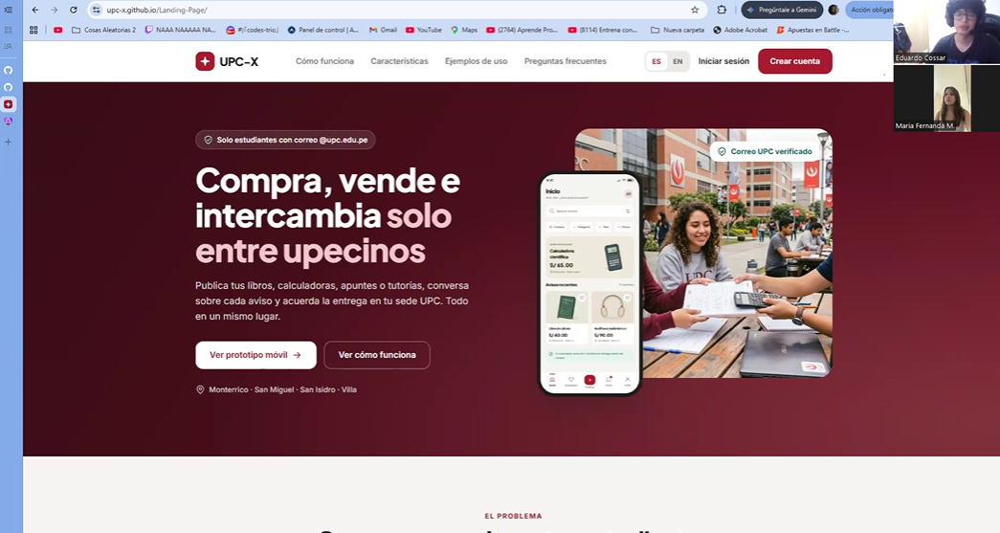

<div style="text-align: center;">
  
</div>

<h2 style="text-align: center;"> Universidad Peruana de Ciencias Aplicadas </h2>

<h4 style="text-align: center"> Ingeniería de Software </h4>

<h4 style="text-align: center"> Periodo: 202620 </h4>

<h4 style="text-align: center"> 1ASI0732 | Diseño de Experimentos de Ingeniería de Software </h4>

<h4 style="text-align: center"> NRC: 9082 </h4>

<h4 style="text-align: center"> Docente: Juan Fernando Ysen Paiba </h4>

<h3 style="text-align: center;"> Informe del Trabajo Final </h3>

<h4 style="text-align: center"> Startup: RichStudent</h4>

<h4 style="text-align: center"> Producto: UPC-X</h4>

<h4 style="text-align: center">Integrantes:</h4>

<div style="text-align:center; margin-top: 10px; font-size: 90%; line-height: 1.6;">
   <table style="margin-left: auto; margin-right: auto;">
      <tr>
         <td>u202312109</td>
         <td>Eduardo Jose Cossar Sanchez</td>
      </tr>
      <tr>
         <td>u202322187</td>
         <td>Gilbert Alonso Huarcaya Matias</td>
      </tr>
      <tr>
         <td>u201821684</td>
         <td>Luis Manuel Espinoza Navarrete</td>
      </tr>
      <tr>
         <td>U20221G231</td>
         <td>Manuel Alejandro Molina Vásquez</td>
      </tr>
      <tr>
         <td>U202022211</td>
         <td>Mathias Javier Murillo</td>
      </tr>
   </table>
</div>

<br>

<h5 style="text-align: center; font-style: italic;"> Noviembre de 2026 </h5>

<div class="page"></div>


# Part III: Experiment-Driven Lifecycle

# Capítulo VIII: Experiment-Driven Development

**Planificación del AV2, actualizada el 13/11/2026.** El alcance comprende 8.1–8.3.2. Las tarjetas, variantes, métricas e historias siguientes son propuestas para revisión del equipo; no representan experimentos ejecutados, instrumentación disponible ni resultados de participantes. El punto de partida verificable es el corte 0.8.0 de los capítulos VI y VII y su [registro de entrega](docs/validacion/entrega-0.8.0.json).

## 8.1. Experiment Planning

### 8.1.1. As-Is Summary

UPC-X dispone de catálogo, conversaciones vinculadas al aviso, reputación, coordinación de encuentro, comprobantes privados y cierre bilateral. El candidato integrado se desplegó en staging y producción; Android QA se distribuyó por Firebase y el titular confirmó instalación y apertura en Samsung SM-S938B con Android 16. Las pruebas técnicas y el recorrido por API con actores sintéticos verifican reglas del producto, pero no establecen adopción, confianza percibida ni impacto sobre el cierre de intercambios reales.

Las cuatro hipótesis Lean UX de [1.2.2.3](#1223-lean-ux-hypothesis-statements) siguen abiertas. En [6.3.2](#632-registro-de-entrevistas) hay cinco entrevistas de validación con video y captura (E01, E02, E04, E05 y E06), cuyos resultados aún no se analizan, y [6.4](#64-auditoría-de-experiencias-de-usuario) reúne las auditorías de experiencia de usuario; no hay mediciones de uso consentido ni asignación experimental instrumentada. La mejora de confianza frente a otros canales tampoco tiene una comparación observada. Los objetivos de 200 usuarios activos y 50 transacciones del primer mes de 1.2.2.2 son aspiraciones, sin línea base ni fecha de inicio de medición confirmadas.

### 8.1.2. Raw Material: Assumptions, Knowledge Gaps, Ideas, Claims

| ID | Tipo y fuente | Premisa o brecha a investigar |
|---|---|---|
| R01 | Suposición, 1.2.2.3, hipótesis del flujo único | Al concentrar búsqueda y coordinación, el estudiante mantendrá la conversación en UPC-X. Iniciar un chat no demuestra por sí mismo que no se trasladó a WhatsApp. |
| R02 | Afirmación a contrastar, 1.2.2.2–1.2.2.3 | La reputación visible reduce el abandono del detalle. Que un contador se calcule correctamente no demuestra ese efecto. |
| R03 | Suposición, 1.2.2.3, hipótesis del voucher | Adjuntar una constancia favorece el cierre. Subir una imagen puede ser solo una tarea adicional y no acredita pago ni entrega. |
| R04 | Idea y premisa, 1.2.2.2–1.2.2.3 | Las sugerencias por campus facilitan un acuerdo de encuentro. Falta saber si se entienden y si se confunden con puntos oficiales. |
| R05 | Brecha, 6.1.4 y 6.3 | Falta observar si las personas distinguen propuesta, aceptación, comprobante recibido y cierre bilateral, y si comprenden quién puede ver la imagen. |

### 8.1.3. Experiment-Ready Questions

| ID | Tipo | Pregunta y límite de la respuesta |
|---|---|---|
| Q01 | Exploratoria, R05 | ¿Qué entienden compradores y vendedores al revisar una constancia y confirmar una entrega en web y Android QA? Se observará el primer intento y se pedirá explicar el resultado, sin pagos reales. |
| Q02 | Belief-led, R01 | ¿Una explicación más clara del contacto interno aumenta la proporción de participantes que inicia una conversación en UPC-X durante siete días, frente a la interfaz 0.8.0? La salida a otros canales se preguntará aparte. |
| Q03 | Belief-led, R02 | ¿Acercar la reputación existente a la acción de contacto reduce el abandono del primer detalle visitado, frente a su posición actual, en compradores nuevos? |
| Q04 | Belief-led, R03 | ¿Explicar mejor el carácter opcional y privado del comprobante aumenta el cierre bilateral de los acuerdos aceptados, frente al texto actual, sin inducir pagos ni carga obligatoria? |
| Q05 | Belief-led, R04 | ¿Aclarar las sugerencias de encuentro y la alternativa de otro punto aumenta la proporción de conversaciones con encuentro aceptado por ambas partes, frente al selector actual? |

La población propuesta son estudiantes UPC compradores y vendedores que consientan participar. El entorno inicial será staging y el APK QA; cada tarjeta identifica tarea, periodo y unidad de observación. Los objetivos son comprensión y comportamiento dentro de ese entorno, sin generalizarlos a transacciones reales. Una pregunta sobre preferencia o confianza frente a Marketplace requiere un protocolo comparativo adicional; estas preguntas no la resuelven indirectamente.

### 8.1.4. Question Backlog

El backlog **broad** contiene Q01–Q05. El backlog **deep** desarrolla primero Q01 y la preparación de Q02; los demás experimentos quedan detrás de esos requisitos. La puntuación siguiente es una propuesta editorial de prioridad, no una evaluación consensuada del equipo ni una probabilidad de que la respuesta sea correcta.

Se usa una escala 1–3: **C**, confianza previa basada en evidencia de participantes (1: sin medición; 3: evidencia replicada); **R**, riesgo de mantener la premisa equivocada; **I**, impacto de resolverla; **J**, interés para la siguiente decisión. La prioridad es `P = (4 − C) + R + I + J`. Se atiende primero P mayor; en empate gana R mayor y, si persiste, la dependencia operativa.

| Orden | Pregunta | Por qué investigar | C | R | I | J | P | Decisión que puede cambiar |
|---|---|---|---:|---:|---:|---:|---:|---|
| 1 | Q01 | Una confusión sobre pago, privacidad o cierre puede perjudicar al estudiante. | 1 | 3 | 3 | 3 | 12 | Corregir explicación/flujo antes de instrumentar una comparación. |
| 2 | Q02 | El flujo único es la principal propuesta de valor. | 1 | 3 | 3 | 3 | 12 | Mantener o revisar la presentación del contacto interno. |
| 3 | Q03 | La reputación puede estar presente sin ayudar a decidir. | 1 | 3 | 3 | 2 | 11 | Mantener o cambiar su ubicación, conservando datos veraces. |
| 4 | Q04 | Cargar más imágenes podría añadir fricción y riesgo sin mejorar el cierre. | 1 | 3 | 2 | 2 | 10 | Mantener la explicación actual o ensayar una más clara. |
| 5 | Q05 | Un encuentro aceptado necesita que ambos entiendan las condiciones. | 1 | 2 | 3 | 2 | 10 | Revisar etiquetas/ayuda del selector, sin atribuir respaldo oficial. |

Q01 precede a Q02 por seguridad y comprensión; Q04 precede a Q05 por el mayor riesgo en el empate. La revisión del equipo puede cambiar los juicios, pero debe conservar la razón y la nueva puntuación antes de ejecutar.

### 8.1.5. Experiment Cards

Todas las medidas mencionadas en las tarjetas se definen en 8.2.2. El **frente** identifica pregunta, por qué, hipótesis y Simplest Useful Thing; el **reverso** fija medidas, condiciones y escala. Ninguna tarjeta está iniciada.

| Tarjeta | Frente: pregunta, motivo, hipótesis y cosa más simple y útil | Reverso: medidas, condiciones y escala |
|---|---|---|
| EX01 — Q01 | Evitar confusión sobre privacidad, pago y entrega. Pregunta exploratoria sin hipótesis causal. Observar una tarea de comprobante/cierre y pedir que la persona explique el resultado antes de ayudarla. | M05 y G01. Seis sesiones propuestas, tres compradores y tres vendedores, con contraparte y constancias sintéticas. Registrar cliente, idioma, ayuda y orden reales. Si aparece una interpretación de pago certificado, acceso público o cierre unilateral, revisar el diseño antes de seguir. |
| EX02 — Q02 | Examinar la premisa del flujo único. H01/H01₀. Comparar la interfaz actual con una variante de texto/ubicación del contacto interno, conservando funciones y reglas. | M01; G01 y G02. Control A: 0.8.0; B: variante aún por diseñar. Asignación por participante, estable entre clientes; siete días de seguimiento completo. Objetivo heredado: M01 de B ≥60 %, junto a diferencia B−A. Escala por calcular con línea base; 8.2.5 solo presenta un escenario. |
| EX03 — Q03 | Saber si la presentación de la reputación influye en el abandono. H02/H02₀. Reubicar la información existente sin inventar ratings ni ventas. | M04; G01 y G02. A: ubicación actual; B: bloque junto al contacto, aún no implementado. Compradores nuevos; primera visita elegible por participante. Objetivo heredado: M04 de B <30 %, junto a diferencia B−A. Escala pendiente de línea base y MDE acordado. |
| EX04 — Q04 | Evitar considerar la subida de comprobantes como un éxito suficiente. H03/H03₀. Comparar dos explicaciones del carácter opcional y privado, sin exigir imagen ni transferencia. | M03 principal, M06 diagnóstica y M05; G01 y G02. A: texto actual; B: explicación propuesta, aún no implementada. Acuerdos aceptados con siete días completos de seguimiento. El 40 % de M06 de la hipótesis inicial no decide el éxito; debe evaluarse M03 sin deteriorar comprensión. Escala pendiente. |
| EX05 — Q05 | Saber si se entienden mejor las opciones del encuentro. H04/H04₀. Comparar el selector actual con etiquetas/ayuda más claras y opción de punto alternativo. | M02; G01 y G02. A: 0.8.0; B: variante no implementada. Primer chat elegible por participante, con un mensaje y siete días completos de seguimiento. Objetivo heredado: M02 de B ≥50 %, junto a diferencia B−A. Escala pendiente. |

## 8.2. Experiment Design

### 8.2.1. Hypotheses

Las condiciones A y B son propuestas de comparación. Los umbrales del capítulo I se conservan como objetivos de producto, no como líneas base, diferencias esperadas ni evidencia de efecto. Las hipótesis de trabajo y sus nulas se refieren al contraste entre condiciones; superar un umbral en B no demuestra una mejora respecto de A.

| ID | Hipótesis de trabajo | Hipótesis nula | Relación con Lean UX |
|---|---|---|---|
| H01 | La variante B aumenta M01 respecto de A: `pB − pA > 0`. | H01₀: `pB − pA = 0`; una diferencia observada puede deberse al azar. | Operacionaliza el contacto de la primera hipótesis. La ausencia de salida a WhatsApp no se deduce de M01. |
| H02 | B reduce M04 respecto de A: `pB − pA < 0`. | H02₀: `pB − pA = 0`. | Segunda hipótesis, abandono del detalle; objetivo B <30 %. |
| H03 | La explicación B aumenta M03 respecto de A: `pB − pA > 0`, conservando comprensión y privacidad. | H03₀: `pB − pA = 0`. | Revisa la tercera hipótesis: M06 ≥40 % era un proxy de carga de imágenes, no una medida de entregas completadas. Se conserva como antecedente diagnóstico. |
| H04 | B aumenta M02 respecto de A: `pB − pA > 0`. | H04₀: `pB − pA = 0`. | Cuarta hipótesis, coordinación de encuentro; objetivo B ≥50 %. |

EX01 es exploratorio y no necesita una hipótesis nula. La inspección de pocas sesiones puede encontrar problemas de comprensión, pero no acepta ni rechaza las nulas de EX02–EX05. Los contrastes posteriores serán bilaterales para detectar también deterioro; una diferencia significativa en dirección contraria no apoya la hipótesis de trabajo.

### 8.2.2. Domain Business Metrics

Las definiciones siguientes son propuestas del experimento. No existe todavía un dataset instrumentado con el que calcularlas. Cuando el denominador sea cero o falte seguimiento completo, el resultado será **no calculable**, nunca cero. Las exclusiones y pérdidas se mostrarán por separado.

| ID | Definición y fórmula | Recolección prevista | Meta y decisión |
|---|---|---|---|
| M01 — Activación de conversación | `100 × participantes que envían ≥1 mensaje a una contraparte / participantes elegibles que buscan o publican`. Una entrada por participante y condición, siete días desde su primera búsqueda/publicación elegible; contactar sin mensaje no basta. | Exposición consentida y evento de mensaje persistido, con rol y periodo completos. Pregunta posterior separada sobre otros canales. | ≥60 % heredado de 1.2.2.3, sin línea base observada. KPI principal de EX02. No acredita conversación recíproca ni exclusividad de canal. |
| M02 — Encuentro aceptado | `100 × primeros chats elegibles con acuerdo de encuentro aceptado por ambas partes / primeros chats elegibles con ≥1 mensaje`. Cada participante aporta un caso; seguimiento de siete días desde ese mensaje. | Mensaje y transición de aceptación persistidos. No cuenta una propuesta sin aceptación ni el clic en una sugerencia. | ≥50 % heredado de 1.2.2.3. KPI principal de EX05; no equivale a entrega presencial. |
| M03 — Cierre bilateral | `100 × primeros acuerdos aceptados elegibles que llegan a completed / primeros acuerdos aceptados elegibles`. Uno por participante; siete días desde aceptación. Cancelaciones y expiraciones permanecen en el denominador. | Transiciones canónicas del backend, contadas una vez por acuerdo; no número de clics de confirmación. | KPI principal de EX04: diferencia B−A y su incertidumbre. Sin objetivo absoluto nuevo hasta medir la línea base. En staging mide cumplimiento de la tarea sintética, no ventas reales. |
| M04 — Abandono del detalle | `100 × participantes cuya primera visita al detalle termina sin contacto ni favorito / participantes con primera visita elegible`. Ventana de 30 minutos activos; salir antes de actuar cuenta abandono. Una visita sin cierre ni ventana completa se informa como incompleta. | Eventos de detalle mostrado, acciones y fin de visita; registro manual en el piloto. Excluir fallos previos a cargar el detalle y reportarlos en G02. | <30 % heredado de 1.2.2.3. Diagnóstico de confianza, no prueba directa de ella. Una lectura satisfecha también puede terminar sin contacto. |
| M05 — Comprensión de la tarea | `personas que explican correctamente cada criterio / personas que ejecutaron esa tarea`. Informar recuento por criterio y segmento, sin sumar personas entre tareas. Criterios: imagen privada, sin certificación bancaria, recepción distinta de pago y cierre con ambas confirmaciones. | Ficha de sesión y explicación antes de ayuda, siguiendo el guion de 6.3. Registrar ayuda/no ejecución por separado. | Propuesta de salida del piloto: ninguna confusión crítica observada antes de exponer variantes. No es una estimación poblacional ni demuestra ausencia de riesgo. |
| M06 — Constancia adjunta | `100 × primeros chats elegibles con ≥1 constancia persistida / primeros chats elegibles con ≥1 mensaje`. Un caso por participante y siete días de seguimiento. | Persistencia de evidencia, solo metadatos de transición; sin imagen ni contenido en analítica. | 40 % es el objetivo histórico de la tercera hipótesis, solo diagnóstico. Una subida no demuestra pago ni mejora de M03; no se incentiva su carga. |
| G01 — Incidente de privacidad | Número de accesos indebidos, exposición de secretos/datos privados o confusión crítica con consecuencias durante una sesión. | Registro restringido del incidente; informe público sin cuerpos ni identificadores personales. | Cero tolerancia: detener la sesión y corregir antes de continuar. Un cero observado no certifica seguridad. |
| G02 — Fallo técnico de tarea | `tareas iniciadas bloqueadas por error técnico / tareas iniciadas`, separado por cliente, condición y arranque en frío. No contar dos veces un mismo fallo por reintentos. | Ficha y código de error permitido, sin cuerpo privado; estado del servicio y versión. | Todo bloqueo se investiga antes de atribuir abandonos al diseño. No se fija un porcentaje de tolerancia sin línea base. |

La selección limita los KPI principales a M01, M02 y M03. M04 y M06 diagnostican premisas concretas; M05 y G01/G02 evitan que una aparente mejora esconda confusión o fallos. Los 200 usuarios activos y 50 intercambios del primer mes siguen como aspiraciones del negocio: se definirá su cohorte real y su ventana antes de usarlos como criterio de lanzamiento; no se comparan con seis entrevistas ni con fixtures de staging.

### 8.2.3. Measures

El piloto conserva por tarea resultado sin ayuda/con ayuda/no completada/no ejecutada, explicación y referencia al momento del video consentido. Esas observaciones alimentan M05 y el diagnóstico; no se convierten en puntos de una escala de confianza inventada. Se reutilizan el [guion](docs/validacion/guion-entrevistas.md) y las fichas de 6.3 solo cuando se realice la sesión y se registre su alcance experimental; las plantillas vacías no son datos.

Las tasas de EX02–EX05 usarán una única observación elegible por participante. Para tareas con dos actores se fija un participante focal y una contraparte sintética estable: no se cuentan ambos como observaciones independientes del mismo acuerdo. Una fase posterior con pares reales deberá aleatorizar y analizar al nivel del par, y recalcular la escala. La cohorte, la condición y el evento inicial se fijan antes de observar el resultado; los reintentos no crean nuevos casos.

### 8.2.4. Conditions

El control A conserva la interfaz y reglas del corte 0.8.0; B modifica únicamente el texto o ubicación señalados por cada tarjeta. Las variantes no existen todavía. No se oculta reputación real, no se inventan ventas y no se debilitan identidad, autorización, advertencias o privacidad para crear un control.

En el piloto se observará primero la interfaz actual. Si después se muestra una alternativa a la misma persona, se registrará el orden y se tratará como comparación exploratoria con aprendizaje, no como A/B independiente. Para una prueba confirmatoria se asignará una condición por participante antes de su primera exposición, se conservará entre web y móvil y se evitará exposición simultánea a experimentos del mismo tema. Mantener tareas, inventario sintético, contraparte, versiones y condiciones del servicio comparables; registrar cliente/idioma y arranque en frío sin confundir su efecto con el de la variante.

Se solicitará consentimiento y se permitirá retirarse sin perder acceso al producto. Correos, OTP y credenciales quedan fuera de grabaciones y analítica. Se detendrá la sesión ante G01, un bloqueo que impida la tarea o una solicitud de retirada. Las sesiones incompletas y retiradas se describirán con sus denominadores y motivos permitidos; no se sustituirán silenciosamente por resultados favorables. No se ejecutarán experimentos ni creación de datos de prueba en producción.

### 8.2.5. Scale Calculations and Decisions

**Piloto exploratorio:** seis participantes propuestos, tres por segmento, reutilizando la planificación de 6.3 cuando se recluten y consientan. Esta escala permite observar problemas y probar el instrumento; no tiene potencia declarada para contrastar H01–H04. Con tres personas por segmento no se interpreta un porcentaje como representativo de la UPC.

**Escenario ilustrativo para un único contraste de dos proporciones:** si la tasa control fuera `pA=0,50` y el cambio mínimo valioso fuera `pB=0,65` (MDE de 15 puntos porcentuales), con grupos independientes del mismo tamaño, α bilateral de 0,05 y potencia de 0,80, la aproximación normal sin corrección de continuidad sería:

```text
p̄ = (pA + pB) / 2
n por grupo = techo([z(0,975) × √(2p̄(1−p̄))
                    + z(0,80) × √(pA(1−pA)+pB(1−pB))]² / (pB−pA)²)
             = 170 participantes analizables por grupo; 340 en total.
Con una pérdida hipotética del 20 %:
reclutamiento por grupo = techo(170 / 0,80) = 213; 426 en total.
```

Estos valores son supuestos de diseño, no una línea base medida, reclutamiento disponible ni compromiso del equipo. α controla el error Tipo I del contraste previsto; la potencia limita el error Tipo II bajo el efecto supuesto. El MDE expresa una diferencia absoluta valiosa, no un aumento relativo del 15 %. La unidad de cálculo es una persona independiente con un caso, no sesiones, clics ni los dos lados de un acuerdo.

La decisión propuesta es comenzar con el piloto y la verificación de datos. Antes de un A/B, medir una línea base comparable, acordar MDE y pérdidas, recalcular n y comprobar que el reclutamiento sea viable. Fijar métrica principal, regla de parada y análisis antes de recoger resultados, sin detener por un p-valor favorable. Si se contrastan varias hipótesis como una familia, predefinir el ajuste por multiplicidad y recalcular la escala; el ejemplo de α=0,05 no autoriza cuatro contrastes confirmatorios sin ajuste. Si la muestra no es viable, mantener el estudio como exploratorio y reportar esa limitación.

### 8.2.6. Methods Selection

La cosa más simple y útil para Q01 es la observación moderada y la explicación de la persona, no una prueba A/B. Para Q02–Q05 el piloto examinará comprensión y viabilidad de las tareas; después, una comparación aleatorizada solo se justifica si existen variantes verificadas, consentimiento, instrumentación y escala suficiente. Las entrevistas pueden explicar dudas; los eventos describen acciones; ninguna de ambas fuentes aislada demuestra causalidad.

Se conservarán resultados por condición y cliente, los numeradores/denominadores, las pérdidas y la incertidumbre apropiada al método finalmente elegido. No se mezclarán resultados sintéticos, sesiones del equipo, pruebas automatizadas y comportamiento de participantes. Un aprendizaje negativo puede llevar a mantener 0.8.0; implementar una variante no es el resultado obligatorio de una tarjeta.

### 8.2.7. Data Analytics: Goals, KPIs and Metrics Selection

| Objetivo de aprendizaje | KPI/diagnóstico | Revisión y decisión propuesta |
|---|---|---|
| Iniciar coordinación dentro de UPC-X | M01 principal de EX02; salida a otro canal como observación separada | Al completar siete días por cohorte, comparar condiciones sin afirmar exclusividad de canal. |
| Acordar un encuentro comprensible | M02 principal de EX05; M05 | Comparar aceptación real del acuerdo, no solo selección de un punto. |
| Completar la entrega sin confundir constancia y pago | M03 principal de EX04; M06 y M05 | Evaluar cierre bilateral y comprensión; no elegir variante solo por aumentar archivos subidos. |
| Entender el papel de la reputación | M04 de EX03 y explicación de la persona | Contrastar abandono y motivos; no llamar confianza al simple clic. |

G01 y G02 acompañan todas las tarjetas. El equipo deberá asignar moderación, revisión de calidad de datos y análisis antes de abrir una cohorte; no se atribuyen todavía esas responsabilidades a un integrante. La decisión se registrará con tarjeta, versiones, rango de fechas, recuentos, limitaciones y cambio propuesto; sin resultados disponibles, no se recomienda aún una variante ganadora.

### 8.2.8. Web and Mobile Tracking Plan

**Estado: propuesto, no implementado.** No se configura aquí un proveedor ni se añade analítica a producción. Los eventos siguientes tendrán un esquema permitido y versionado, un identificador de evento y una clave seudónima del participante; incluirán experimento/condición, entorno, cliente y versión. Los tiempos se almacenarán en UTC y se presentarán en Lima. La clave seudónima sigue requiriendo custodia: no se la declara anónima.

| Evento propuesto | Momento y fuente canónica | Uso |
|---|---|---|
| `experiment_exposed` | Cliente muestra por primera vez la condición asignada, después de consentimiento. Misma asignación web/Android. | Elegibilidad, cohorte y detección de cruces. No cuenta un prerender oculto. |
| `search_completed`, `listing_published` | Cliente termina búsqueda; API confirma publicación persistida. No registrar términos ni contenido. | Inicio de ventana y denominador de M01. |
| `listing_detail_viewed`, `listing_detail_ended`, `listing_saved` | Cliente muestra contenido cargado, termina visita o recibe confirmación del favorito. Pausar tiempo activo al pasar a segundo plano. | M04 y detección de visitas incompletas. |
| `conversation_message_created` | API confirma el mensaje persistido; excluir contraparte y mensajes del moderador. | Numerador M01 y elegibilidad M02/M06. No registrar el cuerpo. |
| `deal_accepted`, `deal_completed` | API confirma la transición persistida; completar solo tras ambas confirmaciones. | M02 y M03, deduplicados por caso/transición. |
| `payment_evidence_created` | API confirma metadatos persistidos de la constancia. | M06; sin imagen, URL, comprobante ni datos bancarios. |
| `task_technical_failure` | Registro del moderador o error permitido del cliente, vinculado a una tarea y sin duplicar reintentos. | G02; sin mensajes libres de excepción ni cuerpos privados. |

M05 y G01 se recogen en fichas restringidas, no como grabación automática del contenido del usuario. El export analítico permitirá códigos de tarea/caso sintéticos y categorías de error, sin correo, nombre, teléfono, OTP, cookie, token, IP, URL completa, texto de búsqueda/chat ni imagen. Las referencias internas necesarias para deduplicar no se publicarán y se mantendrán separadas del export. Los reintentos conservarán el identificador del evento y una restricción de unicidad por transición impedirá duplicar un hecho de negocio.

Antes de usar estos datos se comprobarán ausencia de eventos previos al consentimiento, asignación única, marcas temporales ordenadas, cobertura de ambos clientes y ausencia de campos privados. Mensajes, aceptación y cierre se reconciliarán con los estados sintéticos canónicos, sin sumar los eventos de frontend y backend como dos resultados. Un evento perdido se marca como cobertura incompleta; no como abandono ni resultado cero. Se propone acceso solo al equipo encargado y borrado de datos analíticos del piloto a los 30 días de cerrar su análisis; plazo, custodio y retirada deberán acordarse con los participantes antes de recoger datos. Los videos del curso conservan su consentimiento y acceso por separado.

## 8.3. Experimentation

Esta sección transforma requisitos del plan en trabajo propuesto. No hay todavía sprint To-Be, variantes desplegadas ni resultados experimentales. El avance del AV2 llega hasta el backlog; las evidencias de implementación, entrevistas To-Be y análisis posterior requieren trabajo adicional.

### 8.3.1. To-Be User Stories

Los identificadores continúan después de US50 y TS06 y no reemplazan historias implementadas del Anexo D. Las mejoras visuales de EX02–EX05 se refinan solo después de Q01; su presencia aquí no afirma que sean necesarias ni que hayan sido aceptadas por participantes.

| ID | Historia propuesta | Criterios de aceptación verificables |
|---|---|---|
| US51 | Como estudiante invitado a una prueba, quiero conocer qué acciones se medirán y decidir participar, para conservar control sobre mis datos. | Sin consentimiento no se emiten eventos analíticos; rechazar conserva las funciones del producto; la explicación identifica propósito, datos y plazo acordado sin prometer anonimato. |
| US52 | Como participante, quiero retirar mi participación, para detener la medición sin perder mi cuenta. | Retirar impide nuevos eventos, aplica el procedimiento de borrado acordado e informa su alcance; no borra ni expone conversaciones de otra persona. |
| US53 | Como comprador que explora un aviso, quiero reconocer cómo iniciar la coordinación en UPC-X, para entender dónde continúa la conversación. | Control y variante conservan el mismo destino; no abren canales externos ni alteran permisos; su evaluación usa EX02, sin declarar mejora por implementar el texto. |
| TS07 | Como equipo, queremos validar un esquema mínimo de eventos, para medir sin registrar contenido privado. | Campos permitidos y versionados, bloqueo antes de consentimiento, deduplicación y rechazo de campos prohibidos; pruebas con datos sintéticos. |
| TS08 | Como equipo, queremos una asignación estable por participante y experimento, para evitar cruces entre condiciones. | Persiste entre web/Android; no depende del resultado; impide exposición simultánea a experimentos incompatibles; se prueba el caso de retirada. |
| TS09 | Como equipo, queremos obtener M01–M06 y G01/G02 con su cohorte, para decidir con denominadores auditables. | Un caso elegible por participante, ventanas completas, pérdidas y duplicados explícitos; reconciliación con fixtures canónicos y resultado no calculable cuando corresponda. |

### 8.3.2. To-Be Product Backlog

| Orden | Ítem | Pregunta/tarjeta | Dependencia y salida propuesta | Estado |
|---|---|---|---|---|
| 1 | Ejecutar piloto de comprensión con instrumentos de 6.3 | Q01 / EX01 | Reclutamiento, consentimiento y acceso QA/staging; fichas de tareas y hallazgos reales. | Propuesto; las entrevistas de validación de 6.3.2 no sustituyen este piloto |
| 2 | US51 y US52 — consentimiento y retirada | Todas | Revisar el protocolo del piloto; acordar custodia/plazo y conservar acceso al producto. | Propuesto |
| 3 | TS07 — eventos mínimos | Todas | US51/US52; esquema, privacidad y deduplicación comprobados localmente. | Propuesto |
| 4 | TS08 — asignación y exclusión | EX02–EX05 | TS07; asignación estable y ausencia de contaminación. | Propuesto |
| 5 | TS09 — cohortes y métricas | EX02–EX05 | TS07/TS08; verificar cobertura, medir línea base y recalcular escala antes del A/B. | Propuesto |
| 6 | US53 — variante del contacto interno | Q02 / EX02 | Q01 sin confusión crítica; diseño/revisión y control equivalente. No promover sin candidato y evidencia. | Propuesto, sujeto al piloto |
| 7 | Refinar variantes de reputación, constancia y encuentro | Q03–Q05 / EX03–EX05 | Hallazgos del piloto, línea base, escala viable y revisión de privacidad; crear historias específicas después del aprendizaje. | Propuesto, sin sprint comprometido |

No se asignan Story Points, fechas ni responsables ficticios. El refinamiento del equipo debe estimarlos y elegir un solo experimento compatible con su capacidad de reclutamiento. Los cambios de producto seguirán el flujo feature → `develop` por PR y CI, candidato integrado y staging; una modificación de este capítulo no despliega instrumentación ni promueve variantes a producción. Las fases de implementación y análisis posteriores del capítulo VIII no se presentan como completadas.

### 8.3.3. Pipeline-supported, Experiment-Driven To-Be Software Platform Lifecycle

#### 8.3.3.1. To-Be Sprint Backlogs

#### 8.3.3.2. To-Be Sprint Backlogs

#### 8.3.3.3. To-Be Sprint Backlogs

#### 8.3.3.4. To-Be Sprint Backlogs

#### 8.3.3.5. To-Be Sprint Backlogs

#### 8.3.3.6. Team Collaboration Insights

### 8.3.4. To-Be Validation Interviews

#### 8.3.4.1. Diseño de Entrevistas

El diseño de las entrevistas contempla la evaluación del Landing Page y las aplicaciones de UPC-X mediante tareas prácticas y preguntas abiertas. Se busca observar cómo los participantes utilizan las funcionalidades de la plataforma, identificando dificultades sin intervenir directamente en la ejecución de las tareas.

**Objetivos de la validación**

- Evaluar la claridad de la información y facilidad de navegación del Landing Page.
- Comprobar la usabilidad de los principales User Flows de las aplicaciones web y móvil.
- Identificar dificultades durante la búsqueda, publicación y gestión de productos.
- Evaluar la comprensión de los procesos de comunicación, coordinación y cierre de intercambios.
- Recopilar observaciones sobre accesibilidad, confianza y experiencia general.

**Segmentos y participantes**

| Segmento objetivo | Cantidad de entrevistas | Enfoque de validación |
|---|---|---|
| Estudiantes vendedores | 3 | Publicación y administración de productos, comunicación con compradores y gestión de intercambios. |
| Estudiantes compradores | 3 | Búsqueda de productos, consulta de publicaciones, comunicación con vendedores y coordinación de compras. |

Las sesiones tendrán una duración estimada de 25 a 35 minutos. Se utilizarán las versiones de prueba de las aplicaciones y datos de demostración, sin realizar transferencias monetarias reales. Se solicitará el consentimiento de cada participante para registrar la entrevista en video.

#### Validación del Landing Page

La validación del Landing Page será común para ambos segmentos. Se solicitará a los participantes explorar el sitio e identificar la propuesta de valor de UPC-X, sus funcionalidades principales y los medios disponibles para acceder a la plataforma.

**Tareas de validación:**

1. Explorar el Landing Page e identificar el propósito de UPC-X.
2. Localizar información sobre las características y beneficios de la plataforma.
3. Identificar cómo acceder a las aplicaciones.
4. Cambiar el idioma y localizar los medios de ayuda o contacto.

**Preguntas de validación:**

1. ¿Qué entiendes que ofrece UPC-X después de explorar la página?
2. ¿Qué tan sencillo te resultó encontrar la información que buscabas?
3. ¿Qué opinas de la organización visual y la navegación del sitio?
4. ¿Encontraste alguna sección o elemento que no comprendieras?
5. ¿Qué información agregarías o modificarías para mejorar la página?

#### Validación de las aplicaciones web y móvil

Para las aplicaciones se evaluarán los User Flows establecidos en el Capítulo IV, considerando los recorridos principales y situaciones alternativas. Las sesiones alternarán el uso de la aplicación web y Android para observar la experiencia en ambas plataformas.

**Flujos de validación comunes**

| ID | Tarea de validación | User Flow relacionado |
|---|---|---|
| T01 | Comprender el servicio, cambiar de idioma y localizar ayuda desde el Landing Page. | UG-08 |
| T02 | Enviar una consulta de soporte como visitante. | UG-08 |
| T03 | Acceder mediante correo institucional y verificar la cuenta. | UG-01 |
| T04 | Buscar un producto, aplicar filtros, revisar sus detalles y guardarlo. | UG-02, UG-05 |
| T05 | Comunicarse con la contraparte y coordinar un encuentro mediante un punto sugerido. | UG-04 |
| T06 | Revisar una constancia de pago de prueba y comprender su finalidad. | UG-04 |
| T07 | Confirmar una entrega, realizar una reseña y consultar el historial. | UG-04, UG-06 |
| T08 | Actualizar información del perfil, cambiar de idioma y gestionar datos de cobro de prueba. | UG-06 |

Las tareas se presentarán sin explicar previamente cómo completarlas. Se priorizarán los flujos principales de cada segmento y se registrarán las dificultades observadas durante su ejecución.

#### Segmento Objetivo 1: Estudiantes vendedores

Para este segmento, la validación se centrará en determinar si los estudiantes pueden publicar productos, administrar sus anuncios y coordinar intercambios de manera clara y segura.

**Tareas específicas:**

1. Publicar un producto incluyendo descripción, imágenes y precio.
2. Consultar, editar y pausar una publicación existente.
3. Responder a un comprador mediante la mensajería.
4. Coordinar o modificar las condiciones de un encuentro.
5. Confirmar una entrega y consultar el historial de transacciones.
6. Reactivar o volver a publicar un anuncio cuando corresponda.

**Preguntas de validación:**

1. ¿Qué tan sencillo te resultó publicar un producto en UPC-X?
2. ¿Encontraste alguna dificultad al editar o administrar tus publicaciones?
3. ¿Cómo describirías la experiencia de comunicación con un posible comprador?
4. ¿Qué opinas del proceso para coordinar y confirmar una entrega?
5. ¿Qué información necesitarías para sentir mayor confianza al vender mediante la plataforma?
6. ¿Qué funcionalidad mejorarías para facilitar tus ventas?

#### Segmento Objetivo 2: Estudiantes compradores

Para este segmento, la validación se enfocará en la facilidad para encontrar productos relevantes, evaluar publicaciones, comunicarse con vendedores y completar el proceso de intercambio.

**Tareas específicas:**

1. Buscar un producto mediante el catálogo y sus filtros.
2. Revisar la descripción, precio y perfil del vendedor.
3. Guardar una publicación de interés.
4. Contactar al vendedor para consultar la disponibilidad del producto.
5. Coordinar un encuentro y revisar las condiciones acordadas.
6. Cancelar una propuesta, consultar su notificación y revisar el historial de intercambios.

**Preguntas de validación:**

1. ¿Qué tan fácil te resultó encontrar el producto que buscabas?
2. ¿La información de las publicaciones fue suficiente para evaluar una posible compra?
3. ¿Cómo describirías tu experiencia al contactar y coordinar con un vendedor?
4. ¿Qué opinas de las opciones disponibles para organizar un encuentro?
5. ¿Qué dificultades encontraste durante el proceso de búsqueda o compra?
6. ¿Qué cambios realizarías para mejorar tu experiencia como comprador?

#### Procedimiento de evaluación

Durante cada sesión, el entrevistador presentará las tareas y solicitará al participante expresar sus pensamientos mientras utiliza la plataforma. Se observará su comportamiento sin proporcionar instrucciones adicionales durante el primer intento.

Para cada tarea se registrarán los siguientes aspectos:

- **Resultado:** completada sin ayuda, completada con ayuda, no completada o no ejecutada.
- **Tiempo de ejecución:** duración necesaria para completar o abandonar la tarea.
- **Dificultades:** errores, confusiones o problemas de navegación identificados.
- **Observaciones:** comentarios y recomendaciones expresados por el participante.
- **Facilidad percibida:** valoración opcional del 1 al 5, acompañada de una explicación.

Finalmente, se solicitará una apreciación general sobre UPC-X, considerando su utilidad, facilidad de uso y confianza percibida. La información recopilada permitirá documentar los resultados de cada entrevista y realizar posteriormente las evaluaciones según heurísticas de usabilidad, arquitectura de información y diseño inclusivo, conforme al Anexo D del enunciado del proyecto.

### 8.3.4.2. Registro de Entrevistas

**Estado: cinco de las seis entrevistas de validación tienen su video y su captura registrados (E01, E02, E04, E05 y E06); la sexta, E03, tiene el video y espera su captura.** Los resúmenes de E01 y E06 se redactarán con lo que expresaron los participantes. Una sesión se acredita cuando se registran su video, su captura y los datos del participante, con su consentimiento. Las entrevistas de needfinding del capítulo II no se reutilizan como validaciones del producto. El registro sigue el formato de la sección [2.2.2](#222-registro-de-entrevistas) y añade la fecha, el dispositivo y el consentimiento de grabación. El resultado por tarea de cada sesión se anota en su ficha: [E01](docs/validacion/entrevistas/E01-comprador.md), [E02](docs/validacion/entrevistas/E02-comprador.md), [E03](docs/validacion/entrevistas/E03-comprador.md), [E04](docs/validacion/entrevistas/E04-vendedor.md), [E05](docs/validacion/entrevistas/E05-vendedor.md) y [E06](docs/validacion/entrevistas/E06-vendedor.md).

| Sesión | Segmento | Estado | Evidencia |
|---|---|---|---|
| E04 | Vendedor | Registrada | Video y captura |
| E05 | Vendedor | Registrada | Video y captura |
| E06 | Vendedor | Registrada | Video y captura; resumen por redactar |
| E01 | Comprador | Registrada | Video y captura; resumen por redactar |
| E02 | Comprador | Registrada | Video y captura |
| E03 | Comprador | En registro | Video; faltan la captura y los datos del participante |

La [agenda de tres semanas](docs/validacion/README.md) propone preparación en la primera semana, sesiones en la segunda y correcciones/repetición en la tercera. Los nombres y horarios se registrarán cuando se acuerden, sin convertir la agenda propuesta en evidencia de ejecución.

#### Registro de estudiantes vendedores

##### Entrevista de validación E04


| | |
| :--- | :--- |
| **Entrevistador:** | Molina Vásquez Manuel Alejandro |
| **Entrevistado:** | Milenko Rubén Cayanchi Ávila |
| **Edad:** | 20 |
| **Segmento:** | Estudiantes vendedores |
| **Fecha:** | 11/11/2026 |
| **Dispositivo y plataforma:** | Aplicación Web |
| **Consentimiento de grabación:** | Aprobado |
| **Inicio de la entrevista:** | 00:00 |
| **Duración:** | 08:07 |
| **Enlace:** | https://upcedupe-my.sharepoint.com/:v:/g/personal/u20221g231_upc_edu_pe/IQCdqU19aXguRZ78_rAX-lrWAYwGP_3JaJ-8oPkkC1dxV04?nav=eyJyZWZlcnJhbEluZm8iOnsicmVmZXJyYWxBcHAiOiJPbmVEcml2ZUZvckJ1c2luZXNzIiwicmVmZXJyYWxBcHBQbGF0Zm9ybSI6IldlYiIsInJlZmVycmFsTW9kZSI6InZpZXciLCJyZWZlcnJhbFZpZXciOiJNeUZpbGVzTGlua0NvcHkifX0&e=xurace |
| **Ficha de tareas:** | [E04](docs/validacion/entrevistas/E04-vendedor.md) |

| |
| :--- |
| **Resumen:** Milenko Rubén Cayanche Ávila, estudiante de ingeniería de software de veinte años en la UPC de San Miguel, participó en la entrevista de validación para evaluar el rol de vendedor en la plataforma UPC-X. Durante la sesión, comentó que solía vender artículos previamente mediante WhatsApp y recomendación de boca en boca, lidiando con la alta competencia en redes sociales externas. Al probar el flujo de la aplicación, destacó que el proceso para registrar y publicar productos es sumamente sencillo, intuitivo y fácil de aprender, valorando también el chat interno y los puntos de entrega sugeridos en el campus. Finalmente, señaló que adoptaría la plataforma de forma definitiva si logra una mayor difusión entre la comunidad estudiantil, y recomendó añadir enlaces a redes sociales o detalles de validación institucional en los perfiles de vendedor para fortalecer la confianza de los compradores. |

##### Entrevista de validación E05


| | |
| :--- | :--- |
| **Entrevistador:** | Huarcaya Matias Gilbert Alonso |
| **Entrevistado:** | Fiorella Grisel Cordova Pinchi |
| **Edad:** | 30 |
| **Segmento:** | Estudiantes vendedores |
| **Fecha:** | 12/11/2026 |
| **Dispositivo y plataforma:** | Aplicación móvil Android y Landing Page en laptop |
| **Consentimiento de grabación:** | Aprobado |
| **Inicio de la entrevista:** | 00:00 |
| **Duración:** | 10:32 |
| **Enlace:** | https://upcedupe-my.sharepoint.com/:v:/g/personal/u202322187_upc_edu_pe/IQBNzb2DbmWAQqjR1_Jc_rTJATjnINQK5P06kAMXSqjWjpo?nav=eyJyZWZlcnJhbEluZm8iOnsicmVmZXJyYWxBcHAiOiJPbmVEcml2ZUZvckJ1c2luZXNzIiwicmVmZXJyYWxBcHBQbGF0Zm9ybSI6IldlYiIsInJlZmVycmFsTW9kZSI6InZpZXciLCJyZWZlcnJhbFZpZXciOiJNeUZpbGVzTGlua0NvcHkifX0&e=9syPpy |
| **Ficha de tareas:** | [E05](docs/validacion/entrevistas/E05-vendedor.md) |

| |
| :--- |
| **Resumen:** Fiorella Grisel Cordova Pinchi, estudiante de décimo ciclo de treinta años, participó en la entrevista de validación para evaluar el rol de vendedor en UPC-X. Entendió la propuesta del Landing Page en pocos segundos, cambió el idioma y envió una consulta de soporte sin ayuda. En la aplicación móvil publicó un perfume de catálogo como producto de prueba, lo editó, lo pausó y respondió a una compradora con facilidad, y valoró que su número de WhatsApp no se comparta y que quien compra sea un estudiante verificado. Tardó en ubicar la sugerencia de punto de encuentro porque confundió su ícono con el envío de ubicación, y dudó al interpretar la constancia de pago, que no le indicaba si el pago ya estaba confirmado. Pidió que la aplicación recuerde los pagos pendientes y que las reseñas del comprador se vean antes de aceptar un encuentro. Calificó la facilidad de uso con 4 sobre 5. |

##### Entrevista de validación E06



| | |
| :--- | :--- |
| **Entrevistador:** | Eduardo Jose Cossar Sanchez |
| **Entrevistado:** | Valeria Mendoza |
| **Edad:** | 21 años |
| **Segmento:** | Estudiantes vendedores |
| **Fecha:** | Por registrar |
| **Dispositivo y plataforma:** | Por registrar |
| **Consentimiento de grabación:** | Por registrar |
| **Inicio de la entrevista:** | 00:00 |
| **Duración:** | 4:52 |
| **Enlace:** | https://drive.google.com/file/d/1K48PsRhwTlocGwNUadBb-CI2jWxp8d94/view?usp=sharing |
| **Ficha de tareas:** | [E06](docs/validacion/entrevistas/E06-vendedor.md) |

| |
| :--- |
| **Resumen:** La sesión de validación está diseñada para evaluar la experiencia de Valeria Mendoza como estudiante vendedora en UPC-X. Las tareas previstas incluyen la exploración del Landing Page, el acceso a la plataforma, la publicación y administración de productos, la comunicación con compradores, la coordinación de encuentros, la revisión de constancias de pago y el cierre de ventas. Se busca identificar posibles dificultades de navegación, comprensión de funcionalidades y oportunidades de mejora en usabilidad, arquitectura de información y diseño inclusivo. Los resultados y apreciaciones reales se incorporarán después de la sesión. |


#### Registro de estudiantes compradores

##### Entrevista de validación E01


| | |
| :--- | :--- |
| **Entrevistador:** | Eduardo Jose Cossar Sanchez |
| **Entrevistado:** | Daniela Paredes |
| **Edad:** | 20 años |
| **Segmento:** | Estudiantes compradores |
| **Fecha:** | Por registrar |
| **Dispositivo y plataforma:** | Por registrar |
| **Consentimiento de grabación:** | Por registrar |
| **Inicio de la entrevista:** | 00:00 |
| **Duración:** | 4:55 |
| **Enlace:** | https://drive.google.com/file/d/1J-BsSvitUQQjNBQR-dqU2QSOBBt6yZAS/view?usp=sharing |
| **Ficha de tareas:** | [E01](docs/validacion/entrevistas/E01-comprador.md) |

| |
| :--- |
| **Resumen:** La sesión de validación está diseñada para evaluar la experiencia de Daniela Paredes como estudiante compradora en UPC-X. Las tareas previstas incluyen la exploración del Landing Page, el acceso a la plataforma, la búsqueda y filtrado de productos, la revisión de publicaciones y perfiles de vendedores, el uso de productos guardados, la comunicación con vendedores, la coordinación de entregas, la comprensión de pagos externos, la cancelación de acuerdos y la consulta del historial de compras. Se busca identificar dificultades relacionadas con la navegación, claridad de la información, confianza y facilidad de uso. Los resultados y apreciaciones reales se incorporarán después de la sesión. |

##### Entrevista de validación E02


| | |
| :--- | :--- |
| **Entrevistador:** | Luis Manuel Espinoza Navarrete |
| **Entrevistado:** | Nicolás Castro Solorza |
| **Edad:** | 21 años |
| **Segmento:** | Estudiantes compradores |
| **Fecha:** | 13/11/2026 |
| **Dispositivo y plataforma:** | Laptop (aplicación web), en español y con una breve prueba en inglés |
| **Consentimiento de grabación:** | Autorizó usar la conversación como testimonio y su nombre |
| **Inicio de la entrevista:** | 0:00 |
| **Duración:** | 9:26 min |
| **Enlace:** | [Entrevista de validación E02](https://upcedupe-my.sharepoint.com/:v:/g/personal/u201821684_upc_edu_pe/IQCFyD7xC2PGTZMsm3kJrC9TAZVzpANR7mXdJKcEeG3kjnk?nav=eyJyZWZlcnJhbEluZm8iOnsicmVmZXJyYWxBcHAiOiJPbmVEcml2ZUZvckJ1c2luZXNzIiwicmVmZXJyYWxBcHBQbGF0Zm9ybSI6IldlYiIsInJlZmVycmFsTW9kZSI6InZpZXciLCJyZWZlcnJhbFZpZXciOiJNeUZpbGVzTGlua0NvcHkifX0&e=eojsRI) |
| **Ficha de tareas:** | [E02](docs/validacion/entrevistas/E02-comprador.md) |

| |
| :--- |
| **Resumen:** Nicolás participó nuevamente, ahora en la entrevista de validación como estudiante comprador. Al comprarle a un desconocido le preocupa que no se presente, que el producto no sea como en la foto o que no sea realmente un estudiante. Probó UPC-X desde su laptop, sobre todo en español y con una breve prueba en inglés. Lo describió como un marketplace entre estudiantes de la UPC con entrega en el campus. Creó su cuenta con su correo institucional, un registro que le pareció razonable porque asegura que los usuarios sean estudiantes, y sabe que si el código no llega debe revisar su carpeta de spam. Encontró el producto que buscaba con los filtros por sede y categoría, y se fijó en la reputación y las reseñas del vendedor. Entendió el punto sugerido como un lugar del campus que propone la app y se sintió seguro por entregar dentro de la universidad. Interpretó la constancia de pago como una declaración de lo ocurrido, que no demuestra que el banco acreditó el pago, y probó el cierre con la confirmación de ambas partes, la reseña y el historial. Describió la experiencia como concisa y clara: lo más fácil fue encontrar el aviso y lo más difícil, los selectores de fecha y hora para coordinar el encuentro. Se perdió al volver a los filtros después de bajar, porque desaparecen, y al leer el chat, que se ve pequeño y con mensajes poco distinguibles. Confiaría en UPC-X por los vendedores verificados y la entrega dentro de las sedes, y para seguir usándola después de la venta pediría avisos de productos nuevos sin exceso y respuestas rápidas. Lo primero que cambiaría es que los filtros queden fijos al bajar. Daría un 8 sobre 10 a su recomendación y autorizó usar la conversación como testimonio, con su nombre. |

##### Entrevista de validación E03


| | |
| :--- | :--- |
| **Entrevistador:** | Mathias Javier Murillo |
| **Entrevistado:** | Por registrar |
| **Edad:** | Por registrar |
| **Segmento:** | Estudiantes compradores |
| **Fecha:** | 13/11/2026 |
| **Dispositivo y plataforma:** | Por registrar |
| **Consentimiento de grabación:** | Por registrar |
| **Inicio de la entrevista:** | Por registrar |
| **Duración:** | 1:45 min |
| **Enlace:** | [Entrevista de validación E03](https://upcedupe.sharepoint.com/:v:/s/UPC-X/IQDBFebqn1-ZTYsl-n0kZ-mhAQKVbYIW-l3Vyt7k6g7NjjQ?e=I1kzJq) |
| **Ficha de tareas:** | [E03](docs/validacion/entrevistas/E03-comprador.md) |

| |
| :--- |
| **Resumen:** Por redactar después de la sesión: tareas realizadas, dificultades observadas y apreciaciones del participante, sin generalizar al segmento. |


## 8.4. Experimento Aftermath & Analytics

### 8.4.1. Analysis and Interpretation of Results

### 8.4.2. Re-scored and Re-prioritized Question Backlog

## 8.5. Continuous Learning

### 8.5.1. Shareback Sessions Artifacts: Learning Workflow

## 8.6. To-Be Software Platform Pre-launch

### 8.6.1. About-the-Product Intro Video

### 8.6.2. Resumen usando Angular Framework


