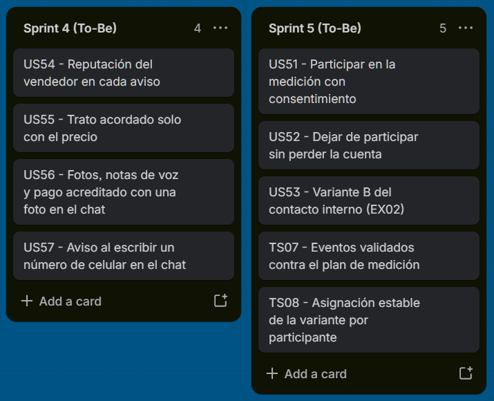
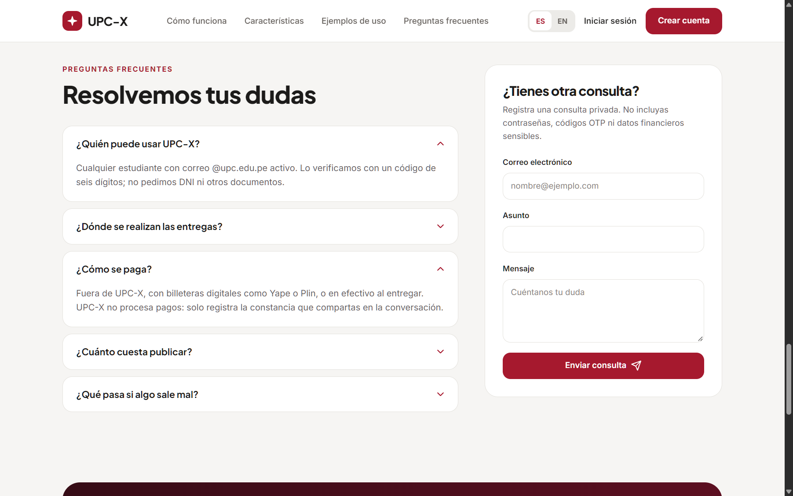
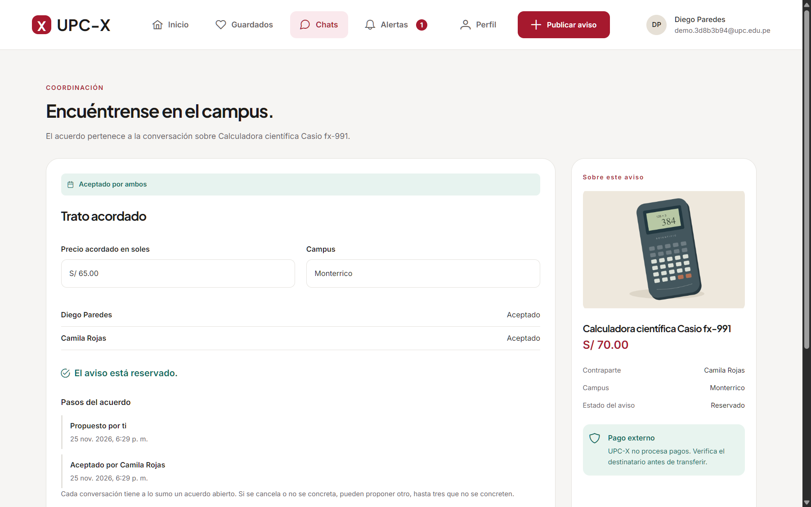
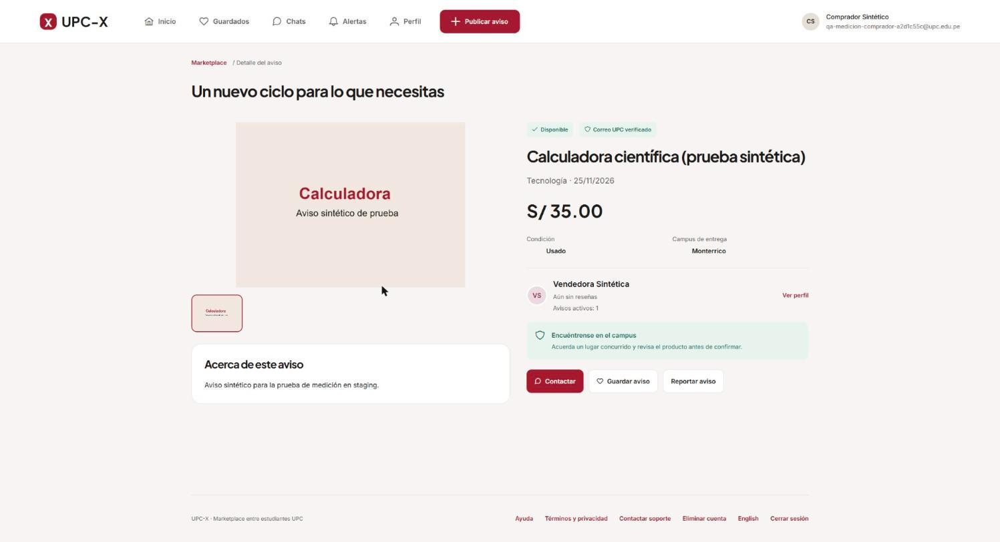
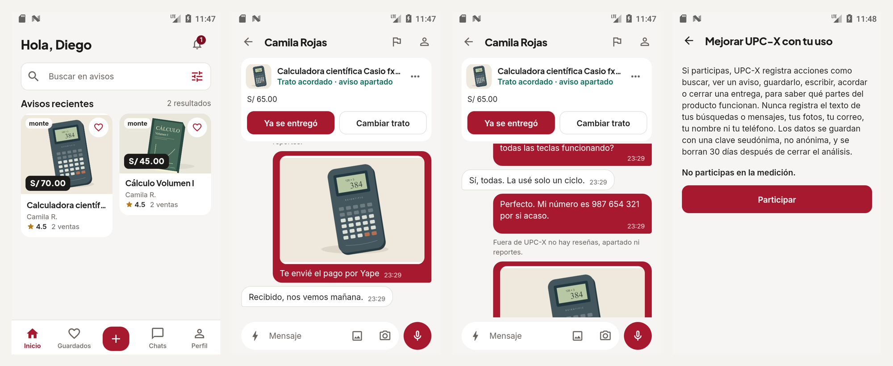
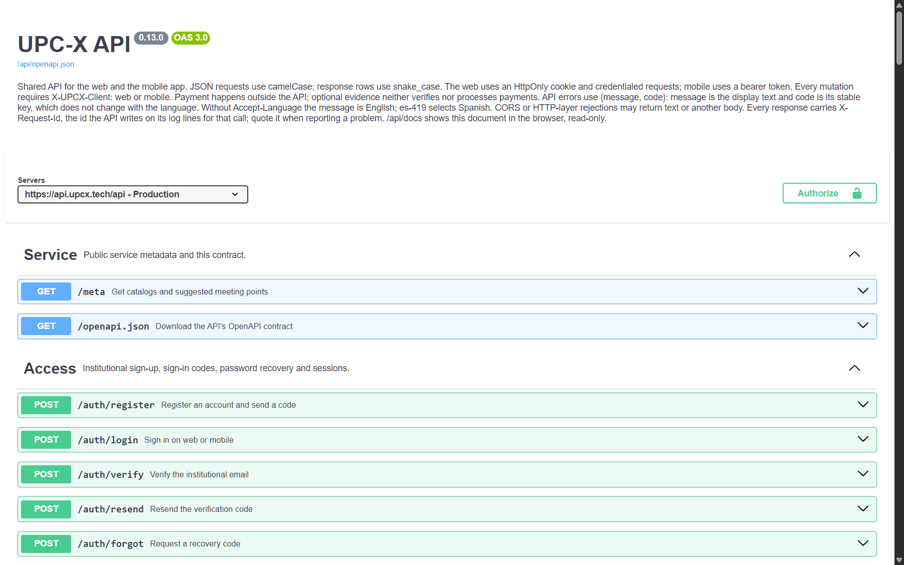
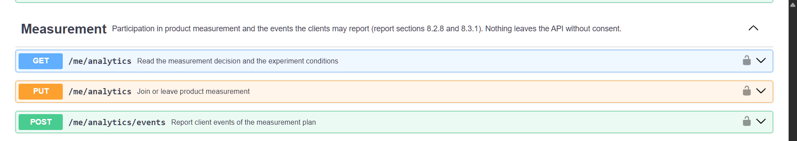
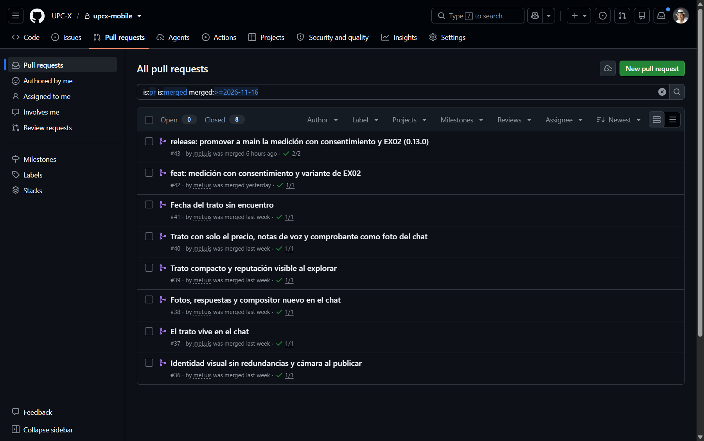

<div style="text-align: center;">
  
</div>

<h2 style="text-align: center;"> Universidad Peruana de Ciencias Aplicadas </h2>

<h4 style="text-align: center"> Ingeniería de Software </h4>

<h4 style="text-align: center"> Periodo: 202620 </h4>

<h4 style="text-align: center"> 1ASI0732 | Diseño de Experimentos de Ingeniería de Software </h4>

<h4 style="text-align: center"> NRC: 9082 </h4>

<h4 style="text-align: center"> Docente: Juan Fernando Ysen Paiba </h4>

<h3 style="text-align: center;"> Informe del Trabajo Final </h3>

<h4 style="text-align: center"> Startup: RichStudent</h4>

<h4 style="text-align: center"> Producto: UPC-X</h4>

<h4 style="text-align: center">Integrantes:</h4>

<div style="text-align:center; margin-top: 10px; font-size: 90%; line-height: 1.6;">
   <table style="margin-left: auto; margin-right: auto;">
      <tr>
         <td>u202312109</td>
         <td>Eduardo Jose Cossar Sanchez</td>
      </tr>
      <tr>
         <td>u202322187</td>
         <td>Gilbert Alonso Huarcaya Matias</td>
      </tr>
      <tr>
         <td>u201821684</td>
         <td>Luis Manuel Espinoza Navarrete</td>
      </tr>
      <tr>
         <td>U20221G231</td>
         <td>Manuel Alejandro Molina Vásquez</td>
      </tr>
      <tr>
         <td>U202022211</td>
         <td>Mathias Javier Murillo</td>
      </tr>
   </table>
</div>

<br>

<h5 style="text-align: center; font-style: italic;"> Noviembre de 2026 </h5>

<div class="page"></div>


# Part III: Experiment-Driven Lifecycle

# Capítulo VIII: Experiment-Driven Development

El capítulo parte del corte 0.8.0 de los capítulos VI y VII y de su registro de entrega (Anexo F). La planificación y el diseño de 8.1 y 8.2 se fijaron el 13/11/2026. Las entrevistas de validación de [6.3.2](#632-registro-de-entrevistas), hechas del 11 al 13 de noviembre sobre la versión 0.10.0 y antes del rediseño, dan evidencia exploratoria para Q01; el piloto con las fichas de EX01 no se ha ejecutado. Entre el 16 y el 17 de noviembre el equipo integró en `develop` un rediseño del trato y del chat que toca las preguntas Q02 a Q05, y el 24 de noviembre integró el consentimiento, la medición y la variante de EX02. Ningún experimento con variantes tiene todavía datos de participantes, así que H01 a H04 no se aceptan ni se rechazan.

## 8.1. Experiment Planning

### 8.1.1. As-Is Summary

UPC-X dispone de catálogo, conversaciones vinculadas al aviso, reputación, coordinación de encuentro, comprobantes privados y cierre bilateral. El candidato integrado se desplegó en staging y producción; Android QA se distribuyó por Firebase y el titular confirmó instalación y apertura en Samsung SM-S938B con Android 16. Las pruebas técnicas y el recorrido por API con actores sintéticos verifican reglas del producto, pero no establecen adopción, confianza percibida ni impacto sobre el cierre de intercambios reales.

Las cuatro hipótesis Lean UX de [1.2.2.3](#1223-lean-ux-hypothesis-statements) siguen abiertas. En [6.3.2](#632-registro-de-entrevistas) hay cinco entrevistas de validación con video y captura (E01, E02, E04, E05 y E06), cuyos resultados se analizan en [8.4.1](#841-analysis-and-interpretation-of-results), y [6.4](#64-auditoría-de-experiencias-de-usuario) reúne las auditorías de experiencia de usuario; no hay mediciones de uso consentido ni asignación experimental instrumentada. La mejora de confianza frente a otros canales tampoco tiene una comparación observada. Los objetivos de 200 usuarios activos y 50 transacciones del primer mes de 1.2.2.2 son aspiraciones, sin línea base ni fecha de inicio de medición confirmadas.

### 8.1.2. Raw Material: Assumptions, Knowledge Gaps, Ideas, Claims

| ID | Tipo y fuente | Premisa o brecha a investigar |
|---|---|---|
| R01 | Suposición, 1.2.2.3, hipótesis del flujo único | Al concentrar búsqueda y coordinación, el estudiante mantendrá la conversación en UPC-X. Iniciar un chat no demuestra por sí mismo que no se trasladó a WhatsApp. |
| R02 | Afirmación a contrastar, 1.2.2.2–1.2.2.3 | La reputación visible reduce el abandono del detalle. Que un contador se calcule correctamente no demuestra ese efecto. |
| R03 | Suposición, 1.2.2.3, hipótesis del voucher | Adjuntar una constancia favorece el cierre. Subir una imagen puede ser solo una tarea adicional y no acredita pago ni entrega. |
| R04 | Idea y premisa, 1.2.2.2–1.2.2.3 | Las sugerencias por campus facilitan un acuerdo de encuentro. Falta saber si se entienden y si se confunden con puntos oficiales. |
| R05 | Brecha, 6.1.4 y 6.3 | Falta observar si las personas distinguen propuesta, aceptación, comprobante recibido y cierre bilateral, y si comprenden quién puede ver la imagen. |

### 8.1.3. Experiment-Ready Questions

| ID | Tipo | Pregunta y límite de la respuesta |
|---|---|---|
| Q01 | Exploratoria, R05 | ¿Qué entienden compradores y vendedores al revisar una constancia y confirmar una entrega en web y Android QA? Se observará el primer intento y se pedirá explicar el resultado, sin pagos reales. |
| Q02 | Belief-led, R01 | ¿Una explicación más clara del contacto interno aumenta la proporción de participantes que inicia una conversación en UPC-X durante siete días, frente a la interfaz 0.8.0? La salida a otros canales se preguntará aparte. |
| Q03 | Belief-led, R02 | ¿Acercar la reputación existente a la acción de contacto reduce el abandono del primer detalle visitado, frente a su posición actual, en compradores nuevos? |
| Q04 | Belief-led, R03 | ¿Explicar mejor el carácter opcional y privado del comprobante aumenta el cierre bilateral de los acuerdos aceptados, frente al texto actual, sin inducir pagos ni carga obligatoria? |
| Q05 | Belief-led, R04 | ¿Aclarar las sugerencias de encuentro y la alternativa de otro punto aumenta la proporción de conversaciones con encuentro aceptado por ambas partes, frente al selector actual? |

La población propuesta son estudiantes UPC compradores y vendedores que consientan participar. El entorno inicial será staging y el APK QA; cada tarjeta identifica tarea, periodo y unidad de observación. Los objetivos son comprensión y comportamiento dentro de ese entorno, sin generalizarlos a transacciones reales. Una pregunta sobre preferencia o confianza frente a Marketplace requiere un protocolo comparativo adicional; estas preguntas no la resuelven indirectamente.

### 8.1.4. Question Backlog

El backlog **broad** contiene Q01–Q05. El backlog **deep** desarrolla primero Q01 y la preparación de Q02; los demás experimentos quedan detrás de esos requisitos. La puntuación siguiente es una propuesta editorial de prioridad, no una evaluación consensuada del equipo ni una probabilidad de que la respuesta sea correcta.

Se usa una escala 1–3: **C**, confianza previa basada en evidencia de participantes (1: sin medición; 3: evidencia replicada); **R**, riesgo de mantener la premisa equivocada; **I**, impacto de resolverla; **J**, interés para la siguiente decisión. La prioridad es `P = (4 − C) + R + I + J`. Se atiende primero P mayor; en empate gana R mayor y, si persiste, la dependencia operativa.

| Orden | Pregunta | Por qué investigar | C | R | I | J | P | Decisión que puede cambiar |
|---|---|---|---:|---:|---:|---:|---:|---|
| 1 | Q01 | Una confusión sobre pago, privacidad o cierre puede perjudicar al estudiante. | 1 | 3 | 3 | 3 | 12 | Corregir explicación/flujo antes de instrumentar una comparación. |
| 2 | Q02 | El flujo único es la principal propuesta de valor. | 1 | 3 | 3 | 3 | 12 | Mantener o revisar la presentación del contacto interno. |
| 3 | Q03 | La reputación puede estar presente sin ayudar a decidir. | 1 | 3 | 3 | 2 | 11 | Mantener o cambiar su ubicación, conservando datos veraces. |
| 4 | Q04 | Cargar más imágenes podría añadir fricción y riesgo sin mejorar el cierre. | 1 | 3 | 2 | 2 | 10 | Mantener la explicación actual o ensayar una más clara. |
| 5 | Q05 | Un encuentro aceptado necesita que ambos entiendan las condiciones. | 1 | 2 | 3 | 2 | 10 | Revisar etiquetas/ayuda del selector, sin atribuir respaldo oficial. |

Q01 precede a Q02 por seguridad y comprensión; Q04 precede a Q05 por el mayor riesgo en el empate. La revisión del equipo puede cambiar los juicios, pero debe conservar la razón y la nueva puntuación antes de ejecutar.

### 8.1.5. Experiment Cards

Todas las medidas mencionadas en las tarjetas se definen en 8.2.2. El **frente** identifica pregunta, por qué, hipótesis y Simplest Useful Thing; el **reverso** fija medidas, condiciones y escala. EX01 se exploró con las entrevistas de validación de 6.3.2, que no usaron las fichas de tareas; el piloto con fichas sigue sin ejecutarse. EX02 tiene su variante y su medición implementadas en 0.13.0 (staging). EX03 a EX05 no se iniciaron.

| Tarjeta | Frente: pregunta, motivo, hipótesis y cosa más simple y útil | Reverso: medidas, condiciones y escala |
|---|---|---|
| EX01 — Q01 | Evitar confusión sobre privacidad, pago y entrega. Pregunta exploratoria sin hipótesis causal. Observar una tarea de comprobante/cierre y pedir que la persona explique el resultado antes de ayudarla. | M05 y G01. Seis sesiones propuestas, tres compradores y tres vendedores, con contraparte y constancias sintéticas. Registrar cliente, idioma, ayuda y orden reales. Si aparece una interpretación de pago certificado, acceso público o cierre unilateral, revisar el diseño antes de seguir. |
| EX02 — Q02 | Examinar la premisa del flujo único. H01/H01₀. Comparar la interfaz actual con una variante de texto/ubicación del contacto interno, conservando funciones y reglas. | M01; G01 y G02. Control A: 0.8.0; B: «Escribir al vendedor en UPC-X», con la nota de que la conversación sigue dentro de UPC-X. Asignación por participante, estable entre clientes; siete días de seguimiento completo. Objetivo heredado: M01 de B ≥60 %, junto a diferencia B−A. Escala por calcular con línea base; 8.2.5 solo presenta un escenario. |
| EX03 — Q03 | Saber si la presentación de la reputación influye en el abandono. H02/H02₀. Reubicar la información existente sin inventar ratings ni ventas. | M04; G01 y G02. A: ubicación actual; B: bloque junto al contacto, aún no implementado. Compradores nuevos; primera visita elegible por participante. Objetivo heredado: M04 de B <30 %, junto a diferencia B−A. Escala pendiente de línea base y MDE acordado. |
| EX04 — Q04 | Evitar considerar la subida de comprobantes como un éxito suficiente. H03/H03₀. Comparar dos explicaciones del carácter opcional y privado, sin exigir imagen ni transferencia. | M03 principal, M06 diagnóstica y M05; G01 y G02. A: texto actual; B: explicación propuesta, aún no implementada. Acuerdos aceptados con siete días completos de seguimiento. El 40 % de M06 de la hipótesis inicial no decide el éxito; debe evaluarse M03 sin deteriorar comprensión. Escala pendiente. |
| EX05 — Q05 | Saber si se entienden mejor las opciones del encuentro. H04/H04₀. Comparar el selector actual con etiquetas/ayuda más claras y opción de punto alternativo. | M02; G01 y G02. A: 0.8.0; B: variante no implementada. Primer chat elegible por participante, con un mensaje y siete días completos de seguimiento. Objetivo heredado: M02 de B ≥50 %, junto a diferencia B−A. Escala pendiente. |

## 8.2. Experiment Design

### 8.2.1. Hypotheses

Las condiciones A y B son propuestas de comparación. Los umbrales del capítulo I se conservan como objetivos de producto, no como líneas base, diferencias esperadas ni evidencia de efecto. Las hipótesis de trabajo y sus nulas se refieren al contraste entre condiciones; superar un umbral en B no demuestra una mejora respecto de A.

| ID | Hipótesis de trabajo | Hipótesis nula | Relación con Lean UX |
|---|---|---|---|
| H01 | La variante B aumenta M01 respecto de A: `pB − pA > 0`. | H01₀: `pB − pA = 0`; una diferencia observada puede deberse al azar. | Operacionaliza el contacto de la primera hipótesis. La ausencia de salida a WhatsApp no se deduce de M01. |
| H02 | B reduce M04 respecto de A: `pB − pA < 0`. | H02₀: `pB − pA = 0`. | Segunda hipótesis, abandono del detalle; objetivo B <30 %. |
| H03 | La explicación B aumenta M03 respecto de A: `pB − pA > 0`, conservando comprensión y privacidad. | H03₀: `pB − pA = 0`. | Revisa la tercera hipótesis: M06 ≥40 % era un proxy de carga de imágenes, no una medida de entregas completadas. Se conserva como antecedente diagnóstico. |
| H04 | B aumenta M02 respecto de A: `pB − pA > 0`. | H04₀: `pB − pA = 0`. | Cuarta hipótesis, coordinación de encuentro; objetivo B ≥50 %. |

EX01 es exploratorio y no necesita una hipótesis nula. La inspección de pocas sesiones puede encontrar problemas de comprensión, pero no acepta ni rechaza las nulas de EX02–EX05. Los contrastes posteriores serán bilaterales para detectar también deterioro; una diferencia significativa en dirección contraria no apoya la hipótesis de trabajo.

### 8.2.2. Domain Business Metrics

Las definiciones siguientes son las del experimento. Desde el corte 0.13.0 la instrumentación de 8.2.8 existe en staging, pero todavía no hay un dataset de participantes con el que calcularlas. Cuando el denominador sea cero o falte seguimiento completo, el resultado será **no calculable**, nunca cero. Las exclusiones y pérdidas se mostrarán por separado.

| ID | Definición y fórmula | Recolección prevista | Meta y decisión |
|---|---|---|---|
| M01 — Activación de conversación | `100 × participantes que envían ≥1 mensaje a una contraparte / participantes elegibles que buscan o publican`. Una entrada por participante y condición, siete días desde su primera búsqueda/publicación elegible; contactar sin mensaje no basta. | Exposición consentida y evento de mensaje persistido, con rol y periodo completos. Pregunta posterior separada sobre otros canales. | ≥60 % heredado de 1.2.2.3, sin línea base observada. KPI principal de EX02. No acredita conversación recíproca ni exclusividad de canal. |
| M02 — Encuentro aceptado | `100 × primeros chats elegibles con acuerdo de encuentro aceptado por ambas partes / primeros chats elegibles con ≥1 mensaje`. Cada participante aporta un caso; seguimiento de siete días desde ese mensaje. | Mensaje y transición de aceptación persistidos. No cuenta una propuesta sin aceptación ni el clic en una sugerencia. | ≥50 % heredado de 1.2.2.3. KPI principal de EX05; no equivale a entrega presencial. |
| M03 — Cierre bilateral | `100 × primeros acuerdos aceptados elegibles que llegan a completed / primeros acuerdos aceptados elegibles`. Uno por participante; siete días desde aceptación. Cancelaciones y expiraciones permanecen en el denominador. | Transiciones canónicas del backend, contadas una vez por acuerdo; no número de clics de confirmación. | KPI principal de EX04: diferencia B−A y su incertidumbre. Sin objetivo absoluto nuevo hasta medir la línea base. En staging mide cumplimiento de la tarea sintética, no ventas reales. |
| M04 — Abandono del detalle | `100 × participantes cuya primera visita al detalle termina sin contacto ni favorito / participantes con primera visita elegible`. Ventana de 30 minutos activos; salir antes de actuar cuenta abandono. Una visita sin cierre ni ventana completa se informa como incompleta. | Eventos de detalle mostrado, acciones y fin de visita; registro manual en el piloto. Excluir fallos previos a cargar el detalle y reportarlos en G02. | <30 % heredado de 1.2.2.3. Diagnóstico de confianza, no prueba directa de ella. Una lectura satisfecha también puede terminar sin contacto. |
| M05 — Comprensión de la tarea | `personas que explican correctamente cada criterio / personas que ejecutaron esa tarea`. Informar recuento por criterio y segmento, sin sumar personas entre tareas. Criterios: imagen privada, sin certificación bancaria, recepción distinta de pago y cierre con ambas confirmaciones. | Ficha de sesión y explicación antes de ayuda, siguiendo el guion de 6.3. Registrar ayuda/no ejecución por separado. | Propuesta de salida del piloto: ninguna confusión crítica observada antes de exponer variantes. No es una estimación poblacional ni demuestra ausencia de riesgo. |
| M06 — Constancia adjunta | `100 × primeros chats elegibles con ≥1 constancia persistida / primeros chats elegibles con ≥1 mensaje`. Un caso por participante y siete días de seguimiento. | Persistencia de evidencia, solo metadatos de transición; sin imagen ni contenido en analítica. | 40 % es el objetivo histórico de la tercera hipótesis, solo diagnóstico. Una subida no demuestra pago ni mejora de M03; no se incentiva su carga. |
| G01 — Incidente de privacidad | Número de accesos indebidos, exposición de secretos/datos privados o confusión crítica con consecuencias durante una sesión. | Registro restringido del incidente; informe público sin cuerpos ni identificadores personales. | Cero tolerancia: detener la sesión y corregir antes de continuar. Un cero observado no certifica seguridad. |
| G02 — Fallo técnico de tarea | `tareas iniciadas bloqueadas por error técnico / tareas iniciadas`, separado por cliente, condición y arranque en frío. No contar dos veces un mismo fallo por reintentos. | Ficha y código de error permitido, sin cuerpo privado; estado del servicio y versión. | Todo bloqueo se investiga antes de atribuir abandonos al diseño. No se fija un porcentaje de tolerancia sin línea base. |

La selección limita los KPI principales a M01, M02 y M03. M04 y M06 diagnostican premisas concretas; M05 y G01/G02 evitan que una aparente mejora esconda confusión o fallos. Los 200 usuarios activos y 50 intercambios del primer mes siguen como aspiraciones del negocio: se definirá su cohorte real y su ventana antes de usarlos como criterio de lanzamiento; no se comparan con seis entrevistas ni con fixtures de staging.

### 8.2.3. Measures

El piloto conserva por tarea resultado sin ayuda/con ayuda/no completada/no ejecutada, explicación y referencia al momento del video consentido. Esas observaciones alimentan M05 y el diagnóstico; no se convierten en puntos de una escala de confianza inventada. Se reutilizan el guion (Anexo G) y las fichas de 6.3 solo cuando se realice la sesión y se registre su alcance experimental; las plantillas vacías no son datos.

Las tasas de EX02–EX05 usarán una única observación elegible por participante. Para tareas con dos actores se fija un participante focal y una contraparte sintética estable: no se cuentan ambos como observaciones independientes del mismo acuerdo. Una fase posterior con pares reales deberá aleatorizar y analizar al nivel del par, y recalcular la escala. La cohorte, la condición y el evento inicial se fijan antes de observar el resultado; los reintentos no crean nuevos casos.

### 8.2.4. Conditions

El control A conserva la interfaz y reglas del corte 0.8.0; B modifica únicamente el texto o ubicación señalados por cada tarjeta. Desde 0.13.0 solo existe la variante B de EX02 (`ex02_contacto`); las de EX03–EX05 no se han implementado. No se oculta reputación real, no se inventan ventas y no se debilitan identidad, autorización, advertencias o privacidad para crear un control.

En el piloto se observará primero la interfaz actual. Si después se muestra una alternativa a la misma persona, se registrará el orden y se tratará como comparación exploratoria con aprendizaje, no como A/B independiente. Para una prueba confirmatoria se asignará una condición por participante antes de su primera exposición, se conservará entre web y móvil y se evitará exposición simultánea a experimentos del mismo tema. Mantener tareas, inventario sintético, contraparte, versiones y condiciones del servicio comparables; registrar cliente/idioma y arranque en frío sin confundir su efecto con el de la variante.

Se solicitará consentimiento y se permitirá retirarse sin perder acceso al producto. Correos, OTP y credenciales quedan fuera de grabaciones y analítica. Se detendrá la sesión ante G01, un bloqueo que impida la tarea o una solicitud de retirada. Las sesiones incompletas y retiradas se describirán con sus denominadores y motivos permitidos; no se sustituirán silenciosamente por resultados favorables. No se ejecutarán experimentos ni creación de datos de prueba en producción.

### 8.2.5. Scale Calculations and Decisions

**Piloto exploratorio:** seis participantes propuestos, tres por segmento, reutilizando la planificación de 6.3 cuando se recluten y consientan. Esta escala permite observar problemas y probar el instrumento; no tiene potencia declarada para contrastar H01–H04. Con tres personas por segmento no se interpreta un porcentaje como representativo de la UPC.

**Escenario ilustrativo para un único contraste de dos proporciones:** si la tasa control fuera `pA=0,50` y el cambio mínimo valioso fuera `pB=0,65` (MDE de 15 puntos porcentuales), con grupos independientes del mismo tamaño, α bilateral de 0,05 y potencia de 0,80, la aproximación normal sin corrección de continuidad sería:

```text
p̄ = (pA + pB) / 2
n por grupo = techo([z(0,975) × √(2p̄(1−p̄))
                    + z(0,80) × √(pA(1−pA)+pB(1−pB))]² / (pB−pA)²)
             = 170 participantes analizables por grupo; 340 en total.
Con una pérdida hipotética del 20 %:
reclutamiento por grupo = techo(170 / 0,80) = 213; 426 en total.
```

Estos valores son supuestos de diseño, no una línea base medida, reclutamiento disponible ni compromiso del equipo. α controla el error Tipo I del contraste previsto; la potencia limita el error Tipo II bajo el efecto supuesto. El MDE expresa una diferencia absoluta valiosa, no un aumento relativo del 15 %. La unidad de cálculo es una persona independiente con un caso, no sesiones, clics ni los dos lados de un acuerdo.

La decisión propuesta es comenzar con el piloto y la verificación de datos. Antes de un A/B, medir una línea base comparable, acordar MDE y pérdidas, recalcular n y comprobar que el reclutamiento sea viable. Fijar métrica principal, regla de parada y análisis antes de recoger resultados, sin detener por un p-valor favorable. Si se contrastan varias hipótesis como una familia, predefinir el ajuste por multiplicidad y recalcular la escala; el ejemplo de α=0,05 no autoriza cuatro contrastes confirmatorios sin ajuste. Si la muestra no es viable, mantener el estudio como exploratorio y reportar esa limitación.

### 8.2.6. Methods Selection

La cosa más simple y útil para Q01 es la observación moderada y la explicación de la persona, no una prueba A/B. Para Q02–Q05 el piloto examinará comprensión y viabilidad de las tareas; después, una comparación aleatorizada solo se justifica si existen variantes verificadas, consentimiento, instrumentación y escala suficiente. Las entrevistas pueden explicar dudas; los eventos describen acciones; ninguna de ambas fuentes aislada demuestra causalidad.

Se conservarán resultados por condición y cliente, los numeradores/denominadores, las pérdidas y la incertidumbre apropiada al método finalmente elegido. No se mezclarán resultados sintéticos, sesiones del equipo, pruebas automatizadas y comportamiento de participantes. Un aprendizaje negativo puede llevar a mantener 0.8.0; implementar una variante no es el resultado obligatorio de una tarjeta.

### 8.2.7. Data Analytics: Goals, KPIs and Metrics Selection

| Objetivo de aprendizaje | KPI/diagnóstico | Revisión y decisión propuesta |
|---|---|---|
| Iniciar coordinación dentro de UPC-X | M01 principal de EX02; salida a otro canal como observación separada | Al completar siete días por cohorte, comparar condiciones sin afirmar exclusividad de canal. |
| Acordar un encuentro comprensible | M02 principal de EX05; M05 | Comparar aceptación real del acuerdo, no solo selección de un punto. |
| Completar la entrega sin confundir constancia y pago | M03 principal de EX04; M06 y M05 | Evaluar cierre bilateral y comprensión; no elegir variante solo por aumentar archivos subidos. |
| Entender el papel de la reputación | M04 de EX03 y explicación de la persona | Contrastar abandono y motivos; no llamar confianza al simple clic. |

G01 y G02 acompañan todas las tarjetas. El equipo deberá asignar moderación, revisión de calidad de datos y análisis antes de abrir una cohorte; no se atribuyen todavía esas responsabilidades a un integrante. La decisión se registrará con tarjeta, versiones, rango de fechas, recuentos, limitaciones y cambio propuesto; sin resultados disponibles, no se recomienda aún una variante ganadora.

### 8.2.8. Web and Mobile Tracking Plan

**Estado: implementado en staging (contrato 0.13.0); producción sin cambios.** El proveedor es PostHog (región US). Solo la API habla con PostHog: web y Android envían sus eventos a `POST /api/me/analytics/events`, que los acepta únicamente si la persona dio su consentimiento y si el evento y cada campo figuran en el esquema permitido. Cualquier otro campo se rechaza. Cada evento lleva un identificador propio, que se conserva en los reintentos, y la clave seudónima `analytics_id` del participante en lugar de su cuenta. Incluye experimento/condición (`$feature/ex02_contacto`), entorno, cliente y versión. La landing envía aparte solo `$pageview` y `cta_clicked`, sin cookies ni almacenamiento, y respeta Do Not Track y Global Privacy Control. Los tiempos se almacenarán en UTC y se presentarán en Lima. La clave seudónima sigue requiriendo custodia: no se la declara anónima.

| Evento | Momento y fuente canónica | Uso |
|---|---|---|
| `experiment_exposed` | Cliente muestra por primera vez la condición asignada, después de consentimiento. Misma asignación web/Android. | Elegibilidad, cohorte y detección de cruces. No cuenta un prerender oculto. |
| `search_completed`, `listing_published` | Cliente termina búsqueda; API confirma publicación persistida. No registrar términos ni contenido. | Inicio de ventana y denominador de M01. |
| `listing_detail_viewed`, `listing_detail_ended`, `listing_saved` | Cliente muestra contenido cargado, termina visita o recibe confirmación del favorito. Pausar tiempo activo al pasar a segundo plano. | M04 y detección de visitas incompletas. |
| `conversation_message_created` | API confirma el mensaje persistido; excluir contraparte y mensajes del moderador. | Numerador M01 y elegibilidad M02/M06. No registrar el cuerpo. |
| `deal_accepted`, `deal_completed` | API confirma la transición persistida; completar solo tras ambas confirmaciones. | M02 y M03, deduplicados por caso/transición. |
| `payment_evidence_created` | API confirma metadatos persistidos de la constancia. | M06; sin imagen, URL, comprobante ni datos bancarios. |
| `task_technical_failure` | Registro del moderador o error permitido del cliente, vinculado a una tarea y sin duplicar reintentos. | G02; sin mensajes libres de excepción ni cuerpos privados. |

Dónde se emite cada evento en el corte 0.13.0:

| Evento | Emisor | Implementación |
|---|---|---|
| `experiment_exposed` | Web y Android | Una vez por sesión, cuando un participante ve el detalle de un aviso ajeno con su condición. |
| `search_completed` | Web y Android | Al terminar una búsqueda pedida por la persona: número de filtros, número de resultados y si hubo texto, nunca el texto. |
| `listing_detail_viewed`, `listing_detail_ended`, `listing_saved` | Web y Android | Por visita, con un identificador aleatorio. `active_seconds` se pausa cuando la pestaña o la app pasan a segundo plano y `outcome` es `contact`, `favorite` o `none`. |
| `listing_published`, `conversation_message_created` | API | Después de guardar el aviso o el mensaje. El identificador se deriva del recurso, así un reintento no duplica el hecho. |
| `deal_accepted`, `deal_completed`, `payment_evidence_created` | API | Después de confirmarse la transición (`AFTER_COMMIT`); el acuerdo cuenta para ambas partes que participan. |
| `task_technical_failure` | Ficha del moderador | El esquema lo admite con un código de error validado; los clientes todavía no lo emiten. |

La asignación de EX02 toma el primer byte de SHA-256(experimento + clave seudónima): si es par, la condición es A; si es impar, B. La calcula la API y la entrega en `GET /api/me/analytics`, así que es la misma en web y Android y no cambia entre sesiones. Al retirarse se borra la clave; un consentimiento posterior crea otra, sin enlace con la anterior. Al cerrar la cuenta se borra el consentimiento.

M05 y G01 se recogen en fichas restringidas, no como grabación automática del contenido del usuario. El export analítico permitirá códigos de tarea/caso sintéticos y categorías de error, sin correo, nombre, teléfono, OTP, cookie, token, IP, URL completa, texto de búsqueda/chat ni imagen. Las referencias internas necesarias para deduplicar no se publicarán y se mantendrán separadas del export. Los reintentos conservarán el identificador del evento y una restricción de unicidad por transición impedirá duplicar un hecho de negocio.

Antes de usar estos datos se comprobarán ausencia de eventos previos al consentimiento, asignación única, marcas temporales ordenadas, cobertura de ambos clientes y ausencia de campos privados. Mensajes, aceptación y cierre se reconciliarán con los estados sintéticos canónicos, sin sumar los eventos de frontend y backend como dos resultados. Un evento perdido se marca como cobertura incompleta; no como abandono ni resultado cero. Se propone acceso solo al equipo encargado y borrado de datos analíticos del piloto a los 30 días de cerrar su análisis; plazo, custodio y retirada deberán acordarse con los participantes antes de recoger datos. Los videos del curso conservan su consentimiento y acceso por separado.

## 8.3. Experimentation

Esta sección transforma los requisitos del plan en trabajo. En el sprint To-Be se implementaron el consentimiento, el esquema de eventos, la asignación estable y la variante B de EX02 (corte 0.13.0, desplegado en staging). Antes, entre el 16 y el 17 de noviembre, se integró el rediseño del trato y del chat (US54 a US57). Todavía no hay resultados experimentales con variantes: las entrevistas To-Be y el análisis de EX02 requieren participantes.

### 8.3.1. To-Be User Stories

Las historias continúan la numeración anterior (US50 y TS06) y no reemplazan las historias del Anexo D. Del 16 al 17 de noviembre se integró el rediseño del trato y del chat (US54 a US57); del 24 al 25 se implementó el bloque de medición y consentimiento. Estas historias describen cambios entregados o capacidades necesarias para la siguiente iteración, no demuestran por sí mismas que una variante mejore el comportamiento.

| ID | Tipo y tarjeta | Historia propuesta | Criterios de aceptación verificables | Evidencia actual |
|---|---|---|---|---|
| US51 | Consentimiento — transversal | Como estudiante invitado a una prueba, quiero conocer qué acciones se medirán y decidir participar, para conservar control sobre mis datos. | Sin consentimiento no se emiten eventos analíticos; rechazar conserva las funciones del producto; la explicación indica propósito, campos, plazo acordado y limitación seudónima. | Implementada en la versión 0.13.0 de staging. |
| US52 | Retirada — transversal | Como participante, quiero retirar mi participación, para detener la medición sin perder mi cuenta. | Retirar impide eventos nuevos y inicia el procedimiento acordado de borrado; el alcance, las conversaciones ajenas y los datos ya retenidos se informan sin ambigüedad. | Implementada en la versión 0.13.0 de staging. |
| US53 | Experimento — Q02/EX02 | Como comprador que explora un aviso, quiero reconocer cómo iniciar la coordinación en UPC-X, para entender dónde continúa la conversación. | Control y variante tienen el mismo destino y permisos; la variante solo modifica el texto o ubicación señalada y no abre canales externos. La comparación se limita a EX02. | Condición B integrada en staging; el piloto todavía no ha producido resultados. |
| TS07 | Instrumentación — transversal | Como equipo, queremos validar un esquema mínimo de eventos, para medir sin registrar contenido privado. | Solo se aceptan eventos y campos versionados; el servidor rechaza campos prohibidos y bloquea eventos antes del consentimiento. Los reintentos usan el mismo identificador y se verifican con datos sintéticos. | Esquema implementado y probado en staging. |
| TS08 | Asignación — EX02–EX05 | Como equipo, queremos una asignación estable por participante y experimento, para evitar cruces entre condiciones. | La asignación persiste en web y Android sin depender del resultado; una retirada termina la exposición y permite volver a medir solo con consentimiento nuevo. | Implementada para EX02; la exclusión global se habilitará al incorporar otro experimento. |
| TS09 | Métrica — EX02–EX05 | Como equipo, queremos obtener M01–M06 y G01/G02 con su cohorte, para decidir con denominadores auditables. | Cada caso elegible usa un participante y una ventana completa; pérdidas, duplicados y exclusiones quedan explícitos. El análisis devuelve «no calculable» si faltan datos necesarios. | Dashboard creado con datos sintéticos; sin resultados de participantes. |
| US54 | Reputación — Q03/EX03 | Como comprador que explora el catálogo, quiero ver la calificación y las ventas confirmadas del vendedor en cada aviso, para decidir antes de abrir el detalle. | Catálogo, detalle, favoritos y publicaciones propias muestran calificación, reseñas y ventas; el promedio usa la última reseña de cada autor y, sin reseñas, no se muestran estrellas. | Implementada en la versión 0.13.0 de staging. |
| US55 | Constancia — Q05/EX05 | Como estudiante, quiero cerrar un trato acordando solo el precio y fijar lugar y hora únicamente si los necesito, para no completar datos que todavía no conozco. | Lugar y hora son opcionales; sin hora no se puede reportar inasistencia; el acuerdo caduca a los siete días y el historial conserva la fecha acordada cuando no hubo encuentro. | Implementada en la versión 0.13.0 de staging. |
| US56 | Coordinación — Q04/EX04 | Como estudiante, quiero enviar fotos, notas de voz y respuestas citadas en el chat, y acreditar el pago con una foto, para coordinar todo en la misma conversación. | Fotos y notas son privadas para las dos partes; un reintento con el mismo `clientId` no duplica el mensaje; la interfaz antigua de comprobantes se reemplaza por el cierre del trato. | Implementada en la versión 0.13.0 de staging. |
| US57 | Privacidad — Q02/EX02 | Como estudiante, quiero que el chat me avise cuando escribo un número de celular, para saber qué pierdo si sigo la conversación fuera de UPC-X. | El aviso aparece sin bloquear el envío y se aplica de forma equivalente en web y Android; se retira el botón para compartir un número de cobro. | Implementada en la versión 0.13.0 de staging. |

Las US54 a US57 son cambios To-Be ya integrados; US53 y TS09 siguen asociados a la ejecución experimental. Los detalles técnicos y las capturas se trazan en 8.3.3.1 y 8.3.3.3–8.3.3.5.

### 8.3.2. To-Be Product Backlog

El backlog prioriza primero la comprensión y los controles necesarios para medir, y deja explícitas las dependencias que impiden convertir entrega técnica en resultado experimental. El estado corresponde al corte del 28 de noviembre de 2026 y distingue implementación, habilitación y validación con participantes.

| Orden | Ítem priorizado | Tarjeta | Dependencia | Entregable verificable | Estado actual |
|---|---|---|---|---|---|
| 1 | US51/US52 — consentimiento y retirada | Todas | Protocolo del piloto y acuerdo de custodia/plazo | Decisión persistente, explicación comprensible y bloqueo del nuevo registro al retirarse | Implementado en 0.13.0 (staging) |
| 2 | TS07 — esquema mínimo de eventos | Todas | US51/US52 | Eventos versionados, campos privados rechazados, consentimiento obligatorio y deduplicación | Implementado y probado en staging |
| 3 | TS08 — asignación y exclusión | EX02–EX05 | TS07 | Misma condición web/Android por participante y sin exposición simultánea a experimentos incompatibles | Implementado para EX02; exclusión global pendiente de un segundo experimento |
| 4 | Ejecutar piloto de comprensión con instrumentos de 6.3 | Q01/EX01 | Reclutamiento, consentimiento y acceso a staging | Fichas completadas, hallazgos observados y limitaciones registradas | Entrevistas As-Is existentes; piloto To-Be sin ejecutar |
| 5 | TS09 — cohortes y métricas | EX02–EX05 | TS07/TS08 y piloto habilitado | Denominadores por participante, ventanas completas, pérdidas/duplicados y resultado no calculable si corresponde | Dashboard disponible con datos sintéticos; sin cohorte de participantes |
| 6 | US53 — variante del contacto interno | Q02/EX02 | TS07–TS09 y ausencia de confusión crítica en Q01 | Control A y variante B equivalentes en destino y permisos; comparación A/B con M01 y ventanas completas | Condición B integrada; evaluación pendiente |
| 7 | US54 — reputación del vendedor en cada aviso | Q03/EX03 | Contrato de API y datos reales o sintéticos; línea base antes de medir | Calificación, reseñas y ventas visibles en los catálogos previstos | Implementado en 0.13.0 (staging) |
| 8 | US55 — trato con solo el precio | Q05/EX05 | API, web y móvil | Lugar/hora opcionales, acuerdo de siete días y fecha histórica sin encuentro | Implementado en 0.13.0 (staging) |
| 9 | US56 — fotos, notas de voz y pago acreditado | Q04/EX04 | API, web y móvil | Medios privados, `clientId` idempotente y comprobante conectado al cierre | Implementado en 0.13.0 (staging) |
| 10 | US57 — aviso ante un número de celular | Q02/EX02 | US53 y reglas equivalentes en ambos clientes | Aviso no bloqueante y sin botón de número de cobro | Implementado en 0.13.0 (staging) |
| 11 | Refinar variantes futuras de reputación, constancia y encuentro | Q03–Q05/EX03–EX05 | Hallazgos, línea base, escala viable y revisión de privacidad | Nuevas historias específicas solo después de aprender qué comportamiento necesita cambiar | Diseños reemplazados por US54–US56; no iniciar A/B hasta contar evidencia |

Las historias no tienen Story Points asignados y no se añaden estimaciones retrospectivas. Los cambios siguen el flujo feature → `develop` por PR y CI, candidato integrado y staging; una modificación en este capítulo no despliega instrumentación ni promueve variantes a producción. La versión 0.13.0, que reúne los dos sprints To-Be, se promovió a `main` y se desplegó en staging el 25 de noviembre. La aceptación de una variante queda condicionada a participantes, denominadores completos y una decisión registrada en 8.4.

### 8.3.3. Pipeline-supported, Experiment-Driven To-Be Software Platform Lifecycle

El incremento To-Be pasó por el mismo pipeline del capítulo VII: cada cambio entra a `develop` por pull request, la CI ejecuta las pruebas y la verificación del contrato, y solo después se promueve a `main` y a producción. El 16 y el 17 de noviembre se integraron en `develop` catorce pull requests de la API, la aplicación web y la aplicación móvil, y el 24 de noviembre otros tres con la medición. El 25 de noviembre la versión 0.13.0 se promovió a `main` en los tres repositorios ([#59](https://github.com/UPC-X/upcx-api/pull/59) de la API, [#45](https://github.com/UPC-X/upcx-web/pull/45) y [#49](https://github.com/UPC-X/upcx-web/pull/49) de la web y [#43](https://github.com/UPC-X/upcx-mobile/pull/43) de la app), y el flujo de promoción del candidato verificado la desplegó en staging, que responde con el contrato 0.13.0. El último despliegue de la API a producción es el de la versión 0.10.0, del 4 de noviembre.

#### 8.3.3.1. To-Be Sprint Backlogs

El Sprint 4, el primero To-Be, se integró en `develop` el 16 y el 17 de noviembre. Lleva a la conversación del aviso todo lo que antes estaba en pantallas aparte: el precio, el pago, el encuentro y el cierre. También muestra la reputación del vendedor desde el catálogo. Cada historia se relaciona con la pregunta del backlog de 8.1.4 que toca.

| Historia | Pregunta | API | Web | Móvil |
|---|---|---|---|---|
| US54: reputación del vendedor en cada aviso | Q03 | [#56](https://github.com/UPC-X/upcx-api/pull/56) | Sin cambio | [#39](https://github.com/UPC-X/upcx-mobile/pull/39) |
| US55: trato con solo el precio | Q05 | [#57](https://github.com/UPC-X/upcx-api/pull/57) | [#40](https://github.com/UPC-X/upcx-web/pull/40), [#41](https://github.com/UPC-X/upcx-web/pull/41), [#42](https://github.com/UPC-X/upcx-web/pull/42) | [#40](https://github.com/UPC-X/upcx-mobile/pull/40), [#41](https://github.com/UPC-X/upcx-mobile/pull/41) |
| US56: fotos, notas de voz y pago con foto | Q04 | [#55](https://github.com/UPC-X/upcx-api/pull/55), [#57](https://github.com/UPC-X/upcx-api/pull/57) | [#39](https://github.com/UPC-X/upcx-web/pull/39), [#40](https://github.com/UPC-X/upcx-web/pull/40) | [#37](https://github.com/UPC-X/upcx-mobile/pull/37), [#38](https://github.com/UPC-X/upcx-mobile/pull/38), [#40](https://github.com/UPC-X/upcx-mobile/pull/40) |
| US57: aviso ante un número de celular | Q02 | Sin cambio | [#43](https://github.com/UPC-X/upcx-web/pull/43) | [#37](https://github.com/UPC-X/upcx-mobile/pull/37) |

El pull request [#36](https://github.com/UPC-X/upcx-mobile/pull/36) completó el sprint con ajustes de identidad visual y la cámara al publicar.

El Sprint 5 implementa los ítems 2 a 6 del backlog de 8.3.2, del 24 al 25/11/2026. Su objetivo es que el experimento EX02 pueda ejecutarse en staging: participación con consentimiento, eventos del plan 8.2.8 enviados a PostHog sin datos privados y la misma condición en web y Android. No se asignan Story Points retroactivos.

| Ítem | Historia | Entregable | Integración |
|---|---|---|---|
| Consentimiento y retirada | US51, US52 | `GET/PUT /api/me/analytics`, tabla `analytics_consents` (migración V23) y pantalla «Mejorar UPC-X con tu uso» en el perfil web y Android. | API [#58](https://github.com/UPC-X/upcx-api/pull/58), web [#44](https://github.com/UPC-X/upcx-web/pull/44), móvil [#42](https://github.com/UPC-X/upcx-mobile/pull/42) |
| Esquema de eventos | TS07 | `POST /api/me/analytics/events` con lista de eventos y campos permitidos; hechos de la API después de guardarse; envío a PostHog desde la API. | API #58 |
| Asignación estable | TS08 | Condición de `ex02_contacto` calculada por la API a partir de la clave seudónima. | API #58 |
| Variante del contacto | US53 / EX02 | Condición B en el detalle del aviso, web y Android. | Web #44, móvil #42 |
| Landing | TS07 | Visitas y clics en llamados a la acción sin cookies. | Landing [#5](https://github.com/UPC-X/Landing-Page/pull/5) |
| Métricas | TS09 | Dashboard en PostHog con M01–M04, M06, exposición, G02 y landing (8.3.3.5). | Configuración de PostHog |
| Entrega | — | Contrato 0.13.0 en `main` y candidata integrada desplegada en staging; producción sigue en 0.10.0. | API [#59](https://github.com/UPC-X/upcx-api/pull/59), web [#45](https://github.com/UPC-X/upcx-web/pull/45), móvil [#43](https://github.com/UPC-X/upcx-mobile/pull/43) |

Cada cambio siguió el flujo feature → `develop` por PR con CI en verde, y luego `develop` → `main`. La candidata integró los tres SHA de `main` y el despliegue a staging se hizo con `deploy.yml`.

El tablero del equipo registra ambos sprints como listas propias, a continuación de los Sprint 1 a 3: [https://trello.com/b/BRl5BkKh](https://trello.com/b/BRl5BkKh).

<p align="center">
  <b>Sprint 4 y Sprint 5 en el tablero del equipo</b>
</p>

<p align="center">
  
</p>


#### 8.3.3.2. Implemented To-Be Landing Page Evidence

La landing mide visitas y clics en sus llamados a la acción para el objetivo de adquisición de 8.2.7 ([PR #5](https://github.com/UPC-X/Landing-Page/pull/5), publicado el 25/11/2026). `js/analytics.js` envía a PostHog un `$pageview` por carga y un `cta_clicked` con `cta` igual a `signup`, `login` o `demo`, leído de los atributos `data-cta` que ya tenían los botones. No usa cookies ni `localStorage` y no crea perfiles de persona: cada carga es un visitante anónimo nuevo. Solo envía el origen de la referencia, no la URL completa. Desde el 25/11/2026 el proyecto de PostHog tiene activado «Discard client IP data», así que no guarda la IP de ningún evento, ni de la landing ni de la API; los eventos que llegaron antes de ese día sí la conservan. Una visita posterior al cambio llegó sin `$ip`. Si el navegador declara Do Not Track o Global Privacy Control, no envía nada, y sin `posthogKey` en `config.json` tampoco. Como la landing no tiene sesión, aquí no hay consentimiento por cuenta: lo reemplaza esta medición sin identificador persistente.

En la página publicada se comprobó que el envío a `us.i.posthog.com/i/v0/e/` responde 200, que no se guardan cookies ni datos locales y que las visitas aparecen en el insight «Landing — visitas y llamados a la acción» del dashboard de 8.3.3.5.

<p align="center">
  <b>Landing Page publicada: portada</b>
</p>

<p align="center">
  
</p>

<p align="center">
  <b>Landing Page: pago fuera de UPC-X y constancia compartida en el chat</b>
</p>

<p align="center">
  
</p>

#### 8.3.3.3. Implemented To-Be Frontend-Web Application Evidence

En `UPC-X/upcx-web` el rediseño entró con los pull requests [#39](https://github.com/UPC-X/upcx-web/pull/39) a [#43](https://github.com/UPC-X/upcx-web/pull/43). El chat muestra fotos y respuestas citadas, graba y reproduce notas de voz de hasta dos minutos y avisa sin bloquear cuando alguien escribe un número de celular. Se retiró el botón para compartir el número de cobro. «Cerrar trato» acuerda el precio y «Fijar lugar y hora» es una casilla opcional que propone el primer punto sugerido de la sede y el mediodía del día siguiente. La página de comprobantes también se retiró: el pago se acredita con una foto en el chat y los enlaces antiguos abren el cierre del trato.

La verificación de [#43](https://github.com/UPC-X/upcx-web/pull/43) pasó el formato, los tipos, el presupuesto del bundle, la exclusión de las vistas de ejemplo y 192 pruebas end-to-end sobre el build de producción. Otras 16 se omitieron porque necesitan la API real.

Las capturas siguientes son de la web de `develop` contra la API 0.13.0 en un entorno local, con datos sintéticos.

<p align="center">
  <b>Chat del aviso: trato aceptado y nota al escribir un número de celular</b>
</p>

<p align="center">
  
</p>

<p align="center">
  <b>Trato acordado solo con el precio, sin lugar ni hora</b>
</p>

<p align="center">
  
</p>

La aplicación web incorpora la medición en [PR #44](https://github.com/UPC-X/upcx-web/pull/44). La prueba en staging encontró que la sección del perfil no se mostraba con el build de producción: sus textos no pasaban por la precompilación de vue-i18n. Se corrigió en [PR #48](https://github.com/UPC-X/upcx-web/pull/48), con una E2E que falla sin el arreglo. [PR #46](https://github.com/UPC-X/upcx-web/pull/46) ajustó las E2E con sesión simulada para la candidata integrada.

- **US51 y US52:** el perfil tiene en Preferencias la sección «Mejorar UPC-X con tu uso». Explica qué se registra y qué no, y permite participar o dejar de participar. Rechazar o retirarse no cambia nada más de la cuenta.
- **TS07:** `analyticsService` solo encola eventos si hay consentimiento. Los envía a la API en lotes de hasta 20 cada 5 s y, al ocultar la página, con `keepalive`. Un lote que falla se reintenta con los mismos identificadores. El catálogo informa `search_completed` sin el texto buscado; el detalle de un aviso ajeno informa la visita, el tiempo activo (pausado cuando la pestaña se oculta), el guardado y si terminó en contacto.
- **US53:** con la condición B, el botón dice «Escribir al vendedor en UPC-X» y debajo explica que la conversación sigue dentro de UPC-X y que el número no se comparte. Ambas condiciones abren el mismo chat.

Pruebas: `analyticsService.spec.ts` verifica que sin consentimiento no se envía nada, que se usa la condición asignada y que un lote fallido se reintenta con los mismos identificadores. La CI de web (unitarias, E2E simuladas, formato y build) pasó en cada PR. La ruta de acceso pesa 60,4 KiB comprimidos, dentro del presupuesto de 90 KiB.

**Prueba en staging (25/11/2026, web `feea320`, API `c0adc90`).** Se usaron dos cuentas sintéticas `qa-medicion-*@upc.edu.pe`, verificadas con el código que staging deja en su log, y un aviso sintético. El comprador participó desde su perfil (condición A) y buscó «Calculadora». Abrió el aviso, lo guardó, contactó y escribió; la vendedora respondió desde el cliente móvil. Después se retiró: el estado pasó a «no participas» y un lote enviado en ese estado fue descartado (`accepted: 0`). Volvió a participar con una clave nueva; a la tercera le tocó la condición B. A PostHog llegaron `search_completed`, `listing_detail_viewed`, `listing_detail_ended` (con `outcome: contact`), `listing_saved`, `experiment_exposed` y dos `conversation_message_created`, cada uno con `client`, `environment: staging` y `$feature/ex02_contacto`. Ninguno llevó texto, correo ni nombre. Una segunda prueba, con las cuentas `qa-trato-*` y ambas participando, recorrió el trato completo por la API como cliente móvil. La vendedora publicó un aviso y el comprador escribió y propuso un trato con solo el precio. La vendedora lo aceptó, el comprador adjuntó una constancia sintética y los dos confirmaron la entrega, con lo que el aviso quedó vendido. Llegaron `listing_published`, `conversation_message_created`, `payment_evidence_created`, y `deal_accepted` y `deal_completed` una vez por cada parte; todos ya sin `$ip`. **Hallazgos abiertos, agrupados para una próxima ronda de cambios:** (1) si la pestaña se cierra o se recarga en el detalle, no se envía `listing_detail_ended` y la visita queda incompleta, que es como 8.2.2 la trata; para no perder esos casos falta enviar el cierre al ocultar la página. (2) La nota de la condición B se muestra sin el margen ni el tamaño previstos.

<p align="center">
  <b>Perfil web: participación en la medición (US51/US52)</b>
</p>

<p align="center">
  
</p>
<p align="center">
  <b>Detalle del aviso, condición A de EX02</b>
</p>

<p align="center">
  
</p>
<p align="center">
  <b>Detalle del aviso, condición B de EX02 (US53)</b>
</p>

<p align="center">
  
</p>

#### 8.3.3.4. Implemented To-Be Native-Mobile Application Evidence

El rediseño de `UPC-X/upcx-mobile` entró con los pull requests [#36](https://github.com/UPC-X/upcx-mobile/pull/36) a [#41](https://github.com/UPC-X/upcx-mobile/pull/41). Una barra fija bajo el nombre de la conversación reúne el aviso, el estado del trato y la única acción que toca en ese momento: cerrar trato, aceptar, confirmar la entrega o calificar. El chat envía fotos, respuestas y notas de voz, y un mensaje con un número de celular lleva debajo una nota sobre lo que se pierde fuera de UPC-X, sin bloquear el envío. Lugar y hora son opcionales; cuando no hubo encuentro, el historial muestra la fecha del acuerdo. Las tarjetas y el detalle muestran la calificación y las ventas confirmadas del vendedor, y caben en pantallas pequeñas y con texto ampliado. En la revisión en teléfono también se corrigió que el contenido de Inicio se deslizara por detrás de los iconos de Android.

Cada pull request terminó con `flutter analyze` sin observaciones y entre 310 y 318 pruebas aprobadas, según el estado de su rama. La CI comprueba el formato, el cliente HTTP y la compilación Android.

Las capturas son de la app Android compilada desde `develop` en un emulador, contra la API 0.13.0 en un entorno local y con datos sintéticos: el catálogo con la calificación y las ventas del vendedor, la barra del trato con el pago acreditado con una foto, la nota bajo un mensaje con un número de celular y la pantalla de participación en la medición.

<p align="center">
  <b>App Android: catálogo con reputación, trato en el chat, nota ante un número de celular y participación en la medición</b>
</p>

<p align="center">
  
</p>

La medición llega a Android en [PR #42](https://github.com/UPC-X/upcx-mobile/pull/42):

- **US51 y US52:** pantalla Perfil → «Mejorar UPC-X con tu uso».
- **TS07:** `AnalyticsController` mantiene la cola de eventos y la envía a la API al llenarse un lote, cada 5 s y cuando la app pasa a segundo plano. `listing_detail_ended` cuenta solo el tiempo con la app visible (`AppLifecycleListener`). Al cerrar sesión se olvidan la decisión, la condición y la cola.
- **US53:** la condición B cambia el botón inferior del detalle del aviso y añade la misma nota que en la web.

La condición la entrega la API, así que una misma cuenta ve la misma condición en Android y en la web. Pruebas: `analytics_controller_test.dart` (sin consentimiento, condición asignada con una sola exposición, reintento con los mismos identificadores y retirada). La suite local tuvo 316 pruebas en verde, y la CI `mobile-checks` (análisis, pruebas y build) pasó en el PR y en `main`. El APK QA con 0.13.0 no se ha distribuido por Firebase.

#### 8.3.3.5. Implemented To-Be RESTful API and/or Serverless Backend Evidence

Los pull requests [#55](https://github.com/UPC-X/upcx-api/pull/55) a [#57](https://github.com/UPC-X/upcx-api/pull/57) de `UPC-X/upcx-api` llevaron el contrato a la versión 0.12.0, con 61 operaciones y una petición de Bruno por cada una.

- [#55](https://github.com/UPC-X/upcx-api/pull/55) añade fotos privadas y respuestas en el chat (migración V20). La foto se sanea y se reduce a 1600 px, y solo la leen el comprador y el vendedor de la conversación.
- [#56](https://github.com/UPC-X/upcx-api/pull/56) incluye en cada aviso la calificación, el número de reseñas y las ventas del vendedor. El promedio cuenta la última reseña de cada autor, igual que el perfil público.
- [#57](https://github.com/UPC-X/upcx-api/pull/57) hace opcionales el lugar y la hora del trato (V21). Sin hora no se puede reportar inasistencia y el trato acordado caduca siete días después. También añade notas de voz privadas de hasta dos minutos y 2 MB, cuyo formato se comprueba por sus bytes (V22).

La verificación de [#57](https://github.com/UPC-X/upcx-api/pull/57) ejecutó 312 pruebas sin fallos y una nueva del historial, y `scripts/check_contract.py` confirmó que OpenAPI y Bruno coinciden. La CI ejecuta `verify` y los recorridos HTTP con validación del contrato.

La API concentra la medición en el módulo `analytics` ([PR #58](https://github.com/UPC-X/upcx-api/pull/58), contrato OpenAPI 0.13.0, 64 operaciones):

| Operación | Comportamiento |
|---|---|
| `GET /api/me/analytics` | Devuelve la decisión, la versión de la explicación y las condiciones asignadas (vacías sin consentimiento). `Cache-Control: no-store`. |
| `PUT /api/me/analytics` | Participar exige la versión vigente de la explicación (`409 analytics.consent_outdated` si es otra). Retirarse borra la clave seudónima. |
| `POST /api/me/analytics/events` | Lote de 1 a 20 eventos, con límite de 120 cada 10 min por estudiante. Sin consentimiento responde `accepted: 0` y descarta. Rechaza eventos, campos o valores fuera del esquema (`analytics.event_unknown`, `property_not_allowed`, `property_invalid`). |

La tabla `analytics_consents` (migración V23) guarda solo la decisión, la versión, la clave seudónima y la fecha. Una restricción impide tener clave sin consentimiento, y cerrar la cuenta borra la fila. Los hechos de negocio (aviso publicado, mensaje, acuerdo aceptado, entrega completada y constancia) se registran después de confirmarse la transacción, nunca antes. PostHog los recibe por `/batch/` con `$geoip_disable`, de modo que no se guarda la ubicación por IP. El envío se hace en un hilo aparte con una cola acotada a 200 eventos: si PostHog falla, la API sigue respondiendo y descarta lo que no cabe. Sin `POSTHOG_API_KEY` (local y CI) los eventos se descartan.

Pruebas: `AnalyticsIntegrationTests` (sin consentimiento no sale nada; condición estable y solo campos permitidos; rechazos; retirada con clave nueva y cierre de cuenta; un mensaje reintentado conserva su identificador) y `ExperimentAssignmentTest` (misma condición para la misma clave y reparto equilibrado en 4.000 claves). La suite de la API pasó con 320 pruebas; `check_contract.py` confirma 64 operaciones y una petición Bruno por cada una (`bruno/Measurement`).

**TS09.** En el proyecto de PostHog, el dashboard «UPC-X — Medición del capítulo VIII (TS09)» tiene un insight por métrica: M01, M02, M03, M04 y M06, exposición de EX02, G02 y landing. Cada uno se separa por entorno y condición, cuenta un caso por participante y toma la condición de su primer evento. Las ventanas de siete días y las exclusiones de 8.2.2 se aplican en el análisis de 8.4; M05 y G01 salen de las fichas de sesión. Los datos de staging son sintéticos y no se usan como resultado.

<p align="center">
  <b>Dashboard de PostHog con los datos sintéticos de staging (TS09)</b>
</p>

<p align="center">
  
</p>

<p align="center">
  <b>Documentación interactiva de la API 0.13.0</b>
</p>

<p align="center">
  
</p>

<p align="center">
  <b>Operaciones de medición en el contrato 0.13.0</b>
</p>

<p align="center">
  
</p>

#### 8.3.3.6. Team Collaboration Insights

El informe se desarrolla en el repositorio [UPC-X/report-UPC](https://github.com/UPC-X/report-UPC) y el producto, en [upcx-api](https://github.com/UPC-X/upcx-api), [upcx-web](https://github.com/UPC-X/upcx-web), [upcx-mobile](https://github.com/UPC-X/upcx-mobile) y [Landing-Page](https://github.com/UPC-X/Landing-Page). Desde el 16 de noviembre se fusionaron 5 pull requests en la API, 11 en la web, 8 en la aplicación móvil, 1 en la landing y 4 en el informe. Los del producto pasaron su CI en verde antes de fusionarse. Las capturas siguientes muestran los de la API, la web y la aplicación móvil.

<p align="center">
  <b>API RESTful: pull requests fusionados desde el 16/11</b>
</p>

<p align="center">
  
</p>

<p align="center">
  <b>Aplicación web: pull requests fusionados desde el 16/11</b>
</p>

<p align="center">
  
</p>

<p align="center">
  <b>Aplicación móvil: pull requests fusionados desde el 16/11</b>
</p>

<p align="center">
  
</p>

### 8.3.4. To-Be Validation Interviews

Las seis entrevistas de validación del corte As-Is se diseñaron y registraron en la sección 6.3 y no se repiten aquí. Esta sección parte de ellas para cerrar el sprint To-Be: resume qué encontraron, qué cambió en el producto por esos hallazgos y cómo se validarán con participantes las funciones nuevas del capítulo VIII (consentimiento de medición y variante del contacto de EX02). Esas seis entrevistas se hicieron entre el 11 y el 13 de noviembre con la versión 0.10.0, antes del rediseño de 8.3.3, y aportan evidencia exploratoria para EX01 (Q01); para esa tarjeta importan sobre todo T05 a T07, que cubren el encuentro, la constancia y el cierre. Su análisis está en [8.4.1](#841-analysis-and-interpretation-of-results).

#### 8.3.4.1. Diseño de Entrevistas

Las sesiones To-Be conservan el protocolo, los segmentos, el consentimiento de grabación y las tareas T01–T08 de la sección 6.3.1 y del guion (Anexo G). Solo se agregan las tareas de lo que el sprint To-Be cambió. Se usan staging o la variante QA de Android con datos sintéticos, nunca producción.

| ID | Tarea To-Be | Historia | Qué se observa |
|---|---|---|---|
| T09 | Desde el perfil, leer «Mejorar UPC-X con tu uso», decidir si participa y luego retirarse. | US51, US52 | Si la persona explica con sus palabras qué se registra y qué no (texto, fotos, correo, nombre y teléfono), que la clave es seudónima y no anónima, y que retirarse no le quita acceso. |
| T10 | Abrir un aviso ajeno e iniciar el contacto con la condición asignada (A: «Contactar a…»; B: «Escribir a… en UPC-X» con la nota de que el número no se comparte). | US53 / EX02 | Dónde espera que siga la conversación y si busca salir a otro canal. Se registra la condición mostrada; ambas abren el mismo chat. |
| T11 | Explicar, al terminar, qué datos cree que UPC-X guardó durante la sesión. | TS07 | Si alguna expectativa contradice el plan de 8.2.8; una contradicción se registra como hallazgo de privacidad (G01) antes de seguir. |

Cada participante ve una sola condición de EX02, la que asigna la API al dar su consentimiento, y la conserva en web y Android. Quien no participa ve la condición A. Por eso estas sesiones sirven para comprobar comprensión y privacidad (M05, G01), no para comparar A y B: esa comparación necesita la escala de 8.2.5.

| Segmento | Sesiones To-Be | Enfoque |
|---|---|---|
| Estudiantes compradores | 3 | T09, T10 y T11 después de T04. |
| Estudiantes vendedores | 3 | T09 y T11 después de T05; T10 desde una cuenta compradora sintética. |

#### 8.3.4.2. Registro de Entrevistas

**Cierre de las entrevistas As-Is.** Las fichas completas, videos y capturas están en la sección 6.3.2.

| Sesión | Segmento | Estado al cierre del sprint |
|---|---|---|
| E01 | Comprador | Registrada con resumen |
| E02 | Comprador | Registrada con resumen |
| E03 | Comprador | Video; faltan captura, datos del participante y resumen |
| E04 | Vendedor | Registrada con resumen |
| E05 | Vendedor | Registrada con resumen |
| E06 | Vendedor | Registrada con resumen |

Hallazgos de las tres sesiones con resumen (E02, E04 y E05) y respuesta del producto. Son observaciones de personas concretas y no se generalizan al segmento.

| Hallazgo | Sesión | Respuesta en el producto |
|---|---|---|
| Valoran que el número de WhatsApp no se comparta y que la contraparte sea un estudiante verificado. | E05, E02 | Es la premisa de US53: la condición B de EX02 lo dice junto al botón de contacto (0.13.0). Que se valore no demuestra que cambie el contacto; eso lo mide M01. |
| Los selectores de fecha y hora fueron lo más difícil de coordinar. | E02 | Desde 0.12.0 un trato puede cerrarse solo con el precio; lugar y hora son opcionales. |
| La sugerencia de punto de encuentro se confundió con enviar la ubicación. | E05 | Sigue abierto; se vuelve a observar con T05. |
| La constancia de pago no aclaraba si el pago estaba confirmado. | E05 | Desde 0.12.0 el comprobante se envía como foto en el chat. Si eso aclara que no certifica el pago se vuelve a observar con T06. |
| Piden ver la reputación de la contraparte antes de acordar. | E04, E05 | La reputación del vendedor se muestra en cada aviso. |
| Los filtros desaparecen al bajar y el chat se ve pequeño. | E02 | Pendientes de corrección. |

**Sesiones To-Be (T09–T11).** Todavía no hay sesiones registradas. Cada sesión se acreditará con su video, su ficha en `docs/validacion/entrevistas/` y la condición de EX02 que vio el participante. Hasta entonces, el consentimiento y la variante solo tienen como evidencia las pruebas automatizadas y la prueba en staging de 8.3.3.

## 8.4. Experiment Aftermath & Analysis

### 8.4.1. Analysis and Interpretation of Results

Solo EX01 tiene evidencia, y es exploratoria. EX02 tiene su variante y su medición integradas desde el 24 de noviembre, pero ningún participante ha pasado por ella; EX03 a EX05 no se ejecutaron. Por eso H01 a H04 no se aceptan ni se rechazan y sus hipótesis nulas se mantienen. El análisis de EX01 sigue los cuatro pasos de la fase: suficiencia de la evidencia, examen, implicancias y decisión.

#### Suficiencia de la evidencia

De las seis sesiones, cinco tienen un resumen con lo que la persona hizo y dijo: E01 y E02, compradores, y E04, E05 y E06, vendedores. E03 tiene solo un video de 1:45 min, sin los datos del participante. El examen de M05 usa E02, E04 y E05, cuyas sesiones recorrieron el pago y la entrega; E01 y E06 no recorrieron el comprobante de pago ni el cierre de la entrega; aportan dudas sobre la búsqueda, la publicación y cuándo se considera aceptado un acuerdo. Como Q01 es exploratoria, esa evidencia alcanza para encontrar problemas de comprensión, no para estimar cuántos estudiantes los tendrían.

#### Examen de la evidencia

| Criterio de M05 | E02, comprador | E04, vendedor | E05, vendedora | Recuento |
|---|---|---|---|---|
| Imagen privada | No registrado | No registrado | No registrado | No calculable |
| Sin certificación bancaria | Correcto: la describió como una declaración que no demuestra que el banco acreditó el pago | No registrado | Dudó: la constancia no le indicaba si el pago ya estaba confirmado | 1 de 2 |
| Recepción distinta de pago | No registrado por separado | No registrado | No registrado por separado | No calculable |
| Cierre bilateral | Cerró con la confirmación de ambas partes, la reseña y el historial | No registrado | No registrado | 1 de 1 |

Ningún resumen registra un incidente de privacidad (G01) ni un bloqueo técnico (G02). Eso no significa cero: las fichas de tareas no se llenaron, así que G01 y G02 quedan sin medir.

Las sesiones también dejaron evidencia sobre las demás preguntas:

- **Encuentro (Q05).** E05 tardó en ubicar la sugerencia de punto porque confundió su ícono con el envío de ubicación, y para E02 lo más difícil fue elegir la fecha y la hora. E02 entendió el punto sugerido como un lugar del campus que propone la app, y E04 valoró esas sugerencias.
- **Reputación (Q03).** E02 revisó la reputación y las reseñas del vendedor antes de decidir. E04 recomendó mostrar redes sociales o la validación institucional en el perfil del vendedor, y E05 pidió ver las reseñas del comprador antes de aceptar un encuentro.
- **Canal (Q02).** E05 valoró que su WhatsApp no se comparta. E04, que antes vendía por WhatsApp, dijo que usaría UPC-X si se difunde entre los estudiantes. Ninguna sesión observó si la conversación sigue fuera de UPC-X.

E05 calificó la facilidad de uso con 4 sobre 5, y E02 daría un 8 sobre 10 a su recomendación. Los problemas de usabilidad sin relación con el backlog, como los filtros que desaparecen al bajar y el chat pequeño que señaló E02, se tratan en 6.3.3.

#### Implicancias

La duda de E05 aparece justo en el paso donde hay dinero de por medio: sin saber si el pago se confirmó, la imagen no le sirvió para decidir. El encuentro fue el paso más difícil para dos de las tres personas. Y la reputación se usa para decidir, pero los vendedores también quieren saber con quién tratan.

EX01 no responde si la imagen se entiende como privada ni si se distingue recibir una constancia de recibir el dinero, porque esas preguntas no se hicieron. Tampoco dice nada de la versión rediseñada, porque las sesiones son anteriores al 16 de noviembre. Con tres personas no se puede hablar de porcentajes ni de la UPC en general.

En la minirretrospectiva quedó un aprendizaje: las fichas de tareas debían llenarse durante cada sesión, con las cuatro preguntas de comprensión. Sin ellas, los criterios dependen de lo que el resumen alcanzó a contar.

#### Conclusión y decisión

Q01 queda respondida en parte: un comprador entendió la constancia como una declaración y cerró el trato con ambas confirmaciones, y una vendedora no supo si el pago estaba confirmado. Como la pregunta es exploratoria, no se calcula nivel de significación ni p-value.

El rediseño integrado en `develop` el 16 y 17 de noviembre cambió las tres zonas donde aparecieron dudas: el pago se acredita con una foto en el chat, el lugar y la hora son opcionales y la reputación del vendedor se ve en cada aviso de la app móvil. Las sesiones no prueban que esos cambios resuelvan las dudas. Por eso se decide repetir EX01 sobre la versión rediseñada, ahora con la ficha y las cuatro preguntas de comprensión, antes de medir cualquier variante. Además, EX03, EX04 y EX05 pierden su condición de control, porque la reputación ya está en cada aviso, la pantalla de comprobantes ya no existe y el selector de encuentro es opcional. Sus preguntas se reformulan en 8.4.2.

### 8.4.2. Re-scored and Re-prioritized Question Backlog

Cada pregunta se volvió a puntuar con la escala de 8.1.4, `P = (4 − C) + R + I + J`. Q03, Q04 y Q05 se reformularon como Q03b, Q04b y Q05b, porque el rediseño cambió lo que comparaban. Las sesiones dejaron además dos premisas nuevas: E05 quiere conocer la reputación del comprador antes de aceptar (Q06), y E04 condiciona su uso a que UPC-X se difunda (Q07).

| Orden | Pregunta | C | R | I | J | P antes | P ahora | Motivo del cambio |
|---:|---|---:|---:|---:|---:|---:|---:|---|
| 1 | Q01: ¿Qué entienden compradores y vendedores al revisar el pago y confirmar la entrega? Se repite sobre la versión rediseñada. | 1 | 3 | 3 | 3 | 12 | 12 | La duda de E05 sigue sin respuesta para la foto en el chat; la evidencia de 0.10.0 no se traslada a la versión nueva. |
| 2 | Q05b: ¿Hacer opcionales el lugar y la hora aumenta los tratos que llegan al cierre bilateral, sin aumentar los encuentros incumplidos que ya no se pueden reportar? | 1 | 3 | 3 | 3 | 10 | 12 | El encuentro fue lo más difícil para E02 y E05, y el rediseño lo cambió sin compararlo. |
| 3 | Q02: ¿Una explicación más clara del contacto interno aumenta la proporción de participantes que inicia una conversación en UPC-X? | 1 | 3 | 3 | 3 | 12 | 12 | No hay evidencia nueva sobre el canal. La variante B de EX02 ya está integrada; falta reclutar la cohorte. |
| 4 | Q07: ¿Por qué canales conocen los estudiantes UPC-X y qué los llevaría a publicar ahí en lugar de en WhatsApp? Exploratoria. | 1 | 3 | 3 | 2 | — | 11 | Nueva, a partir de E04. |
| 5 | Q04b: ¿Acreditar el pago con una foto en el chat mantiene el cierre bilateral frente a la pantalla de comprobantes de 0.10.0? | 1 | 3 | 3 | 2 | 10 | 11 | La pantalla se retiró sin comparación; hace falta la línea base de M03 en 0.10.0. |
| 6 | Q03b: ¿Ver la calificación y las ventas del vendedor en cada aviso reduce el abandono del primer detalle visitado? | 2 | 2 | 3 | 2 | 11 | 9 | E02 usó la reputación para decidir y el cambio ya está integrado; queda medir su efecto. |
| 7 | Q06: ¿Mostrar al vendedor la reputación del comprador antes de aceptar un trato reduce los tratos cancelados? | 1 | 2 | 2 | 2 | — | 9 | Nueva, a partir de E05. |

En los empates de 12 y de 11 el riesgo es igual, así que decide la dependencia operativa. Q01 va primero porque toca el pago y es requisito de las demás. Q05b puede observarse en las mismas sesiones de EX01, mientras que Q02 necesita TS07 a TS09 para el seguimiento de siete días. Q07 no depende de instrumentación y Q04b necesita una línea base. Entre Q03b y Q06, Q03b va antes porque el cambio ya existe y solo falta medirlo.

El backlog broad contiene las siete preguntas. El deep sigue la cadena del pago: Q01 sobre la versión rediseñada y, con esa respuesta, Q04b.

## 8.5. Continuous Learning

### 8.5.1. Shareback Session Artifacts: Learning Workflow

El Learning Workflow mueve cada pregunta del backlog por seis estados. Una pregunta no pasa al siguiente sin el artefacto que lo acredita.

| Estado | Para entrar hay que tener | Artefacto |
|---|---|---|
| Backlog | Pregunta con motivo y puntuación C, R, I y J | Fila de 8.1.4 |
| Diseñada | Tarjeta con frente y reverso, métricas de 8.2.2 y condiciones | Tarjeta de 8.1.5 |
| En ejecución | Consentimiento, instrumentación probada y cohorte fijada antes de observar resultados | Registro de la cohorte |
| Evidencia suficiente | Cantidad de datos revisada contra la escala de 8.2.5, sin mirar resultados | Recuento por condición |
| Analizada | Hipótesis puesta a prueba, métricas de salud revisadas y qué no dice el experimento | Análisis de 8.4.1 |
| Decidida y comunicada | Conclusión con decisión de producto, backlog repuntuado y sesión de Shareback | Acta de la sesión y 8.4.2 |

La revisión de los datos ocurre en dos puntos: poco después de empezar, para confirmar que se está recolectando, y cuando se estima que hay suficiente, para revisar la cantidad y no los resultados. Con la evidencia suficiente se organiza, se responde la pregunta contrastando la hipótesis nula con el nivel de significación fijado en 8.2.5 y se revisan G01 y G02 antes de concluir. Cada experimento cierra con una minirretrospectiva del equipo sobre qué se hizo mal y qué se perdió.

**Sesión de Shareback.** Se hace al cerrar cada experimento y deja un acta con cinco partes: objetivos de largo plazo recordados, metas fijadas con anticipación y su razón, resultados con su evidencia, lecciones aprendidas y metas de la siguiente sesión. El acta enlaza la tarjeta, las versiones, el rango de fechas, los recuentos y las limitaciones, y se guarda en `docs/validacion/shareback/`.

**Estado actual de las preguntas.**

| Pregunta | Tarjeta | Estado |
|---|---|---|
| Q01 | EX01 | Analizada en la versión 0.10.0; vuelve a En ejecución sobre la versión rediseñada |
| Q05b | EX05 | Backlog; la tarjeta se rehace |
| Q02 | EX02 | Diseñada; variante y medición implementadas en 0.13.0 (staging) |
| Q07 | — | Backlog |
| Q04b | EX04 | Backlog; la tarjeta se rehace |
| Q03b | EX03 | Backlog; la tarjeta se rehace |
| Q06 | — | Backlog |

#### Shareback de EX01

- **Objetivos de largo plazo.** 200 usuarios activos y 50 intercambios en el primer mes ([1.2.2.2](#1222-lean-ux-assumptions)), con estudiantes que coordinan y cierran dentro de UPC-X.
- **Meta fijada antes del experimento.** Ninguna confusión crítica sobre el pago, la privacidad o el cierre antes de exponer variantes, medida con M05.
- **Resultados.** En las tres sesiones documentadas, un comprador entendió la constancia como una declaración y cerró con ambas confirmaciones; una vendedora no supo si el pago estaba confirmado. La privacidad de la imagen y la diferencia entre constancia y dinero quedaron sin medir.
- **Lecciones.** Las fichas se llenan durante la sesión, con las cuatro preguntas de comprensión. Una sesión sin resumen no cuenta como evidencia.
- **Metas para la siguiente sesión.** Repetir EX01 sobre la versión rediseñada con fichas completas, definir M02 para tratos sin encuentro y obtener la línea base de M03 en 0.10.0.

## 8.6. To-Be Software Platform Pre-launch

### 8.6.1. About-the-Product Intro Video

### 8.6.2. Resumen usando Gees FrameWork

La matriz mira el sistema desde cuatro lentes, global, económica, ambiental y social, y describe UPC-X tal como está desplegado en el corte 0.13.0; lo que todavía no se cumple figura como brecha y no como logro.

| Lente GEES | Indicador o criterio clave | Hallazgo y estado del sistema | Estándar de referencia |
|---|---|---|---|
| Global | Soberanía de los datos, interoperabilidad y dependencia de proveedores. | Los datos se alojan en Estados Unidos: PostgreSQL en Neon y la API en Render, ambos en Ohio, y PostHog en su región US. Las imágenes están en Cloudflare R2 y el correo sale por Resend. Para la API, la cookie web y el token móvil usan HTTPS. El contrato OpenAPI 0.13.0 y la colección Bruno documentan las 64 operaciones. La interfaz está en español e inglés. **Brecha:** la transferencia de datos fuera del Perú todavía no se informa en los términos con el detalle que exige la ley. | Ley N.º 29733 de Protección de Datos Personales (Perú); ISO/IEC 27001 e ISO/IEC 27701; OpenAPI 3. |
| Economic | Costo de operación, eficiencia y sostenibilidad del piloto. | Todo el piloto funciona en planes gratuitos: Render Free, Neon, R2, Resend, Firebase App Distribution y PostHog. No hay pagos ni costo mensual fijo. El precio es el arranque en frío de Render Free; la app avisa mientras despierta el servidor y reintenta las lecturas. UPC-X no cobra comisión ni intermedia el pago entre estudiantes. **Brecha:** con más tráfico se necesitará un plan pagado, y no se ha calculado ese umbral. | ISO/IEC 25010 (eficiencia de desempeño); costo total de propiedad (TCO). |
| Environmental | Consumo de cómputo, transferencia de datos y huella digital. | Los servicios gratuitos se suspenden sin tráfico, así que no queda un servidor encendido sin uso. Las fotos se reducen y comprimen en el dispositivo antes de subirse. La ruta de acceso web tiene un presupuesto de 90 KiB comprimidos que el CI comprueba (hoy 60,4 KiB). La entrega en las sedes evita envíos a domicilio y la reutilización entre estudiantes alarga la vida útil de los objetos. **Brecha:** no se mide la energía ni las emisiones de los proveedores. | ISO 14001; GHG Protocol (alcance 3, servicios en la nube); Sustainable Web Design. |
| Social | Accesibilidad, protección de quien usa la plataforma y equidad. | Solo entran estudiantes con correo institucional. El chat no expone el número de teléfono, hay bloqueo y reporte, y el comprobante de pago es privado y solo lo ven las dos partes. La medición necesita consentimiento explícito (US51), se puede retirar sin perder la cuenta (US52) y no registra texto, fotos, correo, nombre ni teléfono. El color principal sobre blanco alcanza un contraste de 7,5:1. **Brecha:** faltan la revisión con TalkBack y corregir en la web los hallazgos de la auditoría de SANUVI (6.4.2). | WCAG 2.2; ISO 26000; ODS 4 y 12 de la ONU. |


<div class="page"></div>

# Matriz de Evaluación Ética y de Impacto

La matriz recorre las dimensiones en que UPC-X puede afectar a las personas y deja las acciones de diseño que ya están en el producto o que el equipo adopta. Las magnitudes son estimaciones cualitativas del equipo a partir de las entrevistas y las auditorías de los capítulos II y VI; no son mediciones.

| Dimensión | Riesgos e impactos | A quién afecta y con qué magnitud | Mitigación y acciones de diseño |
|---|---|---|---|
| 1. Salud pública y seguridad | Negativo: el encuentro presencial entre desconocidos puede terminar en robo, acoso o una cita incumplida. Positivo: encontrarse en el campus es más seguro que en un punto lejano. | Estudiantes compradores y vendedores. Magnitud alta si ocurre, con probabilidad baja por el filtro institucional. | Solo entra quien verifica su correo `@upc.edu.pe`. Los puntos sugeridos son del campus del aviso y se aclara que no son puntos oficiales de la universidad. Hay reporte de avisos y soporte para estudiantes con sesión. |
| 2. Inclusión y accesibilidad | Negativo: usuarios con baja visión o con teléfonos modestos pueden quedar fuera. Positivo: la interfaz existe en español y en inglés. | Estudiantes con discapacidad visual o con equipos de gama baja. Magnitud media. | Se probó la ampliación del texto al 200 % en Android y se corrigieron las opciones recortadas. La revisión con TalkBack sigue abierta como brecha del producto. |
| 3. Impacto social y cultural | Positivo: reduce el costo de conseguir material de estudio y fortalece la confianza dentro de la comunidad. Negativo: la reputación visible puede castigar a quien empieza. | Comunidad estudiantil de la UPC. Magnitud media. | La reputación solo muestra datos reales, sin ratings inventados. La reseña se habilita únicamente tras el cierre bilateral, de modo que no se califica a quien no completó un intercambio. |
| 4. Impacto económico | Positivo: el estudiante compra y vende sin intermediarios. Negativo: un fraude con la constancia causa una pérdida directa y la plataforma no certifica el pago. | Estudiantes con poco presupuesto. Magnitud media por operación. | La interfaz declara que una constancia no es un pago certificado y separa recepción de dinero. Q04b evaluará que esa explicación se entienda sin inducir a subir más imágenes. |
| 5. Impacto ambiental (antrópico) | Positivo: reutilizar objetos alarga su vida útil. Negativo: la infraestructura en la nube y las fotos consumen energía. | Medio ambiente, de forma indirecta. Magnitud baja y no medida. | Las fotos se reducen y comprimen en el dispositivo antes de subirse y se guardan en almacenamiento de objetos. El equipo no ha medido la huella de la reutilización ni la de la infraestructura. |
| 6. Enfoque global | Negativo: el producto debe cumplir la normativa peruana de datos personales y depende de los correos institucionales de la universidad. | Equipo y usuarios. Magnitud media. | Términos, política de privacidad y normas de la comunidad se publican y se aceptan al registrarse. La verificación institucional no se debilita para facilitar el acceso. Los datos de la medición y de la infraestructura se alojan en Estados Unidos, y la transferencia fuera del Perú todavía no se informa en los términos con el detalle que exige la ley. |
| 7. Revelación de peligros y responsabilidad | Negativo: la constancia de pago puede mostrar datos bancarios, y un número de cobro escrito en el chat queda a la vista de la otra parte. La analítica de los experimentos podría guardar datos privados o medir a alguien sin que lo sepa. | Quien sube la constancia o cobra, y quienes participan en los experimentos. Magnitud alta para la persona afectada. | La constancia solo la ven las dos partes del acuerdo. El chat avisa cuando alguien escribe un número de celular y ya no tiene botón para compartir el número de cobro. La medición exige consentimiento previo, se puede retirar sin perder la cuenta y no registra imágenes, textos del chat ni búsquedas. Antes de exponer a alguien, cada cambio se prueba en staging con datos sintéticos, y una sola infracción de G01 detiene el experimento. Los datos del piloto se borran a los 30 días de cerrar su análisis (8.2.8). Las brechas abiertas, como la transferencia de datos fuera del Perú sin detalle en los términos y la revisión con TalkBack, se declaran en este informe y en el GEES de 8.6.2. Se siguen la Ley N.° 29733 y los códigos de ética de ACM e IEEE Computer Society. |
