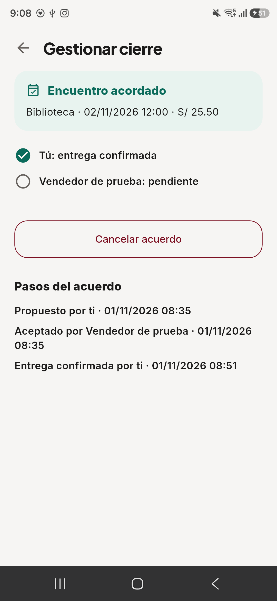
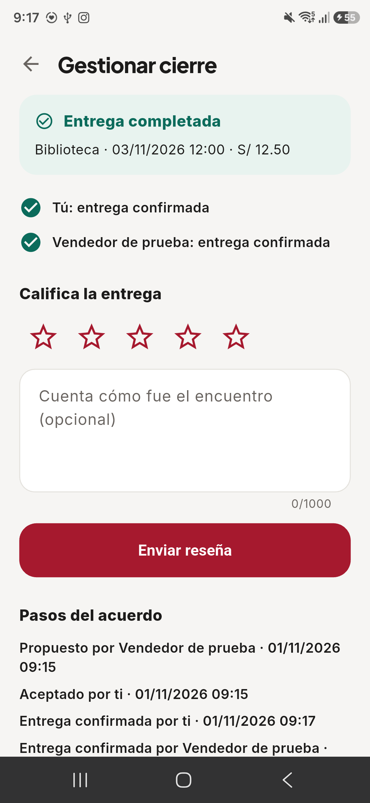

# Auditoría de preparación para lanzamiento — 1 de noviembre de 2026

**Veredicto: NO LANZAR AL MERCADO.** El recorrido principal puede completarse con datos de prueba y se corrigieron fallos reales de la experiencia. Se pueden continuar pruebas controladas con datos ficticios; todavía faltan funciones, decisiones y evidencia para abrir el servicio a usuarios sin acompañamiento. Cada requisito de salida se considera cumplido únicamente con evidencia de funcionamiento y operación. Un requisito sin comprobar se mantiene abierto.

Esta revisión continúa el corte 0.8.0 y la instalación Firebase confirmada por su titular. No es una auditoría independiente, una prueba de penetración ni una validación con participantes. No reemplaza las entrevistas ni las auditorías académicas pendientes. Los resultados de needfinding no se convierten en validación del producto.

**Alcance y entornos**

- API: código de `develop`, verificación Maven y dos smokes HTTP contra PostgreSQL y Mailpit desechables en Docker. No se modificó la API durante esta revisión.
- Web: pruebas unitarias, compilación, exclusión de previews y 220 E2E sobre el paquete estático servido por la API local. Incluyen nueve escenarios con API real repetidos en dos tamaños de ventana; los demás controlan respuestas para comprobar estados y errores.
- Android: Samsung SM-S938B, Android 16, paquete `pe.edu.upc.upcx_mobile.qa`. Primero se probó el APK Firebase `1.0.0-qa (2)` y después una actualización local firmada `1.0.0-qa (3)` contra `https://upcx-staging.onrender.com`, conservando la sesión. El código y los artefactos se identifican en el [registro verificable](resultados-lanzamiento-2026-11-01.json).
- Landing: inspección de contenido y pruebas en Chromium, ES/EN, 1440 y 390 px. Producción: solo lecturas de salud y de rutas públicas; no se crearon cuentas ni transacciones allí.
- El titular introdujo su correo y OTP directamente en el teléfono. La contraparte, avisos, mensajes, imágenes, constancias y reseñas de los recorridos fueron datos de prueba claramente identificados. No hubo una compraventa ni un pago real.

**Recorridos y resultado**

| Recorrido | Evidencia de esta revisión | Resultado dentro del alcance probado |
|---|---|---|
| Acceso institucional con OTP | Titular completó el acceso en el APK Firebase y se observó el catálogo con sesión | Bien hecho en ese intento; no mide entregabilidad para todos los estudiantes |
| Catálogo vacío y búsqueda sin coincidencias | Fallo reproducido en Samsung y en prueba Flutter; mensaje y CTA diferenciados tras corregir | Bien hecho en QA corregida |
| Publicar con imagen | Samsung: datos, categoría, condición, campus, selector Android, portada, vista previa, envío y aviso consultable por la contraparte | Bien hecho en el recorrido probado |
| Guardados, detalle y contacto | Samsung: guardar, abrir desde guardados, contactar y enviar mensaje; respuesta de contraparte persistida | Bien hecho en el recorrido probado |
| Edición, retiro, estados, filtros y oferta continua | Smoke HTTP y escenarios E2E con API local, imágenes y cuentas sintéticas | Bien hecho en esas pruebas; no se repitió cada variante en Samsung |
| Propuesta y aceptación bilateral | Samsung como comprador y como vendedor; la contraparte ejecutó su parte por API staging | Bien hecho en los dos recorridos controlados |
| Constancia privada | Selector Android y carga desde Firebase; acceso de contraparte HTTP 200; control de terceros en suites locales | Bien hecho en el alcance probado; no certifica una transferencia |
| Constancia actualizada con pantalla abierta | El APK distribuido por Firebase conservaba el estado anterior. En QA corregida apareció una constancia enviada por la contraparte sin reabrir; se confirmó recepción desde el teléfono | Bien hecho después de corregir |
| Cierre bilateral y reseña | Una confirmación mantuvo `agreed/reserved`; la segunda produjo `completed/sold`. Samsung actualizado mostró el cambio sin navegar y permitió enviar una reseña | Bien hecho después de corregir |
| Cancelación, inasistencia, concurrencia e historial | Smokes y E2E locales: reserva exclusiva, revisiones obsoletas, reintentos, ventana de inasistencia y acceso al historial | Bien hecho en esas pruebas; no se simuló una inasistencia real de personas |
| Red lenta, respuesta incompleta y recuperación | Regresiones de HTTP detenido, cancelación, error y conservación de borradores; suites locales web/móvil | Bien hecho en pruebas controladas; no demuestra servicio disponible continuamente |
| Ayuda, soporte y rutas públicas | E2E locales y seis rutas públicas de producción en Chromium móvil, incluida ruta inexistente con pantalla de recuperación | Bien hecho para navegación/recepción; no demuestra que un operador responda una solicitud |

**Fallos encontrados y correcciones**

| ID | Problema y efecto para el cliente | Corrección y comprobación |
|---|---|---|
| CX-01 | El catálogo nativo vacío decía «Sin resultados» y sugería cambiar una búsqueda inexistente | Estado sin inventario y acción «Publicar un aviso»; regresión falló antes y pasó después; observado en Samsung actualizado |
| CX-02 | Comprobante y cierre podían quedar pendientes durante minutos después de actuar la contraparte | Actualización cada cinco segundos mientras la pantalla está visible y en primer plano, actualización al reanudar y protección frente a respuestas antiguas de comprobantes. Regresiones y recorrido físico con dos partes |
| CX-03 | El límite HTTP móvil cubría encabezados, pero un cuerpo detenido podía dejar esperando al cliente. La web no tenía un límite completo | Límite y cancelación de la respuesta completa, sin reintentar escrituras automáticamente ni borrar la sesión; pruebas con cuerpo detenido fallaron antes y pasaron después |
| CX-04 | La web podía tratar un HTTP exitoso con JSON inválido como un resultado vacío | Error explícito de respuesta no confirmada, con texto ES/EN y regresión |
| CX-05 | Ayuda/privacidad web negaba edición de perfil y configuración de teléfono que sí existen; Android no ofrecía información pública antes del acceso | Texto web corregido y pantalla Android pública, disponible sin conexión, accesible desde acceso y perfil. Es información del piloto y no una política definitiva aprobada |
| CX-06 | La landing mostraba opiniones ficticias atribuidas a personas con cinco estrellas, llamaba «demo» al prototipo Figma, prometía en su FAQ reportar conversaciones y presentaba como vigentes términos con funciones no verificadas | PR con ejemplos hipotéticos, sin calificaciones ni testimonios atribuidos, «Ver prototipo móvil» en sus tres botones, FAQ corregida y términos ES/EN identificados como borrador y ajustados a las funciones actuales, incluida la falta de eliminación de cuenta en las aplicaciones. Revisado en dos anchos. No aprueba una política definitiva y sigue pendiente de integrar en `main`. Los wireframes y mock-ups del capítulo IV conservan la versión de diseño |
| CX-07 | Si la primera carga de comprobantes fallaba, el aviso de conexión seguía visible junto a los datos ya recuperados | Error de carga separado del error de una operación, limpieza tras una lectura correcta y carga inicial sin solaparse con el refresco. La regresión falló antes y pasó después; un refresco no oculta una respuesta rechazada. Integrado por [PR 21](https://github.com/UPC-X/upcx-mobile/pull/21); no se instaló en el Samsung ni se distribuyó por Firebase |
| CX-08 | El aviso móvil «Sin conexión con UPC-X» prometía cerca de un minuto si el servidor estaba inactivo; en staging se midieron más de dos | Texto ES/EN ajustado a «hasta tres minutos» por [PR 22](https://github.com/UPC-X/upcx-mobile/pull/22). No cambia el límite de espera ni resuelve la suspensión |

Se reforzaron además la validación del correo y las guardas ante envíos repetidos en acceso/verificación. La prueba de envío por teclado ya pasaba antes: se registra como prevención, no como fallo observado.

El primer E2E completo de desarrollo terminó con 231 casos correctos y uno fallido: el selector «Publicar aviso» encontraba dos enlaces legítimos cuando el catálogo estaba vacío. Se corrigió el selector para usar la navegación del marketplace. El fallo era de la prueba, no una publicación duplicada. La corrida final del paquete desplegable pasó 220/220; excluye doce pruebas de previews que solo existen en desarrollo. Estos totales pertenecen a ejecuciones distintas. La corrida empaquetada precede al último ajuste de traducciones de errores web; ese ajuste posterior aprobó de nuevo las pruebas unitarias, compilación y CI. No se atribuye retrospectivamente a la corrida empaquetada el SHA del último commit.

**Evidencia física seleccionada**

El APK Firebase conservaba «Vendedor de prueba: pendiente» después de completarse el acuerdo en el servidor:

Se repitió el recorrido con otro aviso ficticio en QA corregida. La segunda confirmación actualizó la pantalla abierta a «Entrega completada» y habilitó la reseña. Es una nueva transacción de prueba, no una edición de la captura anterior:

Las capturas con correo, alias personal o galería del teléfono quedan fuera del repositorio. No se publican OTP, sesiones, credenciales ni datos de estudiantes. Las capturas anteriores muestran únicamente la contraparte de prueba y condiciones ficticias.

**Pruebas ejecutadas**

| Capa | Resultado final | Límite de la evidencia |
|---|---|---|
| API, Maven/JDK 21 | 216 pruebas; cero fallos, errores y omitidas; `verify` correcto | Código revisado sin cambios de API; no equivale a pentest |
| Smokes HTTP | Core y MVP correctos con PostgreSQL/Mailpit locales | No ejecutados contra producción |
| Web unitaria | 337 pruebas en 43 archivos | Incluye regresiones de esta revisión |
| Web E2E empaquetada | 220 correctas, dos tamaños, un worker y sin reintentos | API real local habilitada; casos restantes con respuestas controladas |
| Web entrega | Formato, compilación y exclusión de previews correctos | Aún requiere promoción de una nueva entrega integrada |
| Flutter | 146 pruebas en la revisión final y 148 tras CX-07 y CX-08, en local y en CI; análisis sin incidencias; formato correcto | No sustituye a pruebas de accesibilidad ni a una matriz de equipos |
| Android físico | OTP, catálogo, guardados, chat, publicación con foto, acuerdo, constancia, cierre y reseña | Un Samsung/Android 16; contraparte controlada por API; no aceptación autónoma de participantes |
| Landing | Cuatro pruebas de soporte y revisión Chromium ES/EN a 1440/390 px, repetidas sobre la cabecera del PR 2 | Verificación de contenido, imágenes, CTA, enlaces, ausencia de error JS y desbordamiento; no estudio de conversión |

Para reproducir: API `./mvnw verify`; web `npm test`, `npm run build`, `node scripts/check-preview-build.mjs` y `UPCX_LIVE_API=1 UPCX_PACKAGED_WEB_ORIGIN=http://127.0.0.1:8080 MAILPIT_URL=http://127.0.0.1:8025 npm run test:e2e -- --workers=1 --retries=0` con API, PostgreSQL y Mailpit desechables. Flutter: `flutter analyze`, `flutter test`, formato y compilación QA con origen staging explícito. Landing: `node --test tests/support.test.cjs`. Nunca apuntar los smokes o E2E de escritura a producción.

**Qué impide lanzar al mercado**

| Prioridad / ID | Estado estricto y efecto para el cliente | Condición verificable para cerrar |
|---|---|---|
| P0 / M-01 Protección ante abuso | **No cumple.** Hay reporte de avisos, pero no un recorrido completo de reporte de usuario/mensaje ni bloqueo entre usuarios. Un usuario acosado no tiene control suficiente | Bloquear/desbloquear y denunciar desde chat/perfil; API aplica la restricción a nuevos contactos y mensajes; se prueba con dos cuentas, acceso directo, historial y acuerdos abiertos; contenido/usuarios denunciados llegan a un responsable |
| P0 / M-02 Moderación y soporte operados | **No demostrado.** La recepción del reporte y el estado de revisión existen; no se verificó atención, decisión, respuesta y cierre por un operador. Un número de ticket no resuelve un problema | Responsable real asignado, cola privada, permisos y trazabilidad; ensayo de denuncia y soporte hasta resolución notificada; tiempos de atención definidos y medidos sin prometer atención inmediata |
| P0 / M-03 Control de cuenta y datos | **No cumple.** Falta una ruta comprobada para solicitar eliminación de cuenta y datos desde app y web | Entrada visible en perfil y recurso web accesible sin reinstalar; identidad verificada, tratamiento de acuerdos/datos a conservar, invalidación de sesiones y finalización comprobada. Puede ser un proceso manual verificable; no se exige que toda eliminación sea instantánea |
| P0 / M-04 Política y aceptación coherentes | **No cumple.** Web declara un borrador y tiene casilla de aceptación. En el corte anterior de la landing se presentaban términos vigentes y funciones de reporte/moderación no expuestas por la implementación: el PR 2 corrige esas afirmaciones en su propuesta, todavía sin publicar. Falta política definitiva común y aceptación nativa comprobable antes de publicar contenido; no se conserva versión aceptada en servidor | Equipo aprueba, con asesoría legal sobre la Ley 29733, responsable, contacto, finalidad, conservación/eliminación y reglas de contenido. Misma versión accesible en web/móvil/landing; aceptación previa a UGC y registro verificable de versión/fecha. La información del piloto y el borrador corregido no cierran este requisito |
| P0 / M-05 Primer acceso y capacidad del servicio | **No cumple.** El cupo de correo documentado es de 100 al día y 3.000 al mes, compartido con staging: según el código, al agotarse la API responde que no pudo enviar el código y nadie más lo recibe para registrarse, entrar desde la app o recuperar su contraseña. Staging, en plan Free, tarda más de dos minutos en despertar y la app corta cada solicitud a los 20 s. Producción no mostró esa suspensión en las lecturas del 1/11, pero `render.yaml` conserva `plan: free`, su plan real no se confirmó y Render desaconseja Free en producción (detalle abajo) | Confirmar el plan real de la API y garantizar una instancia sin suspensión. Contratar un cupo de correo proporcional a la apertura. Medir acceso/OTP después de inactividad y bajo carga representativa, con criterio de tiempo acordado; ensayar alerta, recuperación y restauración de datos/objetos de producción |
| P1 / M-06 Avisos con la app cerrada | **No cumple como experiencia de marketplace.** Existen notificaciones dentro de la app y consulta periódica; falta entrega push/background de mensajes y cambios críticos. El estudiante puede perder una respuesta o encuentro | Aviso de nuevo mensaje, cambio/cancelación de encuentro y respuesta a constancia con app en segundo plano/cerrada; permisos, preferencias, privacidad en pantalla bloqueada y enlace al acuerdo correcto probados en Android real. No es una exigencia de Play sobre push: es criterio de experiencia de este producto |
| P1 / M-07 Aceptación y accesibilidad | **No demostrado.** Los recorridos fueron asistidos/controlados; no hay evidencia de usuarios completándolos solos. No se completó TalkBack ni un recorrido integral con texto ampliado en la entrega actual, otra versión Android o aceptación web con OTP real. La revisión del 27/10 sí comprobó y corrigió opciones de publicación al 200 % | Participantes compradores y vendedores completan tareas críticas sin guía, con consentimiento y registro de errores/recuperación. Verificar TalkBack, texto grande, foco/teclado y permisos cancelados; repetir en otro equipo y navegador. Fijar criterios antes de medir; no rellenar resultados ausentes |
| P1 / M-08 Entrega pública final | **No cumple.** Los arreglos de esta auditoría no forman parte del binario Firebase anterior ni de producción 0.8.0. Los flujos no compilan Android App Bundle, el repositorio no registra cuenta ni ficha de Google Play y la [revisión heurística](auditoria-heuristica.md) deja la publicación en tienda fuera de esta versión. La landing no ofrece descarga y `upcx.tech` no resuelve en DNS público (`www` tampoco existe): quien escribe el dominio de la marca no encuentra nada | Integrar cambios con CI, candidato con SHA exactos, nueva QA por Firebase y aceptación de esa entrega. Crear cuenta de Play, compilar y firmar el AAB, completar ficha, Seguridad de datos y canal de soporte coherentes; si la cuenta es personal y nueva, superar la prueba cerrada exigida antes de solicitar producción. Servir la landing desde el dominio y enlazar la descarga. Luego aprobar y ejecutar promoción y publicación con posibilidad de recuperación |
| P1 / M-09 Errores visibles para el equipo | **No cumple.** API, web y móvil no incorporan reporte de errores ni telemetría de aplicación, y el [runbook](https://github.com/UPC-X/upcx-api/blob/6258c8abc2275cfc42b8d714733b922fd31b08e1/docs/release-runbook.md) reconoce que no hay alertas por errores o latencia. Render avisa de fallos de despliegue, no de un cliente que falla o de un código que no se puede enviar. El equipo solo se entera de un problema si alguien escribe a soporte | Reporte de errores en API y clientes sin datos personales, aviso a un responsable y ensayo con un fallo provocado en staging |
| P1 / M-10 Nombre e identificador | **No demostrado.** El producto se llama UPC-X, exige correo `@upc.edu.pe`, declara no ser un servicio oficial de la UPC y su aplicación se identifica como `pe.edu.upc.upcx_mobile`. El repositorio no registra autorización de la universidad. No es una conclusión legal, pero tiene que resolverse antes de publicar: Google Play trata un identificador nuevo como otra aplicación | Autorización escrita de la UPC, o nombre e identificador propios, decididos antes de la primera publicación en tienda |

**Disponibilidad tras inactividad.** Lecturas puntuales del 1/11, solo GET. La inactividad cuenta únicamente las solicitudes de esta revisión, no las de terceros.

| Hora (UTC) | Entorno y lectura | Inactividad | Resultado |
|---|---|---|---|
| ≈13:21 | Staging, readiness | Desconocida | Agotó 90 s |
| ≈13:23 | Producción, readiness | Desconocida | HTTP 200 en 1,42 s |
| 21:10 | Staging, readiness | Horas | HTTP 200 en 124,8 s; la siguiente, 0,23 s |
| 21:12 | Producción, readiness | Horas | HTTP 200 en 1,38 s; la siguiente, 0,19 s |
| 21:31 | Producción, navegador sin sesión | 18 min | En blanco a los 3 s; `/auth/me` terminó a los 9,5 s y a los 10 s se veía el acceso. Sin pantalla de Render |
| 21:36 | Staging, navegador sin sesión | 23 min | Pantalla de carga de Render, con HTTP 503, hasta unos 130 s; después, el acceso |
| 21:41 | Producción, navegador sin sesión | 6 min | Texto utilizable a los 2,6 s |
| 22:05 | Producción, navegador sin sesión | 24 min | HTML a los 3 s, `/auth/me` terminó a los 5 s y texto utilizable a los 5,2 s. Sin pantalla de Render |

Staging confirma la suspensión de Render Free, y su primer acceso supera con holgura los límites de los clientes: 20 s por solicitud en móvil (30 s en subidas) y 30 s en web. En el navegador se ve la pantalla de carga de Render, que incluye su publicidad; en la app, la solicitud se corta a los 20 s. Con web y API separadas, como en producción, una API suspendida agotaría los 30 s de la web; no se observó. Producción no repitió ese comportamiento, lo que no prueba que no se suspenda: el tráfico de terceros pudo mantenerla activa y su plan no se consultó en el panel. La causa de los 9,5 s de las 21:31 no se determinó. Estas lecturas no permiten derivar un SLO. Render documenta la suspensión a los 15 minutos, la suspensión de todos los servicios Free del workspace al agotar 750 horas mensuales, y pide no usarlos en aplicaciones de producción; se debe resolver este riesgo con una decisión de infraestructura y evidencia de acceso, no ocultarlo ampliando indefinidamente el indicador de carga. [Render Free](https://render.com/docs/free), [cuotas de Resend](https://resend.com/pricing).

**Para las entrevistas en staging:** abrir el servicio unos tres minutos antes de cada sesión, para no registrar la suspensión de la infraestructura como un fallo de la tarea observada.

Para Google Play, la creación de cuentas requiere una vía de solicitud de eliminación en la app y un recurso web. Su política de UGC exige términos aceptados, moderación y reporte; para interacción individual requiere bloqueo de usuarios. Las apps nuevas deben publicarse con Android App Bundle y las cuentas personales creadas después del 13/11/2023 necesitan una prueba cerrada con al menos 12 verificadores durante 14 días continuos antes de solicitar producción; la documentación de Android indica que no se cambie el identificador tras publicar. Estas fuentes respaldan M-01/M-03/M-04/M-08/M-10, pero esta revisión no certifica cumplimiento legal ni aprobación por la tienda. [Eliminación de cuentas](https://support.google.com/googleplay/android-developer/answer/13327111?hl=es), [contenido generado por usuarios](https://support.google.com/googleplay/android-developer/answer/9876937?hl=es), [Android App Bundle](https://developer.android.com/guide/app-bundle), [prueba de cuentas personales](https://support.google.com/googleplay/android-developer/answer/14151465?hl=es), [identificador de aplicación](https://developer.android.com/build/configure-app-module).

**Referencias de implementación para los requisitos abiertos**

- M-01/M-02: el [controlador de soporte](https://github.com/UPC-X/upcx-api/blob/6258c8abc2275cfc42b8d714733b922fd31b08e1/src/main/java/pe/edu/upc/upcx/support/interfaces/rest/SupportController.java) registra reportes de avisos. El [contrato](https://github.com/UPC-X/upcx-api/blob/6258c8abc2275cfc42b8d714733b922fd31b08e1/docs/openapi.json) describe un marcador de revisión, sin retiro ni sanción automáticos. No expone bloqueo, reporte específico de usuario/mensaje ni resolución administrativa. Esto no descarta atención manual externa; su funcionamiento no quedó demostrado.
- M-03/M-04: [RegisterResource](https://github.com/UPC-X/upcx-api/blob/6258c8abc2275cfc42b8d714733b922fd31b08e1/src/main/java/pe/edu/upc/upcx/iam/interfaces/rest/resources/RegisterResource.java) recibe nombre, correo y contraseña; la casilla web no transmite versión/fecha de aceptación. Los [textos web](https://github.com/UPC-X/upcx-web/blob/b91bd261054f96fc4d5cd1257372c8b9e842e6b8/src/i18n/helpTermsMessages.ts) declaran borrador y falta de eliminación. Los [términos de la landing](https://github.com/UPC-X/Landing-Page/blob/9bcb4af42eb3990b2a254973862d87606f88188e/terminos.html) declaran vigencia y una vía de solicitud por contacto: esa mención no demuestra su resolución operativa.
- M-05: [límite móvil](https://github.com/UPC-X/upcx-mobile/blob/b357c52d8fb6ae4e503f524bc362897762d4c016/lib/core/api/upcx_api.dart), [límite web](https://github.com/UPC-X/upcx-web/blob/b95b3f365a9f1037e90ca8dafb01f305356624c5/src/services/apiClient.ts), [plan versionado](https://github.com/UPC-X/upcx-api/blob/6258c8abc2275cfc42b8d714733b922fd31b08e1/render.yaml), [envío de correo](https://github.com/UPC-X/upcx-api/blob/6258c8abc2275cfc42b8d714733b922fd31b08e1/src/main/java/pe/edu/upc/upcx/iam/infrastructure/mail/ResendOtpMailer.java) y [cuotas consultadas](activacion-pendiente.md). Al superar el cupo, Resend responde [HTTP 429](https://resend.com/docs/api-reference/errors); la API lo convierte en «No se pudo enviar el código. Inténtalo de nuevo en unos minutos», aunque el [cupo diario](https://resend.com/docs/knowledge-base/account-quotas-and-limits) no se renueva hasta la medianoche UTC. No se agotó el cupo para comprobarlo en vivo.
- M-06: las [notificaciones móviles](https://github.com/UPC-X/upcx-mobile/blob/b3eb176ad2e9b97d81ea6ead54be4129716a5ea5/lib/features/notifications/notifications_screen.dart) consultan datos al estar en primer plano. El [manifiesto Android](https://github.com/UPC-X/upcx-mobile/blob/b3eb176ad2e9b97d81ea6ead54be4129716a5ea5/android/app/src/main/AndroidManifest.xml) y las [dependencias](https://github.com/UPC-X/upcx-mobile/blob/b3eb176ad2e9b97d81ea6ead54be4129716a5ea5/pubspec.yaml) no configuran entrega push; tampoco hay registro de tokens de dispositivo en el contrato revisado. Firebase App Distribution distribuye el APK y no acredita notificaciones de mensajes con la app cerrada.

**Orden de salida**

Primero cerrar M-01 a M-05 con decisiones reales sobre operación y tratamiento de datos. Después comprobar M-06/M-07/M-09 con la entrega candidata y participantes. Finalmente ejecutar M-08 sobre los mismos SHA aceptados, con M-10 ya resuelto. Un resultado de prueba local o una instalación Firebase no cambia por sí solo el veredicto de mercado.

| Tipo de trabajo | Requisitos |
|---|---|
| Decisiones de los titulares, antes de programar | Responsable de moderación y soporte (M-02), política y tratamiento de datos (M-04), infraestructura y cupo de correo (M-05), cuenta de tienda (M-08), nombre e identificador (M-10) |
| Desarrollo en API, web y móvil | Bloqueo y denuncias (M-01), cola de moderación (M-02), eliminación de cuenta (M-03), aceptación versionada (M-04), avisos con la app cerrada (M-06), reporte de errores (M-09) |
| Validación y entrega | Participantes y accesibilidad (M-07), promoción, QA y tienda (M-08) |

Las correcciones web y móvil quedaron integradas en `develop` por [PR 32](https://github.com/UPC-X/upcx-web/pull/32), [PR 20](https://github.com/UPC-X/upcx-mobile/pull/20), [PR 21](https://github.com/UPC-X/upcx-mobile/pull/21) y [PR 22](https://github.com/UPC-X/upcx-mobile/pull/22), con CI aprobado para sus respectivos commits antes de fusionar. La landing queda propuesta en [PR 2](https://github.com/UPC-X/Landing-Page/pull/2), porque su rama destino es `main`, que publica en GitHub Pages. Los SHA y runs se registran por separado del APK local y de producción. Esta auditoría se prepara desde `develop` del informe. El borrador del capítulo VIII permanece separado en [PR 25](https://github.com/UPC-X/report-UPC/pull/25) y no se incorpora a `develop`.

## Nota posterior del 2 de noviembre de 2026 sobre M-05

Esta nota no cambia el veredicto ni cierra M-05. Al revisar el cupo de correo se encontró que parte del consumo era evitable:

- La app entraba solo con un código por correo y la sesión duraba 12 horas, de modo que cada estudiante activo gastaba un correo por cada entrada tras vencer.
- Staging compartía con producción el cupo de la misma cuenta de Resend.

El [PR 44 de la API](https://github.com/UPC-X/upcx-api/pull/44), el [PR 25 de la app](https://github.com/UPC-X/upcx-mobile/pull/25) y el [PR 35 de la web](https://github.com/UPC-X/upcx-web/pull/35) lo corrigen. Están integrados en `develop` y sin desplegar en producción:

- La app entra con contraseña, sin enviar correo, y su sesión dura 30 días desde el último uso. La web sigue en 12 horas.
- Cada cuenta recibe como máximo cinco códigos al día, y cada conexión puede hacer 30 solicitudes por hora de las que envían correo.
- Staging deja sus correos en su log, sin gastar cupo ni llegar a un buzón real.

Con esto, los 100 correos al día limitan las altas y recuperaciones nuevas de cada día, ya no a los estudiantes activos. Sigue abierto medir el primer acceso y el uso tras inactividad, comprobar la entrega real en un buzón UPC y decidir qué hacer si las altas superan el cupo.

## Revisión móvil del 2 de noviembre de 2026

La revisión continuó en el Samsung SM-S938B con Android 16 y la QA (7), con cuentas, avisos, mensajes e imágenes sintéticos en staging. El ajuste de densidad del [PR 28](https://github.com/UPC-X/upcx-mobile/pull/28) ya estaba integrado: margen de 16 dp, barra de 60 dp y primer aviso aproximadamente al 28 % de la altura, frente al 38 % anterior. El «+» se comprobó centrado horizontalmente y con etiqueta accesible, aunque sin texto visible. No se modificaron los ajustes de tamaño del teléfono.

El recorrido encontró fallos adicionales, corregidos en el [PR 29](https://github.com/UPC-X/upcx-mobile/pull/29):

- Inicio y Chats conservaban datos anteriores al regresar. Ahora consultan al entrar a la pestaña y al volver del detalle; el catálogo conserva las páginas visibles y la posición de desplazamiento si falla la conexión, y divide las consultas que superan 100 avisos.
- El detalle solo mostraba la portada. Ahora permite recorrer todas las fotos, con contador centrado, desplazamiento horizontal y botones con etiquetas accesibles.
- El teclado recuperaba el foco al volver al chat o al cerrar el diálogo de evidencia. La navegación libera el foco y conserva los borradores. La confirmación de entrega incorpora un diálogo que explica su efecto irreversible antes de enviarla.
- Se ajustaron alineación de estrellas y fechas, estados sin una nueva propuesta posible, acciones de Mis avisos, ancho y radios de desplegables, tarjetas de historial, columnas de fotos, insignias y plurales de reputación.
- Republicar incorpora regreso desde el formulario; volver a Publicar reinicia una publicación terminada y conserva una que todavía está en borrador. La etiqueta accesible del «+» sigue el idioma elegido.

**Comprobación técnica y física.** Pasaron 247 pruebas Flutter, formato, análisis y compilación del cliente HTTP Dart. Las pruebas incluyen respuestas fuera de orden, catálogo de más de 100 avisos, galería y confirmación de entrega, conservación del borrador sin reapertura del teclado y cambio de idioma. La matriz de 360×640 y 384×832, texto hasta 200 % y español/inglés abre realmente el detalle: se corrigió una prueba anterior que podía tocar debajo de la barra sin navegar.

Una compilación temporal de depuración, conectada explícitamente a staging, permitió repetir en el Samsung la galería de dos fotos con título y descripción extensos, el botón fijo de contacto, la actualización inmediata de Chats y sus contadores, el retorno al chat con borrador y teclado cerrado, y la cancelación del diálogo de entrega sin registrar confirmaciones. También se republicó un aviso con sus dos fotos existentes, se comprobó su aparición en Inicio y se pausó y reactivó desde Mis avisos. También se comprobaron los plurales con una operación y una valoración, la conservación de una publicación en borrador al cambiar de pestaña y el enlace de uso y privacidad en inglés; la etiqueta accesible del «+» cambió a «Publish». Las cuentas y operaciones fueron sintéticas; la contraparte actuó por la API de staging.

Esta revisión es un recorrido técnico controlado. No equivale a aceptación con participantes, una comprobación integral con TalkBack, una segunda versión de Android ni una autorización para publicar en producción. El veredicto y los requisitos de salida abiertos se conservan.
